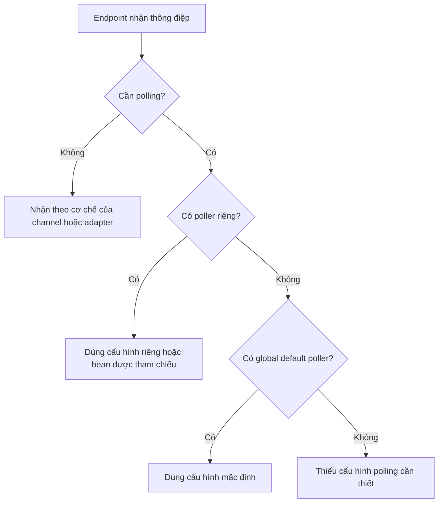

# Global poller

Trong module **SPRING_INTEGRATION_CORE**, global poller là cấu hình polling mặc định giúp nhiều endpoint dùng chung chính sách lấy thông điệp mà không phải lặp lại cấu hình lịch chạy. Chủ đề này thuộc chương **Cấu hình và lifecycle**: lựa chọn poller quyết định khi nào endpoint nhận việc, mỗi lượt nhận bao nhiêu thông điệp và luồng xử lý sử dụng tài nguyên thực thi ra sao.

Sau bài học, bạn có thể khai báo poller mặc định, xác định endpoint nào sử dụng nó, đặt cấu hình riêng cho một endpoint và kiểm tra hành vi khi endpoint dừng hoặc khởi động lại. Ví dụ sử dụng các API có trong Spring Integration 6.x với Spring Framework 6 và Java 17 trở lên; phiên bản thư viện cụ thể nên do BOM tương thích của dự án quản lý.

## 1. Vấn đề mà global poller giải quyết

Giả sử một ứng dụng nhận đơn hàng qua gateway rồi đưa `Message<String>` vào `QueueChannel`. Một transformer chuẩn hóa mã đơn, sau đó một endpoint khác bổ sung trạng thái. Do channel có hàng đợi, cần có thành phần chủ động lấy thông điệp ra để chuyển cho handler.

Nếu mọi endpoint đều tự khai báo chu kỳ 200 ms, giới hạn 5 thông điệp mỗi lượt và thời gian chờ nhận bằng 0, cấu hình bị lặp lại. Khi muốn thay đổi chính sách chung, người phát triển phải tìm từng endpoint và dễ bỏ sót.

Global poller cung cấp một mặc định cho trường hợp này. Trong Java configuration, đó là bean `PollerMetadata` được đăng ký với tên `PollerMetadata.DEFAULT_POLLER`. Endpoint cần polling và không khai báo poller riêng sẽ sử dụng cấu hình đó. Phạm vi được xét ở đây là các endpoint trong cùng `ApplicationContext`. [Quy tắc global default poller](https://docs.spring.io/spring-integration/reference/endpoint.html#global-default-poller).

Tên “global” nói đến phạm vi lựa chọn cấu hình mặc định. Mỗi polling endpoint vẫn là một thành phần hoạt động riêng; giới hạn 5 thông điệp được tính cho từng lượt poll của từng endpoint.

## 2. Endpoint nào cần poller?

Spring Integration phân biệt nhận thông điệp từ một `PollableChannel`, chẳng hạn `QueueChannel`, với nhận thông điệp qua cơ chế đăng ký của `SubscribableChannel`, chẳng hạn `DirectChannel`. Trường hợp đầu sử dụng `PollingConsumer`; trường hợp sau thường sử dụng `EventDrivenConsumer`. Ngoài ra, `SourcePollingChannelAdapter` gọi một `MessageSource` theo lịch để đưa dữ liệu vào flow. [Mô hình polling consumer và message source](https://docs.spring.io/spring-integration/reference/polling-consumer.html).

| Thành phần hoặc tình huống | Cách nhận việc | Vai trò của global poller |
| --- | --- | --- |
| Transformer nhận từ `QueueChannel` | Endpoint lấy message từ queue | Dùng mặc định nếu không có poller riêng |
| Service activator nhận từ `QueueChannel` | Endpoint lấy message rồi gọi handler | Dùng mặc định nếu không có poller riêng |
| `SourcePollingChannelAdapter` | Gọi `MessageSource.receive()` theo lịch | Có thể dùng poller mặc định |
| Transformer nhận từ `DirectChannel` | Channel gọi subscriber khi có message | Không cần poller |
| Gateway gửi vào một channel | Gửi request hoặc chờ reply theo hợp đồng gateway | Polling, nếu có, thuộc endpoint ở phía sau |
| `QueueChannel` đứng một mình | Lưu trữ message đang chờ | Không tự tạo lịch xử lý |

Có thể đọc quy tắc lựa chọn theo sơ đồ sau:



Khi chẩn đoán một flow, hãy nhìn vào **input channel của endpoint đang xét**. Việc một flow có `QueueChannel` ở vị trí khác không có nghĩa mọi handler trong flow đều cần poller.

## 3. Ví dụ hoàn chỉnh bằng Java configuration và Java DSL

Ví dụ dưới đây có hai polling endpoint:

```text
orders                  normalizedOrders                 orderResults
QueueChannel            QueueChannel                     QueueChannel
     │                        │                               ▲
     └─ normalizeOrders ──────┘─ labelOrders ──────────────────┘
          dùng mặc định           dùng mặc định
```

`orders` nhận mã đơn thô. `normalizeOrders` loại khoảng trắng và chuyển thành chữ hoa. `labelOrders` thêm tiền tố `accepted:`. Hàng đợi cuối dùng để quan sát kết quả trong ví dụ và kiểm thử.

Đặt lớp sau trong mã nguồn ứng dụng đã có dependency `spring-integration-core` cùng các dependency Spring tương thích:

```java
import java.time.Duration;
import java.util.Locale;

import org.springframework.context.annotation.Bean;
import org.springframework.context.annotation.Configuration;
import org.springframework.integration.channel.QueueChannel;
import org.springframework.integration.config.EnableIntegration;
import org.springframework.integration.dsl.IntegrationFlow;
import org.springframework.integration.scheduling.PollerMetadata;
import org.springframework.scheduling.support.PeriodicTrigger;

@Configuration
@EnableIntegration
public class GlobalPollerConfig {

    @Bean(name = PollerMetadata.DEFAULT_POLLER)
    public PollerMetadata defaultPoller() {
        PeriodicTrigger trigger =
                new PeriodicTrigger(Duration.ofMillis(200));
        trigger.setFixedRate(false);

        PollerMetadata metadata = new PollerMetadata();
        metadata.setTrigger(trigger);
        metadata.setMaxMessagesPerPoll(5);
        metadata.setReceiveTimeout(0);
        return metadata;
    }

    @Bean
    public QueueChannel orders() {
        return new QueueChannel(100);
    }

    @Bean
    public QueueChannel normalizedOrders() {
        return new QueueChannel(100);
    }

    @Bean
    public QueueChannel orderResults() {
        return new QueueChannel(100);
    }

    @Bean
    public IntegrationFlow normalizeFlow() {
        return IntegrationFlow.from("orders")
                .transform(String.class,
                        text -> text.trim().toUpperCase(Locale.ROOT),
                        endpoint -> endpoint.id("normalizeOrders"))
                .channel("normalizedOrders")
                .get();
    }

    @Bean
    public IntegrationFlow labelFlow() {
        return IntegrationFlow.from("normalizedOrders")
                .transform(String.class,
                        text -> "accepted:" + text,
                        endpoint -> endpoint.id("labelOrders"))
                .channel("orderResults")
                .get();
    }
}
```

Các lệnh `.transform(...)` không chỉ định `.poller(...)`. Hai endpoint nhận từ các queue nên được cấu hình bằng global default poller. ID `normalizeOrders` và `labelOrders` được đặt rõ để có thể truy cập từng endpoint khi kiểm thử hoặc quản lý lifecycle.

Với payload `"  dh-001  "`, kết quả cuối là `"accepted:DH-001"`. Sau khi chuyển message sang `normalizedOrders`, endpoint thứ nhất không quyết định thời điểm endpoint thứ hai nhận message đó: hàng đợi trung gian tạo một ranh giới xử lý riêng.

Các queue trong ví dụ có sức chứa 100. Khi thực hành với nhiều dữ liệu, cần lấy kết quả khỏi `orderResults`; nếu queue đầu ra đầy, thao tác gửi ở phía trước có thể phải chờ hoặc thất bại theo timeout gửi được cấu hình. Sức chứa queue cần được xét cùng tốc độ tiêu thụ của cả flow.

### Viết bean mặc định bằng Pollers DSL

Có thể thay **phương thức `defaultPoller()`** ở trên bằng cách khai báo sau. Thêm import `PollerSpec` và `Pollers` từ package `org.springframework.integration.dsl`:

```java
@Bean(name = PollerMetadata.DEFAULT_POLLER)
public PollerSpec defaultPoller() {
    return Pollers.fixedDelay(Duration.ofMillis(200))
            .maxMessagesPerPoll(5)
            .receiveTimeout(0);
}
```

`PollerSpec` là `FactoryBean` tạo `PollerMetadata`. Khi trả `PollerSpec` trực tiếp từ phương thức `@Bean`, để Spring khởi tạo đối tượng này; không gọi `.getObject()` trong phương thức khai báo bean. Cách viết này cũng giữ đúng quá trình khởi tạo các thành phần phụ do DSL quản lý. [Khai báo poller bằng Java DSL](https://docs.spring.io/spring-integration/reference/dsl/java-pollers.html).

Chọn một trong hai cách khai báo bean mặc định cho ứng dụng. Một bean chỉ có tên phương thức `defaultPoller` nhưng thiếu tên quy ước `PollerMetadata.DEFAULT_POLLER` không trở thành global default poller chỉ nhờ tên phương thức đó. `@Primary` cũng không thay thế vai trò của tên quy ước này.

## 4. Cấu hình riêng và bean poller có tên

Mặc định chung phù hợp khi các endpoint có yêu cầu tương tự. Một tác vụ nhập dữ liệu nặng hoặc bị giới hạn tần suất gọi thường cần chính sách riêng.

### 4.1. Đặt poller trực tiếp trên endpoint

Nếu bước chuẩn hóa chỉ nên nhận một message mỗi lượt và nghỉ 2 giây sau mỗi lượt, thay phương thức `normalizeFlow()` bằng:

```java
@Bean
public IntegrationFlow normalizeFlow() {
    return IntegrationFlow.from("orders")
            .transform(String.class,
                    text -> text.trim().toUpperCase(Locale.ROOT),
                    endpoint -> endpoint
                            .id("normalizeOrders")
                            .poller(poller -> poller
                                    .fixedDelay(Duration.ofSeconds(2))
                                    .maxMessagesPerPoll(1)
                                    .receiveTimeout(0)))
            .channel("normalizedOrders")
            .get();
}
```

Endpoint `labelOrders` vẫn dùng mặc định ban đầu. Việc chỉ định poller cho `normalizeOrders` là lựa chọn một cấu hình riêng cho endpoint đó; không nên hiểu là chỉ thay `fixedDelay` rồi tự kế thừa mọi thuộc tính chưa khai báo từ global poller. Vì vậy, ví dụ ghi rõ cả giới hạn nhận và timeout.

### 4.2. Dùng lại một cấu hình riêng bằng bean

Khi một nhóm endpoint cần chung chính sách đặc biệt, có thể khai báo thêm bean thường:

```java
@Bean
public PollerMetadata slowPoller() {
    PollerMetadata metadata = new PollerMetadata();
    metadata.setTrigger(new PeriodicTrigger(Duration.ofSeconds(2)));
    metadata.setMaxMessagesPerPoll(1);
    metadata.setReceiveTimeout(0);
    return metadata;
}
```

Đưa bean đó vào phương thức định nghĩa flow rồi truyền cho endpoint. Đoạn sau là một cách thay thế khác của `normalizeFlow()`:

```java
@Bean
public IntegrationFlow normalizeFlow(
        @org.springframework.beans.factory.annotation.Qualifier("slowPoller")
        PollerMetadata slowPoller) {

    return IntegrationFlow.from("orders")
            .transform(String.class,
                    text -> text.trim().toUpperCase(Locale.ROOT),
                    endpoint -> endpoint.id("normalizeOrders")
                            .poller(slowPoller))
            .channel("normalizedOrders")
            .get();
}
```

`slowPoller` chỉ được dùng ở nơi tham chiếu đến nó. Việc có thêm bean `PollerMetadata` với tên thông thường không tự thay đổi global default poller. DSL hỗ trợ truyền `PollerMetadata` vào cấu hình consumer endpoint. [API consumer endpoint](https://docs.spring.io/spring-integration/api/org/springframework/integration/dsl/ConsumerEndpointSpec.html).

### 4.3. Tương đương với annotation

Với phương thức thuộc một Spring bean, có thể dùng `@Transformer` như sau. Đây là cách thay thế transformer tương ứng; khi chuyển sang annotation, bỏ endpoint DSL cũ để tránh tạo hai consumer cùng đọc `orders`.

```java
import org.springframework.integration.annotation.Poller;
import org.springframework.integration.annotation.Transformer;

// Thuộc một bean đã đăng ký trong ApplicationContext.
@Transformer(inputChannel = "orders", outputChannel = "normalizedOrders")
public String normalize(String text) {
    return text.trim().toUpperCase(Locale.ROOT);
}

// Biến thể: dùng bean slowPoller thay vì mặc định.
@Transformer(inputChannel = "slowOrders", outputChannel = "normalizedOrders",
        poller = @Poller("slowPoller"))
public String normalizeSlow(String text) {
    return text.trim().toUpperCase(Locale.ROOT);
}
```

Biến thể thứ hai giả định đã có `QueueChannel` tên `slowOrders` và bean `slowPoller`. Giá trị `@Poller("slowPoller")` là **tên bean cấu hình**, không phải tên thread hay channel. Khi dùng cách tham chiếu này, các thuộc tính poller khác được đặt trên bean được tham chiếu. [Annotation `@Poller` và quy tắc sử dụng mặc định](https://docs.spring.io/spring-integration/reference/configuration/annotations.html#using-the-poller-annotation).

## 5. Cách biểu diễn bằng XML

Trong XML, thuộc tính `default="true"` xác định global default poller. Ví dụ độc lập dưới đây chuẩn hóa chuỗi từ một queue sang queue khác:

```xml
<beans xmlns="http://www.springframework.org/schema/beans"
       xmlns:xsi="http://www.w3.org/2001/XMLSchema-instance"
       xmlns:int="http://www.springframework.org/schema/integration"
       xsi:schemaLocation="
         http://www.springframework.org/schema/beans
         https://www.springframework.org/schema/beans/spring-beans.xsd
         http://www.springframework.org/schema/integration
         https://www.springframework.org/schema/integration/spring-integration.xsd">

    <int:poller id="defaultPoller"
                default="true"
                fixed-delay="200"
                max-messages-per-poll="5"
                receive-timeout="0"/>

    <int:channel id="orders">
        <int:queue capacity="100"/>
    </int:channel>

    <int:channel id="normalizedOrders">
        <int:queue capacity="100"/>
    </int:channel>

    <int:transformer id="normalizeOrders"
                     input-channel="orders"
                     output-channel="normalizedOrders"
                     expression="payload.trim().toUpperCase()"/>
</beans>
```

Ở đây transformer không có phần tử con `<int:poller>`, nên sử dụng mặc định. Để tham chiếu một poller thường trong cấu hình XML, dùng `<int:poller ref="slowPoller"/>` bên trong endpoint và khai báo `slowPoller` ở cấp ngoài. Cấu hình XML này là lựa chọn thay thế cho ví dụ Java, không phải phần cần nạp thêm vào cùng context.

## 6. Hiểu đúng các thuộc tính quan trọng

### 6.1. Trigger quyết định thời điểm chạy

| Cách đặt lịch | Ý nghĩa | Tình huống minh họa |
| --- | --- | --- |
| `fixedDelay` | Tính khoảng nghỉ từ khi lượt được lập lịch hoàn tất | Nghỉ một khoảng sau mỗi đợt xử lý |
| `fixedRate` | Tính theo các mốc bắt đầu được lập lịch | Muốn duy trì nhịp lấy việc tương đối đều |
| `cron` | Tính theo biểu thức lịch | Lấy dữ liệu vào các mốc nghiệp vụ |
| `Trigger` tùy chỉnh | Tự tính thời điểm thực thi tiếp theo | Chính sách lịch chuyên biệt |

`PeriodicTrigger` mặc định sử dụng fixed delay; constructor nhận `Duration` làm rõ đơn vị. Initial delay mặc định bằng 0, vì vậy khoảng 200 ms trong ví dụ không có nghĩa lượt đầu tiên luôn phải đợi đủ 200 ms. Thời gian chạy thực tế còn phụ thuộc scheduler và tải hệ thống. [Ngữ nghĩa `PeriodicTrigger`](https://docs.spring.io/spring-framework/docs/6.2.x/javadoc-api/org/springframework/scheduling/support/PeriodicTrigger.html).

Trong ví dụ chính không có executor riêng, lượt polling bao gồm cả việc nhận và xử lý đồng bộ cho đến khi luồng gặp ranh giới bất đồng bộ hoặc hàng đợi khác. Nếu thêm executor cho poller, cần xét lại thời điểm tác vụ được giao cho executor và thời điểm xử lý thực tế hoàn tất.

### 6.2. maxMessagesPerPoll là giới hạn cho một lượt poll

Với giá trị 5, endpoint có thể thực hiện tối đa 5 lần nhận có message trong một lượt; lượt có thể kết thúc sớm khi không còn dữ liệu hoặc khi có lỗi. Giá trị này không đặt số thread, sức chứa queue hay số bản ghi trong payload.

Ví dụ, một message có payload là danh sách 100 đơn vẫn chỉ là một message ở cấp poller. Nếu muốn xử lý từng đơn như một message riêng, cần một splitter hoặc thiết kế nguồn dữ liệu tương ứng.

Khi không khai báo giới hạn, cần phân biệt `PollingConsumer` thường có mặc định `-1` — tiếp tục nhận đến khi không còn message — với `SourcePollingChannelAdapter` thường có mặc định 1. Nếu nguồn luôn trả dữ liệu, cấu hình không giới hạn có thể giữ một lượt chạy rất lâu. Ví dụ của bài đặt rõ 5 để tránh phụ thuộc khác biệt này. [Giới hạn nhận của inbound channel adapter](https://docs.spring.io/spring-integration/reference/channel-adapter.html).

### 6.3. receiveTimeout là thời gian chờ nhận

`receiveTimeout` áp dụng cho thao tác nhận từ `PollableChannel`, đơn vị milliseconds. Giá trị 0 trong ví dụ yêu cầu nhận ngay: queue rỗng thì kết thúc thao tác nhận mà không chờ thông điệp mới. Mặc định của `PollerMetadata` là 1.000 ms. Thuộc tính này không đặt thời hạn chạy cho transformer hoặc một lời gọi HTTP bên trong handler. [API `PollerMetadata`](https://docs.spring.io/spring-integration/api/org/springframework/integration/scheduling/PollerMetadata.html).

Đặt timeout nhận lớn có thể hữu ích với một số mô hình chờ việc, nhưng nhiều endpoint cùng chờ trên queue rỗng sẽ chiếm tài nguyên thực thi. Với `MessageSource` lấy dữ liệu từ hệ thống ngoài, timeout kết nối hoặc đọc dữ liệu phải được xem ở cấu hình của nguồn hoặc client tương ứng.

## 7. Scheduler, executor và ước lượng tốc độ

Scheduler quyết định thời điểm gọi tác vụ polling. Executor, nếu được chỉ định trên poller, là nơi chạy tác vụ được giao. Khi không có executor riêng, việc xử lý của polling endpoint chạy trên thread scheduler; nhiều endpoint có thể cùng sử dụng hạ tầng scheduler đó. Vì vậy, một handler chậm có thể làm giảm khả năng phục vụ các endpoint khác. [Cấu hình task scheduler và executor](https://docs.spring.io/spring-integration/reference/configuration/namespace-taskscheduler.html).

Một phép tính minh họa cho **một endpoint**, với các giả định queue luôn đủ dữ liệu, xử lý tuần tự, không có executor riêng và chi phí nhận không đáng kể:

- Giới hạn mỗi lượt: 5 message.
- Mỗi message mất 40 ms để xử lý.
- Fixed delay: 200 ms.

Một lượt xử lý mất khoảng `5 × 40 = 200 ms`. Sau đó nghỉ khoảng 200 ms, nên thời gian giữa hai lượt bắt đầu khoảng 400 ms. Tốc độ ước lượng là:

```text
5 / (0,2 + 0,2) = 12,5 message/giây
```

Đây là phép tính để hiểu cấu hình, không phải cam kết hiệu năng. Với hai endpoint trong ví dụ, cần đo riêng thời gian xử lý và độ dài queue ở mỗi chặng. Tăng `maxMessagesPerPoll` có thể giúp giải phóng backlog nhanh hơn nhưng cũng kéo dài thời gian một lượt chiếm tài nguyên.

Khi cần executor riêng cho một nhóm endpoint, có thể thêm `.taskExecutor(executor)` vào `PollerSpec`. Kích thước pool và hàng đợi executor cần được đặt cùng với giới hạn của hệ thống đích; không suy ra rằng fixed rate hoặc giới hạn mỗi lượt tự tạo ra một mức đồng thời an toàn.

## 8. Global poller với nguồn dữ liệu chủ động

Không phải mọi poller đều đọc từ `QueueChannel`. Một nguồn dữ liệu có thể trả về message theo lịch, ví dụ một hàng đợi mô phỏng kết quả truy vấn hệ thống ngoài:

```java
import java.util.Queue;
import java.util.concurrent.ConcurrentLinkedQueue;

import org.springframework.integration.core.MessageSource;
import org.springframework.messaging.support.GenericMessage;

// Các phương thức bổ sung cho một lớp @Configuration.
@Bean
public MessageSource<String> pendingOrderSource() {
    Queue<String> pending = new ConcurrentLinkedQueue<>();
    pending.add("  dh-101  ");
    pending.add("  dh-102  ");

    return () -> {
        String next = pending.poll();
        return next == null ? null : new GenericMessage<>(next);
    };
}

@Bean
public IntegrationFlow importOrdersFlow(
        MessageSource<String> pendingOrderSource) {
    return IntegrationFlow.from(pendingOrderSource)
            .channel("orders")
            .get();
}
```

Đoạn mở rộng này giả định đã có `orders` và global poller của ví dụ chính. Nó tạo thêm một source polling endpoint; khi nguồn hết dữ liệu và trả `null`, lượt nhận kết thúc. Global poller cũng có thể cung cấp cấu hình cho endpoint này khi không chỉ định poller riêng.

Nếu thêm đoạn mở rộng vào ứng dụng thử nghiệm, các đơn `dh-101` và `dh-102` sẽ tự được gửi vào flow. Bài kiểm thử ở phần sau chỉ nạp lớp cấu hình chính, vì vậy không có dữ liệu tự sinh này.

Trong một nguồn thực tế, kiểm tra thêm kích thước trang truy vấn hoặc giới hạn fetch của adapter. Năm lần nhận message không nhất thiết tương đương năm lần truy vấn hệ thống đích hoặc năm bản ghi dữ liệu.

## 9. Lifecycle thuộc về endpoint

`PollerMetadata` chứa cấu hình. Việc start/stop được thực hiện trên endpoint sử dụng cấu hình đó. Các polling endpoint có hợp đồng lifecycle của Spring, bao gồm `start()`, `stop()` và `isRunning()`. [API `AbstractPollingEndpoint`](https://docs.spring.io/spring-integration/api/org/springframework/integration/endpoint/AbstractPollingEndpoint.html).

Với context đã khởi tạo từ `GlobalPollerConfig`, có thể quản lý bước chuẩn hóa như sau:

```java
import org.springframework.integration.endpoint.AbstractPollingEndpoint;

AbstractPollingEndpoint endpoint = context.getBean(
        "normalizeOrders", AbstractPollingEndpoint.class);

endpoint.stop();
boolean runningAfterStop = endpoint.isRunning();

// Thực hiện thao tác bảo trì phù hợp với ứng dụng.

endpoint.start();
boolean runningAfterStart = endpoint.isRunning();
```

Khi endpoint chuẩn hóa đã dừng và không còn tác vụ đang thực thi, message mới vẫn có thể được gửi vào `orders` nếu queue còn chỗ. Endpoint gắn nhãn có thể tiếp tục xử lý dữ liệu còn sẵn trong `normalizedOrders`. Vì vậy, dừng một endpoint không đồng nghĩa dừng toàn bộ flow hay chặn mọi nguồn gửi.

Nếu muốn endpoint chưa tự chạy khi context khởi tạo, đặt `.autoStartup(false)` trên cấu hình endpoint tương ứng. Quyết định này tách biệt với việc chọn global poller. Với xử lý đang diễn ra hoặc executor bất đồng bộ, cần phối hợp các tác vụ còn chạy khi bảo trì; không dùng `stop()` như một thao tác rollback nghiệp vụ.

Thay đổi một trường trên bean `PollerMetadata` sau khi context đã tạo endpoint cũng không nên được xem là cơ chế cập nhật động cho mọi endpoint. Khi cần thay đổi lúc chạy, xác định rõ endpoint và API quản lý được hỗ trợ, rồi kiểm tra tác động lên từng endpoint đó.

## 10. Xử lý lỗi khi polling

Trong flow có `QueueChannel`, phía gửi có thể đã gửi xong trước khi transformer chạy. Nếu transformer thất bại ở lượt poll sau, khối `try/catch` bao quanh lần gửi ban đầu không nhận được lỗi xử lý đó. Spring Integration hỗ trợ biểu diễn lỗi bằng `ErrorMessage` và chuyển nó đến error channel phù hợp. Cấu hình mặc định thường sử dụng channel tên `errorChannel`; header `errorChannel` trên message cũng có thể tham gia việc chọn đích nhận lỗi. [Cơ chế xử lý lỗi bất đồng bộ](https://docs.spring.io/spring-integration/reference/error-handling.html).

Nếu muốn các polling endpoint dùng mặc định có chung đích báo lỗi, có thể thay phương thức khai báo poller bằng phiên bản DSL sau và bổ sung error flow:

```java
import org.springframework.integration.channel.DirectChannel;
import org.springframework.integration.dsl.PollerSpec;
import org.springframework.integration.dsl.Pollers;
import org.springframework.messaging.support.ErrorMessage;

@Bean(name = PollerMetadata.DEFAULT_POLLER)
public PollerSpec defaultPoller() {
    return Pollers.fixedDelay(Duration.ofMillis(200))
            .maxMessagesPerPoll(5)
            .receiveTimeout(0)
            .errorChannel("integrationErrors");
}

@Bean
public DirectChannel integrationErrors() {
    return new DirectChannel();
}

@Bean
public IntegrationFlow integrationErrorFlow() {
    return IntegrationFlow.from("integrationErrors")
            .handle(message -> {
                Throwable failure = ((ErrorMessage) message).getPayload();
                System.err.println("Polling thất bại: " + failure.getMessage());
            })
            .get();
}
```

Đây là log minh họa cho bài học. Trong ứng dụng thực tế, error handler nên lưu thông tin đủ để theo dõi message thất bại và chọn chính sách xử lý lại phù hợp. API `PollerSpec.errorChannel(...)` cấu hình đích gửi lỗi của poller. [Các tùy chọn `PollerSpec`](https://docs.spring.io/spring-integration/api/org/springframework/integration/dsl/PollerSpec.html).

Cần phân biệt ba việc: phát hiện lỗi, chuyển lỗi sang một channel và khôi phục công việc. Gửi `ErrorMessage` không tự đưa message đã lấy ra trở lại một `QueueChannel` trong bộ nhớ. Ví dụ chính không cung cấp retry, lưu bền hay bảo đảm exactly-once.

Tương tự, thêm transaction advice cho poller cần đi cùng nguồn dữ liệu và tài nguyên có khả năng tham gia transaction. Transaction thường gắn với thread thực thi; chuyển sang queue hoặc executor khác là điểm cần xem lại ranh giới giao dịch. Một cấu hình polling chung không tự tạo giao dịch phân tán cho toàn bộ flow. [Ranh giới transaction trong message flow](https://docs.spring.io/spring-integration/reference/transactions.html).

## 11. Kiểm thử mặc định và lifecycle

Test dưới đây dùng JUnit Jupiter cùng lớp `GlobalPollerConfig` nguyên bản ở phần 3. Test tạo context riêng, xác nhận hai endpoint nhận giới hạn từ mặc định, dừng bước chuẩn hóa, gửi một message rồi khởi động lại để quan sát kết quả.

```java
import org.junit.jupiter.api.Test;

import org.springframework.context.annotation.AnnotationConfigApplicationContext;
import org.springframework.integration.channel.QueueChannel;
import org.springframework.integration.endpoint.AbstractPollingEndpoint;
import org.springframework.integration.scheduling.PollerMetadata;
import org.springframework.messaging.Message;
import org.springframework.messaging.support.GenericMessage;

import static org.junit.jupiter.api.Assertions.*;

class GlobalPollerConfigTest {

    @Test
    void usesDefaultPollerAndResumesAfterRestart() {
        try (AnnotationConfigApplicationContext context =
                     new AnnotationConfigApplicationContext(GlobalPollerConfig.class)) {

            assertTrue(context.containsBean(PollerMetadata.DEFAULT_POLLER));

            AbstractPollingEndpoint normalizer = context.getBean(
                    "normalizeOrders", AbstractPollingEndpoint.class);
            AbstractPollingEndpoint labeler = context.getBean(
                    "labelOrders", AbstractPollingEndpoint.class);

            assertEquals(5L, normalizer.getMaxMessagesPerPoll());
            assertEquals(5L, labeler.getMaxMessagesPerPoll());
            assertTrue(normalizer.isRunning());
            assertTrue(labeler.isRunning());

            QueueChannel orders = context.getBean("orders", QueueChannel.class);
            QueueChannel results = context.getBean("orderResults", QueueChannel.class);

            // Chưa gửi dữ liệu nên không có công việc nghiệp vụ đang chạy.
            normalizer.stop();
            assertFalse(normalizer.isRunning());

            assertTrue(orders.send(new GenericMessage<>("  dh-001  "), 1_000));
            assertNull(results.receive(100));

            normalizer.start();
            assertTrue(normalizer.isRunning());

            Message<?> result = results.receive(3_000);
            assertNotNull(result);
            assertEquals("accepted:DH-001", result.getPayload());
        }
    }
}
```

Test dùng thao tác nhận có timeout để chờ kết quả thay vì giả định message phải xuất hiện đúng sau 200 ms. Đóng context trong `try-with-resources` giúp giải phóng tài nguyên sau test. Với môi trường CI có tải lớn, chọn thời hạn chờ phù hợp với ngân sách kiểm thử của dự án.

Đây là kiểm thử tích hợp nhỏ bằng các API Spring thông thường. Khi cần thay thế nguồn dữ liệu, mock handler hoặc kiểm soát các endpoint phức tạp hơn, có thể dùng thêm `spring-integration-test`. [Các công cụ kiểm thử Spring Integration](https://docs.spring.io/spring-integration/reference/testing.html).

Để thực hành cấu hình riêng, thay `normalizeFlow()` bằng biến thể ở phần 4 rồi điều chỉnh kỳ vọng: `normalizer.getMaxMessagesPerPoll()` bằng 1 và `labeler.getMaxMessagesPerPoll()` vẫn bằng 5. Kết quả này giúp xác nhận thay đổi chỉ áp dụng cho endpoint được chỉ định.

## 12. Tình huống thực hành: chuẩn hóa đơn và đồng bộ đối tác

Một hệ thống có ba công việc:

| Công việc | Đặc điểm | Cách chọn poller |
| --- | --- | --- |
| Chuẩn hóa mã đơn | Nhanh, chạy thường xuyên | Dùng mặc định chung |
| Bổ sung nhãn định tuyến | Nhanh, xử lý nội bộ | Có thể dùng cùng mặc định |
| Gửi đối tác có giới hạn tần suất | Chậm, phụ thuộc hệ thống ngoài | Dùng poller riêng và xét giới hạn đồng thời |

Hãy thực hiện trên một dự án thực hành theo thứ tự:

1. Nạp cấu hình chính và gửi ba mã đơn có khoảng trắng; thu đủ ba kết quả đã chuẩn hóa.
2. Dừng `normalizeOrders`, gửi thêm một mã rồi khởi động lại; xác nhận dữ liệu chờ được xử lý sau đó.
3. Chuyển `normalizeOrders` sang poller riêng có giới hạn 1, giữ endpoint còn lại dùng giới hạn 5.
4. Tạo một biến thể transformer ném exception cho payload đặc biệt và quan sát error flow.
5. Đo backlog ở các queue khi handler chậm dần trước khi quyết định đổi delay, giới hạn mỗi lượt hoặc executor.

Trong công việc gửi đối tác, giới hạn một message mỗi lượt vẫn có thể chưa đủ để đáp ứng hạn mức API nếu ứng dụng có nhiều instance hoặc có tác vụ chạy đồng thời. Cần xét lưu lượng tổng và đặc tính của hệ thống đích khi thiết kế flow.

## 13. Các lỗi cấu hình thường gặp

| Hiện tượng | Điểm cần kiểm tra |
| --- | --- |
| Queue có dữ liệu nhưng không được tiêu thụ | Đã có consumer endpoint, endpoint đang chạy và poller cần thiết đã được cấu hình chưa? |
| Bean `defaultPoller` tồn tại nhưng mặc định không được chọn | Bean Java có đăng ký với `PollerMetadata.DEFAULT_POLLER` không? |
| Một endpoint chạy khác mặc định | Endpoint có poller riêng hoặc tham chiếu bean khác không? |
| Lỗi khi thêm poller vào endpoint | Input channel có thực sự là `PollableChannel` không? |
| Đổi mặc định làm nhiều flow chậm đi | Những endpoint nào đang dựa vào mặc định và chiếm chung tài nguyên thực thi? |
| Một lượt chạy kéo dài bất thường | Có giới hạn nhận không, nguồn có trả `null` không và handler có bị chặn không? |
| Phía gửi không bắt được lỗi xử lý | Message đã đi qua queue hoặc ranh giới bất đồng bộ nào trước khi lỗi xảy ra? |
| Đổi trường trên metadata nhưng endpoint vẫn giữ giá trị cũ | Có đang coi bean cấu hình như cơ chế cập nhật runtime không? |

Khi đọc hoặc thiết kế một flow, xác định lần lượt channel đầu vào, loại endpoint, cấu hình poller được chọn và trạng thái lifecycle. Bốn thông tin này giúp giải thích vì sao message đang chờ, lúc nào nó được lấy ra và bước nào thực sự cần điều chỉnh.
