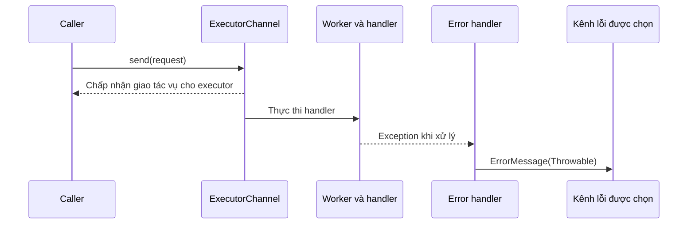

# Global error channel

## 1. Mục tiêu và bối cảnh

Trong chương **Cấu hình và lifecycle** của `SPRING_INTEGRATION_CORE`, global error channel là điểm tiếp nhận lỗi chung của các luồng thông điệp có sử dụng cơ chế phát lỗi của Spring Integration. Hiểu điểm tiếp nhận này giúp kết nối đúng `Message`, `MessageChannel`, endpoint, gateway và Java DSL khi thiết kế luồng xử lý lỗi.

Giả sử hệ thống nhận đơn hàng, biến đổi dữ liệu rồi gửi yêu cầu thanh toán. Khi xử lý diễn ra trên worker thread, caller có thể đã tiếp tục công việc trước khi dịch vụ thanh toán thất bại. Một khối `try/catch` quanh thao tác gửi ban đầu không đủ để theo dõi kết quả nghiệp vụ đó. Ứng dụng cần một đường đi riêng cho thông tin lỗi.

Sau bài này, bạn có thể:

- Phân biệt exception truyền trên call stack với lỗi được đóng gói thành `ErrorMessage`.
- Giải thích phạm vi của bean `errorChannel` và ưu tiên của header cùng tên.
- Gắn consumer vào kênh lỗi toàn cục mà vẫn sử dụng cấu hình mặc định.
- Đọc exception, thông điệp thất bại và dữ liệu liên kết để điều tra lỗi.
- Lựa chọn cách xử lý lỗi theo yêu cầu lifecycle, khả năng lưu trữ và phản hồi cho caller.
- Viết kiểm thử có chờ giới hạn cho luồng lỗi bất đồng bộ.

Các ví dụ dùng Java 17 và API Java DSL của Spring Integration 6.5. Với Spring Boot, có thể dùng `spring-boot-starter-integration` cùng bộ phiên bản do Boot quản lý; phần kiểm thử cần JUnit Jupiter và Spring Test, thường được cung cấp qua `spring-boot-starter-test`. Đây là cấu hình minh họa trong bộ nhớ, chưa có broker hay kho lưu lỗi bền vững.

## 2. Global error channel là gì?

Tên bean quy ước là **`errorChannel`**. Khi cơ chế xử lý lỗi của framework cần phát lỗi và không có kênh riêng phù hợp, đây là đích chung. Spring Integration tự tạo kênh này nếu ứng dụng chưa khai báo. Kiểu mặc định là `PublishSubscribeChannel`, có sẵn subscriber ghi log ở mức `ERROR`. Xem [Error Handling của Spring Integration](https://docs.spring.io/spring-integration/reference/6.5/error-handling.html).

Từ “global” cần được hiểu trong phạm vi hạ tầng Spring Integration của application context đang dùng. Trong ứng dụng thông thường có một context chính, các flow có thể cùng gửi lỗi vào bean này. Nó không tự thu thập lỗi từ những tiến trình hoặc microservice khác.

Ba khái niệm có tên gần nhau nhưng vai trò khác nhau:

| Thành phần | Bản chất | Ví dụ |
|---|---|---|
| Bean `errorChannel` | Kênh lỗi chung do context quản lý | `IntegrationFlow.from("errorChannel")` |
| Header `errorChannel` | Chỉ dẫn đích nhận lỗi gắn với thông điệp | `MessageHeaders.ERROR_CHANNEL` |
| Error handler | Thành phần chuyển exception thành thông điệp và gửi đi | `MessagePublishingErrorHandler` |

Khai báo bean không làm mọi exception trong JVM đi vào kênh đó. Lỗi phải phát sinh trong một đường thực thi có cơ chế xử lý lỗi tương ứng, hoặc được ứng dụng chủ động chuyển thành thông điệp lỗi.

## 3. Ranh giới thực thi quyết định đường đi của lỗi

### 3.1. Gửi trực tiếp trên cùng thread

Với `DirectChannel`, handler thường chạy trên thread của bên gửi:

```text
caller thread
  -> DirectChannel.send(message)
  -> transformer / service activator
  -> exception
  <- exception truyền ngược về caller
```

Nếu trực tiếp gọi `channel.send(message)`, việc thêm header `errorChannel` không tự tạo một khối bắt exception. Bạn phải biết thành phần nào sẽ bắt lỗi và đọc header đó.

Ví dụ gửi trực tiếp vẫn cần xử lý exception tại caller:

```java
try {
    inputChannel.send(message);
}
catch (org.springframework.messaging.MessagingException exception) {
    // Chuyển thành lỗi ứng dụng hoặc phản hồi phù hợp với hợp đồng gọi.
}
```

### 3.2. Chuyển việc xử lý sang executor

Với `ExecutorChannel` và một thread pool thực sự chạy ở thread khác, việc gửi và xử lý nghiệp vụ tách nhau. API này không bảo toàn transaction context từ sender sang handler. Xem [ExecutorChannel API](https://docs.spring.io/spring-integration/api/org/springframework/integration/channel/ExecutorChannel.html).



`send()` hoàn tất thành công chỉ thể hiện việc gửi được chấp nhận theo cơ chế channel. Nó không chứng minh đơn hàng đã thanh toán thành công. Nếu executor từ chối tác vụ ngay lúc gửi, exception vẫn có thể xuất hiện tại caller; đó là một thời điểm lỗi khác với lỗi nghiệp vụ xảy ra sau khi worker bắt đầu chạy.

### 3.3. Những trường hợp cần phân biệt

| Tình huống | Điều cần kiểm tra |
|---|---|
| Gọi `send()` qua chuỗi `DirectChannel` | Exception thường trở về bên gửi |
| Handler chạy sau `ExecutorChannel` | Hạ tầng thực thi có thể phát `ErrorMessage` |
| Consumer đọc `QueueChannel` bằng poller | Error handler của poller/scheduler quyết định đường xử lý |
| Gọi qua messaging gateway | Hợp đồng lỗi và cấu hình `errorChannel` của gateway |
| Mã tự tạo thread hoặc tự gọi executor ngoài flow | Mã đó có chủ động tích hợp cơ chế phát lỗi hay không |
| Filter loại thông điệp theo điều kiện bình thường | Không có exception nên không mặc nhiên có `ErrorMessage` |

Không nên chọn cách xử lý chỉ dựa vào loại endpoint. Cùng một transformer hoặc service activator có thể chạy đồng bộ hoặc sau một ranh giới bất đồng bộ, tùy cấu trúc channel.

## 4. Chọn kênh nhận lỗi: header và đích mặc định

`MessagePublishingErrorHandler` triển khai `ErrorHandler` để gửi `ErrorMessage` tới một `MessageChannel`; đích mặc định có thể được cấu hình bằng channel hoặc tên bean. Xem [MessagePublishingErrorHandler API](https://docs.spring.io/spring-integration/api/org/springframework/integration/channel/MessagePublishingErrorHandler.html).

Trong đường xử lý chuẩn, khi có thông điệp thất bại để lấy ngữ cảnh:

```text
Request có header errorChannel sử dụng được?
  Có    -> gửi lỗi tới kênh được chỉ định
  Không -> dùng đích mặc định; thông thường là bean errorChannel
```

Header có thể chứa tham chiếu `MessageChannel` hoặc tên channel để hạ tầng phân giải. Ví dụ sau chọn một bean tên `orderErrors`:

```java
import org.springframework.messaging.Message;
import org.springframework.messaging.MessageHeaders;
import org.springframework.messaging.support.MessageBuilder;

Message<String> request = MessageBuilder.withPayload("ORDER-101")
        .setHeader(MessageHeaders.ERROR_CHANNEL, "orderErrors")
        .setHeader("traceId", "trace-101")
        .build();
```

Đây là chỉ dẫn định tuyến lỗi, chưa phải cấu hình đầy đủ của một flow. Bean `orderErrors` và consumer phù hợp vẫn phải tồn tại. Một tên sai hoặc một kênh không tiếp nhận được thông điệp là lỗi cấu hình cần xử lý; không dựa vào giả định lỗi sẽ tự chuyển tiếp tới global channel.

Việc chọn kênh riêng cũng không có nghĩa kênh riêng và kênh toàn cục đều nhận một bản sao. Nếu muốn thu thập tập trung, cần cấu hình bridge hoặc bước chuyển tiếp rõ ràng. Những thuộc tính `errorChannel` đặt tại gateway, poller hoặc adapter phải được đọc theo hợp đồng của chính thành phần đó.

## 5. Bên trong `ErrorMessage`

`ErrorMessage` là `Message<Throwable>`. Payload là exception hoặc throwable, thường có lớp bọc `MessagingException`. Ngoài payload và headers, nó có thể có `originalMessage`. Theo [ErrorMessage API](https://docs.spring.io/spring-framework/docs/current/javadoc-api/org/springframework/messaging/support/ErrorMessage.html), `originalMessage` là thông điệp có tại điểm tạo thông điệp lỗi; thông điệp thất bại nằm trong exception có thể đã trải qua biến đổi.

```text
ErrorMessage
├── payload: Throwable
│   └── nếu là MessagingException
│       ├── failedMessage: Message<?> hoặc null
│       └── cause: nguyên nhân bên dưới
├── headers: headers của chính thông điệp lỗi
└── originalMessage: Message<?> hoặc null
```

`MessagingException.getFailedMessage()` cho phép lấy thông điệp liên quan tới lỗi, nhưng kết quả có thể là `null`. Cấu trúc API được mô tả tại [MessagingException API](https://docs.spring.io/spring-framework/docs/current/javadoc-api/org/springframework/messaging/MessagingException.html).

Khi điều tra, nên đọc theo thứ tự:

1. Kiểu exception bọc ngoài để hiểu lỗi ở tầng messaging nào.
2. Chuỗi `cause` để xác định nguyên nhân như dữ liệu sai hoặc dịch vụ không khả dụng.
3. `failedMessage` để biết payload và headers tại bước thất bại.
4. `originalMessage`, nếu có, để bổ sung ngữ cảnh.

Không ép kiểu payload lỗi thành đối tượng nghiệp vụ. Ví dụ `(Order) errorMessage.getPayload()` là sai vì payload hiện tại là `Throwable`. Cũng không mặc định `errorMessage.getHeaders().get("orderId")` có dữ liệu: headers nghiệp vụ cần tìm trong thông điệp thất bại hoặc thông điệp gốc.

Một transformer trước điểm lỗi có thể làm payload của `failedMessage` khác kiểu payload đầu vào. Vì vậy, dùng business key và trace ID trong headers giúp việc liên kết ít phụ thuộc hơn vào cấu trúc payload tại từng bước.

## 6. Ví dụ hoàn chỉnh: gắn consumer vào global channel

### 6.1. Cấu hình flow

Đặt lớp sau trong package `example.integration`. Luồng nhận `Order` qua `ExecutorChannel`; số tiền không hợp lệ làm handler ném exception. `globalErrorFlow` chỉ đăng ký thêm subscriber vào kênh có sẵn, không khai báo một bean `errorChannel` mới.

```java
package example.integration;

import org.slf4j.Logger;
import org.slf4j.LoggerFactory;
import org.springframework.beans.factory.annotation.Qualifier;
import org.springframework.context.annotation.Bean;
import org.springframework.context.annotation.Configuration;
import org.springframework.integration.channel.ExecutorChannel;
import org.springframework.integration.config.EnableIntegration;
import org.springframework.integration.dsl.IntegrationFlow;
import org.springframework.messaging.Message;
import org.springframework.messaging.MessageChannel;
import org.springframework.messaging.MessagingException;
import org.springframework.messaging.support.ErrorMessage;
import org.springframework.scheduling.concurrent.ThreadPoolTaskExecutor;

@Configuration
@EnableIntegration
public class GlobalErrorConfiguration {

    private static final Logger log =
            LoggerFactory.getLogger(GlobalErrorConfiguration.class);

    @Bean
    public ThreadPoolTaskExecutor orderExecutor() {
        ThreadPoolTaskExecutor executor = new ThreadPoolTaskExecutor();
        executor.setCorePoolSize(2);
        executor.setMaxPoolSize(2);
        executor.setQueueCapacity(100);
        executor.setThreadNamePrefix("orders-");
        return executor;
    }

    @Bean
    public MessageChannel orders(
            @Qualifier("orderExecutor") ThreadPoolTaskExecutor executor) {
        return new ExecutorChannel(executor);
    }

    @Bean
    public IntegrationFlow orderFlow() {
        return IntegrationFlow.from("orders")
                .handle(Order.class, (order, headers) -> {
                    if (order.amountVnd() <= 0) {
                        throw new IllegalArgumentException(
                                "Order amount must be positive");
                    }
                    log.info("Accepted orderId={}", order.id());
                    return null;
                })
                .get();
    }

    @Bean
    public IntegrationFlow globalErrorFlow() {
        return IntegrationFlow.from("errorChannel")
                .handle((Message<?> message) -> {
                    if (!(message instanceof ErrorMessage error)) {
                        log.error("Unexpected message on errorChannel: type={}",
                                message.getClass().getName());
                        return;
                    }

                    Throwable failure = error.getPayload();
                    Message<?> failed = null;
                    if (failure instanceof MessagingException exception) {
                        failed = exception.getFailedMessage();
                    }
                    if (failed == null) {
                        failed = error.getOriginalMessage();
                    }

                    Object orderId = failed == null
                            ? null : failed.getHeaders().get("orderId");
                    Object traceId = failed == null
                            ? null : failed.getHeaders().get("traceId");

                    log.error("Integration failure: orderId={}, traceId={}, type={}",
                            orderId, traceId, failure.getClass().getSimpleName());
                })
                .get();
    }

    public record Order(String id, long amountVnd) {
    }
}
```

Spring quản lý khởi tạo và hủy `ThreadPoolTaskExecutor` vì nó là một bean. Không cần tự gọi `initialize()` trong phương thức tạo bean của ví dụ.

Consumer lỗi dùng biến thể `.handle(MessageHandler)` không sinh reply. Handler nghiệp vụ cũng trả `null` để kết thúc luồng một chiều. Nếu đổi thành luồng yêu cầu–phản hồi, phải thiết kế kết quả và đường trả lời tương ứng.

### 6.2. Gửi thông điệp thử nghiệm

Đoạn sau chạy sau khi context đã khởi động và endpoint đã subscribe:

```java
import example.integration.GlobalErrorConfiguration.Order;
import org.springframework.context.annotation.AnnotationConfigApplicationContext;
import org.springframework.messaging.MessageChannel;
import org.springframework.messaging.support.MessageBuilder;

// context là AnnotationConfigApplicationContext đã nạp GlobalErrorConfiguration.
MessageChannel orders = context.getBean("orders", MessageChannel.class);

Order order = new Order("ORDER-101", -50_000);
orders.send(MessageBuilder.withPayload(order)
        .setHeader("orderId", order.id())
        .setHeader("traceId", "trace-101")
        .build());
```

Kết quả cần quan sát là worker gặp `IllegalArgumentException`, hạ tầng chuyển lỗi tới global channel, rồi consumer ghi được `orderId`, `traceId` và kiểu exception bọc ngoài. Một log khác có thể xuất hiện từ subscriber mặc định của framework. Hai dòng log không nhất thiết có nghĩa nghiệp vụ đã được thực thi hai lần.

Để tập trung vào luồng lỗi, ví dụ chỉ ghi metadata và chưa lưu bản ghi vận hành. Khi đưa vào hệ thống thật, có thể bổ sung kho lỗi, metric hoặc cảnh báo, nhưng cần giữ rõ trách nhiệm của từng subscriber.

## 7. Cấu hình kênh lỗi riêng và chuyển tiếp toàn cục

### 7.1. Chọn đích lỗi cho từng thông điệp

Với cấu hình ở mục 6, bạn có thể chọn một `QueueChannel` làm đích lỗi riêng để quan sát trong chương trình thử nghiệm:

```java
import org.springframework.integration.channel.QueueChannel;
import org.springframework.messaging.support.MessageBuilder;

QueueChannel localErrors = new QueueChannel(10);

orders.send(MessageBuilder
        .withPayload(new Order("ORDER-LOCAL", -1))
        .setHeader("orderId", "ORDER-LOCAL")
        .setErrorChannel(localErrors)
        .build());

org.springframework.messaging.Message<?> captured = localErrors.receive(3_000);
```

Đoạn này dùng trực tiếp đối tượng channel nên không cần đăng ký bean để phân giải tên. `receive()` lấy thông điệp khỏi queue và chờ tối đa ba giây. Với ứng dụng chạy lâu dài, queue phải có consumer hoặc poller phù hợp; đây chỉ là cách bắt lỗi để minh họa.

Khi lỗi đã được gửi vào `localErrors`, `globalErrorFlow` không tự nhận thêm một bản sao. Vì thế, một nhóm flow đặt error channel riêng có thể nằm ngoài số liệu mà bộ thu toàn cục đang đo.

### 7.2. Bridge về đích chung

Nếu muốn dùng tên kênh riêng tại biên của flow nhưng cuối cùng vẫn chuyển toàn bộ lỗi về global channel, thêm hai bean sau vào cấu hình:

```java
import org.springframework.context.annotation.Bean;
import org.springframework.integration.channel.DirectChannel;
import org.springframework.integration.dsl.IntegrationFlow;

@Bean
public DirectChannel orderErrors() {
    return new DirectChannel();
}

@Bean
public IntegrationFlow orderErrorsToGlobal() {
    return IntegrationFlow.from("orderErrors")
            .bridge()
            .channel("errorChannel")
            .get();
}
```

Sau đó đặt header `errorChannel` là chuỗi `"orderErrors"`. Bridge chuyển tiếp thông điệp lỗi, không thực thi lại đơn hàng. Nếu bổ sung xử lý riêng trước khi chuyển tiếp, cần quyết định rõ thao tác đó chỉ quan sát hay có tác động nghiệp vụ.

## 8. Có nên tự khai báo bean `errorChannel`?

Thông thường, chỉ thêm consumer như ví dụ chính là đủ. Tự khai báo bean cùng tên là thay đổi hạ tầng toàn cục; lựa chọn loại channel sẽ thay đổi cách phân phối lỗi.

| Lựa chọn | Cách tiếp nhận | Hệ quả thiết kế |
|---|---|---|
| `PublishSubscribeChannel` | Phát tới các subscriber | Phù hợp khi nhiều bộ quan sát cần nhận cùng lỗi |
| `DirectChannel` | Chọn một consumer theo dispatcher | Các consumer không cùng nhận đầy đủ mọi lỗi |
| `QueueChannel` | Giữ lỗi để consumer lấy ra | Cần poller, giới hạn queue và chính sách khi đầy |

`PublishSubscribeChannel` không có executor gọi subscriber ngay trên thread đang phát thông điệp. Nếu thông điệp đó là lỗi từ worker nghiệp vụ, consumer lỗi cũng có thể chiếm thời gian của worker. API thể hiện rõ sự khác nhau giữa constructor có và không có executor tại [PublishSubscribeChannel API](https://docs.spring.io/spring-integration/api/org/springframework/integration/channel/PublishSubscribeChannel.html).

Một cấu hình thay thế rõ hai lựa chọn về phân phối là:

```java
import org.springframework.context.annotation.Bean;
import org.springframework.integration.channel.PublishSubscribeChannel;

@Bean(name = "errorChannel")
public PublishSubscribeChannel applicationErrorChannel() {
    PublishSubscribeChannel channel = new PublishSubscribeChannel(true);
    channel.setIgnoreFailures(true);
    return channel;
}
```

Đây là phương án thay thế bean mặc định, không bắt buộc thêm vào ví dụ ở mục 6. Constructor nhận `true` yêu cầu có subscriber; `setIgnoreFailures(true)` cho phép dispatcher tiếp tục tới subscriber khác khi một subscriber gặp lỗi. Hai lựa chọn này không chứng minh bản ghi lỗi đã được lưu thành công.

Không mặc định một bean tự khai báo sẽ có đủ subscriber và chính sách của bean do framework tạo. Hãy khai báo consumer cần thiết một cách tường minh. Đặc biệt, tự thêm logger phải xét cùng logger có sẵn trong cấu hình thực tế để tránh ghi trùng hoặc ghi thiếu.

Nếu thay bằng `new QueueChannel(500)`, bạn có queue trong bộ nhớ với sức chứa hữu hạn. Nó không tự trở thành dead-letter queue bền vững. Khi không có consumer, lỗi có thể tồn đọng; khi tiến trình kết thúc, dữ liệu trong bộ nhớ không được bảo toàn. Consumer lỗi đọc queue còn cần chính sách riêng nếu chính nó thất bại, tránh phát lỗi trở lại đúng queue đang gây lỗi.

## 9. Global properties và lifecycle

### 9.1. Hai thuộc tính dễ nhầm

Các thuộc tính của kênh lỗi toàn cục mặc định gồm:

```properties
spring.integration.channels.error.requireSubscribers=true
spring.integration.channels.error.ignoreFailures=true
```

Theo [Global Properties](https://docs.spring.io/spring-integration/reference/6.5/configuration/global-properties.html), `requireSubscribers` có từ 5.4.3, còn `ignoreFailures` có từ 5.5. Đây là các mặc định của nhánh tham chiếu đang dùng.

| Thuộc tính | Trả lời câu hỏi |
|---|---|
| `requireSubscribers` | Nếu không có subscriber thì việc phát lỗi có được bỏ qua âm thầm không? |
| `ignoreFailures` | Nếu một subscriber thất bại thì có tiếp tục phân phối tới subscriber khác không? |

Một cơ chế cấu hình trực tiếp của Spring Integration là tài nguyên classpath `META-INF/spring.integration.properties`. Chẳng hạn, đường dẫn mã nguồn tài nguyên thường là `src/main/resources/META-INF/spring.integration.properties`. Không suy ra rằng mọi thuộc tính cùng tên đặt trong `application.yml` đều được tự động áp dụng; cần kiểm tra cơ chế ánh xạ của Spring Boot đang dùng.

Với channel do ứng dụng tự tạo, hãy cấu hình hành vi cần thiết trên chính bean đó. Không giả định thay global property sẽ sửa mọi channel tùy biến.

### 9.2. Endpoint còn hoạt động mới tiếp nhận được lỗi

Channel và consumer là hai đối tượng có trách nhiệm khác nhau. Endpoint kết nối handler vào subscribable channel; polling endpoint quản lý việc đọc pollable channel. Mô hình này được mô tả trong [Message Endpoints](https://docs.spring.io/spring-integration/reference/6.5/endpoint.html).

Một bean channel vẫn có thể tồn tại trong khi endpoint nhận lỗi chưa start, đã stop hoặc được đặt `autoStartup=false`. Với kênh yêu cầu subscriber, tình huống không còn subscriber có thể làm phát sinh `MessageDispatchingException`. Với channel tùy biến cho phép không có subscriber, cùng tình huống có thể không được báo rõ. Vì vậy, cần quan sát trạng thái endpoint thay vì chỉ kiểm tra bean có tồn tại.

Một trình tự vận hành nên được thiết kế và kiểm chứng là:

1. Khi khởi động, chuẩn bị nơi nhận lỗi và các consumer cần thiết trước khi mở nguồn nhận thông điệp.
2. Khi dừng, ngừng nhận công việc mới tại adapter hoặc biên ứng dụng.
3. Cho phép các công việc đã nhận hoàn tất trong thời hạn được chọn.
4. Duy trì đường thu lỗi trong giai đoạn các công việc đó còn có thể thất bại.
5. Kết thúc worker, consumer và tài nguyên lưu trữ theo chính sách shutdown.

Đây là mục tiêu vận hành, không phải lời khẳng định rằng mọi topology có cùng thứ tự shutdown mặc định. Phải xét lifecycle phase, endpoint được quản lý, thread pool và nguồn thông điệp cụ thể. Chỉ bật chờ task trên executor cũng chưa bảo đảm consumer lỗi sẽ sống đủ lâu.

Nếu dùng scheduler tùy biến cho poller, hãy kiểm tra việc gắn cơ chế phát lỗi. `MessagePublishingErrorHandler` có thể được dùng để nối exception của tác vụ vào mô hình thông điệp; một scheduler tự tạo chỉ ghi log exception sẽ không tự cung cấp cùng đường xử lý.

## 10. Thiết kế consumer lỗi có trách nhiệm rõ ràng

### 10.1. Tách quan sát khỏi quyết định nghiệp vụ

Một error flow thường cần thực hiện nhiều việc khác nhau:

- **Quan sát:** log, metric, trace và cảnh báo.
- **Phân loại:** lỗi dữ liệu, lỗi tạm thời của hệ thống ngoài, lỗi cấu hình.
- **Kết thúc xử lý:** lưu lỗi, chuyển tới hàng đợi cách ly, tạo yêu cầu can thiệp.
- **Khôi phục:** retry có giới hạn hoặc chạy nghiệp vụ bù trừ nếu hợp đồng cho phép.

Một subscriber chỉ ghi log không làm đơn hàng thành công. Tương tự, gửi được `ErrorMessage` không tự xác nhận rollback, acknowledgment hoặc redelivery của broker. Các kết quả đó phụ thuộc transaction, adapter và cơ chế recovery đang được dùng.

Ví dụ, lỗi số tiền âm nên được phân loại để sửa dữ liệu; retry nguyên trạng thường không giúp. Lỗi kết nối thanh toán có thể phù hợp với retry giới hạn, nhưng phải xác định trạng thái giao dịch và tính idempotent trước khi gửi lại yêu cầu thu tiền.

### 10.2. Phân loại exception và dùng router

Exception bọc ngoài thường mang thông tin messaging, còn nguyên nhân nghiệp vụ nằm trong chuỗi `cause`. Khi cần rẽ nhánh theo kiểu exception, có thể xem xét `ErrorMessageExceptionTypeRouter`, thay vì phân tích chuỗi thông báo lỗi. Cần thử với chính cấu trúc exception mà flow tạo ra và luôn có đường xử lý loại chưa biết.

Ví dụ chính sách cho hệ thống đơn hàng:

| Nhóm lỗi | Hành động có thể chọn | Điều phải ghi lại |
|---|---|---|
| Dữ liệu không hợp lệ | Cách ly để sửa dữ liệu | Business key, trường sai, phiên bản dữ liệu |
| Kết nối tạm thời thất bại | Retry có giới hạn rồi chuyển nơi lưu lỗi | Số lần thử và kết quả cuối cùng |
| Cấu hình endpoint sai | Báo vận hành, hạn chế tiếp nhận thêm | Endpoint, cấu hình triển khai, trace ID |
| Chưa phân loại | Lưu để điều tra | Exception chain và ngữ cảnh tối thiểu |

### 10.3. Tránh vòng lặp và tác động lặp

Không nối error flow trở lại luồng nghiệp vụ một cách vô điều kiện. Nếu dữ liệu sai vẫn không thay đổi, mỗi vòng chỉ sinh thêm lỗi. Cũng cần tránh chu trình mà lỗi của consumer lỗi lại được phát về đúng consumer đó mà không có điểm kết thúc.

Một cách tổ chức là kết thúc retry tại một nơi lưu lỗi có trách nhiệm rõ ràng, rồi có luồng replay riêng. Replay cần định danh thông điệp gốc, số lần thực thi, lý do gửi lại và khóa idempotency phù hợp với nghiệp vụ.

Nếu dùng nhiều subscriber trên global channel, hãy xác định subscriber nào chỉ quan sát và subscriber nào được phép thực hiện recovery. Để hai subscriber cùng gửi lại yêu cầu thanh toán có thể gây tác động lặp dù mỗi subscriber đều chạy đúng mã của mình.

### 10.4. Metadata và nội dung log

Các trường hữu ích thường gồm `orderId`, `traceId`, tên flow hoặc endpoint, kiểu exception, thời điểm lỗi và số lần thử. Có thể thiếu một số trường khi lỗi xảy ra trước khi tạo được thông điệp nghiệp vụ, nên consumer cần xử lý dữ liệu vắng mặt.

Ví dụ ở mục 6 chỉ ghi một số metadata. Tuy nhiên, logger mặc định của framework có thể ghi thêm exception và thông điệp liên quan. Nếu ứng dụng có yêu cầu che dữ liệu, cần xem xét toàn bộ các subscriber và cách cấu hình log; chỉ sửa logger tự viết chưa đủ để kiểm soát mọi dòng log.

## 11. Quan hệ với gateway và poller

### 11.1. Gateway có hợp đồng phản hồi riêng

Messaging gateway có thể truyền exception về caller hoặc dùng error flow được cấu hình cho nó. Một error flow cũng có thể biến exception thành phản hồi ứng dụng. Đây là cơ chế riêng của gateway, được mô tả tại [Messaging Gateways — Error Handling](https://docs.spring.io/spring-integration/reference/6.5/gateway.html#error-handling).

Nếu phương thức gateway trả về `OrderResult`, consumer lỗi cần tuân theo hợp đồng đó: trả kết quả thất bại hợp lệ hoặc để caller nhận exception theo thiết kế. Một consumer một chiều chỉ ghi log không tạo ra `OrderResult`. Khi không có reply, cần xét timeout và hành vi của gateway; không giả định caller sẽ nhận được phản hồi chỉ vì global channel đã có log.

Với gateway có phương thức `void` và cấu hình `errorChannel`, header lỗi có thể được gắn vào thông điệp gửi đi. Do đó, khi theo dõi global channel, cần kiểm tra gateway có đang chọn một kênh riêng hay không. Đồng thời, không mặc định mọi gateway đồng bộ đều dùng global channel: lỗi có thể được chuyển về caller thông qua cơ chế reply của gateway.

### 11.2. Poller là nơi bắt lỗi khác

`QueueChannel` là nơi giữ thông điệp; poller mới là thành phần chủ động lấy và xử lý chúng. Exception khi lấy dữ liệu từ nguồn có thể xảy ra trước khi có một `failedMessage` đầy đủ. Đây là lý do error consumer phải chấp nhận trường hợp thiếu ngữ cảnh nghiệp vụ.

Khi điều tra lỗi từ polling flow, kiểm tra cả poller, error channel được chọn và scheduler đang dùng. Kiểu channel đầu vào không đủ để xác định toàn bộ đường xử lý lỗi. Chi tiết cấu hình thread và channel được trình bày tại [Configuring Message Channels](https://docs.spring.io/spring-integration/reference/6.5/channel/configuration.html).

## 12. Kiểm thử đường đi của lỗi

Kiểm thử bất đồng bộ cần chờ một tín hiệu có ý nghĩa. Không dùng `Thread.sleep()` rồi đoán worker đã chạy xong, cũng không chỉ kiểm tra `send()` trả về `true`.

Lớp sau dùng cấu hình ở mục 6. Nó đăng ký một subscriber thăm dò trước mỗi test và gỡ subscriber sau test. `QueueChannel.receive(timeout)` vừa thu kết quả vừa đặt giới hạn chờ. Đây là mã kiểm thử minh họa để chạy trong dự án có các dependency đã nêu.

```java
package example.integration;

import example.integration.GlobalErrorConfiguration.Order;
import org.junit.jupiter.api.AfterEach;
import org.junit.jupiter.api.BeforeEach;
import org.junit.jupiter.api.Test;
import org.springframework.beans.factory.annotation.Autowired;
import org.springframework.beans.factory.annotation.Qualifier;
import org.springframework.integration.channel.DirectChannel;
import org.springframework.integration.channel.QueueChannel;
import org.springframework.messaging.Message;
import org.springframework.messaging.MessageChannel;
import org.springframework.messaging.MessageHandler;
import org.springframework.messaging.MessagingException;
import org.springframework.messaging.SubscribableChannel;
import org.springframework.messaging.support.ErrorMessage;
import org.springframework.messaging.support.MessageBuilder;
import org.springframework.test.context.junit.jupiter.SpringJUnitConfig;

import static org.junit.jupiter.api.Assertions.*;

@SpringJUnitConfig(GlobalErrorConfiguration.class)
class GlobalErrorChannelTest {

    @Autowired
    @Qualifier("orders")
    MessageChannel orders;

    @Autowired
    @Qualifier("errorChannel")
    SubscribableChannel globalChannel;

    private QueueChannel observed;
    private MessageHandler probe;

    @BeforeEach
    void subscribeProbe() {
        observed = new QueueChannel(10);
        probe = message -> {
            if (!observed.send(message, 0)) {
                throw new IllegalStateException("Error probe is full");
            }
        };
        globalChannel.subscribe(probe);
    }

    @AfterEach
    void unsubscribeProbe() {
        globalChannel.unsubscribe(probe);
    }

    @Test
    void sendsAsyncFailureToGlobalChannel() {
        Message<Order> request = MessageBuilder
                .withPayload(new Order("ORDER-GLOBAL", -1))
                .setHeader("orderId", "ORDER-GLOBAL")
                .build();

        assertTrue(orders.send(request));

        ErrorMessage error = assertInstanceOf(
                ErrorMessage.class, observed.receive(3_000));
        MessagingException failure = assertInstanceOf(
                MessagingException.class, error.getPayload());

        assertInstanceOf(IllegalArgumentException.class,
                failure.getMostSpecificCause());
        assertNotNull(failure.getFailedMessage());
        assertEquals("ORDER-GLOBAL",
                failure.getFailedMessage().getHeaders().get("orderId"));
    }

    @Test
    void prefersMessageErrorChannelOverGlobalChannel() {
        QueueChannel localErrors = new QueueChannel(10);

        orders.send(MessageBuilder
                .withPayload(new Order("ORDER-LOCAL", -1))
                .setHeader("orderId", "ORDER-LOCAL")
                .setErrorChannel(localErrors)
                .build());

        assertInstanceOf(ErrorMessage.class, localErrors.receive(3_000));
        assertNull(observed.receive(200));
    }

    @Test
    void directSendStillThrowsEvenWhenErrorHeaderExists() {
        DirectChannel direct = new DirectChannel();
        direct.subscribe(message -> {
            throw new IllegalArgumentException("Synchronous failure");
        });

        Message<String> request = MessageBuilder.withPayload("bad-data")
                .setErrorChannel(globalChannel)
                .build();

        assertThrows(RuntimeException.class, () -> direct.send(request));
        assertNull(observed.receive(200));
    }
}
```

Ba test kiểm tra ba hợp đồng khác nhau: lỗi worker tới kênh chung, header chọn kênh riêng và thao tác gửi trực tiếp vẫn ném exception. Thời hạn chờ không phải cam kết về thời gian xử lý của hệ thống; cần chọn giá trị phù hợp môi trường chạy test.

Probe toàn cục có thể nhận lỗi từ các flow khác nếu dùng chung một context lớn. Khi áp dụng vào dự án, dùng context nhỏ như ví dụ hoặc lọc theo trace ID. Các kiểm tra “không có thông điệp” ở đây dựa trên flow hữu hạn, không retry; không dùng khoảng chờ ngắn để kết luận rằng một hệ thống có delayed retry sẽ không bao giờ phát thêm lỗi.

Ngoài ba trường hợp trên, nên có kiểm thử vận hành riêng khi đổi hạ tầng: dừng consumer lỗi trong lúc worker còn chạy, nơi lưu lỗi không khả dụng, queue đầy và exception không chứa `failedMessage`. Những tình huống này giúp xác nhận chính sách lifecycle và recovery đã chọn.

## 13. Chẩn đoán lỗi thường gặp

| Hiện tượng | Khả năng cần kiểm tra | Hướng xác minh |
|---|---|---|
| Có exception nhưng global flow không chạy | Lỗi đồng bộ, lỗi ngoài hạ tầng integration hoặc đã chọn kênh riêng | Theo call stack, header và cấu hình gateway/poller |
| Caller không nhận exception dù worker lỗi | Việc xử lý diễn ra sau ranh giới bất đồng bộ | Kiểm tra error flow và hợp đồng phản hồi |
| Có hai dòng log cho cùng lỗi | Logger mặc định cùng logger ứng dụng | Đối chiếu trace ID, subscriber và số lần xử lý nghiệp vụ |
| Lỗi thiếu `orderId` | Đọc nhầm headers hoặc chưa tạo được request | Kiểm tra `failedMessage`, `originalMessage` và điểm tạo metadata |
| Có nhiều consumer nhưng mỗi nơi chỉ nhận một phần lỗi | Dùng channel phân phối một consumer thay cho broadcast | Kiểm tra kiểu bean `errorChannel` thực tế |
| Báo không có subscriber khi dừng ứng dụng | Error endpoint đã stop trước task phát lỗi | Kiểm tra lifecycle, thời điểm shutdown và `requireSubscribers` |
| Luồng lỗi làm worker chậm dần | Consumer lỗi chặn lâu hoặc queue không được tiêu thụ | Đo thời gian xử lý, độ sâu queue và khả năng của nơi lưu lỗi |
| Lỗi lặp liên tục | Retry không có giới hạn hoặc có chu trình trong error flow | Vẽ lại đường đi từ lỗi đến điểm kết thúc |

Khi thiết kế một flow mới, hãy xác định rõ nơi exception bị bắt, kênh nhận lỗi được chọn, consumer chịu trách nhiệm kết thúc và trạng thái mà caller hoặc nguồn thông điệp sẽ thấy. Global error channel có giá trị khi các trách nhiệm đó được nối thành một đường xử lý có thể quan sát và kiểm thử.
