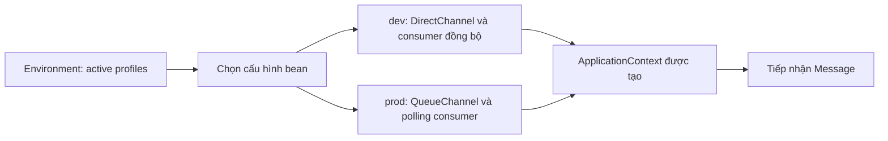

# Cấu hình theo profile

Trong module **SPRING_INTEGRATION_CORE**, cấu hình theo profile giúp một ứng dụng giữ hợp đồng thông điệp chung nhưng chọn các thành phần tích hợp phù hợp với môi trường. Ví dụ, môi trường phát triển dùng luồng đồng bộ để dễ quan sát, còn một cấu hình triển khai dùng hàng đợi và polling consumer để tách thời điểm gửi khỏi thời điểm xử lý.

Bài thuộc chương **Cấu hình và lifecycle**, tập trung vào ảnh hưởng của profile đối với `MessageChannel`, endpoint và Java DSL. Sau bài này, bạn có thể tổ chức các nhánh cấu hình, kích hoạt profile trước khi tạo context, nhận diện tổ hợp không hợp lệ và kiểm thử hành vi của luồng theo từng profile.

Ví dụ dùng Java 17+, API Spring Integration 6.5 và Spring Framework tương thích. Cần dependency `org.springframework.integration:spring-integration-core`; phần kiểm thử dùng JUnit Jupiter và `junit-jupiter-params`. Phần Spring Boot được trình bày riêng cho ứng dụng có Boot. Các đoạn mã là nội dung thực hành, không khẳng định đã được chạy trong dự án hiện tại.

## 1. Profile chọn những thành phần được đăng ký

Profile là một tên cấu hình logic trong Spring `Environment`, chẳng hạn `dev`, `prod` hoặc `test`. `@Profile` đặt điều kiện cho việc đăng ký bean. Annotation này dùng được trên lớp cấu hình hoặc phương thức `@Bean`; nếu lớp cấu hình không thỏa điều kiện, các bean của lớp đó không được cung cấp. Xem [API `@Profile`](https://docs.spring.io/spring-framework/docs/6.2.0/javadoc-api/org/springframework/context/annotation/Profile.html).

Trong ứng dụng tích hợp, quyết định này có thể thay đổi cấu trúc luồng:



Nếu router chọn nhánh theo header `region`, quyết định được đưa ra cho từng message. Nếu profile chọn `QueueChannel`, quyết định được đưa ra khi xây dựng context, trước khi các message bắt đầu đi qua luồng.

| Nhu cầu | Công cụ phù hợp | Ví dụ |
| --- | --- | --- |
| Chọn một nhóm bean theo môi trường | `@Profile` | Consumer thật hoặc consumer mô phỏng |
| Đổi tham số của cùng cấu trúc luồng | Property | Poll delay, capacity, timeout |
| Chọn nhánh cho từng message | Router | Phân tuyến theo `orderType` |
| Tạm dừng endpoint đang tồn tại | Lifecycle | Ngừng consumer khi bảo trì |
| Bật tính năng theo property trong Boot | `@ConditionalOnProperty` | Tùy chọn bật một flow độc lập |

Việc lựa chọn hạ tầng thuộc cấu hình triển khai. Không dùng một header `prod` do client gửi để quyết định có truy cập hệ thống thật hay không. Header nghiệp vụ và profile môi trường có hai vai trò khác nhau.

## 2. Điều kiện profile và tổ hợp hợp lệ

### 2.1. Một profile, nhiều profile và biểu thức

```java
@Profile("dev")                     // Có profile dev.
@Profile({"dev", "test"})           // Có dev HOẶC test.
@Profile("prod & audit")            // Có cả prod VÀ audit.
@Profile("dev & !prod")             // Có dev và không có prod.
@Profile("prod & (audit | metrics)") // prod kết hợp audit hoặc metrics.
```

Các toán tử `!`, `&`, `|` biểu diễn phủ định, AND và OR. Dùng dấu ngoặc khi kết hợp `&` với `|`. Những phần tử trong mảng `@Profile({ ... })` là các lựa chọn OR. Tham khảo [Environment Abstraction](https://docs.spring.io/spring-framework/reference/core/beans/environment.html).

Với hai nhánh thay thế nhau, bài này chọn chính sách:

- Phát triển: `@Profile("dev & !prod")`.
- Triển khai: `@Profile("prod & !dev")`.
- Một flow chung bắt buộc phụ thuộc vào channel do một trong hai nhánh cung cấp.

Nếu cùng kích hoạt `dev,prod`, cả hai nhánh bị loại. Dependency bắt buộc bị thiếu và ứng dụng thất bại lúc khởi động. Đây là chính sách của ví dụ; Spring không mặc định cấm mọi tổ hợp nhiều profile.

### 2.2. Default profile

Khi không có active profile được chỉ định, Spring dùng default profiles; tên mặc định ban đầu là `default`. Có thể dùng `@Profile("default")` cho cấu hình dự phòng. Khi đã chỉ định active profiles, default profiles không tự được bổ sung làm dự phòng. Có thể thay danh sách mặc định qua `Environment` hoặc `spring.profiles.default`. Xem [API `Environment`](https://docs.spring.io/spring-framework/docs/current/javadoc-api/org/springframework/core/env/Environment.html).

Spring không tự hiểu `dev` là mặc định. Ví dụ chính không có nhánh `default`, nên người chạy phải chọn `dev` hoặc `prod` rõ ràng.

Cũng không nên hiểu `@Profile("!prod")` là “chỉ dùng ở dev”. Điều kiện ấy còn có thể đúng khi chỉ bật `test`, chỉ bật `metrics`, hoặc không bật profile nào. Khi bean thực sự dành cho phát triển, biểu thức `dev & !prod` mô tả ý định chặt chẽ hơn.

### 2.3. Cấu hình phải được phát hiện

Một lớp có `@Profile("dev")` vẫn cần được đăng ký, được `@Import` hoặc được component scan phát hiện. Annotation không tự đưa một lớp ở ngoài phạm vi scan vào context.

Ví dụ bên dưới dùng `@Import` để tập hợp hai nhánh tại một chỗ. Các bean chung nhận dependency qua tham số phương thức `@Bean`, phù hợp với `@Configuration(proxyBeanMethods = false)`. Không gọi trực tiếp phương thức tạo bean của nhánh khác để vượt qua điều kiện cấu hình. Xem [Composing Java-based Configurations](https://docs.spring.io/spring-framework/reference/core/beans/java/composing-configuration-classes.html).

## 3. Ví dụ: một hợp đồng đầu vào, hai cách chuyển giao message

### 3.1. Thiết kế

Ứng dụng nhận chuỗi mã đơn hàng. Hai môi trường cùng chuẩn hóa chuỗi bằng cách bỏ khoảng trắng ở hai đầu và chuyển sang chữ hoa với `Locale.ROOT`.

```text
orders.input
    -> intakeFlow: chuẩn hóa payload
    -> orders.transport: do profile cung cấp
    -> orders.delivery: consumer do profile cung cấp
    -> orders.processed: điểm thu kết quả của ví dụ
```

`orders.processed` là queue trong bộ nhớ để quan sát kết quả. Nó không đại diện cho việc đã ghi cơ sở dữ liệu hay hoàn tất giao dịch nghiệp vụ.

| Thành phần | `dev` | `prod` trong ví dụ |
| --- | --- | --- |
| `orders.input` | `DirectChannel` | `DirectChannel` |
| Chuẩn hóa payload | Flow dùng chung | Flow dùng chung |
| `orders.transport` | `DirectChannel` | `QueueChannel` có giới hạn |
| `orders.delivery` | Event-driven consumer | Polling consumer |
| Thời điểm thực thi sink | Trong thread gửi | Khi poller lấy message |
| Đích quan sát | `orders.processed` | `orders.processed` |

Tên `prod` biểu diễn một lựa chọn cấu hình trong bài học. Queue trong bộ nhớ chưa cung cấp độ bền dữ liệu khi tiến trình dừng đột ngột. Hệ thống thật phải chọn hạ tầng theo yêu cầu mất dữ liệu, giao dịch, throughput và khôi phục.

### 3.2. Lớp cấu hình đầy đủ

Khi thực hành, đặt đoạn sau vào `ProfiledOrdersConfig.java` trong package tương ứng:

```java
package example.integration.profiles;

import java.time.Duration;
import java.util.Locale;

import org.springframework.beans.factory.annotation.Qualifier;
import org.springframework.beans.factory.annotation.Value;
import org.springframework.context.annotation.Bean;
import org.springframework.context.annotation.Configuration;
import org.springframework.context.annotation.Import;
import org.springframework.context.annotation.Profile;
import org.springframework.integration.channel.DirectChannel;
import org.springframework.integration.channel.QueueChannel;
import org.springframework.integration.config.EnableIntegration;
import org.springframework.integration.dsl.IntegrationFlow;
import org.springframework.integration.dsl.Pollers;
import org.springframework.messaging.MessageChannel;
import org.springframework.messaging.MessageDeliveryException;
import org.springframework.messaging.MessageHandler;

@Configuration(proxyBeanMethods = false)
@EnableIntegration
@Import({
    ProfiledOrdersConfig.DevTransport.class,
    ProfiledOrdersConfig.ProdTransport.class
})
public class ProfiledOrdersConfig {

    @Bean("orders.input")
    public MessageChannel ordersInput() {
        return new DirectChannel();
    }

    @Bean("orders.processed")
    public QueueChannel processedOrders() {
        return new QueueChannel(100);
    }

    @Bean("orders.sink")
    public MessageHandler ordersSink(
            @Qualifier("orders.processed") QueueChannel processed) {
        return message -> {
            if (!processed.send(message, 1_000)) {
                throw new MessageDeliveryException(
                    message, "orders.processed is full");
            }
        };
    }

    @Bean
    public IntegrationFlow intakeFlow(
            @Qualifier("orders.input") MessageChannel input,
            @Qualifier("orders.transport") MessageChannel transport) {
        return IntegrationFlow.from(input)
            .transform(String.class,
                value -> value.trim().toUpperCase(Locale.ROOT))
            .channel(transport)
            .get();
    }

    @Configuration(proxyBeanMethods = false)
    @Profile("dev & !prod")
    public static class DevTransport {

        @Bean("orders.transport")
        public MessageChannel devTransport() {
            return new DirectChannel();
        }

        @Bean
        public IntegrationFlow devDeliveryFlow(
                @Qualifier("orders.transport") MessageChannel transport,
                @Qualifier("orders.sink") MessageHandler sink) {
            return IntegrationFlow.from(transport)
                .handle(sink, endpoint -> endpoint.id("orders.delivery"))
                .get();
        }
    }

    @Configuration(proxyBeanMethods = false)
    @Profile("prod & !dev")
    public static class ProdTransport {

        @Bean("orders.transport")
        public QueueChannel prodTransport(
                @Value("${orders.queue-capacity:100}") int capacity) {
            if (capacity <= 0) {
                throw new IllegalArgumentException(
                    "orders.queue-capacity must be positive");
            }
            return new QueueChannel(capacity);
        }

        @Bean
        public IntegrationFlow prodDeliveryFlow(
                @Qualifier("orders.transport") QueueChannel transport,
                @Qualifier("orders.sink") MessageHandler sink,
                @Value("${orders.poll-delay-ms:200}") long pollDelayMs,
                @Value("${orders.consumer-auto-startup:true}")
                boolean autoStartup) {
            if (pollDelayMs <= 0) {
                throw new IllegalArgumentException(
                    "orders.poll-delay-ms must be positive");
            }

            return IntegrationFlow.from(transport)
                .handle(sink, endpoint -> endpoint
                    .id("orders.delivery")
                    .autoStartup(autoStartup)
                    .poller(Pollers
                        .fixedDelay(Duration.ofMillis(pollDelayMs))
                        .receiveTimeout(0)
                        .maxMessagesPerPoll(10)))
                .get();
        }
    }
}
```

Java DSL tạo channel và endpoint từ các bean `IntegrationFlow` được chọn. `@EnableIntegration` cung cấp hạ tầng Spring Integration cho cấu hình Spring thuần. Xem [Java DSL của Spring Integration 6.5](https://docs.spring.io/spring-integration/reference/6.5/dsl.html).

Những điểm chính của thiết kế:

1. `intakeFlow` yêu cầu trực tiếp bean `orders.transport`. Khi không có nhánh hợp lệ, dependency không được thỏa mãn và context thất bại lúc khởi tạo.
2. Hai nhánh dùng cùng bean name `orders.transport`, nhưng điều kiện profile ngăn chúng được đăng ký cùng lúc. Không cần bật bean overriding.
3. Phương thức Java `devTransport()` và `prodTransport()` có tên khác nhau. Không dùng overloaded `@Bean` methods để chọn các biến thể profile.
4. `prodDeliveryFlow` là tên flow bean; `orders.delivery` là tên consumer endpoint để điều khiển lifecycle. Hai tên xác định hai vai trò khác nhau.
5. `orders.sink` là handler một chiều: chuyển message sang điểm thu kết quả, không tạo reply quay lại caller.

### 3.3. Vì sao poller chỉ có trong nhánh queue

`DirectChannel` chuyển giao cho subscriber trên thread gửi. `QueueChannel` giữ message cho bên nhận lấy ra sau. Queue có giới hạn có thể làm phía gửi chờ khi đầy. Các hành vi send, receive và capacity được mô tả trong [Message Channel Implementations](https://docs.spring.io/spring-integration/reference/channel/implementations.html).

Consumer đọc từ `QueueChannel` cần cấu hình polling; consumer của `DirectChannel` trong ví dụ dùng cơ chế event-driven. Vì thế poller gắn vào endpoint `.handle(...)` của nhánh `prod`. Chỉ đổi loại channel mà giữ nguyên giả định của endpoint có thể dẫn đến thiếu poller hoặc cấu hình poller ở nơi không phù hợp. Xem [Message Endpoints](https://docs.spring.io/spring-integration/reference/endpoint.html).

`maxMessagesPerPoll(10)` giới hạn số message trong một lượt poll, không tạo mười worker song song. `receiveTimeout(0)` giúp lượt poll không chờ khi queue rỗng. Đây là cấu hình cho ví dụ nhỏ; cần đo tải trước khi chọn tham số vận hành. Tham khảo [API `PollerSpec`](https://docs.spring.io/spring-integration/docs/6.5.0/api/org/springframework/integration/dsl/PollerSpec.html).

Không có quy tắc rằng `prod` luôn dùng queue hoặc `dev` luôn chạy đồng bộ. Bài cố ý thay hai đặc tính này để quan sát ảnh hưởng. Kiểm thử hành vi vận hành vẫn cần một cấu trúc bất đồng bộ tương đương cấu trúc triển khai thật.

## 4. Kích hoạt profile trước khi xây dựng context

### 4.1. Spring thuần bằng Java

Chương trình sau nhận profile từ đối số. Nếu không truyền đối số, chính chương trình chủ động chọn `dev`; đây không phải default profile của Spring.

```java
package example.integration.profiles;

import org.springframework.context.annotation.AnnotationConfigApplicationContext;
import org.springframework.integration.channel.QueueChannel;
import org.springframework.messaging.Message;
import org.springframework.messaging.MessageChannel;
import org.springframework.messaging.support.GenericMessage;

public class ProfileDemo {

    public static void main(String[] args) {
        String selected = args.length == 0 ? "dev" : args[0];

        try (var context = new AnnotationConfigApplicationContext()) {
            context.getEnvironment().setActiveProfiles(selected);
            context.register(ProfiledOrdersConfig.class);
            context.refresh();

            MessageChannel input = context.getBean(
                "orders.input", MessageChannel.class);
            QueueChannel processed = context.getBean(
                "orders.processed", QueueChannel.class);

            boolean accepted = input.send(
                new GenericMessage<>("  order-42  "), 1_000);
            if (!accepted) {
                throw new IllegalStateException("Input rejected the message");
            }

            Message<?> result = processed.receive(5_000);
            if (result == null) {
                throw new IllegalStateException("No processed message received");
            }
            System.out.println(result.getPayload()); // ORDER-42
        }
    }
}
```

Thứ tự thực hiện: tạo context chưa refresh → đặt profile → đăng ký cấu hình → `refresh()` → gửi message. Constructor `new AnnotationConfigApplicationContext(ProfiledOrdersConfig.class)` refresh ngay, nên đặt profile sau constructor đó là quá muộn để chọn bean của lần khởi tạo vừa diễn ra.

Để chọn nhiều profile bằng Java, dùng `setActiveProfiles("prod", "metrics")`. Không truyền `"prod,metrics"` như một phần tử để thay cho hai đối số: API Java nhận từng tên profile riêng.

### 4.2. JVM system property

Với điểm vào không gọi `setActiveProfiles()` để chọn tường minh, có thể để `Environment` nhận JVM system property:

```text
java -Dspring.profiles.active=prod -cp "<application-classpath>" example.integration.profiles.YourMain
```

`YourMain` là điểm vào tự tạo context mà không ghi đè profile. Đặt `-D` trước tên main class hoặc trước `-jar` khi chạy JAR có manifest phù hợp.

Riêng `ProfileDemo` ở trên chủ động chọn profile qua `setActiveProfiles(selected)`, nên hãy truyền đối số chương trình `prod` cho chính ví dụ đó. Nếu có nhiều nguồn cấu hình, xác định rõ nguồn nào làm chủ việc lựa chọn.

### 4.3. Đổi profile sau refresh không thay thế flow

Lệnh sau chỉ thay đổi trạng thái `Environment`; nó không tự hủy bean của nhánh cũ và tạo bean cho nhánh mới:

```java
context.getEnvironment().setActiveProfiles("prod");
```

Nếu context đã refresh, danh sách profile quan sát từ `Environment` có thể khác với tập bean thực tế đã được tạo. Trong thiết kế của bài, thay profile bằng một lần khởi động mới có kiểm soát. Khi cần tạm ngừng consumer, dùng lifecycle. Khi cần chọn tuyến cho từng message, thiết kế router.

## 5. Khi ứng dụng sử dụng Spring Boot

### 5.1. Kích hoạt profile và chọn tài liệu cấu hình

Boot có thể nhận active profiles qua đối số dòng lệnh hoặc biến môi trường:

```text
java -jar orders-app.jar --spring.profiles.active=prod
```

```powershell
$env:SPRING_PROFILES_ACTIVE = 'prod'
java -jar orders-app.jar
```

`spring.profiles.active` chọn tên profile. `spring.config.activate.on-profile` là điều kiện để Boot nạp một tài liệu cấu hình. Hai thuộc tính phục vụ hai bước khác nhau. Xem [Profiles trong Spring Boot](https://docs.spring.io/spring-boot/reference/features/profiles.html).

Ví dụ nội dung nhiều tài liệu trong `application.yml` của ứng dụng Boot:

```yaml
# Tài liệu chung, không dành riêng cho một profile.
spring:
  application:
    name: profiled-orders

orders:
  consumer-auto-startup: true

---
spring:
  config:
    activate:
      on-profile: "dev & !prod"

orders:
  poll-delay-ms: 500
  queue-capacity: 20

---
spring:
  config:
    activate:
      on-profile: "prod & !dev"

orders:
  poll-delay-ms: ${ORDERS_POLL_DELAY_MS:200}
  queue-capacity: ${ORDERS_QUEUE_CAPACITY:100}
```

Khi chọn `prod`, Boot nạp phần chung và phần có điều kiện `prod & !dev`. Những tham số `@Value` của cấu hình Java lấy giá trị từ `Environment` sau đó.

Khi chọn `dev`, hai property về poll delay và capacity vẫn có mặt nhưng `DevTransport` không sử dụng chúng. Property tồn tại không tự thay loại channel hoặc tự tạo poller.

Có thể tổ chức bằng `application-dev.yml` và `application-prod.yml` thay cho tài liệu nhiều phần. Chọn một cách tổ chức phù hợp, không cần dùng đồng thời cả hai chỉ để biểu diễn cùng nội dung. Xem [Externalized Configuration](https://docs.spring.io/spring-boot/reference/features/external-config.html).

Spring thuần không tự đọc `application.yml`, tách tài liệu bằng `---` hay áp dụng `spring.config.activate.on-profile`. Với ví dụ Java thuần, giá trị mặc định trong `@Value` đủ để chạy; có thể bổ sung `PropertySource` hoặc JVM properties khi cần.

### 5.2. Nhóm profile

Trong ứng dụng Boot lớn hơn, có thể nhóm các lựa chọn liên quan:

```yaml
spring:
  profiles:
    group:
      production:
        - prod
        - metrics
```

Kích hoạt `production` bổ sung `prod` và `metrics`. Trong ví dụ Java của bài, `prod` chọn `ProdTransport`; `metrics` chưa có bean riêng.

Đặt `spring.profiles.active`, `spring.profiles.default`, `spring.profiles.include` và `spring.profiles.group` trong tài liệu không dành riêng cho profile. Không đặt chúng trong phần được kích hoạt bằng `spring.config.activate.on-profile` hoặc trong tệp cấu hình riêng của profile. Quy tắc được mô tả trong [tài liệu profile của Boot](https://docs.spring.io/spring-boot/reference/features/profiles.html).

Profile nên biểu diễn một nhóm lựa chọn có ý nghĩa. Nếu chỉ đổi poll delay từ 200 ms thành 500 ms, dùng property sẽ dễ kiểm soát hơn tạo thêm profile cho mỗi giá trị.

## 6. Hợp đồng thông điệp, thời điểm hoàn thành và lỗi

### 6.1. Gửi thành công và xử lý thành công

Hai nhánh giữ đầu vào là chuỗi, cùng quy tắc chuẩn hóa và cùng tên điểm thu kết quả. Tuy vậy, chúng không có cùng thời điểm hoàn tất xử lý.

Trong nhánh `dev`, hai `DirectChannel` cùng sink chạy trên thread gửi. Khi lần gửi trả về mà không có lỗi, sink của ví dụ đã được gọi.

Trong nhánh `prod`, lần gửi ban đầu có thể kết thúc sau khi message vào `orders.transport`. Consumer chưa nhất thiết đã chạy. Do đó, `input.send(...) == true` không chứng minh đơn hàng đã được xử lý nghiệp vụ.

Nếu bổ sung messaging gateway trả về `void`, cần mô tả hợp đồng một chiều. Nếu gateway trả về kết quả nghiệp vụ, cả hai nhánh phải có đường reply và quy định timeout phù hợp. Queue `orders.processed` của ví dụ không tự trở thành reply channel cho gateway.

### 6.2. Lỗi trước và sau ranh giới queue

Nếu bước chuẩn hóa thất bại, cả hai nhánh còn đang chạy trên thread gửi. Nếu sink thất bại, nhánh `dev` có thể truyền exception về caller. Nhánh `prod` chạy sink trong polling task nên không thể ném exception trở lại một caller đã kết thúc lần gọi trước đó.

Spring Integration có cơ chế biểu diễn lỗi bất đồng bộ bằng `ErrorMessage` và gửi tới error channel. Với cơ chế mặc định phù hợp, header `errorChannel` của message được xét trước, rồi đến bean `errorChannel` toàn cục. Xem [Error Handling](https://docs.spring.io/spring-integration/reference/error-handling.html).

Cần thiết kế nơi quan sát và xử lý lỗi của poller. Một bản ghi log không tự đưa message trở lại queue, không tự tạo retry và không tự khôi phục xử lý sau khi tiến trình chết. Các yêu cầu đó cần chính sách riêng về retry, trạng thái bền vững và xử lý message thất bại.

### 6.3. Giới hạn bộ nhớ và timeout từng chặng

`QueueChannel(100)` giới hạn số message chờ. Nếu consumer dừng và queue đầy, phía gửi có thể bị chặn. Timeout trong `input.send(message, 1_000)` không phải deadline xuyên suốt mọi lần gửi nội bộ.

Trong cấu hình hiện tại, transformer gửi tiếp sang transport theo cấu hình mặc định của handler. Ví dụ chỉ gửi một message nên không làm đầy transport. Với tải thật, cấu hình timeout tại chặng có thể bị chặn, xử lý thất bại và xác định phản hồi cho caller. Có thể dùng bridge với `sendTimeout(...)` tại ranh giới cần kiểm soát, hoặc cấu hình tương ứng của endpoint gửi. Tham khảo [ConsumerEndpointSpec](https://docs.spring.io/spring-integration/docs/6.5.0/api/org/springframework/integration/dsl/ConsumerEndpointSpec.html).

Đổi loại channel theo profile cần được đánh giá cùng latency, đường lỗi và backpressure. Việc cùng triển khai interface `MessageChannel` không làm các implementation có đặc tính vận hành giống nhau.

## 7. Profile và lifecycle tác động ở hai thời điểm

| Trạng thái | Endpoint có tồn tại? | Consumer có xử lý message? | Cách đạt trạng thái |
| --- | --- | --- | --- |
| Nhánh không được chọn | Không có endpoint của nhánh | Không | Điều kiện `@Profile` không thỏa |
| Endpoint có mặt nhưng chưa chạy | Có | Chưa chạy consumer | `autoStartup(false)` |
| Endpoint đang chạy | Có | Có thể xử lý khi có message | Tự khởi động hoặc gọi `start()` |

Trong nhánh `prod`, property `orders.consumer-auto-startup` điều khiển trạng thái ban đầu của `orders.delivery`. `autoStartup(false)` vẫn cho phép tạo queue, handler và flow bean. Tham khảo [GenericEndpointSpec](https://docs.spring.io/spring-integration/docs/6.5.0/api/org/springframework/integration/dsl/GenericEndpointSpec.html).

Có thể lấy đúng endpoint để điều khiển lifecycle:

```java
import org.springframework.context.SmartLifecycle;

SmartLifecycle delivery = context.getBean(
    "orders.delivery", SmartLifecycle.class);

delivery.stop();
boolean runningAfterStop = delivery.isRunning();
delivery.start();
```

Trong nhánh queue, dừng consumer không tự dừng producer. Message mới vẫn có thể vào queue và làm queue đầy. Trong nhánh direct, nếu consumer là subscriber duy nhất rồi bị dừng, lần gửi tiếp theo có thể lỗi vì không có subscriber thay vì được xếp hàng chờ.

Dừng consumer cũng không tự chứng minh rằng mọi tác vụ đang chạy đã hoàn tất hoặc mọi dữ liệu trong bộ nhớ đã được lưu bền vững. Khi triển khai thay đổi profile, cần thiết kế thứ tự ngừng nhận việc mới, xử lý việc còn lại và đóng tài nguyên theo yêu cầu của ứng dụng.

## 8. Kiểm thử cấu hình và hành vi theo profile

### 8.1. Ma trận kỳ vọng

Bảng giả định không thay đổi default profiles của Spring và không có cấu hình bên ngoài bổ sung active profiles:

| Active profiles | Nhánh được chọn | Kỳ vọng |
| --- | --- | --- |
| `dev` | `DevTransport` | Khởi động; transport là `DirectChannel` |
| `prod` | `ProdTransport` | Khởi động; transport là `QueueChannel` |
| `prod,metrics` | `ProdTransport` | Khởi động; profile phụ không chọn dev |
| `dev,prod` | Không có nhánh | Thất bại vì thiếu `orders.transport` |
| Không chỉ định | Không có nhánh | `default` không cung cấp transport |
| `qa` | Không có nhánh | Chưa có cấu hình transport cho qa |

Tổ hợp `dev,prod` thất bại vì các biểu thức của bài loại trừ nhau và flow chung bắt buộc có transport. Không diễn giải thành một quy tắc cấm nhiều profile của Spring.

### 8.2. Kiểm tra cả cấu trúc và đầu ra

Các ca sau kiểm tra channel được chọn, loại trừ flow còn lại, xác nhận đầu ra và từ chối tổ hợp xung đột. Mỗi ca có context riêng.

```java
package example.integration.profiles;

import java.util.Map;

import org.junit.jupiter.api.Test;
import org.junit.jupiter.params.ParameterizedTest;
import org.junit.jupiter.params.provider.ValueSource;
import org.springframework.beans.BeansException;
import org.springframework.context.SmartLifecycle;
import org.springframework.context.annotation.AnnotationConfigApplicationContext;
import org.springframework.core.env.MapPropertySource;
import org.springframework.integration.channel.DirectChannel;
import org.springframework.integration.channel.QueueChannel;
import org.springframework.messaging.Message;
import org.springframework.messaging.MessageChannel;
import org.springframework.messaging.support.GenericMessage;

import static org.junit.jupiter.api.Assertions.*;

class ProfiledOrdersConfigTest {

    @ParameterizedTest
    @ValueSource(strings = {"dev", "prod"})
    void selectsTransportAndProcessesPayload(String profile) {
        try (var context = new AnnotationConfigApplicationContext()) {
            context.getEnvironment().setActiveProfiles(profile);
            context.register(ProfiledOrdersConfig.class);
            context.refresh();

            Object transport = context.getBean("orders.transport");
            if (profile.equals("dev")) {
                assertInstanceOf(DirectChannel.class, transport);
                assertTrue(context.containsBean("devDeliveryFlow"));
                assertFalse(context.containsBean("prodDeliveryFlow"));
            }
            else {
                assertInstanceOf(QueueChannel.class, transport);
                assertTrue(context.containsBean("prodDeliveryFlow"));
                assertFalse(context.containsBean("devDeliveryFlow"));
            }

            MessageChannel input = context.getBean(
                "orders.input", MessageChannel.class);
            QueueChannel processed = context.getBean(
                "orders.processed", QueueChannel.class);

            assertTrue(input.send(new GenericMessage<>(" order-42 "), 1_000));
            Message<?> result = processed.receive(5_000);
            assertNotNull(result);
            assertEquals("ORDER-42", result.getPayload());
        }
    }

    @Test
    void rejectsDevAndProdTogether() {
        assertThrows(BeansException.class, () -> {
            try (var context = new AnnotationConfigApplicationContext()) {
                context.getEnvironment().setActiveProfiles("dev", "prod");
                context.register(ProfiledOrdersConfig.class);
                context.refresh();
            }
        });
    }

    @Test
    void prodCanStartConsumerAfterAcceptingAMessage() {
        try (var context = new AnnotationConfigApplicationContext()) {
            context.getEnvironment().setActiveProfiles("prod");
            context.getEnvironment().getPropertySources().addFirst(
                new MapPropertySource("test-settings", Map.of(
                    "orders.consumer-auto-startup", "false",
                    "orders.poll-delay-ms", "20")));
            context.register(ProfiledOrdersConfig.class);
            context.refresh();

            SmartLifecycle delivery = context.getBean(
                "orders.delivery", SmartLifecycle.class);
            MessageChannel input = context.getBean(
                "orders.input", MessageChannel.class);
            QueueChannel transport = context.getBean(
                "orders.transport", QueueChannel.class);
            QueueChannel processed = context.getBean(
                "orders.processed", QueueChannel.class);

            assertFalse(delivery.isRunning());
            assertTrue(input.send(new GenericMessage<>(" order-99 "), 1_000));
            assertEquals(1, transport.getQueueSize());
            assertNull(processed.receive(0));

            delivery.start();
            Message<?> result = processed.receive(5_000);
            assertNotNull(result);
            assertEquals("ORDER-99", result.getPayload());
        }
    }
}
```

Ca lifecycle đặt `autoStartup=false` trước refresh nên consumer không chạy đua với phép kiểm tra queue. Sau `start()`, phép `receive(5_000)` chờ kết quả trong thời gian giới hạn; không phải đoán một khoảng `Thread.sleep()` cố định.

Có thể mở rộng bằng ca `qa`, ca không chọn profile, ca capacity bằng 0 và ca sink ném exception. Với ca lỗi, phân biệt đường lỗi đồng bộ và đường `ErrorMessage` của polling task. Không đặt `assertThrows` quanh lời gọi gửi để chứng minh lỗi phát sinh về sau ở consumer bất đồng bộ.

### 8.3. Dùng Spring TestContext

Nếu bộ kiểm thử có `spring-test`, có thể chọn profile bằng `@ActiveProfiles`:

```java
@ExtendWith(SpringExtension.class)
@ContextConfiguration(classes = ProfiledOrdersConfig.class)
@ActiveProfiles("dev")
class DevProfileContextTest {
    // Tiêm bean và bổ sung các phương thức @Test cần thiết.
}
```

Đây là khung cấu hình, chưa phải ca kiểm thử hoàn chỉnh. `ExtendWith` thuộc JUnit Jupiter; `SpringExtension`, `ContextConfiguration` và `ActiveProfiles` thuộc Spring Test. Spring có thể kế thừa active profiles từ lớp kiểm thử cha. Khi cần thay hoàn toàn profile kế thừa, xem `inheritProfiles` trong [Context Configuration with Environment Profiles](https://docs.spring.io/spring-framework/reference/testing/testcontext-framework/ctx-management/env-profiles.html).

## 9. Các lỗi thường gặp

| Triệu chứng | Nguyên nhân có thể có | Cách kiểm tra và sửa |
| --- | --- | --- |
| Không có `orders.transport` | Thiếu dev/prod, chọn qa hoặc cùng chọn dev/prod | Kiểm tra tập profile trước refresh và điều kiện trên cấu hình |
| Bean có mặt ngoài môi trường dự kiến | Dùng `!prod` quá rộng hoặc dùng mảng OR khi cần AND | Viết điều kiện rõ nghĩa, kiểm thử các tổ hợp |
| Có annotation nhưng không có flow | Lớp chưa được import, đăng ký hoặc scan | Kiểm tra cách đưa cấu hình vào context |
| Trùng bean name hoặc chọn nhầm implementation | Các nhánh thay thế có thể cùng được chọn | Chỉnh điều kiện loại trừ và qualifier |
| Queue tăng, không có kết quả | Consumer chưa chạy, poller sai hoặc sink lỗi | Kiểm tra lifecycle, cấu hình polling và error channel |
| Lỗi poller sau khi đổi channel | Endpoint giữ giả định của channel cũ | Gắn polling cho consumer dùng `PollableChannel` |
| Đổi profile nhưng flow không đổi | Sửa `Environment` sau khi tạo bean | Khởi động context mới với profile chọn từ đầu |
| YAML có giá trị nhưng vẫn dùng mặc định | Chạy Spring thuần hoặc tài liệu Boot chưa được chọn | Xác minh cơ chế nạp và các property source |
| Bật thêm test nhưng nhánh prod vẫn hoạt động | Profile test không phủ định `prod & !dev` | Chọn tập profile đúng; profile phụ không tự tắt prod |

`@Primary` giúp chọn dependency khi có nhiều ứng viên phù hợp; nó không ngăn bean khác được tạo hoặc adapter khác tự khởi động. Vì vậy, annotation này không thay thế điều kiện loại bỏ một nhánh ngoài ý muốn.

Khi quan sát lúc khởi động, ghi nhận active profiles, default profiles nếu cần, loại channel và trạng thái endpoint quan trọng. Tên `prod` chỉ là nhãn: cần quan sát các bean thực tế để xác nhận cấu hình đang chạy.

## 10. Bài thực hành mở rộng

1. Chạy `ProfileDemo` với `dev` rồi `prod`, xác nhận cả hai cho kết quả `ORDER-42`.
2. Dùng ca lifecycle để quan sát message nằm trong transport trước khi consumer khởi động.
3. Thêm ca `prod,metrics`; giải thích vì sao nhánh prod vẫn được chọn.
4. Thêm ca `qa` và ca không chọn profile; xác nhận chúng thất bại theo chính sách bắt buộc có transport.
5. Thiết kế nhánh `test` có transport riêng. Lập ma trận trước để quyết định test có được đi cùng dev hoặc prod hay không.
6. Cho sink ném exception với `ORDER-ERROR`. Quan sát caller ở dev và error channel ở prod.
7. Giữ profile prod, chỉ đổi poll delay bằng property. Giải thích vì sao không cần thêm profile cho từng giá trị delay.
