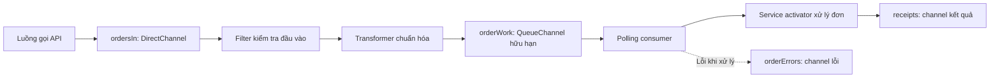

# Chọn channel trước khi chọn endpoint

Trong chương **Thiết kế flow** của module `SPRING_INTEGRATION_CORE`, quyết định đầu tiên khi nối hai bước xử lý là hợp đồng chuyển giao thông điệp: ai nhận, chạy trên luồng nào, có được chờ và có cần giữ lại thông điệp hay không. Từ hợp đồng đó, ta chọn `MessageChannel`, sau đó mới đặt transformer, filter, router, service activator hoặc aggregator vào những vị trí phù hợp.

Cùng một phương thức xử lý đơn hàng có thể chạy ngay trên luồng gọi API, chạy qua executor, hoặc được poller lấy từ queue. Logic nghiệp vụ có thể giữ nguyên, nhưng thời điểm trả lời, đường lỗi và ranh giới transaction sẽ khác nhau. Vì vậy, đọc một flow chỉ qua tên endpoint chưa đủ để hiểu hành vi của nó.

Sau bài này, bạn có thể:

- Chọn giữa phân phối cho một consumer và phát cho nhiều subscriber.
- Xác định ranh giới thực thi đồng bộ, executor và queue có poller.
- Đặt capacity, timeout, đường lỗi và yêu cầu thứ tự trước khi cấu hình endpoint.
- Diễn giải và kiểm thử một flow Java DSL theo đúng ý nghĩa của việc chuyển giao thông điệp.

## 1. Bắt đầu từ yêu cầu chuyển giao

Giả sử hệ thống tiếp nhận đơn hàng có ba yêu cầu:

1. Đơn thiếu mã hoặc có số tiền không hợp lệ phải bị từ chối ngay.
2. Đơn hợp lệ được đưa vào hàng chờ hữu hạn; phần xử lý tiếp theo không giữ luồng gọi API.
3. Kết quả xử lý và lỗi sau khi tiếp nhận phải có nơi thu nhận riêng.

Nếu chỉ viết “filter → transformer → service activator”, sơ đồ chưa thể hiện yêu cầu thứ hai và thứ ba. Ta cần bổ sung channel và bên chịu trách nhiệm tiếp nhận tại mỗi ranh giới:



Đây là thiết kế cho một ví dụ học tập trong cùng ứng dụng. Các channel bộ nhớ ở đây chưa đáp ứng yêu cầu lưu đơn qua việc tiến trình bị dừng. Nếu nghiệp vụ yêu cầu “đã nhận thì phải khôi phục được sau restart”, cần thiết kế cơ chế lưu trữ bền vững ngay tại điểm xác nhận nhận đơn.

Trước mỗi mũi tên, hãy trả lời sáu câu hỏi:

| Câu hỏi | Điều cần chốt | Ví dụ với đơn hàng |
| --- | --- | --- |
| Một thông điệp cần bao nhiêu bên xử lý? | Một consumer thực hiện công việc hay nhiều subscriber nhận sự kiện | Một worker xử lý mỗi đơn; nhiều bên có thể quan tâm sự kiện hoàn tất |
| Bên gửi có chờ xử lý hay không? | Ngân sách thời gian và ý nghĩa của phản hồi | Chờ kiểm tra hợp lệ, sau đó chỉ xác nhận đã chuyển vào hàng chờ |
| Có cần hấp thụ đợt tăng tải không? | Có bộ đệm, capacity và hành vi khi đầy | Hàng chờ tối đa 100 thông điệp trong ví dụ |
| Chấp nhận mất gì khi tiến trình dừng? | Bộ nhớ hay lưu trữ bền vững | Không thể hứa khôi phục với queue bộ nhớ |
| Cần giữ thứ tự đến mức nào? | Thứ tự lấy ra, bắt đầu hay hoàn tất; toàn cục hay theo mã đơn | Các cập nhật cùng đơn có thể cần thứ tự riêng |
| Ai nhận lỗi sau khi chuyển giao? | Caller, channel lỗi, cơ chế retry hoặc lưu lỗi nghiệp vụ | Lỗi đầu vào trả ngay; lỗi worker đi đường riêng |

## 2. Message, channel và endpoint đảm nhận những việc khác nhau

`Message<T>` là đơn vị trao đổi, gồm payload và headers. Payload chứa dữ liệu; headers mang ngữ cảnh như mã theo dõi, khóa nghiệp vụ hoặc thông tin phục vụ trả lời và xử lý lỗi. Hợp đồng payload cần rõ ràng ở từng đoạn: trước transformer có thể là dữ liệu thô, sau transformer là kiểu mà bước nghiệp vụ chấp nhận.

`MessageChannel` cung cấp thao tác gửi. Hai nhánh giao diện quan trọng là:

- `SubscribableChannel`: handler đăng ký nhận; channel phân phối khi có thao tác gửi.
- `PollableChannel`: consumer lấy thông điệp bằng `receive(...)`.

Giao diện gửi không đồng nghĩa với một mô hình thực thi duy nhất. Giá trị `true`, `false` và exception của `send(...)` phải được diễn giải theo channel cụ thể. Xem hợp đồng tại [MessageChannel API](https://docs.spring.io/spring-framework/docs/current/javadoc-api/org/springframework/messaging/MessageChannel.html).

Endpoint kết nối thành phần xử lý với channel và quản lý cách thành phần đó được gọi. Trong nhóm consumer thông thường, Spring Integration chọn `EventDrivenConsumer` cho đầu vào subscribable và `PollingConsumer` cho đầu vào pollable. Vì thế, cùng một transformer có thể được bao bởi hai kiểu consumer khác nhau tùy channel đầu vào. Xem [Message Endpoints](https://docs.spring.io/spring-integration/reference/endpoint.html).

```text
Channel đầu vào             Cách kích hoạt               Logic được gọi
-----------------------    --------------------------   ----------------------
SubscribableChannel        Được channel phân phối       Transformer hoặc handler
PollableChannel            Poller gọi receive()         Transformer hoặc handler
```

Poller thuộc endpoint tiêu thụ, không phải một tác vụ tự chạy sẵn bên trong mọi `QueueChannel`. Khi dùng queue làm đầu vào của endpoint, phải có poller phù hợp, khai báo trực tiếp hoặc thông qua default poller. Trong mã ứng dụng hoặc kiểm thử, bạn cũng có thể chủ động gọi `receive(...)` thay vì dùng một endpoint.

## 3. Chọn kiểu phân phối trước, rồi chọn cách thực thi

Hai quyết định này độc lập:

- **Phân phối:** chọn một consumer để xử lý hay phát cho các subscriber?
- **Thực thi:** gọi trực tiếp, giao cho executor hay lưu vào queue để consumer lấy sau?

Ví dụ, `ExecutorChannel` vẫn là point-to-point dù có thể chuyển việc sang luồng khác. `PublishSubscribeChannel` mặc định có thể gọi subscriber trên chính luồng gửi dù mang tên publish-subscribe.

| Channel | Phân phối và cách nhận | Bộ đệm, luồng thực thi | Phù hợp khi |
| --- | --- | --- | --- |
| `DirectChannel` | Point-to-point; gọi một subscriber được dispatcher chọn | Gọi trên luồng gửi; không có queue chứa công việc chờ | Chuỗi xử lý ngắn, cần caller nhận kết quả hoặc lỗi trực tiếp |
| `ExecutorChannel` | Point-to-point; dispatcher giao việc cho executor | Cách chạy và khả năng xếp hàng phụ thuộc executor | Muốn giao tác vụ cho executor với giới hạn tài nguyên rõ ràng |
| `QueueChannel` | Point-to-point; consumer gọi `receive(...)` | Có queue; endpoint tiêu thụ thường chạy qua poller | Cần bộ đệm hữu hạn và tách nhịp gửi khỏi nhịp xử lý |
| `PublishSubscribeChannel` | Phát thông điệp cho các subscriber đã đăng ký | Mặc định gọi trên luồng gửi; có thể cấu hình executor | Các nhánh đều cần nhận sự kiện |
| `RendezvousChannel` | Chuyển giao trực tiếp cho bên đang nhận | Không tích trữ; bên gửi chờ bên nhận theo timeout | Cần phối hợp giao nhận giữa các luồng mà không giữ backlog |
| `PriorityChannel` | Consumer lấy theo độ ưu tiên | Là channel pollable có queue ưu tiên | Cần ưu tiên công việc và đã xét nguy cơ công việc thường bị chờ lâu |

Hành vi của các channel đặc biệt được mô tả trong [Message Channel Implementations](https://docs.spring.io/spring-integration/reference/channel/implementations.html). Những phần tiếp theo áp dụng các lựa chọn đó vào thiết kế flow.

### 3.1. DirectChannel: liên kết lỏng nhưng dùng chung call stack

Với `DirectChannel`, handler chạy trong luồng gửi. Nếu một đoạn gồm nhiều endpoint chỉ nối bằng direct channel, thời gian gửi vào đoạn đó có thể bao gồm toàn bộ thời gian xử lý phía sau.

Nếu handler ném exception và không có thành phần nào xử lý, exception có thể truyền về caller. Một transaction đang gắn với luồng có thể bao phủ những thao tác tài nguyên phù hợp ở phía sau; channel không tự mở transaction và cũng không tự khiến mọi hệ thống bên ngoài tham gia transaction đó.

Nhiều subscriber cùng đăng ký vào một `DirectChannel` không tạo pipeline “A rồi B”. Dispatcher chọn handler theo cơ chế phân phối; cấu hình failover còn có thể thử handler khác khi xảy ra lỗi. Nếu A và B đều phải chạy theo thứ tự, hãy nối đầu ra A vào channel đầu vào B. Xem [DirectChannel API](https://docs.spring.io/spring-integration/api/org/springframework/integration/channel/DirectChannel.html).

```text
Pipeline hai bước:
input → channelA → handlerA → channelB → handlerB

Hai consumer cùng đầu vào:
                 ┌→ handlerA
shared channel ──┤  dispatcher chọn consumer
                 └→ handlerB
```

Với handler có side effect như gửi lệnh thanh toán, cơ chế thử consumer khác sau lỗi cần được xét cùng tính idempotent. Một lần gọi có thể đã gây tác động ở hệ thống ngoài rồi mới báo lỗi.

### 3.2. ExecutorChannel: executor là một phần của hợp đồng

Khi chọn `ExecutorChannel`, bản thiết kế cần ghi rõ executor nào được dùng, giới hạn luồng, sức chứa hàng tác vụ và chính sách khi bão hòa. Chỉ đổi tên channel chưa đủ để chốt hành vi tải cao.

Executor thông thường làm mất khả năng chia sẻ transaction gắn với luồng giữa sender và handler. Lỗi gửi tác vụ vào executor và lỗi nghiệp vụ trong tác vụ là hai thời điểm khác nhau; caller có thể thấy lỗi từ chối tác vụ, nhưng không thể dùng `try/catch` quanh lần gửi để bắt một lỗi xuất hiện sau đó trên luồng worker. Xem [ExecutorChannel API](https://docs.spring.io/spring-integration/api/org/springframework/integration/channel/ExecutorChannel.html).

Một số chính sách như `CallerRunsPolicy` có thể đưa việc xử lý về luồng gửi khi executor bão hòa. Vì vậy, yêu cầu “luồng API luôn trả nhanh” phải xét cả cấu hình executor. Thread-local, thông tin bảo mật và ngữ cảnh theo dõi cũng cần cơ chế truyền ngữ cảnh phù hợp khi đổi luồng.

### 3.3. QueueChannel: bộ đệm cần người lấy và giới hạn chờ

`QueueChannel` nhận thông điệp vào queue. Khi queue đầy, một lần gửi có thể chờ chỗ trống, hết timeout rồi trả `false`, hoặc phát sinh exception ở lớp gọi phía trên tùy cách gửi. Khi queue trống, consumer cũng có thể chờ theo receive timeout.

Hãy khai báo capacity có chủ đích. Constructor không tham số tạo queue có dung lượng danh nghĩa rất lớn, nên không phải một giới hạn bộ nhớ hữu ích cho phần lớn bài toán tải. Xem [QueueChannel API](https://docs.spring.io/spring-integration/api/org/springframework/integration/channel/QueueChannel.html).

```java
QueueChannel work = new QueueChannel(100);

boolean accepted = work.send(message, 200); // Chờ chỗ trống tối đa 200 ms.
Message<?> next = work.receive(500);        // Chờ thông điệp tối đa 500 ms.
```

Ở đây `message` là thông điệp đã được tạo trước đó. Khi nhận trả về `null`, caller phải xử lý tình huống không có thông điệp trong khoảng chờ.

### 3.4. PublishSubscribeChannel: mỗi nhánh là một trách nhiệm

Khi cùng một sự kiện cần cập nhật số liệu và gửi thông báo, publish-subscribe biểu đạt đúng ý định hơn việc gắn hai endpoint lên một `DirectChannel`. Mỗi subscriber đã đăng ký đều là một đích phân phối.

Constructor mặc định gọi handler trên luồng gửi. Gắn executor thay đổi cách thực thi nhưng không tự tạo cơ chế lưu sự kiện cho subscriber vắng mặt. Với cấu hình mặc định, không nên xem channel này như một kho sự kiện để subscriber đọc bù về sau. Xem [PublishSubscribeChannel API](https://docs.spring.io/spring-integration/api/org/springframework/integration/channel/PublishSubscribeChannel.html).

Khi tách nhánh, cần xác định nhánh nào bắt buộc, nhánh nào chấp nhận lỗi độc lập và nhánh nào có side effect. Việc phát cho nhiều subscriber không tự cung cấp rollback cho những tác động đã xảy ra ở các nhánh trước.

## 4. Đánh dấu ranh giới transaction, kết quả và lỗi

Hãy viết ý nghĩa của phản hồi ngay tại nơi chuyển giao:

| Ranh giới | Bên gửi có thể biết điều gì? | Điều chưa thể kết luận |
| --- | --- | --- |
| Chuỗi direct xử lý và trả về bình thường | Đoạn gọi đồng bộ đã kết thúc theo cấu hình | Mọi tác động bên ngoài đều có thể rollback |
| Gửi thành công vào queue | Thông điệp đã được queue chấp nhận | Worker đã xử lý xong hoặc dữ liệu đã được lưu bền vững |
| Executor nhận tác vụ | Công việc đã được executor nhận theo cơ chế của nó | Nghiệp vụ trong tác vụ đã thành công |
| Một nhánh phát sự kiện đã chạy | Nhánh đó đã thực hiện theo hành vi quan sát được | Các nhánh khác đều thành công hoặc có thể bù trừ tự động |

Với flow đồng bộ, lỗi handler thường truyền theo call stack. Với xử lý bất đồng bộ do Spring Integration quản lý, lỗi có thể được đóng gói thành `ErrorMessage` và gửi đến channel lỗi. Cơ chế chuẩn xét header `errorChannel` của thông điệp, rồi đến channel lỗi được cấu hình hoặc channel lỗi chung tùy thành phần phát lỗi. Poller cũng có cấu hình error channel riêng. Xem [Error Handling](https://docs.spring.io/spring-integration/reference/error-handling.html).

Ví dụ với đơn hàng:

```text
Đầu vào không hợp lệ:
caller → DirectChannel → filter ném lỗi → caller nhận lỗi

Đầu vào hợp lệ nhưng worker lỗi:
caller → DirectChannel → queue nhận đơn → caller được giải phóng
                                      ↓
                                poller → handler lỗi
                                      ↓
                              ErrorMessage → nơi xử lý lỗi
```

Trong dòng thứ hai, worker có thể bắt đầu rất sớm, thậm chí trước khi lần gọi gửi ban đầu trả về. Điểm cốt lõi là lỗi ở worker không quay về qua call stack của caller.

Thiết kế đường lỗi phải trả lời được ba việc: xác định đơn nào thất bại, quyết định có thử lại được không và lưu trạng thái để vận hành theo dõi. Ghi log có thể là một hành động trong quy trình đó; nó chưa phải cơ chế hoàn tất công việc bị lỗi.

## 5. Java DSL có channel ngầm định

Một flow có nhiều lời gọi `.transform(...)`, `.filter(...)`, `.handle(...)` vẫn có channel nối các endpoint. Theo mặc định của Java DSL, những liên kết được tạo ngầm định thường là `DirectChannel`. Đặt nhiều endpoint trong một chuỗi DSL không tự tạo xử lý song song. Xem [Message Channels trong Java DSL](https://docs.spring.io/spring-integration/reference/dsl/java-channels.html).

Khi đọc hoặc thiết kế, hãy ghi lại sơ đồ đã mở rộng:

```text
ordersIn [Direct]
    → filter
    → channel ngầm định [Direct]
    → transformer
    → orderWork [Queue, capacity=100]
    → polling consumer
    → service activator
    → receipts [Queue]
```

Channel nên được đặt tên rõ ở những nơi cần quan sát hoặc thay đổi hợp đồng: cổng vào, hàng công việc chờ xử lý, điểm phát sự kiện, đường kết quả và đường lỗi. Không cần khai báo thủ công mọi direct channel ở giữa các thao tác ngắn nếu channel ngầm định đã biểu đạt đúng ý định.

## 6. Ví dụ hoàn chỉnh: kiểm tra đồng bộ, xử lý qua queue

Ví dụ dưới đây dùng Java 17 trở lên vì có `record`, và giả định classpath đã có Spring Context cùng `spring-integration-core` tương thích với ứng dụng. Đây là cấu hình để đặt vào một ứng dụng hoặc context kiểm thử có sẵn; bài không yêu cầu thay đổi cấu hình build.

Hợp đồng được chọn trước khi viết endpoint:

| Channel | Loại | Mục đích |
| --- | --- | --- |
| `ordersIn` | `DirectChannel` | Giữ bước kiểm tra và chuẩn hóa trên luồng gửi |
| `orderWork` | `QueueChannel(100)` | Giới hạn số thông điệp còn chờ worker nhận |
| `receipts` | `QueueChannel(100)` | Thu kết quả để mã minh họa hoặc kiểm thử chủ động nhận |
| `orderErrors` | `QueueChannel(100)` | Thu lỗi poller để mã minh họa hoặc kiểm thử kiểm tra |

```java
import java.time.Duration;

import org.springframework.beans.factory.annotation.Qualifier;
import org.springframework.context.annotation.Bean;
import org.springframework.context.annotation.Configuration;
import org.springframework.integration.channel.DirectChannel;
import org.springframework.integration.channel.QueueChannel;
import org.springframework.integration.config.EnableIntegration;
import org.springframework.integration.dsl.IntegrationFlow;
import org.springframework.integration.dsl.Pollers;

@Configuration
@EnableIntegration
public class OrdersFlowConfig {

    public record Order(String id, long amountCents) {}

    public record Receipt(String orderId, String status) {}

    @Bean
    public DirectChannel ordersIn() {
        return new DirectChannel();
    }

    @Bean
    public QueueChannel orderWork() {
        return new QueueChannel(100);
    }

    @Bean
    public QueueChannel receipts() {
        return new QueueChannel(100);
    }

    @Bean
    public QueueChannel orderErrors() {
        return new QueueChannel(100);
    }

    @Bean
    public IntegrationFlow acceptOrders(
            @Qualifier("ordersIn") DirectChannel input,
            @Qualifier("orderWork") QueueChannel work) {

        return IntegrationFlow.from(input)
                .<Order>filter(
                        order -> order.id() != null
                                && !order.id().isBlank()
                                && order.amountCents() > 0,
                        endpoint -> endpoint
                                .id("validateOrder")
                                .throwExceptionOnRejection(true))
                .<Order, Order>transform(
                        order -> new Order(
                                order.id().trim(), order.amountCents()),
                        endpoint -> endpoint
                                .id("normalizeOrder")
                                .sendTimeout(200))
                .channel(work)
                .get();
    }

    @Bean
    public IntegrationFlow fulfillOrders(
            @Qualifier("orderWork") QueueChannel work,
            @Qualifier("receipts") QueueChannel output) {

        return IntegrationFlow.from(work)
                .handle(Order.class, (order, headers) -> {
                    // Điều kiện giả lập lỗi để quan sát đường lỗi của poller.
                    if (order.amountCents() == 13_000) {
                        throw new IllegalStateException(
                                "Simulated failure: " + order.id());
                    }
                    return new Receipt(order.id(), "DONE");
                }, endpoint -> endpoint
                        .id("fulfillOrder")
                        .poller(Pollers.fixedDelay(Duration.ofMillis(100))
                                .receiveTimeout(0)
                                .maxMessagesPerPoll(5)
                                .errorChannel("orderErrors"))
                        .sendTimeout(200))
                .channel(output)
                .get();
    }
}
```

### 6.1. Channel quyết định cách hai đoạn flow phối hợp

Trong `acceptOrders`, filter và transformer chạy theo chuỗi đồng bộ. Filter chủ động ném lỗi khi đầu vào sai, tránh trường hợp caller tưởng đơn đã được tiếp nhận dù thông điệp bị loại bỏ. Transformer tạo payload mới với mã đơn đã bỏ khoảng trắng.

Transformer gửi đầu ra tới `orderWork`. Cấu hình `sendTimeout(200)` nằm tại endpoint phát thông điệp vào queue, giới hạn thời gian chờ chỗ trống ở lần gửi đó. Nếu không gửi được, endpoint có thể phát sinh lỗi chuyển giao thay vì để caller hiểu nhầm rằng đơn đã được nhận.

Trong `fulfillOrders`, đầu vào là `QueueChannel`, nên endpoint tiêu thụ có poller. Các tham số được chọn cho mục đích minh họa:

- `fixedDelay(100 ms)`: tạo nhịp chạy theo fixed delay của poller.
- `receiveTimeout(0)`: không giữ tác vụ polling chờ khi queue đang trống.
- `maxMessagesPerPoll(5)`: giới hạn số lần nhận trong một lượt poll.
- `errorChannel("orderErrors")`: chỉ định nơi nhận lỗi của poller trong ví dụ.

`maxMessagesPerPoll(5)` không có nghĩa năm worker song song và cũng không bảo đảm tốc độ 50 thông điệp mỗi giây. Thời gian xử lý, lịch thực thi và cấu hình executor của poller còn ảnh hưởng thông lượng. Tham khảo [Pollers trong Java DSL](https://docs.spring.io/spring-integration/reference/dsl/java-pollers.html) và [PollerSpec API](https://docs.spring.io/spring-integration/api/org/springframework/integration/dsl/PollerSpec.html).

### 6.2. Send timeout có phạm vi cục bộ

Trong cấu hình này, hai `sendTimeout(200)` phục vụ hai lần chuyển giao khác nhau: transformer gửi vào hàng công việc và service activator gửi vào hàng kết quả. API cấu hình tương ứng được mô tả tại [ConsumerEndpointSpec.sendTimeout](https://docs.spring.io/spring-integration/api/org/springframework/integration/dsl/ConsumerEndpointSpec.html#sendTimeout(long)).

Không nên suy luận rằng `ordersIn.send(message, 200)` sẽ buộc mọi endpoint phía sau hoàn thành trong 200 ms. Timeout truyền vào lần gửi ban đầu không tự lan thành deadline toàn flow; direct channel cũng không dùng tham số đó để ngắt một handler đang chạy lâu.

Tương tự, send timeout của endpoint không giới hạn thời gian thực thi logic trong handler. Nếu handler gọi HTTP hoặc truy vấn cơ sở dữ liệu, các timeout cho những thao tác đó cần được cấu hình ở client hoặc tầng tài nguyên tương ứng.

### 6.3. Các queue đầu ra cần được tiêu thụ

`receipts` và `orderErrors` là nơi thu nhận trong ví dụ kiểm thử, nên mã kiểm thử sẽ gọi `receive(...)`. Khi đưa mô hình này vào ứng dụng chạy liên tục, cần có consumer phù hợp để xử lý kết quả và lỗi. Nếu chúng không được lấy ra, queue có thể đầy và tạo lỗi hoặc thời gian chờ mới.

Trong flow này, lỗi tại bước gửi receipt cũng có thể xuất hiện sau khi nghiệp vụ của handler đã chạy xong. Do đó, “không nhận được receipt” không đủ để kết luận “đơn chưa từng được xử lý”. Khi bổ sung retry, phải xét đúng thao tác nào được lặp lại và dùng khóa nghiệp vụ để hạn chế tác động trùng.

## 7. Kiểm thử hợp đồng channel

Kiểm thử phép biến đổi payload chưa chứng minh được flow có hợp đồng chuyển giao đúng. Với ví dụ trên, cần quan sát cả phản hồi của sender, dữ liệu ở channel kết quả và thông điệp lỗi của poller.

Lớp dưới đây là mã minh họa dùng JUnit 5, đặt cùng package với `OrdersFlowConfig`. Mỗi test tạo context riêng để không dùng chung thông điệp còn sót lại trong queue.

```java
import org.junit.jupiter.api.Test;
import org.springframework.context.annotation.AnnotationConfigApplicationContext;
import org.springframework.integration.channel.QueueChannel;
import org.springframework.messaging.Message;
import org.springframework.messaging.MessageChannel;
import org.springframework.messaging.MessagingException;
import org.springframework.messaging.support.ErrorMessage;
import org.springframework.messaging.support.GenericMessage;

import static org.junit.jupiter.api.Assertions.*;

class OrdersFlowConfigTest {

    @Test
    void validOrderProducesReceipt() {
        try (var context = new AnnotationConfigApplicationContext(
                OrdersFlowConfig.class)) {
            var input = context.getBean("ordersIn", MessageChannel.class);
            var output = context.getBean("receipts", QueueChannel.class);

            boolean accepted = input.send(new GenericMessage<>(
                    new OrdersFlowConfig.Order(" ORD-1 ", 25_000)));

            assertTrue(accepted);
            Message<?> result = output.receive(2_000);
            assertNotNull(result);
            assertEquals(
                    new OrdersFlowConfig.Receipt("ORD-1", "DONE"),
                    result.getPayload());
        }
    }

    @Test
    void invalidOrderFailsOnSendingThread() {
        try (var context = new AnnotationConfigApplicationContext(
                OrdersFlowConfig.class)) {
            var input = context.getBean("ordersIn", MessageChannel.class);

            assertThrows(MessagingException.class, () -> input.send(
                    new GenericMessage<>(
                            new OrdersFlowConfig.Order("ORD-2", 0))));
        }
    }

    @Test
    void workerFailureIsReceivedOnErrorChannel() {
        try (var context = new AnnotationConfigApplicationContext(
                OrdersFlowConfig.class)) {
            var input = context.getBean("ordersIn", MessageChannel.class);
            var errors = context.getBean("orderErrors", QueueChannel.class);

            // Lần gửi thành công dù handler phía sau queue sẽ thất bại.
            assertTrue(input.send(new GenericMessage<>(
                    new OrdersFlowConfig.Order("ORD-3", 13_000))));

            Message<?> error = errors.receive(2_000);
            assertNotNull(error);
            assertInstanceOf(ErrorMessage.class, error);
            assertInstanceOf(Throwable.class, error.getPayload());
        }
    }

    @Test
    void fullQueueRejectsAnImmediateSend() {
        var queue = new QueueChannel(1);

        assertTrue(queue.send(new GenericMessage<>("first"), 0));
        assertFalse(queue.send(new GenericMessage<>("second"), 0));
    }
}
```

`receive(2_000)` là giới hạn chờ trong test để đồng bộ với xử lý bất đồng bộ; nó không cam kết SLA cho nghiệp vụ. Cách chờ này gắn trực tiếp với điều kiện cần quan sát, tránh phải chọn một khoảng `sleep` rồi đoán rằng worker đã chạy.

Test queue đầy dùng queue riêng không có consumer, nên không bị cuộc đua với poller đang lấy thông điệp. Để kiểm tra giới hạn thời gian gửi trong cả flow, cần chủ động dừng hoặc thay thế consumer tại ranh giới đó. Spring Integration có công cụ hỗ trợ kiểm thử flow và mock thành phần, được trình bày tại [Testing support](https://docs.spring.io/spring-integration/reference/testing.html).

Các đoạn mã trên phục vụ học tập; bài viết không kèm kết quả chạy build hoặc test trong workspace.

## 8. Tính capacity từ tải và thời gian chờ chấp nhận được

Một queue hữu hạn giúp nhìn thấy quá tải, nhưng không làm consumer xử lý nhanh hơn. Hãy ước lượng backlog bằng các đại lượng đo được:

```text
λ = tốc độ thông điệp đến
μ = tổng tốc độ consumer xử lý được

Khi λ > μ:
    Tốc độ backlog tăng ≈ λ - μ
    Backlog tăng trong đợt tải T ≈ (λ - μ) × T
```

Ví dụ giả định đầu vào đạt 400 thông điệp/giây, consumer xử lý 250 thông điệp/giây và đợt tải kéo dài 4 giây. Backlog tăng khoảng `150 × 4 = 600` thông điệp nếu ban đầu queue trống. Queue dung lượng 100 trong ví dụ Java chỉ hấp thụ khoảng `100 / 150 ≈ 0,67` giây của phần tải vượt, theo mô hình đơn giản này.

Đây là phép ước lượng để chọn điểm bắt đầu đo đạc. Tải theo đợt, thời gian xử lý không đều và sự cố downstream có thể khiến backlog thực tế khác xa giá trị trung bình.

Khi chọn capacity, hãy kiểm tra đồng thời:

- Bộ nhớ cho payload, headers và các đối tượng được tham chiếu.
- Thời gian thông điệp nằm chờ trước khi được xử lý.
- Khả năng phục hồi backlog sau đợt tăng tải.
- Hành vi phía gửi khi queue đầy: chờ hữu hạn, từ chối có thông báo hay chuyển sang nơi lưu bền vững đã được thiết kế.

Theo dõi tối thiểu độ sâu queue, tuổi của thông điệp chờ lâu nhất, số lần gửi thất bại, thời gian xử lý và số lỗi worker. Với executor, bổ sung số tác vụ chờ và số lần bị từ chối. Queue gần rỗng nhưng worker vẫn chậm có thể phản ánh ít tải; queue tăng liên tục cho thấy tốc độ nhận đang vượt khả năng tiêu thụ hoặc consumer đã ngừng hoạt động.

## 9. Thứ tự, transaction và lưu trữ là ba yêu cầu riêng

### 9.1. FIFO không bảo đảm thứ tự hoàn tất

Với queue FIFO thông thường, thứ tự lấy ra không đồng nghĩa thứ tự hoàn tất khi có nhiều consumer hoặc bước xử lý chạy song song. Ví dụ A được lấy trước nhưng gọi hệ thống ngoài chậm hơn B; kết quả B có thể xuất hiện trước A.

Nếu thứ tự cập nhật của cùng một đơn quan trọng, hãy chốt yêu cầu theo khóa nghiệp vụ. Có thể cần phân luồng theo khóa, giới hạn xử lý đồng thời cho mỗi khóa hoặc kiểm tra phiên bản dữ liệu. Không nên áp đặt thứ tự toàn cục nếu nghiệp vụ chỉ cần thứ tự trong từng đơn.

### 9.2. Ranh giới queue cần transaction riêng ở phía consumer

Một transaction trên luồng gửi không tự đi theo thông điệp sang poller. Nếu consumer cần transaction cơ sở dữ liệu, hãy cấu hình transaction tại phía consumer bằng cơ chế phù hợp với ứng dụng.

Queue bộ nhớ trong ví dụ không trở thành hàng đợi có khả năng rollback việc lấy thông điệp chỉ vì handler có `@Transactional`. Khi xử lý thất bại, cũng không có lý do để mặc định rằng thông điệp sẽ tự xuất hiện lại trong queue. Cần thiết kế cụ thể cơ chế retry, lưu lỗi hoặc khôi phục.

### 9.3. Bộ đệm không thay thế cam kết lưu bền vững

Nếu yêu cầu nghiệp vụ là không mất đơn đã xác nhận, phải gắn xác nhận đó với một thao tác lưu bền vững đã hoàn tất. Có thể cân nhắc channel dùng message store phù hợp hoặc một hệ thống messaging bền vững; lựa chọn còn phụ thuộc ranh giới transaction và hạ tầng của ứng dụng. Cấu hình queue có message store được giới thiệu tại [Configuring Message Channels](https://docs.spring.io/spring-integration/reference/channel/configuration.html).

Lưu bền vững vẫn cần đi cùng chiến lược khôi phục và xử lý lặp. Ví dụ, consumer đã gọi hệ thống ngoài thành công rồi dừng trước khi ghi trạng thái hoàn tất; lần chạy lại phải nhận diện được tác động trước đó. Dùng `orderId` hoặc một khóa thao tác nghiệp vụ ổn định thường có ý nghĩa hơn việc dùng một message ID mới được sinh cho mỗi lần gửi lại.

## 10. Sau khi chốt channel, chọn endpoint theo nhiệm vụ

| Nhu cầu xử lý | Thành phần thích hợp | Quyết định về channel cần có trước |
| --- | --- | --- |
| Đổi cấu trúc hoặc chuẩn hóa payload | Transformer | Kiểu dữ liệu đầu ra, có giữ đồng bộ với caller không |
| Chấp nhận hoặc loại bỏ thông điệp | Filter | Khi loại bỏ thì ném lỗi, gửi discard channel hay chủ động bỏ qua theo hợp đồng nào |
| Chọn nhánh theo nội dung hoặc header | Router | Channel đích của từng nhánh, đường mặc định và cách xử lý khi không có đích |
| Gọi logic nghiệp vụ | Service activator | Thời gian xử lý, ranh giới transaction và đường trả kết quả hoặc lỗi |
| Gom nhiều thông điệp liên quan | Aggregator | Nơi nhận từng phần, correlation, điều kiện release và xử lý nhóm chưa đủ |
| Đưa một lời gọi Java vào thế giới messaging | Gateway | Kiểu tương tác một chiều hoặc request-reply, timeout và đường reply |

Router quyết định đích đến; kiểu channel đích quyết định cách chuyển giao. Ví dụ, router có thể chọn nhánh đơn thường dùng direct channel và nhánh cần kiểm tra bổ sung dùng queue. Chọn được nhánh chưa có nghĩa bên nhận nhánh đó đã xử lý xong.

Aggregator có trạng thái riêng để giữ các thông điệp trong nhóm. Queue đầu vào và kho nhóm của aggregator là hai trách nhiệm khác nhau; thêm queue không tự giải quyết việc nhóm thiếu thành phần hoặc hết thời gian chờ. Cần định nghĩa correlation, điều kiện release và chính sách cho nhóm chưa hoàn chỉnh. Xem [Aggregator](https://docs.spring.io/spring-integration/reference/aggregator.html).

Gateway che giấu messaging API sau một giao diện Java. Một phương thức request-reply đồng bộ vẫn có thể giữ caller chờ kết quả dù bên trong flow có queue. Cần lập ngân sách cho cả thời gian chuyển giao, chờ trong queue, xử lý và nhận reply. Xem [Messaging Gateways](https://docs.spring.io/spring-integration/reference/gateway.html).

Với ví dụ `OrdersFlowConfig`, kết quả được đưa rõ vào `receipts`. Nếu muốn thay bằng gateway trả `Receipt`, phải thiết kế lại đường reply tương ứng; chỉ đổi kiểu trả về của phương thức gateway chưa làm receipt tự quay về caller.

## 11. Những lựa chọn dễ gây sai hợp đồng

| Lựa chọn | Hệ quả dễ gặp | Cách sửa thiết kế |
| --- | --- | --- |
| Hai endpoint cùng nghe một direct channel với ý định cả hai đều chạy | Công việc được phân phối theo dispatcher | Nối tuần tự nếu là pipeline; dùng publish-subscribe nếu là các nhánh cùng nhận |
| Đổi direct thành queue nhưng không cấu hình consumer phù hợp | Endpoint thiếu poller hoặc thông điệp không được lấy | Chốt consumer và poller tại ranh giới queue |
| Tạo queue lớn để che việc downstream chậm | Tăng bộ nhớ và độ trễ, sự cố xuất hiện muộn | Chọn capacity theo tải đo được và hợp đồng từ chối hoặc chờ |
| Chỉ đặt timeout ở lần gửi vào cổng đầu tiên | Lần gửi ở endpoint phía sau vẫn có thể chờ lâu | Đặt timeout tại từng ranh giới có khả năng chờ |
| Gọi publish-subscribe rồi giả định các nhánh độc lập về lỗi | Một nhánh có thể ảnh hưởng tiến trình phân phối theo cấu hình | Chốt mô hình thực thi và trách nhiệm lỗi cho từng nhánh |
| Xem `send() == true` như trạng thái đơn đã hoàn tất | Caller báo thành công nghiệp vụ quá sớm | Phân biệt trạng thái đã tiếp nhận với đã xử lý xong |
| Thêm retry mà chưa xét side effect | Gửi trùng lệnh hoặc ghi nhận trùng nghiệp vụ | Xác định phạm vi retry và khóa idempotency |
| Dùng queue bộ nhớ cho lời hứa khôi phục sau restart | Mất thông điệp đã xác nhận khi tiến trình dừng | Đặt cơ chế lưu bền vững tại điểm xác nhận |

## 12. Bài tập áp dụng

### Tình huống A: báo giá phải trả kết quả ngay

Một lời gọi báo giá cần kiểm tra dữ liệu, tra quy tắc trong bộ nhớ và trả giá. Các bước đều ngắn, caller cần biết lỗi ngay.

Hướng thiết kế: bắt đầu với chuỗi direct channel và gateway request-reply. Đo thời gian xử lý trước khi thêm executor hoặc queue. Nếu xuất hiện lời gọi mạng chậm, đánh giá lại ngân sách thời gian tại bước đó và hợp đồng phản hồi của API.

### Tình huống B: nhập dữ liệu theo đợt

Đầu vào có đợt tăng tải trong vài giây; consumer lưu cơ sở dữ liệu có năng lực xử lý hữu hạn. Hệ thống cần từ chối rõ ràng khi hết sức chứa.

Hướng thiết kế: chọn queue hữu hạn, giới hạn thời gian gửi, cấu hình poller và quyết định nơi ghi nhận lỗi. Nếu đã xác nhận nhận thì phải không mất dữ liệu sau restart, bổ sung cơ chế lưu bền vững trước khi dùng mô hình này cho cam kết đó.

### Tình huống C: thông báo hoàn tất cho nhiều bên

Một đơn hoàn tất cần cập nhật số liệu và gửi email. Email có thể chậm, nhưng không được làm nghẽn việc ghi nhận số liệu.

Hướng thiết kế: dùng cơ chế phân phối tới nhiều nhánh, rồi chọn ranh giới xử lý phù hợp cho từng nhánh. Có thể đặt hàng công việc riêng cho email, với consumer và đường lỗi riêng. Nếu email phải được gửi bù sau khi ứng dụng dừng, cần lưu yêu cầu gửi theo cơ chế bền vững.

### Tự kiểm tra thiết kế

Hãy mở rộng sơ đồ flow của bạn sao cho mỗi channel đều trả lời được:

1. Thông điệp được gửi cho một consumer hay cho nhiều subscriber?
2. Luồng nào thực hiện handler kế tiếp, và điều gì xảy ra khi tài nguyên thực thi bão hòa?
3. Có thông điệp nằm chờ ở đâu, sức chứa bao nhiêu và bên nào lấy ra?
4. Việc gửi thành công chứng minh điều gì với caller?
5. Lỗi trước và sau ranh giới chuyển giao được xử lý ở đâu?
6. Yêu cầu thứ tự, transaction và khôi phục sau restart được đáp ứng bằng cơ chế nào?

Khi các câu trả lời đã rõ, mỗi endpoint có một nhiệm vụ cụ thể và một hợp đồng vào/ra có thể quan sát. Đó là cơ sở để bổ sung transformer, router, filter hay aggregator mà vẫn hiểu được toàn bộ hành vi của flow.
