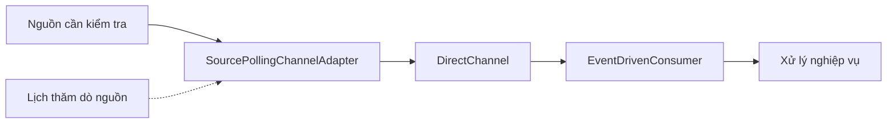
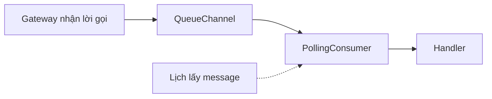

# Chọn event-driven hay polling

Trong chương **Thiết kế flow** của module **SPRING_INTEGRATION_CORE**, lựa chọn event-driven hay polling quyết định lúc nào công việc bắt đầu, thread nào thực hiện và bên nào phải chờ. Quyết định này cần gắn với cách sử dụng Message, MessageChannel, endpoint và gateway, thay vì chỉ chọn một khoảng thời gian chạy định kỳ.

Bài học đi từ mô hình đến Java DSL để trả lời một yêu cầu thực tế: đơn hàng nào cần xử lý ngay, đơn hàng nào có thể đợi trong hàng đệm và nguồn dữ liệu nào phải được ứng dụng chủ động kiểm tra.

## 1. Mục tiêu và kiến thức cần có

Sau bài học, bạn có thể:

- Phân biệt event-driven consumer với polling consumer trong một flow.
- Tách việc lấy dữ liệu từ nguồn khỏi việc chuyển message giữa các endpoint.
- Chọn DirectChannel, ExecutorChannel hoặc QueueChannel theo yêu cầu xử lý.
- Đặt poller đúng endpoint và giải thích các tham số chính.
- Dự đoán ảnh hưởng của lựa chọn đến lỗi, transaction, tồn đọng và kiểm thử.

Bạn cần biết Message gồm payload và headers, channel chuyển message, còn endpoint kết nối channel với thành phần xử lý. Transformer, filter, router hay aggregator mô tả công việc nghiệp vụ; cách endpoint nhận message là một quyết định khác.

## 2. Hai vị trí cần phân biệt

### 2.1. Dữ liệu đi vào ứng dụng như thế nào?

Ở biên hệ thống, hãy xác định ai chủ động bắt đầu trao đổi:

- **Nguồn chủ động thông báo:** một HTTP request đến ứng dụng, callback được gọi hoặc listener nhận dữ liệu. Adapter/gateway đưa dữ liệu vào flow khi hoạt động đó xảy ra.
- **Ứng dụng chủ động kiểm tra nguồn:** định kỳ đọc thư mục, hỏi API hoặc tìm bản ghi chờ xử lý. Một nguồn có thể thăm dò được biểu diễn bằng MessageSource; SourcePollingChannelAdapter gọi nguồn theo lịch.

Đừng suy ra cơ chế của adapter chỉ từ tên giao thức. Cần kiểm tra adapter cụ thể cung cấp listener, polling hay cả hai. Việc listener của một thư viện giao tiếp với máy chủ ra sao cũng khác với việc có cấu hình poller của Spring Integration hay không.

### 2.2. Endpoint nhận message từ channel như thế nào?

Đối với các consumer endpoint thông thường:

| Đầu vào của endpoint | Cách nhận | Kiểu endpoint |
| --- | --- | --- |
| SubscribableChannel, chẳng hạn DirectChannel | Được gọi khi channel dispatch message đến subscriber | EventDrivenConsumer |
| PollableChannel, chẳng hạn QueueChannel | Poller gọi receive() để lấy message | PollingConsumer |

SourcePollingChannelAdapter thăm dò **nguồn**, còn PollingConsumer thăm dò **channel**. Hai thành phần có thể cùng xuất hiện trong một flow và có lịch độc lập. Đây là sự phân biệt được nêu trong tài liệu [Poller của Spring Integration](https://docs.spring.io/spring-integration/reference/6.5/polling-consumer.html).

Một bài toán có thể dùng nguồn polling nhưng phần xử lý nội bộ lại event-driven:



Trong flow này, handler không chờ thêm một lịch polling sau DirectChannel. Khi nguồn trả về message, channel chuyển ngay message cho handler trên thread đang thực hiện lượt thăm dò.

Một cách kết hợp khác:



Lời gọi gateway đưa message vào hàng đệm; endpoint phía sau mới lấy message theo poller. Vì thế, “toàn bộ hệ thống dùng event-driven” thường là mô tả quá rộng. Hãy chỉ rõ từng nguồn và từng ranh giới channel.

## 3. Event-driven không đồng nghĩa với bất đồng bộ

DirectChannel gọi handler ngay trên thread của bên gửi. Nếu handler mất 300 ms, lời gọi gửi cũng phải chờ phần xử lý đồng bộ đó. ExecutorChannel chuyển việc dispatch cho executor, nên thông thường tạo ranh giới thread; cần xem thêm chính sách executor khi quá tải.

QueueChannel mặc định giữ message trong bộ nhớ. Khi còn chỗ, gửi vào channel chỉ hoàn tất việc đưa message vào hàng đợi. Điều đó chưa chứng minh nghiệp vụ đã xử lý xong. Các đặc tính này được mô tả trong [Message Channel Implementations](https://docs.spring.io/spring-integration/reference/6.5/channel/implementations.html).

| Lựa chọn | Nhịp xử lý | Điều cần quyết định thêm |
| --- | --- | --- |
| DirectChannel | Theo lời gọi gửi message | Thời gian bên gọi có thể chờ |
| ExecutorChannel | Theo message đến và khả năng nhận việc của executor | Số worker, hàng đợi executor, chính sách từ chối |
| QueueChannel và polling endpoint | Theo lịch poller, lượng message còn trong queue và thời gian xử lý | Capacity, giới hạn mỗi lượt, timeout, lưu bền |

Ví dụ, xử lý ngay trên thread HTTP phù hợp khi kết quả phải có trước lúc trả response và thời gian xử lý nằm trong ngân sách độ trễ. Gửi email sau khi tiếp nhận đơn hàng có thể cần một ranh giới bất đồng bộ. Nếu yêu cầu chỉ là đổi thread, hãy cân nhắc ExecutorChannel; nếu cần chủ động lấy công việc theo lịch và giữ tồn đọng trong channel, hãy đánh giá QueueChannel cùng poller.

Một QueueChannel cục bộ và một broker lưu bền giải quyết những yêu cầu vận hành khác nhau. Với yêu cầu không mất công việc khi JVM dừng, cần thiết kế lưu trữ, xác nhận và phục hồi phù hợp; chỉ đổi loại endpoint chưa đáp ứng yêu cầu đó.

## 4. Chọn theo yêu cầu của bài toán

Hãy lần lượt trả lời năm câu hỏi:

1. **Nguồn có thông báo đáng tin cậy không?** Nếu chỉ có API đọc hoặc thư mục cần quét, ứng dụng phải chủ động kiểm tra bằng một cơ chế phù hợp.
2. **Người gọi cần kết quả ngay hay chỉ cần tiếp nhận yêu cầu?** Đây là cơ sở chọn hợp đồng gateway và thời điểm trả kết quả.
3. **Có cần kiểm soát thời điểm lấy công việc không?** Ví dụ chỉ chạy trong khung giờ đối tác cho phép hoặc gom một lượng công việc mỗi lượt.
4. **Nếu đầu vào nhanh hơn đầu ra thì công việc nằm ở đâu?** Xác định capacity, nơi lưu bền và hành vi khi đầy.
5. **Ai chịu trách nhiệm khi xử lý thất bại?** Chọn cách trả lỗi, retry và đối soát trước khi tách thread.

| Tình huống | Điểm xuất phát để thiết kế | Lý do |
| --- | --- | --- |
| Kiểm tra một đơn hàng trước khi trả kết quả cho người gọi | Gateway và DirectChannel | Người gọi cần kết quả trong cùng tương tác |
| Đối tác chỉ cho phép gọi API truy vấn trạng thái | MessageSource và source poller | Ứng dụng phải chủ động phát hiện thay đổi |
| Có callback thông báo đơn hàng mới | Inbound gateway/adapter nhận callback | Tận dụng tín hiệu có sẵn để bắt đầu flow |
| Nhiều yêu cầu đến cùng lúc, xử lý được phép trễ | Hàng đệm có giới hạn và consumer phù hợp | Cần hấp thụ đợt tăng tải và quan sát tồn đọng |
| Cần xử lý bất đồng bộ ngay khi có việc | Event-driven qua executor hoặc adapter phù hợp | Chưa có yêu cầu buộc phải thêm lịch polling |
| Công việc chỉ được phép chạy trong khung giờ xác định | Poller dùng trigger phù hợp | Thời điểm lấy việc là một ràng buộc nghiệp vụ |

Đây là các hướng thiết kế ban đầu. Ví dụ callback từ đối tác vẫn có thể được đưa vào hàng đợi lưu bền trước khi xử lý nếu yêu cầu độ tin cậy đòi hỏi điều đó.

## 5. Ba flow Java DSL dùng chung một nghiệp vụ

Ví dụ dưới đây dùng **Java 17 trở lên và API Spring Integration 6.5** làm mốc minh họa. Ứng dụng cần các dependency Spring Context, Spring Messaging và Spring Integration Core với phiên bản tương thích, hoặc một bộ dependency được quản lý đồng bộ bởi Spring Boot.

Mã sử dụng trực tiếp AnnotationConfigApplicationContext nên khai báo EnableIntegration. Các khai báo package và import bên dưới tạo thành một lớp cấu hình; không cần các adapter giao thức bên ngoài để hiểu ví dụ.

### 5.1. Cấu hình đầy đủ

```java
package example.flowdesign;

import java.time.Duration;
import java.util.Queue;
import java.util.concurrent.ConcurrentLinkedQueue;

import org.springframework.beans.factory.annotation.Qualifier;
import org.springframework.context.annotation.Bean;
import org.springframework.context.annotation.Configuration;
import org.springframework.context.annotation.Import;
import org.springframework.integration.annotation.Gateway;
import org.springframework.integration.annotation.MessagingGateway;
import org.springframework.integration.channel.DirectChannel;
import org.springframework.integration.channel.QueueChannel;
import org.springframework.integration.config.EnableIntegration;
import org.springframework.integration.core.MessageSource;
import org.springframework.integration.dsl.IntegrationFlow;
import org.springframework.integration.dsl.Pollers;
import org.springframework.messaging.Message;
import org.springframework.messaging.support.MessageBuilder;

@Configuration(proxyBeanMethods = false)
@EnableIntegration
@Import(FlowChoiceConfig.OrderIngress.class)
public class FlowChoiceConfig {

    public record Order(String id, int quantity) {
    }

    @MessagingGateway
    public interface OrderIngress {

        @Gateway(requestChannel = "ordersDirect")
        void processNow(Order order);

        @Gateway(
                requestChannel = "ordersBuffered",
                requestTimeout = "200")
        void enqueue(Order order);
    }

    public static class OrderService {

        public void process(Order order) {
            if (order.quantity() <= 0) {
                throw new IllegalArgumentException(
                        "quantity phải lớn hơn 0");
            }

            System.out.printf(
                    "order=%s quantity=%d thread=%s%n",
                    order.id(),
                    order.quantity(),
                    Thread.currentThread().getName());
        }
    }

    // Nguồn demo trong bộ nhớ, không phải MessageChannel.
    public static class PendingOrderSource
            implements MessageSource<Order> {

        private final Queue<Order> pending =
                new ConcurrentLinkedQueue<>();

        public void add(Order order) {
            pending.add(order);
        }

        @Override
        public Message<Order> receive() {
            Order order = pending.poll();
            return order == null
                    ? null
                    : MessageBuilder.withPayload(order).build();
        }
    }

    @Bean
    public DirectChannel ordersDirect() {
        return new DirectChannel();
    }

    @Bean
    public QueueChannel ordersBuffered() {
        return new QueueChannel(100);
    }

    @Bean
    public OrderService orderService() {
        return new OrderService();
    }

    @Bean
    public PendingOrderSource pendingOrderSource() {
        return new PendingOrderSource();
    }

    @Bean
    public IntegrationFlow immediateOrders(
            @Qualifier("ordersDirect") DirectChannel input,
            OrderService service) {

        return IntegrationFlow.from(input)
                .handle(service, "process")
                .get();
    }

    @Bean
    public IntegrationFlow bufferedOrders(
            @Qualifier("ordersBuffered") QueueChannel input,
            OrderService service) {

        return IntegrationFlow.from(input)
                .handle(service, "process", endpoint -> endpoint
                        .id("bufferedOrderConsumer")
                        .poller(Pollers
                                .fixedDelay(Duration.ofMillis(200))
                                .maxMessagesPerPoll(10)
                                .receiveTimeout(0)))
                .get();
    }

    @Bean
    public IntegrationFlow polledOrders(
            PendingOrderSource source) {

        return IntegrationFlow.from(source, endpoint -> endpoint
                        .id("pendingOrderSourceAdapter")
                        .poller(Pollers
                                .fixedDelay(Duration.ofSeconds(2))
                                .maxMessagesPerPoll(5)))
                .channel("ordersDirect")
                .get();
    }
}
```

MessagingGateway che API gửi message sau một interface Java. Việc dùng Import để đăng ký interface gateway được hỗ trợ từ Spring Integration 6.0; có thể dùng IntegrationComponentScan khi cần quét nhiều gateway. Xem [Messaging Gateways](https://docs.spring.io/spring-integration/reference/gateway.html).

### 5.2. Flow xử lý ngay

```text
OrderIngress.processNow(order)
  -> ordersDirect
  -> EventDrivenConsumer
  -> OrderService.process(order)
```

Không có poller trên handler nhận từ ordersDirect. Lời gọi chỉ trở về sau khi xử lý đồng bộ hoàn tất hoặc lỗi được truyền ra. Phương thức trả void không làm thay đổi hành vi thread của DirectChannel.

Trong demo, tên thread do OrderService in ra trùng với thread gọi gateway. Đây là một quan sát hữu ích hơn việc suy đoán tính đồng bộ từ tên phương thức.

### 5.3. Flow lấy message từ hàng đệm

```text
OrderIngress.enqueue(order)
  -> ordersBuffered, capacity 100
  -> PollingConsumer, fixed delay 200 ms
  -> OrderService.process(order)
```

Poller được cấu hình trên endpoint handle, vì endpoint này nhận từ QueueChannel. Trong mỗi lượt, nó lấy và xử lý tối đa 10 message, kết thúc sớm nếu receive(0) trả null hoặc lượt bị gián đoạn bởi lỗi.

Một message là một đơn hàng trong ví dụ. maxMessagesPerPoll không biến payload thành danh sách 10 đơn hàng, cũng không tạo 10 worker.

requestTimeout = "200" giới hạn thời gian gửi vào channel khi phải chờ chỗ. Nó không giới hạn thời gian nghiệp vụ chạy xong. Sau khi enqueue trở về, người gọi chỉ biết bước gửi đã hoàn tất theo hợp đồng gateway; cần cơ chế trạng thái hoặc phản hồi riêng để biết kết quả cuối.

### 5.4. Flow thăm dò nguồn

```text
Poller, fixed delay 2 giây
  -> PendingOrderSource.receive()
  -> ordersDirect
  -> OrderService.process(order)
```

PendingOrderSource là nguồn demo chủ động lấy một phần tử mỗi lần receive(). Khi không có dữ liệu, nó trả null; adapter không gửi một message có payload null. Trong một lượt, adapter gọi nguồn tối đa 5 lần, dừng sớm khi không còn dữ liệu.

Handler vẫn là consumer event-driven của ordersDirect, nhưng thread thực thi lúc này là thread đang chạy source poller. Không có thêm một lượt chờ polling ở handler.

Nếu thay nguồn demo bằng việc đọc bản ghi hoặc API bên ngoài, hợp đồng đọc phải bổ sung cách claim công việc, đánh dấu hoàn tất và xử lý thất bại. Nguồn demo lấy phần tử khỏi bộ nhớ ngay, nên không có khả năng tự phục hồi đơn hàng nếu downstream lỗi.

Cách tạo flow từ MessageSource được mô tả trong [IntegrationFlow API](https://docs.spring.io/spring-integration/docs/6.5.0/api/org/springframework/integration/dsl/IntegrationFlow.html). Cơ chế gọi nguồn và xử lý kết quả null xem tại [Channel Adapter](https://docs.spring.io/spring-integration/reference/6.5/channel-adapter.html).

## 6. Đọc đúng cấu hình poller

Một poller điều phối các lượt lấy việc. Nó không phải cơ chế bảo đảm tốc độ xử lý hay cơ chế tự phục hồi dữ liệu.

| Tham số | Ý nghĩa | Cách dùng trong bài |
| --- | --- | --- |
| fixedDelay | Đặt khoảng nghỉ trước lượt tiếp theo sau khi tác vụ theo lịch hoàn tất | 200 ms cho queue; 2 giây cho nguồn |
| fixedRate | Lập lịch theo các mốc bắt đầu định kỳ | Cần đánh giá thời gian thực thi và executor |
| cron hoặc Trigger tùy chỉnh | Xác định lịch theo điều kiện thời gian | Phù hợp yêu cầu khung giờ |
| maxMessagesPerPoll | Giới hạn số message xử lý trong một lượt khi đặt số dương | 10 message từ queue, 5 message từ nguồn |
| receiveTimeout | Thời gian đợi một message khi nhận từ PollableChannel, tính bằng ms | 0 để nhận ngay hoặc trả null |
| taskExecutor | Executor thực thi tác vụ polling khi được cấu hình | Không dùng trong ví dụ để giữ mô hình tuần tự |

Định nghĩa fixed delay và fixed rate được trình bày trong [Pollers API](https://docs.spring.io/spring-integration/docs/6.5.0/api/org/springframework/integration/dsl/Pollers.html); timeout và executor xem tại [PollerSpec API](https://docs.spring.io/spring-integration/docs/6.5.0/api/org/springframework/integration/dsl/PollerSpec.html).

### 6.1. Khoảng polling không phải độ trễ cam kết

Một message được đưa vào queue ngay trước lúc poller chạy có thể được lấy rất nhanh. Một message đến ngay sau khi lượt poll đã dừng có thể phải chờ đến lượt kế tiếp.

Với ví dụ queue, nếu các lần đến phân bố đều, queue không tồn đọng, mỗi lượt trước kết thúc nhanh và không có tranh chấp scheduler, phần chờ lịch trung bình có thể xấp xỉ 100 ms. Đây là ước lượng từ khoảng nghỉ 200 ms, không phải bảo đảm p95 hay p99.

Với nguồn demo 2 giây, kỳ vọng phát hiện thay đổi trong vài mili giây là không phù hợp. Cần đo từ lúc dữ liệu sẵn sàng tại nguồn đến khi adapter phát hiện, rồi cộng thời gian đợi và xử lý downstream.

### 6.2. maxMessagesPerPoll không phải số lượng xử lý mỗi giây

Giả sử một consumer tuần tự luôn có đủ việc, mỗi đơn hàng mất 15 ms và fixed delay là 200 ms. Bỏ qua chi phí framework, I/O phụ và tranh chấp:

```text
B = 10 message/lượt
t = 0,015 giây/message
D = 0,200 giây

Thời gian một chu kỳ ≈ B × t + D
                     ≈ 10 × 0,015 + 0,200
                     ≈ 0,350 giây

Năng lực xử lý ≈ B / (B × t + D)
                ≈ 10 / 0,350
                ≈ 28,6 message/giây
```

Do đó phép chia 10 / 0,2 = 50 message/giây bỏ qua thời gian xử lý. Khi message có thời gian thực thi biến động, kết quả thực tế còn phụ thuộc phân bố thời gian đó.

Nếu tốc độ đến kéo dài ở mức 50 message/giây, mô hình trên dự đoán tồn đọng tăng khoảng 21,4 message/giây. Queue capacity 100 chỉ hấp thụ được một khoảng ngắn, cỡ 4,7 giây tính từ trạng thái trống trong mô hình đơn giản. Capacity lớn hơn kéo dài thời gian trước khi đầy; muốn giải quyết quá tải kéo dài phải tăng năng lực đầu ra hoặc giảm đầu vào.

### 6.3. Timeout có phạm vi cụ thể

receiveTimeout(0) không làm một lời gọi HTTP bên trong nguồn trả về ngay. MessageSource.receive() có thể gọi mạng và chờ lâu nếu client mạng chưa được cấu hình timeout.

Tương tự, requestTimeout của gateway chờ gửi vào channel, còn timeout chờ reply chỉ có ý nghĩa với tương tác có phản hồi. Cần tách timeout gửi, timeout I/O, timeout nghiệp vụ và thời hạn hoàn thành công việc.

### 6.4. Giữ cấu hình cục bộ khi các flow có yêu cầu khác nhau

Ví dụ đặt poller ngay tại endpoint để người đọc nhìn thấy nhịp của từng flow. Default poller dùng chung có thể hữu ích, nhưng thay đổi nó sẽ ảnh hưởng các endpoint đang dựa vào cấu hình đó.

Nếu mở rộng ví dụ bằng taskExecutor, cần đánh giá lại đồng thời giới hạn song song, khả năng chồng lấn tác vụ và độ an toàn của nguồn. Lúc này không nên áp nguyên xi công thức một consumer tuần tự ở trên. Lịch polling cũng không tự trở thành giới hạn số request mỗi giây cho một API bên ngoài.

## 7. Lỗi và transaction phải theo cùng quyết định thiết kế

### 7.1. Lỗi trở về cho ai?

| Đường xử lý | Khi OrderService ném lỗi | Người gọi cần hiểu |
| --- | --- | --- |
| processNow qua DirectChannel | Lỗi có thể truyền ngược qua lời gọi gateway theo cấu hình mặc định | Có thể xử lý ngoại lệ tại ranh giới gọi |
| enqueue qua QueueChannel | Lỗi xảy ra sau lúc nhận message bằng poller | Thành công khi enqueue chưa phải thành công nghiệp vụ |
| SourcePollingChannelAdapter qua DirectChannel | Lỗi xảy ra trong tác vụ thăm dò nguồn | Phải có xử lý lỗi cho tác vụ nền |

Với hạ tầng Spring Integration được cấu hình thông thường, lỗi của tác vụ poller được chuyển thành ErrorMessage. Đích đến dựa trên errorChannel header của message đang xử lý khi có thông tin đó, hoặc channel lỗi mặc định được cấu hình. Nếu nguồn lỗi trước khi tạo message, cần dựa vào cấu hình lỗi của poller.

DirectChannel tự nó không chuyển mọi ngoại lệ vào errorChannel. Khi tùy biến scheduler hay cơ chế thực thi, phải giữ cơ chế error handler thích hợp nếu muốn tiếp tục dùng flow xử lý ErrorMessage. Xem [Error Handling](https://docs.spring.io/spring-integration/reference/6.5/error-handling.html).

Trong một ứng dụng tiếp nhận đơn hàng để xử lý nền, nên xác định rõ các trạng thái như tiếp nhận, đang xử lý, hoàn tất và thất bại. Người gọi có thể nhận mã công việc rồi truy vấn trạng thái, thay vì coi việc gửi vào queue là xác nhận hoàn tất.

### 7.2. Polling không tự tạo retry

Giả sử một message đã được lấy khỏi QueueChannel trong bộ nhớ rồi handler thất bại. Lượt poll sau không tự tìm lại được message đã bị lấy ra chỉ vì poller vẫn đang chạy.

Với nguồn demo, pending.poll() cũng đã bỏ phần tử khỏi hàng đợi trước khi gọi handler. Việc log được lỗi không khôi phục phần tử đó.

Thiết kế phục hồi cần trả lời:

- Lỗi nào được thử lại, thử bao nhiêu lần và giãn cách thế nào?
- Công việc còn được giữ ở đâu trong thời gian thử lại?
- Sau khi hết lượt thử, dữ liệu và nguyên nhân được lưu ở đâu để xử lý tiếp?
- Nếu cùng một công việc được thực hiện lại, side effect có bị nhân đôi không?

Ví dụ, thao tác ghi nhận thanh toán cần một khóa nghiệp vụ ổn định để phát hiện yêu cầu lặp. Một UUID mới tạo ở mỗi lần retry không thể thay thế khóa định danh của giao dịch cần chống trùng.

### 7.3. Ranh giới thread là dấu hiệu cần xem lại transaction

Chuỗi chạy đồng bộ qua DirectChannel có thể tiếp tục transaction gắn với thread đang gọi, nếu Spring transaction và tài nguyên đã được cấu hình đúng. DirectChannel không tự mở transaction.

Khi chuyển công việc qua QueueChannel hoặc sang worker khác, transaction gắn với thread gửi không tự trở thành transaction của thread xử lý. Poller có thể được cấu hình transaction riêng; khả năng rollback thao tác lấy message còn tùy tài nguyên và transaction manager tham gia.

Không thể chỉ thêm transaction cho poller rồi suy ra queue trong bộ nhớ sẽ có độ bền của database. Xem [Transaction Support](https://docs.spring.io/spring-integration/reference/6.5/transactions.html).

Với nguồn lấy công việc từ database, một hướng triển khai cần được thiết kế riêng là claim bản ghi, xử lý, ghi kết quả và giải phóng hoặc phục hồi claim khi thất bại. Khi chạy nhiều instance, các bước này phải ngăn hai instance cùng coi một bản ghi là công việc mới.

## 8. Tồn đọng, thứ tự và các thành phần EIP

### 8.1. Xác định hành vi khi quá tải

Trong ví dụ, queue giữ tối đa 100 message và gateway đợi gửi tối đa 200 ms khi cần chờ chỗ. Ứng dụng gọi gateway phải xử lý lỗi tiếp nhận nếu không thể đưa message vào đúng thời hạn.

Để đánh giá lựa chọn, theo dõi ít nhất:

| Chỉ số | Ý nghĩa thiết kế |
| --- | --- |
| Tốc độ tiếp nhận và tốc độ hoàn tất | Nhận ra đầu vào đang vượt năng lực xử lý |
| Số message đang chờ và tuổi công việc cũ nhất | Phân biệt hàng đợi ngắn với công việc bị chậm lâu |
| Thời gian xử lý p95/p99 | Phát hiện các công việc kéo dài cả lượt poll |
| Số lượt poll không có dữ liệu | Đánh giá chi phí thăm dò khi nguồn ít thay đổi |
| Lỗi nguồn, lỗi handler và retry | Xác định tắc ở bước lấy dữ liệu hay xử lý |
| Lỗi gửi do đầy queue hoặc executor từ chối | Biết lúc hệ thống không còn tiếp nhận được tải |

Giảm khoảng polling có thể giảm thời gian phát hiện khi rảnh, nhưng sẽ làm số lần kiểm tra nguồn tăng. Cần đặt mục tiêu độ trễ trước, rồi đo chi phí đạt mục tiêu đó. Nếu chỉ có thay đổi vài lần mỗi giờ, việc kiểm tra một API mỗi 10 ms có thể tạo rất nhiều lần gọi không đem lại công việc mới.

### 8.2. Thứ tự lấy việc khác thứ tự hoàn thành

Trong demo chỉ có một consumer tuần tự cho ordersBuffered, nên việc quan sát thứ tự đơn giản. Nếu sau này thêm nhiều consumer hoặc một ranh giới xử lý song song, thời gian hoàn thành có thể đảo thứ tự.

Nếu các cập nhật của cùng một đơn hàng phải được áp dụng theo trình tự, hãy định nghĩa thứ tự theo khóa đơn hàng, cách chia luồng và cách phát hiện phiên bản cũ. Một cấu hình queue đơn thuần chưa mô tả đủ yêu cầu đó.

### 8.3. Transformer, filter, router và aggregator vẫn cần chọn cách nhận

Transformer không quyết định một flow là event-driven hay polling. Khi thay handler bằng transformer nhận từ QueueChannel, endpoint nhận message vẫn cần poller. Các endpoint tiếp theo nhận qua DirectChannel không cần thêm lịch chỉ vì trước đó đã có một queue.

Tương tự, một router có thể chạy ngay khi message đến hoặc được kích hoạt sau lúc poller lấy message. Filter cần được xem xét cả chính sách loại bỏ message, đặc biệt khi dữ liệu đến từ nguồn bên ngoài. Aggregator còn có điều kiện hoàn tất nhóm và lưu trạng thái nhóm; chọn event-driven không làm mất thời gian chờ đủ nhóm.

Cơ chế nhận message của các thành phần xử lý được giải thích trong [Message Endpoints](https://docs.spring.io/spring-integration/reference/6.5/endpoint.html). Khi vẽ flow, hãy ghi rõ channel và ranh giới thread trước khi suy luận thời điểm transformer, router hay aggregator chạy.

## 9. Thực hành quan sát và cách kiểm thử

Đăng ký FlowChoiceConfig trong một ApplicationContext đang chạy, lấy bean OrderIngress và PendingOrderSource, rồi thực hiện các thao tác dưới đây. Giữ context hoạt động cho đến khi đã quan sát được kết quả xử lý nền.

### 9.1. Quan sát ba đường đi

```java
var gateway = context.getBean(
        FlowChoiceConfig.OrderIngress.class);

gateway.processNow(
        new FlowChoiceConfig.Order("D-001", 1));

gateway.enqueue(
        new FlowChoiceConfig.Order("Q-001", 2));

context.getBean(FlowChoiceConfig.PendingOrderSource.class)
        .add(new FlowChoiceConfig.Order("P-001", 3));
```

Với D-001, so sánh thread gọi gateway với thread in trong OrderService. Với Q-001 và P-001, quan sát log xử lý nền và khoảng thời gian từ lúc gửi/thêm dữ liệu đến lúc xử lý.

Đừng suy ra thứ tự log giữa ba đường đi là cố định: các poller đã được lên lịch từ khi context khởi động. Một message mới có thể đến gần sát lần poll sắp chạy.

### 9.2. Các hành vi cần xác nhận

| Thao tác | Kết quả cần xác nhận |
| --- | --- |
| Gọi processNow với quantity bằng 0 | Gateway báo lỗi đồng bộ theo cấu hình hiện tại |
| Gửi đơn hợp lệ qua enqueue | Có xử lý sau khi endpoint nhận từ queue; không giả định hoàn tất lúc gateway trở về |
| Gửi đơn không hợp lệ qua enqueue | Luồng lỗi nền nhận được thông tin thất bại; caller không nhận lỗi handler bằng call stack cũ |
| Để nguồn demo trống | Không phát sinh message nghiệp vụ cho kết quả receive() bằng null |
| Thêm một đơn vào nguồn demo | Source poller phát hiện đơn rồi dispatch qua ordersDirect |
| Dừng consumer của ordersBuffered và gửi quá capacity | Lần gửi vượt sức chứa chờ đến timeout rồi thất bại |
| Khởi động lại consumer sau khi đã tạo tồn đọng | Message hợp lệ đang còn trong queue được lấy theo cấu hình poller |

Để dừng đúng endpoint nhận queue trong demo, có thể lấy bean mang id đã đặt:

```java
var consumer = context.getBean(
        "bufferedOrderConsumer",
        org.springframework.integration.endpoint.PollingConsumer.class);

consumer.stop();
// Gửi một lượng message đã kiểm soát để quan sát queue.
consumer.start();
```

Việc dừng endpoint không thay đổi hợp đồng gateway. Khi làm thực hành capacity, cần bảo đảm consumer đã dừng và các message từ lượt đang chạy đã được tính đến trước khi kiểm tra số lượng.

### 9.3. Tách kiểm thử nghiệp vụ khỏi kiểm thử lịch

Kiểm thử nghiệp vụ gọi trực tiếp OrderService để xác nhận điều kiện hợp lệ và side effect. Kiểm thử flow cần xác nhận thêm message đi đến đúng handler, lỗi đi đúng tuyến và thread có đúng đặc tính mong muốn.

Đối với xử lý nền, dùng tín hiệu hoàn tất có thời hạn như CountDownLatch hoặc một đầu ra có thể receive(timeout). Thời hạn chỉ giúp bài kiểm thử thoát khi hệ thống không hoàn tất; nó không chứng minh SLA nghiệp vụ.

Tránh chỉ sleep đúng 200 ms rồi khẳng định consumer đã chạy. Scheduler của môi trường kiểm thử có thể bị chậm, còn lần poll đầu tiên có thể chạy sớm hơn dự đoán. Với kiểm thử queue capacity, nên chủ động điều khiển lifecycle của consumer để tạo điều kiện ổn định.

Các bước thực hành này mô tả cách xác nhận hành vi khi triển khai ví dụ; chúng không phải báo cáo rằng mã đã được chạy trong một ứng dụng cụ thể.

## 10. Ghi lại quyết định cho một flow

Một ghi chú thiết kế ngắn nên chứa đủ các thông tin sau:

```text
Nguồn vào:
  Gateway tiếp nhận đơn từ ứng dụng.

Hợp đồng trả về:
  Xác nhận đã tiếp nhận; trạng thái hoàn tất được theo dõi riêng.

Channel và consumer:
  QueueChannel có giới hạn, PollingConsumer xử lý nền.

Poller ban đầu:
  fixed delay 200 ms; tối đa 10 message/lượt; receiveTimeout 0.

Quá tải:
  Gateway chờ gửi tối đa 200 ms; xử lý rõ trường hợp không tiếp nhận.

Độ tin cậy:
  Demo dùng bộ nhớ. Bản triển khai cần đáp ứng riêng yêu cầu lưu bền,
  retry và chống trùng bằng định danh nghiệp vụ.

Tiêu chí đánh giá:
  Đo độ trễ hoàn tất, tuổi công việc cũ nhất, năng lực xử lý và lỗi.
```

Chọn event-driven khi việc nhận message nên diễn ra theo tín hiệu đến; chọn polling khi ứng dụng cần chủ động kiểm tra nguồn hoặc lấy message từ PollableChannel. Sau đó quyết định riêng ranh giới thread, nơi giữ tồn đọng và hợp đồng xử lý thất bại. Một flow có thể kết hợp cả hai cơ chế, miễn mỗi endpoint có vai trò và điều kiện vận hành rõ ràng.
