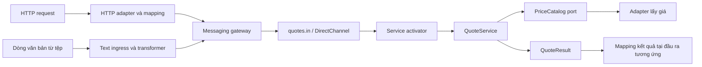

# Tách transport và business logic

## 1. Mục tiêu thiết kế

Trong chương **Thiết kế flow** của module **SPRING_INTEGRATION_CORE**, tách transport và business logic là cách giữ cho quy tắc nghiệp vụ có thể dùng lại khi thay đổi nguồn nhận, cách gửi hoặc định dạng thông điệp. Spring Integration đảm nhiệm kết nối, chuyển đổi và điều phối thông điệp; các đối tượng nghiệp vụ diễn đạt điều hệ thống cần thực hiện.

Sau bài học, bạn có thể:

- Phân định trách nhiệm giữa adapter giao thức, integration flow và application service.
- Thiết kế hợp đồng payload dùng chung cho nhiều đầu vào.
- Dùng `Message`, `MessageChannel`, service activator, messaging gateway và Java DSL để nối các phần đó.
- Đặt transformer, router, filter và aggregator đúng vai trò.
- Thiết kế đường trả kết quả, đường lỗi và kiểm thử theo từng ranh giới.

**Transport** ở đây bao gồm HTTP, tệp, JMS và các cơ chế đưa dữ liệu vào hoặc ra khỏi ứng dụng. **Business logic** bao gồm quy tắc tính toán, điều kiện chấp nhận, bất biến và quyết định của một ca sử dụng. Giữa chúng là **integration logic**: biến đổi thông điệp, chọn đường đi, phối hợp lời gọi và quản lý trao đổi request–reply.

Ví dụ xuyên suốt là tính báo giá một mặt hàng. Cùng quy tắc tính giá phải phục vụ được yêu cầu HTTP và một dòng văn bản đã đọc từ tệp. Bài dùng một loại tiền là VND, chưa có thuế hay chiết khấu; ca sử dụng chỉ đọc giá và tính tổng, chưa tạo đơn hàng hoặc thực hiện thanh toán.

## 2. Vấn đề khi các trách nhiệm trộn lẫn

Giả sử một handler vừa đọc HTTP header, vừa giải mã JSON, vừa tính giá và trả mã HTTP:

```java
// Mã minh họa một thiết kế bị trộn trách nhiệm.
public ResponseEntity<?> quote(Message<String> message) {
    String path = (String) message.getHeaders().get("http_requestUrl");
    // Giải mã JSON, kiểm tra số lượng, lấy giá, tính tổng,
    // rồi chọn HTTP status ngay trong cùng phương thức.
    return ResponseEntity.ok(path);
}
```

Khi thêm đầu vào từ tệp, bạn phải tạo HTTP header giả hoặc sao chép quy tắc tính giá sang một flow khác. Kiểm thử số lượng tối đa lại phụ thuộc vào cách dựng `Message` và Spring context. Thay đổi tên trường JSON có thể buộc sửa cả service tính toán.

Một tiêu chí thực tế: **khi thêm nguồn nhận mới, phần mã cần bổ sung chủ yếu phải nằm ở adapter và mapping; quy tắc nghiệp vụ hiện có tiếp tục dùng được**. Điều đó không có nghĩa toàn bộ hành vi vận hành của HTTP và tệp giống nhau. Chúng vẫn khác về trả lỗi, retry, xác nhận nhận thông điệp và thời điểm hoàn tất.

## 3. Ba lớp trách nhiệm và hướng phụ thuộc



Sơ đồ thể hiện trách nhiệm xử lý; các mũi tên gọi lúc chạy không phải toàn bộ hướng phụ thuộc mã nguồn. `QuoteService` chỉ biết interface `PriceCatalog`; adapter lấy giá phụ thuộc vào interface ấy và hiện thực nó. Service không import JDBC, HTTP client hoặc lớp của broker.

| Phần | Trách nhiệm | Ví dụ trong bài |
| --- | --- | --- |
| Adapter đầu vào/đầu ra | Hiểu giao thức và hợp đồng bên ngoài | Đọc JSON, chọn HTTP status, đọc dòng tệp |
| Integration flow | Nối endpoint, đổi dạng payload, quản lý đường đi | `transform`, `handle`, gọi một subflow |
| Application/domain | Thực thi ca sử dụng và quy tắc | Số lượng từ 1 đến 100, lấy giá và tính tổng |
| Port nghiệp vụ | Mô tả khả năng mà ca sử dụng cần | `PriceCatalog.findUnitPrice(sku)` |
| Adapter hạ tầng | Hiện thực port bằng công nghệ cụ thể | Đọc giá từ DB hoặc API đối tác |

Trong thiết kế này, mã application là Java thông thường. Mã integration được phép dùng `Message`, channel và DSL. Mã adapter được phép biết HTTP hoặc định dạng tệp. Việc Spring khởi tạo một service bằng `@Bean` không buộc lớp service phụ thuộc vào Spring.

Đây là một lựa chọn có chủ đích để giảm liên kết. Dự án có thể dùng `@Service` hoặc `@Transactional` ở application layer theo quy ước riêng; điểm cần giữ là quy tắc tính giá không cần biết URL, tên queue hoặc API của `MessageChannel`.

## 4. Hợp đồng nội bộ: payload có ý nghĩa, header có phạm vi

### 4.1. Chuẩn hóa tại biên

Không đưa thẳng `HttpServletRequest`, một JSON string hoặc đối tượng JMS vào service tính giá. Mỗi ingress chuyển dữ liệu nhận được thành cùng một command:

```text
HTTP JSON {"sku":"BOOK-01","quantity":2}
    -> QuoteCommand("BOOK-01", 2)

Dòng văn bản BOOK-01;2
    -> QuoteCommand("BOOK-01", 2)
```

Hợp đồng nội bộ không cần là một schema khổng lồ cho toàn doanh nghiệp. Nó chỉ cần đủ rõ và ổn định cho ca sử dụng tính báo giá. Khi bên ngoài đổi `quantity` thành `count`, adapter có thể đổi mapping mà không đổi chữ ký của service.

### 4.2. Phân chia payload và header

| Dữ liệu | Vị trí gợi ý | Lý do |
| --- | --- | --- |
| SKU, số lượng | Command trong payload | Là đầu vào quyết định kết quả tính giá |
| Mã tiền tệ khi hỗ trợ nhiều loại tiền | Command/value object có kiểu | Là dữ liệu nghiệp vụ cần kiểm tra rõ ràng |
| Trace ID, thời điểm tiếp nhận | Header nội bộ | Phục vụ quan sát và vận hành |
| `replyChannel`, `errorChannel` | Header do hạ tầng messaging quản lý | Điều khiển trao đổi thông điệp |
| Tên tệp, delivery tag, URL | Metadata của adapter/flow | Có ý nghĩa trong xử lý giao thức |
| Customer ID, tenant ID ảnh hưởng phân quyền hoặc giá | Command hoặc context có kiểu sau xác thực | Không để quy tắc phụ thuộc vào chuỗi header tùy ý |

Header cũng là một hợp đồng: cần quy định tên, kiểu, nguồn tạo và nơi được phép sử dụng. Không tin trực tiếp tenant ID hoặc vai trò người dùng do client tự gửi. Adapter phải xác thực và chuyển thông tin đã được tin cậy thành context rõ ràng trước khi gọi nghiệp vụ.

`Message` có payload và headers, nhưng điều đó không bắt buộc mọi service phải nhận `Message<?>`. Service activator có thể lấy payload để gọi phương thức POJO và dùng giá trị trả về làm payload phản hồi. Cách gọi đó phù hợp với việc giữ chữ ký nghiệp vụ độc lập. [Tài liệu Service Activator](https://docs.spring.io/spring-integration/reference/service-activator.html).

Khi tự dựng một `Message` mới trong transformer, hãy chủ động bảo toàn metadata cần thiết cho phần flow còn lại. Đặc biệt, làm mất `replyChannel` trong một trao đổi request–reply có thể làm hỏng đường trả kết quả. Không tuần tự hóa các đối tượng channel cục bộ vào thông điệp gửi sang hệ thống khác.

## 5. Viết ca sử dụng bằng Java độc lập

Các đoạn mã chính dưới đây dùng API Spring Integration 6.x trở lên; riêng cách đăng ký gateway bằng `@Import` có từ 6.0. Phần Java nghiệp vụ dùng record nên cần Java 17 khi sử dụng với Spring Integration 6.x. Nếu chọn phiên bản Spring Integration khác, dùng JDK và bộ dependency tương thích của phiên bản đó.

Ví dụ là các lớp để đặt trong một dự án Java đã có dependency phù hợp. Không bao gồm build script, bootstrap ứng dụng web hoặc adapter cơ sở dữ liệu. Mỗi kiểu `public` được đặt trong tệp Java cùng tên; các tên tệp trong code block chỉ minh họa cách tổ chức.

### 5.1. Command, result và port

```java
// QuoteCommand.java
package example.quote.application;

public record QuoteCommand(String sku, int quantity) {
}
```

```java
// QuoteResult.java
package example.quote.application;

import java.math.BigDecimal;

public record QuoteResult(String sku, int quantity, BigDecimal total) {
}
```

```java
// PriceCatalog.java
package example.quote.application;

import java.math.BigDecimal;
import java.util.Optional;

public interface PriceCatalog {
    Optional<BigDecimal> findUnitPrice(String sku);
}
```

Hợp đồng `PriceCatalog` quy định `Optional.empty()` nghĩa là không có giá cho SKU được hỏi. Lỗi kết nối nguồn giá phải được báo bằng lỗi kỹ thuật, không chuyển thành `Optional.empty()`. Nếu không phân biệt hai trường hợp, hệ thống có thể trả “không có sản phẩm” khi thực tế nguồn giá đang mất kết nối.

### 5.2. Quy tắc thuộc về service

```java
// QuoteRejectedException.java
package example.quote.application;

public class QuoteRejectedException extends RuntimeException {
    public QuoteRejectedException(String message) {
        super(message);
    }
}
```

```java
// QuoteService.java
package example.quote.application;

import java.math.BigDecimal;
import java.util.Objects;

public final class QuoteService {
    private final PriceCatalog catalog;

    public QuoteService(PriceCatalog catalog) {
        this.catalog = Objects.requireNonNull(catalog);
    }

    public QuoteResult quote(QuoteCommand command) {
        if (command == null || command.sku() == null
                || command.sku().isBlank()) {
            throw new QuoteRejectedException("SKU không được để trống");
        }
        if (command.quantity() < 1 || command.quantity() > 100) {
            throw new QuoteRejectedException("Số lượng phải từ 1 đến 100");
        }

        BigDecimal unitPrice = catalog.findUnitPrice(command.sku())
                .orElseThrow(() -> new QuoteRejectedException(
                        "Không có giá cho SKU: " + command.sku()));
        if (unitPrice.signum() < 0) {
            throw new IllegalStateException("Nguồn giá trả đơn giá âm");
        }

        BigDecimal total = unitPrice.multiply(
                BigDecimal.valueOf(command.quantity()));
        return new QuoteResult(command.sku(), command.quantity(), total);
    }
}
```

Giới hạn 100 là quy tắc của ca sử dụng nên được kiểm tra tại service, kể cả khi form HTTP đã kiểm tra trước. Một chương trình batch gọi cùng service cũng phải chịu giới hạn này. Dùng `BigDecimal` để biểu diễn tiền; khi bổ sung thuế, quy đổi hoặc làm tròn, hãy diễn đạt chính sách đó trong nghiệp vụ.

Service không nhận đơn giá do client tự khai báo. Nó lấy giá qua port mà ứng dụng kiểm soát. Service cũng không trả `ResponseEntity`, không gửi message và không quyết định retry.

## 6. Nối nghiệp vụ vào Spring Integration

### 6.1. Gateway cho payload đã chuẩn hóa

```java
// QuoteMessagingGateway.java
package example.quote.integration;

import example.quote.application.QuoteCommand;
import example.quote.application.QuoteResult;
import org.springframework.integration.annotation.MessagingGateway;

@MessagingGateway(
        defaultRequestChannel = "quotes.in",
        defaultReplyTimeout = "3000")
public interface QuoteMessagingGateway {
    QuoteResult quote(QuoteCommand command);
}
```

Adapter HTTP có thể gọi `gateway.quote(command)` mà không tự dựng `Message`, gọi `send()` và chờ trên reply channel. Annotation và tên channel thuộc package integration; `QuoteService` không phụ thuộc interface gateway này.

Gateway che API messaging qua một interface; gateway request–reply cũng quản lý reply channel cho lời gọi. Ví dụ đăng ký gateway tường minh bằng `@Import`, một khả năng được hỗ trợ từ Spring Integration 6.0. [Tài liệu Messaging Gateways](https://docs.spring.io/spring-integration/reference/gateway.html).

### 6.2. Ingress văn bản và transformer

Để thấy transformer ở đúng ranh giới, thêm một gateway nhận **dòng văn bản đã được đọc**. Việc mở, khóa, di chuyển và xác nhận xử lý tệp nằm ở adapter tệp khi triển khai thực tế.

```java
// TextQuoteGateway.java
package example.quote.integration;

import example.quote.application.QuoteResult;
import org.springframework.integration.annotation.MessagingGateway;

@MessagingGateway(
        defaultRequestChannel = "quotes.text.in",
        defaultReplyTimeout = "3000")
public interface TextQuoteGateway {
    QuoteResult quoteLine(String line);
}
```

```java
// QuoteLineMapper.java
package example.quote.integration;

import example.quote.application.QuoteCommand;

public final class QuoteLineMapper {
    private QuoteLineMapper() {
    }

    public static QuoteCommand toCommand(String line) {
        if (line == null) {
            throw new IllegalArgumentException("Dòng dữ liệu không được null");
        }
        String[] fields = line.split(";", -1);
        if (fields.length != 2) {
            throw new IllegalArgumentException("Định dạng yêu cầu: SKU;quantity");
        }
        return new QuoteCommand(
                fields[0].strip(), Integer.parseInt(fields[1].strip()));
    }
}
```

Định dạng trong ví dụ chỉ có hai trường ngăn bởi dấu chấm phẩy, không hỗ trợ trường chứa dấu phân cách hoặc quy tắc quote của CSV. Với tệp CSV thực tế, dùng parser phù hợp trong adapter. Mapper kiểm tra cú pháp; giới hạn số lượng vẫn do service thực thi.

### 6.3. Hai flow, một điểm gọi nghiệp vụ

```java
// QuoteFlowConfiguration.java
package example.quote.integration;

import example.quote.application.PriceCatalog;
import example.quote.application.QuoteService;
import org.springframework.context.annotation.Bean;
import org.springframework.context.annotation.Configuration;
import org.springframework.context.annotation.Import;
import org.springframework.integration.channel.DirectChannel;
import org.springframework.integration.config.EnableIntegration;
import org.springframework.integration.dsl.IntegrationFlow;
import org.springframework.messaging.MessageChannel;

@Configuration(proxyBeanMethods = false)
@EnableIntegration
@Import({QuoteMessagingGateway.class, TextQuoteGateway.class})
public class QuoteFlowConfiguration {
    @Bean(name = "quotes.in")
    public MessageChannel quoteInput() {
        return new DirectChannel();
    }

    @Bean
    public QuoteService quoteService(PriceCatalog catalog) {
        return new QuoteService(catalog);
    }

    @Bean
    public IntegrationFlow quoteFlow(QuoteService service) {
        return IntegrationFlow.from("quotes.in")
                .handle(service, "quote", endpoint -> endpoint
                        .requiresReply(true))
                .get();
    }

    @Bean
    public IntegrationFlow textQuoteFlow() {
        return IntegrationFlow.from("quotes.text.in")
                .transform(String.class, QuoteLineMapper::toCommand)
                .gateway("quotes.in")
                .get();
    }
}
```

Ứng dụng cần cung cấp một bean `PriceCatalog`: bản triển khai thật khi chạy, hoặc lambda thay thế trong kiểm thử bên dưới. Channel `quotes.text.in` được DSL tạo khi tham chiếu đầu vào theo tên nếu chưa được khai báo. Các flow trên dùng đường xử lý đồng bộ, không cấu hình executor hay poller.

`quoteFlow` có một service activator gọi `QuoteService.quote`. `textQuoteFlow` biến chuỗi thành command rồi dùng `.gateway("quotes.in")` để gọi flow dùng chung theo request–reply. Gateway nội bộ nhận kết quả từ flow con và đưa kết quả đó tiếp tục về lời gọi ingress văn bản.

Không dùng `.channel("quotes.in")` với kỳ vọng nó tự tạo đầy đủ một lời gọi flow con rồi quay về chuỗi hiện tại. Khi cần tiếp tục xử lý sau lời gọi request–reply của flow khác, `.gateway(...)` diễn đạt ý định rõ hơn. Với việc chỉ chuyển tiếp thông điệp sang phần kế tiếp, một channel hoặc bridge có thể đã đủ.

`requiresReply(true)` giúp phát hiện service trả `null` khi hợp đồng cần kết quả. Thiết lập đó không làm một lời gọi từ xa bị chặn phải kết thúc đúng hạn.

### 6.4. Adapter HTTP ánh xạ hợp đồng bên ngoài

Đây là phần bổ sung khi dự án đã có Spring MVC, JSON message converter và cấu hình web. Đặt các DTO và controller trong `example.quote.adapter.http`; đăng ký controller bằng component scan hoặc import của ứng dụng web.

```java
// QuoteHttpRequest.java
package example.quote.adapter.http;

public record QuoteHttpRequest(String sku, Integer quantity) {
}
```

```java
// QuoteHttpResponse.java
package example.quote.adapter.http;

import java.math.BigDecimal;

public record QuoteHttpResponse(
        String productCode, int count, BigDecimal amount, String currency) {
}
```

```java
// QuoteHttpController.java
package example.quote.adapter.http;

import example.quote.application.QuoteCommand;
import example.quote.application.QuoteResult;
import example.quote.integration.QuoteMessagingGateway;
import org.springframework.http.HttpStatus;
import org.springframework.web.bind.annotation.PostMapping;
import org.springframework.web.bind.annotation.RequestBody;
import org.springframework.web.bind.annotation.RestController;
import org.springframework.web.server.ResponseStatusException;

@RestController
public class QuoteHttpController {
    private final QuoteMessagingGateway gateway;

    public QuoteHttpController(QuoteMessagingGateway gateway) {
        this.gateway = gateway;
    }

    @PostMapping("/quotes")
    public QuoteHttpResponse quote(@RequestBody QuoteHttpRequest request) {
        if (request.sku() == null || request.quantity() == null) {
            throw new ResponseStatusException(
                    HttpStatus.BAD_REQUEST, "Thiếu sku hoặc quantity");
        }
        QuoteCommand command = new QuoteCommand(
                request.sku().strip(), request.quantity());
        QuoteResult result = gateway.quote(command);
        if (result == null) {
            throw new ResponseStatusException(
                    HttpStatus.GATEWAY_TIMEOUT, "Chưa nhận được báo giá");
        }
        return new QuoteHttpResponse(
                result.sku(), result.quantity(), result.total(), "VND");
    }
}
```

Với đơn giá `25000.00`, yêu cầu `{"sku":"BOOK-01","quantity":2}` cho kết quả có `productCode=BOOK-01`, `count=2`, `amount=50000.00`, `currency=VND`. Số tiền được tính tại service; tên trường phản hồi và nhãn tiền tệ của hợp đồng HTTP do adapter định dạng.

Controller minh họa mapping và tình huống thiếu phản hồi. Chính sách HTTP cho lỗi nghiệp vụ hoặc lỗi nguồn giá cần được bổ sung ở lớp xử lý lỗi tại biên, chẳng hạn `@RestControllerAdvice`, như phần sau. Nếu muốn dùng HTTP inbound gateway của Spring Integration thay controller, giữ nguyên command và flow dùng chung; chỉ thay phần ingress và mapping HTTP.

## 7. Chọn nơi đặt transformer, router, filter và aggregator

Không phân loại quy tắc chỉ theo tên endpoint. Một lambda trong transformer vẫn có thể đang chứa quá nhiều nghiệp vụ; một router vẫn có thể đang sao chép chính sách phê duyệt.

| Thành phần | Nên làm ở integration flow | Phần nên giao cho nghiệp vụ |
| --- | --- | --- |
| Transformer | Chuyển wire DTO hoặc dòng văn bản sang command; đổi result sang DTO đầu ra | Tính thuế, chọn giá, xác định mức chiết khấu |
| Router | Chọn endpoint theo kết quả phân loại đã được xác định | Xác định khách hàng có đủ điều kiện hưởng ưu đãi hay không |
| Filter | Loại thông điệp không thuộc subscription hoặc chặn dữ liệu sai kỹ thuật theo chính sách rõ ràng | Bảo đảm ca sử dụng luôn tuân thủ giới hạn số lượng |
| Splitter | Tách thông điệp batch thành các phần để xử lý | Quyết định một đơn hàng có được xử lý từng phần hay phải nguyên khối |
| Aggregator | Gom theo correlation key, quản lý nhóm, timeout và release | Xác định kết quả cuối cùng khi một nhà cung cấp từ chối hoặc thiếu dữ liệu |
| Service activator | Nối endpoint với phương thức service | Thực thi quy tắc bên trong phương thức được gọi |

Ví dụ một service trả kết quả `APPROVED`, `REJECTED` hoặc `REVIEW_REQUIRED`; router dùng kết quả đó để chọn channel. Flow có thể thể hiện các nhánh rõ ràng mà không chứa lại công thức xác định kết quả.

Với aggregator, việc đủ ba phản hồi là điều kiện hoàn tất trao đổi; việc chọn mức giá hợp lệ tốt nhất từ ba phản hồi là quyết định nghiệp vụ. Có thể đóng gói hai phần trong các strategy hoặc service riêng, rồi nối chúng tại cấu hình aggregator.

Filter trong request–reply cần được thiết kế thận trọng. Nếu loại bỏ request mà không trả kết quả hoặc báo lỗi, caller vẫn đang chờ phản hồi. Hãy quy định rõ một trong các hành vi: trả kết quả từ chối, ném lỗi có ý nghĩa hoặc chuyển sang nhánh có khả năng hoàn tất phản hồi.

## 8. Tách nghiệp vụ nhưng giữ rõ ngữ nghĩa vận hành

### 8.1. Channel quyết định cách thực thi

`DirectChannel` chuyển message tới một subscriber trên luồng gửi. Bởi vậy, đổi từ lời gọi Java trực tiếp sang gateway và `DirectChannel` chưa làm xử lý trở thành bất đồng bộ. Chuyển sang `ExecutorChannel` hoặc xử lý qua poller làm thay đổi ranh giới thực thi. Queue trong bộ nhớ cũng không tự tạo tính bền vững. [Tài liệu Message Channel Implementations](https://docs.spring.io/spring-integration/reference/channel/implementations.html).

| Quyết định | Câu hỏi phải trả lời khi thay đổi |
| --- | --- |
| Đồng bộ sang bất đồng bộ | Caller nhận kết quả ngay hay chỉ nhận mã chấp nhận xử lý? |
| Thêm queue | Queue có giới hạn không, đầy thì làm gì, có cần lưu bền không? |
| Thêm executor | Ai quản lý pool, tải vượt giới hạn được phản hồi thế nào? |
| Gửi sang broker | Dữ liệu được serialize thế nào, ai xác nhận, ai retry? |
| Chạy nhiều instance | Idempotency, correlation và trạng thái gom nhóm nằm ở đâu? |

Tên channel cũng nên diễn đạt hợp đồng xử lý. `quotes.in` nói đây là đầu vào tính báo giá; một tên như `http.quote.in` chỉ thích hợp ở nhánh thật sự dành riêng cho HTTP. Tên tốt giúp nhận ra nơi được phép gắn thêm một ingress mới.

### 8.2. Timeout không đồng nghĩa hủy thực thi

`defaultReplyTimeout = "3000"` trong ví dụ quy định thời gian đợi reply tại gateway. Nó không ngắt một handler đang chạy lâu trên cùng luồng `DirectChannel`. Với đoạn flow đã bàn giao sang luồng khác, caller có thể hết thời gian chờ trong khi phần xử lý vẫn tiếp tục. [Tài liệu Gateway Behavior When No Response Arrives](https://docs.spring.io/spring-integration/reference/gateway.html#gateway-no-response).

Vì vậy, adapter gọi nguồn giá từ xa cần timeout kết nối và đọc phù hợp. Nếu sau này ca sử dụng tạo đơn hàng, việc HTTP timeout không chứng minh đơn hàng chưa được tạo; thiết kế cần khóa nghiệp vụ chống xử lý lặp và cách truy vấn lại kết quả.

### 8.3. Transaction và tác dụng phụ

Tách lớp không tự tạo transaction. Một chuỗi giữ nguyên luồng thực thi có thể tham gia transaction đã được mở và cấu hình đúng; `DirectChannel` tự nó không mở transaction. Khi chuyển luồng qua executor hoặc xử lý queue bằng poller, transaction gắn với luồng gọi không tự đi theo. [Tài liệu Transaction Support](https://docs.spring.io/spring-integration/reference/transactions.html).

Nếu mở rộng từ tính báo giá sang tạo đơn hàng:

1. Xác định thao tác ghi nào phải nguyên tử, rồi đặt ranh giới transaction ở ca sử dụng hoặc lớp bao phù hợp.
2. Xác định khóa nghiệp vụ chống tạo trùng khi client hoặc broker gửi lại; không mặc định dùng ID kỹ thuật của `Message` làm khóa.
3. Khi vừa ghi DB vừa cần phát sự kiện bền vững, chọn cơ chế phối hợp như transactional outbox phù hợp với yêu cầu.
4. Phân biệt “đã nhận”, “đã lưu” và “đã hoàn tất” trong hợp đồng của từng transport.

Đây là các quyết định cần giữ lại khi thay adapter. Không suy ra bảo đảm xử lý đúng một lần chỉ từ việc đã dùng một gateway hoặc channel.

## 9. Lỗi nghiệp vụ và lỗi giao thức gặp nhau ở đâu?

Service báo lỗi theo ngôn ngữ ca sử dụng; adapter chuyển nó thành cách phản hồi phù hợp. Không để service chọn HTTP status hoặc gọi thao tác reject của broker.

| Tình huống | Nơi phát hiện chính | Cách xử lý tại biên, tùy hợp đồng |
| --- | --- | --- |
| JSON sai cú pháp, thiếu trường bắt buộc | HTTP adapter/converter | Trả lỗi yêu cầu, ví dụ HTTP 400 |
| Dòng văn bản không đúng hai trường hoặc số không hợp lệ | Text mapper | Báo dòng lỗi, ghi nhận lý do để sửa nguồn dữ liệu |
| Số lượng lớn hơn 100 | `QuoteService` | HTTP có thể trả 422; batch ghi kết quả từ chối |
| Nguồn giá mất kết nối tạm thời | Adapter hiện thực `PriceCatalog` | Retry có giới hạn nếu phù hợp; phản hồi lỗi kỹ thuật |
| Không nhận được reply đúng hạn | Gateway/adapter gọi | Phản hồi timeout và gắn thông tin đối soát cần thiết |

Với flow đồng bộ, lỗi thường truyền ngược tới caller và có thể nằm trong chuỗi nguyên nhân của một `MessagingException`. Không giả định mọi lỗi tự chảy vào global `errorChannel`. Với task bất đồng bộ và poller, Spring Integration có cơ chế xuất bản `ErrorMessage` qua error handler tương ứng; đường lỗi phải được cấu hình theo cách flow thực thi. [Tài liệu Error Handling](https://docs.spring.io/spring-integration/reference/error-handling.html).

Khi bổ sung `@RestControllerAdvice`, cần phân loại cả lỗi nghiệp vụ xuất hiện trực tiếp lẫn lỗi được bọc trong cause chain. Chỉ ánh xạ những loại đã xác định; các lỗi kỹ thuật không được ngụy trang thành từ chối nghiệp vụ. Không đưa stack trace hoặc thông tin kết nối nội bộ vào phản hồi cho client.

Nếu cấu hình error flow cho một gateway request–reply, việc log lỗi rồi kết thúc không tạo ra một phản hồi nghiệp vụ. Error flow phải có hành vi hoàn tất trao đổi rõ ràng: trả một kết quả phù hợp với hợp đồng, hoặc để lỗi được truyền ra theo chính sách đã chọn.

Retry cũng nằm trong thiết kế ranh giới. Lỗi “số lượng vượt giới hạn” sẽ không hết khi thử lại cùng dữ liệu. Với lỗi kỹ thuật tạm thời, giới hạn số lần thử và tránh retry chồng ở HTTP client, endpoint advice và broker khiến số lần thực thi tăng ngoài dự kiến.

## 10. Kiểm thử để chứng minh ranh giới có ích

Các ví dụ kiểm thử sau được viết để đặt trong dự án cùng các lớp ở trên. Chúng minh họa cách xác minh hành vi; không cần mở HTTP server hay broker để kiểm tra quy tắc tính giá.

### 10.1. Kiểm thử nghiệp vụ không khởi động Spring

```java
package example.quote.application;

import java.math.BigDecimal;
import java.util.Optional;
import org.junit.jupiter.api.Test;
import static org.junit.jupiter.api.Assertions.*;

class QuoteServiceTest {
    @Test
    void calculatesTotalFromCatalogPrice() {
        PriceCatalog catalog = sku -> Optional.of(new BigDecimal("25000.00"));
        QuoteService service = new QuoteService(catalog);

        QuoteResult result = service.quote(new QuoteCommand("BOOK-01", 2));

        assertEquals("BOOK-01", result.sku());
        assertEquals(2, result.quantity());
        assertEquals(0, new BigDecimal("50000.00").compareTo(result.total()));
    }

    @Test
    void rejectsExcessQuantityBeforeCallingCatalog() {
        PriceCatalog catalog = sku -> {
            throw new AssertionError("Không được gọi nguồn giá");
        };
        QuoteService service = new QuoteService(catalog);

        assertThrows(QuoteRejectedException.class,
                () -> service.quote(new QuoteCommand("BOOK-01", 101)));
    }
}
```

Kiểm thử thứ hai xác nhận giới hạn được thi hành trước khi phát sinh truy cập nguồn giá. Các quy tắc khác như SKU rỗng, không có giá hoặc chính sách làm tròn cũng có thể kiểm thử ở lớp này mà không phải dựng header HTTP.

### 10.2. Kiểm thử hai ingress cùng dùng một flow nghiệp vụ

```java
package example.quote.integration;

import example.quote.application.PriceCatalog;
import example.quote.application.QuoteCommand;
import example.quote.application.QuoteResult;
import java.math.BigDecimal;
import java.util.Optional;
import org.junit.jupiter.api.Test;
import org.springframework.beans.factory.annotation.Autowired;
import org.springframework.context.annotation.Bean;
import org.springframework.context.annotation.Configuration;
import org.springframework.test.context.junit.jupiter.SpringJUnitConfig;
import static org.junit.jupiter.api.Assertions.*;

@SpringJUnitConfig(classes = {
        QuoteFlowConfiguration.class, QuoteFlowTest.TestBeans.class})
class QuoteFlowTest {
    @Configuration(proxyBeanMethods = false)
    static class TestBeans {
        @Bean
        PriceCatalog catalog() {
            return sku -> Optional.of(new BigDecimal("25000.00"));
        }
    }

    @Autowired
    QuoteMessagingGateway commandGateway;

    @Autowired
    TextQuoteGateway textGateway;

    @Test
    void equivalentInputsProduceTheSameQuote() {
        QuoteResult fromCommand = commandGateway.quote(
                new QuoteCommand("BOOK-01", 2));
        QuoteResult fromText = textGateway.quoteLine("BOOK-01;2");

        assertNotNull(fromCommand);
        assertNotNull(fromText);
        assertEquals(fromCommand, fromText);
        assertEquals(0, new BigDecimal("50000.00")
                .compareTo(fromText.total()));
    }
}
```

Kiểm thử flow cần Spring Test, JUnit Jupiter và các dependency Spring Integration tương thích. Nó xác nhận gateway được đăng ký, mapper nối đúng, service activator gọi được service và phản hồi quay về hai ingress. Nó không chứng minh việc đọc tệp, cấu hình JSON hoặc xử lý lỗi HTTP đã đúng.

### 10.3. Kiểm thử adapter và hợp đồng lỗi

| Phạm vi | Hành vi cần xác minh |
| --- | --- |
| HTTP adapter | JSON hợp lệ chuyển thành command đúng; JSON sai nhận mã lỗi đã cam kết |
| Text mapper | Dòng thiếu trường, thừa trường, số không hợp lệ được phát hiện tại biên |
| Error mapping | Lỗi nghiệp vụ được bọc vẫn ra đúng phản hồi; lỗi kỹ thuật không bị đổi thành lỗi nghiệp vụ |
| Request–reply | Các nhánh router/filter kết thúc bằng reply hoặc lỗi theo hợp đồng |
| Adapter nguồn giá | Không có SKU phân biệt với mất kết nối; timeout được cấu hình |
| Ghi dữ liệu nếu bổ sung | Retry không tạo tác dụng phụ trùng; transaction đúng phạm vi |

Spring Integration cung cấp thêm công cụ kiểm thử và mock endpoint trong các module test của framework. Dùng chúng khi cần thay một endpoint hoặc cô lập một đoạn flow; với service Java thuần, kiểm thử trực tiếp vẫn đủ để xác minh quy tắc. [Tài liệu Testing Support](https://docs.spring.io/spring-integration/reference/testing.html).

## 11. Chuyển một flow đang trộn trách nhiệm sang cấu trúc này

Một cách thay đổi theo từng bước:

1. **Chọn một ca sử dụng cụ thể.** Ví dụ tính báo giá, với đầu vào và đầu ra quan sát được.
2. **Định nghĩa command và result.** Loại đối tượng giao thức khỏi chữ ký; ghi lại trường nào bắt buộc và loại lỗi có thể xảy ra.
3. **Rút quy tắc ra service.** Giữ quy tắc ở một chỗ; kiểm thử số lượng, giá và tình huống từ chối bằng Java trực tiếp.
4. **Đặt port tại nơi cần phụ thuộc ngoài.** Hiện thực `PriceCatalog` đọc DB hoặc gọi API mà không đưa client cụ thể vào service.
5. **Thu gọn flow thành mapping và điều phối.** Dùng transformer để chuẩn hóa, service activator để gọi service, gateway khi cần che messaging hoặc gọi request–reply.
6. **Thiết kế đường kết thúc cho từng nhánh.** Xác định reply, từ chối, lỗi kỹ thuật, retry và timeout theo transport.
7. **Thử thêm một ingress thứ hai.** Nếu phải sao chép công thức tính giá hoặc dựng HTTP metadata giả, ranh giới còn chưa rõ.

Không cần tạo một interface cho mọi lớp. Chỉ thêm abstraction khi nó thể hiện ranh giới có ích: nguồn giá là một phụ thuộc ngoài, còn mapper hai trường có thể chỉ là một hàm nhỏ. Cũng không cần đưa một lời gọi service đơn giản vào flow nếu ứng dụng chưa có nhu cầu tích hợp hoặc điều phối tương ứng.

## 12. Bài tập vận dụng

1. Bổ sung hợp đồng JSON phiên bản mới dùng `productCode` và `count`. Giữ nguyên `QuoteCommand` và `QuoteService`; viết mapping tại adapter rồi xác minh kết quả tương đương phiên bản cũ.
2. Viết adapter `PriceCatalog` giả lập ba trạng thái: có giá, không tìm thấy và lỗi kết nối. Chỉ ra trạng thái nào có thể retry và trạng thái nào cần thay đổi dữ liệu đầu vào.
3. Thêm một router để chia kết quả báo giá sang nhánh phản hồi và nhánh cần xử lý bổ sung. Đặt điều kiện nghiệp vụ trong một service hoặc policy có thể kiểm thử, rồi bảo đảm mỗi request–reply luôn kết thúc rõ ràng.
4. Thiết kế trên giấy một flow lấy giá từ ba nhà cung cấp và gom kết quả. Tách điều kiện correlation/release của aggregator khỏi chính sách chọn báo giá; quy định hành vi khi một nhà cung cấp không trả lời.
5. Giả sử đổi channel sang xử lý bằng executor. Mô tả caller thấy gì khi timeout, lỗi được đưa về đâu và transaction nào còn hiệu lực. Không chỉ thay loại channel rồi mặc định giữ nguyên hợp đồng vận hành.

Sau khi thực hiện, dấu hiệu thiết kế đạt mục tiêu là: thêm hợp đồng nhận/gửi mới không làm nhân bản quy tắc; kiểm thử nghiệp vụ chạy độc lập với transport; các quyết định về reply, lỗi và tác dụng phụ vẫn được chỉ rõ trong flow và adapter tương ứng.
