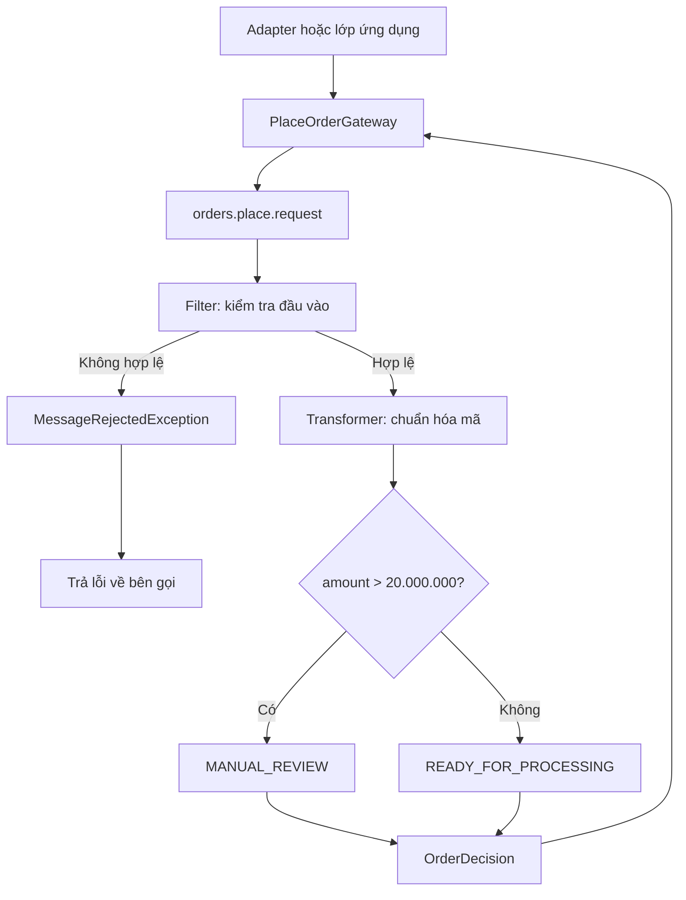

# Đặt flow theo use case

## 1. Mục tiêu của cách tổ chức này

Trong chương **Thiết kế flow** của **SPRING_INTEGRATION_CORE**, đặt flow theo use case nghĩa là lấy một mục tiêu nghiệp vụ cụ thể làm đơn vị tổ chức luồng thông điệp. Tên flow, hợp đồng đầu vào, kết quả đầu ra và cách xử lý thất bại cùng mô tả mục tiêu đó.

Ví dụ, `placeOrderFlow` biểu diễn việc tiếp nhận yêu cầu đặt hàng. Khi đọc flow, người phát triển cần trả lời được: ai gọi, dữ liệu nào được chấp nhận, nhánh nào được chọn, kết quả có ý nghĩa gì và lỗi được trả về đâu.

Các thành phần cốt lõi của Spring Integration được phối hợp trong phạm vi này:

- `Message` mang dữ liệu và ngữ cảnh xử lý.
- `MessageChannel` nối các bước hoặc công bố một điểm giao tiếp.
- Endpoint thực hiện chuyển đổi, lọc, định tuyến hoặc gọi xử lý.
- Gateway cung cấp một hợp đồng gọi vào luồng.
- Java DSL thể hiện thứ tự và quan hệ giữa các bước.

Sau bài học, bạn có thể xác định ranh giới flow, tổ chức mã nguồn theo use case, chọn điểm nối giữa các flow và thiết kế kiểm thử dựa trên kết quả nghiệp vụ.

> Các tên package, bean, channel và ngưỡng tiền trong bài là quy ước minh họa. Spring Integration không bắt buộc một cấu trúc package hay một flow duy nhất cho mỗi use case.

## 2. Xác định đơn vị nghiệp vụ trước khi viết DSL

### 2.1. Viết mục tiêu bằng động từ và đối tượng

Một use case cần thể hiện hành động và kết quả mà bên gọi quan tâm:

| Mục tiêu | Tên flow có thể dùng | Kết quả cần xác định |
| --- | --- | --- |
| Tiếp nhận yêu cầu đặt hàng | `placeOrderFlow` | Yêu cầu sẵn sàng xử lý hoặc cần duyệt |
| Hủy một đơn hàng | `cancelOrderFlow` | Đã hủy hoặc bị từ chối theo trạng thái |
| Tiếp nhận yêu cầu hoàn tiền | `requestRefundFlow` | Đã tiếp nhận hoặc không đủ điều kiện |
| Đối soát một kỳ thanh toán | `reconcileSettlementFlow` | Kết quả đối soát và các sai lệch |
| Nhập danh mục sản phẩm từ đối tác | `importPartnerCatalogFlow` | Kết quả nhập và các dòng bị loại |

Những tên như `transformFlow`, `commonFlow` hay `processFlow` khó cho biết trách nhiệm. Tên như `httpFlow` chỉ cho biết phương tiện tiếp nhận. Chúng có thể phù hợp cho một đoạn thích nghi giao thức, nhưng chưa mô tả đủ luồng nghiệp vụ.

Một phép thử đơn giản: nếu đổi nguồn yêu cầu từ HTTP sang một consumer thông điệp, phần chính của mục tiêu có còn giữ nguyên không? Nếu có, nên để phần tiếp nhận giao thức ánh xạ dữ liệu vào một hợp đồng nghiệp vụ chung.

### 2.2. Dùng kết quả và chính sách để nhận ra ranh giới

Hai thao tác cùng liên quan đến đơn hàng chưa chắc thuộc cùng flow. Đặt hàng và hủy hàng có tiền điều kiện, kết quả, quyền truy cập và chính sách lặp lại khác nhau. Gộp chúng vào một flow nhận `Map<String, Object>` rồi rẽ nhánh theo `action` dễ làm hợp đồng trở nên mơ hồ.

Ngược lại, kiểm tra dữ liệu và chuẩn hóa khoảng trắng là hai bước của cùng việc tiếp nhận yêu cầu. Tách mỗi bước thành một flow công khai có thể tạo nhiều điểm nối mà không làm rõ nghiệp vụ hơn.

Có thể dựa trên các câu hỏi sau:

1. Bên gọi có yêu cầu thao tác này một cách độc lập không?
2. Thao tác có kết quả và điều kiện thành công riêng không?
3. Chính sách timeout, retry hoặc bảo đảm lưu trữ có khác không?
4. Có cần phân quyền, vận hành hoặc triển khai riêng không?
5. Khi thay đổi thao tác này, những bước nào thường phải thay đổi cùng?

Các câu trả lời giúp chọn giữa một endpoint, một subflow, một flow độc lập hoặc một quy trình gồm nhiều flow. Không dùng số dòng DSL làm tiêu chí duy nhất.

### 2.3. Một use case có thể cần nhiều flow vật lý

Use case nhập danh mục có thể gồm flow nhận tệp, flow xử lý từng phần và flow công bố kết quả. Chúng cùng phục vụ một mục tiêu nhưng có nhịp xử lý và khả năng khôi phục khác nhau.

Điều cần duy trì là một mô hình trách nhiệm rõ ràng: flow nào tiếp nhận, flow nào xử lý, dữ liệu nào nối chúng và ở thời điểm nào có thể xác nhận thành công. Một lớp cấu hình hay một bean `IntegrationFlow` không tự tạo ra ranh giới giao dịch, dịch vụ hoặc tiến trình.

## 3. Lập hợp đồng cho flow

Trước khi chọn `filter()`, `route()` hay `handle()`, hãy viết một bản mô tả ngắn cho use case.

Ví dụ trong bài là **tiếp nhận và phân loại yêu cầu đặt hàng**:

| Thuộc tính | Hợp đồng minh họa |
| --- | --- |
| Tên use case | `place-order` |
| Bên gọi | Lớp ứng dụng hoặc adapter tiếp nhận yêu cầu |
| Đầu vào | `PlaceOrderCommand(requestId, customerId, amount)` |
| Đơn vị tiền | VND theo thỏa thuận của ví dụ |
| Tiền điều kiện | Hai mã không rỗng, số tiền lớn hơn 0 |
| Chuẩn hóa | Bỏ khoảng trắng đầu và cuối của hai mã |
| Quy tắc phân loại | Trên 20.000.000 VND thì cần duyệt |
| Kết quả thông thường | `READY_FOR_PROCESSING` |
| Kết quả cần duyệt | `MANUAL_REVIEW` |
| Dữ liệu không hợp lệ | Ném lỗi từ chối thông điệp |
| Mô hình tương tác | Request–reply đồng bộ |
| Tác dụng phụ trong ví dụ | Chưa ghi cơ sở dữ liệu, chưa trừ kho, chưa tạo công việc duyệt |
| Bảo đảm chống xử lý lặp | Chưa triển khai trong ví dụ |

Dòng “tác dụng phụ” đặc biệt quan trọng. `READY_FOR_PROCESSING` chỉ là một quyết định phân loại; nó chưa có nghĩa đơn hàng đã được lưu. `MANUAL_REVIEW` cũng chưa có nghĩa một nhân viên đã nhận được công việc.

Trong hệ thống thực tế, nếu muốn trả `ACCEPTED` với ý nghĩa đã tiếp nhận bền vững, cần xác định thao tác lưu nào đã hoàn tất trước khi trả kết quả.

### Payload, header và định danh

Đặt dữ liệu cần để hiểu yêu cầu nghiệp vụ trong payload. Các thuộc tính như `sourceSystem`, `traceId` hoặc nhãn use case có thể nằm trong header nếu chúng phục vụ truyền dẫn và quan sát.

Trong ví dụ, `requestId` nằm trong payload để trở thành một phần hợp đồng với bên gọi. Nếu dùng nó làm khóa chống xử lý lặp trong thực tế, cần thống nhất phạm vi duy nhất, thời gian lưu khóa và hành vi khi cùng khóa đi kèm nội dung khác nhau.

Phân biệt ba vai trò:

- **Định danh thông điệp**: nhận biết một message cụ thể.
- **Định danh yêu cầu nghiệp vụ**: nhận biết một lần yêu cầu theo hợp đồng.
- **Khóa tương quan**: gom các message thuộc cùng một tập xử lý.

Các vai trò có thể dùng chung một giá trị nếu được thiết kế rõ, nhưng không tự đồng nhất. Gửi lại cùng một yêu cầu thường tạo message mới; tạo message mới không có nghĩa được phép thực hiện lại tác dụng phụ.

## 4. Phác thảo luồng trước khi triển khai



Sơ đồ này cho thấy một kết quả quan trọng: cả hai nhánh hợp lệ đều có phản hồi. Nhánh đầu vào không hợp lệ cũng kết thúc có chủ đích bằng lỗi.

Từ sơ đồ có thể chọn các mẫu tích hợp:

| Nhu cầu trong use case | Thành phần phù hợp | Điều cần làm rõ |
| --- | --- | --- |
| Gọi luồng qua một interface | Messaging gateway | Kiểu đầu vào, đầu ra và lỗi |
| Kiểm tra điều kiện cho đi tiếp | Filter | Hành vi khi bị loại |
| Chuẩn hóa dữ liệu | Transformer | Hợp đồng trước và sau biến đổi |
| Chọn chính sách xử lý | Router | Đủ nhánh và có hành vi cho trường hợp chưa biết |
| Gọi xử lý nghiệp vụ | Service activator qua `handle()` | Kết quả trả về và tác dụng phụ |
| Tách một yêu cầu thành nhiều phần | Splitter | Định danh và số lượng phần |
| Ghép nhiều kết quả liên quan | Aggregator | Khóa tương quan, điều kiện đủ và hết hạn |

Không cần đưa mọi mẫu tích hợp vào một flow. Trong ví dụ hiện tại, router chọn một trong hai nhánh; không có tập kết quả cần ghép nên chưa cần aggregator.

## 5. Tổ chức mã nguồn và tên các điểm giao tiếp

### 5.1. Gom các phần cùng thay đổi theo use case

Một cấu trúc có thể dùng:

```text
example/
  orders/
    inbound/
      http/
      messaging/
    place/
      PlaceOrderCommand.java
      OrderDecision.java
      PlaceOrderGateway.java
      PlaceOrderFlowConfiguration.java
    cancel/
      CancelOrderCommand.java
      CancelOrderGateway.java
      CancelOrderFlowConfiguration.java
    shared/
      pricing/
      customerlookup/
```

Package `place` tập hợp hợp đồng và cách điều phối của việc tiếp nhận đặt hàng. Adapter giao thức chuyển dữ liệu bên ngoài sang `PlaceOrderCommand`. Khi thêm một nguồn tiếp nhận có cùng ngữ nghĩa, nguồn đó có thể gọi cùng gateway.

Thư mục `shared` chỉ nên chứa khả năng dùng chung có hợp đồng ổn định. Nếu hai nơi mới giống nhau ở vài dòng chuẩn hóa, một hàm Java nhỏ thường đủ; chưa cần tạo thêm luồng message.

Cấu trúc này không cấm tổ chức theo lớp kỹ thuật. Nó giúp người đọc tìm được toàn bộ đường đi của một use case mà không phải lần qua một danh sách transformer, router và handler không có ngữ cảnh.

### 5.2. Đặt tên theo trách nhiệm và phạm vi

| Đối tượng | Ví dụ | Ý nghĩa |
| --- | --- | --- |
| Flow bean | `placeOrderFlow` | Điều phối use case đặt hàng |
| Channel đầu vào | `orders.place.request` | Nhận yêu cầu đặt hàng |
| Endpoint lọc | `orders.place.validate` | Kiểm tra hợp đồng đầu vào |
| Endpoint chuẩn hóa | `orders.place.normalize` | Chuẩn hóa dữ liệu đã hợp lệ |
| Endpoint định tuyến | `orders.place.classify` | Chọn cách phân loại |
| Flow lỗi khi cần | `placeOrderErrorFlow` | Xử lý lỗi thuộc use case |

Tên bean và endpoint cần tránh trùng trong cùng application context. Dùng tiền tố nghiệp vụ giúp đọc log và cấu hình dễ hơn.

Nên công bố các channel là điểm giao tiếp có chủ đích. Không cần đặt tên công khai cho mọi liên kết nội bộ mà DSL tạo ra. Một consumer bên ngoài phụ thuộc vào channel giữa hai bước có thể khiến việc đổi thứ tự hoặc thay transformer trở thành thay đổi hợp đồng.

## 6. Ví dụ Java DSL: tiếp nhận yêu cầu đặt hàng

Ví dụ dùng **Java 17 và Spring Integration 6.5**, với `spring-integration-core` trên classpath. Kiểm thử bên dưới cần JUnit Jupiter. Nếu dùng Spring Boot, có thể lấy dependency thông qua starter Integration và để dependency management của ứng dụng quản lý phiên bản tương thích.

Các tệp Java sau thuộc cùng package `example.orders.place`. Chúng là mã mẫu của bài học; không cần tạo một adapter HTTP để quan sát hành vi của flow.

### 6.1. Khai báo hợp đồng dữ liệu

`PlaceOrderCommand.java`:

```java
package example.orders.place;

import java.math.BigDecimal;

public record PlaceOrderCommand(
        String requestId,
        String customerId,
        BigDecimal amount) {
}
```

`OrderDecision.java`:

```java
package example.orders.place;

public record OrderDecision(
        String requestId,
        Status status,
        String reason) {

    public enum Status {
        READY_FOR_PROCESSING,
        MANUAL_REVIEW
    }
}
```

Ví dụ cố định đơn vị VND để tập trung vào thiết kế flow. Với hợp đồng đa tiền tệ, cần biểu diễn loại tiền và quy tắc làm tròn, thay vì suy đơn vị từ một số tiền thuần túy.

### 6.2. Đưa điểm vào qua gateway

`PlaceOrderGateway.java`:

```java
package example.orders.place;

import org.springframework.integration.annotation.MessagingGateway;

@MessagingGateway(
        defaultRequestChannel = "orders.place.request",
        defaultReplyTimeout = "1500")
public interface PlaceOrderGateway {

    OrderDecision place(PlaceOrderCommand command);
}
```

Bên gọi nhận một interface có kiểu dữ liệu rõ ràng. Gateway chuyển lời gọi thành message và lấy kết quả trả về. Ví dụ này dùng `@Import` để đăng ký interface gateway, một khả năng được hỗ trợ từ Spring Integration 6.0. Xem [Messaging Gateways](https://docs.spring.io/spring-integration/reference/6.5/gateway.html).

Không cần khai báo một channel phản hồi công khai cho ví dụ: gateway cung cấp đường phản hồi qua cơ chế `replyChannel`.

### 6.3. Định nghĩa flow theo thứ tự nghiệp vụ

`PlaceOrderFlowConfiguration.java`:

```java
package example.orders.place;

import java.math.BigDecimal;

import org.springframework.context.annotation.Bean;
import org.springframework.context.annotation.Configuration;
import org.springframework.context.annotation.Import;
import org.springframework.integration.channel.DirectChannel;
import org.springframework.integration.config.EnableIntegration;
import org.springframework.integration.dsl.IntegrationFlow;

@Configuration(proxyBeanMethods = false)
@EnableIntegration
@Import(PlaceOrderGateway.class)
public class PlaceOrderFlowConfiguration {

    private static final BigDecimal REVIEW_LIMIT =
            new BigDecimal("20000000");

    @Bean(name = "orders.place.request")
    public DirectChannel placeOrderRequest() {
        return new DirectChannel();
    }

    @Bean
    public IntegrationFlow placeOrderFlow() {
        return IntegrationFlow.from("orders.place.request")
                .enrichHeaders(headers ->
                        headers.header("useCase", "place-order"))
                .<PlaceOrderCommand>filter(
                        PlaceOrderFlowConfiguration::isValid,
                        endpoint -> endpoint
                                .id("orders.place.validate")
                                .throwExceptionOnRejection(true))
                .<PlaceOrderCommand, PlaceOrderCommand>transform(
                        command -> new PlaceOrderCommand(
                                command.requestId().strip(),
                                command.customerId().strip(),
                                command.amount()),
                        endpoint -> endpoint
                                .id("orders.place.normalize"))
                .<PlaceOrderCommand, Boolean>route(
                        command -> command.amount()
                                .compareTo(REVIEW_LIMIT) > 0,
                        router -> router
                                .id("orders.place.classify")
                                .subFlowMapping(true, branch -> branch
                                        .handle(PlaceOrderCommand.class,
                                                (command, headers) ->
                                                        new OrderDecision(
                                                                command.requestId(),
                                                                OrderDecision.Status
                                                                        .MANUAL_REVIEW,
                                                                "HIGH_VALUE")))
                                .subFlowMapping(false, branch -> branch
                                        .handle(PlaceOrderCommand.class,
                                                (command, headers) ->
                                                        new OrderDecision(
                                                                command.requestId(),
                                                                OrderDecision.Status
                                                                        .READY_FOR_PROCESSING,
                                                                "STANDARD_POLICY"))))
                .get();
    }

    private static boolean isValid(PlaceOrderCommand command) {
        return command.requestId() != null
                && !command.requestId().isBlank()
                && command.customerId() != null
                && !command.customerId().isBlank()
                && command.amount() != null
                && command.amount().signum() > 0;
    }
}
```

`PlaceOrderCommand` truyền cho gateway phải là một đối tượng khác `null`; filter kiểm tra các trường của đối tượng. Nếu bên ngoài có thể gửi yêu cầu không có payload, adapter cần từ chối hoặc ánh xạ lỗi đó trước khi gọi gateway.

Đọc flow như một câu nghiệp vụ:

1. Nhận một yêu cầu đặt hàng.
2. Gắn nhãn use case để hỗ trợ quan sát.
3. Từ chối đầu vào không đạt hợp đồng.
4. Chuẩn hóa các mã.
5. Phân loại theo ngưỡng tiền.
6. Trả đúng một `OrderDecision`.

Hai nhánh được khai báo bằng lambda `subFlowMapping`. DSL xử lý việc nối subflow trong trường hợp này. Với một flow bean có sẵn mà cần gọi và nhận phản hồi để tiếp tục, cần cân nhắc `.gateway(...)`; không suy rằng mọi cách nối subflow đều giống nhau. Xem [Sub-flows support](https://docs.spring.io/spring-integration/reference/6.5/dsl/java-subflows.html).

### 6.4. Tại sao không để filter bỏ thông điệp?

Gateway có kiểu trả về `OrderDecision`. Nếu filter loại message mà không có đường trả kết quả hoặc lỗi, bên gọi phải chờ một phản hồi không được tạo ra. `throwExceptionOnRejection(true)` khiến việc từ chối trở thành lỗi rõ ràng trong ví dụ. Xem [Filter](https://docs.spring.io/spring-integration/reference/6.5/filter.html).

Quyết định duyệt một yêu cầu hợp lệ là một kết quả nghiệp vụ nên được router đưa đến `MANUAL_REVIEW`. Không coi “cần duyệt” là dữ liệu không hợp lệ.

Trong API thực tế, có thể chọn trả một kết quả `REJECTED` cho lỗi đầu vào thay vì ném ngoại lệ. Khi đó cần thiết kế một nhánh tạo kết quả tương ứng và thống nhất cách adapter ánh xạ kết quả; chỉ thay cờ filter là chưa đủ.

### 6.5. Tách quy tắc phức tạp khỏi cấu hình điều phối

Ngưỡng tiền trong ví dụ đủ nhỏ để thể hiện trực tiếp. Nếu quy tắc cần lịch sử khách hàng, hạng thành viên hoặc điều kiện khuyến mại, nên chuyển việc đánh giá vào một lớp như `OrderAcceptancePolicy`.

Flow tiếp tục thể hiện trình tự: kiểm tra, chuẩn hóa, đánh giá, định tuyến. Lớp chính sách tính quyết định và có thể được kiểm thử độc lập. Tránh đưa truy vấn cơ sở dữ liệu, gọi API và tính toán dài vào một lambda chỉ vì DSL cho phép viết ở đó.

Khi bổ sung lưu trữ, cũng cần làm rõ vị trí lưu so với lúc trả kết quả. Một handler trả `OrderDecision` không tự mang lại tính bền vững hay chống lặp.

## 7. Chọn cách kết nối giữa các flow

### 7.1. Phân biệt chuyển tiếp với gọi và nhận kết quả

| Cách kết nối | Ý nghĩa thiết kế | Ví dụ sử dụng |
| --- | --- | --- |
| `.channel("...")` | Chuyển message sang một điểm nối | Bàn giao sang bước xử lý kế tiếp |
| `.gateway("...")` | Gọi một điểm vào và chờ phản hồi | Gọi một khả năng định giá rồi tiếp tục |
| `.route(...)` | Chọn đường xử lý theo một quyết định | Phân loại đơn thường và cần duyệt |
| Subflow lambda | Diễn đạt một nhánh ngắn trong flow hiện tại | Hai nhánh của ví dụ đặt hàng |
| Gọi phương thức Java | Thực hiện một phép tính hoặc quy tắc cục bộ | Chuẩn hóa mã, đánh giá chính sách |

Chỉ dùng `.channel("orders.pricing.request")` không tự tạo một phép gọi lồng nhau có kết quả quay về dòng kế tiếp. Nếu flow hiện tại cần kết quả định giá để tiếp tục, `.gateway(...)` thể hiện quan hệ đó rõ hơn. Toán tử này hỗ trợ gọi qua tên channel, đối tượng channel hoặc một `IntegrationFlow`. Xem [Operator gateway()](https://docs.spring.io/spring-integration/reference/dsl/java-gateway.html).

Khi định nghĩa một flow dùng chung, ghi rõ nó nhận kiểu gì và trả kiểu gì. Nếu chuyển từ `OrderContext` sang một `PriceQuote`, phải thiết kế cách giữ hoặc khôi phục ngữ cảnh đơn hàng cần cho bước sau.

### 7.2. Khi nào nên tạo subflow dùng chung?

Một khả năng có thể phù hợp để dùng chung khi có:

- Hợp đồng đầu vào và đầu ra có thể diễn đạt độc lập.
- Ngữ nghĩa thống nhất giữa các bên sử dụng.
- Chính sách lỗi và timeout có thể công bố.
- Lý do cần tham gia mô hình message, chẳng hạn kết nối một hệ thống ngoài.

Ví dụ, “lấy báo giá vận chuyển” có thể là một flow dùng chung cho đặt hàng và đổi hàng. “Tiếp nhận đơn hàng” và “hủy đơn hàng” chỉ nên chia sẻ những khả năng thích hợp, không cần chạy qua cùng một bộ điều phối tổng quát.

Nếu một flow dùng chung phải nhận nhiều cờ như `calledFromCancel`, `skipPersist` hoặc `refundMode`, hãy xem lại hợp đồng. Các cờ có thể cho thấy những mục tiêu khác nhau đang bị ép vào cùng một đường xử lý.

## 8. Thiết kế mô hình thực thi và thất bại

### 8.1. Lựa chọn channel là một phần của hợp đồng

Trong ví dụ, `DirectChannel` gọi handler trên luồng của bên gửi. `ExecutorChannel` có thể bàn giao công việc qua executor. `QueueChannel` lưu message để consumer lấy ra; endpoint đọc queue cần cơ chế polling phù hợp. Queue mặc định lưu trong bộ nhớ, chưa bảo đảm tồn tại sau khi tiến trình dừng. Xem [Message Channel Implementations](https://docs.spring.io/spring-integration/reference/channel/implementations.html).

Vì vậy, thay một channel đồng bộ bằng queue cần được đánh giá như một thay đổi hành vi:

- Bên gọi được xác nhận ở bước nào?
- Kết quả cuối cùng được nhận bằng cách nào?
- Công việc còn lại được khôi phục ra sao khi ứng dụng dừng?
- Các thao tác cơ sở dữ liệu đang dựa vào giao dịch nào?

Cùng một tên use case không bảo đảm các câu trả lời giữ nguyên sau khi đổi mô hình thực thi.

### 8.2. Timeout phải gắn với thao tác cần giới hạn

`defaultReplyTimeout = "1500"` trong ví dụ là thời gian chờ phản hồi của gateway, tính bằng mili giây. Nó không ngắt một handler đang chạy đồng bộ trên cùng luồng. Nếu handler gọi một hệ thống ngoài, cần cấu hình timeout của client và chính sách thất bại cho lời gọi đó. Xem phần hành vi timeout trong [Messaging Gateways](https://docs.spring.io/spring-integration/reference/6.5/gateway.html).

Thiết kế “trả lời trong 1,5 giây” cần xét tổng thời gian qua các bước, thời gian chờ tài nguyên và số lần retry. Đặt một số ở gateway không đủ để bảo đảm mục tiêu đó.

### 8.3. Đường lỗi phải phản ánh mô hình thực thi

Với đường đồng bộ qua `DirectChannel`, lỗi có thể truyền về bên gọi. Với các tác vụ bất đồng bộ do framework quản lý hoặc poller, lỗi có thể được phát dưới dạng `ErrorMessage`; đường lỗi cần được cấu hình và quan sát. Header `errorChannel` và channel lỗi toàn cục tham gia vào cơ chế này. Xem [Error Handling](https://docs.spring.io/spring-integration/reference/error-handling.html).

Không giả định mọi ngoại lệ đều tự đi vào một flow lỗi toàn cục. Đồng thời, một flow lỗi chỉ ghi log chưa hoàn thành hợp đồng request–reply nếu bên gọi còn cần một kết quả.

Đối với từng use case, nên phân loại:

| Tình huống | Hành vi nên xác định |
| --- | --- |
| Đầu vào không hợp lệ | Từ chối có thông tin, không retry |
| Không đủ điều kiện nghiệp vụ | Trả quyết định nghiệp vụ phù hợp |
| Lỗi kết nối tạm thời | Retry có giới hạn nếu thao tác cho phép |
| Lỗi dữ liệu hoặc cấu hình | Ghi nhận, cảnh báo và có hướng xử lý |
| Không biết thao tác ngoài đã thành công chưa | Tra cứu trạng thái hoặc đối soát theo khóa nghiệp vụ |

### 8.4. Tác dụng phụ cần chính sách chống lặp

Giả sử đã bổ sung bước tạo đơn ở một hệ thống ngoài. Hệ thống đó tạo đơn thành công nhưng kết nối mất trước khi trả lời. Nếu retry toàn bộ flow mà không có khóa chống lặp, có thể tạo đơn thứ hai.

Một thiết kế cần thống nhất:

1. Khóa nhận biết cùng yêu cầu, chẳng hạn `(tenantId, requestId)`.
2. Cách ghi nhận yêu cầu đang xử lý và đã hoàn tất.
3. Hành vi khi hai bản sao đến đồng thời.
4. Cách xử lý cùng khóa nhưng nội dung khác.
5. Khả năng tra cứu kết quả ở hệ thống được gọi.

Một tập khóa trong bộ nhớ có thể phục vụ minh họa, nhưng chưa giải quyết khôi phục sau khi dừng tiến trình hoặc xử lý đồng thời trên nhiều instance.

Tương tự, nếu vừa lưu đơn vào cơ sở dữ liệu vừa phát sự kiện, hãy xác định cách tránh trạng thái “đã lưu nhưng chưa phát”. Có thể cần một thiết kế outbox và cơ chế gửi lại. Việc đặt hai bước cạnh nhau trong DSL chưa bảo đảm hai hệ thống commit cùng nhau.

## 9. Khi use case cần splitter và aggregator

Khi tiếp nhận một đơn gồm nhiều dòng hàng và phải kiểm tra từng dòng, một thiết kế có thể là:

```text
Yêu cầu đặt hàng
  -> tách các dòng hàng
  -> kiểm tra từng dòng
  -> tạo một kết quả cho mỗi dòng
  -> gom kết quả của cùng lần kiểm tra
  -> quyết định kết quả cấp đơn
```

Aggregator giữ trạng thái các nhóm message. Nó cần cách tương quan, điều kiện giải phóng nhóm và chính sách hết hạn; các mặc định thường dựa trên header tương quan và chuỗi. Xem [Aggregator](https://docs.spring.io/spring-integration/reference/aggregator.html).

Phần thiết kế thuộc use case cần trả lời thêm:

- Khóa nhóm có phân biệt hai lần kiểm tra cùng một đơn không?
- Một dòng bị từ chối có tạo kết quả tương ứng không?
- Khi thiếu một kết quả, trả kết quả một phần hay báo thất bại?
- Message lặp hoặc đến muộn được xử lý thế nào?
- Trạng thái nhóm có cần lưu bền vững và dọn dẹp không?

Nếu splitter tạo mười phần nhưng một filter làm mất hai phần, aggregator chờ đủ mười kết quả có thể không bao giờ đạt điều kiện hoàn tất. Cách xử lý thường là mỗi phần tạo một kết quả thành công hoặc thất bại có cấu trúc, hoặc thiết kế lại điều kiện hoàn tất và hết hạn theo hợp đồng.

Không dùng `orderId` làm khóa gom một cách máy móc. Hai lần đánh giá cùng đơn có thể cần hai nhóm độc lập, chẳng hạn một khóa gồm mã đơn và mã lần đánh giá.

## 10. Kiểm thử từ hợp đồng use case

### 10.1. Chọn các tình huống có ý nghĩa

Các ca kiểm thử nên xác nhận điều người gọi quan sát được:

| Đầu vào hoặc điều kiện | Kỳ vọng |
| --- | --- |
| Yêu cầu hợp lệ, tiền dưới ngưỡng | `READY_FOR_PROCESSING` |
| Tiền đúng 20.000.000 | Vẫn `READY_FOR_PROCESSING` |
| Tiền lớn hơn 20.000.000 | `MANUAL_REVIEW` |
| Mã có khoảng trắng ngoài cùng | Kết quả chứa mã đã chuẩn hóa |
| Số tiền bằng 0 hoặc âm | Lỗi từ chối |
| Mã trống hoặc trường bắt buộc thiếu | Lỗi từ chối |
| Nhánh mới được thêm vào router | Có kết quả hoặc lỗi được xác định |
| Lặp cùng khóa khi có lưu trữ | Không lặp tác dụng phụ theo hợp đồng |
| Dịch vụ ngoài lỗi sau khi đã ghi nhận | Có hành vi tra cứu, retry hoặc đối soát rõ |

Hai dòng cuối áp dụng khi mở rộng ví dụ có tác dụng phụ. Chúng chưa được bảo đảm bởi đoạn DSL hiện tại.

### 10.2. Ví dụ kiểm thử qua gateway

Kiểm thử dưới đây tạo Spring context trực tiếp, không cần khởi động Spring Boot hay một broker. Mỗi test đi qua gateway thật và các endpoint của flow.

```java
package example.orders.place;

import java.math.BigDecimal;

import org.junit.jupiter.api.AfterEach;
import org.junit.jupiter.api.BeforeEach;
import org.junit.jupiter.api.Test;
import org.springframework.context.annotation.AnnotationConfigApplicationContext;
import org.springframework.integration.MessageRejectedException;

import static org.junit.jupiter.api.Assertions.assertEquals;
import static org.junit.jupiter.api.Assertions.assertThrows;

class PlaceOrderFlowTest {

    private AnnotationConfigApplicationContext context;
    private PlaceOrderGateway gateway;

    @BeforeEach
    void setUp() {
        context = new AnnotationConfigApplicationContext(
                PlaceOrderFlowConfiguration.class);
        gateway = context.getBean(PlaceOrderGateway.class);
    }

    @AfterEach
    void tearDown() {
        context.close();
    }

    @Test
    void returnsReadyAtTheBoundaryAndNormalizesRequestId() {
        OrderDecision result = gateway.place(new PlaceOrderCommand(
                " req-101 ",
                " customer-01 ",
                new BigDecimal("20000000")));

        assertEquals("req-101", result.requestId());
        assertEquals(
                OrderDecision.Status.READY_FOR_PROCESSING,
                result.status());
    }

    @Test
    void returnsManualReviewAboveTheBoundary() {
        OrderDecision result = gateway.place(new PlaceOrderCommand(
                "req-102",
                "customer-01",
                new BigDecimal("20000001")));

        assertEquals(OrderDecision.Status.MANUAL_REVIEW, result.status());
        assertEquals("HIGH_VALUE", result.reason());
    }

    @Test
    void rejectsInvalidInputInsteadOfWaitingForAReply() {
        assertThrows(MessageRejectedException.class,
                () -> gateway.place(new PlaceOrderCommand(
                        "req-103",
                        "customer-01",
                        BigDecimal.ZERO)));
    }
}
```

Những test này minh họa ba hành vi chính; chưa thay thế toàn bộ bảng tình huống. Khi bổ sung hệ thống ngoài, có thể thay thế điểm gọi ngoài để kiểm thử flow trong phạm vi xác định. Spring Integration cung cấp các mô-đun hỗ trợ mock và cấu hình integration test. Xem [Testing support](https://docs.spring.io/spring-integration/reference/testing.html).

Với flow bất đồng bộ, chờ một kết quả hoặc trạng thái có giới hạn thời gian. Tránh dùng một khoảng `sleep` cố định để suy đoán công việc đã hoàn tất.

### 10.3. Quan sát theo cùng một use case

Log và số liệu vận hành nên giúp trả lời: có bao nhiêu yêu cầu vào, bao nhiêu yêu cầu cần duyệt, lỗi xảy ra ở bước nào và thời gian đến kết quả là bao lâu.

Có thể dùng nhãn hữu hạn như `useCase=place-order`, `outcome=manual-review`. Các mã duy nhất như `requestId` phù hợp hơn với log hoặc trace; đưa chúng thành nhãn metric thường tạo quá nhiều chuỗi số liệu.

Khi phát hiện một yêu cầu lỗi, người vận hành cần lần theo cùng định danh nghiệp vụ qua các flow liên quan. Tên endpoint có phạm vi rõ ràng hỗ trợ việc này, còn chỉ có một tên `commonHandler` thường không đủ ngữ cảnh.

## 11. Phát triển và tách flow khi nhu cầu thay đổi

Giả sử yêu cầu mới là: đơn cần duyệt phải được ghi thành một công việc và trả mã theo dõi.

Có thể thực hiện theo thứ tự:

1. **Sửa hợp đồng kết quả.** Xác định khi nào trả mã công việc và mã đó tra cứu ở đâu.
2. **Thiết kế lưu trữ.** Quyết định dữ liệu nào phải tồn tại trước khi xác nhận tiếp nhận.
3. **Giữ nhánh phân loại.** Router vẫn chọn đường thường hoặc đường cần duyệt.
4. **Bổ sung xử lý nhánh duyệt.** Ghi công việc hoặc bàn giao qua cơ chế có bảo đảm phù hợp.
5. **Tách flow nếu cần.** Nếu công việc duyệt có vòng đời dài, dùng một flow xử lý riêng với hợp đồng bàn giao.
6. **Bổ sung kiểm thử.** Kiểm tra gửi lặp, lỗi lúc lưu, khôi phục và trạng thái công việc.

Một quy trình kéo dài hàng giờ thường cần trạng thái bền vững và cơ chế tiếp tục xử lý. Không giữ một lời gọi gateway đồng bộ chỉ để đợi con người duyệt.

Tương tự, khi hai nguồn vào có cùng hợp đồng nghiệp vụ, adapter có thể dùng chung gateway. Nếu nguồn đối tác có ý nghĩa tiền tệ, quy tắc xác thực hoặc kết quả chấp nhận khác, cần ánh xạ và thiết kế hợp đồng rõ ràng trước khi ghép chúng.

## 12. Những dấu hiệu cần xem lại thiết kế

| Dấu hiệu | Hệ quả thường gặp | Hướng điều chỉnh |
| --- | --- | --- |
| Một flow xử lý mọi thao tác qua trường `action` | Đầu vào và đầu ra khó thống nhất | Tách các mục tiêu có hợp đồng khác nhau |
| Mỗi transformer thành một flow công khai | Nhiều channel, khó theo đường đi | Giữ bước cục bộ trong flow hoặc hàm Java |
| Cùng một use case lặp ở nhiều adapter | Quy tắc thay đổi không đồng đều | Ánh xạ về hợp đồng nghiệp vụ chung khi phù hợp |
| Filter loại yêu cầu nhưng gateway cần kết quả | Bên gọi chờ đến timeout | Trả kết quả hoặc lỗi có chủ đích |
| Nhánh router chỉ ghi log | Thiếu kết quả ở một đường đi | Xác định hành vi kết thúc của từng nhánh |
| Dùng queue rồi trả “đã xử lý xong” | Kết quả xác nhận sai thời điểm | Phân biệt đã bàn giao và đã hoàn tất |
| Retry bao quanh nhiều tác dụng phụ | Có thể tạo dữ liệu hoặc giao dịch lặp | Chọn phạm vi retry và khóa chống lặp |
| Flow dùng chung có nhiều cờ riêng từng bên gọi | Khả năng tái sử dụng thiếu ngữ nghĩa chung | Tách hợp đồng hoặc giữ điều phối theo use case |
| Nối sâu nhiều subflow chỉ để rút ngắn mã | Khó đọc, khó xác định đường lỗi | Đưa ra các khả năng có hợp đồng rõ |

Trước khi hoàn tất một flow, hãy tự giải thích được mục tiêu, hợp đồng, kết quả của mọi nhánh, đường lỗi và thời điểm tác dụng phụ được xác nhận. Một flow được tổ chức tốt cho phép người đọc nối từng thành phần Spring Integration với một bước cụ thể của use case.

