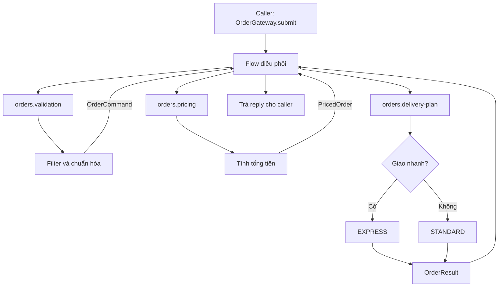

# Tránh flow quá dài

## 1. Mục tiêu của bài học

Trong chương **Thiết kế flow** của module **SPRING_INTEGRATION_CORE**, bài học này giải quyết một vấn đề thường gặp: một `IntegrationFlow` ban đầu dễ đọc nhưng dần chứa toàn bộ việc tiếp nhận, kiểm tra, chuyển đổi, định tuyến, gọi dịch vụ, ghép kết quả và xử lý lỗi.

Sau bài học, bạn có thể:

- Nhận diện flow đang gánh quá nhiều trách nhiệm.
- Chọn điểm tách dựa trên hợp đồng thông điệp và hành vi nghiệp vụ.
- Phân biệt việc chuyển tiếp qua channel với việc gọi flow con để lấy kết quả.
- Giữ rõ đường trả lời, chính sách lỗi và ranh giới thực thi sau khi tách.
- Lập kế hoạch kiểm thử các điểm nối, thay vì chỉ đọc riêng từng flow.

Các thành phần Message, MessageChannel, endpoint, gateway và Java DSL vẫn là nền tảng. Transformer, filter và router xuất hiện trong ví dụ chính; splitter và aggregator được xét khi lựa chọn ranh giới cho quy trình có nhiều phần tử.

## 2. “Quá dài” là vấn đề về khả năng hiểu

Không có số endpoint tối đa áp dụng cho mọi ứng dụng. Một chuỗi nhiều phép chuyển đổi thuần túy có thể dễ hiểu hơn một flow ngắn có nhánh lồng nhau, sửa trạng thái dùng chung và gọi nhiều hệ thống ngoài.

Thay vì chỉ đếm số dòng, hãy thử trả lời:

1. Flow nhận gì và kết thúc bằng kết quả nào?
2. Payload có kiểu gì tại từng điểm?
3. Có bao nhiêu kết quả thành công, từ chối và lỗi?
4. Thành phần nào có tác dụng phụ?
5. Nếu chạy lại, bước nào có thể thực hiện hai lần?
6. Caller nhận kết quả hay chỉ nhận xác nhận tiếp nhận?

Nếu phải mở nhiều lambda và suy ngược các header mới trả lời được, flow đã cần được xem xét lại.

| Dấu hiệu | Khó khăn xuất hiện | Hướng xử lý nên cân nhắc |
|---|---|---|
| Một flow vừa chuẩn hóa đầu vào vừa quyết định giao hàng | Thay đổi một quy tắc kéo theo nhiều vùng mã | Tách theo giai đoạn nghiệp vụ |
| Router có nhiều tầng nhánh | Khó liệt kê các đường kết thúc | Tách nhánh lớn thành flow có tên |
| Lambda dài, chứa tính toán và gọi repository | Cấu hình che khuất logic nghiệp vụ | Đưa logic vào service hoặc transformer có tên |
| Cùng một nhóm bước được sao chép | Các bản sao dễ thay đổi khác nhau | Tạo flow dùng lại với hợp đồng riêng |
| Một chính sách retry bao trùm nhiều tác dụng phụ | Chạy lại có thể nhân đôi hành động | Đặt retry ở thao tác cần phục hồi |
| Payload là `Map<String, Object>` thay đổi liên tục | Hợp đồng giữa các bước bị ẩn | Dùng kiểu dữ liệu thể hiện trạng thái xử lý |
| Test chỉ dựng được toàn bộ quy trình | Khó xác định lỗi nằm ở đâu | Kiểm thử từng hợp đồng và các điểm nối |

Mục đích của việc tách là giúp người đọc dự đoán hành vi. Nếu phải đi qua nhiều channel có tên như `step1`, `step2`, `step3` để hiểu một phép chuẩn hóa đơn giản, thiết kế mới chưa đạt mục đích đó.

## 3. Chọn ranh giới trước khi sửa Java DSL

### 3.1. Chia theo câu hỏi nghiệp vụ

Giả sử ứng dụng tiếp nhận yêu cầu đặt một mặt hàng. Quy trình cần:

- Kiểm tra hình dạng yêu cầu và chuẩn hóa mã hàng.
- Tính tổng tiền theo bảng giá.
- Chọn phương án giao thường hoặc giao nhanh.
- Trả kết quả cho caller.

Có thể mô tả ba giai đoạn:

| Giai đoạn | Câu hỏi mà giai đoạn giải quyết | Đầu vào | Đầu ra |
|---|---|---|---|
| Kiểm tra và chuẩn hóa | Yêu cầu có đủ dữ liệu để xử lý không? | `OrderCommand` | `OrderCommand` đã chuẩn hóa |
| Tính giá | Đơn hàng có tổng tiền bao nhiêu? | `OrderCommand` | `PricedOrder` |
| Lập phương án giao | Đơn hàng sẽ theo phương án nào? | `PricedOrder` | `OrderResult` |

Đây là lựa chọn thiết kế cho ví dụ, không phải yêu cầu của framework. Trong ứng dụng khác, kiểm tra và chuẩn hóa có thể là hai giai đoạn riêng nếu chúng có lý do thay đổi khác nhau.

### 3.2. Ghi hợp đồng ở mỗi điểm nối

Một channel có tên mới chỉ cho biết địa chỉ. Hợp đồng của điểm nối cần giải thích thêm:

| Thuộc tính | Ví dụ cho giai đoạn tính giá |
|---|---|
| Channel nhận request | `orders.pricing` |
| Payload đầu vào | `OrderCommand` có SKU đã chuẩn hóa |
| Header nghiệp vụ cần giữ | `tenantId`, `traceId` nếu hệ thống sử dụng |
| Kết quả thành công | Đúng một `PricedOrder` |
| Trường hợp không có dữ liệu | SKU chưa có giá tạo lỗi |
| Tác dụng phụ | Không có trong ví dụ |
| Cách gọi | Request–reply bằng gateway |
| Thực thi | Đồng bộ qua `DirectChannel` |
| Chính sách phục hồi | Không tự retry lỗi không có giá |

Việc ghi rõ “đúng một kết quả” ngăn một lỗi thiết kế phổ biến: caller chờ reply nhưng flow con có đường đi kết thúc bằng `void`, `null` hoặc loại bỏ message.

### 3.3. Tách service hay tách flow?

Không phải khối mã dài nào cũng cần một `IntegrationFlow` mới.

- Nếu khối mã chỉ tính toán trên một đối tượng, hãy cân nhắc một phương thức hoặc service thuần Java.
- Nếu khối mã cần phối hợp filter, router, adapter hoặc nhiều endpoint, một flow riêng có thể có ích.
- Nếu chỉ cần tên rõ cho vài thao tác cấu hình được lặp lại, có thể trích một phương thức trả về `IntegrationFlow`.
- Nếu cần một điểm vào ổn định để nhiều flow sử dụng, hãy công bố channel và hợp đồng của nó.

Một service như `PriceCalculator` không cần tự biết `MessageChannel`. Flow chịu trách nhiệm kết nối, còn service chịu trách nhiệm tính giá. Nhờ vậy, bạn có thể kiểm thử quy tắc tính giá mà không dựng messaging infrastructure.

## 4. Chọn cách nối phù hợp

### 4.1. Chuyển tiếp bằng channel

```java
@Bean
IntegrationFlow intakeFlow() {
    return IntegrationFlow.from("orders.in")
            .channel("orders.validation")
            .get();
}
```

Ở đây message được chuyển tiếp sang `orders.validation`. Ví dụ này không tạo một lời gọi flow con có điểm quay lại tại `intakeFlow`. Phần xử lý phía sau sẽ do consumer của channel đó quyết định.

Nếu toàn bộ pipeline chỉ tiến về một đích, chuyển tiếp như vậy có thể đủ. Caller bên ngoài vẫn có thể nhận reply nếu đường xử lý cuối giữ đúng cơ chế trả lời; bản thân `.channel(...)` không dựng một vòng request–reply lồng nhau.

### 4.2. Gọi flow con bằng gateway

```java
@Bean
IntegrationFlow orchestrationFlow() {
    return IntegrationFlow.from("orders.in")
            .gateway("orders.validation")
            .gateway("orders.pricing")
            .gateway("orders.delivery-plan")
            .get();
}
```

Operator `.gateway(...)` gửi request tới điểm vào của flow khác, nhận reply rồi tiếp tục ở flow gọi. Cách này phù hợp khi một giai đoạn có kết quả cần được sử dụng ở giai đoạn tiếp theo. Spring Integration hỗ trợ gọi bằng tên channel, đối tượng channel hoặc tham chiếu `IntegrationFlow`. [Tài liệu operator gateway()](https://docs.spring.io/spring-integration/reference/dsl/java-gateway.html).

Không cần thêm gateway tại mọi channel. Chỉ dùng khi quan hệ gọi–trả lời giúp diễn đạt đúng hợp đồng.

### 4.3. Giữ nhánh nhỏ inline, đưa nhánh lớn ra ngoài

Một router hai nhánh ngắn có thể nằm ngay trong flow:

```java
.route(PricedOrder.class, p -> p.order().express(), mapping -> mapping
        .subFlowMapping(true, branch -> branch
                .handle(PricedOrder.class,
                        (p, headers) -> plan(p, "EXPRESS")))
        .subFlowMapping(false, branch -> branch
                .handle(PricedOrder.class,
                        (p, headers) -> plan(p, "STANDARD"))))
```

Nếu mỗi nhánh phát triển thành nhiều bước, có thể giữ router làm bản đồ quyết định:

```java
.route(PricedOrder.class, p -> p.order().express(), mapping -> mapping
        .subFlowMapping(true, branch -> branch
                .gateway("orders.express-plan"))
        .subFlowMapping(false, branch -> branch
                .gateway("orders.standard-plan")))
```

Các đoạn trên là lựa chọn thay thế tại vị trí router; không phải cấu hình chạy đồng thời. Trong lựa chọn thứ hai, hai channel đích cần có flow xử lý trả về `OrderResult`.

Subflow khai báo trực tiếp bằng lambda được DSL nối để kết quả quay về phần tiếp theo của flow. Khi tham chiếu một flow có sẵn và cần tiếp tục bằng reply của nó, hãy dùng gateway phù hợp. Không suy rằng mọi `channelMapping` của router đều tự quay về. Tài liệu Spring cũng khuyến cáo tránh lồng subflow quá sâu. [Tài liệu hỗ trợ subflow](https://docs.spring.io/spring-integration/reference/dsl/java-subflows.html).

## 5. Ví dụ đầy đủ: chia quy trình thành ba giai đoạn

### 5.1. Giả định và sơ đồ

Ví dụ dùng Java 17 trở lên và cú pháp Java DSL của Spring Integration 6.x. Cần dependency `org.springframework.integration:spring-integration-core` với phiên bản tương thích trong dự án. Không cần broker, cơ sở dữ liệu hay HTTP server.

Bảng giá nằm trong bộ nhớ để tập trung vào cách chia flow. “Lập phương án giao” chỉ tạo dữ liệu trả lời, chưa gọi hãng vận chuyển và chưa ghi nhận đơn hàng.



Các mũi tên quay lại flow điều phối thể hiện quan hệ gọi–trả lời. Đây không phải vòng lặp xử lý lại đơn hàng.

### 5.2. Cấu hình Java

Lưu mã ví dụ sau vào `OrderFlowConfig.java` trong dự án thực hành:

```java
import java.math.BigDecimal;
import java.util.Locale;
import java.util.Map;

import org.springframework.context.annotation.AnnotationConfigApplicationContext;
import org.springframework.context.annotation.Bean;
import org.springframework.context.annotation.Configuration;
import org.springframework.integration.channel.DirectChannel;
import org.springframework.integration.config.EnableIntegration;
import org.springframework.integration.dsl.IntegrationFlow;
import org.springframework.messaging.MessageChannel;

@Configuration(proxyBeanMethods = false)
@EnableIntegration
public class OrderFlowConfig {

    private static final String VALIDATION = "orders.validation";
    private static final String PRICING = "orders.pricing";
    private static final String DELIVERY_PLAN = "orders.delivery-plan";

    private static final Map<String, BigDecimal> PRICES = Map.of(
            "BOOK", new BigDecimal("120000"),
            "PEN", new BigDecimal("15000"));

    public record OrderCommand(
            String orderId,
            String sku,
            int quantity,
            boolean express) {
    }

    public record PricedOrder(OrderCommand order, BigDecimal total) {
    }

    public record OrderResult(
            String orderId,
            BigDecimal total,
            String deliveryMethod) {
    }

    public interface OrderGateway {
        OrderResult submit(OrderCommand command);
    }

    @Bean(name = VALIDATION)
    MessageChannel validationChannel() {
        return new DirectChannel();
    }

    @Bean(name = PRICING)
    MessageChannel pricingChannel() {
        return new DirectChannel();
    }

    @Bean(name = DELIVERY_PLAN)
    MessageChannel deliveryPlanChannel() {
        return new DirectChannel();
    }

    @Bean
    IntegrationFlow orderFlow() {
        return IntegrationFlow
                .from(OrderGateway.class, proxy -> proxy
                        .beanName("orderGateway")
                        .replyTimeout(3000))
                .gateway(VALIDATION, endpoint -> endpoint
                        .id("orders.call-validation")
                        .replyTimeout(1000L)
                        .requiresReply(true))
                .gateway(PRICING, endpoint -> endpoint
                        .id("orders.call-pricing")
                        .replyTimeout(1000L)
                        .requiresReply(true))
                .gateway(DELIVERY_PLAN, endpoint -> endpoint
                        .id("orders.call-delivery-plan")
                        .replyTimeout(1000L)
                        .requiresReply(true))
                .get();
    }

    @Bean
    IntegrationFlow validationFlow() {
        return IntegrationFlow.from(VALIDATION)
                .filter(OrderCommand.class, OrderFlowConfig::valid,
                        endpoint -> endpoint
                                .id("orders.validate")
                                .throwExceptionOnRejection(true))
                .transform(OrderCommand.class, OrderFlowConfig::normalize,
                        endpoint -> endpoint.id("orders.normalize"))
                .get();
    }

    @Bean
    IntegrationFlow pricingFlow() {
        return IntegrationFlow.from(PRICING)
                .transform(OrderCommand.class, OrderFlowConfig::price,
                        endpoint -> endpoint.id("orders.calculate-total"))
                .get();
    }

    @Bean
    IntegrationFlow deliveryPlanFlow() {
        return IntegrationFlow.from(DELIVERY_PLAN)
                .route(PricedOrder.class, p -> p.order().express(),
                        mapping -> mapping
                                .subFlowMapping(true, branch -> branch
                                        .handle(PricedOrder.class,
                                                (p, headers) -> plan(p, "EXPRESS"),
                                                endpoint -> endpoint
                                                        .id("orders.express-plan")
                                                        .requiresReply(true)))
                                .subFlowMapping(false, branch -> branch
                                        .handle(PricedOrder.class,
                                                (p, headers) -> plan(p, "STANDARD"),
                                                endpoint -> endpoint
                                                        .id("orders.standard-plan")
                                                        .requiresReply(true))))
                .bridge()
                .get();
    }

    private static boolean valid(OrderCommand command) {
        return command.orderId() != null
                && !command.orderId().isBlank()
                && command.sku() != null
                && !command.sku().isBlank()
                && command.quantity() > 0;
    }

    private static OrderCommand normalize(OrderCommand command) {
        return new OrderCommand(
                command.orderId().strip(),
                command.sku().strip().toUpperCase(Locale.ROOT),
                command.quantity(),
                command.express());
    }

    private static PricedOrder price(OrderCommand command) {
        BigDecimal unitPrice = PRICES.get(command.sku());
        if (unitPrice == null) {
            throw new IllegalArgumentException(
                    "Chua co gia cho SKU: " + command.sku());
        }
        BigDecimal total = unitPrice.multiply(
                BigDecimal.valueOf(command.quantity()));
        return new PricedOrder(command, total);
    }

    private static OrderResult plan(PricedOrder priced, String method) {
        return new OrderResult(
                priced.order().orderId(),
                priced.total(),
                method);
    }

    public static void main(String[] args) {
        try (var context =
                     new AnnotationConfigApplicationContext(OrderFlowConfig.class)) {
            OrderGateway gateway = context.getBean(OrderGateway.class);
            OrderResult result = gateway.submit(
                    new OrderCommand(" O-100 ", " book ", 2, true));
            System.out.println(result);
        }
    }
}
```

### 5.3. Đọc ví dụ theo hợp đồng

`IntegrationFlow.from(OrderGateway.class, ...)` đăng ký gateway proxy với tên `orderGateway` và tạo điểm vào cho flow điều phối. Ví dụ này dùng cách đăng ký qua DSL, nên không cần đồng thời khai báo một `@MessagingGateway` khác cho cùng interface. Tùy chọn `replyTimeout` của `GatewayProxySpec` tính bằng mili giây. [API GatewayProxySpec](https://docs.spring.io/spring-integration/api/org/springframework/integration/dsl/GatewayProxySpec.html).

Flow điều phối chỉ thể hiện thứ tự nghiệp vụ. Nó không cần biết bảng giá lưu ở đâu hoặc nhánh giao nhanh tính toán như thế nào.

`validationFlow` nhận `OrderCommand`, từ chối yêu cầu sai hình dạng và chuẩn hóa yêu cầu hợp lệ. Filter được cấu hình `throwExceptionOnRejection(true)` để việc từ chối có kết quả quan sát được. Nếu chỉ loại message trong quy trình đang chờ reply, caller có thể phải đợi đến timeout. [Tài liệu Filter](https://docs.spring.io/spring-integration/reference/filter.html).

`pricingFlow` biến `OrderCommand` thành `PricedOrder`. Việc đổi kiểu payload giúp thể hiện rằng giai đoạn tính giá đã hoàn tất.

`deliveryPlanFlow` chọn một nhánh, tạo `OrderResult`, sau đó chuyển kết quả qua bridge cuối flow để đi theo đường reply. Service activator trả kết quả có thể dùng header `replyChannel` khi không chỉ định output channel. [Tài liệu Service Activator](https://docs.spring.io/spring-integration/reference/service-activator.html).

Lời gọi mẫu cho kết quả về mặt dữ liệu:

```text
orderId = O-100
total = 240000
deliveryMethod = EXPRESS
```

### 5.4. Flow ngắn hơn nhưng vẫn có cùng quy trình

Trước khi chia, mọi bước có thể nằm trong một chain:

```text
nhận yêu cầu → kiểm tra → chuẩn hóa → tính giá → chọn nhánh → tạo reply
```

Sau khi chia, công việc vẫn tồn tại. Thay đổi có ích là mỗi giai đoạn có tên, kiểu đầu vào, kiểu đầu ra và đường kết thúc rõ ràng. Bạn có thể thay logic tính giá mà không phải đọc toàn bộ router.

`requiresReply(true)` tại gateway là hàng rào phát hiện trường hợp gateway không tạo được kết quả để gửi tiếp. Nó không tạo reply thay cho flow con. Những handler bắt buộc có kết quả vẫn cần tránh trả `null` hoặc được cấu hình yêu cầu reply tại chính handler. [API GatewayEndpointSpec](https://docs.spring.io/spring-integration/api/org/springframework/integration/dsl/GatewayEndpointSpec.html).

## 6. Tách flow không tự tạo ranh giới vận hành mới

### 6.1. Channel quyết định cách chuyển giao

| Cách nối | Đặc điểm thực thi cần hiểu |
|---|---|
| `DirectChannel` | Gọi consumer trên thread gửi |
| `ExecutorChannel` | Chuyển việc dispatch cho executor; không bảo đảm cùng thread |
| `QueueChannel` | Đệm message; endpoint nhận từ queue cần poller |
| `PublishSubscribeChannel` | Phát message tới các subscriber; executor là lựa chọn riêng |

Queue mặc định giữ message trong bộ nhớ. Channel có nhiều subscriber cũng không mặc nhiên là một chuỗi bước chạy lần lượt. [Tài liệu các loại MessageChannel](https://docs.spring.io/spring-integration/reference/channel/implementations.html).

Trong ví dụ, ba channel đều là `DirectChannel`. Việc chia thành bốn bean `IntegrationFlow` giúp tổ chức mã nhưng không biến các giai đoạn thành tác vụ chạy song song.

Nếu sau này thay channel tính giá bằng queue, hãy xem đó là một thay đổi hành vi cần thiết kế riêng. Bạn cần trả lời: ai poll, queue đầy xử lý thế nào, message có cần bền vững không, ai nhận lỗi và caller có còn chờ giá ngay trong request ban đầu không?

### 6.2. Timeout chờ reply không phải cơ chế ngắt xử lý

Các giá trị `replyTimeout` trong ví dụ là ngân sách chờ ở gateway, không phải giới hạn thời gian cưỡng chế cho toàn bộ quy trình.

Với chuỗi chạy đồng bộ, handler chậm vẫn giữ thread gọi. Reply timeout không ngắt handler đó. Khi có chuyển giao sang thread khác, thời gian chờ reply có ý nghĩa riêng; reply đến muộn vẫn cần được xử lý theo thiết kế. [Hành vi timeout của Messaging Gateway](https://docs.spring.io/spring-integration/reference/gateway.html#gateway-behavior-no-response).

Vì vậy, khi thay bảng giá trong bộ nhớ bằng HTTP client, hãy đặt timeout ở HTTP client. Nếu dùng JDBC, cần chính sách timeout phù hợp ở lớp truy cập dữ liệu. Cộng ba giá trị timeout của ba gateway không đủ để chứng minh tổng thời gian xử lý sẽ dưới ba giây.

### 6.3. Tách bean không tự tạo transaction

Ví dụ không khai báo transaction. Bảng giá và các record không cần transaction.

Trong quy trình thực tế, hãy vẽ rõ thao tác ghi dữ liệu và nơi mở transaction trước khi tách. Cùng thread có thể là điều kiện cần cho một số cơ chế transaction theo thread, nhưng vẫn phải có cấu hình transaction và tài nguyên tham gia phù hợp.

Nếu muốn thêm queue giữa “lưu đơn hàng” và “gửi yêu cầu giao”, hãy thiết kế trạng thái trung gian. Chẳng hạn, đơn hàng có thể được ghi với trạng thái `PENDING_DISPATCH` rồi được chuyển tiếp bằng một cơ chế bảo đảm phù hợp. Việc thêm channel không tự bảo đảm hai thao tác sẽ cùng thành công.

## 7. Giữ hợp đồng Message khi đổi payload

Một flow dễ hiểu cần thể hiện cả dữ liệu nghiệp vụ lẫn metadata phục vụ xử lý.

Trong ví dụ:

- `OrderCommand` chứa dữ liệu caller yêu cầu.
- `PricedOrder` biểu diễn kết quả tính giá.
- `OrderResult` là kết quả trả ra ngoài.

Trong ứng dụng nhiều tenant, `tenantId` có thể là header bắt buộc ở mọi giai đoạn. Trong quy trình cần theo dõi, một mã yêu cầu nghiệp vụ ổn định giúp liên kết các lần xử lý.

`Message` gồm payload và headers; cấu trúc headers là chỉ đọc. Khi cần tự xây dựng message mới, hãy chủ động giữ metadata cần thiết. Ví dụ sau minh họa việc chuyển payload và sao chép headers bằng `MessageBuilder`. [Tài liệu Message](https://docs.spring.io/spring-integration/reference/message.html).

```java
import org.springframework.messaging.Message;
import org.springframework.messaging.support.MessageBuilder;

// Dùng trong phạm vi có OrderCommand và normalize().
private static Message<OrderCommand> normalizeMessage(
        Message<OrderCommand> input) {

    return MessageBuilder
            .withPayload(normalize(input.getPayload()))
            .copyHeaders(input.getHeaders())
            .build();
}
```

Đoạn mã này là minh họa bổ sung khi tự tạo `Message`; không cần chèn vào cấu hình chính vốn chỉ trả payload từ transformer.

Hãy ghi riêng các header thuộc hợp đồng nghiệp vụ, ví dụ `tenantId` hoặc `requestId`. Đồng thời, không loại bỏ tùy tiện metadata điều khiển như `replyChannel`, `errorChannel`, hoặc metadata gom nhóm trong quy trình splitter–aggregator.

Không nên dùng `MessageHeaders.ID` làm khóa chống xử lý trùng của nghiệp vụ. Hãy chọn một khóa do ứng dụng quản lý, chẳng hạn `orderId` kèm loại thao tác, với quy tắc duy nhất rõ ràng.

Khi message đi qua broker hoặc giao thức ngoài tiến trình, cần thiết kế lại phần ánh xạ và serialization của header. Không xem một đối tượng channel trong bộ nhớ như địa chỉ trả lời có thể truyền nguyên trạng sang một ứng dụng khác.

## 8. Giữ đường lỗi rõ ràng sau khi chia

### 8.1. Mỗi giai đoạn cần có hành vi thất bại cụ thể

Trong ví dụ, các tình huống được thiết kế như sau:

| Tình huống | Điểm phát hiện | Hành vi mong muốn |
|---|---|---|
| `quantity <= 0` | Filter ở validation | Từ chối bằng exception |
| SKU null hoặc trống | Filter ở validation | Từ chối trước khi chuẩn hóa |
| SKU chưa có giá | Transformer tính giá | Tạo lỗi, không lập phương án giao |
| Đơn hợp lệ | Các giai đoạn xử lý | Trả đúng một `OrderResult` |
| Handler bắt buộc trả kết quả nhưng trả null | Endpoint tương ứng hoặc gateway gọi nó | Báo lỗi hợp đồng reply theo cấu hình |

Exception có thể được framework bọc trong messaging exception. Khi viết kiểm thử, cần phân biệt exception ngoài cùng với nguyên nhân nghiệp vụ bên trong, thay vì mặc định caller luôn nhận nguyên vẹn kiểu exception do phương thức tính giá ném ra.

Một phương án khác cho dữ liệu không hợp lệ là trả `RejectedOrder` như kết quả nghiệp vụ. Nếu chọn cách đó, phải sửa hợp đồng gateway và các giai đoạn tiếp theo để phân biệt kết quả chấp nhận với từ chối. Không thể chỉ đổi filter thành “bỏ qua” rồi giữ giả định mọi request sẽ có `OrderResult`.

### 8.2. Không mặc định mọi lỗi đều tới errorChannel chung

Lỗi từ handler đồng bộ trên thread gửi thường lan về caller. Khi framework xử lý tác vụ bất đồng bộ hoặc poller, cơ chế công bố `ErrorMessage` có vai trò khác; header `errorChannel` và kênh lỗi mặc định tham gia định tuyến theo cấu hình. [Tài liệu Error Handling](https://docs.spring.io/spring-integration/reference/7.0/error-handling.html).

Do đó, việc đặt tên flow là `pricingFlow` không tạo ra một kênh lỗi riêng cho nó. Nếu muốn dùng gateway error channel để chuyển lỗi thành kết quả, flow xử lý lỗi phải tạo một reply đúng kiểu mà caller chấp nhận.

Nếu flow lỗi chỉ ghi log, hãy xác định rõ caller sẽ nhận exception, không có reply hay một kết quả nghiệp vụ khác. Sự im lặng của handler log không tương đương với việc yêu cầu ban đầu đã được xử lý thành công.

### 8.3. Đặt retry theo thao tác, không theo độ dài flow

Giả sử quy trình sau này có thêm:

```text
giữ tiền → ghi đơn → tạo vận đơn → gửi thông báo
```

Nếu “gửi thông báo” lỗi và toàn bộ quy trình được chạy lại, các bước trước có thể bị lặp. Tách thành nhiều flow giúp nhìn rõ các bước, nhưng không tự giải quyết nguy cơ đó.

Một thiết kế nên ghi:

| Thao tác | Câu hỏi trước khi retry |
|---|---|
| Đọc giá từ dịch vụ ngoài | Lỗi tạm thời hay SKU không tồn tại? |
| Giữ tiền | Có khóa idempotency được bên thanh toán hỗ trợ không? |
| Ghi đơn hàng | Có ràng buộc duy nhất theo mã yêu cầu không? |
| Tạo vận đơn | Có thể tra cứu yêu cầu đã tạo trước khi gửi lại không? |
| Gửi thông báo | Hệ thống chấp nhận gửi trùng hay cần chống trùng? |

Trong ví dụ hiện tại, “chưa có giá cho SKU” là lỗi dữ liệu hoặc cấu hình danh mục. Retry nhiều lần không làm SKU tự xuất hiện. Đây là lý do chính sách phục hồi nên gắn với nguyên nhân thất bại cụ thể.

## 9. Chọn ranh giới cho splitter và aggregator

Một flow xử lý cả danh sách thường dài theo một cách khác:

```text
nhận đơn nhiều dòng
→ split thành dòng hàng
→ kiểm tra và tính giá từng dòng
→ aggregate về kết quả đơn hàng
→ lập phương án giao
```

Khi chia flow này, hãy giữ rõ đơn vị xử lý. “Một dòng hàng” và “một đơn hàng” là hai hợp đồng khác nhau.

Có thể tổ chức:

```text
orderFlow
    split
    gọi linePricingFlow cho từng dòng
    aggregate
    lập phương án giao

linePricingFlow
    kiểm tra một dòng
    tính giá một dòng
    trả một kết quả dòng
```

Đây là sơ đồ thiết kế, chưa phải mã DSL hoàn chỉnh. Cần cấu hình correlation, điều kiện release, thời hạn chờ và xử lý nhóm thiếu phần tử phù hợp với nghiệp vụ.

Giữ splitter và aggregator trong cùng một flow điều phối thường giúp người đọc thấy phạm vi của nhóm. Nếu cần đặt chúng ở các flow khác nhau, hãy công bố rõ:

- Metadata nào liên kết các phần tử thuộc cùng đơn.
- Khi nào một nhóm được xem là đủ.
- Trường hợp một dòng bị từ chối sẽ tạo kết quả lỗi của dòng hay làm hủy cả đơn.
- Kết quả một phần có được chấp nhận không.
- Ai chịu trách nhiệm giải phóng trạng thái của nhóm không hoàn tất.

Không thêm aggregator chỉ để “nối lại” các flow đã tách. Chuỗi request–reply xử lý một message như ví dụ đặt một mặt hàng không cần bước gom nhóm.

## 10. Kiểm thử hợp đồng và điểm nối

Phần này mô tả cách kiểm thử thiết kế trong dự án thực hành. Việc một bài viết có mã ví dụ và kết quả mong đợi không có nghĩa mã đó đã được chạy trong môi trường của bạn.

### 10.1. Ba mức kiểm tra có mục đích khác nhau

| Mức | Đối tượng | Bằng chứng cần thu được |
|---|---|---|
| Logic thuần | Chuẩn hóa, tính giá, chọn phương án | Quy tắc dữ liệu cho kết quả đúng |
| Flow một giai đoạn | Validation, pricing, delivery plan | Đúng kiểu message và hành vi lỗi |
| Quy trình hoàn chỉnh | `OrderGateway.submit` | Điểm nối và đường reply hoạt động cùng nhau |

Test logic thuần không phát hiện channel bị nối sai. Test từng flow thành công cũng chưa chứng minh rằng flow điều phối lấy đúng kết quả của giai đoạn trước.

### 10.2. Các ca kiểm tra nên có

| Đầu vào hoặc tình huống | Kỳ vọng |
|---|---|
| `O-100, " book ", 2, true` | `O-100, 240000, EXPRESS` |
| `O-101, "PEN", 3, false` | `O-101, 45000, STANDARD` |
| Quantity bằng 0 | Bị từ chối tại validation |
| SKU chỉ có khoảng trắng | Bị từ chối trước khi tính giá |
| SKU `UNKNOWN` | Có lỗi chưa có giá; không tạo kết quả giao |
| Gọi pricing bằng command đã chuẩn hóa | Nhận `PricedOrder` với tổng tiền đúng |
| Flow con bắt buộc trả lời nhưng không tạo reply | Phát hiện vi phạm hợp đồng theo cấu hình timeout/requiresReply |
| Header nghiệp vụ được gửi vào | Header còn ở những điểm mà hợp đồng yêu cầu |

Với tính toán tiền, test nên so sánh giá trị `BigDecimal` theo chính sách scale của hệ thống. Trong ví dụ này, bảng giá dùng số tiền nguyên theo VND.

### 10.3. Gọi trực tiếp một điểm vào của flow

Có thể kiểm tra riêng flow tính giá bằng cách gửi message có reply channel. Đoạn sau đặt bên trong phạm vi đang có application context và các kiểu của `OrderFlowConfig`:

```java
import org.springframework.integration.channel.QueueChannel;
import org.springframework.messaging.Message;
import org.springframework.messaging.MessageChannel;
import org.springframework.messaging.support.MessageBuilder;

// context là AnnotationConfigApplicationContext đã khởi tạo.
MessageChannel pricing = context.getBean(
        "orders.pricing", MessageChannel.class);

QueueChannel replies = new QueueChannel(1);

var command = new OrderFlowConfig.OrderCommand(
        "O-200", "BOOK", 2, false);

Message<?> request = MessageBuilder
        .withPayload(command)
        .setReplyChannel(replies)
        .build();

boolean sent = pricing.send(request, 1000);
if (!sent) {
    throw new AssertionError("Khong gui duoc request tinh gia");
}

Message<?> reply = replies.receive(1000);
if (reply == null) {
    throw new AssertionError("Khong nhan duoc reply tinh gia");
}

if (!(reply.getPayload() instanceof OrderFlowConfig.PricedOrder priced)) {
    throw new AssertionError("Sai kieu payload");
}

if (priced.total().compareTo(new BigDecimal("240000")) != 0) {
    throw new AssertionError("Sai tong tien");
}
```

`QueueChannel` ở đây chỉ là nơi test nhận reply. Nó không thay channel `orders.pricing` trong cấu hình chính thành queue. Vì channel request vẫn là `DirectChannel`, tham số timeout của `send` không phải giới hạn thời gian chạy phương thức tính giá.

Khi thêm queue hoặc executor vào cấu hình sản phẩm, hãy bổ sung kiểm tra cho giao nhận bất đồng bộ, lỗi và trường hợp reply tới muộn. Không dùng `Thread.sleep` cố định để chứng minh một message đã được xử lý; hãy chờ kết quả hoặc trạng thái cụ thể với thời hạn hữu hạn.

## 11. Cách tách một flow đang có mà giữ được hành vi

### Bước 1: Liệt kê các đường kết thúc

Ghi các kết quả hiện tại: thành công, dữ liệu bị từ chối, lỗi dịch vụ ngoài và timeout. Xác định caller nhận gì ở mỗi trường hợp.

Với flow dài, bước này giúp tìm cả những nhánh vô tình kết thúc không có reply.

### Bước 2: Theo dõi payload và tác dụng phụ

Đánh dấu kiểu payload sau mỗi transformer. Ghi riêng các thao tác ghi cơ sở dữ liệu, gọi thanh toán, tạo vận đơn hoặc phát sự kiện.

Nếu một lambda vừa đổi dữ liệu vừa gọi hệ thống ngoài, hãy làm rõ hợp đồng của nó trước khi chuyển sang flow khác.

### Bước 3: Chọn một giai đoạn dễ xác định hợp đồng

Một nhóm thao tác thuần túy như chuẩn hóa rồi tính giá là ứng viên dễ bắt đầu. Ghi đầu vào, đầu ra, header và lỗi mà giai đoạn này có thể tạo.

Không bắt đầu bằng việc chia đều theo số dòng.

### Bước 4: Tạo điểm vào có tên

Ví dụ chọn `orders.pricing`, thay vì `flow.part2`. Kiểm tra tên này không bị dùng cho một chức năng khác và có consumer phù hợp.

Tên channel nên thể hiện loại công việc hoặc loại message. Tên endpoint có thể mô tả hành động cụ thể như `orders.calculate-total`.

### Bước 5: Chọn chuyển tiếp hay gateway

Nếu quy trình chỉ bàn giao rồi kết thúc tại flow hiện tại, chuyển tiếp bằng channel có thể đủ.

Nếu cần lấy kết quả để tiếp tục xử lý tại flow gọi, dùng quan hệ request–reply rõ ràng. Đừng thay `.gateway(...)` bằng `.channel(...)` chỉ vì cả hai đều nhận tên channel.

### Bước 6: Kiểm tra hành vi quan sát được

So sánh kết quả và lỗi ở đầu vào công khai trước và sau khi tách. Đối với thao tác có tác dụng phụ, xác nhận số lần thực hiện và hành vi khi chạy lại.

Giữ thay đổi về tổ chức flow tách biệt với thay đổi về thuật toán, giá bán hoặc giao thức để việc đánh giá dễ hơn.

### Bước 7: Đánh giá tổng thể sau mỗi lần tách

Hãy đọc flow điều phối như một mô tả nghiệp vụ. Sau đó đọc riêng flow vừa tách và kiểm tra xem nó có thể được giải thích bằng một câu rõ ràng không.

Chỉ tiếp tục tạo flow mới khi xuất hiện một ranh giới có ý nghĩa. Mục đích không phải làm cho tất cả bean có cùng độ dài.

## 12. Những cách “rút ngắn” làm tăng độ khó hiểu

### 12.1. Giấu toàn bộ quy trình vào một handler

```java
.handle(orderProcessor, "processEverything")
```

Dòng DSL rất ngắn nhưng có thể che cả router, retry, gọi HTTP và ghi dữ liệu trong một phương thức lớn. Cách này chỉ có ích nếu service đó thực sự có một trách nhiệm rõ và logic phối hợp được quản lý tốt bên trong.

Hãy đánh giá khả năng giải thích và kiểm thử của toàn bộ thiết kế, không chỉ hình dạng chuỗi DSL.

### 12.2. Tạo một channel cho từng phép gán

Chuỗi `trim.in → uppercase.in → defaults.in → rename.in` có thể khiến người đọc phải nhảy qua nhiều bean cho một thao tác chuẩn hóa.

Nếu các phép biến đổi luôn đi cùng nhau và có chung lý do thay đổi, một transformer hoặc service có tên phù hợp sẽ dễ theo dõi hơn.

### 12.3. Tách nhánh nhưng vẫn chia sẻ trạng thái mutable

Hai flow ngắn cùng sửa một đối tượng lớn có thể phụ thuộc vào thứ tự ngầm. Khi thêm xử lý song song, thiết kế này càng khó kiểm soát.

Ưu tiên các đối tượng thể hiện trạng thái đầu ra rõ ràng. Các record của ví dụ chứa những giá trị đơn giản và không bị sửa trực tiếp sau khi tạo.

### 12.4. Tạo vòng gọi giữa các flow

```text
orderFlow → pricingFlow → orderFlow
```

Nếu không có điều kiện kết thúc và mô hình trạng thái rõ, vòng này có thể gây đệ quy hoặc lặp message. Đặt tên mới cho flow không làm vòng phụ thuộc trở nên an toàn.

Flow điều phối nên gọi các giai đoạn có trách nhiệm riêng; một giai đoạn không nên quay lại điểm tiếp nhận ban đầu chỉ để sử dụng lại vài bước.

### 12.5. Chuyển sang bất đồng bộ chỉ để flow nhìn gọn

Queue và executor hữu ích khi có nhu cầu đệm, điều tiết hoặc tách thời gian xử lý. Chúng cũng đòi hỏi quyết định về lỗi, năng lực xử lý và phản hồi.

Nếu nhu cầu hiện tại chỉ là đọc và bảo trì mã dễ hơn, có thể tách các `IntegrationFlow` đồng bộ trước. Hãy bổ sung bất đồng bộ khi có yêu cầu vận hành cụ thể.

## 13. Khi nào nên giữ nguyên một flow?

Một flow nên được giữ liền mạch nếu:

- Mọi bước phục vụ cùng một trách nhiệm dễ diễn đạt.
- Đường thành công và thất bại đều rõ.
- Logic trong từng endpoint đủ nhỏ hoặc đã được đặt trong service phù hợp.
- Hợp đồng payload dễ theo dõi.
- Chưa có nhu cầu dùng lại hoặc chính sách xử lý riêng.
- Tách thêm chỉ tạo các địa chỉ trung gian mà không làm rõ nghiệp vụ.

Ví dụ, một flow “nhận chuỗi → loại chuỗi rỗng → chuẩn hóa → trả chuỗi” không nhất thiết cần bốn bean.

Đối với quy trình đặt hàng trong bài, thước đo hữu ích là: người bảo trì đọc flow điều phối để biết thứ tự nghiệp vụ, đọc từng flow con để biết hợp đồng của giai đoạn đó, và kiểm thử qua gateway để chứng minh các điểm nối hoạt động đúng.
