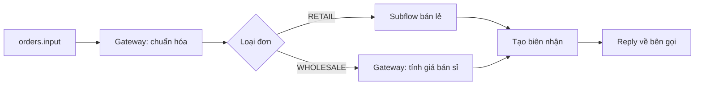

# Tách flow bằng subflow

Trong chương **Thiết kế flow** của module **SPRING_INTEGRATION_CORE**, tách flow bằng subflow là cách tổ chức một luồng thông điệp thành những phần có trách nhiệm rõ ràng. Flow cha thể hiện thứ tự xử lý nghiệp vụ; subflow thực hiện một nhánh hoặc một khả năng dùng chung như chuẩn hóa dữ liệu, tính phí hay tiếp nhận thông điệp bị loại.

Điểm cần nắm là **đường đi của Message và đường trả lời**. Đưa vài dòng Java DSL sang một phương thức khác chỉ giúp bố cục mã. Muốn flow cha tiếp tục đúng, phải xác định subflow nhận payload gì, trả payload gì, có thể kết thúc không trả lời hay không và ai chịu trách nhiệm xử lý lỗi.

Các ví dụ dưới đây dùng **Java 17 và Spring Integration 6.2**, với `IntegrationFlow` trong `org.springframework.integration.dsl`. Phần cấu hình cần `spring-integration-core`; ví dụ kiểm thử cần thêm JUnit Jupiter. Phiên bản dependency được quản lý theo dự án đang học. Các khối mã ghi rõ là trích đoạn cần được đặt vào cấu hình tương ứng.

Sau bài này, người học có thể:

- Chọn ranh giới subflow theo trách nhiệm và hợp đồng thông điệp.
- Phân biệt subflow nội tuyến của router với flow dùng chung được gọi qua `gateway()`.
- Giữ đúng đường trả lời khi kết hợp transformer, router và filter.
- Nhận biết tác động của channel, timeout, lỗi và aggregator đến khả năng tiếp tục flow cha.
- Kiểm thử riêng một subflow và kiểm thử hành vi toàn flow qua MessageChannel.

## 1. Subflow là một phần của đồ thị xử lý thông điệp

Một `IntegrationFlow` mô tả các endpoint và channel mà Spring đăng ký, kết nối trong application context. Lambda Java DSL được dùng để xây dựng cấu hình; nó không được gọi lại như một hàm Java cho từng thông điệp. Khi hệ thống chạy, Message được chuyển giữa các thành phần đã cấu hình. Xem mô hình tại [API IntegrationFlow](https://docs.spring.io/spring-integration/docs/6.2.6/api/org/springframework/integration/dsl/IntegrationFlow.html).

Với bài toán đơn hàng, có thể tổ chức:



Sơ đồ biểu diễn đường đi logic. Hai nhánh đi vào bước tạo biên nhận là **hai lựa chọn**, không phải hai tác vụ cùng chạy rồi chờ nhau. Mỗi đơn hợp lệ chỉ đi qua một nhánh.

Có hai hợp đồng thường gặp:

| Hợp đồng | Ý nghĩa | Ví dụ |
| --- | --- | --- |
| Request–reply | Gửi yêu cầu, nhận kết quả rồi tiếp tục | Chuẩn hóa đơn, tính giá |
| Một chiều | Chuyển thông điệp đến nơi xử lý và kết thúc đường đi đó | Ghi nhận sự kiện từ chối, gửi thông báo |

Tên gọi subflow không tự quyết định hợp đồng. Một nhánh router, nhánh discard và flow được gọi qua gateway có thể có cách kết thúc khác nhau.

## 2. Chọn cách tách phù hợp

| Nhu cầu thiết kế | Cách tổ chức | Điểm cần xác định |
| --- | --- | --- |
| Nhánh ngắn, chỉ có ý nghĩa tại một router | `subFlowMapping(key, sf -> ...)` | Kiểu payload trả về bước sau router |
| Khả năng được nhiều flow sử dụng | `IntegrationFlow` bean có input channel riêng, gọi bằng `gateway()` | Hợp đồng request–reply và timeout |
| Đoạn cấu hình dài, chỉ dùng trong một flow | Phương thức private trả `IntegrationFlow`, ghép qua operator phù hợp | Có cần một input channel công khai hay không |
| Chuyển sang một đích xử lý độc lập | `channelMapping()` hoặc gửi đến channel | Ai sở hữu phần xử lý tiếp theo |
| Xử lý message bị filter loại | `discardFlow()` hoặc `discardChannel()` | Có chủ ý kết thúc hay tạo kết quả từ chối |
| Phát cùng sự kiện tới nhiều bên | `publishSubscribeChannel()` và các subscriber | Số nhánh nhận message và cách thu kết quả nếu cần |

`subFlowMapping()` nội tuyến cho phép nối đầu ra nhánh về phần sau router. Khi dùng lại một `IntegrationFlow` bean trong nhánh và cần nhận reply để tiếp tục, hãy gọi bean đó qua `gateway()`. Cơ chế này được mô tả trong [Sub-flows support](https://docs.spring.io/spring-integration/reference/6.2/dsl/java-subflows.html).

Đừng tách mọi transformer thành một flow riêng. Nếu một phép biến đổi chỉ dài một dòng và chỉ được dùng tại chỗ, giữ nó trong flow cha thường dễ đọc hơn. Ranh giới tốt thường có tên nghiệp vụ, hợp đồng riêng hoặc nhu cầu tái sử dụng rõ ràng.

## 3. Viết hợp đồng trước khi viết Java DSL

Giả sử hệ thống nhận đơn bán lẻ và bán sỉ, với các quy ước phục vụ ví dụ:

- `orderId`, `customerId` phải có nội dung; sau chuẩn hóa sẽ được trim và chuyển thành chữ hoa.
- `kind` chỉ nhận `RETAIL` hoặc `WHOLESALE`.
- `amount` là số tiền nguyên theo VND và phải lớn hơn 0.
- Phí bán lẻ là 30.000 VND; phí bán sỉ là 0 VND.
- Đơn hợp lệ trả đúng một biên nhận; dữ liệu không hợp lệ làm phát sinh lỗi.

Hợp đồng các phần:

| Phần xử lý | Payload vào | Payload ra | Header cần giữ | Khi thất bại |
| --- | --- | --- | --- | --- |
| Chuẩn hóa | `OrderRequest` | `OrderRequest` đã chuẩn hóa | `requestId`, ngữ cảnh reply/error | Ném lỗi kiểm tra dữ liệu |
| Nhánh bán lẻ | `OrderRequest` | `PricedOrder` | `requestId` | Lan truyền lỗi tính toán |
| Flow bán sỉ | `OrderRequest` đã hợp lệ | `PricedOrder` | `requestId`, ngữ cảnh reply/error | Lan truyền lỗi tính toán |
| Tạo biên nhận | `PricedOrder` | `OrderReceipt` | `requestId` | Báo lỗi nếu tổng tiền vượt phạm vi `long` |

Hai nhánh cùng trả `PricedOrder`, nên bước sau router chỉ cần một phép chuyển đổi sang `OrderReceipt`. Nếu một nhánh trả `String` còn nhánh khác trả `OrderRequest`, flow cha sẽ phải biết chi tiết từng nhánh và dễ gặp lỗi kiểu dữ liệu.

`order.wholesale.input` trong ví dụ là đầu vào nội bộ dành cho dữ liệu đã qua chuẩn hóa. Nếu muốn công khai đầu vào này cho những bên gọi khác, cần bổ sung kiểm tra ngay tại ranh giới đó hoặc đưa kiểm tra vào thành phần dùng chung.

## 4. Ví dụ hoàn chỉnh: một flow cha, hai subflow và một bên gọi dùng chung

Đặt cấu hình dưới đây trong `OrderFlows.java` thuộc package `example.subflow` của một dự án có các dependency nêu ở đầu bài. Ví dụ dùng cấu hình Spring thuần để thấy rõ các thành phần cốt lõi, không phụ thuộc tự cấu hình của Spring Boot.

```java
package example.subflow;

import java.util.Locale;

import org.springframework.context.annotation.Bean;
import org.springframework.context.annotation.Configuration;
import org.springframework.integration.config.EnableIntegration;
import org.springframework.integration.dsl.IntegrationFlow;

@Configuration(proxyBeanMethods = false)
@EnableIntegration
public class OrderFlows {

    public enum OrderKind {
        RETAIL, WHOLESALE
    }

    public record OrderRequest(
            String orderId,
            String customerId,
            OrderKind kind,
            long amount) {
    }

    public record PricedOrder(
            String orderId,
            String customerId,
            OrderKind kind,
            long amount,
            long fee) {
    }

    public record OrderReceipt(
            String orderId,
            long total,
            String status) {
    }

    @Bean
    public IntegrationFlow normalizeOrderFlow() {
        return IntegrationFlow.from("order.normalize.input")
                .<OrderRequest>handle(
                        (order, headers) -> normalize(order),
                        endpoint -> endpoint.requiresReply(true))
                .get();
    }

    @Bean
    public IntegrationFlow wholesalePricingFlow() {
        return IntegrationFlow.from("order.wholesale.input")
                .<OrderRequest, PricedOrder>transform(
                        order -> price(order, 0L))
                .get();
    }

    @Bean
    public IntegrationFlow orderProcessingFlow() {
        return IntegrationFlow.from("orders.input")
                .gateway("order.normalize.input", gateway -> gateway
                        .requestTimeout(500L)
                        .replyTimeout(1_000L)
                        .errorOnTimeout(true))
                .<OrderRequest, OrderKind>route(OrderRequest::kind,
                        router -> router
                                .channelKeyFallback(false)
                                .subFlowMapping(OrderKind.RETAIL,
                                        retail -> retail
                                                .<OrderRequest, PricedOrder>
                                                        transform(order ->
                                                                price(order, 30_000L)))
                                .subFlowMapping(OrderKind.WHOLESALE,
                                        wholesale -> wholesale
                                                .gateway("order.wholesale.input",
                                                        gateway -> gateway
                                                                .requestTimeout(500L)
                                                                .replyTimeout(1_000L)
                                                                .errorOnTimeout(true))))
                .<PricedOrder, OrderReceipt>transform(order ->
                        new OrderReceipt(
                                order.orderId(),
                                Math.addExact(order.amount(), order.fee()),
                                "ACCEPTED"))
                .get();
    }

    @Bean
    public IntegrationFlow orderLabelFlow() {
        return IntegrationFlow.from("orders.labels.input")
                .gateway("order.normalize.input", gateway -> gateway
                        .requestTimeout(500L)
                        .replyTimeout(1_000L)
                        .errorOnTimeout(true))
                .<OrderRequest, String>transform(order ->
                        order.orderId() + " / " + order.customerId())
                .get();
    }

    private static OrderRequest normalize(OrderRequest order) {
        if (order.kind() == null || order.amount() <= 0) {
            throw new IllegalArgumentException(
                    "Order kind is required and amount must be positive");
        }

        return new OrderRequest(
                normalizeId(order.orderId(), "orderId"),
                normalizeId(order.customerId(), "customerId"),
                order.kind(),
                order.amount());
    }

    private static String normalizeId(String value, String field) {
        if (value == null || value.isBlank()) {
            throw new IllegalArgumentException(field + " is required");
        }
        return value.trim().toUpperCase(Locale.ROOT);
    }

    private static PricedOrder price(OrderRequest order, long fee) {
        return new PricedOrder(
                order.orderId(),
                order.customerId(),
                order.kind(),
                order.amount(),
                fee);
    }
}
```

### 4.1. Các channel đến từ đâu?

Trong cách dùng này, `IntegrationFlow.from("tên.channel")` tạo đầu vào có tên; nếu chưa có bean channel tương ứng, DSL đăng ký một `DirectChannel`. Hai flow gọi `order.normalize.input` đều gửi đến cùng đầu vào của `normalizeOrderFlow`. API khởi tạo flow được trình bày trong [IntegrationFlow.from(String)](https://docs.spring.io/spring-integration/docs/6.2.6/api/org/springframework/integration/dsl/IntegrationFlow.html#from(java.lang.String)).

Hai bên gọi dùng chung một **khả năng xử lý**, không tạo hai bản sao flow chuẩn hóa. Mỗi request vẫn phải giữ ngữ cảnh và dữ liệu riêng của mình. Các phương thức trong ví dụ không lưu trạng thái của request vào field dùng chung.

### 4.2. Theo dấu một đơn bán lẻ

Với payload `OrderRequest(" o-1 ", " c-1 ", RETAIL, 100_000L)`:

1. `orders.input` nhận một Message có payload là `OrderRequest`.
2. Gateway gọi `order.normalize.input`; kết quả có mã đơn `O-1`, mã khách `C-1`.
3. Router chọn subflow bán lẻ theo `OrderRequest::kind`.
4. Transformer của nhánh trả `PricedOrder` có phí `30_000L`.
5. Message tiếp tục tại transformer sau router, tạo `OrderReceipt("O-1", 130_000L, "ACCEPTED")`.
6. Biên nhận trả về bên gọi qua ngữ cảnh reply của request ban đầu.

Với đơn bán sỉ, bước 4 được thay bằng gateway tới `order.wholesale.input`. Nhánh này cũng trả `PricedOrder`, có phí bằng 0, nên bước tạo biên nhận được dùng chung.

`channelKeyFallback(false)` ngăn việc dùng một khóa chưa được map như tên channel. Ví dụ xác thực `kind` và khai báo đủ hai nhánh; khi mở rộng enum, cần mở rộng mapping tương ứng. Cách cấu hình mapping thuộc [Message Routers trong Java DSL](https://docs.spring.io/spring-integration/reference/6.2/dsl/java-routers.html).

### 4.3. Vì sao flow con không khai báo output channel cố định?

Flow chuẩn hóa và flow tính giá kết thúc ở endpoint tạo kết quả. Khi được gateway gọi, reply được gửi về đường trả lời của lần gọi đó. Chúng không cần biết bước tiếp theo của flow cha là tạo biên nhận hay tạo nhãn.

Nếu flow chuẩn hóa luôn gửi kết quả vào `orders.receipts`, bên gọi tạo nhãn sẽ bị phụ thuộc vào đích dành riêng cho flow xử lý đơn. Khả năng tái sử dụng mất đi ngay tại đầu ra.

## 5. Gateway tạo ranh giới request–reply

DSL hỗ trợ `gateway()` nhận tên channel, đối tượng `MessageChannel` hoặc một `IntegrationFlow`. Operator này gửi request đến đầu vào đích, nhận reply và cung cấp kết quả cho bước tiếp theo của flow hiện tại. Các overload và cách ghép flow được mô tả trong [Operator gateway()](https://docs.spring.io/spring-integration/reference/6.2/dsl/java-gateway.html).

Ví dụ lấy một flow đã đăng ký bằng dependency injection; đây là cách thay thế phần gọi chuẩn hóa bằng tên channel trong ví dụ chính:

```java
@Bean
public IntegrationFlow normalizedOrderIdFlow(
        @Qualifier("normalizeOrderFlow") IntegrationFlow normalizeFlow) {

    return IntegrationFlow.from("orders.normalized-id.input")
            .gateway(normalizeFlow, gateway -> gateway
                    .replyTimeout(1_000L)
                    .errorOnTimeout(true))
            .<OrderRequest, String>transform(OrderRequest::orderId)
            .get();
}
```

Trích đoạn đặt trong `OrderFlows` và cần import `org.springframework.beans.factory.annotation.Qualifier`. Truyền bean qua tham số vẫn làm việc với `@Configuration(proxyBeanMethods = false)`; không dựa vào lời gọi Java trực tiếp đến một phương thức `@Bean` khác để lấy bean đã quản lý.

### 5.1. Tách cấu hình bằng phương thức private

Khi chỉ cần tổ chức mã trong một cấu hình, có thể tạo một mảnh flow bằng helper. Ví dụ thay thế cho cách gọi chuẩn hóa ở một đầu vào riêng:

```java
@Bean
public IntegrationFlow localNormalizationFlow() {
    return IntegrationFlow.from("orders.local.input")
            .gateway(normalizationSteps(), gateway -> gateway
                    .replyTimeout(1_000L)
                    .errorOnTimeout(true))
            .<OrderRequest, String>transform(OrderRequest::orderId)
            .get();
}

private IntegrationFlow normalizationSteps() {
    return flow -> flow
            .<OrderRequest>handle(
                    (order, headers) -> normalize(order),
                    endpoint -> endpoint.requiresReply(true));
}
```

Helper này tạo mô tả cho subflow tại vị trí được ghép. Nó không phải bean `normalizeOrderFlow` dùng chung ở phần trước. Nếu gọi helper để ghép nhiều lần, phải xem mỗi chỗ là một cấu hình xử lý riêng; tránh đặt cùng một endpoint ID cố định cho các bản ghép đó.

Chọn helper khi mục tiêu là đọc mã dễ hơn; chọn bean có input channel riêng khi muốn nhiều bên sử dụng cùng một điểm xử lý, quan sát và quản lý.

### 5.2. `gateway()` và `@MessagingGateway` phục vụ hai vị trí khác nhau

Trong bài này, `.gateway()` nối hai phần của đồ thị xử lý. `@MessagingGateway` thường được dùng để tạo giao diện Java cho mã ứng dụng gửi request vào hệ thống messaging. Cả hai liên quan đến hợp đồng request–reply, nhưng một operator trong DSL không bắt buộc phải đi kèm một interface Java có annotation.

Gateway sử dụng ngữ cảnh reply của từng request để đưa kết quả về bên gọi. Khi tự tạo Message mới, cần giữ các header ứng dụng và hạ tầng cần thiết thay vì dựng một message chỉ có payload. Cơ chế reply channel được giải thích tại [Messaging Gateways](https://docs.spring.io/spring-integration/reference/6.2/gateway.html#gateway-default-reply-channel).

## 6. `channelMapping()` và `channel()` không thay thế hợp đồng gateway

Trích đoạn router sau diễn đạt việc chuyển quyền xử lý sang hai channel:

```java
.<OrderRequest, OrderKind>route(OrderRequest::kind, router -> router
        .channelKeyFallback(false)
        .channelMapping(OrderKind.RETAIL, "retail.commands")
        .channelMapping(OrderKind.WHOLESALE, "wholesale.commands"))
```

Các consumer của `retail.commands` và `wholesale.commands` sở hữu phần xử lý tiếp theo. Đừng đọc đoạn này như hai hàm luôn trả kết quả về câu lệnh sau router. Nếu cần xử lý tiếp trong flow cha, hãy thiết kế rõ nhánh nội tuyến hoặc gọi qua gateway.

Tương tự, `.channel("order.normalize.input")` là thao tác kết nối channel. Nó không tự tạo ranh giới request–reply như gateway. Message vẫn có thể mang `replyChannel` và được một consumer trả lời; điều đó khác với việc DSL thiết lập đường quay về bước kế tiếp của flow đang ghép.

Một lỗi bố trí phổ biến là:

```java
// Trích đoạn cần tránh nếu shared.input đã có consumer nghiệp vụ riêng.
return IntegrationFlow.from("caller.input")
        .channel("shared.input")
        .transform("payload.toString()")
        .get();
```

Transformer phía sau trở thành consumer của `shared.input`. Nếu đó là một `DirectChannel` đã có consumer khác, các handler không tạo thành chuỗi mặc nhiên; mỗi message được dispatch đến một handler theo cấu hình channel. Điều này có thể làm request đi nhầm nhánh. Ngữ nghĩa point-to-point của channel được mô tả tại [Message Channel Implementations](https://docs.spring.io/spring-integration/reference/6.2/channel/implementations.html#channel-implementations-directchannel).

Với nhu cầu gọi xử lý dùng chung rồi tiếp tục, cách thể hiện hợp đồng rõ hơn là:

```java
return IntegrationFlow.from("caller.input")
        .gateway("shared.input", gateway -> gateway
                .replyTimeout(1_000L)
                .errorOnTimeout(true))
        .transform("payload.toString()")
        .get();
```

## 7. Filter có subflow discard: xác định rõ nơi kết thúc

`discardFlow()` biểu diễn đường xử lý cho message bị filter từ chối. Nó không có ý nghĩa rằng xử lý xong nhánh từ chối thì message tự động trở lại đường chấp nhận.

Ví dụ dưới đây là **một đầu vào một chiều độc lập**, nhận request để phân loại thành hai queue. Bên gửi dùng `send()`, không chờ biên nhận từ đầu vào này. Đặt các bean vào một cấu hình được quản lý và import `org.springframework.integration.channel.QueueChannel`; các kiểu `OrderRequest` dùng từ ví dụ chính.

```java
@Bean(name = "orders.rejected")
public QueueChannel rejectedOrders() {
    return new QueueChannel(100);
}

@Bean(name = "orders.accepted")
public QueueChannel acceptedOrders() {
    return new QueueChannel(100);
}

@Bean
public IntegrationFlow classifyOrderFlow() {
    return IntegrationFlow.from("orders.classify.input")
            .filter(OrderRequest.class,
                    order -> order.amount() > 0,
                    filter -> filter.discardFlow(discard -> discard
                            .<OrderRequest, String>transform(order ->
                                    "REJECTED:" + order.orderId())
                            .channel("orders.rejected")))
            .channel("orders.accepted")
            .get();
}
```

Với `amount <= 0`, chỉ queue `orders.rejected` nhận kết quả. Với `amount > 0`, queue `orders.accepted` nhận `OrderRequest`. Đây chỉ là phép kiểm tra số tiền để minh họa nhánh discard, không thay thế đầy đủ hợp đồng chuẩn hóa của ví dụ chính. Cách filter chấp nhận và loại bỏ message được trình bày tại [Filter](https://docs.spring.io/spring-integration/docs/6.1.x/reference/html/filter.html).

Các queue ở đây là nơi quan sát kết quả trong bài học; ứng dụng thực tế phải có consumer tiêu thụ chúng. Queue giới hạn dung lượng còn cần chính sách khi đầy và thời gian gửi phù hợp.

Nếu đặt một filter có thể loại bỏ message vào subflow request–reply, cần chọn hành vi cho request bị loại:

- Ném lỗi từ chối để bên gọi biết request thất bại.
- Trả một kết quả từ chối có kiểu rõ ràng nếu hợp đồng yêu cầu luôn có phản hồi nghiệp vụ.
- Chủ ý kết thúc không có reply và cấu hình bên gọi chấp nhận điều đó.

Không nên vô tình chọn trường hợp cuối chỉ vì một handler không trả kết quả. Khi cả chấp nhận và từ chối đều phải tạo biên nhận, một router có hai nhánh trả cùng kiểu kết quả thường thể hiện hợp đồng dễ đọc hơn.

## 8. Publish–subscribe và aggregator có ngữ nghĩa riêng

Subflow còn được dùng để bố trí các subscriber, chẳng hạn một nhánh ghi audit và một nhánh phát sự kiện. Đây là fan-out: cùng một message được gửi đến nhiều bên nhận. Router trong ví dụ chính chỉ chọn một nhánh theo loại đơn.

Không suy ra rằng mã DSL nằm sau `publishSubscribeChannel()` chờ tất cả subscriber hoàn thành và tự hợp nhất các kết quả. Nếu nghiệp vụ cần thu nhiều phản hồi để đưa ra một quyết định, phải thiết kế cơ chế gom kết quả riêng.

Khi ghép splitter, các nhánh và aggregator, cần xác định số kết quả mong đợi. Aggregator dùng correlation để xác định nhóm và release strategy để quyết định lúc phát kết quả. Cách hoạt động này được giải thích tại [Aggregator](https://docs.spring.io/spring-integration/docs/6.1.3/reference/html/aggregator.html).

Ví dụ splitter tạo 3 phần với thông tin sequence tương ứng nhưng một subflow filter loại bỏ 1 phần. Nếu aggregator vẫn đợi đủ 3, nhóm có thể không được giải phóng theo điều kiện ban đầu. Cách xử lý phải xuất phát từ hợp đồng nghiệp vụ: giữ một kết quả từ chối để đủ số phần, thay đổi release strategy có chủ đích, hoặc quy định timeout và xử lý nhóm thiếu. Thêm một aggregator chỉ để “nối lại subflow” sẽ đưa trạng thái và vòng đời nhóm vào một bài toán có thể chỉ cần request–reply.

## 9. Tách cấu hình không tự tạo bất đồng bộ hay transaction mới

Trong ví dụ chính, các channel nối endpoint theo cách đồng bộ. Việc đặt tính giá sang một `IntegrationFlow` bean khác không tự tạo thread mới.

| Ranh giới | Tác động cần cân nhắc |
| --- | --- |
| `DirectChannel` | Handler chạy trong thread gửi; lỗi có thể đi ngược theo đường gọi |
| `ExecutorChannel` | Có thể chuyển xử lý sang executor; phải thiết kế khả năng tiếp nhận tải và đường lỗi |
| `QueueChannel` | Có vùng đệm; consumer cần cơ chế polling phù hợp |
| Broker hoặc kho message | Cần xét serialization, lưu bền, giao nhận lại và tương quan request–reply |

Thread và khả năng truyền transaction phụ thuộc channel cùng cấu hình transaction thực tế. Một subflow đồng bộ có thể tham gia transaction đã mở; bản thân việc tách flow không mở transaction. Khi qua executor hoặc poller, không mặc nhiên coi transaction ở thread gửi được truyền sang consumer. Xem [DirectChannel và ExecutorChannel](https://docs.spring.io/spring-integration/reference/6.2/channel/implementations.html).

Đối với subflow dùng chung, cũng cần tránh giữ `currentOrder`, `lastReply` hay trạng thái biến đổi theo request trong singleton. Dùng payload bất biến như record giúp giảm rủi ro các nhánh hoặc các request đồng thời sửa chung một đối tượng.

## 10. Timeout, lỗi và hợp đồng không có reply

### 10.1. Phân biệt ba giới hạn thời gian

| Giới hạn | Câu hỏi nó giải quyết |
| --- | --- |
| `requestTimeout` | Có thể chờ bao lâu để gửi request khi channel hỗ trợ gửi có thời hạn? |
| `replyTimeout` | Có thể chờ bao lâu khi gateway đợi reply? |
| Timeout của thao tác nghiệp vụ hoặc I/O | Lời gọi HTTP, JDBC hoặc dịch vụ bên ngoài được phép chạy bao lâu? |

Ví dụ đặt `requestTimeout(500L)`, `replyTimeout(1_000L)` và `errorOnTimeout(true)` để thể hiện kỳ vọng có phản hồi và báo lỗi khi chờ reply hết hạn. `errorOnTimeout` được cung cấp từ Spring Integration 6.2; các lựa chọn cấu hình được liệt kê trong [GatewayEndpointSpec](https://docs.spring.io/spring-integration/docs/6.2.6/api/org/springframework/integration/dsl/GatewayEndpointSpec.html).

Với chuỗi xử lý đồng bộ trên cùng thread, gateway không thể dùng `replyTimeout` để ngắt một handler vẫn đang chạy. Nếu subflow gọi dịch vụ chậm, phải cấu hình timeout ở client hoặc tác vụ thực hiện I/O. Với xử lý khác thread, hết thời gian chờ cũng không mặc nhiên hủy tác vụ hay hoàn tác tác dụng phụ. Các tình huống này được phân tích trong [Gateway Behavior When No response Arrives](https://docs.spring.io/spring-integration/reference/6.2/gateway.html#gateway-timeouts).

### 10.2. Lỗi đồng bộ và lỗi sau ranh giới thread

Trong ví dụ chính, `normalize()` ném `IllegalArgumentException` cho dữ liệu không hợp lệ. Bên gọi flow bằng messaging API cần dự kiến ngoại lệ messaging bao bọc nguyên nhân; không nên giả định luôn nhận trực tiếp đúng kiểu ngoại lệ của hàm Java.

Khi xử lý chuyển sang executor hoặc poller, cần cấu hình và kiểm tra đường phát `ErrorMessage`. Cơ chế xử lý lỗi của Spring Integration có thể dùng header `errorChannel` hoặc channel lỗi chung tùy thành phần và ngữ cảnh; không coi mọi ngoại lệ đồng bộ đều tự động được publish ra channel lỗi toàn cục. Xem [Error Handling](https://docs.spring.io/spring-integration/docs/6.1.x/reference/html/error-handling.html).

Nếu cấu hình gateway chuyển lỗi sang một flow xử lý lỗi và bên gọi vẫn cần reply, flow xử lý lỗi phải trả được kết quả phù hợp hoặc có chính sách kết thúc rõ ràng. Một nhánh chỉ ghi log không tạo ra biên nhận thay thế.

### 10.3. Đặt retry tại nơi có thể thực hiện lại an toàn

Trong bài toán đơn hàng, retry cả flow cha có thể chạy lại bước giữ hàng hoặc ghi nhận thanh toán nếu sau này thêm các bước đó. Vì vậy, xác định rõ thao tác nào có thể lặp, thao tác nào cần khóa chống trùng và khóa nghiệp vụ nào dùng để nhận diện cùng một yêu cầu.

Chẳng hạn, việc chuẩn hóa chuỗi có thể thực hiện lại mà không tạo tác dụng phụ. Một bước gọi thanh toán cần hợp đồng idempotency với hệ thống đích; tách nó thành subflow không tự giải quyết giao dịch trùng.

## 11. Kiểm thử theo hợp đồng của flow

Kiểm thử một hàm `price()` chỉ xác nhận phép tính. Để xác nhận tách flow đúng, cần gửi Message qua channel và quan sát reply hoặc đầu ra đích. Các tính chất cần kiểm tra gồm kiểu payload, nhánh được chọn, dữ liệu sau chuẩn hóa, header ứng dụng và hành vi lỗi.

Ví dụ dưới đây đặt trong `OrderFlowsTest.java`, cùng package `example.subflow`. Mỗi test tạo context mới, không cần Spring Boot hay một broker. Đây là mã kiểm thử minh họa để người học chạy trong dự án.

```java
package example.subflow;

import org.junit.jupiter.api.AfterEach;
import org.junit.jupiter.api.BeforeEach;
import org.junit.jupiter.api.Test;
import org.springframework.context.annotation.AnnotationConfigApplicationContext;
import org.springframework.integration.core.MessagingTemplate;
import org.springframework.messaging.Message;
import org.springframework.messaging.MessageChannel;
import org.springframework.messaging.MessagingException;
import org.springframework.messaging.support.MessageBuilder;

import static example.subflow.OrderFlows.OrderKind.RETAIL;
import static example.subflow.OrderFlows.OrderKind.WHOLESALE;
import static org.junit.jupiter.api.Assertions.assertEquals;
import static org.junit.jupiter.api.Assertions.assertInstanceOf;
import static org.junit.jupiter.api.Assertions.assertNotNull;
import static org.junit.jupiter.api.Assertions.assertThrows;
import static org.junit.jupiter.api.Assertions.assertTrue;

class OrderFlowsTest {

    private AnnotationConfigApplicationContext context;
    private MessagingTemplate messaging;

    @BeforeEach
    void openContext() {
        context = new AnnotationConfigApplicationContext(OrderFlows.class);
        messaging = new MessagingTemplate();
        messaging.setSendTimeout(500L);
        messaging.setReceiveTimeout(1_500L);
    }

    @AfterEach
    void closeContext() {
        if (context != null) {
            context.close();
        }
    }

    @Test
    void retailBranchReturnsToCommonReceiptStep() {
        Message<?> reply = request("orders.input",
                new OrderFlows.OrderRequest(
                        " o-1 ", " c-1 ", RETAIL, 100_000L));

        var receipt = assertInstanceOf(
                OrderFlows.OrderReceipt.class, reply.getPayload());

        assertEquals("O-1", receipt.orderId());
        assertEquals(130_000L, receipt.total());
        assertEquals("ACCEPTED", receipt.status());
    }

    @Test
    void wholesaleGatewayReturnsToCommonReceiptStep() {
        Message<?> reply = request("orders.input",
                new OrderFlows.OrderRequest(
                        "o-2", "c-2", WHOLESALE, 100_000L));

        var receipt = assertInstanceOf(
                OrderFlows.OrderReceipt.class, reply.getPayload());

        assertEquals("O-2", receipt.orderId());
        assertEquals(100_000L, receipt.total());
        assertEquals("req-42", reply.getHeaders().get("requestId"));
    }

    @Test
    void normalizationSubflowCanBeTestedIndependently() {
        Message<?> reply = request("order.normalize.input",
                new OrderFlows.OrderRequest(
                        " o-3 ", " c-3 ", RETAIL, 50_000L));

        var normalized = assertInstanceOf(
                OrderFlows.OrderRequest.class, reply.getPayload());

        assertEquals("O-3", normalized.orderId());
        assertEquals("C-3", normalized.customerId());
        assertEquals(50_000L, normalized.amount());
        assertEquals("req-42", reply.getHeaders().get("requestId"));
    }

    @Test
    void anotherCallerReusesNormalizationWithItsOwnContinuation() {
        Message<?> reply = request("orders.labels.input",
                new OrderFlows.OrderRequest(
                        " o-4 ", " c-4 ", RETAIL, 20_000L));

        assertEquals("O-4 / C-4", reply.getPayload());
        assertEquals("req-42", reply.getHeaders().get("requestId"));
    }

    @Test
    void invalidOrderFailsBeforePricing() {
        var invalid = new OrderFlows.OrderRequest(
                "o-5", "c-5", RETAIL, 0L);

        MessagingException error = assertThrows(
                MessagingException.class,
                () -> request("orders.input", invalid));

        Throwable cause = error;
        while (cause.getCause() != null) {
            cause = cause.getCause();
        }
        assertTrue(cause instanceof IllegalArgumentException);
    }

    private Message<?> request(
            String inputChannel,
            OrderFlows.OrderRequest order) {

        MessageChannel input = context.getBean(
                inputChannel, MessageChannel.class);

        Message<?> reply = messaging.sendAndReceive(
                input,
                MessageBuilder.withPayload(order)
                        .setHeader("requestId", "req-42")
                        .build());

        assertNotNull(reply, "Flow must return a reply for a valid request");
        return reply;
    }
}
```

Hai test theo loại đơn có giá trị ngoài phép tính tiền: nếu nhánh chỉ gửi đến một đích khác rồi không quay lại flow cha, sẽ không nhận được `OrderReceipt` mong đợi. Test tạo nhãn xác nhận flow chuẩn hóa không bị gắn cứng vào đường tạo biên nhận. Test header xác nhận dữ liệu theo dõi request vẫn đi qua ranh giới subflow.

Khi thêm các biến thể ở các phần trước, mở rộng kiểm thử theo hành vi tương ứng:

| Thay đổi | Quan sát cần có |
| --- | --- |
| Thêm nhánh discard | Dùng `send()`; kiểm tra queue từ chối có message và queue chấp nhận không có message cho cùng request |
| Thêm loại đơn mới | Kiểm tra mapping mới và hành vi với khóa không được map |
| Thêm subflow có thể không trả lời | Kiểm tra hết thời gian chờ hoặc kết quả từ chối đúng hợp đồng |
| Chuyển sang executor | Kiểm tra reply, đường lỗi, đóng executor và mức tải phù hợp |
| Thêm splitter–aggregator | Kiểm tra nhóm đủ, nhóm thiếu, timeout và việc dọn nhóm |
| Thêm retry cho thao tác có tác dụng phụ | Kiểm tra số lần gọi và hiệu quả chống trùng |

Không dùng `Thread.sleep()` để đoán khi nào message tới queue. Dùng `receive(timeout)` có giới hạn và kiểm tra rõ trường hợp không nhận được message. Timeout của `MessagingTemplate` trong test cũng không thay thế timeout của một handler I/O đang chạy đồng bộ.

## 12. Cách refactor một flow đang dài

Bắt đầu từ đường đi nghiệp vụ đã có và ghi lại đầu ra mong đợi trước khi đổi cấu hình:

1. Đánh dấu các đoạn chỉ có một trách nhiệm: chuẩn hóa, chọn nhánh, tính giá, tạo kết quả.
2. Ghi kiểu payload và các header cần thiết tại ranh giới từng đoạn.
3. Chọn đoạn dùng chung để đưa vào bean có input channel riêng; chọn đoạn chỉ phục vụ bố cục để đưa vào helper nếu cần.
4. Với lời gọi cần kết quả, nối bằng gateway và quy định hành vi khi thiếu reply.
5. Với router, thống nhất kiểu đầu ra của các nhánh quay về bước chung.
6. Kiểm tra bằng Message thật qua channel, bao gồm đường thành công và đường thất bại của phần đã tách.

Tên flow, channel và endpoint nên giúp nhận biết trách nhiệm khi đọc log hoặc theo dõi hệ thống, chẳng hạn `order.normalize.input` và `order.wholesale.input`. Tránh đặt tên chỉ theo vị trí như `subflow1` và tránh lồng nhiều tầng lambda đến mức khó xác định bước tiếp tục. Theo dõi thời gian xử lý và số lỗi ở ranh giới nghiệp vụ giúp phát hiện một subflow dùng chung đang làm chậm nhiều bên gọi.

Một cách thiết kế đạt yêu cầu cho bài toán này là: flow cha chỉ ra **chuẩn hóa → chọn cách tính giá → tạo biên nhận**; subflow có hợp đồng đủ rõ để gọi riêng và kiểm thử riêng; đường một chiều được phân biệt với đường bắt buộc có reply. Khi đọc Java DSL, người bảo trì phải xác định được message tiếp tục ở đâu sau mỗi nhánh mà không cần suy đoán từ độ thụt dòng.
