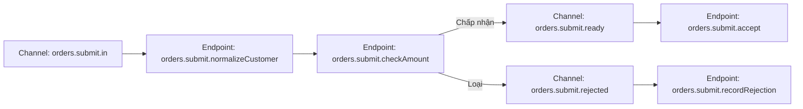

# Đặt tên channel và endpoint

Trong chương **Thiết kế flow** của module **SPRING_INTEGRATION_CORE**, đặt tên là một phần của thiết kế: người đọc cần nhận ra thông điệp đang ở ranh giới nào, thành phần nào xử lý nó và tên nào được các flow khác sử dụng.

Bài học tập trung vào `MessageChannel`, endpoint, handler và tên bean trong Java DSL. Các ví dụ dùng luồng tiếp nhận đơn hàng để minh họa transformer, filter và điểm xử lý cuối; sau đó mở rộng quy ước sang router, aggregator, gateway và nhánh lỗi.

## 1. Mục tiêu và kiến thức nền

Sau bài học, bạn có thể:

- Phân biệt tên channel, ID endpoint, tên handler bean và tên flow.
- Đặt tên theo hợp đồng thông điệp và trách nhiệm nghiệp vụ.
- Khai báo tên rõ ràng bằng `@Bean`, `@Qualifier`, Java DSL và `@EndpointId`.
- Nhận diện xung đột tên, tham chiếu sai và sự phụ thuộc vào tên tự sinh.
- Giữ các điểm kết nối ổn định khi thay đổi cấu trúc bên trong flow.

Bạn nên biết `Message<T>` gồm payload và headers, channel chuyển thông điệp giữa các thành phần, còn endpoint kết nối hoạt động xử lý với cơ chế nhận thông điệp. Ví dụ Java chính sử dụng Java 17 trở lên và API `IntegrationFlow` của Spring Integration 6.x/7.x; thư viện Spring cần được quản lý bằng bộ phiên bản tương thích của dự án.

## 2. Một thông điệp đi qua nhiều loại định danh

Xét luồng đơn hàng:



Sơ đồ chỉ vẽ các channel được đặt tên chủ động. Giữa transformer và filter, DSL vẫn cần một channel nối các endpoint; channel đó có thể do framework tạo.

| Loại định danh | Trả lời câu hỏi | Ví dụ |
| --- | --- | --- |
| Tên flow bean | Cấu hình này biểu diễn luồng nào? | `orders.submit.flow` |
| Tên channel bean | Thông điệp được gửi tới điểm kết nối nào? | `orders.submit.in` |
| ID endpoint | Thành phần nhận và điều phối xử lý nào? | `orders.submit.checkAmount` |
| Tên handler bean | Đối tượng xử lý nào được endpoint gọi? | `orders.submit.checkAmount.handler`, nếu được cấu hình hoặc sinh theo quy ước tương ứng |
| `MessageHeaders.ID` | Đây là thông điệp cụ thể nào? | Một UUID trong headers |
| Khóa tương quan nghiệp vụ | Các thông điệp nào thuộc cùng đơn hàng hoặc nhóm? | `orderId` hoặc header tương quan do ứng dụng quy định |
| Đích bên ngoài ứng dụng | Dữ liệu đi tới tài nguyên transport nào? | Kafka topic, RabbitMQ queue hoặc thư mục |

Tên channel và endpoint thuộc cấu hình ứng dụng. ID thông điệp và khóa tương quan thuộc dữ liệu của từng lần xử lý. Tên bean channel cũng không tự tạo một queue hoặc topic trên broker.

Với consuming endpoint, cần phân biệt consumer endpoint và `MessageHandler` mà nó gọi; hai vai trò có thể tương ứng hai bean riêng. Tên cụ thể phụ thuộc cách khai báo. [Spring Integration — Endpoint Bean Names](https://docs.spring.io/spring-integration/reference/overview.html#endpoint-bean-names).

### 2.1. Channel biểu đạt điểm kết nối; endpoint biểu đạt hành động

Một cách đặt tên dễ đọc:

- Channel: `orders.submit.ready` — thông điệp đã đủ điều kiện đi tiếp trong use case tiếp nhận.
- Endpoint: `orders.submit.normalizeCustomer` — chuẩn hóa mã khách hàng.
- Endpoint: `orders.submit.checkAmount` — kiểm tra điều kiện số tiền.

Tên `orders.submit.validateChannel` làm lẫn lộn điểm chuyển giao với hành động kiểm tra. Tên `orders.submit.processor` lại quá rộng: người trực vận hành chưa biết processor đó làm việc gì.

Không cần đưa toàn bộ thiết kế vào tên. Hợp đồng của channel còn bao gồm payload, headers bắt buộc, điều kiện được gửi vào và hành vi giao nhận; những thông tin này cần được diễn giải trong tài liệu hoặc mã nguồn.

## 3. Quy ước đặt tên đề xuất

Quy ước dưới đây là lựa chọn thiết kế của bài học, không phải cú pháp bắt buộc của Spring Integration:

```text
Channel:  <domain>.<useCase>.<roleOrState>
Endpoint: <domain>.<useCase>.<action>
Flow:     <domain>.<useCase>.flow
Gateway:  <domain>.<useCase>.gateway
```

Ví dụ:

```text
orders.submit.in
orders.submit.ready
orders.submit.rejected

orders.submit.normalizeCustomer
orders.submit.checkAmount
orders.submit.accept

orders.submit.flow
orders.submit.gateway
```

Ba phần có ý nghĩa:

1. **Domain** giới hạn phạm vi nghiệp vụ, chẳng hạn `orders`, `payments`, `inventory`.
2. **Use case** phân biệt các luồng trong cùng domain, chẳng hạn `submit`, `cancel`, `reconcile`.
3. **Vai trò, trạng thái hoặc hành động** cho biết ý nghĩa tại điểm đang xét.

Dùng từ tiếng Anh trong mã giúp thống nhất với tên lớp và API; phần giải thích nghiệp vụ có thể viết bằng tiếng Việt. Một nhóm dùng camelCase như `orderSubmissionInput` vẫn có thể thiết kế tốt nếu áp dụng nhất quán.

### 3.1. Tên channel phải phản ánh mức bảo đảm thực tế

| Tên | Ý nghĩa nên được cam kết | Điều cần tránh |
| --- | --- | --- |
| `orders.submit.in` | Điểm vào của use case tiếp nhận đơn | Mỗi producer hiểu payload theo một cách |
| `orders.submit.ready` | Đã qua những điều kiện được tài liệu hóa | Hiểu thành “đã qua mọi kiểm tra nghiệp vụ” |
| `orders.submit.rejected` | Đơn bị loại bởi điều kiện của flow này | Trộn với exception kỹ thuật chưa có hợp đồng |
| `orders.submit.errors` | Điểm nhận lỗi được nối rõ vào cơ chế xử lý lỗi | Cho rằng tên kết thúc bằng `errors` tự kích hoạt xử lý lỗi |
| `orders.submit.retry` | Điểm vào lại theo chính sách retry xác định | Cho rằng tên này tự tạo retry hoặc bảo đảm idempotency |
| `orders.submit.reply` | Điểm phản hồi nếu kiến trúc cần channel cố định | Tạo chỉ vì mọi gateway đều phải có tên reply |

Tên `validated` là một lời hứa khá mạnh. Nếu flow chỉ kiểm tra `total > 0`, cần ghi rõ phạm vi kiểm tra, hoặc chọn tên hẹp hơn như `positiveAmount` khi đó là ranh giới được chia sẻ.

### 3.2. Tên endpoint nên nêu hành động đủ cụ thể

| Trách nhiệm | Tên gợi ý |
| --- | --- |
| Chuẩn hóa mã khách hàng | `orders.submit.normalizeCustomer` |
| Filter kiểm tra số tiền | `orders.submit.checkAmount` |
| Router chọn kho thực hiện | `orders.fulfill.routeByWarehouse` |
| Transformer chuyển sang thông điệp thanh toán | `orders.submit.toPaymentRequest` |
| Aggregator gom kết quả kiểm tra tồn kho | `orders.fulfill.aggregateStockChecks` |
| Gọi dịch vụ thanh toán | `payments.authorize.callProvider` |
| Ghi nhận đơn bị loại | `orders.submit.recordRejection` |

Động từ `validate` không cho biết khi vi phạm thì ném exception hay chuyển sang discard channel. Khi hành vi đó ảnh hưởng caller, phải ghi rõ bên cạnh cấu hình; tên endpoint chỉ là điểm bắt đầu để hiểu trách nhiệm.

### 3.3. Tên ổn định và hữu hạn

Ưu tiên `orders.submit.accept` hơn `orders.submit.step4`. Chèn một transformer mới không nên buộc mọi endpoint phía sau đổi tên.

Không gắn `orderId`, timestamp, UUID hoặc tên khách hàng vào bean name của một flow tĩnh. Thông tin từng message nên nằm trong payload, headers hoặc ngữ cảnh quan sát. Danh tính component ổn định giúp đối chiếu log và metric qua nhiều lần chạy; trace ID và khóa nghiệp vụ giúp tìm một lần xử lý cụ thể.

Tên `directOrdersInput` ràng buộc tên với kiểu triển khai. Nếu quyết định chuyển sang `ExecutorChannel`, tên ấy sẽ trở nên sai. Dùng vai trò nghiệp vụ làm tên chính; tài liệu hóa riêng các thay đổi về thread, backpressure, transaction và lỗi.

## 4. Những cách gán tên trong Spring

### 4.1. Tên bean và tên phương thức Java có thể khác nhau

```java
@Bean("orders.submit.in")
public MessageChannel submissionInput() {
    return new DirectChannel();
}
```

Trong cấu hình này:

- Tên bean là `orders.submit.in`.
- Tên phương thức Java là `submissionInput`.
- `@Qualifier("orders.submit.in")` chọn bean bằng tên đã công bố.

Dùng `@Bean` không chỉ định tên thì tên mặc định thường là tên phương thức. Khi đó, đổi tên phương thức có thể làm thay đổi điểm kết nối mà cấu hình khác đang tham chiếu.

Dấu chấm trong các tên minh họa là một phần của chuỗi bean name, không biểu diễn cấu trúc package Java. Trong các biểu thức có cú pháp riêng, cần tham chiếu đúng theo cú pháp đó; không suy rằng mọi công cụ đều hiểu tên có dấu chấm như một thuộc tính.

### 4.2. ID endpoint trong DSL nằm ở endpoint configurer

```java
.transform(
    Order.class,
    order -> normalize(order),
    endpoint -> endpoint.id("orders.submit.normalizeCustomer")
)
```

Tham số thứ ba cấu hình endpoint được tạo cho bước transform; `.id(...)` ở đây chọn tên endpoint bean. Nó không đặt tên cho input channel hay đổi tên `IntegrationFlow`. [Spring Integration — DSL and Endpoint Configuration](https://docs.spring.io/spring-integration/reference/dsl/java-endpoints.html).

Tên flow được khai báo riêng:

```java
@Bean("orders.submit.flow")
public IntegrationFlow submissionFlow(/* dependencies */) {
    // ...
}
```

Đoạn này chỉ minh họa vị trí khai báo tên. Ví dụ đầy đủ nằm ở phần tiếp theo.

### 4.3. Tham chiếu channel bằng chuỗi cần được xem xét cẩn thận

DSL hỗ trợ `IntegrationFlow.from("orders.submit.in")` và `.channel("orders.submit.ready")`. Một số cách tham chiếu này sẽ tạo channel khi chưa có bean tương ứng. Vì vậy lỗi gõ tên có thể trở thành một channel khác thay vì lỗi thiếu bean. [Spring Integration — Message Channels](https://docs.spring.io/spring-integration/reference/dsl/java-channels.html).

Ví dụ cần kiểm tra:

```java
.channel("orders.submit.raedy") // Sai chính tả so với hợp đồng "ready".
```

Khi channel là điểm kết nối quan trọng, một lựa chọn rõ ràng là khai báo `@Bean` rồi inject đối tượng bằng `@Qualifier` và truyền đối tượng đó vào DSL. Cách này giúp phát hiện lỗi thiếu dependency ngay khi tạo context.

Hằng số cũng giảm lỗi lặp chuỗi. Tuy nhiên, hằng số chứa sai tên vẫn là tên sai, và hai hằng số khác tên vẫn có thể có cùng giá trị. Cần kiểm tra cả cấu hình kết nối và hành vi message.

## 5. Ví dụ đầy đủ: luồng tiếp nhận đơn hàng

Ví dụ dùng bộ nhớ để ghi nhận đơn được chấp nhận hoặc bị loại, giúp quan sát hành vi mà không cần cơ sở dữ liệu. Mục tiêu là thấy tên component gắn với trách nhiệm nào.

Các giả định:

- `id`, `customerCode` và `total` không null; record kiểm tra điều kiện này khi được tạo.
- Mã khách hàng được bỏ khoảng trắng hai đầu và chuyển thành chữ hoa.
- Đơn có `total > 0` đi tiếp; các đơn còn lại đi vào nhánh `rejected`.
- Hai điểm cuối trả về `null` để kết thúc xử lý, không yêu cầu reply.

### 5.1. Cấu hình Java

```java
import java.math.BigDecimal;
import java.util.List;
import java.util.Locale;
import java.util.Objects;
import java.util.concurrent.CopyOnWriteArrayList;

import org.springframework.beans.factory.annotation.Qualifier;
import org.springframework.context.annotation.Bean;
import org.springframework.context.annotation.Configuration;
import org.springframework.integration.channel.DirectChannel;
import org.springframework.integration.config.EnableIntegration;
import org.springframework.integration.dsl.IntegrationFlow;
import org.springframework.messaging.MessageChannel;

@Configuration
@EnableIntegration
public class OrderSubmissionConfiguration {

    public static final String INPUT = "orders.submit.in";
    public static final String READY = "orders.submit.ready";
    public static final String REJECTED = "orders.submit.rejected";

    @Bean(INPUT)
    public MessageChannel submissionInput() {
        return new DirectChannel();
    }

    @Bean(READY)
    public MessageChannel acceptedOrders() {
        return new DirectChannel();
    }

    @Bean(REJECTED)
    public MessageChannel rejectedOrders() {
        return new DirectChannel();
    }

    @Bean("orders.submit.sink")
    public OrderSink orderSink() {
        return new OrderSink();
    }

    @Bean("orders.submit.flow")
    public IntegrationFlow submissionFlow(
            @Qualifier(INPUT) MessageChannel input,
            @Qualifier(READY) MessageChannel ready,
            @Qualifier(REJECTED) MessageChannel rejected,
            OrderSink sink) {

        return IntegrationFlow.from(input)
                .transform(
                        Order.class,
                        order -> new Order(
                                order.id(),
                                order.customerCode()
                                        .strip()
                                        .toUpperCase(Locale.ROOT),
                                order.total()),
                        endpoint -> endpoint
                                .id("orders.submit.normalizeCustomer"))
                .filter(
                        Order.class,
                        order -> order.total().signum() > 0,
                        endpoint -> endpoint
                                .id("orders.submit.checkAmount")
                                .discardChannel(rejected))
                .channel(ready)
                .handle(
                        Order.class,
                        (order, headers) -> {
                            sink.accept(order);
                            return null;
                        },
                        endpoint -> endpoint.id("orders.submit.accept"))
                .get();
    }

    @Bean("orders.submit.rejectionFlow")
    public IntegrationFlow rejectionFlow(
            @Qualifier(REJECTED) MessageChannel rejected,
            OrderSink sink) {

        return IntegrationFlow.from(rejected)
                .handle(
                        Order.class,
                        (order, headers) -> {
                            sink.recordRejection(order);
                            return null;
                        },
                        endpoint -> endpoint
                                .id("orders.submit.recordRejection"))
                .get();
    }

    public record Order(
            String id,
            String customerCode,
            BigDecimal total) {

        public Order {
            Objects.requireNonNull(id, "id");
            Objects.requireNonNull(customerCode, "customerCode");
            Objects.requireNonNull(total, "total");
        }
    }

    public static final class OrderSink {

        private final List<Order> accepted = new CopyOnWriteArrayList<>();
        private final List<Order> rejected = new CopyOnWriteArrayList<>();

        public void accept(Order order) {
            accepted.add(order);
        }

        public void recordRejection(Order order) {
            rejected.add(order);
        }

        public List<Order> acceptedOrders() {
            return List.copyOf(accepted);
        }

        public List<Order> rejectedOrders() {
            return List.copyOf(rejected);
        }
    }
}
```

Đặt đoạn mã trên trong `OrderSubmissionConfiguration.java` của ứng dụng thử nghiệm. Cấu hình có thể được đăng ký trực tiếp bằng `AnnotationConfigApplicationContext` như ở phần kiểm tra bên dưới. Nếu dùng Spring Boot, đưa lớp vào phạm vi cấu hình được ứng dụng nạp.

### 5.2. Đọc lại thiết kế qua tên

`orders.submit.in` là điểm vào công bố cho producer. Producer không cần biết bước đầu tiên là transformer hay filter.

`orders.submit.normalizeCustomer` là một endpoint xử lý. Nó tạo payload mới có mã khách hàng đã chuẩn hóa; tên này không phải địa chỉ để gửi message trực tiếp.

`orders.submit.checkAmount` quyết định hai nhánh. Khi predicate trả về false, filter gửi message sang channel discard đã cấu hình. Hành vi này được khai báo bằng `discardChannel(rejected)`; tên `rejected` chỉ giúp người đọc hiểu mục đích. [Spring Integration — FilterEndpointSpec](https://docs.spring.io/spring-integration/api/org/springframework/integration/dsl/FilterEndpointSpec.html).

`orders.submit.ready` nằm sau điều kiện số tiền. Trong ví dụ, payload ở đây là `Order` đã chuẩn hóa và có số tiền dương, chưa có bảo đảm về tồn kho hay thanh toán.

`orders.submit.accept` và `orders.submit.recordRejection` là các điểm cuối. Cả hai ghi nhận vào bộ nhớ và không tạo phản hồi. Tên `orders.submit.sink` là bean hỗ trợ của ví dụ; nó không trở thành endpoint chỉ vì được gọi từ lambda.

### 5.3. Tên channel không quyết định mô hình giao nhận

Cả ba channel tường minh trong ví dụ đều là `DirectChannel`. Việc có tên `ready` không làm thông điệp được lưu bền vững, và việc có tên `rejected` không tạo dead-letter queue.

Khi đổi kiểu channel, cần đánh giá lại hợp đồng giao nhận. Ví dụ, thêm queue kéo theo nhu cầu consumer/poller tương ứng; thêm executor thay đổi ngữ cảnh thực thi. Giữ tên nghiệp vụ ổn định chỉ hợp lý khi thay đổi đó vẫn đáp ứng hợp đồng mà các bên sử dụng điểm kết nối đã chấp nhận.

Đặc biệt, không gắn một consumer phụ để “nghe thử” `DirectChannel` rồi giả định cả consumer chính và phụ đều nhận cùng message. Nếu cần bản sao quan sát, hãy thiết kế wire tap hoặc publish-subscribe phù hợp; phải giữ đúng ngữ nghĩa của luồng chính.

## 6. Khai báo bằng annotation: tên phương thức chưa chắc là endpoint ID

Với một phương thức xử lý POJO, có thể công bố ID rõ ràng bằng `@EndpointId`:

```java
import org.springframework.integration.annotation.EndpointId;
import org.springframework.integration.annotation.ServiceActivator;
import org.springframework.stereotype.Component;

@Component
public class RejectedOrderHandler {

    @EndpointId("orders.submit.recordRejection")
    @ServiceActivator(inputChannel = "orders.submit.rejected")
    public void record(
            OrderSubmissionConfiguration.Order order) {
        // Ghi audit theo yêu cầu của ứng dụng.
    }
}
```

Đây là **phương án thay thế** cho `rejectionFlow` của ví dụ, cần được component scan nạp. Không bật đồng thời hai phương án có cùng endpoint ID.

Với phương thức POJO không có `@Bean` như trên, `@EndpointId` xác định tên consumer; framework áp dụng quy ước handler tương ứng. Với phương thức vừa có `@Bean` vừa có annotation EIP, tên handler lại do `@Bean` quyết định. [Spring Integration — EndpointId API](https://docs.spring.io/spring-integration/api/org/springframework/integration/annotation/EndpointId.html).

Nếu cần tách tên rõ ràng khi handler là một bean:

```java
@Bean("orders.submit.recordRejection.handler")
@EndpointId("orders.submit.recordRejection")
@ServiceActivator(inputChannel = "orders.submit.rejected")
public MessageHandler rejectedOrderHandler() {
    return message -> {
        // Xử lý message bị loại.
    };
}
```

Đoạn này đặt trong một lớp cấu hình, với import `org.springframework.messaging.MessageHandler` và các annotation tương ứng. Nó cũng là một phương án thay thế.

Cần đọc đúng từng vị trí đặt tên:

- `@Bean("...handler")` đặt tên bean xử lý.
- `@EndpointId("...recordRejection")` đặt tên endpoint nhận message.
- `inputChannel = "...rejected"` tham chiếu channel đầu vào.

Không thay mọi tên bằng một chuỗi chung. Các tên tường minh phải phân biệt trong cùng namespace bean; endpoint và handler không nên tranh cùng tên.

## 7. Gateway, router và aggregator cần cùng một ngôn ngữ đặt tên

### 7.1. Gateway là điểm vào ở mức API

Có thể thêm một interface để caller không trực tiếp dùng `MessageChannel`:

```java
import org.springframework.integration.annotation.MessagingGateway;

@MessagingGateway(
        name = "orders.submit.gateway",
        defaultRequestChannel = "orders.submit.in")
public interface OrdersGateway {

    void submit(OrderSubmissionConfiguration.Order order);
}
```

Đăng ký interface bằng cơ chế gateway scanning, chẳng hạn thêm `@IntegrationComponentScan(basePackageClasses = OrdersGateway.class)` vào cấu hình phù hợp và import annotation từ `org.springframework.integration.annotation`. Tên gateway và channel đích là hai định danh riêng. [Spring Integration — MessagingGateway API](https://docs.spring.io/spring-integration/api/org/springframework/integration/annotation/MessagingGateway.html).

Phương thức `void` phù hợp với hai điểm cuối không trả reply của ví dụ. Nếu đổi thành phương thức trả kết quả, phải thiết kế cả đường phản hồi.

Một gateway request-reply có thể dùng reply channel tạm; không cần tạo channel cố định chỉ để thỏa quy ước đặt tên. [Spring Integration — Messaging Gateways](https://docs.spring.io/spring-integration/reference/gateway.html).

### 7.2. Router: phân biệt bước quyết định với nhánh kết quả

Ví dụ thiết kế:

```text
Endpoint: orders.fulfill.routeByWarehouse

Channels:
orders.fulfill.warehouseNorth
orders.fulfill.warehouseSouth
orders.fulfill.unroutable
```

Tên endpoint cho biết tiêu chí route. Tên channel cho biết điểm đến theo nghiệp vụ. Giá trị định tuyến như `NORTH` hoặc `SOUTH` nên được ánh xạ rõ sang channel; không buộc mọi mã nghiệp vụ phải đồng thời là bean name.

Khi bổ sung chi nhánh thứ ba, tên `routeByWarehouse` vẫn đúng. Tên `routeToNorthOrSouth` sẽ cần đổi dù trách nhiệm chính không đổi.

### 7.3. Aggregator: phân biệt component với nhóm message

Ví dụ thiết kế:

```text
Input channel:  orders.fulfill.stockResults
Endpoint:       orders.fulfill.aggregateStockChecks
Output channel: orders.fulfill.stockDecision
Discard path:   orders.fulfill.expiredStockChecks
```

Tên endpoint là danh tính bộ gom. Khóa tương quan xác định các message thuộc cùng nhóm và thuộc dữ liệu runtime; không tạo một endpoint mới cho mỗi `orderId`.

Tên `expiredStockChecks` chỉ có ý nghĩa khi cấu hình timeout, release và discard thực tế đưa đúng loại thông điệp tới đó. Nếu thông điệp loại ra khác schema với kết quả tổng hợp, cần ghi rõ hợp đồng hai nhánh.

## 8. Đặt tên cho nhánh lỗi và nhánh bị loại

Nên phân biệt trong thiết kế:

| Nhánh | Ví dụ nguyên nhân | Dữ liệu dự kiến |
| --- | --- | --- |
| `orders.submit.rejected` | Số tiền không dương, theo predicate của filter | `Order` bị loại trong ví dụ |
| `orders.submit.errors` | Exception khi gọi dịch vụ hoặc xử lý message | `ErrorMessage` khi được cơ chế lỗi phát hành |
| `orders.submit.retry` | Yêu cầu thực hiện lại theo chính sách | Hợp đồng message retry do ứng dụng định nghĩa |

Tên tùy chỉnh `orders.submit.errors` không tự nhận exception. Phải nối nó qua gateway, header `errorChannel` hoặc cơ chế xuất bản lỗi phù hợp. Lỗi đồng bộ khi gửi trực tiếp qua `DirectChannel` thường được ném về caller. Cơ chế lỗi bất đồng bộ có thể phát `ErrorMessage` tới channel trong header, hoặc `errorChannel` toàn cục. [Spring Integration — Error Handling](https://docs.spring.io/spring-integration/reference/error-handling.html).

Trong ví dụ, filter loại đơn có số tiền không dương là kết quả nghiệp vụ đã thiết kế. Không cần biến kết quả đó thành exception chỉ để mọi nhánh đều có cùng payload.

Khi mở nhánh retry, tài liệu hóa thêm số lần thử, độ trễ, điều kiện dừng và cách chống thực hiện tác dụng phụ lặp. Một tên dễ hiểu không thay thế chính sách thực thi.

## 9. Khi nào cần tên tường minh, khi nào để tự sinh?

Các điểm nên đặt tên chủ động:

- Channel mà producer, gateway hoặc flow khác tham chiếu.
- Channel dùng làm nhánh route, discard hoặc điểm quan sát có chủ đích.
- Endpoint cần nhận diện trong log, quản lý lifecycle hoặc thay thế khi kiểm thử.
- Endpoint có ý nghĩa nghiệp vụ quan trọng dù hiện tại nằm trong một flow.

Một channel chỉ nối hai bước nội bộ, không có hợp đồng sử dụng bên ngoài và không cần tham chiếu riêng, có thể giữ tên tự sinh.

Tên tự sinh của channel DSL có thể chứa tên flow và chỉ số như `orders.submit.flow.channel#0`. Chỉ số thể hiện cấu trúc được sinh; không nên coi nó là API ổn định cho cấu hình bên ngoài.

### 9.1. Ranh giới công bố quan trọng hơn số lượng tên

Đặt tên cho mọi đường nối có thể làm cấu hình dài mà không giúp người đọc. Chỉ đặt tên cho điểm quan trọng nhưng endpoint lại đều mang tên `handler1`, `handler2` cũng làm khó vận hành.

Cách cân bằng là:

1. Chọn ranh giới mà một bên khác cần kết nối hoặc quan sát.
2. Viết hợp đồng message tại ranh giới đó.
3. Gán tên ổn định.
4. Cho phép phần triển khai bên trong thay đổi.

Một quy ước tên tốt thể hiện quyết định thiết kế đã có. Nó không bù được một flow chưa xác định payload, thứ tự bước và hành vi lỗi.

### 9.2. Flow được đăng ký động cần namespace riêng

Với flow tạo nhiều instance ở runtime, các ID bên trong có thể trùng nhau giữa các instance. `IntegrationFlowContext` hỗ trợ đăng ký với ID cụ thể và `useFlowIdAsPrefix()` để thêm flow ID vào tên component theo cơ chế của nó; tùy chọn này yêu cầu flow ID. [Spring Integration — Dynamic and Runtime Integration Flows](https://docs.spring.io/spring-integration/reference/dsl/java-runtime-flows.html).

Đây là cấu hình cho đăng ký động. Không suy rằng đặt tên một `IntegrationFlow @Bean` sẽ tự làm mọi ID tường minh bên trong trở thành riêng biệt. Với các flow tĩnh, hãy chọn tên endpoint không trùng ngay trong thiết kế.

## 10. Dùng tên để quan sát và chẩn đoán

Một thông báo lỗi có tên `orders.submit.checkAmount` giúp người đọc xác định trách nhiệm nhanh hơn tên `handler#7`. Khi nhiều nhóm cùng vận hành, tiền tố `orders.submit` cũng giúp khoanh phạm vi.

Nếu cần theo dõi đường đi, có thể bật Message History cho nhóm component phù hợp:

```java
import org.springframework.context.annotation.Configuration;
import org.springframework.integration.config.EnableMessageHistory;

@Configuration
@EnableMessageHistory("orders.submit.*")
public class OrderHistoryConfiguration {
}
```

Nạp cấu hình này cùng cấu hình flow khi muốn sử dụng. Message History ghi nhận các component được theo dõi trong header `history`; có thể giới hạn bằng pattern tên. [Spring Integration — Message History](https://docs.spring.io/spring-integration/reference/message-history.html).

History, log, metric và trace là các công cụ bổ trợ. Khi tìm một message cụ thể, dùng thêm `orderId` hoặc trace context; không đưa giá trị đó vào tên component.

Khi kiểm tra một nhánh “không nhận được message”, hãy đi theo thứ tự:

1. Điểm gửi tham chiếu đúng tên bean nào?
2. Tên đó trỏ tới cùng đối tượng channel mà consumer đang dùng không?
3. Endpoint cần nhận message có được tạo và đang chạy không?
4. Có filter hoặc router chuyển message sang nhánh khác không?
5. Kiểu channel có hành vi giao nhận đúng với giả định đang dùng không?

Nếu chỉ bắt đầu bằng đổi log level, bạn có thể bỏ qua lỗi nối sai channel ngay trong cấu hình.

## 11. Kiểm tra tên cùng hành vi kết nối

Chỉ kiểm tra `containsBean("orders.submit.ready")` là chưa đủ. Bean có thể tồn tại nhưng producer gửi sai nơi, hoặc endpoint trên nhánh đó chưa được nối.

Đoạn JUnit 5 dưới đây minh họa kiểm tra các tên được công bố và hai nhánh hành vi của cấu hình ở phần 5:

```java
import java.math.BigDecimal;
import java.util.List;

import org.junit.jupiter.api.Test;
import org.springframework.context.annotation.AnnotationConfigApplicationContext;
import org.springframework.integration.dsl.IntegrationFlow;
import org.springframework.integration.endpoint.AbstractEndpoint;
import org.springframework.messaging.MessageChannel;
import org.springframework.messaging.support.MessageBuilder;

import static org.junit.jupiter.api.Assertions.assertEquals;
import static org.junit.jupiter.api.Assertions.assertTrue;

class OrderSubmissionNamingTest {

    @Test
    void exposesStableNamesAndConnectsBothBranches() {
        try (var context = new AnnotationConfigApplicationContext(
                OrderSubmissionConfiguration.class)) {

            var input = context.getBean(
                    OrderSubmissionConfiguration.INPUT,
                    MessageChannel.class);

            context.getBean(
                    OrderSubmissionConfiguration.READY,
                    MessageChannel.class);
            context.getBean(
                    OrderSubmissionConfiguration.REJECTED,
                    MessageChannel.class);
            context.getBean("orders.submit.flow", IntegrationFlow.class);

            for (String endpointId : List.of(
                    "orders.submit.normalizeCustomer",
                    "orders.submit.checkAmount",
                    "orders.submit.accept",
                    "orders.submit.recordRejection")) {
                var endpoint = context.getBean(
                        endpointId,
                        AbstractEndpoint.class);
                assertTrue(endpoint.isRunning(), endpointId);
            }

            var valid = new OrderSubmissionConfiguration.Order(
                    "O-101", "  c01  ", new BigDecimal("250.00"));
            var invalid = new OrderSubmissionConfiguration.Order(
                    "O-102", "  c02  ", BigDecimal.ZERO);

            assertTrue(input.send(MessageBuilder.withPayload(valid).build()));
            assertTrue(input.send(MessageBuilder.withPayload(invalid).build()));

            var sink = context.getBean(
                    OrderSubmissionConfiguration.OrderSink.class);

            assertEquals(
                    List.of(new OrderSubmissionConfiguration.Order(
                            "O-101", "C01", new BigDecimal("250.00"))),
                    sink.acceptedOrders());
            assertEquals(
                    List.of(new OrderSubmissionConfiguration.Order(
                            "O-102", "C02", BigDecimal.ZERO)),
                    sink.rejectedOrders());
        }
    }
}
```

Đặt test cùng package với cấu hình và cung cấp dependency JUnit Jupiter trong ứng dụng thử nghiệm. Việc kiểm tra ngay sau `send` dựa trên các channel đồng bộ trong ví dụ; nếu thay bằng xử lý bất đồng bộ, cần chiến lược chờ có timeout phù hợp.

Test bảo vệ ba điều: tên channel công bố tồn tại với đúng kiểu, endpoint quan trọng đang chạy, và message đi đúng nhánh với payload đã chuẩn hóa. Không ràng buộc test vào chỉ số channel tự sinh.

Giá trị trả về của `send` cũng không tự chứng minh mọi tác dụng phụ nghiệp vụ đã thành công trong mọi kiến trúc. Vì vậy ví dụ còn kiểm tra nội dung thực tế ở hai điểm cuối.

## 12. Refactor tên và xử lý xung đột

### 12.1. Một ApplicationContext có namespace bean chung

Hai flow khác tên vẫn có thể khai báo endpoint cùng tên `validate`. Dùng prefix có ý nghĩa như `orders.submit.checkAmount` và `payments.authorize.checkAmount`.

Cũng cần tránh tên endpoint trùng tên channel hoặc bean hỗ trợ. Bật bean overriding để che xung đột có thể khiến ứng dụng nạp nhầm cấu hình; hãy xác định thành phần nào thực sự sở hữu tên đó.

Với channel dùng chung, chọn một nơi khai báo bean và truyền cùng bean tới các flow sử dụng. Đừng tạo hai đối tượng channel khác nhau rồi kỳ vọng chúng là một chỉ vì có cùng tên dự kiến.

### 12.2. Đổi tên là thay đổi hợp đồng khi đã có bên tham chiếu

Trước khi đổi `orderInput` thành `orders.submit.in`, xác định các bên tham chiếu:

- `@Qualifier` và `ApplicationContext.getBean(...)`.
- `inputChannel`, `outputChannel`, channel mapping và gateway.
- Cấu hình kiểm thử, lifecycle và công cụ quan sát.
- Tài liệu vận hành hoặc cấu hình ngoài mã nguồn có dùng chuỗi tên đó.

Nếu cần tương thích tạm thời, bean có thể công bố một alias:

```java
@Bean(name = {"orders.submit.in", "orderInput"})
public MessageChannel submissionInput() {
    return new DirectChannel();
}
```

Đây là cách **thay khai báo input channel hiện có**, không phải thêm một channel nữa vào cấu hình. Hai tên trỏ tới cùng một bean.

Alias hỗ trợ tra cứu bằng tên cũ; không nên giả định mọi log, history hoặc nhãn quan sát sẽ tự hiển thị cả hai tên. Hãy kiểm tra các điểm phụ thuộc tên và đặt thời hạn loại bỏ alias sau khi các bên sử dụng đã chuyển.

### 12.3. Chỉ thêm phiên bản khi hợp đồng cần tách

Tên `orders.submit.v2.in` hữu ích nếu hai hợp đồng payload khác nhau phải cùng tồn tại. Không tăng phiên bản tên channel sau mỗi lần thêm một transformer nội bộ.

Ngược lại, giữ nguyên tên nhưng đổi `String` thành `Order` mà producer chưa được cập nhật có thể phá hợp đồng dù ứng dụng vẫn khởi động. Cần đánh giá thay đổi bằng thông điệp trao đổi thực tế.

## 13. Các lỗi thường gặp và cách sửa

| Biểu hiện | Nguyên nhân có thể có | Cách xử lý |
| --- | --- | --- |
| Không inject được `MessageChannel` | Có nhiều channel nhưng không chỉ rõ bean | Dùng `@Qualifier` ở dependency tương ứng |
| Message đi vào một điểm không có consumer | Gõ sai tên; DSL có thể đã tạo channel khác | Đối chiếu tên công bố, ưu tiên bean reference ở ranh giới quan trọng |
| Khởi động báo trùng tên | Endpoint, handler hoặc channel tranh cùng bean name | Gán namespace và tách rõ từng vai trò |
| Thêm bước làm test thất bại vì tên `channel#N` | Test phụ thuộc cấu trúc tự sinh | Kiểm tra ranh giới công bố hoặc đặt tên chủ động |
| Đổi tên phương thức cấu hình làm flow khác hỏng | Tên bean mặc định đã được dùng như hợp đồng | Công bố tên bằng `@Bean` khi cần giữ ổn định |
| Có `orders.submit.errors` nhưng không nhận lỗi | Chưa nối vào cơ chế lỗi | Cấu hình nguồn phát lỗi và channel đích thực tế |
| `validated` chứa đơn chưa kiểm tra tồn kho | Tên hứa quá phạm vi endpoint trước đó | Đổi tên hoặc mô tả rõ điều kiện đã bảo đảm |
| Ghi log bằng consumer phụ làm xử lý thiếu message | Hiểu sai mô hình giao nhận của channel | Thiết kế điểm quan sát phù hợp thay vì chỉ thêm subscriber |
| Đổi tên mà dashboard mất dữ liệu lịch sử | Công cụ quan sát phụ thuộc component name | Phối hợp cập nhật cấu hình quan sát khi migration |

## 14. Bài thực hành thiết kế tên

Bạn nhận một flow có:

```text
input -> handler1 -> channel2 -> handler2
                    |
                    +-> errorInput
```

Bối cảnh: flow tiếp nhận yêu cầu thanh toán, chuẩn hóa tiền tệ, loại số tiền không dương, rồi gọi nhà cung cấp. Đơn bị loại và exception từ nhà cung cấp cần hai nhánh khác nhau.

Hãy thực hiện:

1. Đặt tên điểm vào, channel sau kiểm tra, nhánh bị loại và nhánh lỗi.
2. Đặt tên endpoint chuẩn hóa, kiểm tra và gọi nhà cung cấp.
3. Ghi payload dự kiến cùng điều kiện đầu vào cho mỗi channel.
4. Chỉ ra tên nào caller hoặc flow khác sẽ tham chiếu.
5. Chọn một tên cần giữ ổn định khi chèn thêm transformer.
6. Nêu cách kiểm tra flow đã nối đúng, không chỉ kiểm tra bean có tồn tại.

Một phương án:

```text
Channels:
payments.authorize.in
payments.authorize.ready
payments.authorize.rejected
payments.authorize.errors

Endpoints:
payments.authorize.normalizeCurrency
payments.authorize.checkAmount
payments.authorize.callProvider

Flow:
payments.authorize.flow
```

Phương án hoàn chỉnh còn phải xác định rõ `rejected` nhận yêu cầu thanh toán bị loại, `errors` nhận thông điệp lỗi do cơ chế đã cấu hình, và `ready` chỉ bảo đảm những điều kiện mà các bước trước thật sự kiểm tra. Nếu kết quả từ nhà cung cấp cần được gửi tiếp, bổ sung channel có tên thể hiện hợp đồng kết quả đó.

## 15. Tự kiểm tra khi thiết kế flow

- Có phân biệt tên flow, channel, endpoint và handler bean không?
- Tên channel có thể hiện đúng trạng thái hoặc vai trò của message không?
- Tên endpoint có cho biết hành động nghiệp vụ không?
- Mỗi tên tường minh có riêng biệt trong context không?
- Các ranh giới được chia sẻ có tên và hợp đồng ổn định không?
- Tên có chứa chỉ số bước, dữ liệu từng request hoặc chi tiết triển khai dễ đổi không?
- Nhánh bị loại và nhánh lỗi có được nối đúng cấu hình không?
- Kiểm tra có gửi message qua các nhánh quan trọng không?
- Khi thay tên, các tham chiếu và công cụ quan sát đã được xem xét chưa?

Điểm cốt lõi của quy ước trong bài là dùng tên channel để nhận diện hợp đồng chuyển giao, dùng tên endpoint để nhận diện trách nhiệm xử lý, rồi bảo vệ các ranh giới đó bằng cấu hình rõ ràng và kiểm tra hành vi.
