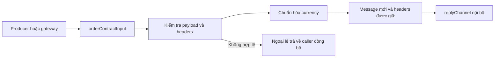

# Bảo toàn message contract

## 1. Mục tiêu và bối cảnh

Trong chương **Thiết kế flow** của module **SPRING_INTEGRATION_CORE**, bảo toàn message contract là giữ cho mỗi thành phần nhận được thông điệp đúng cấu trúc, đúng ý nghĩa và đúng cách tương tác đã thỏa thuận. Đây là cơ sở để ghép Message, MessageChannel, endpoint, gateway và Java DSL thành một luồng tích hợp có thể thay đổi và kiểm thử được.

Ví dụ, một flow nhận sự kiện đặt hàng, chuẩn hóa mã tiền tệ, chọn nhánh xử lý rồi ghi nhận kết quả. Nếu transformer giữ nguyên số tiền nhưng làm mất `tenantId`, consumer có thể xử lý sai khách hàng. Nếu giữ đủ dữ liệu nghiệp vụ nhưng mất đường phản hồi, gateway có thể chờ đến hết thời gian. Cả hai đều là lỗi contract.

Sau bài này, bạn có thể:

- Mô tả contract của một message và của từng ranh giới trong flow.
- Phân loại header cần giữ, cần tính lại và cần loại bỏ.
- Viết transformer giữ ngữ cảnh nghiệp vụ và đường phản hồi nội bộ.
- Nhận diện thay đổi contract tại router, filter, splitter, aggregator và gateway.
- Thiết kế kiểm thử bắt được mất header, sai phiên bản, sai ngữ nghĩa và thiếu phản hồi.

## 2. Message contract gồm những gì?

Spring định nghĩa `Message<T>` bằng payload và headers. Header có thể chứa metadata nghiệp vụ hoặc metadata phục vụ xử lý thông điệp. Đó là cấu trúc kỹ thuật; một contract sử dụng cấu trúc ấy để đưa ra các cam kết cụ thể. [Tài liệu Message](https://docs.spring.io/spring-integration/reference/message.html).

Có thể mô tả contract của ứng dụng bằng bốn nhóm:

| Nhóm | Cần xác định | Ví dụ |
| --- | --- | --- |
| Payload | Kiểu, trường bắt buộc, giới hạn giá trị, đơn vị | `amount` là `BigDecimal`, lớn hơn 0 và có `currency` |
| Headers | Tên, kiểu Java, nguồn cung cấp, phạm vi tồn tại | `tenantId` là `String`, `schemaVersion` là `Integer` |
| Ngữ nghĩa | Sự kiện hay yêu cầu, danh tính, bất biến nghiệp vụ | `OrderSubmitted` nghĩa là đơn đã được gửi |
| Tương tác | Số đầu ra, phản hồi, lỗi, thứ tự, timeout, trùng lặp | Một đầu vào hợp lệ tạo một phản hồi chuẩn hóa |

Một message có thể đúng kiểu Java nhưng sai contract. Chẳng hạn, `amount = 100` vẫn hợp lệ về kiểu khi producer hiểu là 100 đồng và consumer hiểu là 100 xu. Tương tự, `schemaVersion = "1"` và `schemaVersion = 1` khác kiểu dù nhìn giống nhau trong log.

### 2.1. Bảo toàn không có nghĩa mọi thứ bất biến

Một transformer chuẩn hóa có thể đổi `" vnd "` thành `"VND"` nếu contract đầu vào cho phép cách viết đó và contract đầu ra yêu cầu dạng chuẩn. Nó vẫn giữ ý nghĩa của sự kiện.

Ngược lại, đổi `OrderSubmitted` thành `PaymentCaptured` là tạo một sự kiện mang ý nghĩa khác. Khi đó phải thiết kế contract mới, gồm loại sự kiện, dữ liệu, ID sự kiện và liên kết với nguyên nhân tạo ra nó.

Quy tắc thiết kế:

> Mỗi endpoint phải công bố điều kiện đầu vào, cam kết đầu ra và những thay đổi được phép.

Nếu đầu ra của endpoint A không đáp ứng đầu vào của endpoint B, cần một bước chuyển đổi rõ ràng giữa chúng. Việc nối hai endpoint bằng cùng một tên channel không tự tạo ra sự tương thích.

### 2.2. Contract của channel là một thỏa thuận chung

Tên `ordersNormalized` nên biểu đạt một cam kết mà mọi producer gửi vào và mọi consumer nhận ra đều hiểu giống nhau. Nếu một producer gửi POJO, producer khác gửi JSON và consumer phải đoán loại dữ liệu, channel đó đang mang nhiều contract chưa được phân biệt.

Datatype channel có thể kiểm tra kiểu payload, hoặc thử chuyển kiểu khi được cấu hình conversion service. Nó không thay thế việc xác minh header, giá trị và ý nghĩa nghiệp vụ. [Cấu hình datatype channel](https://docs.spring.io/spring-integration/reference/channel/configuration.html#channel-datatype-channel).

## 3. Định nghĩa một contract đặt hàng cụ thể

Bài này dùng sự kiện `OrderSubmitted`, phiên bản 1, trong một flow nội bộ JVM. Producer chịu trách nhiệm xác định đúng tenant và cấp ID sự kiện trước khi gọi flow.

| Thành phần | Quy tắc |
| --- | --- |
| Payload | `OrderSubmittedV1(orderId, amount, currency)` |
| `orderId` | `String` không rỗng; không tự sửa danh tính đơn hàng |
| `amount` | `BigDecimal`, lớn hơn 0; không tự đổi đơn vị hoặc làm tròn |
| `currency` đầu vào | Một trong VND, USD, EUR; cho phép khoảng trắng ngoài và chữ thường |
| `currency` đầu ra | VND, USD hoặc EUR, viết hoa và không có khoảng trắng ngoài |
| `eventType` | `String`, bằng `OrderSubmitted` |
| `schemaVersion` | `Integer`, bằng `1` |
| `tenantId` | `String` không rỗng, giữ nguyên qua bước chuẩn hóa |
| `businessEventId` | `String` không rỗng, giữ nguyên vì vẫn là cùng sự kiện |
| Header nghiệp vụ bổ sung | Được truyền tiếp trong flow nội bộ này nếu không có chính sách loại bỏ riêng |
| Phản hồi | Mỗi đầu vào hợp lệ tạo một message chứa payload đã chuẩn hóa |
| Đầu vào không hợp lệ | Ném lỗi contract; không tạo phản hồi thành công |
| Lặp lại đầu vào | Bước chuẩn hóa không tạo tác dụng phụ; chưa thực hiện khử trùng lặp |

`tenantId` trong bảng là ngữ cảnh đã được xác thực ở biên hệ thống. Việc kiểm tra nó là chuỗi không rỗng trong flow chỉ là kiểm tra hình thức; adapter nhận HTTP hoặc broker vẫn phải xác minh người gửi có quyền sử dụng tenant đó.

Flow minh họa:



Đây là lựa chọn contract của ví dụ, không phải bộ header bắt buộc mà mọi ứng dụng Spring Integration phải dùng.

## 4. Quản lý header theo vai trò

### 4.1. Phân biệt danh tính message và danh tính nghiệp vụ

Không nên dùng một ID cho mọi mục đích:

| Dữ liệu định danh | Đại diện cho | Chính sách trong ví dụ |
| --- | --- | --- |
| `MessageHeaders.ID` | Một instance message của framework | Không dùng làm khóa khử trùng lặp nghiệp vụ |
| `businessEventId` | Một sự kiện nghiệp vụ đã phát sinh | Giữ qua chuẩn hóa và gửi lại cùng sự kiện |
| `orderId` | Đơn hàng | Có thể xuất hiện trong nhiều sự kiện khác nhau |
| ID correlation nghiệp vụ, nếu có | Một cuộc hội thoại hoặc quy trình | Theo quy ước truy vết của ứng dụng |
| `correlationId` của mẫu gom nhóm | Nhóm message cần ghép | Theo chiến lược correlation của aggregator |

Spring có thể cấp ID và timestamp mới khi tạo message biến đổi. Vì vậy, đừng yêu cầu chúng giữ nguyên như `businessEventId`. [Message ID generation](https://docs.spring.io/spring-integration/reference/message.html#message-id-generation).

Một đơn hàng có thể có sự kiện gửi đơn, xác nhận đơn và thanh toán. Cả ba cùng `orderId` nhưng cần các ID sự kiện khác nhau. Khi retry gửi lại sự kiện gửi đơn, giữ ID sự kiện cũ để consumer có cơ sở nhận diện bản gửi lại.

Việc có ID ổn định chưa tạo ra idempotency. Consumer có tác dụng phụ còn cần cơ chế ghi nhận khóa đã xử lý và phối hợp với transaction hoặc trạng thái nghiệp vụ.

### 4.2. Header điều khiển cần tồn tại đúng phạm vi

Trong một flow request–reply nội bộ, `replyChannel` giúp kết quả quay về bên đang đợi. `errorChannel` có thể được thành phần xử lý lỗi dùng để chọn đích gửi lỗi. Các header correlation và sequence phục vụ gom nhóm cần được giữ cho tới khi bước tương ứng sử dụng xong.

Đừng xóa hàng loạt header chỉ vì chúng không xuất hiện trong DTO. Mỗi bước nên có chính sách rõ ràng:

| Nhóm header | Trong cùng flow nội bộ | Khi qua ranh giới bên ngoài |
| --- | --- | --- |
| `tenantId`, `businessEventId` | Giữ nếu contract yêu cầu | Map theo danh sách cho phép và kiểm tra nguồn tin cậy |
| `eventType`, `schemaVersion` | Giữ khi vẫn là cùng contract | Đối chiếu với schema đã công bố |
| `replyChannel`, `errorChannel` | Giữ khi còn cần cho tương tác | Thiết kế cơ chế request–reply riêng của transport |
| `correlationId`, `sequenceNumber`, `sequenceSize` | Giữ theo mẫu splitter/aggregator | Định nghĩa lại biểu diễn và ý nghĩa nếu cần truyền |
| Header của adapter | Giữ đến nơi sử dụng | Chọn theo adapter và header mapper cụ thể |
| Dữ liệu nhạy cảm hoặc chỉ dùng cục bộ | Giữ trong phạm vi được phép | Không tự động xuất toàn bộ ra ngoài |

Gateway thường dùng một reply channel tạm trong header để nhận phản hồi. Vì vậy, đường quay về là một phần thiết kế của tương tác, dù business service không nhìn thấy nó. [Messaging Gateways](https://docs.spring.io/spring-integration/reference/gateway.html#gateway-default-reply-channel).

### 4.3. Tạo message mới và giữ header có chủ đích

Trong bài dùng `org.springframework.messaging.support.MessageBuilder`.

Nếu giữ payload và chỉ bổ sung header:

```java
Message<?> enriched = MessageBuilder.fromMessage(input)
        .setHeader("validatedBy", "order-contract")
        .build();
```

Nếu thay payload:

```java
Message<?> output = MessageBuilder.withPayload(normalizedPayload)
        .copyHeaders(input.getHeaders())
        .build();
```

`copyHeaders` ghi đè các header trùng tên; `copyHeadersIfAbsent` chỉ bổ sung header còn thiếu. Cả hai không dùng để ghi đè ID và timestamp của message mới. [MessageBuilder API](https://docs.spring.io/spring-framework/docs/current/javadoc-api/org/springframework/messaging/support/MessageBuilder.html#copyHeaders(java.util.Map)).

Ví dụ khi chuyển phiên bản, thứ tự sau giúp header đích thắng header cũ:

```java
Message<?> converted = MessageBuilder.withPayload(targetPayload)
        .copyHeaders(input.getHeaders())
        .setHeader("schemaVersion", 2)
        .build();
```

Đoạn này chỉ minh họa thứ tự builder. Chuyển phiên bản đầy đủ còn phải chuyển dữ liệu, kiểm tra ý nghĩa và cập nhật những metadata liên quan; thay mỗi header không làm payload thành phiên bản mới.

Không tạo một message chỉ có payload rồi mặc định rằng mọi endpoint sẽ khôi phục đầy đủ header. Framework có cơ chế truyền header tùy loại handler và cách cấu hình. Khi chủ động trả về `Message<?>`, hãy xây dựng tập header đầu ra theo contract và kiểm thử qua flow thực.

### 4.4. Bất biến của envelope không phải bất biến sâu

Headers không cho phép sửa trực tiếp cấu trúc map, nhưng payload hoặc giá trị header vẫn có thể là object mutable. Truyền message sang nhánh khác không tạo bản sao sâu của các object đó. [Message headers và mutability](https://docs.spring.io/spring-integration/reference/message.html#message-headers).

Ví dụ không an toàn trong luồng có nhiều nhánh:

```java
// Hai consumer cùng giữ tham chiếu đến một Order mutable.
Order order = (Order) message.getPayload();
order.getItems().clear();
```

Nên dùng giá trị bất biến hoặc tạo bản sao theo nhu cầu. Java `record` chỉ cố định tham chiếu field; một record chứa `List` vẫn cần sao chép hoặc bao bất biến danh sách. Record của ví dụ bên dưới chỉ chứa `String` và `BigDecimal`.

## 5. Viết transformer kiểm tra và chuẩn hóa

Các đoạn mã thực hành dùng Java 17 trở lên và API Java DSL dạng `IntegrationFlow.from(...)`. Cần dependency Spring Integration Core, Spring Context và JUnit Jupiter cho phần kiểm thử; phiên bản các thư viện được quản lý đồng bộ trong dự án.

Ví dụ cố ý nhận `Message<?>` để có thể kiểm tra cả payload và headers. Nó chỉ chuẩn hóa biểu diễn tiền tệ đã được contract cho phép, không thực hiện nghiệp vụ đặt hàng.

### 5.1. Model và hàm chuyển đổi

Đặt lớp sau trong `OrderContract.java` của một dự án thực hành:

```java
import java.math.BigDecimal;
import java.util.Locale;
import java.util.Set;

import org.springframework.messaging.Message;
import org.springframework.messaging.support.MessageBuilder;

public final class OrderContract {

    public static final String EVENT_TYPE = "eventType";
    public static final String SCHEMA_VERSION = "schemaVersion";
    public static final String TENANT_ID = "tenantId";
    public static final String BUSINESS_EVENT_ID = "businessEventId";

    private static final Set<String> CURRENCIES =
            Set.of("VND", "USD", "EUR");

    private OrderContract() {
    }

    public record OrderSubmittedV1(
            String orderId,
            BigDecimal amount,
            String currency) {
    }

    public static final class ContractViolation extends RuntimeException {
        public ContractViolation(String message) {
            super(message);
        }
    }

    public static Message<?> normalize(Message<?> input) {
        if (!(input.getPayload() instanceof OrderSubmittedV1 order)) {
            throw invalid("Payload phải là OrderSubmittedV1");
        }

        String eventType = requiredString(input, EVENT_TYPE);
        if (!"OrderSubmitted".equals(eventType)) {
            throw invalid("eventType không được hỗ trợ");
        }

        Object version = input.getHeaders().get(SCHEMA_VERSION);
        if (!(version instanceof Integer number) || number != 1) {
            throw invalid("schemaVersion phải là Integer bằng 1");
        }

        requiredString(input, TENANT_ID);
        requiredString(input, BUSINESS_EVENT_ID);

        if (order.orderId() == null || order.orderId().isBlank()) {
            throw invalid("orderId là bắt buộc");
        }

        if (order.amount() == null || order.amount().signum() <= 0) {
            throw invalid("amount phải lớn hơn 0");
        }

        if (order.currency() == null) {
            throw invalid("currency là bắt buộc");
        }

        String currency = order.currency()
                .strip()
                .toUpperCase(Locale.ROOT);

        if (!CURRENCIES.contains(currency)) {
            throw invalid("currency không được hỗ trợ");
        }

        OrderSubmittedV1 normalized = new OrderSubmittedV1(
                order.orderId(),
                order.amount(),
                currency);

        return MessageBuilder.withPayload(normalized)
                .copyHeaders(input.getHeaders())
                .build();
    }

    private static String requiredString(Message<?> input, String name) {
        Object value = input.getHeaders().get(name);
        if (!(value instanceof String text) || text.isBlank()) {
            throw invalid("Header " + name + " phải là String không rỗng");
        }
        return text;
    }

    private static ContractViolation invalid(String reason) {
        return new ContractViolation(reason);
    }
}
```

Những quyết định cần chú ý:

- Kiểm tra loại sự kiện và phiên bản trước khi xử lý dữ liệu nghiệp vụ.
- Không mặc định `tenantId`, ID sự kiện hoặc tiền tệ khi chúng bị thiếu.
- Không biến chuỗi `"1"` thành số `1` ngay trong flow này. Nếu transport cần chuyển kiểu, adapter phải làm ở ranh giới đã quy định.
- Không sửa `orderId`, `amount` hoặc message đầu vào.
- Giữ các header đầu vào trong phạm vi nội bộ của ví dụ; chưa áp dụng chính sách xuất message ra transport.

Trong hệ thống thực, tập tiền tệ và quy tắc số tiền phải theo nghiệp vụ. Ví dụ này chỉ kiểm tra số tiền dương; nếu contract yêu cầu số chữ số thập phân hoặc giới hạn tối đa thì phải bổ sung điều kiện tương ứng.

### 5.2. Gắn transformer vào Java DSL

Đặt cấu hình sau trong `OrderContractFlowConfig.java`:

```java
import org.springframework.context.annotation.Bean;
import org.springframework.context.annotation.Configuration;
import org.springframework.integration.channel.DirectChannel;
import org.springframework.integration.config.EnableIntegration;
import org.springframework.integration.dsl.IntegrationFlow;
import org.springframework.integration.transformer.Transformer;
import org.springframework.messaging.MessageChannel;

@Configuration
@EnableIntegration
public class OrderContractFlowConfig {

    @Bean
    public MessageChannel orderContractInput() {
        return new DirectChannel();
    }

    @Bean
    public IntegrationFlow orderContractFlow() {
        Transformer normalizer = OrderContract::normalize;

        return IntegrationFlow.from(orderContractInput())
                .transform(normalizer)
                .get();
    }
}
```

Biến `Transformer` làm rõ rằng hàm nhận và trả về message, tránh nhầm với lambda chỉ nhận payload. Java DSL hỗ trợ đưa đối tượng transformer vào `.transform(...)`. [Java DSL Transformers](https://docs.spring.io/spring-integration/reference/dsl/java-transformers.html).

Flow không đặt output channel cố định. Kết quả cuối quay về `replyChannel` của request. Caller tự gửi message phải cung cấp đường phản hồi phù hợp; gateway request–reply thường thiết lập đường này.

Transformer phải tạo kết quả hợp lệ hoặc báo lỗi. Không dùng `return null` để lọc sự kiện không hợp lệ; transformer không chấp nhận kết quả null. [Transformer và quy tắc trả kết quả](https://docs.spring.io/spring-integration/reference/transformer.html).

## 6. Kiểm thử contract qua flow

Kiểm thử chỉ gọi `normalize()` giúp xác minh logic thuần, nhưng chưa chứng minh flow giữ được đường phản hồi. Kiểm thử bên dưới tạo Spring context tối thiểu, gửi qua channel thật và nhận kết quả từ một `QueueChannel` dùng làm reply channel.

Đặt trong `OrderContractFlowTest.java`, cùng package với hai lớp trên:

```java
import java.math.BigDecimal;

import org.junit.jupiter.api.Test;
import org.springframework.context.annotation.AnnotationConfigApplicationContext;
import org.springframework.integration.channel.QueueChannel;
import org.springframework.messaging.Message;
import org.springframework.messaging.MessageChannel;
import org.springframework.messaging.MessageHeaders;
import org.springframework.messaging.MessagingException;
import org.springframework.messaging.support.MessageBuilder;

import static org.junit.jupiter.api.Assertions.*;

class OrderContractFlowTest {

    @Test
    void preservesBusinessHeadersAndReplyRoute() {
        try (var context = new AnnotationConfigApplicationContext(
                OrderContractFlowConfig.class)) {

            MessageChannel input = context.getBean(
                    "orderContractInput", MessageChannel.class);
            QueueChannel replies = new QueueChannel(10);
            QueueChannel errors = new QueueChannel(10);
            Message<?> request = validRequest(replies, errors);

            assertTrue(input.send(request));

            Message<?> response = replies.receive(0);
            assertNotNull(response);
            assertInstanceOf(OrderContract.OrderSubmittedV1.class,
                    response.getPayload());

            var result =
                    (OrderContract.OrderSubmittedV1) response.getPayload();
            assertEquals("ORD-101", result.orderId());
            assertEquals(new BigDecimal("150000"), result.amount());
            assertEquals("VND", result.currency());

            assertEquals("tenant-a",
                    response.getHeaders().get(OrderContract.TENANT_ID));
            assertEquals("evt-101",
                    response.getHeaders().get(OrderContract.BUSINESS_EVENT_ID));
            assertEquals("OrderSubmitted",
                    response.getHeaders().get(OrderContract.EVENT_TYPE));
            assertEquals(1,
                    response.getHeaders().get(OrderContract.SCHEMA_VERSION));
            assertEquals("web",
                    response.getHeaders().get("sourceSystem"));

            assertSame(replies,
                    response.getHeaders().get(MessageHeaders.REPLY_CHANNEL));
            assertSame(errors,
                    response.getHeaders().get(MessageHeaders.ERROR_CHANNEL));

            var original =
                    (OrderContract.OrderSubmittedV1) request.getPayload();
            assertEquals(" vnd ", original.currency());

            assertNull(replies.receive(0));
            assertNull(errors.receive(0));
        }
    }

    @Test
    void rejectsMissingTenantWithoutSuccessfulReply() {
        try (var context = new AnnotationConfigApplicationContext(
                OrderContractFlowConfig.class)) {

            MessageChannel input = context.getBean(
                    "orderContractInput", MessageChannel.class);
            QueueChannel replies = new QueueChannel(10);
            QueueChannel errors = new QueueChannel(10);
            Message<?> bad = MessageBuilder.fromMessage(
                            validRequest(replies, errors))
                    .removeHeader(OrderContract.TENANT_ID)
                    .build();

            MessagingException failure = assertThrows(
                    MessagingException.class, () -> input.send(bad));

            assertInstanceOf(OrderContract.ContractViolation.class,
                    rootCause(failure));
            assertNull(replies.receive(0));
            assertNull(errors.receive(0));
        }
    }

    @Test
    void rejectsStringVersionInsteadOfGuessingItsType() {
        QueueChannel replies = new QueueChannel(10);
        QueueChannel errors = new QueueChannel(10);
        Message<?> bad = MessageBuilder.fromMessage(
                        validRequest(replies, errors))
                .setHeader(OrderContract.SCHEMA_VERSION, "1")
                .build();

        assertThrows(OrderContract.ContractViolation.class,
                () -> OrderContract.normalize(bad));
    }

    private static Message<?> validRequest(
            QueueChannel replies, QueueChannel errors) {

        var payload = new OrderContract.OrderSubmittedV1(
                "ORD-101", new BigDecimal("150000"), " vnd ");

        return MessageBuilder.withPayload(payload)
                .setHeader(OrderContract.EVENT_TYPE, "OrderSubmitted")
                .setHeader(OrderContract.SCHEMA_VERSION, 1)
                .setHeader(OrderContract.TENANT_ID, "tenant-a")
                .setHeader(OrderContract.BUSINESS_EVENT_ID, "evt-101")
                .setHeader("sourceSystem", "web")
                .setReplyChannel(replies)
                .setErrorChannel(errors)
                .build();
    }

    private static Throwable rootCause(Throwable failure) {
        Throwable current = failure;
        while (current.getCause() != null) {
            current = current.getCause();
        }
        return current;
    }
}
```

`receive(0)` phù hợp vì toàn bộ đoạn xử lý trước khi gửi reply chạy đồng bộ trên `DirectChannel`. Trong kiểm thử flow có executor hoặc poller, cần chờ có giới hạn theo đặc tính của flow.

Test lỗi cố ý xác nhận `errors` còn rỗng: gửi trực tiếp vào flow đồng bộ làm ngoại lệ quay lại caller. Chỉ đặt header `errorChannel` không tự khiến mọi ngoại lệ được chuyển vào đó. Cơ chế xử lý lỗi còn phụ thuộc ranh giới thực thi và cấu hình gateway hoặc adapter. [Error Handling](https://docs.spring.io/spring-integration/reference/error-handling.html).

Không so sánh toàn bộ headers bằng `assertEquals`: contract cho phép metadata framework thay đổi. Hãy so sánh chính xác các header có cam kết, kiểu dữ liệu của chúng và đường phản hồi cần duy trì.

## 7. Contract thay đổi thế nào qua các endpoint?

### 7.1. Transformer: chuyển biểu diễn có kiểm soát

Trong ví dụ, transformer chuyển contract đầu vào cho phép currency chưa chuẩn sang contract đầu ra có currency chuẩn. Mọi bước còn lại phải biết nó đang nhận đầu ra đã chuẩn hóa.

Khi POJO chuyển sang JSON, cần công bố thêm tên trường, kiểu số, định dạng thời gian, charset và content type. Khi đổi dữ liệu từ hệ thống đối tác sang mô hình nội bộ, cần nêu rõ trường nào được ánh xạ và dữ liệu nào không thể chuyển đổi.

Không mặc định một phép chuyển thành công về kỹ thuật đã giữ đúng ý nghĩa. Đổi múi giờ, làm tròn số tiền hoặc gán giá trị mặc định có thể làm thay đổi sự kiện.

### 7.2. Router: từng nhánh cần có contract nhận

Một router chọn nhánh theo header hoặc payload. Việc chọn nhánh không thay thế kiểm tra dữ liệu của nhánh đó. Ví dụ, các nhánh phiên bản 1 và 2 phải nhận đúng payload tương ứng, không chỉ đúng số phiên bản.

Nên xác định kết quả khi không có mapping: báo lỗi hoặc chuyển tới nhánh cách ly có người chịu trách nhiệm. Router có cấu hình về phân giải channel và đích mặc định; cần chọn rõ thay vì dựa vào suy đoán. [Router implementations](https://docs.spring.io/spring-integration/reference/router/implementations.html).

Với dữ liệu bên ngoài, ánh xạ giá trị nghiệp vụ sang danh sách channel đã định nghĩa. Không để một header không tin cậy tự do quyết định tên channel nội bộ.

### 7.3. Filter: bị loại bỏ cũng là một kết quả

Filter quyết định message được đi tiếp hay bị loại. Có thể cấu hình discard channel hoặc ném lỗi khi từ chối. [Filter](https://docs.spring.io/spring-integration/reference/filter.html).

Cần phân biệt:

- Sự kiện đúng schema nhưng không thuộc phạm vi xử lý: có thể loại theo quy tắc đã công bố.
- Sự kiện thiếu trường bắt buộc: thường là lỗi contract, cần phản hồi hoặc cách ly.
- Request đang chờ một kết quả: nếu filter chỉ loại bỏ, caller có thể phải chờ hết timeout.

Với request–reply, nhánh từ chối cần tạo kết quả từ chối đúng kiểu hoặc đi theo chính sách ngoại lệ đã thỏa thuận. Với luồng sự kiện một chiều, việc bỏ qua cần có tiêu chí và khả năng quan sát phù hợp.

### 7.4. Splitter và aggregator: cardinality và correlation

Sau splitter, một đơn hàng có thể tạo nhiều message dòng hàng. Contract mới cần nói rõ mỗi message đại diện cho phần tử nào, thuộc nhóm nào và cách biết nhóm đã hoàn tất.

Aggregator mặc định dùng header `correlationId` để nhóm và chiến lược release dựa trên kích thước sequence. Có thể tùy biến cả hai. Khi tổng hợp header, các giá trị xung đột có thể bị bỏ theo chiến lược mặc định. [Aggregator](https://docs.spring.io/spring-integration/reference/aggregator.html).

Vì vậy, khi thiết kế nhóm đơn hàng:

- Giữ correlation và sequence trong suốt đoạn cần gom lại.
- Không dùng cùng một correlation nghiệp vụ rộng cho nhiều nhóm con không liên quan.
- Nếu tự chọn khóa `orderId`, phải xét thêm `tenantId` và lần thực hiện khi các giá trị có thể trùng.
- Chọn rõ cách xử lý phần tử trùng, nhóm hết hạn và kết quả chưa đủ.
- Kiểm tra tính nhất quán của tenant và phiên bản trong cả nhóm trước khi xuất kết quả.
- Công bố kiểu payload và header của message tổng hợp.

Kết quả tổng hợp là một contract đầu ra riêng. Đừng yêu cầu aggregator giữ mọi header từ mọi phần tử khi chúng có thể mâu thuẫn nhau.

### 7.5. Gateway: biến contract thành giao diện gọi

Một gateway trả về kết quả đặt ra kỳ vọng mạnh hơn một channel nhận sự kiện một chiều. Giao diện gọi cần xác định kiểu request, kiểu reply, lỗi từ chối, timeout và trường hợp không có kết quả.

Khi đưa ví dụ chuẩn hóa phía trên ra sau một gateway:

1. Gateway đưa dữ liệu và các header nghiệp vụ bắt buộc vào request.
2. Flow kiểm tra và chuẩn hóa.
3. Terminal endpoint trả một kết quả về đường reply.
4. Gateway chuyển kết quả về kiểu trả về đã công bố.

Nếu sau này nối thêm một channel cố định ở cuối, phải kiểm tra lại cách kết quả quay về gateway. Việc chuyển đích đầu ra có thể thay đổi tương tác mà chữ ký phương thức Java không đổi.

Timeout cũng cần được diễn giải đúng: caller ngừng chờ không chứng minh downstream chưa thực hiện công việc. Nếu caller retry một thao tác có tác dụng phụ, chính sách ID ổn định và idempotency phải tham gia vào contract.

## 8. Ranh giới bất đồng bộ và contract lỗi

Bảng sau là chính sách cần thiết kế cho ứng dụng:

| Tình huống | Điều cần cam kết |
| --- | --- |
| Dữ liệu sai schema hoặc thiếu tenant | Phân loại lỗi contract; không retry vô hạn cùng dữ liệu sai |
| Dịch vụ phụ thuộc tạm thời không sẵn sàng | Điều kiện retry, giới hạn và hành động khi hết lượt |
| Xử lý đã thành công nhưng caller timeout | Cách tra cứu kết quả hoặc retry an toàn |
| Một nhóm message không đủ phần tử | Timeout nhóm và ý nghĩa của kết quả thiếu |
| Không thể gửi phản hồi | Cách ghi nhận, cảnh báo hoặc phục hồi tương tác |

Trong đoạn đồng bộ của ví dụ, lỗi được trả bằng ngoại lệ. Khi thêm executor, poller hoặc một transport, caller có thể không còn nằm trên stack thực thi xử lý. Lúc đó cần một đường xử lý lỗi phù hợp với mô hình mới; Spring Integration có thể biểu diễn lỗi bằng `ErrorMessage` trong các cơ chế xử lý lỗi bất đồng bộ của framework. [Cơ chế xử lý lỗi](https://docs.spring.io/spring-integration/reference/error-handling.html).

Đừng đưa `Throwable` vào payload thành công rồi giữ `eventType = OrderSubmitted`. Nếu cần công bố lỗi cho hệ thống khác, hãy định nghĩa một contract lỗi, ví dụ:

```json
{
  "errorType": "ContractRejected",
  "errorCode": "UNSUPPORTED_SCHEMA_VERSION",
  "rejectedEventId": "evt-101",
  "tenantId": "tenant-a",
  "retryable": false
}
```

Đây là schema lỗi do ứng dụng thiết kế, không phải cấu trúc mặc định của `ErrorMessage`. Chỉ đưa vào những dữ liệu xác minh được và được phép công bố; nếu message lỗi không có tenant hoặc ID hợp lệ thì không bịa ra chúng.

## 9. Qua ranh giới transport: cần ánh xạ contract

Sao chép header trong JVM và truyền contract qua HTTP, JMS, AMQP hoặc Kafka là hai công việc khác nhau.

Ở ranh giới ngoài tiến trình, cần thống nhất:

| Khía cạnh | Quyết định cụ thể |
| --- | --- |
| Payload | JSON, XML hoặc định dạng khác; schema và encoding |
| Header | Tên bên ngoài, kiểu biểu diễn, danh sách được phép truyền |
| Phiên bản | Đặt trong envelope, header hoặc cả hai; xử lý khi mâu thuẫn |
| Danh tính | ID sự kiện ổn định và nguồn cấp |
| Tenant | Nguồn xác thực và quy tắc ánh xạ |
| Phản hồi | Destination, correlation, thời gian chờ và kết quả đến muộn |
| Lỗi | Retry, từ chối, cách ly và cách tra cứu |

Một đối tượng `MessageChannel` nội bộ không phải địa chỉ phản hồi dùng được trên máy khác. Nếu transport cần request–reply, thiết kế destination và correlation theo transport hoặc gateway tương ứng.

Khi giải mã header bên ngoài thành Java, quyết định rõ số phiên bản sẽ trở thành `Integer` hay kiểu khác. Flow ví dụ yêu cầu `Integer`; nếu adapter tạo ra `String`, cần sửa bước ánh xạ tại biên hoặc thay contract một cách có chủ đích.

Bài này không cấu hình adapter cụ thể. Chính sách header thực tế phải được triển khai bằng header mapper hoặc cơ chế của adapter được chọn, rồi kiểm thử vòng gửi–nhận qua đúng transport đó.

## 10. Tiến hóa contract và tương thích

Thay đổi được coi là tương thích hay không phụ thuộc consumer thực tế và điều kiện đã công bố.

| Thay đổi | Cần xem xét |
| --- | --- |
| Thêm trường tùy chọn | Consumer cũ có bỏ qua trường lạ không? Giá trị vắng mặt nghĩa là gì? |
| Thêm trường bắt buộc | Producer cũ có tạo được không? Có cần phiên bản mới không? |
| Đổi tên hoặc kiểu trường | Consumer cũ sẽ đọc ra sao? Có bộ chuyển đổi không? |
| Đổi đơn vị của số tiền | Ý nghĩa thay đổi dù kiểu dữ liệu vẫn giữ |
| Đổi kiểu `schemaVersion` | Có làm hỏng router hoặc validator đang kiểm tra kiểu không? |
| Xóa hoặc đổi nghĩa `tenantId` | Có phá vỡ ranh giới dữ liệu giữa các tenant không? |
| Đổi một request–reply thành một chiều | Caller có còn nhận kết quả đã cam kết không? |
| Thay đổi thứ tự hoặc số đầu ra | Aggregator và consumer có còn hiểu đúng không? |

Một cách triển khai chuyển phiên bản:

1. Giữ contract v1 đang được sử dụng.
2. Công bố v2 cùng các điểm thay đổi về dữ liệu và ý nghĩa.
3. Thêm converter rõ ràng từ v1 sang v2 khi chuyển đổi được.
4. Từ chối các giá trị không thể ánh xạ đúng.
5. Kiểm thử producer v1 với consumer mới qua converter.
6. Theo dõi lưu lượng từng phiên bản trước khi ngừng v1.

Không tự tạo dữ liệu bắt buộc của v2 bằng giá trị giả chỉ để vượt qua validation. Nếu v1 không cung cấp đủ thông tin, cần bổ sung từ nguồn có thẩm quyền hoặc từ chối việc chuyển đổi.

Chuẩn hóa cùng một sự kiện thường giữ `businessEventId`. Phát sinh sự kiện nghiệp vụ mới thường cần ID mới và liên kết nguyên nhân. Quyết định đó dựa trên ý nghĩa nghiệp vụ, không dựa riêng vào việc Java object đã được tạo lại.

## 11. Những lỗi thiết kế thường gặp

| Biểu hiện | Contract bị phá ở đâu? | Cách sửa |
| --- | --- | --- |
| Gateway chờ dù đã thấy payload trong log | Đường phản hồi mất hoặc chuyển sai | Kiểm tra reply channel và endpoint cuối |
| Router không chọn được nhánh phiên bản | Header mất, sai giá trị hoặc sai kiểu | Kiểm tra mapping và validation ở biên |
| Tenant bị thay bằng giá trị mặc định | Nguồn ngữ cảnh không được kiểm soát | Bắt buộc xác thực và từ chối thiếu tenant |
| Retry tạo xử lý nghiệp vụ lặp | ID hoặc idempotency chưa được thiết kế | Giữ ID cùng sự kiện và bảo vệ tác dụng phụ |
| Aggregator không release | Correlation hoặc sequence không còn đúng | Kiểm tra toàn bộ message trong nhóm |
| Nhánh audit thấy payload đã bị sửa | Chia sẻ object mutable | Dùng giá trị bất biến hoặc bản sao phù hợp |
| Message sai dữ liệu biến mất | Filter loại mà không có kết quả đã công bố | Thiết kế nhánh từ chối hoặc lỗi |
| Chuyển JSON chạy được nhưng số tiền sai | Đơn vị hoặc quy tắc làm tròn thay đổi | Ghi rõ ngữ nghĩa và kiểm thử giá trị biên |
| Qua broker mất header bắt buộc | Chính sách ánh xạ transport thiếu | Bổ sung mapping và kiểm thử gửi–nhận |

Khi chẩn đoán, hãy lấy message ở hai phía của ranh giới nghi ngờ rồi so sánh những field và header thuộc contract. Log payload đơn lẻ thường không giải thích được mất ngữ cảnh hoặc thay đổi tương tác.

## 12. Bài tập thực hành

### Bài 1: Bắt lỗi thiếu header

Từ bộ kiểm thử minh họa, bổ sung trường hợp thiếu `businessEventId`, `eventType` sai và `schemaVersion` là `Long`.

Kết quả mong đợi: tất cả bị từ chối theo contract hiện tại; không có phản hồi thành công và không tự cấp dữ liệu còn thiếu.

### Bài 2: Mở rộng quy tắc tiền tệ

Quy định USD và EUR có tối đa hai chữ số thập phân, VND không có phần lẻ. Thêm các ví dụ hợp lệ và không hợp lệ.

Kết quả mong đợi: validator phát hiện giá trị không đúng; không tự làm tròn nếu contract chưa cho phép.

### Bài 3: Thêm filter sau chuẩn hóa

Chỉ chấp nhận đơn hàng VND để xử lý ở một nhánh. Xác định rõ request USD nhận kết quả từ chối hay ngoại lệ.

Kết quả mong đợi: caller có hành vi xác định được, không phải chờ timeout chỉ vì message bị loại.

### Bài 4: Tách và gom dòng hàng

Thiết kế contract dòng hàng có khóa nhóm phân biệt tenant, đơn hàng và lần xử lý. Mô tả cách xử lý một dòng bị gửi lại hoặc không bao giờ đến.

Kết quả mong đợi: nhóm không lẫn tenant, không release sai vì bản trùng và có chính sách khi hết hạn.

### Bài 5: Chuyển phiên bản

Tạo contract v2 tách phần giá trị tiền và mã tiền tệ thành một object `Money`. Viết bảng ánh xạ v1 sang v2, xác định ID nào giữ nguyên và bổ sung kiểm thử sự tương thích.

Kết quả mong đợi: payload và metadata cùng biểu đạt đúng phiên bản; mọi trường bắt buộc có nguồn dữ liệu hợp lệ.

## 13. Tiêu chí hoàn thành thiết kế

Một flow đã mô tả đủ message contract khi người triển khai trả lời được:

- Mỗi channel nhận payload, phiên bản và header nào?
- Mỗi endpoint được phép thay đổi gì, giữ gì và loại bỏ gì?
- Những field nào mang đơn vị hoặc ý nghĩa nghiệp vụ cần bảo vệ?
- Caller nhận gì khi thành công, bị từ chối, gặp lỗi hoặc timeout?
- Khi message được gửi lại, danh tính và tác dụng phụ được xử lý ra sao?
- Khi tách, gom hoặc chạy song song, số lượng và thứ tự kết quả được cam kết thế nào?
- Khi qua transport, header được ánh xạ và xác thực ở đâu?
- Kiểm thử nào chứng minh các cam kết ấy qua đúng ranh giới thực thi?

Trong ví dụ đặt hàng, bằng chứng cụ thể là payload được chuẩn hóa đúng quy tắc, các header nghiệp vụ giữ nguyên, đường phản hồi còn hoạt động và dữ liệu sai bị từ chối theo chính sách đã công bố.
