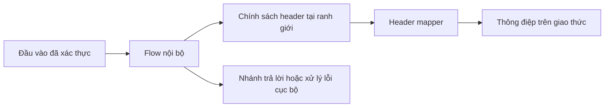

# Kiểm soát header propagation

Trong chương **Thiết kế flow** của module **SPRING_INTEGRATION_CORE**, kiểm soát header propagation là việc quyết định metadata nào được giữ lại, thay thế hoặc loại bỏ khi thông điệp đi qua các thành phần của Spring Integration. Bài học vận dụng Message, MessageChannel, endpoint và Java DSL để thiết kế luồng có hợp đồng header rõ ràng, đồng thời giữ đúng cơ chế gateway, xử lý lỗi và các mẫu splitter–aggregator.

Một flow có thể biến đổi payload chính xác nhưng vẫn sai vì đánh mất địa chỉ trả lời, mang thông tin xác thực sang một hệ thống khác hoặc sử dụng lại metadata thuộc giao thức đầu vào.

Sau bài học, bạn có thể:

- Dự đoán header đầu ra khi endpoint trả về payload hoặc một Message hoàn chỉnh.
- Phân biệt thêm header, lọc header, chặn sao chép header và ánh xạ header ra giao thức.
- Thiết kế danh sách header được phép đi qua một ranh giới xử lý.
- Giữ metadata điều phối đến đúng thời điểm và kiểm thử cả header cần có lẫn header phải vắng mặt.

Các ví dụ dùng Java 17 và API Java DSL của Spring Integration 6.4.x. Đây là mốc API để đọc ví dụ, không phải yêu cầu nâng phiên bản của một dự án hiện có. Thư viện nền tảng cần có là `spring-integration-core` và Spring Context; phần kiểm thử dùng JUnit Jupiter.

## 1. Bắt đầu bằng một hợp đồng header

Giả sử dịch vụ đơn hàng nhận thông điệp sau:

```text
payload = " ord-42 "

headers:
  requestId       = "req-42"
  tenantId        = "tenant-a"
  sourceSystem    = "caller-supplied"
  Authorization   = "<credential>"
  internal_debug  = "pricing-path-v2"
  replyChannel    = <local channel>
  errorChannel    = <local channel>
  id              = <UUID>
  timestamp       = <creation time>
```

Dịch vụ chuẩn hóa mã đơn hàng rồi tạo thông điệp xuất sang một flow độc lập. Hợp đồng xuất chỉ cần `requestId`, `tenantId`, `sourceSystem` và `contentType`. Thông tin xác thực, ghi chú nội bộ và địa chỉ channel của lượt gọi ban đầu không thuộc hợp đồng này.

Trước khi viết DSL, hãy ghi lại quyết định:

| Header | Chủ thể quản lý | Vòng đời dự kiến | Quyết định tại ranh giới xuất |
| --- | --- | --- | --- |
| `requestId` | Lớp tiếp nhận đã chuẩn hóa | Theo dõi một yêu cầu nghiệp vụ | Giữ sau khi kiểm tra định dạng |
| `tenantId` | Lớp xác thực, phân quyền | Phạm vi dữ liệu của yêu cầu | Giữ giá trị đã được xác minh |
| `sourceSystem` | Dịch vụ đang phát thông điệp | Hợp đồng giữa các hệ thống | Gán từ cấu hình tin cậy |
| `Authorization` | Giao thức/lớp xác thực đầu vào | Đến khi hoàn tất xác thực | Loại bỏ theo hợp đồng ví dụ |
| `internal_*` | Các bước xử lý nội bộ | Trong một đoạn flow | Loại bỏ |
| `replyChannel`, `errorChannel` | Cơ chế điều phối cục bộ | Khi lượt gọi còn cần trả lời hoặc xử lý lỗi | Giữ trong flow gọi–đáp; không đưa vào hợp đồng xuất độc lập |
| `id`, `timestamp` | Framework | Định danh và thời điểm của Message | Để framework quản lý |

Đây là chính sách thiết kế của ví dụ. Một tích hợp khác có thể cần xác thực cho đích đến; khi đó phải lấy thông tin xác thực dành riêng cho đích từ nguồn được quản lý, thay vì mặc nhiên chuyển tiếp credential đầu vào.

Kiểm tra định dạng `tenantId` không chứng minh người gọi có quyền truy cập tenant đó. Quyền này phải được xác lập trước khi đưa thông điệp vào flow nghiệp vụ.

## 2. Header được truyền tiếp như thế nào?

### 2.1. Message mới không đồng nghĩa với payload mới hoàn toàn

Một `Message<T>` chứa payload và `MessageHeaders`. Với các triển khai bất biến thông dụng, ứng dụng tạo Message mới khi cần thay header; không gọi `put()` hoặc `remove()` trên `message.getHeaders()`. Giá trị header có thể vẫn tham chiếu đến object mutable, nên sao chép header không phải deep copy. [Tham chiếu Message](https://docs.spring.io/spring-integration/reference/message.html#message-headers).

```java
import org.springframework.integration.support.MessageBuilder;
import org.springframework.messaging.Message;

Message<String> changed = MessageBuilder
        .fromMessage(original)
        .setHeader("processingStage", "validated")
        .removeHeader("internal_debug")
        .build();
```

Đoạn này giữ payload và các header có thể sao chép, đổi `processingStage`, bỏ `internal_debug`, rồi tạo kết quả qua builder. Nó không sửa Message nguồn.

Không đặt một `ArrayList` dùng chung vào header rồi thay đổi list trong các nhánh xử lý song song. Nếu metadata cần nhiều giá trị, hãy ưu tiên giá trị bất biến hoặc bản sao có quyền sở hữu rõ ràng.

### 2.2. Kiểu kết quả của endpoint quyết định cách ghép header

Quy tắc thực hành khi đọc flow:

| Thành phần/kết quả | Hành vi cần dự đoán |
| --- | --- |
| Service activator trả payload | Framework tạo thông điệp kết quả và sao chép các header đầu vào đủ điều kiện |
| Service activator trả Message | Header đã có trên kết quả được ưu tiên; header đầu vào còn thiếu có thể được bổ sung |
| Transformer trả payload | Header đầu vào thông thường được truyền tiếp |
| Transformer trả Message | Message trả về là kết quả hoàn chỉnh; mã transformer chịu trách nhiệm về header |
| Router hoặc bridge chuyển tiếp thông điệp | Không có bước dựng payload kết quả để áp dụng chính sách chặn sao chép như service activator |

Đặc biệt, bỏ header trong Message do một service activator trả về có thể chưa đủ: bước ghép header của handler có thể bổ sung lại header đầu vào. Transformer trả Message là điểm khác biệt quan trọng. [Quy tắc Header Propagation](https://docs.spring.io/spring-integration/reference/message.html#message-header-propagation).

Ví dụ hai bước sau có ý nghĩa khác nhau:

```java
// Chỉ tạo payload mới: không xác lập một hợp đồng header mới.
.transform(String.class, String::trim)

// Gọi phương thức trả Message hoàn chỉnh: tự quyết định các header đầu ra.
.transform(boundaryPolicy, "forExport")
```

Phương thức `forExport` sẽ được triển khai đầy đủ ở phần 6. Transformer POJO có thể nhận Message và trả Message; đừng trả `null` để loại bỏ thông điệp, vì việc đó thuộc trách nhiệm của message filter. [Hợp đồng Transformer](https://docs.spring.io/spring-integration/reference/transformer.html).

### 2.3. Không dùng id để theo dõi xuyên suốt nghiệp vụ

`MessageHeaders.ID` và `MessageHeaders.TIMESTAMP` là header do framework quản lý. Khi tạo Message mới qua builder thông thường, các giá trị này có thể được tạo lại; chúng không phải mã nghiệp vụ ổn định xuyên toàn bộ flow.

Dùng `requestId`, `orderId` hoặc mã sự kiện do ứng dụng quy định cho nhu cầu liên kết nghiệp vụ. Không cố giữ `id` bằng header enricher, cũng không đưa `id` và `timestamp` vào danh sách cần xóa để “làm sạch” thông điệp.

### 2.4. Đổi channel không tạo chính sách header

Đưa thông điệp qua `DirectChannel`, `QueueChannel` hoặc `ExecutorChannel` không tự biến nó thành một hợp đồng metadata tối giản. Nếu cần lọc header trước một đoạn xử lý, đặt endpoint lọc hoặc transformer ở vị trí rõ ràng.

Header nằm trong Message và ngữ cảnh gắn với thread là hai khái niệm riêng. Việc Message giữ một `requestId` không có nghĩa MDC, SecurityContext hoặc ngữ cảnh tracing tự động đi theo mọi ranh giới bất đồng bộ.

## 3. Chọn đúng cơ chế điều khiển

| Nhu cầu | Cơ chế phù hợp | Phạm vi |
| --- | --- | --- |
| Thêm header còn thiếu hoặc thay giá trị | Header enricher | Giá trị header trên thông điệp kết quả |
| Xóa header đang có | Header filter | Một điểm cụ thể trong flow |
| Ngăn handler sao chép một số header đầu vào | `notPropagatedHeaders(...)` | Bước tạo đầu ra của handler đó |
| Chỉ giữ một tập header đã định nghĩa | Transformer tạo Message từ payload | Một ranh giới hợp đồng |
| Quyết định header nào đi ra HTTP, AMQP hoặc JMS | Header mapper của adapter/gateway | Ranh giới giao thức |
| Định nghĩa header không được builder mặc định ghi/copy trên diện rộng | Cấu hình read-only header | Các thành phần sử dụng builder factory tương ứng |

Một danh sách cấm phù hợp khi bạn đã biết vài header tạm cần loại bỏ. Một danh sách cho phép phù hợp khi thông điệp đi vào hợp đồng mới: header chưa từng được biết đến sẽ không vô tình đi qua.

### 3.1. Header enricher: phải chọn có ghi đè hay không

```java
.enrichHeaders(h -> h
        .header("sourceSystem", "order-service", true)
        .header("processingStage", "received", false))
```

Tham số `true` cho phép thay `sourceSystem` đã có; `false` giữ `processingStage` hiện tại nếu header tồn tại. Không chỉ nhìn thấy lệnh `header(...)` rồi kết luận giá trị đầu vào đã bị thay thế. [API HeaderEnricherSpec](https://docs.spring.io/spring-integration/docs/6.4.x/api/org/springframework/integration/dsl/HeaderEnricherSpec.html).

Trong ví dụ, người phát thông điệp sở hữu `sourceSystem`, nên việc ghi đè là có chủ đích. Với `tenantId`, nguồn có thẩm quyền phải là kết quả xác thực; ghi đè bằng một hằng số tùy ý sẽ làm sai phạm vi dữ liệu.

### 3.2. Header filter: xóa metadata nhưng giữ thông điệp

Xóa theo tên chính xác:

```java
.headerFilter("internal_debug", "Authorization", "authorization")
```

Xóa theo nhóm tên, với chế độ pattern được khai báo rõ:

```java
.headerFilter(h -> h
        .headersToRemove("internal_*", "Authorization", "authorization")
        .patternMatch(true))
```

`HeaderFilterSpec` cung cấp cả `headersToRemove(...)` và `patternMatch(...)`. [API HeaderFilterSpec](https://docs.spring.io/spring-integration/docs/6.4.x/api/org/springframework/integration/dsl/HeaderFilterSpec.html).

Đối với header ứng dụng thông thường, `Authorization` và `authorization` là hai khóa khác nhau trong map. Quy tắc tên header của giao thức HTTP không khiến mọi khóa trong MessageHeaders tự động trở thành không phân biệt hoa thường. Hãy chuẩn hóa tên tại đầu vào và kiểm thử tên thực tế mà mapper tạo ra.

Phân biệt hai endpoint:

```java
// Loại một header, thông điệp vẫn đi tiếp.
.headerFilter("internal_debug")

// Quyết định thông điệp có được đi tiếp hay không.
.filter(String.class, payload -> !payload.isBlank())
```

Message filter đánh giá điều kiện đối với cả thông điệp; nó không thay thế nhiệm vụ của header filter. [Tham chiếu Filter](https://docs.spring.io/spring-integration/reference/filter.html).

## 4. Chặn sao chép bằng notPropagatedHeaders

Cấu hình sau áp dụng tại một service activator trả payload:

```java
@Bean
IntegrationFlow normalizeWithoutPrivateHeaders() {
    return IntegrationFlow.from("normalizeInput")
            .handle(String.class,
                    (payload, headers) ->
                            payload.trim().toUpperCase(Locale.ROOT),
                    endpoint -> endpoint.notPropagatedHeaders(
                            "internal_*",
                            "Authorization",
                            "authorization"))
            .channel("normalizeOutput")
            .get();
}
```

Đây là một phương thức bean minh họa; đặt trong cấu hình có `@EnableIntegration`, import `IntegrationFlow`, `Bean`, `Locale` và cung cấp channel đầu ra theo ứng dụng.

Nếu đầu vào có `requestId=req-42`, `internal_debug=debug` và `Authorization=<credential>`, kết quả payload vẫn giữ `requestId`, còn các header bị chặn không được handler sao chép từ đầu vào.

Pattern ở đây là simple wildcard như `internal_*`, không phải regular expression. Một pattern `"*"` chặn toàn bộ bước sao chép header đầu vào. [API ConsumerEndpointSpec.notPropagatedHeaders](https://docs.spring.io/spring-integration/docs/6.4.x/api/org/springframework/integration/dsl/ConsumerEndpointSpec.html#notPropagatedHeaders(java.lang.String...)).

### 4.1. Chặn sao chép không phải xóa mọi giá trị trên kết quả

Xét một handler chủ động tạo lại header nội bộ:

```java
.handle(String.class,
        (payload, headers) -> MessageBuilder
                .withPayload(payload.trim())
                .setHeader("internal_debug", "created-by-handler")
                .build(),
        endpoint -> endpoint.notPropagatedHeaders("internal_*"))
```

`internal_debug` vẫn xuất hiện vì nó do mã handler đặt trên Message kết quả. Cấu hình chỉ chặn việc lấy header tương ứng từ đầu vào.

Nếu yêu cầu là “đầu ra tuyệt đối không có header này”, đặt header filter sau handler hoặc dùng transformer tạo hợp đồng đầu ra ngay trước ranh giới cần bảo vệ. Đồng thời tránh để bước phía sau bổ sung lại header vừa loại bỏ.

### 4.2. Cẩn trọng với dấu sao toàn bộ

```java
.handle(String.class,
        (payload, headers) -> payload.trim(),
        endpoint -> endpoint.notPropagatedHeaders("*"))
```

Cấu hình này có thể làm mất cả `replyChannel`, `errorChannel` và các mã liên kết cần thiết. Việc có output channel tường minh chỉ giải quyết đích nhận ở bước hiện tại, không bảo đảm đoạn cuối vẫn trả lời được gateway.

Cũng không đặt kỳ vọng rằng `notPropagatedHeaders` trên một router hoặc bridge sẽ làm sạch Message đang được chuyển tiếp. Hãy đặt một bước biến đổi header riêng.

## 5. Giữ metadata điều phối đến hết vòng đời của nó

### 5.1. replyChannel và errorChannel

Gateway gọi–đáp cần một đường để nhận phản hồi. Nếu xóa `replyChannel` trước khi flow hoàn tất, đoạn xử lý cuối có thể không tìm được đích trả lời khi nó cần dựa vào header này. Tùy cấu hình, lỗi có thể xuất hiện ngay hoặc người gọi chờ đến timeout. [Messaging Gateways](https://docs.spring.io/spring-integration/reference/gateway.html).

Không coi `errorChannel` là cơ chế biến mọi exception thành thông điệp lỗi. Với flow đồng bộ qua DirectChannel, exception thường truyền ngược theo stack gọi; các cơ chế xử lý bất đồng bộ có thể công bố ErrorMessage tới channel lỗi tương ứng. [Error Handling](https://docs.spring.io/spring-integration/reference/error-handling.html).

Khi error flow cần ghi log hoặc xuất lỗi ra ngoài, kiểm tra cả `failedMessage` bên trong exception. Lọc header của ErrorMessage bên ngoài chưa chắc đã loại metadata nhạy cảm khỏi thông điệp thất bại được tham chiếu trong payload.

### 5.2. correlationId và thông tin sequence

Trong splitter–aggregator, một thông điệp có thể được tách thành nhiều phần. Các header `correlationId`, `sequenceNumber` và `sequenceSize` có thể tham gia xác định nhóm và điều kiện hoàn tất.

Chính sách phù hợp:

| Vị trí | Cách xử lý |
| --- | --- |
| Sau splitter, trước aggregator | Giữ metadata mà correlation/release strategy đang sử dụng |
| Trên từng nhánh xử lý phần tử | Tránh ghi đè correlationId bằng requestId chỉ để tiện log |
| Khi aggregator tạo kết quả | Xác định quy tắc hợp nhất header của cả nhóm |
| Sau khi hoàn thành một tầng tổng hợp | Chỉ loại metadata đã hết vai trò; chú ý flow có các tầng split–aggregate lồng nhau |

Một nhóm không có một Message đầu vào duy nhất để “copy toàn bộ”. Với `DefaultAggregateHeadersFunction`, header có giá trị xung đột giữa các phần tử bị loại khỏi tập header hợp nhất; việc một phần tử không có header chưa được coi là xung đột. Đừng mặc định giá trị của phần tử đầu tiên luôn thắng. [Aggregator và hợp nhất header](https://docs.spring.io/spring-integration/reference/aggregator.html).

Ví dụ, hai phần tử có `tenantId=tenant-a` và `tenantId=tenant-b` cần được phát hiện như một vi phạm ranh giới dữ liệu. Việc header bị bỏ khỏi kết quả tổng hợp không thay thế kiểm tra tính nhất quán của nhóm.

## 6. Ví dụ hoàn chỉnh: tạo Message theo danh sách cho phép

Flow dưới đây mô phỏng một tác vụ xuất độc lập, kết thúc ở QueueChannel. Nó không phải flow gọi–đáp của một gateway, nên Message xuất không cần mang địa chỉ trả lời của người gọi ban đầu.

Đầu vào đã qua lớp xác thực; flow vẫn kiểm tra kiểu và định dạng hai header bắt buộc để bảo vệ hợp đồng dữ liệu. Cấu hình giữ riêng hai chính sách:

1. Service activator không sao chép các header riêng tư đã biết khi chuẩn hóa payload.
2. Transformer tạo Message mới, chỉ đưa các header trong hợp đồng xuất vào kết quả.

Đặt lớp sau trong một tệp Java thuộc package của ứng dụng:

```java
import java.util.Locale;

import org.springframework.context.annotation.Bean;
import org.springframework.context.annotation.Configuration;
import org.springframework.integration.channel.DirectChannel;
import org.springframework.integration.channel.QueueChannel;
import org.springframework.integration.config.EnableIntegration;
import org.springframework.integration.dsl.IntegrationFlow;
import org.springframework.integration.support.MessageBuilder;
import org.springframework.messaging.Message;
import org.springframework.messaging.MessageChannel;
import org.springframework.messaging.MessageHeaders;

@Configuration
@EnableIntegration
public class HeaderPolicyConfig {

    @Bean
    public MessageChannel headersInput() {
        return new DirectChannel();
    }

    @Bean
    public QueueChannel headersOutput() {
        return new QueueChannel();
    }

    @Bean
    public BoundaryPolicy boundaryPolicy() {
        return new BoundaryPolicy();
    }

    @Bean
    public IntegrationFlow exportFlow(BoundaryPolicy policy) {
        return IntegrationFlow.from("headersInput")
                .enrichHeaders(h -> h
                        .header("sourceSystem", "order-service", true))
                .handle(String.class,
                        (payload, headers) ->
                                payload.trim().toUpperCase(Locale.ROOT),
                        endpoint -> endpoint.notPropagatedHeaders(
                                "internal_*",
                                "Authorization",
                                "authorization"))
                .transform(policy, "forExport")
                .channel("headersOutput")
                .get();
    }

    public static final class BoundaryPolicy {

        public Message<String> forExport(Message<String> input) {
            String requestId = requireIdentifier(input, "requestId");
            String tenantId = requireIdentifier(input, "tenantId");
            String sourceSystem =
                    input.getHeaders().get("sourceSystem", String.class);

            return MessageBuilder.withPayload(input.getPayload())
                    .setHeader("requestId", requestId)
                    .setHeader("tenantId", tenantId)
                    .setHeader("sourceSystem", sourceSystem)
                    .setHeader(MessageHeaders.CONTENT_TYPE, "text/plain")
                    .build();
        }

        private static String requireIdentifier(
                Message<?> message, String name) {

            Object value = message.getHeaders().get(name);
            if (!(value instanceof String text)
                    || !text.matches("[A-Za-z0-9._:-]{1,80}")) {
                throw new IllegalArgumentException(
                        "Missing or invalid header: " + name);
            }
            return text;
        }
    }
}
```

Điểm quyết định là `MessageBuilder.withPayload(...)`: builder bắt đầu từ payload, không bắt đầu từ `fromMessage(input)`, và không gọi `copyHeaders(input.getHeaders())`. Nhờ vậy, một header chưa biết như `future_private_note` cũng không lọt vào kết quả.

Phương thức được đăng ký bằng `.transform(policy, "forExport")`. Nếu đổi sang `.handle(policy, "forExport")` mà giữ mặc định ghép header của service activator, hợp đồng đầu ra có thể thay đổi. [API transform(Object, String)](https://docs.spring.io/spring-integration/docs/6.4.x/api/org/springframework/integration/dsl/BaseIntegrationFlowDefinition.html#transform(java.lang.Object,java.lang.String)).

Với đầu vào ở phần 1, kết quả dự kiến là:

```text
payload = "ORD-42"

application headers:
  requestId    = "req-42"
  tenantId     = "tenant-a"
  sourceSystem = "order-service"
  contentType  = "text/plain"

framework headers:
  id           = <UUID of output Message>
  timestamp    = <output Message creation time>
```

Các header điều phối cục bộ không có trong Message xuất. Đích đầu ra đã được xác định tường minh là `headersOutput`.

Nếu muốn tái sử dụng chính sách này trong flow gọi–đáp, phải thiết kế một biến thể có giữ header điều phối cần thiết, hoặc tách nhánh xuất thành một hợp đồng riêng trong khi nhánh chính tiếp tục giữ đường phản hồi. Không đặt nguyên chính sách xuất này vào giữa mọi flow.

## 7. Kiểm thử hợp đồng header

Chỉ kiểm tra `payload == "ORD-42"` sẽ bỏ sót phần quan trọng nhất của bài học. Một kiểm thử hợp đồng cần xác minh:

- Header bắt buộc có đúng giá trị và đúng kiểu.
- Header bị cấm và header chưa biết không xuất hiện.
- `sourceSystem` đầu vào không ghi đè nguồn do ứng dụng quyết định.
- Message nguồn không bị thay đổi.
- Thiếu metadata bắt buộc dẫn đến thất bại rõ ràng.

Hai kiểm thử sau dùng trực tiếp cấu hình phần 6, không gọi mạng và không cần Spring Boot:

```java
import java.util.Set;

import org.junit.jupiter.api.Test;
import org.springframework.context.annotation.AnnotationConfigApplicationContext;
import org.springframework.integration.channel.QueueChannel;
import org.springframework.integration.support.MessageBuilder;
import org.springframework.messaging.Message;
import org.springframework.messaging.MessageChannel;
import org.springframework.messaging.MessageHeaders;
import org.springframework.messaging.MessagingException;

import static org.junit.jupiter.api.Assertions.*;

class HeaderPolicyConfigTest {

    @Test
    void exportsOnlyHeadersDefinedByTheContract() {
        try (var context = new AnnotationConfigApplicationContext(
                HeaderPolicyConfig.class)) {

            MessageChannel input =
                    context.getBean("headersInput", MessageChannel.class);
            QueueChannel output =
                    context.getBean("headersOutput", QueueChannel.class);
            QueueChannel originalReplyChannel = new QueueChannel();

            Message<String> source = MessageBuilder
                    .withPayload(" ord-42 ")
                    .setHeader("requestId", "req-42")
                    .setHeader("tenantId", "tenant-a")
                    .setHeader("sourceSystem", "caller-supplied")
                    .setHeader("Authorization", "test-credential")
                    .setHeader("authorization", "another-test-credential")
                    .setHeader("internal_debug", "pricing-path-v2")
                    .setHeader("future_private_note", "do-not-export")
                    .setHeader(
                            MessageHeaders.REPLY_CHANNEL,
                            originalReplyChannel)
                    .setHeader(
                            MessageHeaders.ERROR_CHANNEL,
                            new QueueChannel())
                    .build();

            assertTrue(input.send(source));

            Message<?> exported = output.receive(1000);
            assertNotNull(exported);
            assertEquals("ORD-42", exported.getPayload());
            assertEquals("req-42", exported.getHeaders()
                    .get("requestId", String.class));
            assertEquals("tenant-a", exported.getHeaders()
                    .get("tenantId", String.class));
            assertEquals("order-service", exported.getHeaders()
                    .get("sourceSystem", String.class));
            assertEquals("text/plain", exported.getHeaders()
                    .get(MessageHeaders.CONTENT_TYPE));

            assertEquals(
                    Set.of(
                            "requestId",
                            "tenantId",
                            "sourceSystem",
                            MessageHeaders.CONTENT_TYPE,
                            MessageHeaders.ID,
                            MessageHeaders.TIMESTAMP),
                    exported.getHeaders().keySet());

            assertNotEquals(
                    source.getHeaders().getId(),
                    exported.getHeaders().getId());

            assertEquals(" ord-42 ", source.getPayload());
            assertEquals("caller-supplied",
                    source.getHeaders().get("sourceSystem"));
            assertTrue(source.getHeaders().containsKey("internal_debug"));
            assertSame(originalReplyChannel, source.getHeaders()
                    .get(MessageHeaders.REPLY_CHANNEL));
        }
    }

    @Test
    void rejectsInputWithoutRequiredTenantMetadata() {
        try (var context = new AnnotationConfigApplicationContext(
                HeaderPolicyConfig.class)) {

            MessageChannel input =
                    context.getBean("headersInput", MessageChannel.class);
            QueueChannel output =
                    context.getBean("headersOutput", QueueChannel.class);

            Message<String> source = MessageBuilder
                    .withPayload("ord-42")
                    .setHeader("requestId", "req-42")
                    .build();

            assertThrows(
                    MessagingException.class,
                    () -> input.send(source));

            assertNull(output.receive(0));
        }
    }
}
```

So sánh toàn bộ tập tên header ở kiểm thử đầu tiên thể hiện hợp đồng danh sách cho phép: nếu một bước mới vô tình phát sinh header ngoài hợp đồng, kiểm thử sẽ báo lỗi. Đây là chủ đích của flow xuất tối giản trong ví dụ; không áp dụng máy móc tập tên này cho mọi flow có tracing hoặc điều phối phức tạp.

Kiểm thử thứ hai dựa vào flow đồng bộ sử dụng DirectChannel. Nếu chuyển sang QueueChannel có poller hoặc ExecutorChannel, phải thay cách quan sát thất bại: chờ kết quả/error channel với timeout hữu hạn thay vì trông đợi `send()` luôn ném lỗi ngay.

Với một flow thực tế có nhiều mẫu tích hợp, bổ sung các tình huống có ý nghĩa sau:

| Tình huống | Điều cần khẳng định |
| --- | --- |
| Handler tự đặt lại `internal_debug` | Chính sách sau handler vẫn loại header khỏi đầu ra cần bảo vệ |
| Gateway gọi–đáp | Có phản hồi trong timeout sau khi áp dụng chính sách header |
| Một phần tử sau splitter đi qua transformer | Header dùng để nhóm vẫn còn trước aggregator |
| Các phần tử có tenantId khác nhau | Flow phát hiện hoặc từ chối nhóm không hợp lệ |
| Lỗi trước bước làm sạch | Error flow không xuất credential qua log hoặc bản ghi lỗi |
| Adapter gửi ra hệ thống khác | Header trên giao thức thực tế đúng với hợp đồng mapper |

Các kiểm thử minh họa ở đây là mã để người học đưa vào dự án; chúng không chứng minh mọi adapter hay mọi kiểu channel có hành vi giống nhau.

## 8. Header propagation và header mapping là hai lớp khác nhau

Giữ một header trong Message không có nghĩa header đó chắc chắn xuất hiện trên HTTP request hoặc bản tin broker. Ngược lại, cấu hình mapper hạn chế header gửi ra ngoài cũng không xóa các header còn lưu trong Message nội bộ.



Với HTTP, adapter/gateway hỗ trợ cấu hình header mapper riêng cho ánh xạ request và response. Danh sách tên/pattern tùy chỉnh ảnh hưởng đến tập header mặc định; cần khai báo cả các header chuẩn mà tích hợp vẫn cần. [HTTP Header Mappings](https://docs.spring.io/spring-integration/reference/http/header-mapping.html).

Ví dụ, hợp đồng nội bộ có thể giữ `requestId`, còn hợp đồng HTTP yêu cầu tên `X-Request-Id`. Cần một bước ánh xạ/chuyển tên được thiết kế rõ; việc cả hai đều mang ý nghĩa “mã yêu cầu” không khiến chúng tự động tương đương.

Tại ranh giới giao thức, hãy kiểm tra ba vấn đề:

1. **Tên:** header ứng dụng có tên đúng theo hợp đồng bên nhận không?
2. **Kiểu:** giá trị có biểu diễn được bằng kiểu mà giao thức/converter hỗ trợ không?
3. **Quyền sở hữu:** header này do ứng dụng, framework hay adapter quản lý?

Một channel object trong `replyChannel` không phải địa chỉ trả lời dùng được ở một tiến trình khác. Với cơ chế Header Channel Registry, chuyển tham chiếu channel thành chuỗi giúp giải quyết một số nhu cầu lưu/chuyển trong phạm vi registry tương ứng; chuỗi đó không tự tạo cơ chế request–reply liên tiến trình. [Header Channel Registry](https://docs.spring.io/spring-integration/reference/content-enrichment.html#header-channel-registry).

Nếu cần gọi–đáp qua broker, dùng cơ chế reply destination và correlation của tích hợp tương ứng. Đừng xuất nguyên map header cục bộ rồi kỳ vọng bên nhận có thể gọi lại các object trong map.

## 9. Khi nào dùng cấu hình read-only header?

Spring Integration có thuộc tính toàn cục trong tài nguyên `META-INF/spring.integration.properties`:

```properties
spring.integration.readOnly.headers=internal_debug
```

Đây chỉ là nội dung cấu hình minh họa, không cần tạo tài nguyên này để chạy ví dụ phần 6. Tên thuộc tính được liệt kê trong tài liệu [Global Properties](https://docs.spring.io/spring-integration/reference/configuration/global-properties.html).

Các thành phần dùng DefaultMessageBuilderFactory tương ứng sẽ coi header đã khai báo là read-only khi dựng thông điệp. “Read-only” ở đây không có nghĩa ứng dụng được đặt giá trị một lần rồi framework khóa nó như một trường nghiệp vụ; nó liên quan đến việc builder bỏ qua header khi ghi/sao chép.

Ưu tiên một chính sách tại endpoint hoặc ranh giới cụ thể nếu chỉ một đoạn flow cần loại metadata. Cấu hình diện rộng có thể khiến nhiều flow cùng mất một header đang cần cho xử lý.

Cũng không coi thuộc tính này là một bộ lọc tuyệt đối cho mọi Message do mã tùy chỉnh tạo ra, mọi loại builder, mọi router hoặc mọi adapter. Nó không thay thế kiểm thử hợp đồng tại điểm xuất.

## 10. Chẩn đoán lỗi liên quan đến header

| Triệu chứng | Giả thuyết cần kiểm tra | Hướng xử lý |
| --- | --- | --- |
| Header đã bỏ trong phương thức nhưng lại xuất hiện | Service activator bổ sung header còn thiếu từ đầu vào | Kiểm tra kiểu endpoint; dùng suppression hoặc lọc sau handler |
| Gateway hết thời gian chờ sau thay đổi header | Mất replyChannel hoặc đổi đường trả lời | Kiểm tra header trước endpoint cuối và cấu hình output/reply channel |
| Aggregator không hoàn tất nhóm | Mất metadata nhóm hoặc điều kiện release không còn thỏa mãn | Quan sát correlation/sequence trước khi thêm dữ liệu vào nhóm |
| Header tenant biến mất sau tổng hợp | Có giá trị xung đột hoặc chính sách hợp nhất khác kỳ vọng | Kiểm tra tính nhất quán các phần tử và hàm hợp nhất header |
| Credential vẫn đi ra ngoài | Handler tạo lại header, sai tên/hoa thường hoặc mapper cho phép gửi | Kiểm tra sau handler cuối và tại giao thức thực tế |
| Header tùy ý mới xuất hiện ở đầu ra | Chỉ dùng danh sách cấm hữu hạn | Tạo Message theo danh sách cho phép tại ranh giới |
| requestId đúng nhưng log thiếu mã theo dõi | Ngữ cảnh logging của thread không được thiết lập đúng | Kiểm tra riêng cơ chế chuyển ngữ cảnh khi xử lý bất đồng bộ |
| Lọc ErrorMessage rồi nhưng log vẫn có dữ liệu cũ | Payload lỗi chứa failedMessage hoặc cause có metadata gốc | Tạo bản ghi lỗi tối giản từ các trường được phép |

Một cách điều tra hiệu quả là đặt điểm quan sát ngay trước và ngay sau endpoint nghi vấn, đối chiếu **tên header, kiểu giá trị và giá trị đã được che phù hợp**. Không log toàn bộ Message để tìm lỗi propagation nếu đầu vào có thể chứa credential hoặc dữ liệu cá nhân.

Đối với lỗi thất lạc header, hãy truy lại endpoint đầu tiên làm thay đổi tập header. Đối với lỗi lộ header, hãy kiểm tra cả endpoint cuối trước ranh giới xuất, vì một bước phía sau có thể thêm lại metadata đã bị loại ở phía trước.

## 11. Thực hành áp dụng vào flow của bạn

Chọn một flow có ít nhất một transformer và một handler, sau đó thực hiện theo thứ tự:

1. Liệt kê header hiện diện ở đầu vào; xác định nguồn có thẩm quyền cho mỗi header quan trọng.
2. Ghi hợp đồng riêng cho đầu ra nghiệp vụ, đường phản hồi và đường lỗi.
3. Đánh dấu endpoint nào trả payload, endpoint nào trả Message hoàn chỉnh.
4. Giữ metadata gateway và splitter–aggregator đến khi cơ chế đó hoàn tất.
5. Tạo chính sách danh sách cho phép tại một ranh giới xuất đã xác định.
6. Gửi thêm một header chưa biết để chứng minh nó không vô tình vượt ranh giới.
7. Kiểm tra cả một ca thành công và một ca lỗi, kể cả dữ liệu được đưa vào log hoặc error flow.

Kết quả cần đạt là một flow có thể giải thích được: header xuất hiện vì có thành phần chịu trách nhiệm tạo hoặc giữ nó; header biến mất vì đã đến điểm kết thúc vòng đời hoặc không thuộc hợp đồng tiếp theo.
