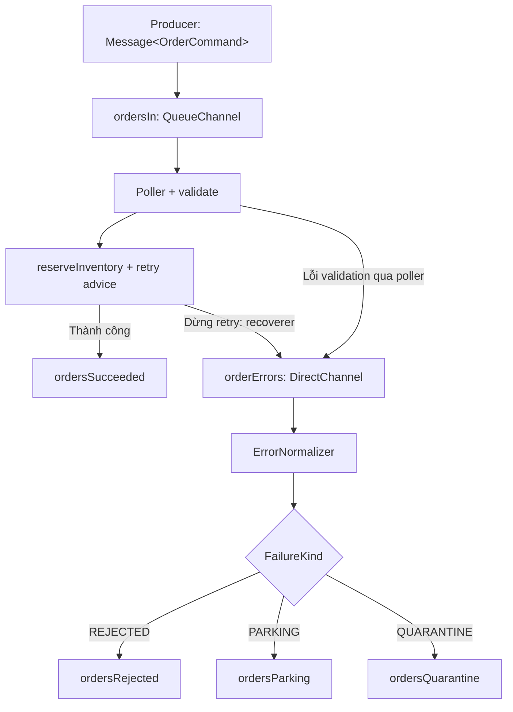

# Thiết kế retry và error flow

## 1. Bài toán và mục tiêu thiết kế

Trong chương **Thiết kế flow** của **SPRING_INTEGRATION_CORE**, retry và error flow là hai phần của cùng một thiết kế: khi một bước xử lý thất bại, hệ thống phải xác định có nên thử lại, thử lại bước nào, và đưa thông điệp đến đâu nếu không thể hoàn tất.

Ví dụ xuyên suốt bài là luồng đặt giữ hàng:

1. Nhận một `Message<OrderCommand>`.
2. Kiểm tra dữ liệu đầu vào.
3. Gọi dịch vụ kho để đặt giữ hàng.
4. Chuyển kết quả thành công sang channel tiếp theo.
5. Với lỗi, phân loại thành từ chối nghiệp vụ, chờ xử lý lại hoặc cách ly để điều tra.

Giả sử kho mất kết nối trong chốc lát: thử lại có thể hữu ích. Nếu số lượng đặt hàng âm, gọi lại ba lần vẫn là dữ liệu sai. Nếu kho đã giữ hàng nhưng phản hồi bị mất, một lần gọi lại thiếu idempotency có thể giữ hàng hai lần.

Sau bài học, người học cần có khả năng:

- Phân biệt exception truyền trên call stack với `ErrorMessage` được gửi qua channel.
- Chọn lỗi được retry, giới hạn số lần gọi và tổng thời gian xử lý.
- Gắn retry vào đúng endpoint bằng Java DSL.
- Giữ đủ ngữ cảnh khi chuyển lỗi sang một luồng riêng.
- Thiết kế recovery, replay và kiểm thử mà không đánh đồng “đã nhận message” với “nghiệp vụ đã hoàn tất”.

### Phạm vi phiên bản

Ví dụ chính dùng **Java 17+, Spring Integration 7.0.x và Spring Framework 7.0.x**. Cần dùng bộ dependency tương thích do dự án hoặc BOM quản lý; bài không yêu cầu thay phiên bản của một dự án đang có.

Từ Spring Integration 7.0, retry chuyển từ thư viện Spring Retry sang API trong Spring Framework. Do đó các import và cách cấu hình của ví dụ 6.x không thể ghép trực tiếp vào ví dụ 7.x. [Nguồn: thay đổi của Spring Integration 7.0](https://docs.spring.io/spring-integration/reference/7.0/whats-new.html).

| Nội dung | Spring Integration 6.5.x | Spring Integration 7.0.x trong bài |
|---|---|---|
| API retry nền tảng | `org.springframework.retry.*` | `org.springframework.core.retry.*` |
| Cấu hình advice | Truyền Spring Retry `RetryTemplate` qua `setRetryTemplate(...)` | Truyền Framework `RetryPolicy` qua `setRetryPolicy(...)` |
| Giới hạn tương đương ba lần gọi | `maxAttempts = 3`, bao gồm lần đầu | `maxRetries = 2`, cộng lần đầu thành ba lần |
| Recovery callback | Kiểu thuộc Spring Retry | Kiểu thuộc Spring Integration |

Đối chiếu API cũ tại [Retry Advice 6.5](https://docs.spring.io/spring-integration/reference/6.5/handler-advice/classes.html). Với 7.0, công thức số lần gọi là:

```text
totalAttempts = 1 + maxRetries

maxRetries = 0  -> tối đa 1 lần gọi
maxRetries = 2  -> tối đa 3 lần gọi
```

Ý nghĩa `maxRetries` được quy định tại [RetryPolicy.Builder của Spring Framework 7.0](https://docs.spring.io/spring-framework/docs/7.0.0/javadoc-api/org/springframework/core/retry/RetryPolicy.Builder.html#maxRetries(long)). Luôn khai báo giới hạn cụ thể để kết quả không phụ thuộc cấu hình mặc định.

## 2. Tách bốn quyết định thường bị gộp làm một

Một flow đáng tin cậy cần trả lời riêng bốn câu hỏi sau:

| Quyết định | Câu hỏi phải trả lời | Ví dụ với dịch vụ kho |
|---|---|---|
| Phân loại lỗi | Lỗi có khả năng tự hết không? | Mất kết nối tạm thời có thể thử lại; hết hàng được từ chối |
| Retry | Lặp lại đơn vị xử lý nào, bao nhiêu lần? | Chỉ lặp lời gọi đặt giữ hàng, tối đa ba lần gọi |
| Recovery | Khi dừng retry, đầu ra của bước đó là gì? | Phát thông điệp lỗi, trả kết quả thay thế hợp lệ hoặc ném lỗi ra ngoài |
| Tiếp nhận lại | Ai có quyền đưa công việc trở lại flow? | Consumer retry queue, broker hoặc thao tác vận hành có kiểm soát |

**Retry** lặp lại công việc theo policy. **Recovery** là hành động khi policy không cho tiếp tục, kể cả khi lỗi không thuộc nhóm được thử lại. **Redelivery** là nguồn gửi lại message. **Replay** là xử lý lại một công việc đã được lưu hoặc đã dừng trước đó.

Bốn khái niệm này có thể phối hợp nhưng không thay thế nhau. Một ứng dụng có retry ba lần trong handler và broker giao tối đa năm lượt có thể gọi hệ thống ngoài tới `3 × 5 = 15` lần cho một công việc. Nếu HTTP client bên trong còn tự thử hai lần tổng cộng cho mỗi lần gọi, trần có thể thành `3 × 5 × 2 = 30`.

Các phép nhân trên giả định mọi tầng đều đi tới giới hạn; mục đích là tính được trần tải. Khi viết cấu hình thực tế, phải xác định mỗi tham số là **tổng số lần gọi** hay **số lần thử lại** trước khi tính.

## 3. Lỗi đi đâu phụ thuộc ranh giới thực thi

### 3.1. DirectChannel: lỗi thường quay lại caller

Với `DirectChannel`, handler thông thường chạy trên thread đang gửi message. Nếu handler ném exception và chưa có thành phần nào xử lý nó, exception đi ngược call stack về phía `send(...)`, `MessagingTemplate` hoặc gateway.

```text
caller thread:
send(message) -> DirectChannel -> handler -> exception
      ^                                     |
      +-------------- call stack -----------+
```

Đặt header `errorChannel` lên message không biến mọi exception của `DirectChannel` thành sự kiện lỗi. Phải có thành phần thực sự bắt lỗi và phát `ErrorMessage`, chẳng hạn recovery callback hoặc gateway được cấu hình xử lý lỗi.

### 3.2. QueueChannel và ExecutorChannel: caller không còn chờ cùng call stack

Với `QueueChannel`, producer gửi message vào hàng đợi; polling consumer đọc và xử lý sau. Với `ExecutorChannel`, công việc được chuyển sang executor, tùy chính sách thực thi của executor.

Khi lỗi xảy ra sau ranh giới bất đồng bộ, caller ban đầu thường đã đi tiếp. Cơ chế xử lý lỗi phải hoạt động ở phía consumer/task. Với poller của Spring Integration, lỗi của tác vụ polling có thể được phát thành `ErrorMessage` qua cơ chế error handler. Channel lỗi cấu hình riêng trên poller là một điểm định tuyến cần xem xét.

Nếu dùng chiến lược có xét header, channel trong `MessageHeaders.ERROR_CHANNEL` được ưu tiên trước global `errorChannel`. Cần kiểm tra cơ chế phát lỗi cụ thể; recoverer đã được truyền channel đích rõ ràng có đường gửi riêng. Xem [Error Handling](https://docs.spring.io/spring-integration/reference/7.0/error-handling.html).

| Điểm gọi | `send(...)` thành công thường chứng minh điều gì? | Lỗi nghiệp vụ được quan sát ở đâu? |
|---|---|---|
| DirectChannel | Subscriber đồng bộ đã xử lý xong mà không ném lỗi chưa được xử lý | Caller, hoặc recovery/error flow đã cấu hình |
| QueueChannel | Message đã được đưa vào queue | Poller, error flow hoặc trạng thái nghiệp vụ |
| ExecutorChannel | Công việc đã được chấp nhận cho thực thi theo executor | Cơ chế error handler của tác vụ |
| Gateway request–reply | Phụ thuộc có nhận được reply hợp lệ hay không | Exception của gateway hoặc error flow của gateway |

Ngay cả trên DirectChannel, “không còn exception” có thể chỉ có nghĩa là một recoverer đã tiếp nhận lỗi. Caller cần một hợp đồng nghiệp vụ rõ ràng để diễn giải kết quả.

## 4. Hợp đồng của một error flow

### 4.1. ErrorMessage mang lỗi, không mang trực tiếp command

Về mặt kiểu dữ liệu:

```text
Message<OrderCommand>
    payload = OrderCommand
    headers = businessCorrelationId, ...

ErrorMessage
    payload = Throwable
    originalMessage = Message<?> hoặc không có
```

`Throwable` có thể là `MessagingException`, bên trong có `failedMessage`. Nó cũng có thể được bọc bởi exception retry hoặc exception của adapter.

Vì vậy error flow nên thực hiện các bước:

1. Nhận toàn bộ `ErrorMessage`.
2. Tìm `failedMessage` trong cause chain; nếu không có, xét `originalMessage`.
3. Phân loại theo exception và ngữ cảnh nghiệp vụ.
4. Chuyển thành một cấu trúc lỗi có thể quan sát, lưu và điều phối.
5. Gửi tới đích cuối hoặc một cơ chế retry trễ có giới hạn.

Không chỉ ép `error.getPayload()` thành command. Payload của error message là exception. Cũng không giả định mọi lỗi đều có message gốc: lỗi khởi tạo, polling hoặc lỗi hạ tầng có thể không gắn được với một đơn hàng.

### 4.2. Ba nhánh lỗi có ý nghĩa khác nhau

Trong bài dùng ba nhánh:

| Nhánh | Ý nghĩa | Ví dụ | Xử lý tiếp |
|---|---|---|---|
| `REJECTED` | Yêu cầu không được đáp ứng theo quy tắc dữ liệu/nghiệp vụ | Số lượng không hợp lệ, hết hàng | Ghi kết quả từ chối; thông báo theo hợp đồng |
| `PARKING` | Lỗi được phép thử lại nhưng đã hết ngân sách retry hiện tại | Kho tiếp tục mất kết nối | Lưu công việc để xử lý lại có lịch hoặc đối soát |
| `QUARANTINE` | Không đủ cơ sở tự thử lại an toàn | Lỗi lập trình, schema không mong đợi | Cách ly, điều tra và sửa nguyên nhân |

`PARKING` không tự làm message được gửi lại. Phải có một consumer, lịch xử lý hoặc quy trình vận hành tiếp nhận nhánh này. `QUARANTINE` cũng cần người hoặc công cụ sở hữu, thời hạn xử lý và dữ liệu truy vết.

Tên channel như `deadLetterChannel` chỉ là tên bean. Để trở thành dead-letter destination bền vững, cần thêm cơ chế lưu trữ, chính sách vận hành và cách xử lý khi việc ghi lỗi thất bại.

### 4.3. Dữ liệu lỗi cần đủ để xử lý lại

Một bản ghi lỗi dùng cho production thường cần:

- `failureId`: định danh lần ghi nhận lỗi để tránh lưu trùng.
- `businessKey`, `correlationId`: nối lỗi với công việc gốc.
- `failedComponent`, `operation`: bước thất bại.
- `errorCode`, loại exception, mô tả đã loại dữ liệu nhạy cảm.
- Payload nghiệp vụ hoặc tham chiếu an toàn đến payload.
- Phiên bản schema và thời điểm lỗi.
- Số lần thực thi theo từng tầng, tổng số lượt replay và hạn chót xử lý.
- `nextAttemptAt`, trạng thái xử lý và lịch sử các quyết định vận hành.

Không mặc định serialize nguyên một `ErrorMessage` để gửi qua broker: header có thể chứa đối tượng `MessageChannel`, temporary reply channel hoặc thành phần chỉ tồn tại trong process. Chuẩn hóa dữ liệu nghiệp vụ và metadata cho hợp đồng lưu trữ của hệ thống.

## 5. Xây dựng retry policy từ yêu cầu nghiệp vụ

### 5.1. Lỗi được phép thử lại phải là một danh sách có chủ đích

| Tình huống | Quyết định gợi ý | Điều kiện kèm theo |
|---|---|---|
| Kết nối tạm thời không mở được | Retry ngắn, có backoff | Còn deadline và thao tác an toàn khi lặp |
| Read timeout sau khi gửi yêu cầu thay đổi dữ liệu | Đối soát hoặc retry với idempotency key | Không biết chắc hệ thống ngoài đã thực hiện hay chưa |
| HTTP 429 | Retry theo thời điểm được phép | Tôn trọng `Retry-After`, quota và deadline |
| HTTP 5xx | Xem hợp đồng API và từng mã lỗi | Không phải mọi 5xx đều đáng retry |
| Dữ liệu thiếu/sai định dạng | Từ chối hoặc cách ly | Sửa dữ liệu trước khi gửi lại |
| Hết hàng, tài khoản không đủ điều kiện | Từ chối nghiệp vụ | Không tự biến thành sự cố kết nối |
| Sai thông tin xác thực/cấu hình | Dừng và xử lý nguyên nhân | Retry dồn dập thường không có ích |
| Lỗi lập trình chưa phân loại | Cách ly và cảnh báo | Không đưa vào danh sách retry mặc định |

Adapter/client nên chuyển các lỗi kỹ thuật đã hiểu sang exception miền tích hợp, ví dụ `TemporaryInventoryException`. Chỉ chuyển lỗi sang loại tạm thời sau khi kiểm tra ngữ nghĩa của nó.

Nếu handler bắt exception rồi trả `null` hoặc trả `false`, retry advice không tự biết công việc đã thất bại. Với handler trả giá trị boolean, `false` vẫn có thể là một kết quả bình thường. Policy dựa trên exception cần handler ném exception đúng loại, hoặc phải có một bước kiểm tra kết quả riêng.

### 5.2. Số lần thử phải đi cùng backoff

Với exponential backoff không có jitter, có thể lập kế hoạch bằng:

```text
delay(k) = min(maxDelay, initialDelay × multiplier^(k - 1))

k = 1 là khoảng chờ trước lần gọi thứ hai.
```

Giả sử tối đa bốn lần gọi, mỗi lần tối đa 500 ms, các khoảng chờ là 100, 200 và 400 ms:

```text
T_handler_max ≈ 4 × 500 + 100 + 200 + 400
              = 2.700 ms
```

Đây là ước lượng có giả định mỗi lần gọi thật sự bị chặn ở 500 ms. Cần cộng thời gian đợi queue, kết nối, chuẩn bị payload, xử lý kết quả và phát lỗi để tính thời gian đầu cuối. Nếu client không có timeout phù hợp, giới hạn số lần retry không tạo ra trần thời gian thực thi.

Jitter làm các instance lệch thời điểm gọi lại, giảm việc nhiều consumer cùng đánh vào một dependency sau sự cố. Với `RetryPolicy.Builder` có thể khai báo `delay`, `multiplier`, `maxDelay` và `jitter`; cần đọc đúng ý nghĩa jitter của API đang dùng, vì không phải mọi thư viện đều thực hiện full jitter. [Nguồn: RetryPolicy.Builder 7.0](https://docs.spring.io/spring-framework/docs/7.0.0/javadoc-api/org/springframework/core/retry/RetryPolicy.Builder.html).

### 5.3. Chọn retry tại chỗ hay retry trễ

| Tiêu chí | Retry ngắn tại handler | Retry trễ qua lưu trữ/broker |
|---|---|---|
| Khoảng chờ điển hình | Vài chục đến vài trăm mili giây, theo ngân sách hệ thống | Vài giây, phút hoặc lâu hơn |
| Thread thực thi | Có thể bị giữ trong khi backoff | Có thể được giải phóng giữa các lượt |
| Phục hồi khi restart | Retry đang diễn ra trong bộ nhớ có thể mất | Phụ thuộc tính bền vững của nơi lưu và metadata |
| Quản lý deadline | Bên trong lần xử lý hiện tại | Cần mang deadline qua các lượt giao |
| Độ phức tạp | Ít thành phần hơn | Cần lịch, giới hạn replay, chống trùng và quan sát |

Không dùng `Thread.sleep` dài trong handler để đóng vai trò một lịch xử lý. Ví dụ có 20 thread, mỗi công việc giữ thread 2,7 giây thì công suất lý tưởng chỉ khoảng `20 / 2,7 ≈ 7,4` công việc/giây, trước khi tính chi phí khác.

Retry dài còn ảnh hưởng thứ tự: một message lỗi có thể giữ một poller hoặc làm các message cùng khóa nghiệp vụ đến sau vượt lên. Cần chọn giữa bảo toàn thứ tự, cô lập message lỗi và tăng throughput.

## 6. Đặt retry vào đúng phạm vi

Xét flow:

```text
validate -> reserveInventory -> saveOrder -> notifyCustomer
```

Nếu `notifyCustomer` thất bại, lặp lại toàn bộ flow có thể đặt giữ hàng và ghi đơn lần nữa. Đơn vị retry nên là đơn vị nhỏ nhất có thể lặp an toàn, với trạng thái và tác dụng phụ đã được hiểu.

Với reply-producing handler thông thường, request-handler advice được thiết kế để bọc xử lý request của handler. Không nên suy ra rằng advice đặt ở `reserveInventory` sẽ retry cả các endpoint downstream. Khi bọc gateway hoặc custom advice, phải xem lại phạm vi được gọi bên trong. [Nguồn: Adding Behavior to Endpoints](https://docs.spring.io/spring-integration/reference/7.0/handler-advice.html).

Thiết kế theo từng bước:

- Validation: kiểm tra một lần; trả kết quả từ chối nếu dữ liệu không hợp lệ.
- Đặt giữ hàng: retry ngắn khi lỗi tạm thời; dùng cùng idempotency key.
- Ghi đơn: transaction và retry riêng cho lỗi thực sự phù hợp.
- Thông báo: tách thành công việc riêng nếu không cần chặn việc hoàn tất đơn.

Nếu bước giữ hàng đã thành công nhưng ghi đơn thất bại, cần đối soát hoặc một hành động bù để giải phóng giữ hàng, tùy yêu cầu nghiệp vụ. Retry không tự đảo ngược tác dụng phụ đã xảy ra ở hệ thống ngoài.

Với `filter`, một message bị chuyển sang discard channel mà không ném lỗi không kích hoạt exception retry. Với splitter/aggregator, lỗi của một nhánh không tự hủy các nhánh khác hoặc hoàn tất message group; cần chính sách timeout, kết quả một phần và xử lý group riêng.

## 7. Ví dụ Java DSL: đặt giữ hàng và phân luồng lỗi

### 7.1. Sơ đồ xử lý



Các terminal channel trong ví dụ đều là queue trong bộ nhớ để dễ quan sát khi học và kiểm thử. Chúng chưa phải hệ thống lưu lỗi bền vững. Flow không tự đọc `ordersParking` rồi gửi lại `ordersIn`.

Ví dụ dùng dependency `org.springframework.integration:spring-integration-core` trong bộ phiên bản tương thích nêu đầu bài. Java DSL đã nằm trong core; không thêm artifact Java DSL riêng. Phần kiểm thử dùng JUnit Jupiter.

### 7.2. Cấu hình đầy đủ

Đoạn mã sau có thể đặt trong một file `RetryErrorFlowConfig.java`. Client mô phỏng cho phép tái hiện lỗi có chủ đích, không gọi mạng thật.

```java
package example.integration;

import java.time.Duration;
import java.util.concurrent.ConcurrentHashMap;
import java.util.concurrent.atomic.AtomicInteger;

import org.springframework.beans.factory.annotation.Qualifier;
import org.springframework.context.annotation.Bean;
import org.springframework.context.annotation.Configuration;
import org.springframework.core.retry.RetryPolicy;
import org.springframework.integration.channel.DirectChannel;
import org.springframework.integration.channel.QueueChannel;
import org.springframework.integration.config.EnableIntegration;
import org.springframework.integration.dsl.IntegrationFlow;
import org.springframework.integration.dsl.Pollers;
import org.springframework.integration.handler.advice.ErrorMessageSendingRecoverer;
import org.springframework.integration.handler.advice.RequestHandlerRetryAdvice;
import org.springframework.messaging.Message;
import org.springframework.messaging.MessageChannel;
import org.springframework.messaging.MessagingException;
import org.springframework.messaging.support.ErrorMessage;

@Configuration(proxyBeanMethods = false)
@EnableIntegration
public class RetryErrorFlowConfig {

    public record OrderCommand(String orderId, String sku, int quantity) {
    }

    public record Reservation(String orderId, String reservationId) {
    }

    public enum FailureKind {
        REJECTED, PARKING, QUARANTINE
    }

    public record FailureRecord(
            String orderId,
            String correlationId,
            FailureKind kind,
            String exceptionType,
            String reason,
            Object businessPayload) {
    }

    public static class InvalidOrderException extends RuntimeException {
        public InvalidOrderException(String message) {
            super(message);
        }
    }

    public static class OutOfStockException extends RuntimeException {
        public OutOfStockException(String message) {
            super(message);
        }
    }

    public static class TemporaryInventoryException extends RuntimeException {
        public TemporaryInventoryException(String message) {
            super(message);
        }

        public TemporaryInventoryException(String message, Throwable cause) {
            super(message, cause);
        }
    }

    public interface InventoryClient {
        Reservation reserve(OrderCommand command);
    }

    public static class DemoInventoryClient implements InventoryClient {

        private final ConcurrentHashMap<String, AtomicInteger> counts =
                new ConcurrentHashMap<>();

        @Override
        public Reservation reserve(OrderCommand command) {
            int attempt = counts
                    .computeIfAbsent(command.orderId(), key -> new AtomicInteger())
                    .incrementAndGet();

            if ("FLAKY".equals(command.sku()) && attempt <= 2) {
                throw new TemporaryInventoryException("Kho tạm mất kết nối");
            }
            if ("DOWN".equals(command.sku())) {
                throw new TemporaryInventoryException("Kho chưa phục hồi");
            }
            if ("SOLD_OUT".equals(command.sku())) {
                throw new OutOfStockException("Không đủ hàng");
            }
            if ("BUG".equals(command.sku())) {
                throw new IllegalStateException("Trạng thái kho không mong đợi");
            }

            return new Reservation(
                    command.orderId(), "reservation-" + command.orderId());
        }

        public int attempts(String orderId) {
            AtomicInteger count = counts.get(orderId);
            return count == null ? 0 : count.get();
        }
    }

    @Bean
    QueueChannel ordersIn() {
        return new QueueChannel(100);
    }

    @Bean
    QueueChannel ordersSucceeded() {
        return new QueueChannel(100);
    }

    @Bean
    MessageChannel orderErrors() {
        return new DirectChannel();
    }

    @Bean
    QueueChannel ordersRejected() {
        return new QueueChannel(100);
    }

    @Bean
    QueueChannel ordersParking() {
        return new QueueChannel(100);
    }

    @Bean
    QueueChannel ordersQuarantine() {
        return new QueueChannel(100);
    }

    @Bean
    DemoInventoryClient inventoryClient() {
        return new DemoInventoryClient();
    }

    @Bean
    RequestHandlerRetryAdvice inventoryRetry(
            @Qualifier("orderErrors") MessageChannel errors) {

        RetryPolicy policy = RetryPolicy.builder()
                .includes(TemporaryInventoryException.class)
                .maxRetries(2)
                .delay(Duration.ofMillis(100))
                .multiplier(2.0)
                .maxDelay(Duration.ofMillis(500))
                .build();

        ErrorMessageSendingRecoverer recoverer =
                new ErrorMessageSendingRecoverer(errors);
        recoverer.setSendTimeout(200);

        RequestHandlerRetryAdvice advice = new RequestHandlerRetryAdvice();
        advice.setRetryPolicy(policy);
        advice.setRecoveryCallback(recoverer);
        return advice;
    }

    @Bean
    IntegrationFlow orderProcessing(
            InventoryClient inventoryClient,
            RequestHandlerRetryAdvice inventoryRetry) {

        return IntegrationFlow.from("ordersIn")
                .transform(
                        OrderCommand.class,
                        RetryErrorFlowConfig::validate,
                        endpoint -> endpoint
                                .id("validateOrder")
                                .poller(Pollers
                                        .fixedDelay(Duration.ofMillis(100))
                                        .maxMessagesPerPoll(1)
                                        .errorChannel("orderErrors")))
                .handle(
                        OrderCommand.class,
                        (command, headers) -> inventoryClient.reserve(command),
                        endpoint -> endpoint
                                .id("reserveInventory")
                                .advice(inventoryRetry))
                .channel("ordersSucceeded")
                .get();
    }

    @Bean
    IntegrationFlow orderFailureRouting() {
        return IntegrationFlow.from("orderErrors")
                .transform(new ErrorNormalizer(), "normalize")
                .route(
                        FailureRecord.class,
                        failure -> failure.kind().name(),
                        router -> router
                                .channelMapping("REJECTED", "ordersRejected")
                                .channelMapping("PARKING", "ordersParking")
                                .channelMapping("QUARANTINE", "ordersQuarantine"))
                .get();
    }

    private static OrderCommand validate(OrderCommand command) {
        if (command.orderId() == null || command.orderId().isBlank()) {
            throw new InvalidOrderException("orderId không được rỗng");
        }
        if (command.sku() == null || command.sku().isBlank()) {
            throw new InvalidOrderException("sku không được rỗng");
        }
        if (command.quantity() <= 0) {
            throw new InvalidOrderException("quantity phải lớn hơn 0");
        }
        return command;
    }

    public static class ErrorNormalizer {

        public FailureRecord normalize(ErrorMessage error) {
            Message<?> failed = findFailedMessage(error);
            Object payload = failed == null ? null : failed.getPayload();
            String correlationId = failed == null ? null
                    : failed.getHeaders().get(
                            "businessCorrelationId", String.class);

            String orderId = "unknown";
            if (payload instanceof OrderCommand command) {
                orderId = command.orderId();
            }
            else if (payload instanceof Reservation reservation) {
                orderId = reservation.orderId();
            }

            Throwable root = deepestCause(error.getPayload());
            return new FailureRecord(
                    orderId,
                    correlationId,
                    classify(error.getPayload()),
                    root.getClass().getName(),
                    root.getMessage(),
                    payload);
        }

        private static Message<?> findFailedMessage(ErrorMessage error) {
            Throwable current = error.getPayload();
            for (int depth = 0; current != null && depth < 32; depth++) {
                if (current instanceof MessagingException messaging
                        && messaging.getFailedMessage() != null) {
                    return messaging.getFailedMessage();
                }
                current = current.getCause();
            }
            return error.getOriginalMessage();
        }

        private static FailureKind classify(Throwable error) {
            FailureKind result = FailureKind.QUARANTINE;
            Throwable current = error;
            for (int depth = 0; current != null && depth < 32; depth++) {
                if (current instanceof InvalidOrderException
                        || current instanceof OutOfStockException) {
                    return FailureKind.REJECTED;
                }
                if (current instanceof TemporaryInventoryException) {
                    result = FailureKind.PARKING;
                }
                current = current.getCause();
            }
            return result;
        }

        private static Throwable deepestCause(Throwable error) {
            Throwable current = error;
            for (int depth = 0;
                    current.getCause() != null && depth < 32;
                    depth++) {
                current = current.getCause();
            }
            return current;
        }
    }
}
```

### 7.3. Cách các thành phần phối hợp

`ordersIn` là `QueueChannel`, nên endpoint đầu tiên tiêu thụ nó cần poller. Trong ví dụ, poller được cấu hình trên transformer validation. Các endpoint phía sau nối tiếp qua channel nội bộ; chúng chạy trong luồng xử lý do poller khởi tạo cho message này. Cách khai báo poller qua DSL được mô tả tại [Pollers](https://docs.spring.io/spring-integration/reference/7.0/dsl/java-pollers.html).

Advice chỉ được gắn vào `reserveInventory`. Vì vậy quantity không hợp lệ không làm client kho được gọi. Với SKU `FLAKY`, client ném lỗi hai lần và trả `Reservation` ở lần thứ ba. Với SKU `DOWN`, ba lần gọi đều thất bại.

Policy bao gồm `TemporaryInventoryException`; các lỗi nghiệp vụ hoặc lỗi bất thường không nằm trong danh sách thử lại. Các bộ lọc exception của Framework retry xem cả cause chain, nên việc exception miền tích hợp bị bọc không nhất thiết làm mất khả năng phân loại. [Nguồn: programmatic retry support](https://docs.spring.io/spring-framework/reference/core/resilience.html#resilience-programmatic).

Khi retry không tiếp tục, `ErrorMessageSendingRecoverer` phát lỗi tới channel được truyền vào. Trong triển khai 7.0, recoverer này trả `null` sau khi gửi, nên nhánh đó không tạo ra `Reservation` để chạy tiếp tới `ordersSucceeded`. Đây là hợp đồng phù hợp cho ví dụ xử lý công việc bất đồng bộ. [Nguồn: ErrorMessageSendingRecoverer 7.0.0](https://github.com/spring-projects/spring-integration/blob/v7.0.0/spring-integration-core/src/main/java/org/springframework/integration/handler/advice/ErrorMessageSendingRecoverer.java).

Không bật `requiresReply` cho handler rồi vẫn giữ recovery trả `null` mà không thiết kế lại hợp đồng đầu ra. Nếu endpoint yêu cầu reply bắt buộc, một kết quả recovery rỗng có thể tiếp tục tạo lỗi thiếu reply.

Normalizer dùng phương thức POJO nhận `ErrorMessage` để đọc cả envelope. Nếu thay bằng `.handle(Throwable.class, ...)`, lambda nhận payload exception; nó không tự nhận được `originalMessage` của envelope. Khi viết lambda DSL cần phân biệt rõ payload và message đầy đủ. [Nguồn: Service Activators và handle](https://docs.spring.io/spring-integration/reference/7.0/dsl/java-handle.html).

Giới hạn 32 mức trong các vòng duyệt là biện pháp phòng vệ cho ví dụ. Trong hệ thống thật cần cân nhắc thêm exception đặc thù của adapter, lỗi tổng hợp và suppressed exceptions nếu chúng mang thông tin cần thiết.

### 7.4. Những giới hạn cố ý của ví dụ

Client mô phỏng chỉ đếm số lần gọi. Việc trả cùng một chuỗi reservation ID không chứng minh client hay dịch vụ kho thật có idempotency. Khi thay bằng HTTP/gRPC client thật, cần triển khai idempotency ở phía có tác dụng phụ.

Các queue có capacity 100 để tránh tăng bộ nhớ vô hạn. Ví dụ giả định queue đầu ra còn chỗ; cần thêm chính sách send timeout và xử lý bão hòa khi dùng lâu dài. `recoverer.setSendTimeout(200)` là timeout cho thao tác gửi của recoverer, không phải deadline 200 ms cho toàn bộ error flow.

Đặc biệt, `orderErrors` là `DirectChannel`: normalizer và router chạy đồng bộ trong lời gọi gửi lỗi. Một subscriber bị chặn lâu có thể giữ luôn thread đang recovery. Timeout gửi không cưỡng chế dừng xử lý của subscriber đồng bộ.

`FailureRecord` trong ví dụ dùng payload trong bộ nhớ và thông báo exception đơn giản để dễ học. Bản ghi bền vững cần schema rõ ràng, chính sách dữ liệu và cơ chế ghi nhận việc lưu thành công như mục 4.

## 8. Gateway: xác định rõ caller sẽ nhận gì

Gateway che giấu messaging API nhưng vẫn phải có hợp đồng lỗi. Với gateway request–reply, có ba lựa chọn phổ biến:

1. **Truyền lỗi cho caller:** để exception được chuyển về gateway theo cấu hình.
2. **Trả một kết quả thất bại có kiểu:** ví dụ `OrderResult(status=REJECTED, reason=...)`.
3. **Chuyển sang mô hình tiếp nhận công việc:** trả mã tiếp nhận, sau đó caller tra trạng thái nghiệp vụ.

Nếu cấu hình error channel cho gateway request–reply, error flow có thể tạo reply thay thế. Nếu error flow chỉ ghi log và kết thúc, caller có thể không nhận được reply mong đợi và phải chờ tới timeout theo hợp đồng gateway.

Ví dụ tại mục 7 sử dụng queue đầu vào và các queue kết quả, không cung cấp một gateway request–reply. Không thể chỉ đặt một gateway đồng bộ ở đầu vào rồi kỳ vọng `ordersSucceeded` sẽ tự trả kết quả về temporary reply channel: kết quả đang được đưa tới một channel cụ thể để consumer khác nhận.

Cần phân biệt ba loại timeout:

| Timeout | Đo khoảng thời gian nào? | Có tự hủy tác dụng phụ đang chạy không? |
|---|---|---|
| Send/request timeout | Chờ gửi/đưa request vào channel theo loại channel | Không |
| Reply timeout | Chờ response của gateway | Không mặc định |
| Timeout của remote client | Chờ kết nối/response của một lần gọi hệ thống ngoài | Phụ thuộc client; không chứng minh phía ngoài chưa xử lý |

Với chuỗi đồng bộ trên caller thread, reply timeout cũng không phải cơ chế cưỡng chế cắt một handler đang block. Deadline phải được truyền và áp dụng ở đúng nơi thực hiện I/O. Tham khảo hành vi gateway tại [Messaging Gateways](https://docs.spring.io/spring-integration/reference/7.0/gateway.html).

## 9. Kiểm thử hành vi của flow

### 9.1. Ma trận tình huống

Mỗi tình huống bên dưới dùng một `orderId` riêng để số lần gọi mô phỏng không ảnh hưởng nhau.

| Dữ liệu/tình huống | Số lần gọi kho kỳ vọng | Kết quả cuối |
|---|---:|---|
| SKU bình thường, quantity hợp lệ | 1 | Một `Reservation` ở `ordersSucceeded` |
| SKU `FLAKY` | 3 | Thành công sau hai lỗi tạm thời |
| SKU `DOWN` | 3 | Một `FailureRecord(PARKING)` |
| SKU `SOLD_OUT` | 1 | Một `FailureRecord(REJECTED)` |
| Quantity bằng 0 | 0 | Một `FailureRecord(REJECTED)` từ lỗi validation |
| SKU `BUG` | 1 | Một `FailureRecord(QUARANTINE)` |

Ngoài channel đích, cần kiểm tra nhánh thành công và các nhánh lỗi không cùng nhận một kết quả của cùng lượt xử lý. Một error flow hoạt động đúng không được che giấu một đơn hàng thất bại bằng kết quả thành công giả.

### 9.2. Kiểm thử hết lượt retry qua toàn bộ flow

Đoạn kiểm thử sau dùng Spring context thật, không mock retry advice. Các assertion kiểm tra đầu ra nghiệp vụ và số lần gọi client.

```java
package example.integration;

import org.junit.jupiter.api.Test;
import org.springframework.context.annotation.AnnotationConfigApplicationContext;
import org.springframework.integration.channel.QueueChannel;
import org.springframework.messaging.Message;
import org.springframework.messaging.support.MessageBuilder;

import static example.integration.RetryErrorFlowConfig.*;
import static org.junit.jupiter.api.Assertions.*;

class RetryErrorFlowTest {

    @Test
    void exhaustedTemporaryFailureGoesToParkingWithContext() {
        try (var context =
                     new AnnotationConfigApplicationContext(
                             RetryErrorFlowConfig.class)) {

            QueueChannel input =
                    context.getBean("ordersIn", QueueChannel.class);
            QueueChannel parking =
                    context.getBean("ordersParking", QueueChannel.class);
            QueueChannel succeeded =
                    context.getBean("ordersSucceeded", QueueChannel.class);
            QueueChannel rejected =
                    context.getBean("ordersRejected", QueueChannel.class);
            QueueChannel quarantine =
                    context.getBean("ordersQuarantine", QueueChannel.class);
            DemoInventoryClient client =
                    context.getBean(DemoInventoryClient.class);

            OrderCommand command = new OrderCommand("order-down", "DOWN", 2);
            Message<OrderCommand> request = MessageBuilder
                    .withPayload(command)
                    .setHeader("businessCorrelationId", "corr-down")
                    .build();

            assertTrue(input.send(request, 100));

            Message<?> parked = parking.receive(3_000);
            assertNotNull(parked);
            FailureRecord failure =
                    assertInstanceOf(FailureRecord.class, parked.getPayload());

            assertEquals(3, client.attempts("order-down"));
            assertEquals(FailureKind.PARKING, failure.kind());
            assertEquals("order-down", failure.orderId());
            assertEquals("corr-down", failure.correlationId());
            assertEquals(command, failure.businessPayload());
            assertNull(succeeded.receive(0));
            assertNull(rejected.receive(0));
            assertNull(quarantine.receive(0));
        }
    }
}
```

`receive(3_000)` chờ một kết quả có giới hạn, tránh dùng `Thread.sleep` để đoán poller đã xong chưa. Con số ba giây là giới hạn chờ của bài kiểm thử, không phải cam kết độ trễ production.

Muốn kiểm tra khoảng backoff chính xác, nên kiểm thử policy với clock/backoff có thể điều khiển hoặc thành phần ghi nhận thời điểm. Tránh assertion chặt tới từng mili giây trên máy CI. Với kiểm thử kết quả, có thể dùng một policy kiểm thử có độ trễ nhỏ, đồng thời giữ cùng giới hạn số lần và quy tắc phân loại.

### 9.3. Các tình huống bổ sung cần xác nhận

- Exception miền tích hợp bị bọc trong `MessagingException` vẫn được phân loại đúng.
- Error message không có original/failed message vẫn được đưa vào quarantine với metadata thiếu được biểu diễn rõ.
- Lỗi không được retry chỉ gọi client một lần rồi đi tới nhánh cuối phù hợp.
- Giữ hàng đã thành công nhưng phản hồi bị mất: gọi lại cùng khóa không giữ hàng lần nữa.
- Error destination không ghi được: không đánh dấu nghiệp vụ đã được tiếp nhận bền vững.
- Hết deadline trước lần thử tiếp theo: không tiếp tục gọi dependency.
- Restart sau khi đã ghi lỗi nhưng trước khi ACK: việc giao lại không tạo bản ghi hoặc tác dụng phụ trùng.
- Khi thay queue bộ nhớ bằng nơi lưu bền vững, công việc còn tồn tại sau khi khởi động lại.

Các tình huống liên quan broker, transaction hoặc kho dữ liệu cần kiểm thử với đúng thành phần thực tế hoặc môi trường tích hợp tương ứng; kiểm thử queue bộ nhớ không chứng minh được các bảo đảm đó.

## 10. Stateless retry, stateful retry và nguồn redelivery

### 10.1. Stateless retry

Ví dụ chính dùng stateless retry: một lần handler được gọi sẽ thực hiện cả chu kỳ retry tại chỗ. Advice quản lý các lần gọi và backoff trong lần thực thi này.

Ở đây “stateless” không có nghĩa là không có biến đếm nào trong chu kỳ. Nó nói rằng lời gọi lại từ bên ngoài không được nối với một retry state theo khóa nghiệp vụ như cơ chế stateful.

Stateless retry phù hợp khi:

- Khoảng chờ ngắn và nằm trong ngân sách xử lý.
- Có thể lặp handler an toàn.
- Caller/consumer chấp nhận thời gian giữ thread trong chu kỳ.
- Không cần nguồn gửi lại message giữa từng lần thử.

### 10.2. Stateful retry

Stateful retry cần nhận ra một message được giao lại là công việc đã thử trước đó. Với Spring Integration 7.0, cung cấp `stateKeyFunction` cho `RequestHandlerRetryAdvice` để bật cơ chế này.

Ví dụ khóa có thể biểu diễn `tenant + operation + orderId + commandVersion`. Không nên lấy `MessageHeaders.ID` làm khóa nếu nguồn có thể tạo message mới cho cùng công việc khi redelivery.

Nguồn bên ngoài vẫn phải chịu trách nhiệm giao lại message. Nếu chỉ bật stateful retry rồi gửi vào một flow không có cơ chế resubmit, không có thành phần nào tự bảo đảm lần thử tiếp theo sẽ diễn ra. Cache trạng thái của advice cũng không phải kho bền vững để bảo toàn số lượt qua restart hoặc đồng bộ giữa mọi instance. [Nguồn: RequestHandlerRetryAdvice](https://docs.spring.io/spring-integration/api/org/springframework/integration/handler/advice/RequestHandlerRetryAdvice.html).

Stateful retry không đồng nghĩa mọi khoảng backoff đều được đưa sang một scheduler riêng. Phải xem triển khai của phiên bản đang dùng và cách redelivery hoạt động; không dùng nó như một lời hứa rằng consumer không bao giờ chờ.

### 10.3. Chỉ định một chủ sở hữu cho mỗi loại retry

Một cách phân chia có thể dùng:

| Phạm vi | Chủ sở hữu | Mục đích |
|---|---|---|
| Lỗi chớp nhoáng trong một lời gọi | Handler advice | Một vài lần thử nhanh |
| Sự cố kéo dài | Retry destination hoặc broker | Chờ lâu hơn và giao lại có giới hạn |
| Dữ liệu nghiệp vụ sai | Nhánh rejected | Đợi dữ liệu hoặc yêu cầu mới hợp lệ |
| Lỗi chưa hiểu | Quarantine và vận hành | Điều tra trước khi xử lý lại |

Không đồng thời bật các cơ chế khác nhau với giá trị mặc định rồi hy vọng tổng số lần gọi vẫn nhỏ. Ngân sách tổng phải bao gồm client, advice, broker và thao tác replay.

## 11. Transaction và idempotency quyết định retry có an toàn không

### 11.1. Retry không tự tạo transaction mới

Hai cấu trúc sau có kết quả khác nhau:

```text
A. retry
     -> transaction mới cho từng attempt
          -> thao tác cơ sở dữ liệu

B. một transaction bên ngoài
     -> retry nhiều attempt trong cùng transaction
          -> thao tác cơ sở dữ liệu
```

Ở cấu trúc A, mỗi lần thất bại có thể rollback trước khi thử lại. Ở cấu trúc B, transaction có thể đã bị đánh dấu rollback-only ngay sau lần lỗi đầu; thử lại trong cùng transaction không bảo đảm có thể commit.

Với transaction advice trong integration flow, cần kiểm tra phạm vi của poller, gateway, handler và thứ tự advice. Khi thêm transaction vào ví dụ, hãy vẽ cấu trúc bao quanh thực tế và kiểm thử điều gì commit/rollback trong từng nhánh. Thứ tự advice ảnh hưởng ngữ nghĩa thực thi. [Nguồn: Ordering Advices within Advice Chain](https://docs.spring.io/spring-integration/reference/7.0/handler-advice/order.html).

Đặc biệt, một recovery callback tiêu thụ lỗi và trả về bình thường có thể làm thành phần bên ngoài không còn thấy exception để rollback hoặc từ chối message. ACK/commit cụ thể phụ thuộc inbound adapter, transaction manager và cấu hình broker. Phải chủ động chọn một trong các hợp đồng: xử lý thành công, đã chuyển giao lỗi bền vững hoặc thất bại để nguồn giao lại.

### 11.2. Idempotency gắn với tác dụng phụ

Xét tình huống:

```text
Ứng dụng gửi reserve(order-42, key=reserve:order-42:v1)
Kho giữ hàng thành công
Response bị mất trên đường về
Ứng dụng thấy timeout
Ứng dụng gọi lại với cùng key
```

Kho cần nhận ra cùng một hành động đã được thực hiện và trả lại kết quả tương ứng, hoặc ứng dụng cần có khả năng tra cứu kết quả trước khi quyết định thử lại.

Một bản ghi “đã thấy message” ở ứng dụng chưa đủ nếu nó được ghi sau tác dụng phụ. Process có thể dừng sau khi kho giữ hàng nhưng trước khi ứng dụng đánh dấu hoàn tất.

Thiết kế cần xác định:

- Khóa đại diện cho đúng một hành động nghiệp vụ, kể cả tenant và phiên bản khi cần.
- Cách lưu khóa và kết quả có tính nguyên tử với hành động được bảo vệ.
- Cách xử lý cùng khóa nhưng payload khác.
- Thời hạn giữ khóa dài hơn cửa sổ redelivery/replay được hỗ trợ.
- Cách đối soát trạng thái chưa biết sau timeout hoặc restart.

Retry không mang lại bảo đảm exactly-once cho tác dụng phụ qua mạng. Kết hợp cơ chế giao lại với idempotency và đối soát mới giải quyết được các tình huống kết quả không chắc chắn.

### 11.3. Tác dụng phụ giữa nhiều hệ thống

Nếu ghi trạng thái đơn trong database rồi cần phát sự kiện, có thể cân nhắc transactional outbox để bản ghi thay đổi và ý định phát được lưu trong cùng transaction cục bộ. Consumer phía nhận vẫn cần xử lý trùng vì publisher có thể giao lại.

Nếu phải hoàn tác một hành động đã thành công ở hệ thống ngoài, cần định nghĩa hành động bù và cách retry riêng cho hành động bù. Một `ErrorMessage` không tự biến lời gọi giữ hàng thành một transaction phân tán có rollback.

## 12. Error flow phải có đường hoàn tất đáng tin cậy

### 12.1. Ghi log chưa phải chuyển giao trách nhiệm

Global `errorChannel` mặc định phục vụ xử lý lỗi chung và có logging subscriber. Khi một bài toán yêu cầu không mất đơn hàng, log không đủ để giữ payload, trạng thái xử lý và quyền sở hữu công việc.

Trong production, việc gửi vào một error channel cần kết thúc bằng một bảo đảm rõ ràng, ví dụ:

- Bản ghi lỗi đã commit trong database.
- Message lỗi đã được hệ thống lưu trữ đích xác nhận theo cấu hình bền vững.
- Trạng thái nghiệp vụ đã đổi sang từ chối hoặc cần can thiệp, có thể truy vấn.

Không coi việc `send(...)` trả về thành công trên một queue trong bộ nhớ là xác nhận lưu lỗi qua restart.

### 12.2. Khi error flow cũng thất bại

Ví dụ: handler hết lượt retry, recoverer gửi vào `orderErrors`, nhưng nơi lưu lỗi đang mất kết nối. Nếu error handler chỉ bắt lỗi thứ hai rồi bỏ qua, công việc có thể mất đường xử lý cuối.

Cần thiết kế riêng cho tình huống này:

1. Chọn lỗi lưu trữ nào được retry, với giới hạn riêng.
2. Giữ exception để nguồn có thể redeliver khi hợp đồng nguồn cho phép.
3. Hoặc chuyển sang nơi lưu dự phòng có bảo đảm phù hợp.
4. Phát cảnh báo về việc đường lỗi không tiếp nhận được công việc.
5. Dùng định danh để chống ghi lỗi trùng khi nguồn giao lại.

Tránh gửi mọi lỗi của error handler trở về chính channel đang lỗi mà không có điểm dừng. Một chuỗi cause lồng nhau hoặc một vòng chuyển tiếp không giới hạn có thể che mất lỗi gốc và gây quá tải.

Trong ví dụ, error channel là DirectChannel nên exception của normalizer/router có thể quay lại nơi gửi lỗi. Đây là hành vi phải kiểm thử khi thay các queue minh họa bằng hệ thống lưu trữ thật.

### 12.3. Khoảng hở giữa lưu lỗi và ACK

Nếu lỗi đã lưu thành công nhưng process dừng trước khi ACK message nguồn, nguồn có thể giao lại cùng công việc. Nếu ACK trước khi lỗi được lưu bền vững rồi process dừng, công việc có thể không còn ở đâu để xử lý.

Đây là bài toán chuyển giao trách nhiệm giữa hai hệ thống. Cần chọn transaction phù hợp khi các thành phần hỗ trợ, hoặc chấp nhận cơ chế giao lại kèm chống trùng. Không suy ra tính nguyên tử chỉ vì hai thao tác nằm cạnh nhau trong Java DSL.

## 13. Thiết kế replay có điểm dừng

Một bản ghi ở parking hoặc quarantine không nên được đưa lại vào input vô điều kiện. Replay cũng là một luồng nghiệp vụ có ngân sách và quyền sở hữu.

Quy trình gợi ý:

1. Đọc bản ghi còn đủ điều kiện, đồng thời nhận quyền xử lý để tránh nhiều worker replay cùng lúc.
2. Kiểm tra nguyên nhân đã được xử lý, schema còn hiểu được và deadline chưa hết.
3. Kiểm tra trạng thái hiện tại: công việc có thể đã hoàn tất ở hệ thống ngoài.
4. Tạo message nghiệp vụ từ payload đã chuẩn hóa.
5. Giữ nguyên idempotency key của hành động; tăng số lượt replay bằng cập nhật có kiểm soát.
6. Gửi sang flow phù hợp; ghi nhận kết quả hoặc lên lịch lượt tiếp theo.
7. Chuyển trạng thái kết thúc khi hết giới hạn số lượt hoặc tuổi message.

Message được dựng lại có thể có `MessageHeaders.ID` mới, nhưng `businessKey` của cùng hành động phải tiếp tục ổn định. Temporary `replyChannel` và `errorChannel` từ process cũ không nên được đưa lại tùy tiện.

Một bộ metadata replay có thể là:

```json
{
  "failureId": "failure-2026-001",
  "operation": "reserveInventory",
  "businessKey": "tenant-a:reserve:order-42:v1",
  "correlationId": "corr-42",
  "schemaVersion": 1,
  "replayCount": 2,
  "maxReplayCount": 5,
  "nextAttemptAt": "2026-11-20T03:15:00Z",
  "deadline": "2026-11-20T04:00:00Z",
  "status": "WAITING"
}
```

Giá trị thời gian và giới hạn trên chỉ là ví dụ hợp đồng dữ liệu. Hệ thống cần thống nhất nơi lưu, đồng hồ sử dụng, cách claim bản ghi và cách tính deadline theo yêu cầu nghiệp vụ.

Với thao tác ngoài hệ thống đã có kết quả không chắc chắn, ưu tiên đối soát trước khi replay. Không thay idempotency key chỉ để vượt qua cơ chế chống trùng: điều đó biến lần xử lý lại thành một hành động mới có thể tạo tác dụng phụ thứ hai.

## 14. Quan sát flow bằng trạng thái nghiệp vụ

Số message lỗi không đủ để biết hệ thống đang phục hồi hay đang kẹt. Cần theo dõi ít nhất:

| Chỉ số | Điều cần phát hiện |
|---|---|
| Số công việc được tiếp nhận và hoàn tất | Công việc có bị tồn đọng hoặc mất dấu không |
| Số attempt theo operation | Retry đang khuếch đại tải tới mức nào |
| Tỷ lệ thành công sau retry | Các lượt thử lại có giúp được gì không |
| Số lượt hết retry theo nhóm lỗi | Sự cố nào cần xử lý ở tầng khác |
| Độ sâu và tuổi message lớn nhất của parking/quarantine | Có công việc bị bỏ quên không |
| Lỗi gửi/lưu error message | Đường xử lý lỗi có còn hoạt động không |
| Thời gian queue, thời gian gọi dependency, thời gian backoff | Độ trễ nằm ở đâu |
| Số lần phát hiện xử lý trùng | Nguồn có giao lại hoặc replay quá nhiều không |

Dùng `operation`, `component` và `errorCode` có số lượng giá trị được kiểm soát làm nhãn metrics. Đưa order ID, failure ID và correlation ID vào log/trace thay vì làm nhãn có cardinality rất cao.

Nên tách trạng thái như `RECEIVED`, `PROCESSING`, `SUCCEEDED`, `REJECTED`, `WAITING_RETRY`, `QUARANTINED`. Một trạng thái “đã tiếp nhận” giúp caller biết hệ thống sở hữu công việc; nó không nên được trình bày như kết quả đã giữ hàng thành công.

Circuit breaker và giới hạn concurrency có thể bổ trợ cho retry khi dependency gặp sự cố diện rộng. Retry quyết định có thử lại một công việc; circuit breaker hạn chế các lời gọi vào dependency đang được đánh giá không khỏe. Nếu phối hợp nhiều advice, cần xét thứ tự vì breaker bọc toàn chu kỳ retry và breaker quan sát từng attempt sẽ có cách đếm khác nhau.

## 15. Những lỗi thiết kế thường gặp

| Lỗi thiết kế | Hệ quả | Điều chỉnh |
|---|---|---|
| Retry mọi `Exception` | Lặp cả lỗi dữ liệu và lỗi lập trình | Chọn exception/predicate theo hợp đồng |
| Chỉ đặt `errorChannel` header trên DirectChannel | Caller vẫn nhận exception chưa được xử lý | Bổ sung đúng nơi bắt và phát lỗi |
| Bọc retry quanh toàn bộ chuỗi có nhiều tác dụng phụ | Bước đã thành công bị chạy lại | Thu nhỏ phạm vi và bổ sung idempotency |
| Chồng retry client, advice và broker | Số lời gọi tăng ngoài dự kiến | Tính trần tổng và phân công tầng sở hữu |
| Dùng recovery trả `null` cho một API luôn yêu cầu reply | Thiếu reply hoặc timeout khó hiểu | Định nghĩa kiểu kết quả hoặc truyền exception |
| Log lỗi rồi coi công việc đã xử lý xong | Không còn dữ liệu để khôi phục | Lưu trạng thái/lỗi theo hợp đồng bền vững |
| Gọi queue bộ nhớ là DLQ bền vững | Mất lỗi khi process dừng | Dùng nơi lưu có bảo đảm phù hợp |
| Tự nối parking về input không tăng lượt và không có deadline | Vòng retry vô hạn | Lưu metadata, giới hạn và lịch xử lý |
| Giữ transaction bao quanh các khoảng backoff dài | Giữ lock/tài nguyên lâu | Thu hẹp transaction, chọn retry trễ khi cần |
| Dùng reply timeout để kỳ vọng hủy I/O đang chạy | Tác dụng phụ vẫn tiếp tục sau khi caller bỏ chờ | Cấu hình timeout/cancellation tại client và đối soát |

## 16. Áp dụng vào một flow mới

Trước khi chốt retry và error flow cho một operation, hãy ghi rõ các quyết định sau vào thiết kế:

1. **Hợp đồng kết quả:** caller cần reply, mã tiếp nhận hay trạng thái cuối bất đồng bộ?
2. **Đơn vị retry:** endpoint nào được lặp và tác dụng phụ nào nằm bên trong?
3. **Phân loại lỗi:** lỗi nào có thể tự hết, lỗi nào từ chối và lỗi nào cách ly?
4. **Ngân sách:** tổng số lần gọi, delay, deadline và concurrency là bao nhiêu?
5. **Tính an toàn:** cùng công việc được giao lại thì tác dụng phụ được bảo vệ bằng gì?
6. **Đích lỗi:** bản ghi được lưu ở đâu, lúc nào được coi là chuyển giao thành công?
7. **Lỗi thứ cấp:** nếu error destination không tiếp nhận thì ai giữ trách nhiệm?
8. **Replay:** ai thực hiện, dùng khóa nào, tối đa bao nhiêu lượt và khi nào dừng?
9. **Kiểm chứng:** có quan sát được đầu ra đúng, số lần gọi và trạng thái sau restart không?

Với luồng đặt giữ hàng trong bài, câu trả lời ban đầu là: tiếp nhận công việc bất đồng bộ; validation không retry; chỉ retry lời gọi kho cho lỗi tạm thời; tối đa ba lần gọi trong một lượt xử lý; hết lượt thì phát lỗi và phân nhánh theo nguyên nhân. Để đưa thiết kế vào production, cần hoàn thiện idempotency của dịch vụ kho, lưu trữ lỗi bền vững và cơ chế replay/đối soát theo đúng yêu cầu hệ thống.
