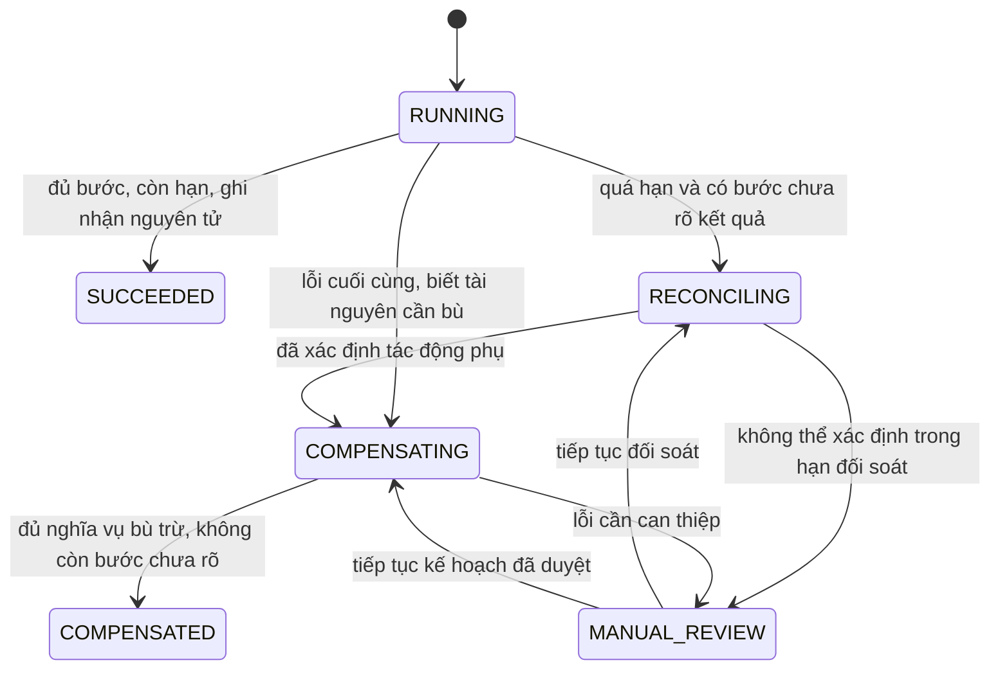
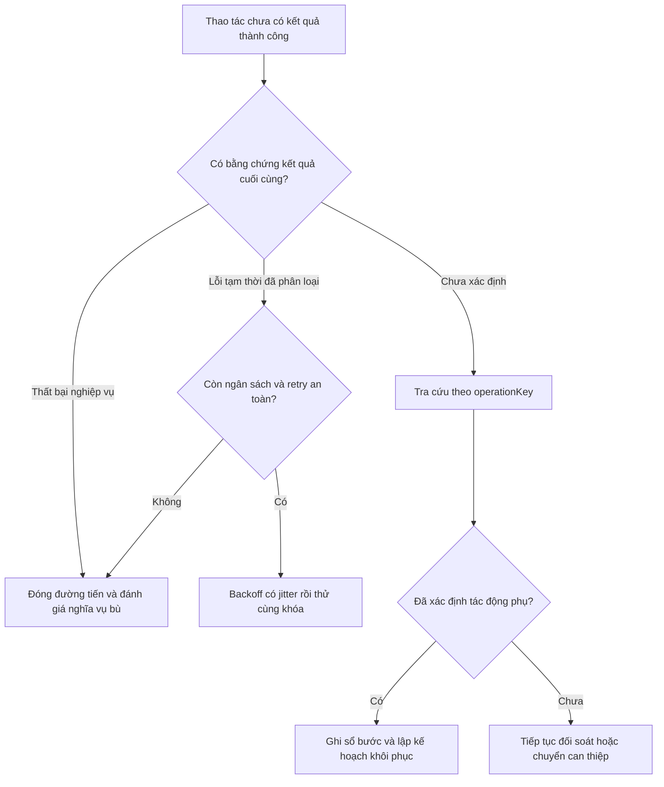

# Thiết kế timeout và compensation

Trong chương **Thiết kế flow** của **SPRING_INTEGRATION_CORE**, timeout và compensation giúp một luồng thông điệp có cách kết thúc rõ ràng khi thành phần xử lý chậm, phản hồi thất lạc hoặc một bước đã thay đổi dữ liệu nhưng bước sau thất bại. Bài học kết hợp `Message`, `MessageChannel`, endpoint, gateway, router, aggregator và Java DSL để thiết kế hành vi đó.

Điểm xuất phát là một phân biệt quan trọng: **hết thời gian chờ chỉ cho biết bên chờ chưa nhận được kết quả trong khoảng đã định**. Nó không chứng minh thao tác bên kia thất bại, chưa tạo tác động phụ hay đã bị hủy. Compensation là hành động nghiệp vụ nhằm xử lý những tác động phụ đã xảy ra; việc này cần trạng thái, bằng chứng và chính sách riêng.

Sau bài học, bạn có thể:

- Phân biệt timeout gửi thông điệp, chờ phản hồi, gọi dịch vụ ngoài, chờ nhóm và deadline nghiệp vụ.
- Phân bổ ngân sách thời gian cho flow, truyền deadline qua message và giới hạn retry.
- Thiết kế đường đi cho timeout, lỗi kỹ thuật, phản hồi muộn và kết quả chưa xác định.
- Xây dựng kế hoạch compensation có idempotency, lưu tiến độ và khôi phục sau restart.
- Đề xuất kiểm thử cho tình huống timeout chạy đua với thành công, thay vì chỉ kiểm thử đường thành công.

Các đoạn cấu hình minh họa sử dụng Java 17 trở lên và API Spring Integration 6.5. Chúng là những phần ghép để giải thích thiết kế, không phải một ứng dụng hoàn chỉnh. Các lớp nghiệp vụ và cổng lưu trữ được nêu rõ ở từng ví dụ. Giá trị timeout được cấu hình tường minh, không dựa vào giá trị mặc định giữa các phiên bản.

## 1. Một flow đặt hàng có thể thất bại như thế nào?

Xét flow tuần tự:

```text
Nhận yêu cầu
  -> giữ tồn kho
  -> cấp phép thanh toán
  -> đặt vận chuyển
  -> xác nhận đơn
```

Giả sử tồn kho đã được giữ, nhưng dịch vụ thanh toán không trả lời trong thời gian cho phép. Có ít nhất ba khả năng:

1. Yêu cầu thanh toán chưa đến dịch vụ đích.
2. Dịch vụ đích đang xử lý và sẽ trả lời muộn.
3. Dịch vụ đích đã cấp phép thành công, nhưng phản hồi bị mất.

Nếu lập tức gửi lại bằng một khóa thao tác mới, hệ thống có thể tạo hai lần cấp phép. Nếu giải phóng tồn kho rồi bỏ qua mọi phản hồi muộn, hệ thống có thể giữ một khoản cấp phép mà không còn đơn hàng tương ứng.

Vì vậy, thiết kế phải trả lời hai câu hỏi độc lập:

| Câu hỏi | Cơ chế cần có |
|---|---|
| Khi nào ngừng chờ hoặc ngừng bắt đầu công việc mới? | Timeout, deadline, giới hạn hàng đợi và giới hạn tài nguyên |
| Xử lý tác động phụ đã xảy ra hoặc có thể đã xảy ra như thế nào? | Sổ theo dõi bước, đối soát, idempotency và compensation |

Một lỗi timeout có thể dẫn đến đối soát trước khi bù trừ. Một lỗi nghiệp vụ chắc chắn, chẳng hạn không còn tồn kho trước khi giữ hàng thành công, có thể kết thúc mà không cần compensation nào.

## 2. Xác định timeout đang bảo vệ điều gì

### 2.1. Các tầng timeout

| Tầng | Ý nghĩa | Điều không được suy ra |
|---|---|---|
| Gateway `requestTimeout` | Giới hạn việc gửi vào channel có thể chặn, ví dụ `QueueChannel` có dung lượng hữu hạn đang đầy | Không giới hạn thời gian chạy của một handler đồng bộ |
| Gateway `replyTimeout` | Giới hạn thời gian gateway chờ phản hồi sau khi lời gọi gửi trả quyền điều khiển | Không tự hủy công việc đã được chuyển đi |
| Timeout của HTTP client hoặc client khác | Giới hạn một giai đoạn như lấy kết nối, kết nối hoặc đọc phản hồi | Không đảm bảo dịch vụ từ xa chưa ghi dữ liệu |
| Timeout nhận của poller | Giới hạn một lần đợi nhận từ nguồn hoặc channel hỗ trợ nhận | Không phải deadline xử lý toàn bộ message |
| Aggregator group timeout | Lập lịch buộc nhóm đang tồn tại được xét hoàn tất hoặc loại bỏ | Không theo dõi được yêu cầu chưa tạo ra nhóm nào |
| Deadline nghiệp vụ | Thời điểm sau đó flow không được tiếp tục hoàn tất theo đường thành công của chính sách đã chọn | Không tự tạo cơ chế ngắt thread hay hoàn tác dữ liệu |
| Timeout của tác vụ compensation | Giới hạn một lần gọi bù trừ hoặc một giai đoạn khôi phục | Không thể dùng nguyên deadline đã hết của công việc ban đầu |

Với gateway, `requestTimeout` chỉ có tác dụng giới hạn chờ gửi khi channel thực sự có thể chặn. `replyTimeout` và timeout của remote client bảo vệ những đoạn khác nhau. Đặc biệt, thuộc tính timeout của một outbound gateway cần được đọc theo adapter cụ thể; tên thuộc tính có chữ “reply” không đủ để kết luận đó là timeout đọc socket. Xem [Gateway Timeouts](https://docs.spring.io/spring-integration/reference/6.5/gateway.html#gateway-timeouts) và [HTTP Timeout Handling](https://docs.spring.io/spring-integration/reference/http/timeout.html).

### 2.2. Ranh giới đồng bộ quyết định hiệu lực của timeout

```text
Caller -> Gateway -> DirectChannel -> Handler chặn 10 giây
```

`DirectChannel` gọi subscriber trên thread gửi. Nếu handler chưa trả về, caller vẫn đang ở trong quá trình gửi. Đặt `replyTimeout = 1000` không biến lời gọi handler đó thành công việc bị ngắt sau một giây. Đặc tính thread của các channel được mô tả trong [Message Channel Implementations](https://docs.spring.io/spring-integration/reference/channel/implementations.html).

Với một ranh giới bất đồng bộ:

```text
Caller -> Gateway -> QueueChannel -> Poller -> Handler
                  <- chờ reply
```

Caller có thể dừng chờ trong khi poller hoặc handler vẫn tiếp tục. Điều này làm giới hạn chờ hữu ích hơn, nhưng đồng thời tạo ra yêu cầu xử lý phản hồi muộn và công việc tồn đọng. Chuyển sang `ExecutorChannel` cũng phải tính đến executor, dung lượng hàng đợi và chính sách từ chối; không được mặc định mọi lời gọi đều đã tách khỏi thread gửi trong mọi cấu hình.

Một timeout an toàn cần đi cùng giới hạn số tác vụ đang chạy. Nếu chỉ trả timeout cho caller mà tiếp tục nhận vô hạn công việc, hệ thống vẫn có thể cạn thread, kết nối hoặc bộ nhớ.

## 3. Thiết kế ngân sách thời gian từ ngoài vào trong

### 3.1. Bắt đầu bằng hợp đồng nghiệp vụ

Giả sử yêu cầu đặt hàng có deadline hai giây kể từ lúc hệ thống chấp nhận. Một ngân sách thiết kế ban đầu có thể là:

| Hạng mục | Ngân sách minh họa |
|---|---:|
| Chờ điều phối ban đầu | 100 ms |
| Giữ tồn kho | 400 ms |
| Cấp phép thanh toán, gồm retry nếu đủ điều kiện | 650 ms |
| Đặt vận chuyển | 350 ms |
| Ghi nhận và hoàn tất kết quả | 150 ms |
| Dự phòng cho điều phối và biến động | 350 ms |
| Tổng | 2.000 ms |

Đây là giả định cho bài tập, cần hiệu chỉnh theo số liệu độ trễ, tải và hợp đồng của hệ thống thực tế. Với các nhánh chạy song song, thời gian trên đường đi quan trọng nhất quyết định độ trễ tổng; số nhánh vẫn ảnh hưởng đến tài nguyên sử dụng và số tác động phụ cần quản lý.

Ngân sách của một bước bao gồm các thành phần có liên quan:

```text
thời gian chờ tài nguyên
  + tổng thời gian các lần thử
  + tổng backoff
  + thời gian điều phối/ghi nhận
  <= ngân sách bước
```

Ví dụ, hai lần thử thanh toán tối đa 250 ms và một backoff 50 ms tiêu thụ đến 550 ms, chưa tính ghi nhận. Bước không được tiếp tục retry chỉ vì còn số lần thử nếu deadline tổng không còn đủ thời gian.

### 3.2. Truyền deadline tuyệt đối

Một hợp đồng message có thể sử dụng các header do ứng dụng định nghĩa:

| Header | Mục đích |
|---|---|
| `sagaId` | Định danh một lần thực thi flow nghiệp vụ |
| `deadlineEpochMs` | Deadline tuyệt đối theo epoch milliseconds |
| `operationKey` | Khóa idempotency của một thao tác cụ thể |
| `attempt` | Số lần thử để quan sát, không dùng làm khóa chống trùng |
| `causationId` | Liên kết sự kiện hoặc lệnh gây ra message hiện tại |

`MessageHeaders.ID` định danh message của framework, không thay thế khóa nghiệp vụ ổn định qua retry. Cùng một thao tác được giao lại vẫn phải mang cùng `operationKey`.

Tại cổng vào, kiểm tra và giới hạn deadline được gửi từ client theo chính sách máy chủ. Tại ranh giới broker hoặc HTTP, ánh xạ rõ các header cần truyền sang thuộc tính hoặc trường dữ liệu được hỗ trợ. Không giả định mọi header Java đều được tuần tự hóa tự động.

Ví dụ hàm tính timeout trước một lần gọi:

```java
import java.time.Clock;
import java.time.Duration;
import java.util.concurrent.TimeoutException;

public final class DeadlineBudget {
    private DeadlineBudget() {
    }

    public static Duration nextAttemptTimeout(
            long deadlineEpochMs,
            Duration perAttemptLimit,
            Duration reserveAfterCall,
            Clock clock) throws TimeoutException {

        long capMs = perAttemptLimit.toMillis();
        long reserveMs = reserveAfterCall.toMillis();
        if (capMs <= 0 || reserveMs < 0) {
            throw new IllegalArgumentException("Invalid timeout budget");
        }

        long usableMs = deadlineEpochMs - clock.millis() - reserveMs;
        if (usableMs <= 0) {
            throw new TimeoutException("No time left for another attempt");
        }

        return Duration.ofMillis(Math.min(capMs, usableMs));
    }
}
```

Ví dụ này giả định epoch và duration đầu vào đã được kiểm tra miền giá trị tại ingress. `reserveAfterCall` dành thời gian cho ghi nhận và các bước còn lại theo chính sách điều phối, không phải một con số luôn bằng nhau ở mọi bước.

Giá trị trả về phải được áp vào API timeout phù hợp của client. Nếu client có nhiều timeout độc lập cho pool, connect và read, đặt mỗi giá trị bằng toàn bộ ngân sách còn lại có thể khiến tổng thời gian vượt giới hạn. Cần một giới hạn bao trùm lần gọi hoặc một cách phân bổ giữa các giai đoạn, cùng việc kiểm tra deadline sau khi gọi trả về.

Không biến thời gian còn lại âm thành `0` rồi truyền xuống thư viện mà chưa kiểm tra ý nghĩa: ở một số API, `0` có thể được hiểu là không giới hạn thời gian chờ.

Deadline tuyệt đối giữa các máy cần đồng hồ được đồng bộ và có dự phòng sai lệch. Đo thời gian trôi qua bên trong một tiến trình có thể dùng đồng hồ đơn điệu như `System.nanoTime()`; không truyền giá trị đó sang máy khác như một thời điểm tuyệt đối.

### 3.3. Không cấp lại deadline khi message đi qua mỗi endpoint

Nếu mỗi handler đều đặt lại `deadline = now + 2 giây`, một message có thể sống lâu hơn nhiều so với cam kết ban đầu. Giữ nguyên deadline của công việc gốc qua transformer, router và retry; tính lại ngân sách còn lại ngay trước lần gọi mới.

Kiểm tra deadline ở đầu bước giúp tránh bắt đầu việc đã quá hạn. Kiểm tra khi ghi nhận kết quả giúp ngăn một lời gọi trả về muộn làm flow thành công trái chính sách. Hai lần kiểm tra phục vụ hai mục đích khác nhau.

Một khi cần khôi phục, tạo lệnh compensation có deadline và lịch retry riêng, đồng thời giữ `originalDeadlineEpochMs` để truy vết. Hạn xử lý yêu cầu khách hàng không được ngăn hệ thống giải phóng tài nguyên còn đang giữ.

## 4. Gateway: giới hạn thời gian caller chờ

### 4.1. Một cấu hình có ranh giới bất đồng bộ

Ví dụ sau dùng `QueueChannel` có dung lượng hữu hạn. `OrderWorker` là cổng nghiệp vụ do ứng dụng triển khai; phương thức `execute` phải ghi nhận kết quả nghiệp vụ trước khi trả reply.

```java
import java.util.Map;
import org.springframework.messaging.Message;

public record PlaceOrder(String orderId, int quantity) {
}

public record OrderReply(String orderId, String status) {
}

public interface OrderWorker {
    OrderReply execute(PlaceOrder command, Map<String, Object> headers);
}
```

Các kiểu `public` được đặt trong những tệp Java riêng khi triển khai. Gateway nhận một `Message` để caller có thể cung cấp header nghiệp vụ:

```java
import org.springframework.integration.annotation.MessagingGateway;
import org.springframework.messaging.Message;

@MessagingGateway(
    defaultRequestChannel = "orderRequests",
    defaultRequestTimeout = "50",
    defaultReplyTimeout = "1000"
)
public interface OrderGateway {
    Message<OrderReply> place(Message<PlaceOrder> request);
}
```

Cấu hình Java DSL:

```java
import org.springframework.context.annotation.Bean;
import org.springframework.context.annotation.Configuration;
import org.springframework.integration.channel.QueueChannel;
import org.springframework.integration.config.EnableIntegration;
import org.springframework.integration.annotation.IntegrationComponentScan;
import org.springframework.integration.dsl.IntegrationFlow;
import org.springframework.integration.dsl.Pollers;

@Configuration
@EnableIntegration
@IntegrationComponentScan(basePackageClasses = OrderGateway.class)
public class OrderFlowConfiguration {

    @Bean
    QueueChannel orderRequests() {
        return new QueueChannel(100);
    }

    @Bean
    IntegrationFlow orderFlow(
            QueueChannel orderRequests,
            OrderWorker worker) {

        return IntegrationFlow.from(orderRequests)
            .handle(PlaceOrder.class,
                (command, headers) -> worker.execute(command, headers),
                endpoint -> endpoint
                    .requiresReply(true)
                    .poller(Pollers.fixedDelay(10)
                        .maxMessagesPerPoll(10)))
            .get();
    }
}
```

Trong ví dụ, `50` ms là thời gian chờ gửi khi hàng đợi đầy; `1000` ms là thời gian chờ reply của caller. Hai khoảng này không phải một cam kết tổng cộng đúng một giây. `requiresReply(true)` giúp phát hiện handler trả `null` ngoài hợp đồng, không biến gateway timeout thành sự kiện nghiệp vụ hay hủy tác vụ đang chạy.

Lời gọi minh họa:

```java
Message<PlaceOrder> request = MessageBuilder
    .withPayload(new PlaceOrder("ORDER-42", 2))
    .setHeader("sagaId", sagaId)
    .setHeader("deadlineEpochMs", clock.millis() + 2_000L)
    .setHeader("operationKey", "ORDER-42:create:v1")
    .build();

Message<OrderReply> reply = orderGateway.place(request);

if (reply == null) {
    // Không nhận được reply trong cửa sổ chờ.
    // Tra cứu trạng thái bền theo sagaId/orderId trước khi kết luận kết quả.
}
```

Đoạn gọi sử dụng `MessageBuilder` từ `org.springframework.messaging.support`; `clock`, `sagaId` và `orderGateway` được cung cấp bởi lớp gọi. Với hợp đồng gateway này, hết thời gian chờ reply có thể trả `null`; lỗi gửi hoặc lỗi xử lý có thể đi theo đường exception. Không gom tất cả các trường hợp thành “đơn hàng chắc chắn chưa được tạo”.

Quy tắc về thời điểm bắt đầu chờ reply và ảnh hưởng của flow đồng bộ được giải thích trong [Messaging Gateways](https://docs.spring.io/spring-integration/reference/6.5/gateway.html).

### 4.2. Caller timeout khác với deadline nghiệp vụ

Với caller chờ một giây nhưng nghiệp vụ có deadline hai giây, flow có thể hoàn tất hợp lệ trong giây thứ hai. API có thể trả trạng thái đang xử lý cùng mã tra cứu, nếu hợp đồng sản phẩm hỗ trợ. Chỉ kích hoạt hủy vì caller ngừng chờ khi nghiệp vụ đã quy định rõ chính sách đó và yêu cầu hủy được ghi nhận đáng tin cậy.

Phải lưu kết quả nghiệp vụ trước khi gửi reply về gateway. Temporary reply channel phục vụ phiên chờ hiện tại, không phải nơi lưu kết quả dài hạn. Nếu một reply đến muộn không còn người nhận hoặc gây lỗi chuyển phát, thông tin đơn hàng và tài nguyên đã tạo vẫn phải tồn tại trong kho trạng thái.

`QueueChannel(100)` ở trên sử dụng hàng đợi trong bộ nhớ theo cấu hình minh họa. Khi cần cam kết “đã chấp nhận” tồn tại qua restart, phải có persistence thích hợp trước khi xác nhận chấp nhận, chẳng hạn một bản ghi công việc và outbox trong cùng giao dịch cục bộ. Đừng suy ra tính bền vững chỉ từ việc gửi vào channel thành công.

## 5. Mô hình hóa trạng thái trước khi viết compensation handler

### 5.1. Trạng thái flow và trạng thái bước

Một mô hình tham khảo:



Đây là trạng thái của ứng dụng, không phải enum có sẵn của Spring Integration. Cần thêm đường thất bại không có tác động phụ nếu miền nghiệp vụ cần, thay vì buộc mọi lỗi đi qua compensation.

Trạng thái từng bước nên biểu diễn được ít nhất:

```text
NOT_STARTED
REQUESTED
CONFIRMED_SUCCESS
CONFIRMED_FAILURE
OUTCOME_UNKNOWN
COMPENSATION_PENDING
COMPENSATED
```

Một bước bị read timeout sau khi gửi yêu cầu thường cần được xem là `OUTCOME_UNKNOWN`. Chỉ ghi `CONFIRMED_FAILURE` khi có bằng chứng phù hợp với hợp đồng phía đích. Cũng cần ghi `operationKey`, định danh tài nguyên phía đích, thời điểm, số lần thử và phiên bản bản ghi.

### 5.2. Timeout và thành công có thể chạy đua

Hai thread có thể cùng nhìn thấy `RUNNING`: thread A nhận kết quả cuối cùng, thread B xử lý sự kiện deadline. Nếu cả hai đều thực hiện tác động tiếp theo chỉ dựa trên lần đọc cũ, hệ thống có thể vừa xác nhận vừa hủy đơn.

Quyền quyết định phải được phân xử bằng thao tác nguyên tử trên trạng thái bền. Ví dụ SQL minh họa cho nhánh timeout:

```sql
BEGIN;

UPDATE saga_instance
SET state = 'RECONCILING', version = version + 1
WHERE saga_id = :saga_id
  AND state = 'RUNNING'
  AND version = :expected_version
  AND deadline_epoch_ms <= :decision_time_ms;

-- Chỉ khi UPDATE thay đổi đúng một dòng:
-- INSERT một lệnh đối soát vào outbox, dùng khóa chống trùng ổn định.

COMMIT;
```

`:decision_time_ms` phải lấy theo nguồn thời gian đã chọn cho việc phân xử. Nhánh thành công cũng phải dùng điều kiện phiên bản/trạng thái, xác nhận đầy đủ các bước cần thiết và kiểm tra deadline theo cùng chính sách. Không dựa riêng vào một timer chạy đúng giờ: scheduler có thể trễ.

Nếu cập nhật được không dòng nào, đọc lại và xử lý theo trạng thái hiện tại. Có thể một thread khác đã thắng hoặc phiên bản đã thay đổi vì một sự kiện bước mới; điều đó không tự động có nghĩa là công việc đã hoàn tất. Khi cần, tính lại quyết định và thử chuyển trạng thái có điều kiện.

### 5.3. Không bỏ mất bằng chứng của phản hồi muộn

Phản hồi muộn của một bước phải được ghi nhận vào sổ theo dõi bằng cơ chế chống trùng trước khi bị chặn khỏi đường thành công. Chính sách tham khảo:

| Trạng thái hiện tại | Nhận thành công muộn của một bước |
|---|---|
| `RUNNING`, còn hạn | Ghi nhận bước, xét tiếp điều kiện thành công |
| `RUNNING`, đã quá hạn | Ghi nhận tác động phụ và kích hoạt quyết định hết hạn |
| `RECONCILING` | Bổ sung bằng chứng, xác định nghĩa vụ bù trừ |
| `COMPENSATING` | Bổ sung hoặc hoàn thiện kế hoạch bù trừ cho tài nguyên vừa xác nhận |
| `COMPENSATED` | Kiểm tra bất biến; nếu là tài nguyên mới chưa được bù, mở lại xử lý khôi phục theo chính sách |
| `SUCCEEDED` | Chống trùng; nếu xuất hiện tài nguyên ngoài dự kiến, đưa sang xử lý bất thường |

Một filter có thể ngăn message quá hạn đi tiếp sang endpoint xác nhận. Tuy nhiên, đặt filter trước nơi lưu bằng chứng tác động phụ có thể làm mất chính thông tin cần để compensation. Thứ tự an toàn là **ghi nhận bằng chứng → đọc/quyết định trạng thái → chọn đường đi**.

## 6. Compensation là hành động nghiệp vụ có hợp đồng riêng

### 6.1. Phân biệt với rollback của giao dịch cục bộ

Rollback phù hợp với thay đổi nằm trong cùng giao dịch được quản lý. Một lời gọi dịch vụ khác đã commit không tự bị hoàn tác khi transaction của ứng dụng hiện tại rollback. Khi flow đổi thread qua queue hoặc executor, cũng không được giả định transaction gắn với thread ban đầu tiếp tục bao phủ phần xử lý sau. Xem [Transaction Support và Transaction Boundaries](https://docs.spring.io/spring-integration/reference/transactions.html).

Compensation là thao tác mới để đưa nghiệp vụ về trạng thái chấp nhận được. Nó có thể không tái tạo chính xác ảnh chụp dữ liệu ban đầu. Ví dụ:

| Bước đã thành công | Bằng chứng phải lưu | Hành động bù trừ tham khảo |
|---|---|---|
| Giữ tồn kho | `reservationId`, số lượng, khóa thao tác | Giải phóng đúng reservation |
| Cấp phép thanh toán, chưa capture | `authorizationId`, trạng thái phía cung cấp | Void/hủy cấp phép theo API của nhà cung cấp |
| Đã capture thanh toán | `captureId`, số tiền và trạng thái đã ghi nhận | Quy trình refund theo chính sách nghiệp vụ |
| Tạo booking vận chuyển | `shipmentId`, giai đoạn vận chuyển | Hủy nếu còn cho phép, hoặc chuyển quy trình xử lý phù hợp |
| Gửi thông báo xác nhận | Định danh thông báo và ngữ cảnh | Thông báo đính chính nếu cần; không thể thu hồi việc người nhận đã đọc |

Các dòng trên là mô hình kỹ thuật, không thay thế hợp đồng thực tế của từng dịch vụ. Đặc biệt, không gọi void và refund như hai thao tác tương đương.

### 6.2. Bù theo tài nguyên, không gán lại giá trị cũ

Giả sử trước khi đặt hàng tồn kho là 10, sau giữ hàng còn 8, rồi một đơn khác giữ thêm 3. Compensation của đơn đầu không được ghi tồn kho trở lại 10: thao tác đó sẽ xóa ảnh hưởng của đơn thứ hai. Hãy giải phóng reservation của chính đơn đầu để dịch vụ tồn kho điều chỉnh tài nguyên theo quy tắc của nó.

Tương tự, không bù trừ bằng cách xóa mọi dữ liệu có cùng `orderId` nếu các lần thực thi hoặc tài nguyên khác nhau chưa được phân biệt. `sagaId`, `operationKey` và định danh tài nguyên phía đích phải cho phép xác định đúng nghĩa vụ.

### 6.3. Thứ tự bù phụ thuộc quan hệ nghiệp vụ

Đảo thứ tự các bước đã hoàn tất là điểm bắt đầu dễ hiểu. Tuy nhiên, kế hoạch thực tế có thể ưu tiên giải phóng một tài nguyên nhạy cảm trước, hoặc bù song song các tài nguyên độc lập. Phải biểu diễn các ràng buộc đó trong kế hoạch thay vì luôn gọi một danh sách ngược cố định.

Compensation cũng có thể thất bại, cần lưu tiến độ và có thể chạy lại. Mỗi hành động nên có tính idempotent theo hợp đồng phía đích; trường hợp không thể tự khôi phục cần lưu đủ thông tin để xử lý tiếp. Những đặc điểm này được mô tả trong [Compensating Transaction pattern](https://learn.microsoft.com/en-us/azure/architecture/patterns/compensating-transaction).

### 6.4. Thiết kế idempotency cho cả hai chiều

Ví dụ quy ước khóa:

```text
Chiều tiến: saga-42:authorize-payment:v1
Chiều bù:   saga-42:void-authorization:AUTH-9:v1
```

Các lần retry cùng một thao tác giữ nguyên khóa. Một lần thử lại nghiệp vụ mới cần định danh lần thực thi mới, có kiểm soát đối với lần cũ. `attempt=2` giúp quan sát nhưng không được làm phát sinh khóa thao tác mới.

Idempotency phải bao gồm việc gắn khóa với tác động phụ và kết quả một cách nguyên tử ở nơi thực hiện. Một bộ nhớ cache chống trùng trong coordinator không thể tự bảo đảm dịch vụ ngoài chỉ thực hiện một lần nếu dịch vụ đó không hỗ trợ hợp đồng tương ứng.

Nếu bù theo một tài nguyên chưa tạo xong, cần đặc biệt chú ý cuộc đua “hủy trước, tạo sau”. Một phản hồi “không tìm thấy reservation” chưa đủ chứng minh reservation sẽ không xuất hiện sau đó. Các cách xử lý gồm đối soát cho tới khi thao tác gốc có kết quả xác định, hoặc dùng hợp đồng hủy theo khóa thao tác có khả năng chặn việc tạo muộn. Không đánh dấu `COMPENSATED` khi vẫn còn tác động phụ chưa thể xác định.

## 7. Lưu kế hoạch và phát lệnh compensation đáng tin cậy

### 7.1. Dữ liệu tối thiểu

Một mô hình lưu trữ tham khảo gồm:

| Thành phần | Nội dung chính |
|---|---|
| `saga_instance` | Trạng thái flow, deadline, version, chính sách kết thúc |
| `saga_step` | Khóa bước, kết quả đã xác nhận/chưa rõ, resource ID |
| `compensation_task` | Khóa hành động bù, phụ thuộc, trạng thái, `nextAttemptAt`, số lần thử |
| `event_inbox` | Khóa sự kiện đã xử lý để chống giao lại |
| `outbox_event` | Lệnh/sự kiện chờ phát ra sau quyết định đã commit |

Khi nhận một sự kiện, một giao dịch cục bộ có thể kiểm tra inbox, ghi bằng chứng, chuyển trạng thái có điều kiện và thêm outbox. Các ràng buộc duy nhất trên khóa sự kiện và khóa hành động giúp nhiều lần giao không tạo nhiều nghĩa vụ bù trừ giống nhau.

Các tên bảng là mô hình do bài học đề xuất, không phải schema bắt buộc của Spring Integration.

### 7.2. Cửa sổ lỗi cần đóng

```text
Ghi COMPENSATING thành công
  -> tiến trình chết
  -> chưa gửi lệnh giải phóng tồn kho
```

Nếu chỉ làm hai lệnh rời rạc, tài nguyên có thể bị giữ mãi. Ghi thay đổi trạng thái và lệnh outbox trong cùng transaction cục bộ giúp publisher gửi tiếp sau restart.

Outbox publisher có thể gửi thành công rồi chết trước khi đánh dấu đã gửi, nên consumer vẫn phải chấp nhận giao lại. Tương tự, compensation worker có thể đã giải phóng tài nguyên nhưng chết trước khi ghi `COMPENSATED`; lần gọi lại cùng khóa phải có kết quả an toàn hoặc được đối soát.

Outbox không đóng được mọi cửa sổ lỗi xuyên dịch vụ. Với tình huống remote đã thực hiện nhưng kết quả chưa về, vẫn phải truy vấn theo `operationKey`, nhận sự kiện xác nhận hoặc dùng giao thức được dịch vụ đích cung cấp.

### 7.3. Timer cũng cần khôi phục

Không dùng duy nhất một tác vụ `schedule()` trong bộ nhớ làm nguồn duy nhất cho deadline quan trọng. Khi khởi động lại, coordinator cần quét hoặc khôi phục các saga còn hoạt động và các compensation task đến hạn. Nhiều instance cùng phát hiện một deadline phải đi qua cùng cơ chế phân xử trạng thái.

Đường xử lý deadline nên chỉ quyết định và ghi lệnh ngắn gọn. Không để thread scheduler trực tiếp thực hiện hàng loạt lời gọi mạng bù trừ kéo dài, khiến deadline của các saga khác bị trễ.

### 7.4. Dùng router để tách hành động bù

Ví dụ hợp đồng lệnh:

```java
public enum CompensationAction {
    RELEASE_INVENTORY,
    VOID_PAYMENT,
    CANCEL_SHIPMENT
}

public record CompensationCommand(
    String sagaId,
    String taskId,
    CompensationAction action,
    String resourceId,
    String operationKey,
    long compensationDeadlineEpochMs
) {
}
```

Router Java DSL có thể phân loại lệnh đã được publisher nạp từ outbox:

```java
@Bean
IntegrationFlow compensationRouter() {
    return IntegrationFlow.from("compensationCommands")
        .route(CompensationCommand.class,
            command -> command.action().name(),
            routes -> routes
                .channelMapping("RELEASE_INVENTORY", "inventoryCompensation")
                .channelMapping("VOID_PAYMENT", "paymentCompensation")
                .channelMapping("CANCEL_SHIPMENT", "shipmentCompensation"))
        .get();
}
```

Ứng dụng phải cung cấp consumer cho ba channel đích và cơ chế nạp/phát lại lệnh. Router này chỉ chọn đường đi; nó không tạo outbox, transaction, retry hay kho trạng thái. Mỗi consumer cần nhận quyền xử lý task một cách có điều kiện, gọi dịch vụ với khóa ổn định rồi lưu kết quả hoặc lịch retry.

Không chỉ lấy lệnh khỏi hàng đợi trong bộ nhớ rồi coi như đã xong. Nếu tiến trình chết trong lúc xử lý, bản ghi task chưa hoàn tất phải đủ để giao lại. Việc chọn adapter hoặc message store bền thuộc thiết kế triển khai của ứng dụng.

## 8. Aggregator timeout trong flow có nhiều nhánh

### 8.1. Nhóm thông điệp không phải toàn bộ trạng thái nghiệp vụ

Giả sử flow chạy ba nhánh và đợi phản hồi từ `INVENTORY`, `PAYMENT`, `SHIPMENT`. Không dùng điều kiện “đã có ba message” nếu có thể nhận lặp một nhánh. Hãy phát hiện đủ ba loại phản hồi phân biệt và kiểm tra trạng thái nghiệp vụ của từng nhánh trước khi xác nhận thành công.

Ví dụ payload:

```java
public enum Branch {
    INVENTORY, PAYMENT, SHIPMENT
}

public record BranchReply(Branch branch, String resourceId, boolean success) {
}
```

Flow minh họa dưới đây giả định mọi message đã được xác thực, ghi nhận vào inbox/sổ bước và đều có `sagaId`, `deadlineEpochMs` hợp lệ trước khi vào `branchReplies`:

```java
import java.util.Date;
import java.util.Set;
import java.util.stream.Collectors;

@Bean
IntegrationFlow branchAggregation() {
    Set<Branch> expected = Set.of(
        Branch.INVENTORY, Branch.PAYMENT, Branch.SHIPMENT);

    return IntegrationFlow.from("branchReplies")
        .aggregate(spec -> spec
            .correlationStrategy(message ->
                message.getHeaders().get("sagaId"))
            .releaseStrategy(group -> group.getMessages().stream()
                .map(message -> ((BranchReply) message.getPayload()).branch())
                .collect(Collectors.toSet())
                .containsAll(expected))
            .groupTimeout(group -> new Date(
                group.getMessages().stream()
                    .mapToLong(message -> (Long) message.getHeaders()
                        .get("deadlineEpochMs"))
                    .min()
                    .orElseThrow()))
            .sendPartialResultOnExpiry(false)
            .expireGroupsUponCompletion(true)
            .expireGroupsUponTimeout(true)
            .discardChannel("expiredBranchReplies"))
        .channel("completeBranchGroups")
        .get();
}
```

`groupTimeout(Function<MessageGroup, ?>)` chấp nhận kết quả kiểu `Date` trong API đang dùng. Trả về một thời điểm tuyệt đối tránh việc mỗi message mới lại cấp thêm trọn một khoảng chờ. Các tùy chọn này được mô tả trong [CorrelationHandlerSpec 6.5](https://docs.spring.io/spring-integration/docs/6.5.0/api/org/springframework/integration/dsl/CorrelationHandlerSpec.html).

`completeBranchGroups` có nghĩa **đủ loại phản hồi**, chưa có nghĩa mọi bước thành công. Consumer phải kiểm tra payload, deadline và trạng thái saga bền trước khi chuyển `SUCCEEDED`. Một phản hồi thất bại rõ ràng cũng có thể được đưa vào đường quyết định sớm hơn, không cần đợi đủ các nhánh mới bắt đầu khôi phục.

### 8.2. Hiểu chính xác hành vi khi nhóm hết hạn

Group timeout lập lịch xét buộc hoàn tất. Khi đến hạn, release strategy được kiểm tra lại; nếu vẫn chưa đủ điều kiện, cấu hình quyết định phát kết quả một phần hoặc đưa message sang discard. Khoảng timeout tương đối được tính lại theo message đến, còn biểu thức trả `Date` chỉ định thời điểm tuyệt đối. Xem [Aggregator and Group Timeout](https://docs.spring.io/spring-integration/reference/6.5/aggregator.html#agg-and-group-to).

Trong ví dụ:

- Không phát nhóm thiếu như một kết quả thành công bình thường.
- `expiredBranchReplies` cần consumer biến bằng chứng hết hạn thành yêu cầu đánh giá saga; không mặc định mỗi message discard là một saga khác nhau.
- Với cách discard từng message, nhiều message của cùng nhóm có thể cùng kích hoạt đánh giá. Chuyển trạng thái có điều kiện phải chống việc tạo trùng kế hoạch bù.
- Hai tùy chọn `expireGroupsUpon...` được đặt `true` để xóa nhóm sau hoàn tất/hết hạn. Reply đến muộn có thể tạo nhóm mới; lớp trạng thái nghiệp vụ và inbox phải kiểm soát điều đó.

Một nhóm có thể được scheduler xử lý chậm hơn deadline. Một message cuối đến sau deadline nhưng trước tác vụ timer vẫn có thể làm release strategy đủ điều kiện. Vì thế deadline phải được kiểm tra tại điểm quyết định nghiệp vụ, không chỉ trong cấu hình scheduler.

### 8.3. Trường hợp không có phản hồi nào

Nếu cả ba nhánh đều im lặng thì aggregator chưa có message, chưa có group và không có group timeout tương ứng để cứu flow. Coordinator vẫn phải theo dõi deadline của saga từ lúc chấp nhận công việc, độc lập với việc có reply đầu tiên hay chưa.

Một lựa chọn khác là thiết kế thông điệp mở nhóm riêng, nhưng khi đó phải định nghĩa lại release strategy và output processor để thông điệp điều khiển không bị tính như một kết quả nghiệp vụ. Không thêm một message giả rồi tiếp tục dùng điều kiện đếm cũ.

Aggregator mặc định trong ví dụ không cấu hình kho nhóm bền. Khi cần khôi phục nhóm qua restart, phải chọn `MessageGroupStore`, cơ chế khóa khi nhiều instance cùng xử lý và cách khôi phục lịch hết hạn phù hợp. Sổ trạng thái saga vẫn có vai trò quyết định cuối cùng.

## 9. Đường lỗi và đường timeout phải có ý nghĩa riêng

### 9.1. Không quy mọi lỗi về một channel hủy chung

Phân biệt ít nhất các nhóm sau:

| Loại sự kiện | Ví dụ | Hướng xử lý |
|---|---|---|
| Lỗi nghiệp vụ xác định | Tồn kho không đủ, chưa giữ hàng | Kết thúc theo hợp đồng hoặc bù các bước khác đã thành công |
| Lỗi tạm thời | Kết nối chưa thiết lập, có thể thử lại an toàn | Retry nếu còn ngân sách và thỏa idempotency |
| Kết quả chưa xác định | Read timeout sau khi yêu cầu đã được gửi | Đối soát theo operation key |
| Deadline nghiệp vụ | Không được bắt đầu/hoàn tất đường tiến nữa | Phân xử trạng thái rồi lập kế hoạch khôi phục |
| Caller ngừng chờ | Gateway chưa có reply sau 1 giây | Trả trạng thái phù hợp, tra cứu kết quả bền |
| Lỗi compensation | Dịch vụ giải phóng reservation tạm ngừng | Lưu tiến độ, retry riêng hoặc chuyển can thiệp |

Timeout do caller chờ hết không nhất thiết tạo một exception trên `errorChannel`. Tương tự, aggregator đưa message sang discard theo cấu hình không phải là một exception tự động.

### 9.2. ErrorMessage cung cấp nguyên nhân, không tự định nghĩa chính sách

Với flow đồng bộ, exception có thể quay về bên gọi. Với xử lý bất đồng bộ được framework hỗ trợ, lỗi thường được biểu diễn bằng `ErrorMessage` và gửi tới error channel thích hợp. Phạm vi xử lý phụ thuộc endpoint, scheduler và cấu hình error handler; không mặc định mọi executor tùy biến đều tự xuất bản lỗi. Xem [Error Handling](https://docs.spring.io/spring-integration/reference/error-handling.html).

Khi chuyển một lỗi kỹ thuật thành sự kiện nghiệp vụ:

1. Xác định exception và message thất bại nếu có.
2. Lấy khóa tương quan từ message gốc hoặc ngữ cảnh đã được lưu.
3. Phân loại kết quả đã biết/chưa biết, không chỉ dựa vào tên exception.
4. Ghi nhận sự kiện có khóa chống trùng.
5. Để coordinator đọc trạng thái và quyết định retry, đối soát hoặc compensation.

Không ép kiểu mọi `Throwable` thành `MessagingException`, cũng không giả định `getFailedMessage()` luôn khác `null`. Nếu thiếu khóa tương quan, cần một đường xử lý lỗi không tương quan để tìm nguyên nhân, thay vì phát lệnh hủy với định danh đoán được.

Lỗi của chính compensation đi về cơ chế quản lý task compensation. Nếu lại đưa nó vào một error flow luôn tạo kế hoạch compensation mới, hệ thống có thể tạo vòng lặp khôi phục không kết thúc.

## 10. Retry, đối soát và cancellation phối hợp thế nào?

### 10.1. Một cây quyết định tham khảo



Kết quả tra cứu “không thấy” chỉ đủ kết luận chưa thực hiện khi API đích có hợp đồng nhất quán và thời điểm quan sát thích hợp. Với một hệ thống có độ trễ cập nhật kết quả, cần tiếp tục đối soát theo chính sách thay vì lập tức tạo lại thao tác bằng khóa mới.

### 10.2. Cancellation là một yêu cầu hợp tác

Hủy `Future`, đặt cờ hủy hoặc đóng kết nối có thể giảm công việc còn chạy nếu thành phần đích hỗ trợ. Những thao tác này không chứng minh remote chưa commit. Nếu nghiệp vụ cần hủy chắc chắn, cần giao thức hủy ở mức ứng dụng, phản hồi xác nhận và quy tắc xử lý cuộc đua với hoàn tất.

Thiết kế các điểm kiểm tra trước bước tiếp theo giúp worker hợp tác với yêu cầu hủy. Các bước đã tạo tác động phụ vẫn phải xuất bản kết quả đã biết để coordinator ghi sổ và quyết định bù.

### 10.3. Compensation có chính sách retry riêng

Một kế hoạch có thể chọn timeout ngắn cho từng lần gọi giải phóng, backoff tăng dần có jitter và hạn khôi phục dài hơn deadline gốc. `nextAttemptAt` được lưu bền để tiến trình khác có thể tiếp tục sau restart.

Không đánh dấu task hoàn tất chỉ vì đã gửi lệnh. Chỉ hoàn tất khi có xác nhận đủ tin cậy hoặc kết quả đối soát theo hợp đồng. Khi vượt giới hạn tự xử lý, giữ nguyên nghĩa vụ chưa hoàn tất, lưu nguyên nhân và chuyển `MANUAL_REVIEW`; không đổi thành `COMPENSATED` để làm sạch hàng đợi.

## 11. Kiểm thử những bất biến của thiết kế

Các kiểm thử cần tập trung vào kết quả nghiệp vụ và khả năng phục hồi. Có thể dùng fake client, `Clock` kiểm soát được, latch/barrier và kho trạng thái thử nghiệm để tạo đúng điều kiện. Thay đổi `Clock` của ứng dụng không tự làm scheduler thật chạy; kiểm thử tích hợp phải điều khiển hoặc kích hoạt riêng nguồn sự kiện deadline.

| Tình huống | Điều cần xác minh |
|---|---|
| Mọi bước trả lời trước hạn | Chỉ một quyết định thành công; không tạo task bù |
| Queue đầy | Việc chờ gửi có giới hạn; hợp đồng caller phân biệt chưa biết/chưa chấp nhận theo bằng chứng |
| Handler đồng bộ chạy chậm | Không khẳng định `replyTimeout` cắt được handler; giới hạn client/tài nguyên hoạt động đúng |
| Gateway hết thời gian chờ nhưng flow còn hạn | Worker có thể hoàn tất hợp lệ và kết quả được tra cứu từ kho bền |
| Remote thành công nhưng phản hồi mất | Không nhân đôi thao tác; đối soát tìm được resource ID |
| Không nhánh nào trả lời | Deadline của coordinator vẫn khởi động khôi phục dù aggregator chưa có group |
| Một nhánh trả lời hai lần | Không đếm hai message như hai nhánh, không bù hai lần về mặt nghiệp vụ |
| Thành công cuối cùng chạy đua với deadline | Chuyển trạng thái nguyên tử chỉ cho phép một quyết định kết thúc đường tiến |
| Reply thành công đến khi đang compensation | Ghi nhận tài nguyên và bảo đảm có nghĩa vụ bù tương ứng |
| Compensation timeout sau khi remote đã bù | Retry cùng khóa hoặc đối soát; không giải phóng/refund thêm lần nữa |
| Chết sau commit trạng thái và trước khi publish | Outbox tiếp tục phát được lệnh sau restart |
| Chết sau remote thành công và trước khi ghi nhận | Khôi phục bằng operation key, không dựa vào bộ nhớ tiến trình |
| Hai instance cùng xử lý deadline/task | Không sinh kế hoạch trùng; việc giao lại không làm tăng tác động nghiệp vụ |
| Một task bù lỗi vĩnh viễn | Lưu đủ tiến độ và lý do chuyển can thiệp; không báo đã bù xong |

Với các kiểm thử thời gian, dùng thời hạn chờ hữu hạn và điều kiện kết quả rõ ràng. Tránh một chuỗi `Thread.sleep()` rồi suy ra thứ tự thread từ thời gian ngủ. Với cuộc đua, đồng bộ hai phía tại điểm quyết định và kiểm tra trạng thái/outbox sau cả hai lời gọi.

Ba bất biến đặc biệt hữu ích:

```text
SUCCEEDED => mọi bước bắt buộc đã xác nhận thành công theo chính sách deadline

COMPENSATED => mọi nghĩa vụ bù đã hoàn tất và không còn bước chưa rõ kết quả

Giao lại cùng sự kiện/lệnh => không tạo thêm tác động nghiệp vụ cho cùng khóa
```

Không đòi hỏi “chỉ gọi HTTP đúng một lần” nếu cơ chế cho phép giao lại. Điều cần chứng minh là một thao tác nghiệp vụ không bị áp dụng nhiều lần và hệ thống có thể tiếp tục sau điểm lỗi.

## 12. Quan sát và thực hành thiết kế

### 12.1. Số liệu nên có

Theo dõi riêng thời gian caller chờ, thời gian từ chấp nhận đến kết thúc đường tiến và thời gian đến khi toàn bộ nghĩa vụ bù được giải quyết. Nếu chỉ đo thời gian gateway trả về, hệ thống có thể trông nhanh trong khi một lượng lớn tài nguyên vẫn đang chờ đối soát.

Các nhóm số liệu hữu ích gồm:

- Số timeout theo tầng và bước xử lý.
- Độ trễ thực tế so với deadline, gồm độ trễ scheduler và thời gian trong queue.
- Số saga `OUTCOME_UNKNOWN`/`RECONCILING` và tuổi bản ghi lâu nhất.
- Số task compensation pending, số lần retry, độ trễ outbox và thời gian giữ tài nguyên.
- Số reply muộn, sự kiện trùng và trường hợp cần can thiệp.

`OUTCOME_UNKNOWN` trong mô hình bài học là trạng thái bước; metric nên đặt nhãn rõ để không lẫn với trạng thái saga. Gắn `sagaId` và `operationKey` vào log/trace để tra cứu, tránh dùng các định danh gần như duy nhất làm nhãn metric có số lượng giá trị rất lớn.

### 12.2. Bài tập áp dụng

Thiết kế flow đặt hàng với deadline hai giây, caller chờ một giây và ba bước tuần tự: giữ hàng, cấp phép thanh toán, đặt vận chuyển. Dịch vụ thanh toán hỗ trợ tra cứu theo khóa thao tác; dịch vụ tồn kho hỗ trợ giải phóng theo reservation ID.

Hoàn thành các đầu việc sau:

1. Vẽ đường thành công, deadline, đối soát và compensation; chỉ rõ nơi đổi thread.
2. Chọn ngân sách cho từng bước, số lần retry tối đa và điều kiện dừng retry theo thời gian còn lại.
3. Định nghĩa các header cần truyền, trạng thái saga/bước và khóa chống trùng.
4. Mô tả giao dịch ghi trạng thái cùng outbox, cơ chế deadline sau restart và cách nhận quyền xử lý task.
5. Xử lý tình huống thanh toán báo thành công sau khi caller đã timeout và tồn kho đang được giải phóng.
6. Chọn ít nhất bốn tình huống trong bảng kiểm thử, gồm một cuộc đua và một điểm tiến trình chết.

Một thiết kế đạt yêu cầu phải cho biết được tài nguyên nào đã tạo, tài nguyên nào chưa rõ và ai chịu trách nhiệm tiếp tục xử lý. Cấu hình thêm vài thuộc tính timeout chưa đủ để trả lời những câu hỏi đó.

Khi triển khai bằng Spring Integration, hãy dùng channel và endpoint để biểu diễn đường đi, gateway để giữ hợp đồng lời gọi, aggregator để gom phản hồi và router để phân loại hành động. Deadline, quyết định trạng thái và nghĩa vụ compensation thuộc hợp đồng nghiệp vụ của flow; chúng cần được lưu và phân xử rõ ràng để các thành phần trên phối hợp an toàn.
