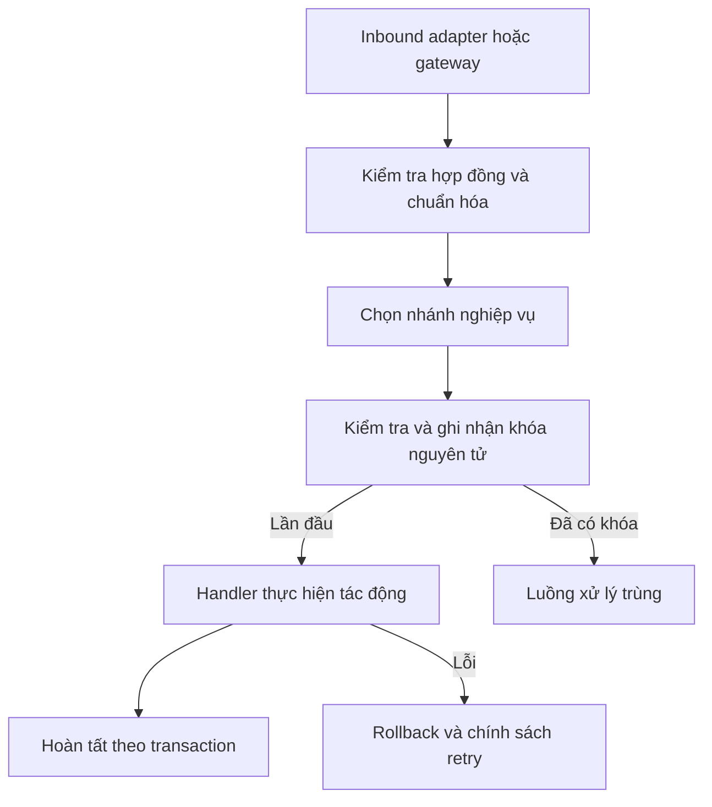

# Thiết kế idempotent handler

Trong chương **Thiết kế flow** của module **SPRING_INTEGRATION_CORE**, một handler không chỉ cần xử lý đúng một thông điệp. Nó còn phải giữ đúng kết quả nghiệp vụ khi cùng một yêu cầu được gửi lại do retry, mất kết nối, khởi động lại ứng dụng hoặc nhiều consumer chạy đồng thời.

Bài học này kết nối `Message`, `MessageChannel`, endpoint, gateway và Java DSL để xây dựng handler có tính idempotent. Tình huống xuyên suốt là nhận sự kiện cộng tiền vào tài khoản: sự kiện `evt-731` cộng 150.000 đồng, dù được chuyển đến nhiều lần, vẫn chỉ làm tăng số dư một lần. Các đơn vị tiền trong ví dụ là số nguyên theo đơn vị nhỏ nhất đã thống nhất của từng loại tiền.

## 1. Mục tiêu và kiến thức nền

Sau bài học, bạn có thể:

- Phân biệt thông điệp được giao lại với một yêu cầu nghiệp vụ mới.
- Chọn khóa idempotency ổn định, có phạm vi theo tenant và thao tác.
- Gắn `IdempotentReceiverInterceptor` vào endpoint bằng Java DSL.
- Giải thích vì sao ghi nhận khóa nguyên tử vẫn chưa đủ bảo vệ toàn bộ nghiệp vụ.
- Xác định transaction, cơ chế retry, cách xử lý thông điệp trùng và thời gian lưu khóa.
- Thiết kế phép kiểm thử dựa trên số lần phát sinh tác động nghiệp vụ.

Bạn nên biết cách dùng service activator, gateway, `DirectChannel`, `MessageBuilder`, Java bean và transaction của Spring. Những ví dụ có `record` giả định Java 17 trở lên; dependency Spring Integration và Spring JDBC cần được quản lý theo BOM phù hợp với ứng dụng. Bài học không yêu cầu một phiên bản Spring Boot cụ thể.

## 2. Idempotency được xác định theo tác động nghiệp vụ

Gọi `H(S, C)` là trạng thái sau khi handler xử lý command `C` trên trạng thái ban đầu `S`. Tính idempotent đối với command đó có thể biểu diễn bằng:

```text
H(H(S, C), C) = H(S, C)
```

Điều được bảo vệ là kết quả mà hệ thống cam kết với bên sử dụng. Handler có thể được gọi nhiều lần, ghi nhiều dòng log hoặc tăng bộ đếm thông điệp nhận được; số tiền cộng vào tài khoản vẫn phải tương đương một lần xử lý.

| Thao tác | Khi thực hiện lại cùng yêu cầu | Thiết kế cần chú ý |
| --- | --- | --- |
| Gán trạng thái đơn hàng thành `PAID` | Có thể giữ nguyên trạng thái | Email và sự kiện phát ra kèm theo vẫn có thể bị lặp |
| Cộng thêm 150.000 vào số dư | Tăng tiền thêm lần nữa | Phải kiểm soát danh tính của lần cộng tiền |
| Chèn bản ghi bằng khóa nghiệp vụ duy nhất | Lần sau có thể xung đột khóa | Phải phân biệt trùng hợp lệ và dữ liệu mâu thuẫn |
| Gửi email xác nhận | Có thể gửi nhiều email | Cần cơ chế riêng cho tác động gửi email |

Hai sự kiện khác nhau cùng cộng 150.000 vào một tài khoản là hai nghiệp vụ hợp lệ. Không được gộp chúng chỉ vì payload gần giống nhau. Ngược lại, cùng một sự kiện được bọc trong hai `Message` khác nhau vẫn phải được nhận diện là một nghiệp vụ.

Idempotency cũng không giải quyết mọi vấn đề đồng thời. Hai sự kiện hợp lệ cùng cập nhật số dư vẫn cần câu lệnh cập nhật nguyên tử hoặc cơ chế khóa phù hợp để tránh mất cập nhật.

## 3. Vì sao thông điệp xuất hiện lại?

Xét consumer xử lý thông điệp rồi xác nhận với broker:

```text
Nhận message → cập nhật nghiệp vụ → commit database → acknowledge broker
```

Nếu consumer chết sau commit nhưng trước acknowledge, broker có thể giao lại message. Producer cũng có thể gửi lại vì không biết lần gửi trước đã được chấp nhận hay chưa. Những cơ chế giao lại này giúp phục hồi công việc nhưng tạo ra nhu cầu kiểm soát tác động trùng.

| Thời điểm lỗi | Trạng thái có thể quan sát | Khi giao lại cần làm gì? |
| --- | --- | --- |
| Trước khi bắt đầu transaction | Chưa thay đổi nghiệp vụ | Xử lý bình thường |
| Trong transaction và transaction rollback | Chưa có thay đổi được commit | Cho phép xử lý lại |
| Sau commit, trước acknowledge | Nghiệp vụ đã hoàn tất | Nhận diện trùng và tránh lặp tác động |
| Sau lời gọi HTTP nhưng trước khi nhận phản hồi | Có thể hệ thống đích đã thực hiện | Tra cứu hoặc retry bằng khóa được hệ thống đích hỗ trợ |

Trong bài này, mục tiêu là bảo vệ tác động nghiệp vụ khi thông điệp được giao ít nhất một lần. Chỉ thêm một interceptor không đủ để khẳng định hệ thống có đảm bảo exactly-once trên toàn bộ database, broker và API bên ngoài.

## 4. Thiết kế khóa idempotency

### 4.1. Chọn danh tính nghiệp vụ ổn định

Với sự kiện cộng tiền, dùng khóa:

```text
account-credit:v1|tenant-a|evt-731
└──── thao tác ────┘ └ tenant ┘ └ eventId ┘
```

`eventId` phải được tạo một lần cho sự kiện gốc và giữ nguyên qua mọi lần retry. Namespace phân biệt cộng tiền với những consumer thực hiện tác động khác. Tenant ngăn hai khách hàng có cùng chuỗi `eventId` bị coi là một.

Không dùng `MessageHeaders.ID` làm khóa mặc định cho nghiệp vụ. Một lần dựng lại message hoặc gửi lại ở producer có thể tạo ID mới. `correlationId` cũng có thể đại diện cho cả nhóm thông điệp, nên không tự động có nghĩa là danh tính của một thao tác.

| Khóa dự kiến | Vấn đề |
| --- | --- |
| `accountId` | Chặn mọi lần cộng tiền hợp lệ tiếp theo vào cùng tài khoản |
| `orderId` | Có thể gộp thanh toán, hoàn tiền và nhiều lần thanh toán của một đơn |
| UUID tạo mới ở mỗi lần retry | Mọi lần retry đều được xem như yêu cầu mới |
| Hash của toàn bộ JSON thô | Thay đổi thứ tự field hoặc định dạng có thể đổi hash |
| Namespace + tenant + eventId ổn định | Phù hợp khi hợp đồng quy định eventId bất biến cho cùng nghiệp vụ |

Trong ví dụ, `v1` là phiên bản hợp đồng danh tính. Không tự tăng nó theo mỗi lần triển khai ứng dụng: đổi namespace khiến các sự kiện cũ có thể được xử lý lại.

### 4.2. Tránh khóa nhập nhằng và khóa rỗng

Nếu ghép chuỗi bằng dấu `|`, phải cấm dấu này trong từng thành phần hoặc dùng cách mã hóa không nhập nhằng. Không đổi `null` thành một chuỗi chung rồi tiếp tục xử lý; nhiều sự kiện lỗi có thể bị gộp thành cùng một khóa.

Khóa cần có giới hạn độ dài và nguồn dữ liệu tin cậy. Một header do client tự truyền chỉ được sử dụng sau khi đã xác thực tenant và kiểm tra hợp đồng của sự kiện. Việc đặt khóa trong header giúp flow thuận tiện hơn, nhưng không thay thế những kiểm tra này.

### 4.3. Cùng khóa, khác payload

Hai yêu cầu dưới đây có cùng danh tính nhưng mâu thuẫn nội dung:

```text
tenant-a, evt-731, account-09, amount=150000, currency=VND
tenant-a, evt-731, account-09, amount=250000, currency=VND
```

Có ba kết quả cần phân biệt:

1. Khóa chưa tồn tại: ứng viên để xử lý lần đầu.
2. Khóa đã tồn tại, nội dung nghiệp vụ giống nhau: thông điệp trùng hợp lệ.
3. Khóa đã tồn tại, nội dung nghiệp vụ khác nhau: vi phạm hợp đồng, cần báo lỗi hoặc chuyển sang luồng kiểm tra.

Một bộ lọc chỉ kiểm tra sự tồn tại của khóa không phân biệt được trường hợp 2 và 3. Khi cần phát hiện mâu thuẫn, lưu thêm fingerprint của những trường nghiệp vụ đã chuẩn hóa, hoặc lưu trực tiếp các trường cần đối chiếu. Fingerprint nên loại bỏ timestamp vận chuyển, trace ID và các header có thể thay đổi qua retry.

## 5. Đặt cơ chế chống trùng vào đúng vị trí trong flow



Transformer có thể chuẩn hóa kiểu dữ liệu trước khi tạo khóa; router đưa yêu cầu tới đúng nghiệp vụ; cơ chế chống trùng cần đứng trước tác động mà nó bảo vệ. Một filter kiểm tra `store.get(key) == null`, sau đó mới `store.put(key, value)`, có thể cho hai consumer cùng đi qua.

Ví dụ race condition:

```text
Consumer A: đọc khóa → chưa có
Consumer B: đọc khóa → chưa có
Consumer A: cộng tiền
Consumer B: cộng tiền
```

Vì vậy, phép kiểm tra và ghi nhận quyền xử lý cần nguyên tử. Khi flow có nhiều nhánh cùng thực hiện các tác động khác nhau, hãy xác định phạm vi khóa cho từng tác động. Một namespace dùng chung ở đầu nhánh publish-subscribe không tự chứng minh mọi nhánh đều hoàn thành sau một lần xử lý.

## 6. Các thành phần Spring Integration liên quan

| Thành phần | Vai trò |
| --- | --- |
| `IdempotentReceiverInterceptor` | Advice quyết định xử lý thông điệp trùng tại handler |
| `MessageSelector` | Hợp đồng chấp nhận hoặc từ chối message |
| `MetadataStoreSelector` | Tạo khóa và dùng kho metadata để quyết định chấp nhận |
| `ConcurrentMetadataStore` | Cung cấp thao tác cập nhật metadata nguyên tử |
| `SimpleMetadataStore` | Kho trong bộ nhớ cho thử nghiệm trong một tiến trình |
| `JdbcMetadataStore` | Kho JDBC dùng chung, có thể giữ trạng thái qua lần khởi động |

Interceptor gắn vào endpoint hiện có; Spring Integration không tạo một endpoint idempotent riêng. Có thể đưa nó vào Java DSL qua cấu hình `e.advice(...)`. [Tài liệu Idempotent Receiver](https://docs.spring.io/spring-integration/reference/handler-advice/idempotent-receiver.html).

### 6.1. Hành vi đối với thông điệp trùng

Mặc định, interceptor có thể đánh dấu `duplicateMessage=true` và vẫn cho handler chạy. Để chặn tác động, phải chọn rõ cách xử lý:

| Cấu hình | Kết quả đối với thông điệp bị selector từ chối |
| --- | --- |
| Không có discard channel, không bật exception | Handler vẫn được gọi với dấu hiệu thông điệp trùng |
| Có `discardChannel` | Chuyển thông điệp sang channel đó, bỏ qua handler được bảo vệ |
| Discard về `nullChannel` | Bỏ thông điệp trùng |
| `throwExceptionOnRejection=true` | Phát sinh `MessageRejectedException` |

Nếu cấu hình cả discard channel và exception, exception vẫn có thể được ném sau khi gửi thông điệp sang discard channel. Bật exception có thể làm thông điệp trùng rơi vào retry; cần chọn theo hợp đồng nhận thông điệp. [Javadoc của IdempotentReceiverInterceptor](https://www.springframework.org/spring-integration/api/org/springframework/integration/handler/advice/IdempotentReceiverInterceptor.html).

### 6.2. Selector ghi nhận khóa trước khi nghiệp vụ chạy

Với cấu hình kiểm tra tồn tại thông thường, có thể hình dung `MetadataStoreSelector` như sau:

```text
key = keyStrategy(message)
previous = store.putIfAbsent(key, value)
accepted = previous == null
```

Khi selector chấp nhận, khóa đã được ghi vào kho theo ngữ nghĩa transaction của kho đó; selector chưa biết handler sẽ thành công hay thất bại. [Javadoc của MetadataStoreSelector](https://docs.spring.io/spring-integration/api/org/springframework/integration/selector/MetadataStoreSelector.html).

Nếu kho giữ khóa ngay nhưng handler ném exception, lần giao lại có thể bị loại dù tác động nghiệp vụ chưa xảy ra. Tính nguyên tử của `putIfAbsent` bảo vệ việc giành quyền xử lý một khóa, còn ranh giới commit mới quyết định khóa có phản ánh một nghiệp vụ hoàn tất hay không.

## 7. Ví dụ Java DSL: cộng tiền trong cùng transaction với khóa

### 7.1. Giả định của ví dụ

Ví dụ dùng Spring Integration Core, Spring Integration JDBC và Spring JDBC. Ứng dụng đã có `DataSource`; các class được đặt trong cùng package ví dụ và được Spring quét. Mỗi public class hoặc interface được đặt trong file Java riêng khi đưa vào dự án thực hành.

Hợp đồng đầu vào đảm bảo cùng `tenantId` và `eventId` luôn có cùng payload nghiệp vụ. Ví dụ interceptor này loại trùng theo khóa, chưa triển khai phát hiện cùng khóa khác payload; phần 10 trình bày thiết kế inbox cho yêu cầu đó.

Các điều kiện để ví dụ bảo vệ được tác động cộng tiền:

- Metadata và dữ liệu số dư dùng cùng `DataSource`, tham gia cùng transaction manager.
- Transaction bắt đầu trước khi gateway gửi message tới selector.
- `DirectChannel` giữ chuỗi xử lý đồng bộ trên cùng luồng thực thi.
- Lỗi nghiệp vụ được truyền ngược ra ngoài để transaction rollback.
- Nguồn nhận chỉ acknowledge sau khi lời gọi transaction hoàn tất thành công.

### 7.2. Kiểu dữ liệu và khóa

```java
public record CreditCommand(
        String tenantId,
        String eventId,
        String accountId,
        long amountMinor,
        String currency) {

    public CreditCommand {
        requireToken(tenantId, "tenantId");
        requireToken(eventId, "eventId");
        requireToken(accountId, "accountId");
        if (amountMinor <= 0) {
            throw new IllegalArgumentException("amountMinor must be positive");
        }
        if (currency == null || !currency.matches("[A-Z]{3}")) {
            throw new IllegalArgumentException("Invalid currency");
        }
    }

    private static void requireToken(String value, String field) {
        if (value == null || !value.matches("[A-Za-z0-9._-]{1,64}")) {
            throw new IllegalArgumentException("Invalid " + field);
        }
    }

    public String idempotencyKey() {
        return "account-credit:v1|" + tenantId + "|" + eventId;
    }
}
```

Quy tắc token ngăn ký tự phân cách xuất hiện trong từng thành phần. Không đưa `amountMinor` vào khóa: một eventId bị thay đổi số tiền phải được phát hiện là mâu thuẫn, thay vì trở thành một nghiệp vụ mới.

### 7.3. Cấu hình channel, kho metadata và advice

```java
import javax.sql.DataSource;

import org.springframework.context.annotation.Bean;
import org.springframework.context.annotation.Configuration;
import org.springframework.integration.annotation.IntegrationComponentScan;
import org.springframework.integration.channel.DirectChannel;
import org.springframework.integration.config.EnableIntegration;
import org.springframework.integration.dsl.IntegrationFlow;
import org.springframework.integration.handler.advice.IdempotentReceiverInterceptor;
import org.springframework.integration.jdbc.metadata.JdbcMetadataStore;
import org.springframework.integration.metadata.ConcurrentMetadataStore;
import org.springframework.integration.selector.MetadataStoreSelector;
import org.springframework.jdbc.datasource.DataSourceTransactionManager;
import org.springframework.messaging.MessageChannel;
import org.springframework.transaction.PlatformTransactionManager;
import org.springframework.transaction.annotation.EnableTransactionManagement;

@Configuration
@EnableIntegration
@EnableTransactionManagement
@IntegrationComponentScan(basePackageClasses = CreditGateway.class)
public class CreditFlowConfiguration {

    @Bean
    public PlatformTransactionManager integrationTxManager(DataSource dataSource) {
        return new DataSourceTransactionManager(dataSource);
    }

    @Bean
    public MessageChannel creditInput() {
        return new DirectChannel();
    }

    @Bean
    public ConcurrentMetadataStore creditMetadataStore(DataSource dataSource) {
        return new JdbcMetadataStore(dataSource);
    }

    @Bean
    public IdempotentReceiverInterceptor creditIdempotency(
            ConcurrentMetadataStore creditMetadataStore) {

        MetadataStoreSelector selector = new MetadataStoreSelector(
                message -> ((CreditCommand) message.getPayload()).idempotencyKey(),
                creditMetadataStore);

        IdempotentReceiverInterceptor interceptor =
                new IdempotentReceiverInterceptor(selector);
        interceptor.setDiscardChannelName("nullChannel");
        return interceptor;
    }

    @Bean
    public IntegrationFlow creditFlow(
            CreditHandler creditHandler,
            IdempotentReceiverInterceptor creditIdempotency) {

        return IntegrationFlow.from("creditInput")
                .handle(creditHandler, "apply",
                        endpoint -> endpoint.advice(creditIdempotency))
                .get();
    }
}
```

`nullChannel` là channel đặc biệt do hạ tầng Spring Integration cung cấp. Việc loại trùng ở đây là thành công theo hợp đồng một chiều: không cộng tiền thêm và cho phép bên nhận kết thúc lần giao lại.

`JdbcMetadataStore` cần bảng metadata được tạo từ schema phù hợp với database trong dependency Spring Integration JDBC. Dùng migration để tạo bảng trước khi khởi động; không giả định khai báo bean sẽ tự tạo schema. Kho JDBC lưu được trạng thái đã commit qua lần khởi động và chia sẻ giữa các instance. [JDBC Metadata Store](https://docs.spring.io/spring-integration/reference/jdbc/metadata-store.html).

### 7.4. Gateway và transaction bao ngoài flow

Gateway chuyển lời gọi Java thành thông điệp đi vào `creditInput`:

```java
import org.springframework.integration.annotation.MessagingGateway;
import org.springframework.messaging.Message;

@MessagingGateway(defaultRequestChannel = "creditInput")
public interface CreditGateway {
    void credit(Message<CreditCommand> message);
}
```

Một service mở transaction trước khi gọi gateway:

```java
import org.springframework.messaging.support.MessageBuilder;
import org.springframework.stereotype.Service;
import org.springframework.transaction.annotation.Transactional;

@Service
public class TransactionalCreditIngress {

    private final CreditGateway gateway;

    public TransactionalCreditIngress(CreditGateway gateway) {
        this.gateway = gateway;
    }

    @Transactional(
            transactionManager = "integrationTxManager",
            rollbackFor = Exception.class)
    public void accept(CreditCommand command) {
        gateway.credit(MessageBuilder.withPayload(command).build());
    }
}
```

Bên tiếp nhận gọi `accept()` qua bean do Spring quản lý. Không tự `new TransactionalCreditIngress(...)` và không dựa vào lời gọi nội bộ cùng object để kích hoạt transaction proxy. Cũng không để một consumer khác gửi thẳng vào `creditInput` rồi bỏ qua ranh giới transaction đã thiết kế.

### 7.5. Handler và dữ liệu nghiệp vụ

Schema nghiệp vụ minh họa:

```sql
CREATE TABLE account_balance (
    tenant_id     VARCHAR(64) NOT NULL,
    account_id    VARCHAR(64) NOT NULL,
    currency      CHAR(3) NOT NULL,
    balance_minor BIGINT NOT NULL,
    PRIMARY KEY (tenant_id, account_id)
);

CREATE TABLE account_credit_ledger (
    tenant_id    VARCHAR(64) NOT NULL,
    event_id     VARCHAR(64) NOT NULL,
    account_id   VARCHAR(64) NOT NULL,
    amount_minor BIGINT NOT NULL CHECK (amount_minor > 0),
    currency     CHAR(3) NOT NULL,
    PRIMARY KEY (tenant_id, event_id)
);
```

Ledger có ràng buộc duy nhất cho sự kiện cộng tiền trong từng tenant. Đây là một hàng rào dữ liệu bổ sung; chính sách xử lý trùng trong flow vẫn cần được xác định rõ.

```java
import javax.sql.DataSource;

import org.springframework.jdbc.core.JdbcTemplate;
import org.springframework.stereotype.Service;

@Service
public class CreditHandler {

    private final JdbcTemplate jdbc;

    public CreditHandler(DataSource dataSource) {
        this.jdbc = new JdbcTemplate(dataSource);
    }

    public void apply(CreditCommand command) {
        jdbc.update("""
                INSERT INTO account_credit_ledger
                    (tenant_id, event_id, account_id, amount_minor, currency)
                VALUES (?, ?, ?, ?, ?)
                """,
                command.tenantId(), command.eventId(), command.accountId(),
                command.amountMinor(), command.currency());

        int changed = jdbc.update("""
                UPDATE account_balance
                SET balance_minor = balance_minor + ?
                WHERE tenant_id = ? AND account_id = ? AND currency = ?
                """,
                command.amountMinor(), command.tenantId(),
                command.accountId(), command.currency());

        if (changed != 1) {
            throw new IllegalStateException(
                    "Account not found or currency mismatch");
        }
    }
}
```

Câu lệnh `balance_minor = balance_minor + ?` để database cập nhật số dư, thay cho đọc số dư vào Java rồi ghi đè một giá trị đã tính từ dữ liệu cũ. Nó giải quyết vấn đề mất cập nhật giữa các sự kiện khác nhau; khóa idempotency giải quyết việc cùng sự kiện được giao lại.

### 7.6. Diễn biến mong đợi

Giả sử số dư ban đầu là 100.000 VND và lệnh có `eventId=evt-731`, `amountMinor=150000`:

```text
Lần đầu:
  BEGIN
  ghi khóa metadata
  chèn ledger
  số dư: 100000 → 250000
  COMMIT

Lần giao lại:
  BEGIN
  selector thấy khóa đã tồn tại
  chuyển message tới nullChannel
  không gọi CreditHandler
  COMMIT
```

Nếu handler lỗi trước commit, transaction bao ngoài phải rollback cả khóa, ledger và số dư. Lần giao lại tiếp theo có thể giành khóa và thử xử lý lại. Điều này dựa trên việc mọi thao tác JDBC thực sự tham gia cùng transaction; chỉ đặt hai bảng trên cùng máy chủ database chưa đủ.

Nếu hai instance cùng nhận `evt-731`, kho metadata dùng chung phải phân xử nguyên tử. Một instance có thể phải chờ khóa database; khi có timeout hoặc deadlock, hãy xử lý như lỗi tạm thời của transaction và thử lại theo chính sách. Không diễn giải lỗi truy cập kho thành thông điệp trùng thành công.

## 8. Các ranh giới transaction dễ thiết kế sai

### 8.1. Chỉ đặt `@Transactional` trên handler

```text
selector ghi khóa và hoàn tất transaction riêng
    → handler mở transaction nghiệp vụ
    → handler lỗi và rollback
    → khóa vẫn còn
```

Nếu transaction chỉ bắt đầu khi vào phương thức nghiệp vụ, selector có thể nằm ngoài nó. Bài học đặt transaction ở service gọi gateway để cả selector lẫn handler đều chạy bên trong một ranh giới đã mở.

Không nên suy ra thứ tự thực thi chỉ từ thứ tự phần tử trong `advice(...)`. `IdempotentReceiverInterceptor` là `HandleMessageAdvice`; với handler sinh reply, advice này có thể được áp dụng ở `handleMessage()` trong khi advice khác bao quanh xử lý request nội bộ. [Handling Message Advice](https://docs.spring.io/spring-integration/reference/handler-advice/handle-message.html).

### 8.2. Chuyển từ `DirectChannel` sang xử lý bất đồng bộ

Transaction JDBC thông thường gắn với luồng thực thi. Thay channel bằng `ExecutorChannel` hoặc đưa công việc qua `QueueChannel` có thể khiến handler chạy ở thread khác, sau khi transaction của bên gửi đã kết thúc.

Nếu cần bất đồng bộ, hãy mở transaction tại consumer thực sự xử lý message và bảo đảm selector nằm trong transaction đó. Transaction của poller hoặc listener cần được thiết kế theo adapter đang dùng; không sao chép cấu hình gateway đồng bộ rồi giả định nó vẫn giữ nguyên bảo đảm.

Một `QueueChannel` trong bộ nhớ cũng không cung cấp độ bền cho công việc đang chờ khi tiến trình chết. Idempotency và khả năng lưu giữ thông điệp là hai yêu cầu cần kiểm tra riêng.

### 8.3. Bắt lỗi rồi trả về bình thường

```java
try {
    applyBusinessChange();
}
catch (RuntimeException ex) {
    logFailure(ex);
    // Nếu kết thúc bình thường, transaction bên ngoài có thể commit khóa.
}
```

Khi bắt lỗi, phải xác định kết quả transaction và kết quả nhận thông điệp. Nếu muốn rollback, truyền exception phù hợp ra ngoài hoặc đánh dấu rollback theo thiết kế. Một error flow ghi log thành công không đồng nghĩa nghiệp vụ gốc đã thành công.

### 8.4. Acknowledge quá sớm

Thứ tự dự kiến cho nguồn có acknowledge thủ công:

```text
gọi TransactionalCreditIngress.accept(command)
    → lời gọi trả về sau commit thành công
    → acknowledge thông điệp nguồn
```

Nếu lỗi trước khi hoàn tất, áp dụng chính sách redelivery hoặc chuyển thông điệp lỗi theo cơ chế của nguồn. Cách viết acknowledge cụ thể phụ thuộc adapter; không có một lệnh acknowledge chung cho mọi `MessageChannel`.

## 9. Retry, error channel và tác động bên ngoài

### 9.1. Phân loại kết quả trước khi quyết định retry

| Tình huống | Hướng xử lý |
| --- | --- |
| Trùng hợp lệ, nghiệp vụ đã commit | Kết thúc theo hợp đồng trùng, không retry vô hạn |
| Kho metadata mất kết nối | Báo lỗi tạm thời, chưa acknowledge như thành công |
| Deadlock hoặc lỗi transaction có thể phục hồi | Rollback rồi retry có giới hạn và backoff |
| Thiếu eventId hoặc tenant không hợp lệ | Từ chối dữ liệu, chuyển luồng kiểm tra theo chính sách |
| Cùng khóa khác nội dung | Báo conflict, cần điều tra hợp đồng hoặc nguồn phát |
| Lời gọi hệ thống ngoài bị timeout | Xác định kết quả chưa rõ; dùng cơ chế idempotency của hệ thống đích |

Retry chỉ hữu ích nếu lần thử lại vẫn được phép thực hiện phần chưa hoàn thành. Nếu khóa đã commit riêng trước khi nghiệp vụ lỗi, một lần retry có thể chỉ bị loại trùng rồi tạo cảm giác đã xử lý xong.

Một retry advice bên trong endpoint cũng có thể giữ nguyên transaction đang lỗi. Với lỗi cần transaction mới, ưu tiên retry bao ngoài ranh giới transaction hoặc để nguồn giao lại, thay vì giả định mọi retry đều mở một transaction sạch.

### 9.2. Error message và message nghiệp vụ

Khi thiết kế `errorChannel`, giữ lại khóa nghiệp vụ cùng thông tin message gốc để truy vết. Không mặc nhiên đưa `ErrorMessage` vào lại endpoint đang cast payload sang `CreditCommand`. Error flow cần phân loại lỗi và chủ động dựng lại lời gọi nghiệp vụ khi chính sách cho phép.

Không xóa khóa một cách mù quáng trong mọi nhánh lỗi. Nếu một lần xử lý khác đã hoàn tất, việc xóa khóa có thể mở lại quyền thực hiện tác động. Với transaction chung, để rollback phục hồi trạng thái. Với thiết kế có trạng thái xử lý riêng, cần cập nhật có điều kiện theo chủ sở hữu hoặc phiên bản.

### 9.3. Database và HTTP không commit cùng nhau

Giả sử handler vừa cập nhật ledger vừa gọi API gửi tiền:

```text
API đích đã thực hiện chuyển tiền
    → kết nối bị ngắt trước phản hồi
    → transaction database ở consumer rollback
    → message được giao lại
```

Rollback cục bộ không thu hồi tác động ở API. Có thể phối hợp theo hai hướng:

- Gửi cùng một idempotency key đến API đích, nếu API có hợp đồng lưu và đối chiếu khóa phù hợp; tra cứu kết quả khi phản hồi không rõ.
- Trong transaction nghiệp vụ, ghi thêm bản ghi outbox. Một publisher riêng gửi yêu cầu hoặc sự kiện từ outbox và retry khi cần. Bên nhận vẫn cần xử lý trùng vì publisher có thể gửi lại sau lỗi.

Không gọi đồng thời HTTP và database rồi xem việc có `@Transactional` là bằng chứng chúng nguyên tử với nhau. Với tác động dài hạn hoặc không thể hoàn tác trực tiếp, thiết kế tiến trình nghiệp vụ và đối soát rõ ràng.

## 10. Khi cần inbox thay cho kiểm tra tồn tại khóa đơn giản

Một inbox riêng phù hợp khi cần phát hiện payload mâu thuẫn, lưu kết quả cho gateway hoặc quản lý trạng thái của công việc kéo dài. Đây là thiết kế ở tầng ứng dụng; `MetadataStoreSelector` không tự cung cấp toàn bộ các trường và chuyển trạng thái dưới đây.

Schema minh họa cho PostgreSQL:

```sql
CREATE TABLE processed_command (
    consumer_name VARCHAR(80) NOT NULL,
    tenant_id     VARCHAR(64) NOT NULL,
    event_id      VARCHAR(64) NOT NULL,
    payload_hash  VARCHAR(64) NOT NULL,
    result_json   TEXT,
    processed_at  TIMESTAMP WITH TIME ZONE NOT NULL DEFAULT CURRENT_TIMESTAMP,
    PRIMARY KEY (consumer_name, tenant_id, event_id)
);
```

Với nghiệp vụ cập nhật database ngắn và đồng bộ, thuật toán trong cùng transaction có thể là:

1. Tạo fingerprint từ các trường nghiệp vụ chuẩn hóa.
2. Thử chèn một hàng inbox bằng thao tác nguyên tử.
3. Nếu chèn được, thực hiện cập nhật nghiệp vụ rồi lưu kết quả vào hàng inbox.
4. Nếu đã có hàng, đọc fingerprint và kết quả đã commit. Cùng fingerprint thì trả lại kết quả cũ; khác fingerprint thì báo conflict.
5. Commit sau khi các thay đổi bắt buộc đều thành công. Nếu nghiệp vụ lỗi, rollback cả hàng inbox mới.

Ví dụ thao tác giành khóa trong PostgreSQL:

```sql
INSERT INTO processed_command
    (consumer_name, tenant_id, event_id, payload_hash)
VALUES (?, ?, ?, ?)
ON CONFLICT (consumer_name, tenant_id, event_id) DO NOTHING;
```

Với cách gọi JDBC phù hợp, số hàng bị thay đổi cho biết lần chèn này có tạo hàng mới hay không. Nhánh trùng phải đọc dữ liệu đã commit theo isolation và cơ chế retry của database đang dùng. Không xử lý bằng cách bắt mọi `DataIntegrityViolationException` rồi xem như duplicate: lỗi có thể đến từ một ràng buộc khác, và một số database làm transaction hiện tại không thể tiếp tục sau lỗi SQL.

Trong thiết kế này, hàng inbox mới có thể được tạo trước cập nhật nghiệp vụ nhưng chỉ được commit cùng nghiệp vụ. Không cần commit một trạng thái `PROCESSING` riêng nếu mọi thao tác đều nằm trong một transaction ngắn.

Nếu công việc dài và phải commit quyền xử lý trước, cần mô hình trạng thái rõ hơn:

```text
ABSENT → PROCESSING → SUCCEEDED
             ↓
     FAILED_RETRYABLE hoặc chờ phục hồi
```

Khi đó phải bổ sung owner token, thời hạn lease, quy tắc gia hạn, cơ chế phục hồi và cập nhật có điều kiện. Lease hết hạn không chứng minh worker cũ đã ngừng tạo tác động; hệ thống đích cần hỗ trợ fencing token hoặc cơ chế chống trùng tương ứng. Không lấy timestamp rồi xóa bản ghi đang xử lý như một cách phục hồi chung.

### Gateway có yêu cầu trả kết quả

Ví dụ trước dùng gateway trả `void`, nên loại trùng về `nullChannel` phù hợp với hợp đồng một chiều. Với gateway request-reply, cùng cách loại message có thể khiến bên gọi không nhận reply và phải chờ timeout.

Hãy chọn một hợp đồng cụ thể: trả lại kết quả thành công đã lưu, trả một trạng thái duplicate có cấu trúc, hoặc trả lỗi conflict khi nội dung khác nhau. Nếu cần replay phản hồi, lưu cả kết quả nghiệp vụ đủ để trả lại; header `duplicateMessage` không phải một response cache.

## 11. Giới hạn của kho và thời gian lưu khóa

### 11.1. Thử nghiệm trong bộ nhớ

`SimpleMetadataStore` thuận tiện cho ví dụ hoặc kiểm thử trong một tiến trình. Các object riêng ở hai instance không chia sẻ khóa, và khởi động lại ứng dụng làm mất trạng thái trong bộ nhớ. [Metadata Store](https://docs.spring.io/spring-integration/reference/meta-data-store.html).

Kho trong bộ nhớ cũng không tự rollback theo transaction JDBC. Thay `JdbcMetadataStore` bằng `SimpleMetadataStore` trong ví dụ production làm thay đổi bảo đảm khi handler lỗi, dù kiểm thử hai lần gửi liên tiếp vẫn có thể chạy qua.

### 11.2. Xác định cửa sổ phát lại

Thời gian lưu khóa cần bao phủ khoảng thời gian sự kiện cũ có thể quay lại: retry tự động, broker retention, hàng đợi lỗi, phục hồi backup và replay thủ công. Đây là quyết định nghiệp vụ và vận hành, không chỉ là dung lượng cache.

Ví dụ, nếu có thể replay sự kiện trong 30 ngày nhưng xóa khóa sau 24 giờ, hệ thống có thể xử lý lại tác động đã hoàn tất. Với ledger tài chính, ràng buộc danh tính nghiệp vụ thường cần sống lâu hơn cache chống trùng ở lớp tích hợp.

Không giả định mọi `ConcurrentMetadataStore` đều có TTL tự động hoặc cùng một chính sách dọn dữ liệu. Hãy xác định cơ chế dọn theo implementation thực tế, chỉ xóa trạng thái phù hợp và ghi nhận tác động của việc xóa đối với replay.

Trong ví dụ có ledger duy nhất, nếu khóa metadata bị xóa nhưng ledger vẫn còn, một sự kiện cũ sẽ gặp xung đột ở ledger thay vì được cộng tiền lần nữa. Cần có nhánh đối chiếu ledger và phân loại kết quả; retry vô hạn một lỗi unique constraint không khôi phục được trạng thái mong muốn.

## 12. Phân biệt chống trùng với xử lý thứ tự

Hai sự kiện `evt-731` và `evt-732` có thể hợp lệ dù đến sai thứ tự. Bộ chống trùng theo eventId cho phép cả hai; tính đúng đắn khi áp dụng thứ tự phụ thuộc nghiệp vụ.

Nếu mỗi message là snapshot đầy đủ và chỉ cần trạng thái mới nhất, ứng dụng có thể dùng số phiên bản để từ chối snapshot cũ. Ngược lại, nếu message là từng khoản cộng tiền, không được bỏ phiên bản 11 chỉ vì phiên bản 12 đã đến trước: bỏ một sự kiện khác đồng nghĩa mất tiền cần cộng.

`MetadataStoreSelector` có khả năng so sánh giá trị qua `compareValues`, nhưng điều kiện tăng phiên bản chỉ phù hợp với hợp đồng chấp nhận bỏ dữ liệu cũ. Nó không tự cung cấp resequencing, phát hiện khoảng trống hoặc chứng minh mọi sự kiện trước đó đã xử lý xong. [Cấu hình compareValues](https://docs.spring.io/spring-integration/reference/handler-advice/idempotent-receiver.html).

Với flow có splitter hoặc aggregator, xác định danh tính của từng phần tử và của kết quả tổng hợp. Không lấy ID mới của message tổng hợp làm bằng chứng rằng tác động cuối cùng chưa từng xảy ra.

## 13. Kiểm thử dựa trên tác động và điểm lỗi

### 13.1. Kiểm thử nhỏ cho chiến lược khóa

Đoạn JUnit 5 sau chứng minh hai `Message` có ID khác nhau vẫn được gộp theo danh tính nghiệp vụ:

```java
import org.junit.jupiter.api.Test;
import org.springframework.integration.metadata.SimpleMetadataStore;
import org.springframework.integration.selector.MetadataStoreSelector;
import org.springframework.messaging.Message;
import org.springframework.messaging.support.MessageBuilder;

import static org.junit.jupiter.api.Assertions.*;

class CreditKeyTest {

    @Test
    void detectsSameEventInDifferentMessageEnvelopes() {
        MetadataStoreSelector selector = new MetadataStoreSelector(
                message -> ((CreditCommand) message.getPayload()).idempotencyKey(),
                new SimpleMetadataStore());

        CreditCommand command = new CreditCommand(
                "tenant-a", "evt-731", "account-09", 150000L, "VND");
        Message<CreditCommand> first = MessageBuilder.withPayload(command).build();
        Message<CreditCommand> again = MessageBuilder.withPayload(command).build();

        assertNotEquals(first.getHeaders().getId(), again.getHeaders().getId());
        assertTrue(selector.accept(first));
        assertFalse(selector.accept(again));
    }
}
```

Phép thử này kiểm tra chiến lược khóa và selector trong bộ nhớ. Nó chưa kiểm tra wiring của advice, số lần gọi handler, rollback, khóa database hoặc nhiều instance.

### 13.2. Ma trận kiểm thử tích hợp

Dùng database cùng loại với môi trường đích cho các phép thử phụ thuộc transaction và cạnh tranh khóa. Đo cả ledger lẫn số dư; chỉ kiểm tra log có dòng duplicate là chưa đủ.

| Kịch bản | Kết quả cần kiểm tra |
| --- | --- |
| Gửi cùng tenant và eventId hai lần | Một dòng ledger, số dư chỉ tăng một lần |
| Cùng payload nhưng eventId khác | Hai dòng ledger, hai lần tăng tiền |
| Cùng eventId nhưng tenant khác | Hai nghiệp vụ độc lập |
| Hai consumer đồng thời xử lý cùng khóa | Chỉ một tác động được commit; nhánh còn lại trùng hoặc retry sau lỗi tạm thời |
| Handler lỗi sau chèn ledger, trước commit | Metadata, ledger và số dư đều rollback |
| Giao lại sau lần rollback | Nghiệp vụ được phép thực hiện và commit |
| Mất acknowledge sau commit | Lần giao lại không tạo thêm tác động |
| Khởi động lại ứng dụng | Khóa đã commit vẫn chống trùng |
| Hai application context dùng chung database | Cơ chế chống trùng vẫn hoạt động giữa các instance |
| Cùng khóa khác amount hoặc account | Thiết kế inbox phát hiện conflict; ví dụ selector đơn giản không đáp ứng phép thử này |
| Kho metadata không truy cập được | Không báo thành công giả và không âm thầm bỏ message |
| Request-reply nhận message trùng | Trả kết quả theo hợp đồng, không treo chờ reply |
| Dọn khóa rồi replay sự kiện cũ | Kết quả phù hợp chính sách retention và hàng rào ledger |

Để kiểm thử đồng thời, dùng latch hoặc barrier cho hai tác vụ bắt đầu gần nhau và chờ cả hai kết thúc trước khi đọc dữ liệu đã commit. Không dùng vài lệnh `sleep` để suy ra đã có cạnh tranh. Với kiểm thử rollback, lỗi giả lập phải nằm bên trong transaction, không chỉ xảy ra trước khi flow bắt đầu.

### 13.3. Thực hành với ví dụ cộng tiền

Chuẩn bị một tài khoản có số dư 100.000 VND, rồi gọi bean `TransactionalCreditIngress` hai lần bằng cùng command. Kết quả sau commit phải là 250.000 VND và một dòng ledger. Gửi tiếp một eventId mới cùng số tiền: số dư phải thành 400.000 VND.

Tiếp theo, chèn một điểm lỗi có kiểm soát trong handler trước khi kết thúc transaction của môi trường kiểm thử. Sau khi rollback, xác nhận không có khóa hoặc ledger mới được commit; tắt điểm lỗi và giao lại sự kiện để xác nhận lần xử lý sau thành công. Cuối cùng, chạy hai instance dùng chung database để kiểm tra giả định về kho chia sẻ.

Các phép thử trên là nội dung hướng dẫn thực hành, không phải báo cáo rằng bài học hoặc một ứng dụng mẫu đã được chạy kiểm thử trong bước biên soạn này.

## 14. Quan sát và vận hành

Theo dõi riêng số thông điệp nhận vào, số nghiệp vụ commit, số duplicate, số conflict, lỗi kho metadata và số lần retry. Duplicate tăng có thể phản ánh producer retry mạnh hoặc acknowledge bị chậm; không nhất thiết là lỗi của handler.

Log nên chứa tenant, tên thao tác, eventId, kết quả xử lý và trace ID phù hợp với chính sách dữ liệu. Nếu key chứa thông tin nhạy cảm, cần che hoặc băm trước khi ghi log. Không đưa eventId có số lượng giá trị rất lớn vào nhãn metric.

Khi điều tra sự kiện bị nghi là mất, đối chiếu trạng thái metadata, ledger, transaction và lịch sử acknowledge. Một khóa tồn tại nhưng không có tác động nghiệp vụ có thể chỉ ra transaction bị tách hoặc lỗi bị nuốt. Khi điều tra tác động lặp, kiểm tra sự ổn định của eventId, namespace, retention và việc các instance có thực sự dùng chung kho hay không.

Một thiết kế handler idempotent cần nêu rõ danh tính nghiệp vụ, phạm vi tác động, điểm ghi nhận trạng thái, ranh giới commit và kết quả trả về khi trùng. Những quyết định này biến cơ chế lọc message thành một bảo đảm có thể kiểm chứng của flow tích hợp.

