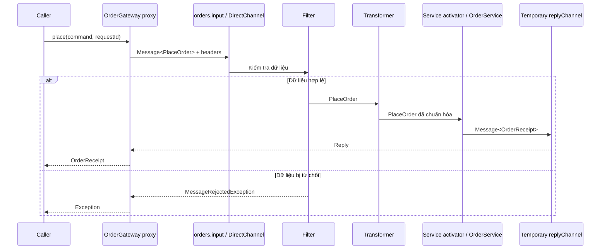

# Xây flow từ gateway đến service activator

## 1. Mục tiêu của bài thực hành

Trong chương **Thực hành tổng hợp** của module **SPRING_INTEGRATION_CORE**, bạn sẽ xây dựng một luồng tiếp nhận đơn hàng bằng Java DSL. Điểm vào là một interface Java, dữ liệu đi qua `MessageChannel`, được kiểm tra và chuẩn hóa, rồi đến service activator để thực hiện nghiệp vụ. Kết quả quay lại đúng lời gọi gateway đã gửi yêu cầu.

Sau bài này, bạn cần thực hiện được các việc sau:

- Thiết kế hợp đồng request/reply giữa gateway và service.
- Phân biệt payload nghiệp vụ với header phục vụ việc xử lý thông điệp.
- Nối `DirectChannel`, filter, transformer và service activator thành một `IntegrationFlow`.
- Giải thích đường trả lời qua `replyChannel`, kể cả khi flow không khai báo output channel cuối cùng.
- Làm cho dữ liệu không hợp lệ và lỗi nghiệp vụ kết thúc bằng lỗi rõ ràng.
- Viết kiểm thử đi qua gateway thật và toàn bộ flow trong Spring context.

Bạn nên biết cách tạo Spring bean, constructor injection, Java record, JUnit 5 và phép tính với `BigDecimal`. Bài tập dùng các mẫu tích hợp trong cùng tiến trình để tập trung vào những thành phần cốt lõi của Spring Integration.

## 2. Đề bài và hợp đồng xử lý

Một ứng dụng bán hàng cần cung cấp thao tác đặt đơn:

```java
OrderReceipt place(PlaceOrder command, String requestId);
```

Ví dụ đầu vào:

```text
orderId  = " ORD-001 "
sku      = " book-01 "
quantity = 2
unitPrice = 125000.00
requestId = "REQ-001"
```

Kết quả mong đợi:

```text
orderId  = "ORD-001"
sku      = "BOOK-01"
quantity = 2
total    = 250000.00
status   = "ACCEPTED"
requestId = "REQ-001"
```

Quy tắc của lab:

| Thành phần | Hợp đồng |
| --- | --- |
| `orderId`, `sku` | Có giá trị và không chỉ chứa khoảng trắng |
| `quantity` | Lớn hơn 0 |
| `unitPrice` | Khác `null`, lớn hơn 0; dữ liệu mẫu sử dụng cùng một loại tiền |
| Chuẩn hóa | Loại khoảng trắng đầu/cuối của mã đơn; đồng thời chuyển SKU thành chữ hoa |
| `requestId` | Header bắt buộc, không rỗng; được phản ánh trong kết quả để đối chiếu |
| SKU `BLOCKED` | Mô phỏng mặt hàng bị khóa; service ném lỗi nghiệp vụ |
| Thành công | Trả một `OrderReceipt` với tổng tiền bằng đơn giá nhân số lượng |

`ACCEPTED` trong bài chỉ biểu thị quyết định của service mẫu. Chưa có thao tác ghi cơ sở dữ liệu, giữ tồn kho hay thanh toán. Nếu bổ sung các tác vụ đó, bạn phải xác định lại ý nghĩa của kết quả và ranh giới giao dịch.

## 3. Thiết kế đường đi của thông điệp



Các vai trò trong thiết kế:

| Thành phần | Trách nhiệm trong lab |
| --- | --- |
| `OrderGateway` | Là hợp đồng mà caller sử dụng để gửi yêu cầu và nhận kết quả |
| `Message<PlaceOrder>` | Mang dữ liệu đơn hàng cùng metadata của lần gọi |
| `orders.input` | Là điểm nối ổn định giữa gateway và các endpoint |
| Filter | Chặn dữ liệu sai trước bước chuẩn hóa và xử lý nghiệp vụ |
| Transformer | Tạo payload mới có mã đơn và SKU đã chuẩn hóa |
| Service activator | Gọi `OrderService.place(...)` khi nhận message |
| `OrderService` | Áp dụng quy tắc khóa SKU và tính tổng tiền |

Lab chọn `DirectChannel`: handler được gọi trên thread gửi message, không cần poller. Nhiều subscriber trên cùng channel này không tạo thành các bước xử lý nối tiếp; chúng là các consumer cạnh tranh theo cơ chế dispatcher. Vì vậy, mỗi chặng của pipeline chỉ có một consumer chính. Xem [các loại message channel](https://docs.spring.io/spring-integration/reference/6.5/channel/implementations.html).

## 4. Chuẩn bị dự án

Ví dụ sử dụng Java 17, Maven và Spring Boot 3.5.0 làm mốc tái hiện. Spring Boot quản lý bộ dependency, bao gồm Spring Integration tương ứng; không gán riêng version cho từng thư viện Spring Integration. Đây là mốc của lab, không phải khẳng định về phiên bản mới nhất. Thông tin phát hành nằm tại [Spring Boot 3.5.0](https://spring.io/blog/2025/05/22/spring-boot-3-5-0-available-now).

Tạo dự án học tập với cấu trúc:

```text
order-flow-lab/
├── pom.xml
└── src/
    ├── main/java/com/example/orderflow/
    │   ├── OrderFlowApplication.java
    │   ├── PlaceOrder.java
    │   ├── OrderReceipt.java
    │   ├── OrderGateway.java
    │   ├── OrderService.java
    │   └── OrderFlowConfiguration.java
    └── test/java/com/example/orderflow/
        └── OrderFlowTest.java
```

Nội dung `pom.xml`:

```xml
<?xml version="1.0" encoding="UTF-8"?>
<project xmlns="http://maven.apache.org/POM/4.0.0"
         xmlns:xsi="http://www.w3.org/2001/XMLSchema-instance"
         xsi:schemaLocation="http://maven.apache.org/POM/4.0.0 https://maven.apache.org/xsd/maven-4.0.0.xsd">
    <modelVersion>4.0.0</modelVersion>

    <parent>
        <groupId>org.springframework.boot</groupId>
        <artifactId>spring-boot-starter-parent</artifactId>
        <version>3.5.0</version>
        <relativePath/>
    </parent>

    <groupId>com.example</groupId>
    <artifactId>order-flow-lab</artifactId>
    <version>1.0.0-SNAPSHOT</version>

    <properties>
        <java.version>17</java.version>
        <project.build.sourceEncoding>UTF-8</project.build.sourceEncoding>
    </properties>

    <dependencies>
        <dependency>
            <groupId>org.springframework.boot</groupId>
            <artifactId>spring-boot-starter-integration</artifactId>
        </dependency>
        <dependency>
            <groupId>org.springframework.boot</groupId>
            <artifactId>spring-boot-starter-test</artifactId>
            <scope>test</scope>
        </dependency>
    </dependencies>

    <build>
        <plugins>
            <plugin>
                <groupId>org.springframework.boot</groupId>
                <artifactId>spring-boot-maven-plugin</artifactId>
            </plugin>
        </plugins>
    </build>
</project>
```

Tất cả lớp bên dưới nằm trong package `com.example.orderflow`. Giữ đúng tên file tương ứng với từng kiểu `public` để có thể chép ví dụ thành một dự án hoàn chỉnh.

## 5. Bước 1: định nghĩa payload và kết quả

Nội dung `PlaceOrder.java`:

```java
package com.example.orderflow;

import java.math.BigDecimal;

public record PlaceOrder(
        String orderId,
        String sku,
        int quantity,
        BigDecimal unitPrice
) {
}
```

Nội dung `OrderReceipt.java`:

```java
package com.example.orderflow;

import java.math.BigDecimal;

public record OrderReceipt(
        String orderId,
        String sku,
        int quantity,
        BigDecimal total,
        String status,
        String requestId
) {
}
```

Payload đầu vào giữ các trường nghiệp vụ của yêu cầu đặt đơn. `requestId` được truyền riêng qua header; service đưa giá trị này vào receipt để caller dễ đối chiếu.

Dùng `BigDecimal` cho đơn giá và tổng tiền. Với ví dụ, khởi tạo bằng chuỗi như `new BigDecimal("125000.00")`. Việc giới hạn số chữ số thập phân, làm tròn, thuế và nhiều loại tiền là các quy tắc cần bổ sung nếu mở rộng bài toán.

## 6. Bước 2: khai báo gateway

Nội dung `OrderGateway.java`:

```java
package com.example.orderflow;

import org.springframework.integration.annotation.MessagingGateway;
import org.springframework.messaging.handler.annotation.Header;

@MessagingGateway(
        defaultRequestChannel = "orders.input",
        defaultRequestTimeout = "1000",
        defaultReplyTimeout = "3000",
        errorOnTimeout = true
)
public interface OrderGateway {

    OrderReceipt place(
            PlaceOrder command,
            @Header("requestId") String requestId
    );
}
```

Spring tạo proxy cho interface. Khi caller gọi `place`, đối số `command` trở thành payload và đối số có `@Header` trở thành header `requestId`. Caller nhận `OrderReceipt` thay vì tự gọi các API gửi/nhận message. Xem [Messaging Gateways](https://docs.spring.io/spring-integration/reference/6.5/gateway.html).

Không tự viết lớp `OrderGatewayImpl`. Ở bước khởi động, dùng `@IntegrationComponentScan` để đăng ký gateway interface. Annotation scan này dành cho interface gateway; xem [API của MessagingGateway](https://docs.spring.io/spring-integration/api/org/springframework/integration/annotation/MessagingGateway.html).

Các số timeout trong annotation có đơn vị mili giây. `errorOnTimeout = true` yêu cầu báo lỗi khi hết thời gian chờ reply thay vì trả `null`; tùy chọn này có từ Spring Integration 6.2. Cơ chế này được mô tả trong [API errorOnTimeout](https://docs.spring.io/spring-integration/api/org/springframework/integration/annotation/MessagingGateway.html#errorOnTimeout()).

## 7. Bước 3: viết service nghiệp vụ

Nội dung `OrderService.java`:

```java
package com.example.orderflow;

import java.math.BigDecimal;

import org.springframework.messaging.handler.annotation.Header;
import org.springframework.stereotype.Service;

@Service
public class OrderService {

    public OrderReceipt place(
            PlaceOrder command,
            @Header("requestId") String requestId
    ) {
        if (requestId == null || requestId.isBlank()) {
            throw new IllegalArgumentException("requestId must not be blank");
        }

        if ("BLOCKED".equals(command.sku())) {
            throw new IllegalStateException("SKU_BLOCKED: " + command.sku());
        }

        BigDecimal total = command.unitPrice()
                .multiply(BigDecimal.valueOf(command.quantity()));

        return new OrderReceipt(
                command.orderId(),
                command.sku(),
                command.quantity(),
                total,
                "ACCEPTED",
                requestId
        );
    }
}
```

Service nhận payload dưới dạng `PlaceOrder`; `@Header` trên tham số còn lại yêu cầu endpoint lấy metadata từ message. Annotation này là điểm phụ thuộc vào cơ chế ánh xạ của Spring Messaging. Phần tính tổng tiền vẫn có thể kiểm thử trực tiếp như một hàm Java.

Service activator là endpoint kết nối message với lời gọi phương thức bean. Trong Java DSL, `.handle(orderService, "place")` cấu hình endpoint đó; `@Service` chỉ đăng ký bean nghiệp vụ. Cách ánh xạ payload và header được trình bày tại [Service Activator](https://docs.spring.io/spring-integration/reference/6.5/service-activator.html).

Giữ phương thức có kiểu trả về rõ ràng. Không đổi nó thành `void` khi gateway vẫn yêu cầu một `OrderReceipt`.

## 8. Bước 4: ghép flow bằng Java DSL

Nội dung `OrderFlowConfiguration.java`:

```java
package com.example.orderflow;

import java.util.Locale;

import org.springframework.context.annotation.Bean;
import org.springframework.context.annotation.Configuration;
import org.springframework.integration.channel.DirectChannel;
import org.springframework.integration.dsl.IntegrationFlow;

@Configuration(proxyBeanMethods = false)
public class OrderFlowConfiguration {

    @Bean(name = "orders.input")
    DirectChannel ordersInput() {
        return new DirectChannel();
    }

    @Bean
    IntegrationFlow placeOrderFlow(OrderService orderService) {
        return IntegrationFlow.from("orders.input")
                .<PlaceOrder>filter(
                        OrderFlowConfiguration::valid,
                        endpoint -> endpoint
                                .id("orders.validate")
                                .throwExceptionOnRejection(true)
                )
                .<PlaceOrder, PlaceOrder>transform(
                        OrderFlowConfiguration::normalize,
                        endpoint -> endpoint.id("orders.normalize")
                )
                .handle(
                        orderService,
                        "place",
                        endpoint -> endpoint
                                .id("orders.place")
                                .requiresReply(true)
                )
                .get();
    }

    private static boolean valid(PlaceOrder command) {
        return command != null
                && command.orderId() != null
                && !command.orderId().isBlank()
                && command.sku() != null
                && !command.sku().isBlank()
                && command.quantity() > 0
                && command.unitPrice() != null
                && command.unitPrice().signum() > 0;
    }

    private static PlaceOrder normalize(PlaceOrder command) {
        return new PlaceOrder(
                command.orderId().trim(),
                command.sku().trim().toUpperCase(Locale.ROOT),
                command.quantity(),
                command.unitPrice()
        );
    }
}
```

### 8.1. Filter bảo vệ điều kiện đầu vào

Filter đứng trước transformer để loại bỏ các trường hợp không thể chuẩn hóa, chẳng hạn SKU `null`. Lab bật `throwExceptionOnRejection(true)` để yêu cầu sai kết thúc bằng `MessageRejectedException`. Nếu filter bỏ message mà không tạo reply hoặc lỗi, caller đang chờ kết quả sẽ phải đợi timeout. Xem [MessageFilter](https://docs.spring.io/spring-integration/docs/6.5.0/api/org/springframework/integration/filter/MessageFilter.html).

Điều kiện `command != null` không có nghĩa rằng gateway chấp nhận payload `null`: bản thân việc dựng message có thể từ chối dữ liệu này trước filter. Các ca kiểm thử dưới đây gửi một command có trường không hợp lệ để kiểm tra đúng endpoint cần học.

### 8.2. Transformer chỉ chuẩn hóa dữ liệu

Hàm `normalize` tạo một record mới, giữ nguyên số lượng và đơn giá. Ví dụ `" book-01 "` được đổi thành `"BOOK-01"`; payload gốc mà caller đang giữ vẫn giữ nguyên giá trị ban đầu.

Java DSL đăng ký các endpoint và nối những chặng liên tiếp bằng channel. Các toán tử `filter`, `transform` và `handle` tương ứng với các vai trò khác nhau trong pipeline. Tham khảo [Java DSL Basics](https://docs.spring.io/spring-integration/reference/6.5/dsl/java-basics.html).

### 8.3. Endpoint cuối phải tạo reply

`.requiresReply(true)` biến việc service trả `null` thành `ReplyRequiredException`. Đây là kiểm tra hợp đồng output, tách biệt với kiểm tra dữ liệu của filter. Endpoint cuối không khai báo output channel nên kết quả được gửi về `replyChannel` của request. Xem [quy tắc trả lời của service activator](https://docs.spring.io/spring-integration/reference/6.5/service-activator.html).

`orders.validate`, `orders.normalize`, `orders.place` là ID endpoint; `orders.input` là tên channel. Đặt tên riêng giúp xác định đúng vị trí khi xem lỗi hoặc điều khiển vòng đời endpoint.

## 9. Bước 5: khởi động và gọi thử

Nội dung `OrderFlowApplication.java`:

```java
package com.example.orderflow;

import java.math.BigDecimal;

import org.springframework.boot.ApplicationRunner;
import org.springframework.boot.SpringApplication;
import org.springframework.boot.autoconfigure.SpringBootApplication;
import org.springframework.boot.autoconfigure.condition.ConditionalOnProperty;
import org.springframework.context.annotation.Bean;
import org.springframework.integration.annotation.IntegrationComponentScan;

@SpringBootApplication
@IntegrationComponentScan(basePackageClasses = OrderGateway.class)
public class OrderFlowApplication {

    public static void main(String[] args) {
        SpringApplication.run(OrderFlowApplication.class, args);
    }

    @Bean
    @ConditionalOnProperty(name = "demo.run", havingValue = "true")
    ApplicationRunner sampleOrder(OrderGateway gateway) {
        return args -> {
            OrderReceipt receipt = gateway.place(
                    new PlaceOrder(
                            " ORD-001 ",
                            " book-01 ",
                            2,
                            new BigDecimal("125000.00")
                    ),
                    "REQ-001"
            );

            System.out.println(receipt);
        };
    }
}
```

Starter Spring Integration cung cấp cấu hình tự động trong ứng dụng Spring Boot. `@IntegrationComponentScan` xác định package chứa gateway; component scan thông thường tìm configuration và service trong cùng cây package.

Tại thư mục dự án lab, kiểm tra Java/Maven rồi chạy:

```powershell
mvn -v
mvn test
mvn spring-boot:run "-Dspring-boot.run.arguments=--demo.run=true"
```

Dòng kết quả dự kiến, ngoài các log khởi động:

```text
OrderReceipt[orderId=ORD-001, sku=BOOK-01, quantity=2, total=250000.00, status=ACCEPTED, requestId=REQ-001]
```

Thay SKU bằng `" blocked "` để quan sát lỗi nghiệp vụ sau bước chuẩn hóa. Chạy lại với `quantity = 0` để quan sát lỗi từ filter. Không kết luận flow thành công chỉ vì ứng dụng khởi động: phải nhận được receipt đúng hoặc lỗi đúng theo đầu vào.

## 10. Bước 6: kiểm thử qua gateway thật

Kiểm thử đi qua `OrderGateway` để bao phủ việc dựng message, binding header, filter, transformer, service và đường trả lời. Unit test gọi thẳng `OrderService.place` chỉ xác minh phần nghiệp vụ, chưa chứng minh flow đã nối đúng.

Nội dung `OrderFlowTest.java`:

```java
package com.example.orderflow;

import java.math.BigDecimal;

import org.junit.jupiter.api.Test;
import org.springframework.beans.factory.annotation.Autowired;
import org.springframework.boot.test.context.SpringBootTest;
import org.springframework.integration.MessageRejectedException;

import static org.assertj.core.api.Assertions.assertThat;
import static org.junit.jupiter.api.Assertions.assertThrows;

@SpringBootTest(
        classes = OrderFlowApplication.class,
        webEnvironment = SpringBootTest.WebEnvironment.NONE,
        properties = "demo.run=false"
)
class OrderFlowTest {

    @Autowired
    private OrderGateway gateway;

    @Test
    void shouldReturnNormalizedOrderAndCalculatedTotal() {
        PlaceOrder command = order(" ORD-001 ", " book-01 ", 2);

        OrderReceipt receipt = gateway.place(command, "REQ-001");

        assertThat(receipt.orderId()).isEqualTo("ORD-001");
        assertThat(receipt.sku()).isEqualTo("BOOK-01");
        assertThat(receipt.quantity()).isEqualTo(2);
        assertThat(receipt.total()).isEqualByComparingTo("250000.00");
        assertThat(receipt.status()).isEqualTo("ACCEPTED");
        assertThat(receipt.requestId()).isEqualTo("REQ-001");
        assertThat(command.sku()).isEqualTo(" book-01 ");
    }

    @Test
    void shouldRejectInvalidQuantityAtFilter() {
        RuntimeException error = assertThrows(
                RuntimeException.class,
                () -> gateway.place(order("ORD-002", "BOOK-01", 0), "REQ-002")
        );

        assertThat(rootCause(error))
                .isInstanceOf(MessageRejectedException.class);
    }

    @Test
    void shouldPropagateBusinessFailure() {
        RuntimeException error = assertThrows(
                RuntimeException.class,
                () -> gateway.place(order("ORD-003", " blocked ", 1), "REQ-003")
        );

        assertThat(rootCause(error))
                .isInstanceOf(IllegalStateException.class)
                .hasMessage("SKU_BLOCKED: BLOCKED");
    }

    @Test
    void shouldRejectBlankRequestId() {
        RuntimeException error = assertThrows(
                RuntimeException.class,
                () -> gateway.place(order("ORD-004", "BOOK-01", 1), " ")
        );

        assertThat(rootCause(error))
                .isInstanceOf(IllegalArgumentException.class)
                .hasMessage("requestId must not be blank");
    }

    @Test
    void shouldKeepRepliesAssociatedWithEachCall() {
        OrderReceipt first = gateway.place(
                order("ORD-A", "BOOK-01", 1), "REQ-A"
        );
        OrderReceipt second = gateway.place(
                order("ORD-B", "BOOK-02", 3), "REQ-B"
        );

        assertThat(first.orderId()).isEqualTo("ORD-A");
        assertThat(first.requestId()).isEqualTo("REQ-A");
        assertThat(first.total()).isEqualByComparingTo("125000.00");
        assertThat(second.orderId()).isEqualTo("ORD-B");
        assertThat(second.requestId()).isEqualTo("REQ-B");
        assertThat(second.total()).isEqualByComparingTo("375000.00");
    }

    private static PlaceOrder order(String id, String sku, int quantity) {
        return new PlaceOrder(id, sku, quantity, new BigDecimal("125000.00"));
    }

    private static Throwable rootCause(Throwable error) {
        Throwable current = error;
        while (current.getCause() != null && current.getCause() != current) {
            current = current.getCause();
        }
        return current;
    }
}
```

Các assertion kiểm tra kết quả và nguyên nhân lỗi thay vì chỉ kiểm tra một exception bất kỳ. Hàm `rootCause` cho phép quan sát lỗi nghiệp vụ dù có lớp bọc messaging. Khi chẩn đoán thực tế, vẫn giữ exception ngoài cùng vì nó có thể chứa thông tin message và endpoint.

Ca cuối kiểm tra hai lời gọi tuần tự, chưa phải phép kiểm chứng tính đúng đắn dưới tải đồng thời. Nếu mở rộng sang xử lý song song, cần thêm các ca gửi đồng thời và đối chiếu từng `orderId`/`requestId`.

Các bài nâng cao có thể thêm `spring-integration-test` và `MockIntegrationContext` để thay handler của một endpoint có ID. Bộ test ở đây cố ý chạy service thật để xác minh kết nối toàn flow. Xem [Testing Support](https://docs.spring.io/spring-integration/reference/6.5/testing.html).

## 11. Theo dõi payload, header và reply

Với yêu cầu `ORD-001`, hãy đặt breakpoint tại `valid`, `normalize` và `OrderService.place`, rồi lập bảng quan sát:

| Vị trí | Payload cần thấy | Metadata cần theo dõi |
| --- | --- | --- |
| Sau gateway | `PlaceOrder` có SKU `" book-01 "` | `requestId = REQ-001` |
| Sau filter | Command hợp lệ, nội dung nghiệp vụ chưa đổi | `requestId` vẫn có mặt |
| Sau transformer | `PlaceOrder` có SKU `BOOK-01` | Các header cần thiết cho việc trả lời vẫn còn |
| Trong service | Command đã chuẩn hóa | Tham số `requestId` là `REQ-001` |
| Tại caller | `OrderReceipt` có tổng `250000.00` | Receipt chứa `requestId = REQ-001` |

Gateway tạo channel trả lời tạm và đặt địa chỉ đó trong header `replyChannel`. Endpoint cuối sử dụng địa chỉ trả về này khi không có output channel riêng. Trường `requestId` của lab chỉ để đối chiếu nghiệp vụ; chính nó không thực hiện việc chuyển reply về caller. Xem [Setting the Default Reply Channel](https://docs.spring.io/spring-integration/reference/6.5/gateway.html#gateway-default-reply-channel).

Không giả định ID của mọi message trong flow luôn giống nhau. Khi chuẩn hóa payload hoặc tạo reply, framework có thể tạo message mới. Nếu viết transformer thủ công bằng `MessageBuilder`, cần chủ động giữ các header cần thiết; tạo một message chỉ có payload mới có thể làm mất địa chỉ trả lời.

## 12. Xử lý lỗi và hiểu đúng timeout

### 12.1. Tách lỗi dữ liệu và lỗi nghiệp vụ

Trong thiết kế hiện tại, dữ liệu không hợp lệ bị filter từ chối; SKU bị khóa đi đến service rồi phát sinh lỗi nghiệp vụ. Cả hai đều là kết thúc thất bại của thao tác đặt đơn. Không bắt tất cả exception rồi trả một receipt `ACCEPTED` mặc định.

Với flow đồng bộ và gateway chưa cấu hình `errorChannel` riêng, exception được đưa trở lại caller. Không mặc định rằng mọi lỗi đồng bộ đều được công bố lên bean toàn cục `errorChannel`. Nếu chuyển sang channel bất đồng bộ, phải xét đường truyền lỗi bằng message. Xem [Error Handling](https://docs.spring.io/spring-integration/reference/6.5/error-handling.html).

Nếu muốn chuyển lỗi thành kết quả nghiệp vụ như `REJECTED`, trước hết hãy mở rộng hợp đồng kết quả với mã lỗi và trạng thái thích hợp. Sau đó mới thiết kế error flow tạo đúng kiểu response; một error handler chỉ ghi log sẽ chưa cung cấp reply cho caller đang chờ.

### 12.2. Hai timeout giải quyết hai việc khác nhau

| Cấu hình trong lab | Ý nghĩa |
| --- | --- |
| `defaultRequestTimeout = "1000"` | Giới hạn chờ gửi khi thao tác gửi vào channel có khả năng block |
| `defaultReplyTimeout = "3000"` | Giới hạn giai đoạn chờ lấy reply |
| `errorOnTimeout = true` | Hết thời gian chờ reply thì báo lỗi thay vì nhận `null` |
| `requiresReply(true)` | Endpoint phải tạo kết quả; trả `null` là vi phạm hợp đồng |

Với toàn bộ flow chạy đồng bộ qua `DirectChannel`, `replyTimeout` không ngắt một service đang thực thi. Nếu service mất 10 giây, đặt timeout reply thành 3 giây không tự biến lời gọi đó thành giới hạn tổng thời gian 3 giây. Khi có bước chuyển xử lý sang thread khác, thời gian chờ reply mới giới hạn việc caller đợi kết quả; nó vẫn không tự hủy tác vụ nền. Xem [Gateway Behavior When No Response Arrives](https://docs.spring.io/spring-integration/reference/6.5/gateway.html#gateway-behavior-no-response).

Nếu service gọi HTTP hoặc cơ sở dữ liệu, cấu hình timeout ở client tương ứng và xác định cách xử lý kết quả đến muộn. Đây là một quyết định bổ sung cho nghiệp vụ, đặc biệt khi yêu cầu có thể đã tạo side effect trước khi caller nhận lỗi.

## 13. Biến thể: đăng ký service activator bằng annotation

Java DSL trong bài đã tạo endpoint gọi service. Để hiểu cấu hình annotation tương đương, có thể thử một phiên bản tối giản chỉ có channel và service activator:

```java
@Service
public class OrderService {

    @ServiceActivator(inputChannel = "orders.input", requiresReply = "true")
    public OrderReceipt place(
            PlaceOrder command,
            @Header("requestId") String requestId
    ) {
        // Dùng lại phần xử lý của OrderService ở trên.
    }
}
```

Đây là đoạn minh họa thay thế, không phải file hoàn chỉnh để chép nguyên trạng: cần import `ServiceActivator` từ `org.springframework.integration.annotation` và giữ đầy đủ thân phương thức ở bước 3.

Khi thử biến thể này, **gỡ bean `placeOrderFlow`**, chỉ giữ bean channel và service. Filter và transformer của phiên bản DSL sẽ không còn, nên phải cung cấp dữ liệu hợp lệ, đã chuẩn hóa hoặc cấu hình lại các bước tương đương.

Không đồng thời để annotation này và flow DSL cùng subscribe vào `orders.input`. Bạn sẽ tạo hai consumer cạnh tranh, trong đó một đường có thể bỏ qua kiểm tra hoặc chuẩn hóa. Để quay về bài gốc, bỏ `@ServiceActivator` và khôi phục `placeOrderFlow`.

## 14. Chẩn đoán theo triệu chứng

| Triệu chứng | Điểm cần kiểm tra | Cách xác minh trong lab |
| --- | --- | --- |
| Không inject được `OrderGateway` | Phạm vi `@IntegrationComponentScan` | Gateway có nằm trong package được scan không? |
| Gửi message nhưng không có subscriber | Tên channel, bean flow và vòng đời endpoint | `orders.input` có khớp ở gateway và configuration không? |
| Caller chờ rồi báo timeout | Một nhánh không tạo reply hoặc lỗi | Có filter bỏ message, service trả `void` hoặc kết quả đi vào channel khác không? |
| Service nhận SKU chưa chuẩn hóa | Đường xử lý bị nối sai hoặc có consumer cạnh tranh | Breakpoint có đi qua `normalize` trước `place` không? |
| Không ánh xạ được tham số header | Sai tên header hoặc thiếu metadata | Đối chiếu hai annotation `@Header("requestId")` |
| Lỗi xác định phương thức xử lý | Sai tên trong `.handle(..., "place")` hoặc chữ ký không phù hợp | Phương thức có `public`, payload và header có đúng kiểu không? |
| Lỗi `ReplyRequiredException` | Service kết thúc bằng `null` | Kiểm tra tất cả đường return của service |
| Đã đặt timeout nhưng lời gọi vẫn chậm | Service đang chạy trên thread gọi | Xem lại ranh giới thread và timeout của tài nguyên mà service sử dụng |

Khi đọc stack trace, bắt đầu từ endpoint ID gần nơi lỗi phát sinh, đối chiếu payload và `requestId`, rồi kiểm tra chuỗi nguyên nhân. Nếu bổ sung log, ưu tiên mã đơn, mã yêu cầu và kết quả xử lý; chỉ log dữ liệu cần cho việc chẩn đoán.

## 15. Bài tập mở rộng và tiêu chí hoàn thành

Hoàn thiện phiên bản cơ bản trước khi thêm các mẫu tích hợp khác:

1. Bổ sung kiểm thử `orderId` chỉ chứa khoảng trắng, SKU `null`, đơn giá `null`, đơn giá bằng 0 và số lượng âm. Xác định lỗi xuất hiện ở filter hay trước filter.
2. Đưa một quy tắc giảm giá vào transformer riêng và cập nhật assertion tổng tiền. Giữ service activator là nơi thực hiện quyết định chấp nhận đơn.
3. Thêm router để phân loại đơn theo tổng tiền; mỗi nhánh phải tạo cùng kiểu `OrderReceipt` hoặc báo lỗi rõ ràng.
4. Nếu mở rộng thành nhiều dòng hàng, mô tả cách splitter và aggregator dùng khóa nhóm, điều kiện hoàn tất và timeout. Chỉ triển khai khi đã xác định một đơn thiếu dòng hàng phải trả gì.
5. Thử thay ranh giới xử lý bằng `ExecutorChannel` hoặc `QueueChannel`; trước khi chạy, dự đoán thread, nhu cầu poller, đường lỗi và hành vi timeout. `QueueChannel` cần consumer nhận/poll message; đổi loại channel không tự tạo consumer đó.

Phiên bản cơ bản được coi là hoàn thành khi:

- Caller chỉ gọi gateway để đặt đơn và nhận được receipt đúng dữ liệu.
- Mã đơn và SKU được chuẩn hóa trước khi service chạy.
- Dữ liệu sai kết thúc bằng lỗi từ filter; SKU khóa kết thúc bằng lỗi nghiệp vụ.
- `requestId` đi từ gateway đến service và được đối chiếu trong kết quả.
- Năm kiểm thử mẫu chạy thành công trong dự án lab đã dựng.
- Bạn giải thích được channel nào nhận request, endpoint nào gọi service và reply quay về caller theo địa chỉ nào.

Bộ mã trong bài là hướng dẫn dựng lab; kết quả chạy test phải được xác nhận trong môi trường thực hành của người học.