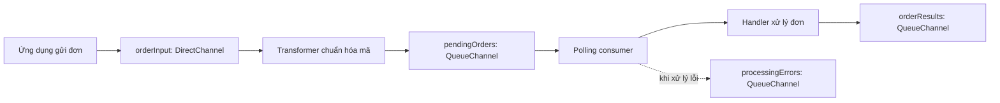

# Tạo DirectChannel và QueueChannel

Trong chương **Thực hành tổng hợp** của module `SPRING_INTEGRATION_CORE`, bài này xây dựng một luồng tiếp nhận đơn hàng để làm rõ hai cách chuyển thông điệp: gọi bộ xử lý ngay trên luồng gửi và lưu thông điệp vào hàng đợi để bộ xử lý lấy ra sau. Từ hai channel này, bạn sẽ nối `Message`, transformer, endpoint và Java DSL thành một bài thực hành có thể quan sát và kiểm thử.

Trọng tâm là xác định **thông điệp đang ở đâu, ai lấy nó, bộ xử lý chạy trên luồng nào và kết quả gửi có ý nghĩa gì**. Những kết luận này là nền tảng khi bổ sung gateway, router, filter hoặc aggregator trong các luồng tích hợp lớn hơn.

## 1. Mục tiêu và tình huống thực hành

Sau bài học, bạn có thể:

- Tạo `DirectChannel`, đăng ký một `MessageHandler` và chứng minh handler chạy trước khi lời gọi `send()` kết thúc.
- Tạo `QueueChannel` có dung lượng giới hạn; gửi, nhận và kiểm tra tình huống hàng đợi đầy hoặc rỗng.
- Phân biệt `MessageChannel`, `SubscribableChannel` và `PollableChannel`.
- Nối một đoạn xử lý đồng bộ với một đoạn xử lý qua poller bằng Java DSL.
- Viết kiểm thử cho cùng luồng thực thi, thứ tự FIFO, dung lượng và lỗi xử lý sau hàng đợi.

Giả sử hệ thống tiếp nhận một đơn hàng từ giao diện web. Mã đơn phải được chuẩn hóa ngay, còn bước xử lý nghiệp vụ được chuyển qua hàng đợi:



Ở đây, channel vận chuyển thông điệp; transformer và handler mới thực hiện logic. `orderResults` là nơi bài kiểm thử nhận kết quả, còn `processingErrors` là nơi nhận lỗi của poller. Các tên bean thể hiện vai trò, không quyết định loại channel.

## 2. Nhắc lại các hợp đồng cần dùng

Một `Message<T>` chứa payload kiểu `T` và các header mô tả ngữ cảnh. Trong bài lab, payload là chuỗi hoặc bản ghi `Order`; header `source` cho biết nơi phát sinh đơn.

Các interface phân chia trách nhiệm như sau:

| Interface | Thao tác chính | Cách dùng trong bài |
| --- | --- | --- |
| `MessageChannel` | `send(message)`, `send(message, timeout)` | Phía gửi không cần biết cách tiêu thụ |
| `SubscribableChannel` | `subscribe(handler)`, `unsubscribe(handler)` | Gắn handler vào `DirectChannel` |
| `PollableChannel` | `receive()`, `receive(timeout)` | Lấy thông điệp từ `QueueChannel` |

`send()` trả về `boolean`; `receive(timeout)` trả về một thông điệp hoặc `null` khi không nhận được trong thời gian chờ. `DirectChannel` không có `receive()` vì nó dùng cơ chế đăng ký handler. Xem hợp đồng tại [The MessageChannel Interface](https://docs.spring.io/spring-integration/reference/channel/interfaces.html).

### 2.1. DirectChannel: chuyển trực tiếp đến handler

Với một handler đã đăng ký, `DirectChannel` gọi handler trên chính thread đang gửi. Trình tự là `trước send → handler → sau send`. Channel không tạo một vùng đệm để chờ consumer xuất hiện. Hành vi cùng thread này được mô tả trong [DirectChannel API](https://docs.spring.io/spring-integration/api/org/springframework/integration/channel/DirectChannel.html).

Trong mô hình đơn hàng, chọn đoạn này cho việc chuẩn hóa mã trước khi chấp nhận công việc vào hàng đợi. Nếu bước chuẩn hóa thất bại, phía gọi vẫn đang ở cùng call stack và có thể nhận exception.

### 2.2. QueueChannel: lưu đệm để bên nhận chủ động lấy

`new QueueChannel(2)` tạo hàng đợi chứa tối đa hai thông điệp đang chờ. Khi còn chỗ, phía gửi có thể đưa thông điệp vào mà chưa có receiver. Một lần `receive()` thành công lấy thông điệp ra khỏi hàng đợi. Các constructor và thao tác quan sát dung lượng có trong [QueueChannel API](https://docs.spring.io/spring-integration/api/org/springframework/integration/channel/QueueChannel.html).

**QueueChannel không tự tạo worker thread.** Trong ví dụ Java thuần bên dưới, chính thread `main` sẽ gửi rồi nhận. Trong cấu hình Java DSL, một polling endpoint được lên lịch để nhận và xử lý. Chỉ trường hợp thứ hai mới có đoạn xử lý trên thread của scheduler.

### 2.3. Bảng đối chiếu khi thiết kế bài lab

| Câu hỏi | DirectChannel | QueueChannel mặc định trong bài |
| --- | --- | --- |
| Ai kích hoạt tiêu thụ? | Lời gọi gửi kích hoạt handler đã đăng ký | Receiver hoặc polling consumer gọi nhận |
| Có lưu thông điệp chờ không? | Không | Có, trong bộ nhớ |
| Handler chạy ở đâu? | Trên thread gửi | Trên thread thực hiện việc lấy và xử lý |
| Chưa có consumer thì sao? | Không có subscriber sẽ gây lỗi gửi | Có thể giữ thông điệp nếu còn chỗ |
| Điều gì giới hạn tốc độ tiếp nhận? | Thời gian xử lý đồng bộ | Chỗ trống và chính sách chờ của hàng đợi |
| Có phát bản sao đến mọi consumer không? | Không | Không |

Cả hai có ngữ nghĩa point-to-point. Với nhiều subscriber, `DirectChannel` chọn handler theo chiến lược phân phối; cơ chế failover có thể thử handler khác nếu handler trước ném lỗi. Với nhiều receiver của một queue, các receiver cạnh tranh lấy thông điệp. Cần broadcast thì phải thiết kế một bước phát đến nhiều đích riêng. Chi tiết về phân phối, failover và giới hạn lưu trữ được nêu tại [Message Channel Implementations](https://docs.spring.io/spring-integration/reference/channel/implementations.html).

## 3. Chuẩn bị môi trường

Dùng một project Spring Boot đã cấu hình parent hoặc BOM tương thích với JDK của dự án. Các ví dụ dùng `record` và có thể đặt trong project dùng Java 17 trở lên, miễn là đáp ứng yêu cầu Java của phiên bản Spring Boot đã chọn.

Thêm các dependency sau vào project thực hành. Không cần khai báo phiên bản riêng cho từng thư viện khi chúng đã được Spring Boot quản lý:

```xml
<dependencies>
    <dependency>
        <groupId>org.springframework.boot</groupId>
        <artifactId>spring-boot-starter-integration</artifactId>
    </dependency>
    <dependency>
        <groupId>org.springframework.boot</groupId>
        <artifactId>spring-boot-starter-test</artifactId>
        <scope>test</scope>
    </dependency>
</dependencies>
```

Nếu dùng Gradle, phần dependency tương ứng là:

```groovy
dependencies {
    implementation 'org.springframework.boot:spring-boot-starter-integration'
    testImplementation 'org.springframework.boot:spring-boot-starter-test'
}

test {
    useJUnitPlatform()
}
```

Các đoạn cấu hình này giả định project đã có cơ chế quản lý phiên bản của Spring Boot. Chọn một công cụ build theo project đang dùng.

Tổ chức các lớp ví dụ như sau; toàn bộ mã nguồn cần thiết được cung cấp trong bài:

```text
src/main/java/lab/channels/ChannelBasicsDemo.java
src/main/java/lab/channels/OrderChannelConfiguration.java
src/test/java/lab/channels/ChannelContractTest.java
src/test/java/lab/channels/OrderChannelFlowTest.java
```

Hai ví dụ đầu tiên khởi tạo channel trực tiếp bằng Java. Ví dụ Java DSL dùng `AnnotationConfigApplicationContext`, vì vậy không cần một lớp `@SpringBootApplication` để chạy các bài kiểm thử này.

## 4. Bước 1 — Quan sát hành vi bằng Java thuần

Tạo lớp `ChannelBasicsDemo`:

```java
package lab.channels;

import org.springframework.integration.channel.DirectChannel;
import org.springframework.integration.channel.QueueChannel;
import org.springframework.messaging.Message;
import org.springframework.messaging.support.MessageBuilder;

public class ChannelBasicsDemo {

    public static void main(String[] args) {
        demonstrateDirectChannel();
        demonstrateQueueChannel();
    }

    private static void demonstrateDirectChannel() {
        DirectChannel direct = new DirectChannel();

        direct.subscribe(message -> System.out.printf(
                "DIRECT handler: payload=%s, source=%s, thread=%s%n",
                message.getPayload(),
                message.getHeaders().get("source"),
                Thread.currentThread().getName()));

        Message<String> order = order("ORDER-001");

        System.out.println("DIRECT before send");
        boolean accepted = direct.send(order);
        System.out.println("DIRECT after send: " + accepted);
    }

    private static void demonstrateQueueChannel() {
        QueueChannel queue = new QueueChannel(2);

        System.out.println("QUEUE send A: " + queue.send(order("A"), 0));
        System.out.println("QUEUE send B: " + queue.send(order("B"), 0));
        System.out.println("QUEUE send C: " + queue.send(order("C"), 0));
        System.out.println("QUEUE size: " + queue.getQueueSize());

        printReceived(queue.receive(0));
        System.out.println("QUEUE retry C: " + queue.send(order("C"), 0));
        printReceived(queue.receive(0));
        printReceived(queue.receive(0));
        printReceived(queue.receive(0));
    }

    private static Message<String> order(String id) {
        return MessageBuilder.withPayload(id)
                .setHeader("source", "web")
                .build();
    }

    private static void printReceived(Message<?> message) {
        if (message == null) {
            System.out.println("QUEUE receive: null");
            return;
        }

        System.out.printf("QUEUE receive: %s, thread=%s%n",
                message.getPayload(),
                Thread.currentThread().getName());
    }
}
```

Chạy `main()` từ IDE. Nếu thread của chương trình có tên `main`, kết quả là:

```text
DIRECT before send
DIRECT handler: payload=ORDER-001, source=web, thread=main
DIRECT after send: true
QUEUE send A: true
QUEUE send B: true
QUEUE send C: false
QUEUE size: 2
QUEUE receive: A, thread=main
QUEUE retry C: true
QUEUE receive: B, thread=main
QUEUE receive: C, thread=main
QUEUE receive: null
```

Đọc kết quả theo các mốc quan sát:

1. Dòng `DIRECT handler` xuất hiện giữa hai dòng trước và sau `send()`: việc gọi handler nằm trong lời gọi gửi.
2. Queue đã nhận `A` và `B` dù chưa có receiver.
3. `C` bị từ chối ở lần đầu vì queue đầy; dùng timeout bằng `0` nên chương trình không chờ.
4. Nhận `A` giải phóng một chỗ. Lần gửi lại `C` thành công và thứ tự nhận còn lại là `B`, rồi `C`.
5. Queue rỗng thì `receive(0)` trả về `null`.
6. Tất cả thao tác nhận đều chạy trên `main`: chưa có scheduler hay worker nào được tạo trong ví dụ này.

`getQueueSize()` ở đây có kết quả xác định vì chỉ có một thread thao tác. Trong luồng có consumer chạy đồng thời, giá trị này chỉ phản ánh một thời điểm; không nên dùng nó để quyết định rằng lần gửi kế tiếp chắc chắn thành công.

## 5. Bước 2 — Chọn timeout và xử lý kết quả gửi

Trong các lời gọi có tham số `long timeout` ở bài này, đơn vị là mili giây:

| Thao tác với QueueChannel | Hành vi cần quan sát |
| --- | --- |
| `send(message, 0)` | Thử đưa vào ngay; queue đầy thì trả về `false` |
| `send(message, 500)` | Chờ chỗ trống tối đa khoảng 500 ms; hết thời gian thì trả về `false` |
| `receive(0)` | Lấy ngay nếu có; rỗng thì trả về `null` |
| `receive(500)` | Chờ thông điệp tối đa khoảng 500 ms |
| `send(message)` | Có thể chờ vô hạn nếu queue đầy |
| `receive()` | Có thể chờ vô hạn nếu queue rỗng |

Không dùng lời gọi chờ vô hạn trong một thử nghiệm mà không có thread khác làm thay đổi trạng thái hàng đợi. Chẳng hạn, nếu `main` đã gửi đầy queue rồi tiếp tục gọi `send(message)` trước khi nhận, nó không thể tự tiến đến dòng `receive()` phía sau.

Đặt quy tắc cho phía gửi thay vì bỏ qua giá trị trả về:

```java
boolean accepted = queue.send(message, 200);
if (!accepted) {
    throw new IllegalStateException("Không tiếp nhận được đơn trong 200 ms");
}
```

Đây là chính sách của ứng dụng minh họa. Hệ thống thực tế có thể trả trạng thái bận, đưa công việc sang một đích khác hoặc thử lại theo quy tắc đã định. Cần tránh vòng lặp retry liên tục khi consumer chưa giải phóng được hàng đợi.

Với `DirectChannel`, truyền timeout vào `send()` không biến nó thành giới hạn thời gian thực thi handler. Nếu handler gọi một dịch vụ chậm, cần cấu hình timeout tại thao tác gọi dịch vụ hoặc thiết kế lại ranh giới thực thi.

## 6. Bước 3 — Kiểm thử hợp đồng của hai channel

Tạo lớp `ChannelContractTest` dưới thư mục test:

```java
package lab.channels;

import java.util.concurrent.atomic.AtomicReference;

import org.junit.jupiter.api.Test;
import org.springframework.integration.channel.DirectChannel;
import org.springframework.integration.channel.QueueChannel;
import org.springframework.messaging.Message;
import org.springframework.messaging.MessagingException;
import org.springframework.messaging.support.GenericMessage;

import static org.junit.jupiter.api.Assertions.*;

class ChannelContractTest {

    @Test
    void directInvokesHandlerOnTheSendingThreadBeforeReturning() {
        DirectChannel channel = new DirectChannel();
        Thread sender = Thread.currentThread();
        AtomicReference<Thread> handlerThread = new AtomicReference<>();
        AtomicReference<Object> handledPayload = new AtomicReference<>();

        channel.subscribe(message -> {
            handlerThread.set(Thread.currentThread());
            handledPayload.set(message.getPayload());
        });

        boolean accepted = channel.send(new GenericMessage<>("ORDER-001"));

        assertTrue(accepted);
        assertSame(sender, handlerThread.get());
        assertEquals("ORDER-001", handledPayload.get());
    }

    @Test
    void directWithoutSubscriberFailsInsteadOfBuffering() {
        DirectChannel channel = new DirectChannel();

        assertThrows(MessagingException.class,
                () -> channel.send(new GenericMessage<>("ORDER-001")));
    }

    @Test
    void queueBuffersWithoutReceiverAndReturnsMessagesInFifoOrder() {
        QueueChannel channel = new QueueChannel(2);

        assertTrue(channel.send(new GenericMessage<>("A"), 0));
        assertTrue(channel.send(new GenericMessage<>("B"), 0));
        assertEquals(2, channel.getQueueSize());

        Message<?> first = channel.receive(0);
        Message<?> second = channel.receive(0);

        assertNotNull(first);
        assertNotNull(second);
        assertEquals("A", first.getPayload());
        assertEquals("B", second.getPayload());
        assertNull(channel.receive(0));
    }

    @Test
    void fullQueueRejectsNewMessageAndPreservesTheAcceptedOne() {
        QueueChannel channel = new QueueChannel(1);

        assertTrue(channel.send(new GenericMessage<>("A"), 0));
        assertFalse(channel.send(new GenericMessage<>("B"), 0));
        assertEquals(1, channel.getQueueSize());

        Message<?> received = channel.receive(0);
        assertNotNull(received);
        assertEquals("A", received.getPayload());
        assertNull(channel.receive(0));

        assertTrue(channel.send(new GenericMessage<>("B"), 0));
    }

    @Test
    void emptyQueueCanBeCheckedWithoutWaiting() {
        QueueChannel channel = new QueueChannel(1);

        assertNull(channel.receive(0));
    }
}
```

Bài kiểm thử đầu tiên kiểm tra tham chiếu `Thread`, vì vậy không phụ thuộc vào tên thread do IDE hoặc công cụ build đặt. Các bài queue không có consumer nền, nên có thể dùng `receive(0)` và kiểm tra FIFO một cách xác định.

FIFO ở đây là thứ tự lấy thông điệp khỏi queue mặc định. Nếu sau này nhiều worker xử lý song song, đơn lấy ra trước vẫn có thể hoàn tất sau một đơn khác; muốn giữ thứ tự kết quả cần thêm thiết kế tương ứng.

## 7. Bước 4 — Kết nối hai channel bằng Java DSL

Java DSL mô tả flow dưới dạng các bean `IntegrationFlow`. Spring đăng ký các channel và endpoint khi khởi tạo application context; chuỗi builder tự nó không phải một worker đang chạy. Cách khai báo này được giới thiệu tại [Java DSL](https://docs.spring.io/spring-integration/reference/dsl.html).

Trong cấu hình dưới đây:

- `ingressFlow` nhận từ `DirectChannel`, chuẩn hóa mã rồi gửi vào `pendingOrders`.
- `processingFlow` lấy đơn từ `pendingOrders` bằng poller, kiểm tra số tiền và tạo kết quả.
- Hai queue cuối chứa kết quả hoặc lỗi để phía kiểm thử chủ động nhận.

Tạo lớp `OrderChannelConfiguration`:

```java
package lab.channels;

import java.math.BigDecimal;
import java.time.Duration;
import java.util.Locale;

import org.springframework.beans.factory.annotation.Qualifier;
import org.springframework.context.annotation.Bean;
import org.springframework.context.annotation.Configuration;
import org.springframework.integration.config.EnableIntegration;
import org.springframework.integration.channel.DirectChannel;
import org.springframework.integration.channel.QueueChannel;
import org.springframework.integration.dsl.IntegrationFlow;
import org.springframework.integration.dsl.Pollers;

@Configuration(proxyBeanMethods = false)
@EnableIntegration
public class OrderChannelConfiguration {

    public record Order(String id, BigDecimal total) {
    }

    @Bean
    public DirectChannel orderInput() {
        return new DirectChannel();
    }

    @Bean
    public QueueChannel pendingOrders() {
        return new QueueChannel(10);
    }

    @Bean
    public QueueChannel orderResults() {
        return new QueueChannel(10);
    }

    @Bean
    public QueueChannel processingErrors() {
        return new QueueChannel(10);
    }

    @Bean
    public IntegrationFlow ingressFlow(
            @Qualifier("orderInput") DirectChannel input,
            @Qualifier("pendingOrders") QueueChannel pending) {

        return IntegrationFlow.from(input)
                .<Order, Order>transform(order -> {
                    System.out.printf("normalize: thread=%s%n",
                            Thread.currentThread().getName());
                    return new Order(
                            order.id().trim().toUpperCase(Locale.ROOT),
                            order.total());
                })
                .channel(pending)
                .get();
    }

    @Bean
    public IntegrationFlow processingFlow(
            @Qualifier("pendingOrders") QueueChannel pending,
            @Qualifier("orderResults") QueueChannel results) {

        return IntegrationFlow.from(pending)
                .handle(Order.class, (order, headers) -> {
                    System.out.printf("process: thread=%s%n",
                            Thread.currentThread().getName());

                    if (order.total().signum() <= 0) {
                        throw new IllegalArgumentException(
                                "Tổng tiền đơn hàng phải lớn hơn 0");
                    }

                    return "PROCESSED:" + order.id();
                }, endpoint -> endpoint.poller(
                        Pollers.fixedDelay(Duration.ofMillis(100))
                                .receiveTimeout(0)
                                .maxMessagesPerPoll(5)
                                .errorChannel("processingErrors")))
                .channel(results)
                .get();
    }
}
```

`@EnableIntegration` cung cấp hạ tầng cho application context Java thuần. Ví dụ này không có gateway cần quét nên không cần `@IntegrationComponentScan`.

### 7.1. Vì sao poller gắn vào endpoint?

Endpoint tiêu thụ `SubscribableChannel` được kích hoạt khi có thông điệp gửi đến. Endpoint tiêu thụ `PollableChannel` phải chủ động nhận. Vì `processingFlow` bắt đầu từ queue, poller được cấu hình tại handler đầu tiên để tạo polling consumer. Xem [Polling Consumer](https://docs.spring.io/spring-integration/reference/polling-consumer.html).

Trong bài, không có default poller. Nếu bỏ cấu hình poller khỏi handler tiêu thụ queue, application context không có đủ cấu hình để khởi tạo endpoint đó. Ngược lại, `orderResults` và `processingErrors` chỉ là queue đầu ra được test gọi `receive()`, nên không cần polling endpoint riêng.

### 7.2. Đọc cấu hình poller theo từng tham số

| Cấu hình | Ý nghĩa trong ví dụ |
| --- | --- |
| `fixedDelay(Duration.ofMillis(100))` | Đợi khoảng 100 ms từ khi một lượt polling kết thúc đến lượt kế tiếp |
| `receiveTimeout(0)` | Mỗi lần thử nhận không chờ khi queue đang rỗng |
| `maxMessagesPerPoll(5)` | Một lượt polling xử lý tối đa năm thông điệp nếu có sẵn |
| `errorChannel("processingErrors")` | Đích mặc định nhận lỗi của poller trong cấu hình này |

Giới hạn năm thông điệp không tạo ra năm thread và không bảo đảm xử lý được năm đơn mỗi 100 ms. Thời gian thực hiện handler cũng góp vào thời gian của một lượt polling. Tham khảo định nghĩa lịch chạy tại [Pollers API](https://docs.spring.io/spring-integration/api/org/springframework/integration/dsl/Pollers.html) và các thuộc tính tại [PollerSpec API](https://docs.spring.io/spring-integration/api/org/springframework/integration/dsl/PollerSpec.html).

### 7.3. Xác định ranh giới thực thi

Trong flow đã cấu hình, phía gửi thực hiện bước chuẩn hóa rồi đưa thông điệp vào queue. Scheduler thực hiện bước nhận và xử lý đơn. Tên thread cụ thể có thể khác nhau giữa các môi trường; quan sát hai dòng `normalize` và `process` để nhận ra ranh giới.

Có ba mốc hoàn thành khác nhau:

1. Chuẩn hóa xong mã đơn.
2. Gửi được thông điệp đã chuẩn hóa vào `pendingOrders`.
3. Xử lý xong và phát kết quả vào `orderResults`.

`input.send(...)` thành công trong flow này cho biết đoạn đồng bộ đã chạy và thông điệp đã được chấp nhận ở queue. Muốn biết kết quả nghiệp vụ, test phải nhận thông điệp ở `orderResults`.

Consumer có thể lấy đơn rất nhanh, thậm chí trước khi phía gửi kịp in dòng log tiếp theo. Vì vậy, không dùng thứ tự log giữa hai thread hoặc giá trị `pendingOrders.getQueueSize()` ngay sau gửi để kết luận công việc đã hay chưa hoàn tất.

Timeout truyền vào `input.send(message, timeout)` cũng không tự đặt timeout cho mọi bước nằm phía sau transformer. Khi cần giới hạn thời gian gửi từ endpoint sang queue kế tiếp, phải cấu hình chính thao tác gửi của endpoint đó; các hàng đợi trong bài lab không bị lấp đầy bởi hai ca kiểm thử bên dưới.

## 8. Bước 5 — Kiểm thử flow thành công và flow lỗi

Tạo lớp `OrderChannelFlowTest`. Mỗi test mở một context riêng và đóng sau khi hoàn tất, nên không dùng chung thông điệp tồn đọng:

```java
package lab.channels;

import java.math.BigDecimal;

import org.junit.jupiter.api.Test;
import org.springframework.context.annotation.AnnotationConfigApplicationContext;
import org.springframework.integration.channel.DirectChannel;
import org.springframework.integration.channel.QueueChannel;
import org.springframework.messaging.Message;
import org.springframework.messaging.MessagingException;
import org.springframework.messaging.support.ErrorMessage;
import org.springframework.messaging.support.MessageBuilder;

import static lab.channels.OrderChannelConfiguration.Order;
import static org.junit.jupiter.api.Assertions.*;

class OrderChannelFlowTest {

    @Test
    void normalizesAnOrderThenProcessesItFromTheQueue() {
        try (var context = new AnnotationConfigApplicationContext(
                OrderChannelConfiguration.class)) {

            DirectChannel input = context.getBean(
                    "orderInput", DirectChannel.class);
            QueueChannel results = context.getBean(
                    "orderResults", QueueChannel.class);

            Message<Order> request = MessageBuilder
                    .withPayload(new Order("  od-001  ",
                            new BigDecimal("150000")))
                    .setHeader("source", "web")
                    .build();

            assertTrue(input.send(request));

            Message<?> result = results.receive(3000);
            assertNotNull(result);
            assertEquals("PROCESSED:OD-001", result.getPayload());
            assertEquals("web", result.getHeaders().get("source"));
        }
    }

    @Test
    void sendsProcessingFailureToThePollerErrorChannel() {
        try (var context = new AnnotationConfigApplicationContext(
                OrderChannelConfiguration.class)) {

            DirectChannel input = context.getBean(
                    "orderInput", DirectChannel.class);
            QueueChannel errors = context.getBean(
                    "processingErrors", QueueChannel.class);
            QueueChannel results = context.getBean(
                    "orderResults", QueueChannel.class);

            Message<Order> request = MessageBuilder
                    .withPayload(new Order("od-err", BigDecimal.ZERO))
                    .setHeader("source", "web")
                    .build();

            assertTrue(input.send(request));

            Message<?> received = errors.receive(3000);
            ErrorMessage error = assertInstanceOf(ErrorMessage.class, received);
            MessagingException failure = assertInstanceOf(
                    MessagingException.class, error.getPayload());

            assertNotNull(failure.getFailedMessage());
            assertNull(results.receive(0));
        }
    }
}
```

Chạy hai lớp test bằng IDE hoặc lệnh phù hợp với project thực hành:

```text
Maven:  mvn test -Dtest=ChannelContractTest,OrderChannelFlowTest
Gradle: ./gradlew test --tests lab.channels.ChannelContractTest --tests lab.channels.OrderChannelFlowTest
```

Trên Windows PowerShell, chạy Gradle Wrapper từ thư mục gốc project bằng `.\gradlew.bat test --tests lab.channels.ChannelContractTest --tests lab.channels.OrderChannelFlowTest`.

Kết quả mong đợi là **bảy test đạt**: năm test hợp đồng channel và hai test flow. Ví dụ không dùng `Thread.sleep()`; lời gọi `receive(3000)` chờ một điều kiện có ý nghĩa là kết quả hoặc lỗi xuất hiện, với giới hạn ba giây để test không treo vô hạn. Trên môi trường CI quá tải, có thể điều chỉnh giới hạn chờ có chủ đích.

### 8.1. Hiểu đúng ca lỗi sau hàng đợi

Ở test thứ hai, đơn đã được chuẩn hóa và gửi vào queue, nên `input.send()` có thể thành công. Lỗi số tiền phát sinh ở polling task. Với hạ tầng Spring Integration mặc định dùng trong bài, lỗi này được bọc trong `ErrorMessage` và chuyển đến kênh lỗi đã cấu hình. Nó không quay ngược bằng exception về call stack của bên đã gửi xong. Cơ chế này được mô tả tại [Error Handling](https://docs.spring.io/spring-integration/reference/error-handling.html).

Ca kiểm thử xác nhận hai đầu ra: có thông điệp lỗi và không có kết quả thành công cho đơn đó. Nó không ngụ ý đơn lỗi được tự động đưa lại vào `pendingOrders`. Nếu cần retry hoặc lưu công việc lỗi để xử lý lại, phải bổ sung chính sách riêng.

Nếu tự viết vòng lặp `receive()` rồi gọi handler ngoài polling endpoint của Spring Integration, bạn phải tự quản lý exception và đích lỗi của vòng lặp ấy.

## 9. Bài tập thay đổi có kiểm soát

### Bài tập A — Thử nghiệm dung lượng bằng một queue độc lập

Tạo `QueueChannel(1)` không có consumer nền, rồi thực hiện lần lượt:

```text
send(A, 0) → send(B, 0) → receive(0) → send(B, 0) → receive(0)
```

Kết quả mong đợi:

```text
true → false → A → true → B
```

Giải thích vì sao thông điệp `B` ở lần gửi thất bại không tự xuất hiện về sau. Chỉ lần gửi lại thành công mới đưa nó vào queue. Dùng queue độc lập để consumer nền không làm thay đổi trạng thái trong lúc bạn kiểm tra.

### Bài tập B — Phân biệt lỗi trước và sau queue

Giữ nguyên flow và thử hai dữ liệu:

| Dữ liệu | Nơi phát sinh lỗi trong mã ví dụ | Bằng chứng cần kiểm tra |
| --- | --- | --- |
| `new Order(null, new BigDecimal("10"))` | Transformer gọi `trim()` trước queue | `input.send()` ném một `MessagingException` |
| `new Order("od-err", BigDecimal.ZERO)` | Handler xử lý sau queue | Nhận `ErrorMessage` từ `processingErrors` |

Dòng đầu chỉ là thí nghiệm xác định ranh giới lỗi; trong ứng dụng thật nên kiểm tra mã đơn và báo lỗi có ý nghĩa thay vì để `NullPointerException` phát sinh. Khi viết test, kiểm tra loại exception bao ngoài theo hợp đồng messaging và xem nguyên nhân gốc nếu cần chẩn đoán.

### Bài tập C — Quan sát cạnh tranh tiêu thụ

Với một queue độc lập có dung lượng đủ lớn, gửi `A`, `B`, `C`, `D`. Cho hai consumer gọi `receive()` trên cùng queue và ghi nhận consumer nào nhận payload nào.

Điều cần chứng minh là tổng cộng bốn thông điệp được lấy ra và mỗi thông điệp chỉ bị lấy ra một lần trong thí nghiệm không retry. Không yêu cầu consumer số 1 luôn nhận `A`, hoặc mỗi consumer luôn nhận đúng hai thông điệp; lịch chạy thread quyết định phân bố thực tế.

### Bài tập D — Giải thích ảnh hưởng của tốc độ đầu vào

Giả sử ban đầu queue rỗng, trung bình nhận 100 đơn/giây và consumer xử lý 60 đơn/giây. Nếu các tốc độ giữ ổn định, tồn đọng tăng khoảng 40 đơn/giây. Với capacity 100, hàng đợi có thể đầy sau khoảng 2,5 giây.

Đây là ước lượng để phân tích một tình huống giả định. Tăng capacity chỉ kéo dài thời gian hấp thụ đột biến; cần đo thời gian xử lý và điều chỉnh năng lực consumer hoặc chính sách tiếp nhận nếu chênh lệch kéo dài.

## 10. Những lỗi thường gặp khi hoàn thành bài lab

| Hiện tượng | Nguyên nhân có thể gặp | Cách kiểm tra hoặc sửa |
| --- | --- | --- |
| Gửi vào DirectChannel báo không có subscriber | Chưa đăng ký handler, endpoint chưa chạy hoặc đã dừng | Với Java thuần, kiểm tra `subscribe()`; với DSL, kiểm tra context và endpoint |
| IDE không tìm thấy `receive()` trên DirectChannel | Nhầm cơ chế subscribe với cơ chế polling | Dùng handler hoặc đổi thiết kế sang queue nếu cần bên nhận chủ động lấy |
| Main hoặc test đứng ở `send()` | Queue đầy và lời gọi đang chờ vô hạn | Dùng timeout hữu hạn và kiểm tra giá trị trả về |
| Queue có dữ liệu nhưng handler không chạy | Chưa có consumer, poller chưa chạy hoặc endpoint không khởi tạo được | Kiểm tra cấu hình poller tại endpoint tiêu thụ queue |
| Khởi tạo context thất bại vì thiếu poller | Handler nhận từ queue nhưng không có poller riêng hay mặc định | Khôi phục `endpoint.poller(...)` của ví dụ |
| `receive()` làm test treo khi chưa có thông điệp | Lời gọi nhận không có giới hạn chờ | Dùng `receive(0)` cho trạng thái đồng bộ hoặc timeout hữu hạn cho xử lý nền |
| Lúc kiểm tra thì queue size đã bằng 0 | Poller đã lấy thông điệp | Kiểm tra kết quả cuối thay vì suy luận từ kích thước queue |
| Gửi trả về `true` nhưng không có kết quả | Xử lý sau queue thất bại hoặc còn đang chạy | Nhận từ `orderResults` với timeout và kiểm tra `processingErrors` |
| Flow chạy một lúc rồi dừng tiến triển | Queue kết quả hoặc lỗi đã đầy vì không có receiver | Tiêu thụ cả các đầu ra; kiểm tra nơi các thread đang chờ |
| Hai handler không cùng nhận mỗi thông điệp | Đang dùng point-to-point | Thiết kế một bước publish-subscribe nếu cần nhân thông điệp |
| Dữ liệu chờ biến mất sau khởi động lại | Queue mặc định chỉ lưu trong bộ nhớ | Chọn message store bền vững hoặc hạ tầng messaging phù hợp nếu nghiệp vụ yêu cầu |

Trong cấu hình minh họa, cả ba queue đều giới hạn 10 thông điệp. Khi mở rộng số lượng đơn gửi, phải tiếp tục nhận kết quả và lỗi; nếu bỏ mặc đầu ra, việc gửi vào queue đầu ra có thể chặn polling task.

Ngoài ra, một queue trong cùng tiến trình không tự trở thành hàng đợi phân tán giữa nhiều instance. Channel cũng không tự cung cấp cam kết xử lý nghiệp vụ đúng một lần. Muốn có khả năng phục hồi khi tiến trình chết, kiểm soát việc gửi lại hoặc xử lý trùng, cần thiết kế lưu trữ và nghiệp vụ tương ứng.

## 11. Điều kiện hoàn thành

Bài thực hành hoàn thành khi bạn có đủ các bằng chứng sau:

- [ ] Chạy được demo và giải thích được vì sao handler của DirectChannel nằm giữa hai dòng trước/sau `send()`.
- [ ] Chứng minh handler trực tiếp chạy trên cùng đối tượng `Thread` với bên gửi.
- [ ] Quan sát queue nhận thông điệp khi chưa có receiver và trả lại theo FIFO trong thử nghiệm một consumer.
- [ ] Kiểm tra được trường hợp queue đầy trả `false` mà không làm mất thông điệp đã nhận trước đó.
- [ ] Khởi tạo được Java DSL flow có polling consumer sau `pendingOrders`.
- [ ] Nhận `PROCESSED:OD-001` cùng header `source=web` ở ca thành công.
- [ ] Nhận `ErrorMessage` ở ca số tiền không hợp lệ và giải thích được ranh giới lỗi.
- [ ] Phân biệt được ba mốc: đã chuẩn hóa, đã vào queue và đã xử lý xong.

Từ flow này, có thể tiếp tục thêm filter để từ chối đơn không hợp lệ, router để tách nhóm đơn hoặc gateway để cung cấp giao diện gọi nghiệp vụ. Khi mở rộng, hãy đánh dấu lại từng ranh giới đồng bộ, hàng đợi và đích lỗi để giữ được khả năng giải thích cũng như kiểm thử luồng thông điệp.
