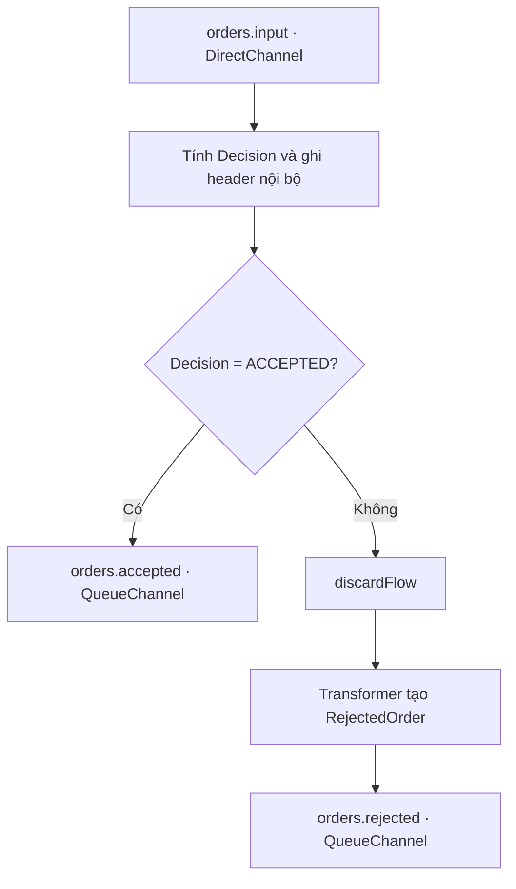

# Tạo filter và discard flow

Trong chương **Thực hành tổng hợp** của module **SPRING_INTEGRATION_CORE**, bài này xây dựng một luồng tiếp nhận đơn hàng: thông điệp hợp lệ đi tiếp; thông điệp không đạt quy tắc đi vào nhánh từ chối có mã lý do. Qua đó, bạn kết hợp `Message`, `MessageChannel`, endpoint, transformer và Java DSL, rồi kiểm thử kết quả ở cả hai nhánh.

## 1. Kết quả cần đạt và bài toán

Sau bài thực hành, bạn có thể:

- Viết điều kiện chấp nhận dựa trên cả payload lẫn header.
- Dùng `filter` để bảo vệ luồng xử lý chính.
- Cấu hình `discardFlow` để ghi nhận thông điệp bị từ chối.
- Phân biệt một lần từ chối nghiệp vụ với một lần xử lý gặp exception.
- Kiểm tra nội dung, header và số lượng thông điệp ở từng đầu ra.

Giả sử một hệ thống bán lẻ chỉ tiếp nhận đơn hàng của tenant `retail-vn`. Mỗi đơn phải có mã đơn, mã khách hàng và tổng tiền tối thiểu **100.000 VND**. Thứ tự kiểm tra được quy định rõ:

| Thứ tự | Điều kiện không đạt | Kết quả |
| --- | --- | --- |
| 1 | Payload không phải `Order` | `UNSUPPORTED_PAYLOAD` |
| 2 | Header `tenantId` thiếu hoặc khác `retail-vn` | `UNSUPPORTED_TENANT` |
| 3 | `orderId` null, rỗng hoặc chỉ chứa khoảng trắng | `MISSING_ORDER_ID` |
| 4 | `customerId` null, rỗng hoặc chỉ chứa khoảng trắng | `MISSING_CUSTOMER_ID` |
| 5 | `total` null | `INVALID_AMOUNT` |
| 6 | `total < 100000` | `BELOW_MINIMUM` |
| 7 | Đạt tất cả điều kiện | `ACCEPTED` |

Nếu một đơn vi phạm nhiều điều kiện, bài lab ghi nhận **lỗi đầu tiên theo bảng**. Tổng tiền bằng đúng ngưỡng được chấp nhận; số âm và số không đều thuộc `BELOW_MINIMUM`. Mọi số tiền trong bài dùng cùng đơn vị VND.

Đây là hợp đồng của bài thực hành. Khi quy tắc thực tế cần trả về tất cả lỗi, hãy thay kết quả đơn bằng một cấu trúc chứa danh sách lỗi và cập nhật kiểm thử tương ứng.

## 2. Filter quyết định điều gì?

Một filter trả lời câu hỏi: **thông điệp này có được tiếp tục qua endpoint hiện tại hay không?** Selector trả về `true` thì thông điệp được chuyển tiếp; trả về `false` thì áp dụng chính sách từ chối. Filter không biến đơn hàng thành một kiểu payload khác. [Tài liệu Filter của Spring Integration](https://docs.spring.io/spring-integration/reference/filter.html).

| Thành phần | Trách nhiệm trong bài |
| --- | --- |
| Header enricher | Tính quyết định kiểm tra và thêm vào header |
| Filter | Cho phép hoặc chặn thông điệp dựa trên quyết định đó |
| Transformer trong discard flow | Tạo bản ghi từ chối có mã lý do |
| Channel tiếp nhận | Nhận các đơn được phép xử lý tiếp |
| Channel từ chối | Nhận các bản ghi để quan sát hoặc lưu trữ |

`discard` có nghĩa là loại khỏi đường đi chính. Ta vẫn có thể lưu vết hoặc chuyển thông điệp sang nơi xử lý khác.

`discardFlow(...)` khai báo nhánh xử lý ngay tại filter; `discardChannel(...)` trỏ tới một channel và cho phép định nghĩa nhánh đó bằng flow riêng. Chọn một cách cho cùng nhánh từ chối. [API FilterEndpointSpec](https://docs.spring.io/spring-integration/api/org/springframework/integration/dsl/FilterEndpointSpec.html).

### Sơ đồ luồng



Trong bài, filter là endpoint `eligibleOrderFilter`; các channel là điểm nối giữa những bước xử lý. Không gộp vai trò “kiểm tra điều kiện” và “thực hiện thanh toán” vào cùng một selector.

## 3. Chuẩn bị project thực hành

Bộ mã minh họa dùng **Java 17**, Maven và Spring Boot **3.5.0**, với Spring Integration **6.5.0** do dependency management của Boot quản lý. Đây là mốc phiên bản cố định để tái tạo bài lab. [Khai báo dependency của Spring Boot 3.5.0](https://github.com/spring-projects/spring-boot/blob/v3.5.0/spring-boot-project/spring-boot-dependencies/build.gradle).

Tạo một project thực hành với cấu trúc:

```text
order-filter-lab/
├── pom.xml
└── src/
    ├── main/java/com/example/integration/
    │   ├── Order.java
    │   ├── Decision.java
    │   ├── OrderPolicy.java
    │   ├── RejectedOrder.java
    │   ├── RejectedOrderMapper.java
    │   └── OrderFilterConfig.java
    └── test/java/com/example/integration/
        └── OrderFilterFlowTest.java
```

Nội dung `pom.xml`:

```xml
<project xmlns="http://maven.apache.org/POM/4.0.0"
         xmlns:xsi="http://www.w3.org/2001/XMLSchema-instance"
         xsi:schemaLocation="http://maven.apache.org/POM/4.0.0 https://maven.apache.org/xsd/maven-4.0.0.xsd">
    <modelVersion>4.0.0</modelVersion>

    <parent>
        <groupId>org.springframework.boot</groupId>
        <artifactId>spring-boot-starter-parent</artifactId>
        <version>3.5.0</version>
        <relativePath/>
    </parent>

    <groupId>com.example</groupId>
    <artifactId>order-filter-lab</artifactId>
    <version>1.0.0-SNAPSHOT</version>

    <properties>
        <java.version>17</java.version>
        <project.build.sourceEncoding>UTF-8</project.build.sourceEncoding>
    </properties>

    <dependencies>
        <dependency>
            <groupId>org.springframework.boot</groupId>
            <artifactId>spring-boot-starter-integration</artifactId>
        </dependency>
        <dependency>
            <groupId>org.springframework.boot</groupId>
            <artifactId>spring-boot-starter-test</artifactId>
            <scope>test</scope>
        </dependency>
    </dependencies>
</project>
```

Bài lab khởi tạo Spring context từ lớp cấu hình trong kiểm thử, nên không cần lớp `main` hay kết nối broker. Hai `QueueChannel` cuối luồng giữ kết quả trong bộ nhớ để kiểm tra; ở cấu hình này chúng chưa có consumer tự động.

## 4. Mô hình dữ liệu và quyết định kiểm tra

### 4.1. Payload đơn hàng

Tệp `Order.java`:

```java
package com.example.integration;

import java.math.BigDecimal;

public record Order(
        String orderId,
        String customerId,
        BigDecimal total) {
}
```

Dùng `BigDecimal` để biểu diễn tiền và dùng `compareTo` để kiểm tra ngưỡng. Chẳng hạn, `100000` và `100000.00` phải có cùng kết quả chấp nhận dù scale khác nhau.

Record này cho phép tạo dữ liệu chưa hợp lệ để mô phỏng đầu vào cần kiểm tra. Payload của một `Message` không được null; trường `total` bên trong một `Order` vẫn có thể null và sẽ được policy xử lý.

### 4.2. Mã quyết định

Tệp `Decision.java`:

```java
package com.example.integration;

public enum Decision {
    ACCEPTED,
    UNSUPPORTED_PAYLOAD,
    UNSUPPORTED_TENANT,
    MISSING_ORDER_ID,
    MISSING_CUSTOMER_ID,
    INVALID_AMOUNT,
    BELOW_MINIMUM
}
```

Mã quyết định giúp kiểm thử và thống kê mà không phụ thuộc câu chữ thông báo. Nếu cần thông báo tiếng Việt cho người dùng, ánh xạ từ enum ở lớp trình bày.

### 4.3. Policy đọc cả payload và header

Tệp `OrderPolicy.java`:

```java
package com.example.integration;

import java.math.BigDecimal;

import org.springframework.messaging.Message;

public final class OrderPolicy {

    public static final String TENANT_HEADER = "tenantId";
    public static final String REQUEST_HEADER = "requestId";
    public static final String DECISION_HEADER = "validationDecision";

    private static final BigDecimal MINIMUM_TOTAL =
            new BigDecimal("100000");

    public Decision evaluate(Message<?> message) {
        if (!(message.getPayload() instanceof Order order)) {
            return Decision.UNSUPPORTED_PAYLOAD;
        }

        Object tenant = message.getHeaders().get(TENANT_HEADER);
        if (!"retail-vn".equals(tenant)) {
            return Decision.UNSUPPORTED_TENANT;
        }

        if (isBlank(order.orderId())) {
            return Decision.MISSING_ORDER_ID;
        }

        if (isBlank(order.customerId())) {
            return Decision.MISSING_CUSTOMER_ID;
        }

        if (order.total() == null) {
            return Decision.INVALID_AMOUNT;
        }

        if (order.total().compareTo(MINIMUM_TOTAL) < 0) {
            return Decision.BELOW_MINIMUM;
        }

        return Decision.ACCEPTED;
    }

    private boolean isBlank(String value) {
        return value == null || value.isBlank();
    }
}
```

`evaluate` là hàm không có tác dụng phụ: không gọi HTTP, không ghi database, không trừ tồn kho. Một đầu vào không đạt quy tắc được chuyển thành `Decision`. Các lỗi lập trình hoặc lỗi hạ tầng vẫn phải được nhận diện bằng cơ chế exception phù hợp.

Policy kiểm tra kiểu payload trước khi truy cập thuộc tính của `Order`. Vì vậy, một chuỗi đầu vào có thể đi vào nhánh `UNSUPPORTED_PAYLOAD` mà không gây `ClassCastException`. Bài này nhận đối tượng Java đã được dựng; việc phân tích JSON tại adapter là một bước khác.

Header `tenantId` ở đây là dữ liệu đầu vào giả lập. Trong hệ thống có xác thực, adapter phải thiết lập tenant từ ngữ cảnh đã xác minh trước khi chuyển vào flow.

## 5. Thiết kế bản ghi cho discard flow

Tệp `RejectedOrder.java`:

```java
package com.example.integration;

public record RejectedOrder(
        String requestId,
        String orderId,
        Decision reason) {
}
```

Bản ghi chỉ chứa thông tin cần để đối chiếu yêu cầu và nhận biết nguyên nhân. Nếu payload sai kiểu thì không lấy được mã đơn; `orderId` của bản ghi có thể null. Nếu mã đơn ban đầu rỗng thì bản ghi giữ giá trị rỗng đó.

Tệp `RejectedOrderMapper.java`:

```java
package com.example.integration;

import org.springframework.messaging.Message;

public final class RejectedOrderMapper {

    public RejectedOrder toRejection(Message<?> message) {
        Object decision =
                message.getHeaders().get(OrderPolicy.DECISION_HEADER);

        if (!(decision instanceof Decision reason)
                || reason == Decision.ACCEPTED) {
            throw new IllegalStateException(
                    "Discard flow requires a rejection decision");
        }

        String orderId = message.getPayload() instanceof Order order
                ? order.orderId()
                : null;

        Object rawRequestId =
                message.getHeaders().get(OrderPolicy.REQUEST_HEADER);
        String requestId = rawRequestId instanceof String value
                ? value
                : null;

        return new RejectedOrder(requestId, orderId, reason);
    }
}
```

Mapper dùng kết quả đã tính trong header. Cách này tránh việc selector kết luận một lý do nhưng discard flow tính lại với dữ liệu hoặc cấu hình đã thay đổi.

Điều kiện bảo vệ trong mapper phát hiện sai cấu hình: một thông điệp không có quyết định từ chối không được tạo thành bản ghi từ chối hợp lệ. Khi điều kiện này ném exception, đó là lỗi thực thi flow.

## 6. Lắp ráp flow bằng Java DSL

Tệp `OrderFilterConfig.java`:

```java
package com.example.integration;

import org.springframework.beans.factory.annotation.Qualifier;
import org.springframework.context.annotation.Bean;
import org.springframework.context.annotation.Configuration;
import org.springframework.integration.channel.DirectChannel;
import org.springframework.integration.channel.QueueChannel;
import org.springframework.integration.config.EnableIntegration;
import org.springframework.integration.dsl.IntegrationFlow;
import org.springframework.messaging.Message;
import org.springframework.messaging.MessageChannel;

@Configuration
@EnableIntegration
public class OrderFilterConfig {

    @Bean(name = "orders.input")
    public MessageChannel orderInput() {
        return new DirectChannel();
    }

    @Bean(name = "orders.accepted")
    public QueueChannel acceptedOrders() {
        return new QueueChannel();
    }

    @Bean(name = "orders.rejected")
    public QueueChannel rejectedOrders() {
        return new QueueChannel();
    }

    @Bean
    public OrderPolicy orderPolicy() {
        return new OrderPolicy();
    }

    @Bean
    public RejectedOrderMapper rejectedOrderMapper() {
        return new RejectedOrderMapper();
    }

    @Bean
    public IntegrationFlow orderFilterFlow(
            @Qualifier("orders.input") MessageChannel input,
            @Qualifier("orders.accepted") QueueChannel accepted,
            @Qualifier("orders.rejected") QueueChannel rejected,
            OrderPolicy policy,
            RejectedOrderMapper rejectionMapper) {

        return IntegrationFlow.from(input)
                .enrichHeaders(headers -> headers.headerFunction(
                        OrderPolicy.DECISION_HEADER,
                        policy::evaluate,
                        true))
                .filter(Message.class,
                        message -> message.getHeaders().get(
                                OrderPolicy.DECISION_HEADER)
                                == Decision.ACCEPTED,
                        endpoint -> endpoint
                                .id("eligibleOrderFilter")
                                .throwExceptionOnRejection(false)
                                .discardFlow(discard -> discard
                                        .transform(rejectionMapper,
                                                "toRejection")
                                        .channel(rejected)))
                .channel(accepted)
                .get();
    }
}
```

### 6.1. Vì sao tính Decision trước filter?

Một selector chỉ cung cấp kết quả boolean. Bài lab cần đồng thời biết thông điệp bị chặn vì lý do nào, nên header enricher tính `Decision` trước. Filter chỉ so sánh kết quả với `ACCEPTED`; mapper đọc lại chính kết quả đó.

Tham số `true` của `headerFunction` cho phép ghi đè header `validationDecision` đã có. Nhờ vậy, bên gửi không thể chèn `ACCEPTED` vào header này để bỏ qua policy. [Mã nguồn HeaderEnricherSpec 6.5.0](https://github.com/spring-projects/spring-integration/blob/v6.5.0/spring-integration-core/src/main/java/org/springframework/integration/dsl/HeaderEnricherSpec.java).

Header này thuộc quyền quản lý nội bộ của flow. Không dùng trực tiếp giá trị do nguồn ngoài cung cấp làm quyết định chấp nhận.

### 6.2. Vì sao có Message.class?

`filter(Message.class, ...)` cho callback truy cập toàn bộ thông điệp, gồm payload và header. Đây là overload thích hợp khi điều kiện cần `validationDecision`. [Mã nguồn Java DSL 6.5.0](https://github.com/spring-projects/spring-integration/blob/v6.5.0/spring-integration-core/src/main/java/org/springframework/integration/dsl/BaseIntegrationFlowDefinition.java).

Một ví dụ chỉ dựa vào payload có thể viết:

```java
// Đoạn minh họa độc lập, giả sử đầu vào đã là Order hợp lệ về cấu trúc.
.filter(Order.class,
        order -> order.total().compareTo(
                new java.math.BigDecimal("100000")) >= 0)
```

Không thay trực tiếp ví dụ này vào flow chính, vì nó bỏ qua các quy tắc còn lại và giả định `total` khác null.

### 6.3. Nhánh từ chối kết thúc ở đâu?

`discardFlow` nhận thông điệp bị filter chặn, sau đó transformer tạo `RejectedOrder` rồi gửi tới `orders.rejected`. Thông điệp đó không chạy tiếp vào `orders.accepted` sau filter.

Nhánh này có đầu ra tường minh. Nếu kết thúc bằng một transformer tạo reply nhưng không có đích nhận phù hợp, flow có thể tìm tới `replyChannel` của yêu cầu hoặc gặp lỗi định tuyến. Luôn vẽ rõ điểm kết thúc của nhánh.

Đầu vào là `DirectChannel`, nên policy, filter và bước gửi kết quả vào queue được thực hiện trong luồng gọi của bên gửi. Việc gọi `receive` trên các queue ở cuối bài là thao tác lấy kết quả; bài chưa thêm poller.

## 7. Chính sách từ chối và exception

Các tổ hợp sau áp dụng khi selector trả về `false` và thao tác gửi sang discard channel, nếu có, thực hiện thành công:

| Có discard channel/flow? | `throwExceptionOnRejection` | Hành vi |
| --- | --- | --- |
| Không | `false` | Không đi tiếp; không có đầu ra nghiệp vụ |
| Có | `false` | Gửi sang nhánh từ chối; không tạo exception do chính việc từ chối |
| Không | `true` | Ném `MessageRejectedException` |
| Có | `true` | Gửi sang nhánh từ chối rồi ném `MessageRejectedException` |

Cờ này mặc định là `false`. Nếu vừa cấu hình discard vừa bật cờ, exception vẫn được ném sau thao tác discard thành công. [API FilterEndpointSpec](https://docs.spring.io/spring-integration/api/org/springframework/integration/dsl/FilterEndpointSpec.html).

Nếu không có discard channel và cờ là `false`, phiên bản dùng trong bài ghi cảnh báo cho thông điệp bị bỏ. Vì vậy, không nên hiểu “không có exception” là “không có log”. [Mã nguồn MessageFilter 6.5.0](https://github.com/spring-projects/spring-integration/blob/v6.5.0/spring-integration-core/src/main/java/org/springframework/integration/filter/MessageFilter.java).

Bài lab dùng discard flow và `false` vì đơn dưới ngưỡng là một kết quả nghiệp vụ có dự kiến. Tuy nhiên, nếu transformer hoặc nơi nhận bản ghi từ chối ném exception thì lỗi đó vẫn có thể truyền về bên gọi. Cờ này không che lỗi của các bước xử lý trong nhánh từ chối.

## 8. Kiểm thử hành vi của cả hai nhánh

Tệp `OrderFilterFlowTest.java` dưới đây dùng Spring Test để khởi tạo cấu hình thật và dùng queue làm điểm quan sát. Spring Test có thể kiểm thử integration flow; `@SpringIntegrationTest` bổ sung công cụ như `MockIntegrationContext` khi cần thay endpoint hoặc chặn adapter tự khởi động. Bài này chưa cần các tính năng đó. [Testing support của Spring Integration](https://docs.spring.io/spring-integration/reference/testing.html).

```java
package com.example.integration;

import java.math.BigDecimal;
import java.util.HashSet;
import java.util.Set;
import java.util.stream.Stream;

import org.junit.jupiter.api.BeforeEach;
import org.junit.jupiter.api.Test;
import org.junit.jupiter.api.parallel.Execution;
import org.junit.jupiter.api.parallel.ExecutionMode;
import org.junit.jupiter.params.ParameterizedTest;
import org.junit.jupiter.params.provider.Arguments;
import org.junit.jupiter.params.provider.MethodSource;
import org.junit.jupiter.params.provider.ValueSource;
import org.springframework.beans.factory.annotation.Autowired;
import org.springframework.beans.factory.annotation.Qualifier;
import org.springframework.integration.channel.QueueChannel;
import org.springframework.messaging.Message;
import org.springframework.messaging.MessageChannel;
import org.springframework.messaging.MessagingException;
import org.springframework.messaging.support.ChannelInterceptor;
import org.springframework.messaging.support.MessageBuilder;
import org.springframework.test.context.junit.jupiter.SpringJUnitConfig;

import static org.junit.jupiter.api.Assertions.*;

@SpringJUnitConfig(OrderFilterConfig.class)
@Execution(ExecutionMode.SAME_THREAD)
class OrderFilterFlowTest {

    @Autowired
    @Qualifier("orders.input")
    MessageChannel input;

    @Autowired
    @Qualifier("orders.accepted")
    QueueChannel accepted;

    @Autowired
    @Qualifier("orders.rejected")
    QueueChannel rejected;

    @BeforeEach
    void clearOutputQueues() {
        while (accepted.receive(0) != null) {
            // Dọn dữ liệu còn lại giữa các lần kiểm thử.
        }
        while (rejected.receive(0) != null) {
            // Dọn dữ liệu còn lại giữa các lần kiểm thử.
        }
    }

    @ParameterizedTest
    @ValueSource(strings = {"100000", "100000.00", "250000"})
    void acceptsEligibleOrder(String total) {
        Order order = order("O-100", "C-10", total);

        assertTrue(input.send(request(order, "retail-vn", "REQ-100")));

        Message<?> output = take(accepted);
        assertEquals(order, output.getPayload());
        assertEquals("REQ-100", output.getHeaders().get(
                OrderPolicy.REQUEST_HEADER));
        assertEquals("retail-vn", output.getHeaders().get(
                OrderPolicy.TENANT_HEADER));
        assertEquals(Decision.ACCEPTED, output.getHeaders().get(
                OrderPolicy.DECISION_HEADER));
        assertNoExtraOutput();
    }

    @ParameterizedTest
    @MethodSource("rejectedCases")
    void sendsRejectedOrderToDiscardFlow(
            Object payload, String tenant, Decision expected) {

        assertTrue(input.send(request(payload, tenant, "REQ-200")));

        Message<?> output = take(rejected);
        RejectedOrder event = assertInstanceOf(
                RejectedOrder.class, output.getPayload());

        assertEquals(expected, event.reason());
        assertEquals("REQ-200", event.requestId());
        assertEquals("REQ-200", output.getHeaders().get(
                OrderPolicy.REQUEST_HEADER));
        assertEquals(expected, output.getHeaders().get(
                OrderPolicy.DECISION_HEADER));

        String expectedOrderId = payload instanceof Order order
                ? order.orderId()
                : null;
        assertEquals(expectedOrderId, event.orderId());
        assertNoExtraOutput();
    }

    static Stream<Arguments> rejectedCases() {
        return Stream.of(
                Arguments.of("raw-json", "retail-vn",
                        Decision.UNSUPPORTED_PAYLOAD),
                Arguments.of(order("O-1", "C-1", "200000"), null,
                        Decision.UNSUPPORTED_TENANT),
                Arguments.of(order("O-1", "C-1", "200000"), "other",
                        Decision.UNSUPPORTED_TENANT),
                Arguments.of(order("   ", "C-1", "200000"), "retail-vn",
                        Decision.MISSING_ORDER_ID),
                Arguments.of(order(null, "C-1", "200000"), "retail-vn",
                        Decision.MISSING_ORDER_ID),
                Arguments.of(order("O-1", " ", "200000"), "retail-vn",
                        Decision.MISSING_CUSTOMER_ID),
                Arguments.of(order("O-1", "C-1", null), "retail-vn",
                        Decision.INVALID_AMOUNT),
                Arguments.of(order("O-1", "C-1", "99999.99"), "retail-vn",
                        Decision.BELOW_MINIMUM),
                Arguments.of(order("O-1", "C-1", "0"), "retail-vn",
                        Decision.BELOW_MINIMUM),
                Arguments.of(order("O-1", "C-1", "-1"), "retail-vn",
                        Decision.BELOW_MINIMUM));
    }

    @Test
    void overwritesDecisionSuppliedBySender() {
        Message<?> forged = MessageBuilder.withPayload(
                        order("O-300", "C-30", "50000"))
                .setHeader(OrderPolicy.TENANT_HEADER, "retail-vn")
                .setHeader(OrderPolicy.REQUEST_HEADER, "REQ-300")
                .setHeader(OrderPolicy.DECISION_HEADER, Decision.ACCEPTED)
                .build();

        assertTrue(input.send(forged));

        RejectedOrder event = assertInstanceOf(
                RejectedOrder.class, take(rejected).getPayload());
        assertEquals(Decision.BELOW_MINIMUM, event.reason());
        assertNoExtraOutput();
    }

    @Test
    void reportsFirstFailedRule() {
        Order order = order(" ", " ", "1");

        assertTrue(input.send(request(order, "other", "REQ-400")));

        RejectedOrder event = assertInstanceOf(
                RejectedOrder.class, take(rejected).getPayload());
        assertEquals(Decision.UNSUPPORTED_TENANT, event.reason());
        assertNoExtraOutput();
    }

    @Test
    void partitionsBatchWithoutUnexpectedOutput() {
        for (int i = 0; i < 5; i++) {
            String total = i < 2 ? "150000" : "50000";
            assertTrue(input.send(request(
                    order("B-" + i, "C-1", total),
                    "retail-vn",
                    "REQ-B-" + i)));
        }

        assertEquals(2, accepted.getQueueSize());
        assertEquals(3, rejected.getQueueSize());

        Set<String> acceptedIds = new HashSet<>();
        Set<String> rejectedIds = new HashSet<>();

        for (int i = 0; i < 2; i++) {
            Order order = assertInstanceOf(
                    Order.class, take(accepted).getPayload());
            assertTrue(acceptedIds.add(order.orderId()));
        }

        for (int i = 0; i < 3; i++) {
            RejectedOrder event = assertInstanceOf(
                    RejectedOrder.class, take(rejected).getPayload());
            assertEquals(Decision.BELOW_MINIMUM, event.reason());
            assertTrue(rejectedIds.add(event.orderId()));
        }

        assertEquals(Set.of("B-0", "B-1"), acceptedIds);
        assertEquals(Set.of("B-2", "B-3", "B-4"), rejectedIds);
        assertNoExtraOutput();
    }

    @Test
    void discardSinkFailurePropagatesToCaller() {
        ChannelInterceptor failingSink = new ChannelInterceptor() {
            @Override
            public Message<?> preSend(
                    Message<?> message, MessageChannel channel) {
                throw new IllegalStateException(
                        "rejection sink unavailable");
            }
        };

        rejected.addInterceptor(failingSink);
        try {
            MessagingException failure = assertThrows(
                    MessagingException.class,
                    () -> input.send(request(
                            order("O-500", "C-50", "50000"),
                            "retail-vn",
                            "REQ-500")));

            assertEquals("rejection sink unavailable",
                    failure.getMostSpecificCause().getMessage());
            assertNoExtraOutput();
        }
        finally {
            rejected.removeInterceptor(failingSink);
        }
    }

    private static Order order(
            String orderId, String customerId, String total) {
        return new Order(orderId, customerId,
                total == null ? null : new BigDecimal(total));
    }

    private static Message<?> request(
            Object payload, String tenant, String requestId) {
        return MessageBuilder.withPayload(payload)
                .setHeader(OrderPolicy.TENANT_HEADER, tenant)
                .setHeader(OrderPolicy.REQUEST_HEADER, requestId)
                .build();
    }

    private Message<?> take(QueueChannel channel) {
        Message<?> result = channel.receive(1_000);
        assertNotNull(result, "Expected an output message");
        return result;
    }

    private void assertNoExtraOutput() {
        assertNull(accepted.receive(0),
                "Unexpected message in accepted channel");
        assertNull(rejected.receive(0),
                "Unexpected message in rejected channel");
    }
}
```

Thực hiện trong thư mục project lab:

```shell
mvn test
```

Đây là lệnh người học thực thi với bộ mã trên. Các kết quả trong bài là tiêu chí cần đạt, không phải biên bản chạy kiểm thử trong môi trường hiện tại.

### Đọc ý nghĩa từng nhóm kiểm thử

| Nhóm | Bằng chứng cần có |
| --- | --- |
| Đúng ngưỡng, khác scale và trên ngưỡng | Đều tới accepted, giữ payload và header nghiệp vụ |
| Dữ liệu không hợp lệ | Có đúng mã lý do trong bản ghi từ chối |
| Header quyết định do bên gửi gán | Bị thay bởi kết quả policy thực sự |
| Nhiều quy tắc cùng vi phạm | Ghi nhận lỗi đầu tiên theo hợp đồng |
| Lô gồm 5 đơn | 2 đơn hợp lệ, 3 đơn bị từ chối, đúng mã đơn |
| Nơi nhận bản ghi từ chối gặp lỗi | Exception về bên gọi, không có kết quả trong hai queue |

Sau khi lấy kết quả mong đợi, kiểm thử còn xác nhận cả hai queue không có thông điệp thừa. Chỉ chứng minh “đã thấy một thông điệp ở discard” chưa đủ để loại trừ việc đơn đó đồng thời xuất hiện ở nhánh chính.

`receive(1_000)` có thời hạn chờ, tránh treo bài kiểm thử khi flow không tạo đầu ra. `receive(0)` kiểm tra ngay phần dữ liệu còn lại. Cách kiểm tra tức thời này phù hợp vì các bước trước queue của bài chạy đồng bộ; khi thêm executor, cần chờ một tín hiệu hoàn tất phù hợp trước khi kết luận không còn đầu ra.

Interceptor trong kiểm thử cuối mô phỏng nơi nhận từ chối không sẵn sàng. Khối `finally` gỡ interceptor để không làm ảnh hưởng lần kiểm thử sau. Các kiểm thử cùng lớp chạy tuần tự vì dùng chung queue và tạm sửa channel.

## 9. Tách discard flow thành flow riêng

Khi nhiều nơi cần dùng cùng cơ chế lưu từ chối, bạn có thể đặt tên cho điểm vào của nhánh đó. Trong cấu hình `orderFilterFlow`, thay phần cấu hình endpoint bằng:

```java
endpoint -> endpoint
        .id("eligibleOrderFilter")
        .throwExceptionOnRejection(false)
        .discardChannel("orders.discard")
```

Giữ bước enrich header, điều kiện filter và đầu ra accepted như cấu hình gốc. Sau đó thêm hai bean sau vào `OrderFilterConfig`:

```java
@Bean(name = "orders.discard")
public MessageChannel discardInput() {
    return new DirectChannel();
}

@Bean
public IntegrationFlow orderDiscardFlow(
        @Qualifier("orders.discard") MessageChannel discardInput,
        @Qualifier("orders.rejected") QueueChannel rejected,
        RejectedOrderMapper rejectionMapper) {

    return IntegrationFlow.from(discardInput)
            .transform(rejectionMapper, "toRejection")
            .channel(rejected)
            .get();
}
```

`discardFlow` và `discardChannel` là hai cách biểu diễn nhánh từ chối trong Java DSL. DSL hỗ trợ khai báo subflow trực tiếp tại filter. [Tài liệu hỗ trợ subflow](https://docs.spring.io/spring-integration/reference/dsl/java-subflows.html).

Với biến thể này, chỉ giữ một flow chính nhận từ `orders.input`. Flow mới nhận từ `orders.discard`. Bài kiểm thử ở phần trước vẫn áp dụng vì hợp đồng hai đầu ra không thay đổi.

Tên channel chung chỉ hữu ích khi những thông điệp gửi tới đó tuân thủ cùng hợp đồng. Mapper hiện tại yêu cầu header `validationDecision` chứa một `Decision` từ chối; không gửi tùy ý những thông điệp thiếu header này vào `orders.discard`.

## 10. Gắn gateway vào biên hệ thống

Flow hiện tại là luồng gửi một chiều: kết quả được lấy từ các channel đầu ra. Nếu muốn lớp nghiệp vụ gọi một interface thay vì thao tác trực tiếp với channel, có thể bổ sung tệp `OrderIngress.java`:

```java
package com.example.integration;

import org.springframework.integration.annotation.MessagingGateway;
import org.springframework.messaging.handler.annotation.Header;

@MessagingGateway(defaultRequestChannel = "orders.input")
public interface OrderIngress {

    void submit(
            Order order,
            @Header(OrderPolicy.TENANT_HEADER) String tenantId,
            @Header(OrderPolicy.REQUEST_HEADER) String requestId);
}
```

Để Spring tạo proxy cho interface, thêm import sau vào lớp cấu hình:

```java
import org.springframework.integration.annotation.IntegrationComponentScan;
```

Và thêm annotation trên `OrderFilterConfig`:

```java
@IntegrationComponentScan(basePackageClasses = OrderIngress.class)
```

Sau đó có thể inject `OrderIngress` và gọi:

```java
ingress.submit(
        new Order("O-600", "C-60",
                new java.math.BigDecimal("150000")),
        "retail-vn",
        "REQ-600");
```

Phương thức `void` phù hợp với hợp đồng không trả kết quả trực tiếp này. Nó không làm flow tự chuyển sang bất đồng bộ; với `DirectChannel`, lời gọi vẫn thực thi các bước đồng bộ trước khi trả về.

Nếu API cần phản hồi ngay một kết quả “được nhận” hoặc “bị từ chối”, phải thiết kế reply cho cả hai nhánh. Chỉ đổi kiểu trả về của gateway không khiến thông điệp trong `orders.accepted` hoặc `orders.rejected` trở thành reply gửi về người gọi.

## 11. Lỗi thực thi và giới hạn vận hành

### 11.1. Discard channel và errorChannel

`orders.rejected` nhận một `Message` có payload `RejectedOrder` do ứng dụng chủ động tạo. Việc selector trả về `false` không tự tạo `ErrorMessage`.

Với đường đi đồng bộ qua `DirectChannel`, exception có thể truyền về bên gửi. Khi thêm poller hoặc executor, cần cơ chế xử lý lỗi cho tác vụ tương ứng; cơ chế chuẩn có thể công bố `ErrorMessage` tới header `errorChannel` hoặc channel lỗi toàn cục. [Tài liệu Error Handling](https://docs.spring.io/spring-integration/reference/error-handling.html).

Đừng giả định thêm header `errorChannel` vào một lời gọi `input.send(...)` đồng bộ sẽ tự chuyển mọi exception sang channel đó.

| Tình huống | Cách hiểu trong bài |
| --- | --- |
| Đơn hàng có tổng tiền dưới ngưỡng | Kết quả từ chối nghiệp vụ |
| Payload sai kiểu đã được policy nhận diện | Kết quả từ chối với mã rõ ràng |
| Mapper không thấy header quyết định | Lỗi cấu hình hoặc lỗi thực thi |
| Nơi lưu từ chối không sẵn sàng | Lỗi hạ tầng cần chính sách xử lý riêng |
| Không có đầu ra như mong đợi trong kiểm thử | Kiểm tra flow, channel và chính sách từ chối |

### 11.2. send() trả true không có nghĩa là đơn được duyệt

Trong bài, `input.send(message)` có thể trả về `true` cho cả đơn được chấp nhận và đơn bị từ chối đã được chuyển sang discard flow. Giá trị boolean của thao tác gửi không thay thế kết quả kiểm tra nghiệp vụ.

Muốn biết đơn thuộc nhánh nào, quan sát đầu ra hoặc thiết kế một hợp đồng phản hồi riêng.

### 11.3. Thận trọng với retry quanh filter

Một đơn không đủ ngưỡng vẫn không đủ ngưỡng khi được thử lại với cùng dữ liệu và quy tắc. Retry trường hợp này không tạo thêm cơ hội thành công, nhưng có thể tạo nhiều bản ghi từ chối.

Nếu advice có retry bao quanh filter, phạm vi advice và hành động discard cần được xem xét. Spring Integration có tùy chọn `discardWithinAdvice` để điều khiển quan hệ này. [API FilterEndpointSpec](https://docs.spring.io/spring-integration/api/org/springframework/integration/dsl/FilterEndpointSpec.html).

Ví dụ tình huống cần phân tích: bản ghi từ chối đã được lưu nhưng sau đó flow ném lỗi; hệ thống nguồn giao lại thông điệp. Khi đó, nơi lưu từ chối cần khóa chống trùng phù hợp với hợp đồng giao nhận, chẳng hạn một định danh yêu cầu ổn định do nguồn cấp. Không dùng UUID mới sinh ở mỗi lần giao lại làm khóa chống trùng.

### 11.4. Queue trong bài chỉ phục vụ thực hành

Hai `QueueChannel` hiện dùng lưu trữ trong bộ nhớ. Chúng không tự cung cấp độ bền khi tiến trình dừng. Khi thay bằng database hoặc broker, cần xác định:

- Dung lượng và chính sách khi nơi nhận chậm hoặc đầy.
- Timeout gửi và cách xử lý khi gửi thất bại.
- Thời điểm xác nhận với hệ thống nguồn.
- Cách tránh ghi từ chối trùng khi có giao lại.
- Các trường cần lưu để truy vết và thời hạn giữ dữ liệu.

Theo dõi số lượng tiếp nhận và từ chối theo mã `Decision`. Các mã lý do hữu hạn phù hợp để nhóm số liệu; `orderId` và `requestId` phù hợp cho truy vết từng yêu cầu.

Trong lô kiểm thử không gặp lỗi, mỗi đầu vào xuất hiện ở đúng một nhánh nên có đẳng thức `5 = 2 + 3`. Đây là điều kiện kiểm tra của cấu hình lab. Khi có giao lại hoặc lỗi giữa các bước, cần đối soát theo hợp đồng giao nhận thực tế trước khi suy ra tính chất tương tự.

## 12. Các lỗi thường gặp và hướng xử lý

| Triệu chứng | Nguyên nhân cần kiểm tra | Hướng xử lý |
| --- | --- | --- |
| Đơn dưới ngưỡng không tới đâu | Chưa có discard channel/flow | Cấu hình đích từ chối tường minh |
| Đã ghi từ chối nhưng bên gọi vẫn nhận lỗi | Bật `throwExceptionOnRejection` hoặc nhánh discard gặp exception | Xác định đúng nguồn exception |
| Đơn không hợp lệ vẫn được nhận | Tin header quyết định từ nguồn ngoài hoặc thiếu quy tắc | Tính lại quyết định và ghi đè header nội bộ |
| Kiểm tra thuộc tính payload gây lỗi ép kiểu | Giả định mọi đầu vào đều là `Order` | Nhận diện kiểu trước khi truy cập trường |
| So sánh tiền sai ở trường hợp khác scale | Dùng `BigDecimal.equals` cho ngưỡng số học | Dùng `compareTo` |
| Flow không tạo phản hồi cho gateway | Gateway chờ reply nhưng các nhánh kết thúc ở queue riêng | Thiết kế đường reply cho cả hai kết quả |
| Kiểm thử treo khi thiếu đầu ra | Nhận từ queue với thời gian chờ không giới hạn | Dùng timeout hữu hạn |
| Có thông điệp ở cả hai nhánh | Cấu hình phát nhiều nhánh hoặc có nguồn gửi lặp | Kiểm tra sơ đồ flow và định danh yêu cầu |
| Queue tăng liên tục | Chưa có consumer hoặc consumer không theo kịp | Bổ sung xử lý đầu ra và giới hạn phù hợp |

Để thực hành tiếp, hãy thay nơi nhận từ chối bằng một kho lưu có kiểm thử tích hợp, bổ sung quy tắc mới kèm kiểm thử biên, rồi thử đặt một executor trước filter để quan sát thay đổi về thời điểm hoàn tất và xử lý lỗi. Giữ rõ hợp đồng: thông điệp nào được đi tiếp, thông điệp nào bị từ chối, và lỗi kỹ thuật được chuyển tới đâu.
