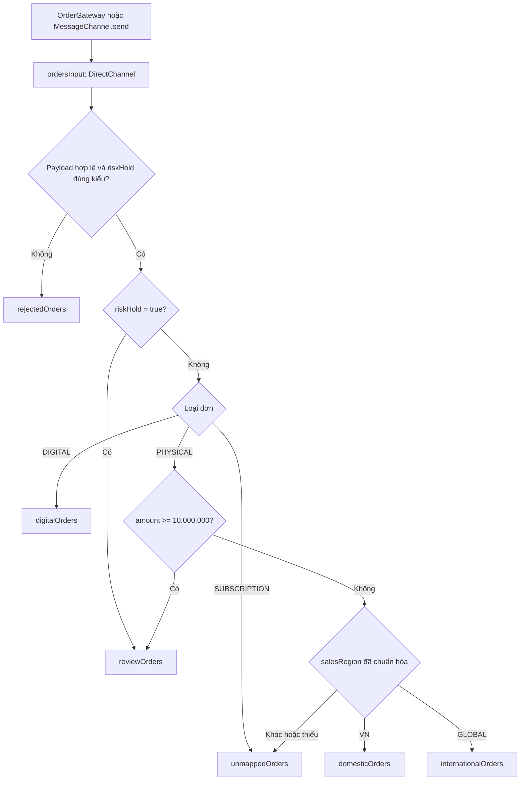

# Định tuyến bằng payload và header

## 1. Mục tiêu và tình huống thực hành

Trong **SPRING_INTEGRATION_CORE**, một luồng thông điệp được hình thành từ `Message`, `MessageChannel` và các endpoint. Bài thuộc chương **Thực hành tổng hợp**, tập trung vào router: đọc payload và header để chọn đích bằng Java DSL.

Tình huống: hệ thống nhận lệnh đặt hàng từ nhiều nguồn. Hàng số chuyển sang bộ phận cấp quyền sử dụng; hàng vật lý chuyển sang xử lý nội địa hoặc quốc tế; đơn cần kiểm tra đi vào nhánh rà soát. Dữ liệu sai và dữ liệu chưa có quy tắc xử lý cần được phân biệt.

Sau bài học, bạn có thể:

- Thiết kế hợp đồng thông điệp và thứ tự ưu tiên của các quy tắc.
- Viết router đọc cả payload lẫn header.
- Dùng gateway làm điểm vào, `DirectChannel` gọi router và `QueueChannel` quan sát kết quả.
- Phân biệt nhánh mặc định, nhánh từ chối nghiệp vụ và lỗi kỹ thuật.
- Kiểm thử flow thật: đúng đích, không phát bản sao sang đích khác và giữ header tương quan.

Bài tập dùng Spring Integration Core trong bộ nhớ, không cần broker, cơ sở dữ liệu hay HTTP server. Transformer, filter và aggregator được xem xét ở phần mở rộng để thấy vị trí của chúng trong một luồng tích hợp.

## 2. Hợp đồng thông điệp

### 2.1. Payload chứa dữ liệu nghiệp vụ

Payload là `OrderCommand`:

| Trường | Kiểu Java | Quy ước |
| --- | --- | --- |
| `orderId` | `String` | Không `null`, không rỗng hoặc chỉ có khoảng trắng |
| `kind` | `OrderCommand.Kind` | `DIGITAL`, `PHYSICAL` hoặc `SUBSCRIPTION`; không `null` |
| `amount` | `BigDecimal` | Số tiền theo VND, lớn hơn 0 |

`SUBSCRIPTION` mô phỏng loại đơn hợp lệ về cấu trúc nhưng chưa có nhánh xử lý chuyên biệt. Payload khác kiểu `OrderCommand` là đầu vào không hợp lệ.

Dùng `BigDecimal.compareTo()` khi so sánh tiền. `equals()` còn xét scale, không phù hợp để diễn đạt quy tắc ngưỡng tiền trong bài này.

### 2.2. Header cung cấp ngữ cảnh xử lý

| Header | Kiểu mong đợi | Quy ước |
| --- | --- | --- |
| `salesRegion` | `String` | `VN` hoặc `GLOBAL`; cần cho đơn vật lý thông thường |
| `riskHold` | `Boolean` | `true` yêu cầu rà soát; thiếu header được hiểu là `false` |
| `correlationId` | Do nguồn gửi quy ước | Đối chiếu thông điệp, không tham gia chọn nhánh |

Với `salesRegion`, router bỏ khoảng trắng hai đầu và chuyển sang chữ hoa bằng `Locale.ROOT`. Giá trị thiếu, không phải chuỗi hoặc ngoài tập cho phép được xem là chưa xác định khu vực.

Với `riskHold`, chuỗi `"true"` không phải Boolean `true`. Header sai kiểu đi vào nhánh từ chối, tránh vô tình bỏ qua yêu cầu rà soát khi các hệ thống không thống nhất kiểu dữ liệu.

Đây là các quyết định nghiệp vụ của bài tập. Spring Integration không tự đặt những chính sách này cho ứng dụng.

## 3. Chốt bảng quyết định trước khi viết flow

Áp dụng quy tắc từ trên xuống. Quy tắc đầu tiên phù hợp quyết định đích.

| Ưu tiên | Điều kiện | Khóa định tuyến | Channel |
| --- | --- | --- | --- |
| 1 | Payload sai kiểu, thiếu trường bắt buộc hoặc `amount <= 0` | `REJECT` | `rejectedOrders` |
| 2 | `riskHold` có giá trị nhưng không phải `Boolean` | `REJECT` | `rejectedOrders` |
| 3 | Payload hợp lệ và `riskHold == true` | `REVIEW` | `reviewOrders` |
| 4 | Loại `DIGITAL` | `DIGITAL` | `digitalOrders` |
| 5 | Loại khác `PHYSICAL` sau các bước trên | `UNMAPPED` | `unmappedOrders` |
| 6 | Loại `PHYSICAL`, số tiền từ 10.000.000 VND | `REVIEW` | `reviewOrders` |
| 7 | Loại `PHYSICAL`, dưới ngưỡng, khu vực `VN` | `DOMESTIC` | `domesticOrders` |
| 8 | Loại `PHYSICAL`, dưới ngưỡng, khu vực `GLOBAL` | `INTERNATIONAL` | `internationalOrders` |
| 9 | Không xác định được khu vực cho đơn vật lý dưới ngưỡng | `UNMAPPED` | `unmappedOrders` |

Các hệ quả phải dự đoán được:

- Đơn sai dữ liệu và có `riskHold=true` vẫn bị từ chối.
- Đơn số có `riskHold=true` được rà soát trước khi xét nhánh hàng số.
- Đơn số không bị áp dụng ngưỡng tiền dành riêng cho hàng vật lý.
- Đơn vật lý đúng bằng 10.000.000 VND đi rà soát, dù thiếu khu vực.
- `SUBSCRIPTION` hợp lệ về cấu trúc; nếu không bị giữ để rà soát, nó đi vào nhánh chưa có quy tắc.



Các nút quyết định mô tả logic trong một policy được router gọi; không yêu cầu tạo một endpoint cho mỗi điều kiện.

## 4. Chuẩn bị dự án thực hành

Ví dụ cố định API ở **Spring Integration 6.5.0**, dùng **JDK 17** và **JUnit Jupiter 5.12.2** để có một mốc tái lập. Đây là phiên bản minh họa, không phải khẳng định phiên bản mới nhất. Java DSL đã nằm trong `spring-integration-core`.

Tạo một dự án Maven riêng:

```text
order-routing-lab/
├── pom.xml
└── src/
    ├── main/java/example/routing/
    │   ├── OrderCommand.java
    │   ├── RoutingPolicy.java
    │   ├── OrderGateway.java
    │   └── OrderRoutingConfiguration.java
    └── test/java/example/routing/
        └── OrderRoutingTest.java
```

Các đường dẫn trên là vị trí tạo mã trong dự án thực hành của người học.

Nội dung `pom.xml`:

```xml
<project xmlns="http://maven.apache.org/POM/4.0.0"
         xmlns:xsi="http://www.w3.org/2001/XMLSchema-instance"
         xsi:schemaLocation="http://maven.apache.org/POM/4.0.0 https://maven.apache.org/xsd/maven-4.0.0.xsd">
    <modelVersion>4.0.0</modelVersion>
    <groupId>example</groupId>
    <artifactId>order-routing-lab</artifactId>
    <version>1.0-SNAPSHOT</version>

    <properties>
        <maven.compiler.release>17</maven.compiler.release>
        <project.build.sourceEncoding>UTF-8</project.build.sourceEncoding>
    </properties>

    <dependencies>
        <dependency>
            <groupId>org.springframework.integration</groupId>
            <artifactId>spring-integration-core</artifactId>
            <version>6.5.0</version>
        </dependency>
        <dependency>
            <groupId>org.junit.jupiter</groupId>
            <artifactId>junit-jupiter</artifactId>
            <version>5.12.2</version>
            <scope>test</scope>
        </dependency>
    </dependencies>

    <build>
        <plugins>
            <plugin>
                <groupId>org.apache.maven.plugins</groupId>
                <artifactId>maven-compiler-plugin</artifactId>
                <version>3.14.0</version>
            </plugin>
            <plugin>
                <groupId>org.apache.maven.plugins</groupId>
                <artifactId>maven-surefire-plugin</artifactId>
                <version>3.5.3</version>
            </plugin>
        </plugins>
    </build>
</project>
```

Không cần Spring Boot hoặc lớp `main`: kiểm thử sẽ khởi tạo `ApplicationContext` trực tiếp.

## 5. Xây dựng mô hình và policy

### 5.1. Khai báo payload

Tệp `OrderCommand.java`:

```java
package example.routing;

import java.math.BigDecimal;

public record OrderCommand(
        String orderId,
        Kind kind,
        BigDecimal amount) {

    public enum Kind {
        DIGITAL,
        PHYSICAL,
        SUBSCRIPTION
    }
}
```

Record chưa kiểm tra dữ liệu trong constructor để người học đưa các lệnh sai vào flow và quan sát nhánh từ chối. Trong hệ thống thật, có thể kiểm tra sớm hơn ở biên nhận dữ liệu; cần thống nhất nơi chịu trách nhiệm.

### 5.2. Policy nhận toàn bộ Message

Tệp `RoutingPolicy.java`:

```java
package example.routing;

import java.math.BigDecimal;
import java.util.Locale;

import org.springframework.messaging.Message;

public final class RoutingPolicy {

    private static final BigDecimal REVIEW_THRESHOLD =
            new BigDecimal("10000000");

    public String route(Message<?> message) {
        if (!(message.getPayload() instanceof OrderCommand order)) {
            return "REJECT";
        }

        if (!isValid(order)) {
            return "REJECT";
        }

        Object riskHold = message.getHeaders().get("riskHold");
        if (riskHold != null && !(riskHold instanceof Boolean)) {
            return "REJECT";
        }

        if (Boolean.TRUE.equals(riskHold)) {
            return "REVIEW";
        }

        if (order.kind() == OrderCommand.Kind.DIGITAL) {
            return "DIGITAL";
        }

        if (order.kind() != OrderCommand.Kind.PHYSICAL) {
            return "UNMAPPED";
        }

        if (order.amount().compareTo(REVIEW_THRESHOLD) >= 0) {
            return "REVIEW";
        }

        String region = normalizedRegion(
                message.getHeaders().get("salesRegion"));

        return switch (region) {
            case "VN" -> "DOMESTIC";
            case "GLOBAL" -> "INTERNATIONAL";
            default -> "UNMAPPED";
        };
    }

    private boolean isValid(OrderCommand order) {
        return order.orderId() != null
                && !order.orderId().isBlank()
                && order.kind() != null
                && order.amount() != null
                && order.amount().signum() > 0;
    }

    private String normalizedRegion(Object value) {
        if (value instanceof String text) {
            return text.strip().toUpperCase(Locale.ROOT);
        }
        return "";
    }
}
```

Policy trả khóa nghiệp vụ, không gửi thông điệp và không chứa tên bean channel. Thay tên channel không bắt buộc thay quy tắc nghiệp vụ.

`route()` không giữ trạng thái giữa các lần gọi và không sửa payload hoặc header. Cách tổ chức này phù hợp khi nhiều luồng cùng gọi policy.

Đọc header dưới dạng `Object` giúp xử lý sai kiểu chủ động. Nếu gọi ngay `get("riskHold", Boolean.class)`, dữ liệu sai kiểu có thể gây ngoại lệ trước khi policy chọn nhánh từ chối.

## 6. Gateway và luồng Java DSL

### 6.1. Gateway làm điểm vào cho ứng dụng

Tệp `OrderGateway.java`:

```java
package example.routing;

import org.springframework.integration.annotation.MessagingGateway;
import org.springframework.messaging.handler.annotation.Header;

@MessagingGateway(defaultRequestChannel = "ordersInput")
public interface OrderGateway {

    void submit(
            OrderCommand order,
            @Header("salesRegion") String salesRegion,
            @Header("riskHold") boolean riskHold);
}
```

`order` trở thành payload; hai đối số còn lại trở thành header. Gateway dùng kiểu trả về `void` vì hợp đồng của bài là gửi lệnh, không chờ kết quả nghiệp vụ từ các nhánh. Cơ chế proxy gateway được mô tả trong [Messaging Gateways](https://docs.spring.io/spring-integration/reference/6.5/gateway.html).

Gateway này luôn cung cấp hai header định tuyến. Kiểm thử gửi trực tiếp vào channel sẽ bổ sung các trường hợp thiếu header hoặc sai kiểu mà chữ ký gateway đã hạn chế.

### 6.2. Khai báo channel và router

Tệp `OrderRoutingConfiguration.java`:

```java
package example.routing;

import org.springframework.beans.factory.annotation.Qualifier;
import org.springframework.context.annotation.Bean;
import org.springframework.context.annotation.Configuration;
import org.springframework.integration.annotation.IntegrationComponentScan;
import org.springframework.integration.channel.DirectChannel;
import org.springframework.integration.channel.QueueChannel;
import org.springframework.integration.config.EnableIntegration;
import org.springframework.integration.dsl.IntegrationFlow;
import org.springframework.messaging.Message;
import org.springframework.messaging.MessageChannel;

@Configuration(proxyBeanMethods = false)
@EnableIntegration
@IntegrationComponentScan(basePackageClasses = OrderGateway.class)
public class OrderRoutingConfiguration {

    @Bean
    public MessageChannel ordersInput() {
        return new DirectChannel();
    }

    @Bean
    public QueueChannel rejectedOrders() {
        return new QueueChannel(100);
    }

    @Bean
    public QueueChannel reviewOrders() {
        return new QueueChannel(100);
    }

    @Bean
    public QueueChannel digitalOrders() {
        return new QueueChannel(100);
    }

    @Bean
    public QueueChannel domesticOrders() {
        return new QueueChannel(100);
    }

    @Bean
    public QueueChannel internationalOrders() {
        return new QueueChannel(100);
    }

    @Bean
    public QueueChannel unmappedOrders() {
        return new QueueChannel(100);
    }

    @Bean
    public RoutingPolicy routingPolicy() {
        return new RoutingPolicy();
    }

    @Bean
    public IntegrationFlow orderRoutingFlow(
            @Qualifier("ordersInput") MessageChannel input,
            RoutingPolicy policy) {

        return IntegrationFlow.from(input)
                .route(Message.class, message -> policy.route(message),
                        router -> router
                                .channelMapping("REJECT", "rejectedOrders")
                                .channelMapping("REVIEW", "reviewOrders")
                                .channelMapping("DIGITAL", "digitalOrders")
                                .channelMapping("DOMESTIC", "domesticOrders")
                                .channelMapping(
                                        "INTERNATIONAL",
                                        "internationalOrders")
                                .defaultOutputChannel("unmappedOrders")
                                .channelKeyFallback(false)
                                .resolutionRequired(true)
                                .sendTimeout(250))
                .get();
    }
}
```

Chỉ định `Message.class` cho DSL thể hiện policy cần toàn bộ thông điệp để đọc cả payload lẫn header. Nếu chỉ cần dữ liệu nghiệp vụ, có thể dùng `OrderCommand.class`. Tham khảo các overload tại [BaseIntegrationFlowDefinition 6.5.0](https://docs.spring.io/spring-integration/docs/6.5.0/api/org/springframework/integration/dsl/BaseIntegrationFlowDefinition.html).

`@EnableIntegration` bật hạ tầng trong context thuần Spring. `@IntegrationComponentScan` tìm interface gateway và đăng ký proxy. Tham số injection giúp tránh gọi trực tiếp phương thức `@Bean` khi dùng `proxyBeanMethods=false`.

### 6.3. Hiểu nhánh mặc định

Flow không khai báo mapping cho `UNMAPPED`. Khóa này đi tới `unmappedOrders` qua nhánh mặc định.

| Cấu hình | Ý nghĩa trong flow |
| --- | --- |
| `channelMapping(...)` | Chuyển khóa do policy trả về sang tên channel |
| `defaultOutputChannel("unmappedOrders")` | Nhận thông điệp khi không có đích từ bảng mapping |
| `channelKeyFallback(false)` | Không dùng khóa chưa được ánh xạ làm tên channel |
| `resolutionRequired(true)` | Phát sinh lỗi khi tên channel đã chọn không thể phân giải |
| `sendTimeout(250)` | Giới hạn chờ gửi vào channel hỗ trợ timeout; không giới hạn thời gian hoàn tất nghiệp vụ |

Từ Spring Integration 6.0, đặt default output channel cũng tắt cơ chế dùng khóa làm tên channel nếu không bị ghi đè rõ ràng. Ví dụ vẫn ghi `channelKeyFallback(false)` để thể hiện hợp đồng. Xem [Common Router Parameters](https://docs.spring.io/spring-integration/reference/6.5/router/common-parameters.html) và [RouterSpec 6.5.0](https://docs.spring.io/spring-integration/docs/6.5.0/api/org/springframework/integration/dsl/RouterSpec.html).

Cần tách hai trường hợp:

1. Policy trả `UNMAPPED`, không có mapping: đi nhánh mặc định.
2. Policy trả `DOMESTIC`, mapping trỏ sai tên channel: cấu hình đang hỏng; `resolutionRequired(true)` làm lỗi bộc lộ.

Không bật `resolutionRequired(false)` chỉ để làm biến mất lỗi gõ sai tên channel.

### 6.4. Vai trò của các loại channel

`ordersInput` là `DirectChannel`: router chạy trên thread gửi. Các đích là `QueueChannel`: lưu kết quả để kiểm thử lấy ra bằng `receive(0)`.

Bài chưa đăng ký consumer nghiệp vụ ở các queue đầu ra. Khi gửi thành công, chỉ có thể kết luận thông điệp đã vào queue đích; việc cấp quyền sử dụng hoặc giao hàng chưa diễn ra.

Queue có sức chứa 100, nằm trong bộ nhớ và không lưu bền khi tiến trình dừng. Hành vi chờ và `receive(0)` được mô tả tại [Message Channel Implementations](https://docs.spring.io/spring-integration/reference/6.5/channel/implementations.html).

## 7. Hai biến thể để nhận diện cách chọn router

Các đoạn bổ sung dưới dùng channel đầu ra đã khai báo. Có thể đặt chúng trong cùng lớp cấu hình để thử nghiệm. Mỗi flow có input riêng, không cạnh tranh consumer với `ordersInput`. Chúng không áp dụng toàn bộ bảng quyết định của flow chính.

### 7.1. Chỉ định tuyến theo giá trị payload

Giả sử đầu vào đã là `OrderCommand` hợp lệ, chỉ cần nhận diện hàng số:

```java
@Bean
public IntegrationFlow payloadOnlyFlow() {
    return IntegrationFlow.from("payloadOnlyInput")
            .route(OrderCommand.class,
                    order -> order.kind() == OrderCommand.Kind.DIGITAL
                            ? "DIGITAL" : "OTHER",
                    router -> router
                            .channelMapping("DIGITAL", "digitalOrders")
                            .defaultOutputChannel("unmappedOrders")
                            .channelKeyFallback(false))
            .get();
}
```

Đây là định tuyến theo **giá trị thuộc tính**. `PayloadTypeRouter` chọn đích dựa vào **kiểu Java** của payload, chẳng hạn `String` hay `OrderCommand`. Khi mọi payload đều là `OrderCommand`, cấu hình theo kiểu không phân biệt được `DIGITAL` và `PHYSICAL`.

### 7.2. Chỉ định tuyến theo một header

Nếu nguồn gửi đã cung cấp `salesRegion` đúng dạng chuẩn, có thể dùng `HeaderValueRouter`:

```java
@Bean
public IntegrationFlow headerOnlyFlow() {
    var router =
            new org.springframework.integration.router.HeaderValueRouter(
                    "salesRegion");

    router.setChannelMapping("VN", "domesticOrders");
    router.setChannelMapping("GLOBAL", "internationalOrders");
    router.setDefaultOutputChannelName("unmappedOrders");
    router.setChannelKeyFallback(false);
    router.setResolutionRequired(true);

    return IntegrationFlow.from("headerOnlyInput")
            .route(router)
            .get();
}
```

Biến thể này ánh xạ trực tiếp giá trị header, không tự `strip()` và chuyển chữ hoa như policy chính. Vì vậy `" vn "` chưa phải `"VN"`. Nếu nhiều endpoint cần cùng dạng chuẩn, có thể đặt header enricher trước router.

Sự khác nhau giữa `PayloadTypeRouter` và `HeaderValueRouter` được mô tả trong [Router Implementations](https://docs.spring.io/spring-integration/reference/6.5/router/implementations.html).

## 8. Kiểm thử flow theo bảng quyết định

Mỗi ca khởi tạo context mới. Queue không chia sẻ thông điệp tồn dư giữa các ca và không có poller nền. Vì router chạy đồng bộ, có thể quan sát đầu ra ngay sau lời gọi gửi.

Tệp `OrderRoutingTest.java`:

```java
package example.routing;

import java.math.BigDecimal;
import java.util.List;
import java.util.Map;
import java.util.stream.Stream;

import org.junit.jupiter.api.AfterEach;
import org.junit.jupiter.api.BeforeEach;
import org.junit.jupiter.api.Test;
import org.junit.jupiter.params.ParameterizedTest;
import org.junit.jupiter.params.provider.Arguments;
import org.junit.jupiter.params.provider.MethodSource;
import org.springframework.context.annotation.AnnotationConfigApplicationContext;
import org.springframework.integration.channel.QueueChannel;
import org.springframework.messaging.Message;
import org.springframework.messaging.MessageChannel;
import org.springframework.messaging.support.MessageBuilder;

import static org.junit.jupiter.api.Assertions.*;

class OrderRoutingTest {

    private static final List<String> OUTPUTS = List.of(
            "rejectedOrders",
            "reviewOrders",
            "digitalOrders",
            "domesticOrders",
            "internationalOrders",
            "unmappedOrders");

    private AnnotationConfigApplicationContext context;
    private MessageChannel input;

    @BeforeEach
    void startContext() {
        context = new AnnotationConfigApplicationContext(
                OrderRoutingConfiguration.class);
        input = context.getBean("ordersInput", MessageChannel.class);
    }

    @AfterEach
    void stopContext() {
        if (context != null) {
            context.close();
        }
    }

    @ParameterizedTest(name = "{0}")
    @MethodSource("routingCases")
    void routesToOneExpectedDestination(
            String label,
            Object payload,
            Map<String, Object> headers,
            String expectedChannel) {

        Message<?> sent = MessageBuilder.withPayload(payload)
                .copyHeaders(headers)
                .setHeader("correlationId", "CORR-004")
                .build();

        assertTrue(input.send(sent, 1000));

        Message<?> received = takeOnlyMessage(expectedChannel);

        assertSame(sent.getPayload(), received.getPayload());
        assertEquals("CORR-004",
                received.getHeaders().get("correlationId"));

        headers.forEach((key, value) ->
                assertEquals(value, received.getHeaders().get(key)));
    }

    @Test
    void gatewayCreatesHeadersAndUsesTheSameRoutingFlow() {
        OrderCommand order = order(
                OrderCommand.Kind.PHYSICAL, "500000");

        OrderGateway gateway = context.getBean(OrderGateway.class);
        gateway.submit(order, "GLOBAL", false);

        Message<?> received = takeOnlyMessage("internationalOrders");

        assertEquals(order, received.getPayload());
        assertEquals("GLOBAL",
                received.getHeaders().get("salesRegion"));
        assertEquals(Boolean.FALSE,
                received.getHeaders().get("riskHold"));
    }

    private Message<?> takeOnlyMessage(String expectedChannel) {
        QueueChannel target =
                context.getBean(expectedChannel, QueueChannel.class);

        Message<?> received = target.receive(0);
        assertNotNull(received, "Không nhận được tại " + expectedChannel);

        for (String channelName : OUTPUTS) {
            QueueChannel channel =
                    context.getBean(channelName, QueueChannel.class);
            assertNull(channel.receive(0),
                    "Có thông điệp ngoài dự kiến tại " + channelName);
        }

        return received;
    }

    private static OrderCommand order(
            OrderCommand.Kind kind, String amount) {
        return new OrderCommand(
                "ORD-004", kind, new BigDecimal(amount));
    }

    static Stream<Arguments> routingCases() {
        return Stream.of(
                Arguments.of(
                        "Hàng số không cần khu vực",
                        order(OrderCommand.Kind.DIGITAL, "200000"),
                        Map.of(),
                        "digitalOrders"),
                Arguments.of(
                        "Hàng số không áp ngưỡng tiền của hàng vật lý",
                        order(OrderCommand.Kind.DIGITAL, "12000000"),
                        Map.of("salesRegion", "VN"),
                        "digitalOrders"),
                Arguments.of(
                        "riskHold ưu tiên hơn nhánh hàng số",
                        order(OrderCommand.Kind.DIGITAL, "200000"),
                        Map.of("riskHold", true),
                        "reviewOrders"),
                Arguments.of(
                        "Chuẩn hóa khoảng trắng và chữ thường",
                        order(OrderCommand.Kind.PHYSICAL, "500000"),
                        Map.of("salesRegion", " vn "),
                        "domesticOrders"),
                Arguments.of(
                        "Đơn quốc tế",
                        order(OrderCommand.Kind.PHYSICAL, "500000"),
                        Map.of("salesRegion", "GLOBAL"),
                        "internationalOrders"),
                Arguments.of(
                        "Ngay dưới ngưỡng vẫn xét khu vực",
                        order(OrderCommand.Kind.PHYSICAL, "9999999"),
                        Map.of("salesRegion", "VN"),
                        "domesticOrders"),
                Arguments.of(
                        "Đúng ngưỡng và thiếu khu vực vẫn rà soát",
                        order(OrderCommand.Kind.PHYSICAL, "10000000"),
                        Map.of(),
                        "reviewOrders"),
                Arguments.of(
                        "Thiếu khu vực với đơn vật lý thông thường",
                        order(OrderCommand.Kind.PHYSICAL, "500000"),
                        Map.of(),
                        "unmappedOrders"),
                Arguments.of(
                        "Khu vực chưa hỗ trợ",
                        order(OrderCommand.Kind.PHYSICAL, "500000"),
                        Map.of("salesRegion", "EU"),
                        "unmappedOrders"),
                Arguments.of(
                        "Khu vực sai kiểu",
                        order(OrderCommand.Kind.PHYSICAL, "500000"),
                        Map.of("salesRegion", 84),
                        "unmappedOrders"),
                Arguments.of(
                        "Header chứa tên input không được dùng làm đích",
                        order(OrderCommand.Kind.PHYSICAL, "500000"),
                        Map.of("salesRegion", "ordersInput"),
                        "unmappedOrders"),
                Arguments.of(
                        "Loại đơn hợp lệ nhưng chưa có nhánh",
                        order(OrderCommand.Kind.SUBSCRIPTION, "500000"),
                        Map.of("salesRegion", "VN"),
                        "unmappedOrders"),
                Arguments.of(
                        "Không tự chuyển chuỗi true thành Boolean",
                        order(OrderCommand.Kind.DIGITAL, "200000"),
                        Map.of("riskHold", "true"),
                        "rejectedOrders"),
                Arguments.of(
                        "Số tiền bằng không",
                        order(OrderCommand.Kind.PHYSICAL, "0"),
                        Map.of("salesRegion", "VN"),
                        "rejectedOrders"),
                Arguments.of(
                        "Số tiền âm",
                        order(OrderCommand.Kind.PHYSICAL, "-1"),
                        Map.of("salesRegion", "VN"),
                        "rejectedOrders"),
                Arguments.of(
                        "Thiếu mã đơn",
                        new OrderCommand(" ",
                                OrderCommand.Kind.PHYSICAL,
                                new BigDecimal("500000")),
                        Map.of("salesRegion", "VN"),
                        "rejectedOrders"),
                Arguments.of(
                        "Thiếu loại đơn",
                        new OrderCommand("ORD-004", null,
                                new BigDecimal("500000")),
                        Map.of(),
                        "rejectedOrders"),
                Arguments.of(
                        "Thiếu số tiền",
                        new OrderCommand("ORD-004",
                                OrderCommand.Kind.PHYSICAL, null),
                        Map.of(),
                        "rejectedOrders"),
                Arguments.of(
                        "Payload sai kiểu bị từ chối trước riskHold",
                        "not-an-order",
                        Map.of("riskHold", true),
                        "rejectedOrders"));
    }
}
```

Từ thư mục dự án thực hành, chạy:

```shell
mvn test
```

Kết quả kỳ vọng khi triển khai đúng các tệp là **19 ca tham số hóa và 1 ca gateway**, tổng cộng 20 ca thành công. Đây là kết quả để người học đối chiếu khi tự chạy, không phải báo cáo đã thực thi trong bước biên soạn tài liệu.

`@MethodSource` biểu diễn bảng dữ liệu kiểm thử mà không ép mọi trường hợp thành chuỗi CSV. Tham khảo [JUnit 5.12.2 User Guide](https://docs.junit.org/5.12.2/user-guide/#writing-tests-parameterized-tests-sources-MethodSource).

### Vì sao kiểm tra cả các đích còn lại?

Nếu chỉ kiểm tra `domesticOrders` có thông điệp, cấu hình vô tình phát thêm bản sao tới `reviewOrders` vẫn có thể vượt kiểm thử.

`takeOnlyMessage()` lấy một thông điệp ở đích mong đợi, sau đó kiểm tra cả sáu queue đều rỗng. Kiểm tra lại chính queue đích cũng phát hiện bản sao thứ hai trong lần gửi đang xét.

Phép kiểm tra chứng minh hành vi chọn một đích trong flow và context của bài. Nó không chứng minh khả năng giao nhận exactly-once của hệ thống phân tán, không phát hiện mọi lần gửi lại từ nguồn và không thay thế xử lý idempotency.

## 9. Phân biệt ba đường đi khi có vấn đề

| Tình huống | Biểu hiện | Xử lý trong bài |
| --- | --- | --- |
| Vi phạm hợp đồng đầu vào | Thông điệp mang payload đầu vào | Policy trả `REJECT`, gửi `rejectedOrders` |
| Hợp lệ nhưng chưa có quy tắc | Thông điệp nghiệp vụ | Policy trả `UNMAPPED`, gửi `unmappedOrders` |
| Cấu hình hoặc thực thi gặp lỗi | Ngoại lệ messaging hoặc nguyên nhân bên trong | Để lỗi bộc lộ, xử lý theo cơ chế lỗi kỹ thuật |

`unmappedOrders` là channel nghiệp vụ do bài định nghĩa. Nó không tự trở thành dead-letter queue của broker hoặc thay thế `errorChannel`.

Với `MessageChannel.send()` vào `DirectChannel` như kiểm thử hiện tại, ngoại lệ trong xử lý đồng bộ truyền về bên gọi. Chỉ gắn header `errorChannel` không làm mọi ngoại lệ đồng bộ tự được xuất bản thành `ErrorMessage`. Gateway có cấu hình xử lý lỗi, poller và hạ tầng bất đồng bộ cần được xét theo cơ chế tương ứng. Xem [Error Handling](https://docs.spring.io/spring-integration/reference/6.5/error-handling.html).

Thí nghiệm trong bản sao dự án thực hành:

1. Đổi mapping `DOMESTIC` sang tên channel không tồn tại.
2. Gửi đơn vật lý dưới ngưỡng, khu vực `VN`.
3. Xác nhận lời gọi phát sinh lỗi phân giải channel; thông điệp không tự chuyển sang `unmappedOrders`.
4. Khôi phục tên channel và chạy lại kiểm thử.

Khi queue đích đầy, việc gửi có thể hết thời gian chờ. `sendTimeout(250)` không tự chuyển sang nhánh mặc định và không tạo khả năng lưu bền. Lỗi gửi khác với việc không có mapping.

## 10. Những lỗi thường gặp

### 10.1. Thứ tự kiểm tra làm thay đổi nghiệp vụ

Kiểm tra `DIGITAL` trước `riskHold` sẽ cho đơn số cần rà soát đi xử lý ngay. Kiểm tra ngưỡng tiền trước loại đơn lại làm đơn số giá trị lớn đi sai nhánh.

Giữ bảng quyết định và các ca cho điều kiện chồng lấn, đặc biệt `DIGITAL + riskHold=true` và `DIGITAL + amount lớn`.

### 10.2. Dùng tên channel lấy từ header

Header khu vực nên biểu diễn giá trị nghiệp vụ như `VN`. Bảng mapping chuyển giá trị được cho phép thành channel cụ thể.

Policy chính không dùng header làm tên đích. Cấu hình tắt `channelKeyFallback` củng cố ranh giới giữa khóa nghiệp vụ và cấu trúc nội bộ.

### 10.3. Nhầm chọn một nhánh với phát nhiều nhánh

Router chính trả một khóa đơn nên mục tiêu là chọn một đích. Muốn vừa xử lý đơn vừa phát audit độc lập, phải thiết kế nhiều recipient có chủ ý.

Không thay router bằng `PublishSubscribeChannel` rồi kỳ vọng chỉ một nhánh nhận thông điệp. Cũng không gắn hai consumer vào cùng `DirectChannel` để mô phỏng broadcast.

### 10.4. Tạo Message mới và mất header

Router trong bài không cần dựng lại thông điệp. Nếu thêm transformer trả một `Message` mới, cần bảo toàn các header ứng dụng như `correlationId`.

Có thể dùng `MessageBuilder.fromMessage(...)` hoặc header enricher khi cần thay header. Header hệ thống như `id` và `timestamp` có quy tắc riêng; không dùng chúng thay cho mã tương quan nghiệp vụ.

### 10.5. Coi định tuyến thành công là hoàn tất nghiệp vụ

Khóa đúng mô tả quyết định định tuyến. Queue nhận thành công mô tả bước chuyển giao. Xử lý ở consumer, commit giao dịch và chống lặp vẫn cần hợp đồng riêng.

## 11. Bài tập mở rộng

### 11.1. Thêm khu vực

Thêm `APAC` cho đơn vật lý dưới ngưỡng:

- Tạo channel mới, cập nhật policy và mapping.
- Bổ sung ca `" apac "` để kiểm tra chuẩn hóa.
- Bổ sung channel vào danh sách đầu ra mà kiểm thử kiểm tra rỗng.

Đạt khi `APAC` tới đúng đích, các ca cũ giữ nguyên kết quả và không có thông điệp tại hai đích sau một lần gửi.

### 11.2. Bổ sung lý do xử lý thủ công

Hiện thông điệp tại `rejectedOrders` và `unmappedOrders` chưa có mã lý do. Hãy bổ sung kết quả quyết định gồm `routeKey` và `reasonCode`, đưa lý do vào header trước router.

Đạt khi phân biệt được `INVALID_AMOUNT`, `INVALID_RISK_HEADER`, `UNKNOWN_REGION` và `UNSUPPORTED_KIND`, đồng thời giữ nguyên `correlationId`.

Không đưa tên channel nội bộ vào mô hình đơn hàng chỉ để phục vụ định tuyến.

### 11.3. So sánh router, filter và transformer

Tách kiểm tra hợp lệ thành filter, cấu hình discard channel là `rejectedOrders`, giữ router cho các nhánh hợp lệ. Đầu vào sai phải vẫn quan sát được ở nhánh từ chối.

Tiếp theo, dùng header enricher để chuẩn hóa `salesRegion` trước router. Kiểm tra lại header truy vết và thống nhất có cần lưu riêng giá trị khu vực ban đầu hay không.

### 11.4. Khi nào cần aggregator?

Flow hiện chọn một đích cho mỗi thông điệp, chưa tạo nhóm cần hợp nhất nên chưa cần aggregator.

Nếu mở rộng thành hai nhánh kiểm tra tồn kho và rủi ro độc lập, cần xác định:

- Khóa liên kết hai phản hồi của cùng đơn.
- Điều kiện nhóm đủ để hoàn tất.
- Cách xử lý thiếu phản hồi, hết hạn hoặc phản hồi lặp.

Chỉ thêm aggregator sau khi định nghĩa correlation strategy và release strategy. Có router không tự tạo ra yêu cầu phải tổng hợp.

## 12. Tiêu chí hoàn thành

Người học cần trình bày và kiểm chứng được:

- Hợp đồng kiểu dữ liệu của payload và header rõ ràng.
- Thứ tự ưu tiên đúng bảng quyết định, kể cả điều kiện chồng lấn.
- Gateway, channel và router Java DSL phối hợp chọn đúng nhánh.
- Giá trị nghiệp vụ không được tùy ý dùng làm tên channel.
- Nhánh từ chối, nhánh mặc định và lỗi kỹ thuật có hợp đồng riêng.
- Kiểm thử xác nhận đúng một thông điệp ở đích, không có bản sao ở đích khác và giữ header tương quan.
- Queue nhận thông điệp chưa đồng nghĩa nghiệp vụ cuối cùng hoàn tất.

Sản phẩm của bài là flow có quy tắc định tuyến minh bạch và bộ kiểm thử bảo vệ các quyết định đó khi thêm loại đơn, khu vực hoặc bước xử lý.
