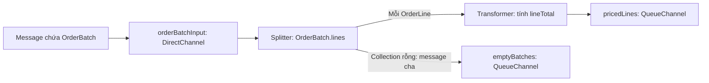

# Tách collection bằng splitter

## 1. Mục tiêu và bài toán thực hành

Trong chương **Thực hành tổng hợp** của module **SPRING_INTEGRATION_CORE**, ta xây dựng một luồng nhận lô đơn hàng, tách các dòng hàng và tính thành tiền cho từng dòng. Bài tập nối các khái niệm `Message`, `MessageChannel`, endpoint và Java DSL thành một ví dụ có đầu vào, đầu ra và kiểm thử rõ ràng.

Sau bài học, bạn có thể:

- Chọn splitter khi một message chứa nhiều phần tử cần đi qua các bước xử lý riêng.
- Phân biệt payload của message cha với payload của message con.
- Theo dõi nhóm message qua correlation và sequence header.
- Quy định cách tiếp nhận collection rỗng và lỗi của từng phần tử.
- Kiểm thử số lượng, nội dung, header và tác động của lỗi trong luồng.
- Nhận biết những thay đổi cần thiết khi nối thêm filter, router, aggregator hoặc xử lý bất đồng bộ.

Hệ thống nhận một lô gồm ba dòng hàng:

| lineId | sku | quantity | unitPrice | lineTotal mong đợi |
| --- | --- | ---: | ---: | ---: |
| L-01 | BOOK-JAVA | 2 | 120000 | 240000 |
| L-02 | PEN-BLUE | 5 | 10000 | 50000 |
| L-03 | NOTE-A5 | 3 | 25000 | 75000 |

Hợp đồng của bài thực hành:

1. Một lô hợp lệ có `N` dòng tạo `N` message kết quả, mỗi payload là một `PricedLine`.
2. Mỗi kết quả giữ `batchId` và `tenantId` từ header đầu vào.
3. Các message con cùng lô có cùng `correlationId`, số thứ tự từ 1 đến `N` và `sequenceSize = N`.
4. Lô rỗng đi vào kênh `emptyBatches` dưới dạng message cha.
5. Khi một dòng không hợp lệ, luồng đồng bộ báo lỗi về bên gửi và dừng tại dòng đó.

Đây là xử lý trong bộ nhớ để quan sát cơ chế cốt lõi. Chưa có cơ sở dữ liệu, broker hay thao tác thanh toán trong ví dụ.

## 2. Một message chứa collection khác nhiều message như thế nào?

Đầu vào:

```text
Message<OrderBatch>
  payload:
    batchId: B-2026-001
    lines: [L-01, L-02, L-03]
  headers:
    batchId: B-2026-001
    tenantId: tenant-demo
    id: P
```

Sau splitter, mỗi phần tử trở thành payload của một message riêng:

```text
Message<OrderLine> {payload=L-01, correlationId=P, sequenceNumber=1, sequenceSize=3}
Message<OrderLine> {payload=L-02, correlationId=P, sequenceNumber=2, sequenceSize=3}
Message<OrderLine> {payload=L-03, correlationId=P, sequenceNumber=3, sequenceSize=3}
```

Sau transformer:

```text
Message<PricedLine> {payload=(L-01, BOOK-JAVA, 240000), ...}
Message<PricedLine> {payload=(L-02, PEN-BLUE, 50000), ...}
Message<PricedLine> {payload=(L-03, NOTE-A5, 75000), ...}
```

Splitter tạo nhiều message từ các phần của đầu vào. Transformer thực hiện việc đổi dữ liệu trong một message. Vì vậy, chỉ trả về một `List<PricedLine>` từ transformer vẫn là một message chứa list. Java DSL cung cấp `split()` cho trường hợp payload đã là collection, và `splitWith(...)` khi cần cấu hình chi tiết. [Spring Integration — Splitters trong Java DSL](https://docs.spring.io/spring-integration/reference/6.4/dsl/java-splitters.html).



Sơ đồ thể hiện các đường đi của message, chưa biểu diễn các thread chạy song song.

## 3. Chuẩn bị môi trường

Ví dụ dùng **Java 17**, **Maven**, **Spring Integration 6.4.x** và **JUnit 5**. Để thực hành độc lập, tạo một dự án với `pom.xml` sau. Phiên bản Spring Boot được cố định làm mốc của bài học; các thư viện Spring và thư viện kiểm thử được quản lý bởi parent. Cơ chế quản lý phiên bản này được mô tả trong [Spring Boot — Managed Dependency Coordinates](https://docs.spring.io/spring-boot/3.4/appendix/dependency-versions/coordinates.html).

```xml
<?xml version="1.0" encoding="UTF-8"?>
<project xmlns="http://maven.apache.org/POM/4.0.0"
         xmlns:xsi="http://www.w3.org/2001/XMLSchema-instance"
         xsi:schemaLocation="http://maven.apache.org/POM/4.0.0
                             https://maven.apache.org/xsd/maven-4.0.0.xsd">
    <modelVersion>4.0.0</modelVersion>

    <parent>
        <groupId>org.springframework.boot</groupId>
        <artifactId>spring-boot-starter-parent</artifactId>
        <version>3.4.13</version>
        <relativePath/>
    </parent>

    <groupId>example</groupId>
    <artifactId>collection-splitter-practice</artifactId>
    <version>1.0.0</version>

    <properties>
        <java.version>17</java.version>
        <project.build.sourceEncoding>UTF-8</project.build.sourceEncoding>
    </properties>

    <dependencies>
        <dependency>
            <groupId>org.springframework.boot</groupId>
            <artifactId>spring-boot-starter-integration</artifactId>
        </dependency>
        <dependency>
            <groupId>org.springframework.boot</groupId>
            <artifactId>spring-boot-starter-test</artifactId>
            <scope>test</scope>
        </dependency>
    </dependencies>
</project>
```

Bài chạy qua kiểm thử nên không cần lớp `@SpringBootApplication`. Hai tệp Java cần tạo trong dự án thực hành:

```text
src/main/java/example/split/CollectionSplitConfiguration.java
src/test/java/example/split/CollectionSplitConfigurationTest.java
```

## 4. Xây dựng cấu hình đầy đủ

Đặt mã sau vào `CollectionSplitConfiguration.java`:

```java
package example.split;

import java.math.BigDecimal;
import java.util.List;
import java.util.Objects;

import org.springframework.context.annotation.Bean;
import org.springframework.context.annotation.Configuration;
import org.springframework.integration.channel.DirectChannel;
import org.springframework.integration.channel.QueueChannel;
import org.springframework.integration.config.EnableIntegration;
import org.springframework.integration.dsl.IntegrationFlow;

@Configuration
@EnableIntegration
public class CollectionSplitConfiguration {

    public record OrderBatch(String batchId, List<OrderLine> lines) {
        public OrderBatch {
            Objects.requireNonNull(batchId, "batchId");
            lines = List.copyOf(Objects.requireNonNull(lines, "lines"));
        }
    }

    public record OrderLine(
            String lineId,
            String sku,
            int quantity,
            BigDecimal unitPrice) {

        public OrderLine {
            Objects.requireNonNull(lineId, "lineId");
            Objects.requireNonNull(sku, "sku");
            Objects.requireNonNull(unitPrice, "unitPrice");
        }
    }

    public record PricedLine(
            String lineId,
            String sku,
            BigDecimal lineTotal) {
    }

    @Bean
    public DirectChannel orderBatchInput() {
        return new DirectChannel();
    }

    @Bean
    public QueueChannel pricedLines() {
        return new QueueChannel(100);
    }

    @Bean
    public QueueChannel emptyBatches() {
        return new QueueChannel(10);
    }

    @Bean
    public IntegrationFlow orderBatchFlow() {
        return IntegrationFlow.from("orderBatchInput")
                .splitWith(splitter -> splitter
                        .expectedType(OrderBatch.class)
                        .function((OrderBatch batch) -> batch.lines())
                        .applySequence(true)
                        .discardChannel("emptyBatches")
                        .sendTimeout(1_000))
                .transformWith(transformer -> transformer
                        .expectedType(OrderLine.class)
                        .transformer((OrderLine line) -> priceLine(line))
                        .sendTimeout(1_000))
                .channel("pricedLines")
                .get();
    }

    private static PricedLine priceLine(OrderLine line) {
        if (line.quantity() <= 0) {
            throw new IllegalArgumentException(
                    "quantity must be positive: " + line.lineId());
        }
        if (line.unitPrice().signum() < 0) {
            throw new IllegalArgumentException(
                    "unitPrice must not be negative: " + line.lineId());
        }

        BigDecimal lineTotal = line.unitPrice()
                .multiply(BigDecimal.valueOf(line.quantity()));

        return new PricedLine(line.lineId(), line.sku(), lineTotal);
    }
}
```

### 4.1. Vì sao cần hàm lấy collection?

Payload đầu vào là `OrderBatch`, không phải `List<OrderLine>`. Hàm:

```java
.function((OrderBatch batch) -> batch.lines())
```

chỉ ra collection cần tách. Nếu đầu vào vốn đã là `Message<List<OrderLine>>`, phần tách tối thiểu có thể viết:

```java
@Bean
public IntegrationFlow listPayloadFlow() {
    return IntegrationFlow.from("listInput")
            .split()
            .channel("individualLines")
            .get();
}
```

Đoạn ngắn này minh họa một luồng thay thế; chưa nối vào luồng chính và cần các kênh tương ứng khi sử dụng. Không đăng ký nó chỉ để chạy bộ kiểm thử phía dưới.

Trong cấu hình chính, `expectedType(OrderBatch.class)` mô tả kiểu đầu vào của hàm; `function(...)` lấy các phần tử; `applySequence(true)` bật metadata của chuỗi; `discardChannel(...)` nhận trường hợp collection rỗng. `splitWith(...)` có từ Spring Integration 6.2. [Javadoc — BaseIntegrationFlowDefinition](https://docs.spring.io/spring-integration/docs/6.4.x/api/org/springframework/integration/dsl/BaseIntegrationFlowDefinition.html), [Javadoc — SplitterSpec](https://docs.spring.io/spring-integration/docs/6.4.x/api/org/springframework/integration/dsl/SplitterSpec.html).

### 4.2. Vai trò của từng thành phần

| Thành phần | Vai trò trong bài |
| --- | --- |
| `Message<OrderBatch>` | Mang lô dữ liệu và header nghiệp vụ |
| `orderBatchInput` | Điểm vào mà bên gửi biết |
| Splitter endpoint | Lấy các dòng của lô và phát message cho từng dòng |
| Transformer endpoint | Kiểm tra số lượng, giá và tính thành tiền |
| `pricedLines` | Giữ message kết quả để kiểm thử đọc ra |
| `emptyBatches` | Giữ message đầu vào của lô rỗng |

`@EnableIntegration` kích hoạt hạ tầng Spring Integration khi tạo context trực tiếp. `IntegrationFlow` phải được đăng ký thành bean để hạ tầng dựng các channel và endpoint. [Spring Integration — Java DSL](https://docs.spring.io/spring-integration/reference/6.4/dsl.html).

### 4.3. Quy ước dữ liệu của bài

`OrderBatch` sao chép list bằng `List.copyOf(...)` để bên gửi không thể thay đổi cấu trúc list đã giao cho luồng. List và phần tử `null` bị từ chối ngay khi tạo batch. Các dòng dùng record, `String` và `BigDecimal`, phù hợp với dữ liệu bất biến của ví dụ.

Quy tắc `quantity > 0` và `unitPrice >= 0` được kiểm tra trong transformer để ta quan sát lỗi sau khi tách. Giá bằng 0 được phép, chẳng hạn dòng hàng tặng kèm. Đây là lựa chọn nghiệp vụ của bài.

`batchId` trong payload giúp mô tả lô. Muốn giá trị đó đi cùng từng dòng sau split, bên gửi phải đặt nó vào header hoặc đưa vào từng payload con. Framework không tự biến mọi trường trong payload cha thành header. Trong bài, hàm tạo message của bộ kiểm thử đặt `batchId` vào header từ chính batch, tránh hai giá trị khác nhau.

## 5. Đọc correlation và sequence header

Với đầu vào có ba phần tử và không có chuỗi tách lồng nhau, ta kỳ vọng:

| Header trên kết quả | Giá trị | Ý nghĩa trong ví dụ |
| --- | --- | --- |
| `batchId` | `B-2026-001` | Mã lô nghiệp vụ do ứng dụng đặt |
| `tenantId` | `tenant-demo` | Ngữ cảnh của bên sở hữu dữ liệu |
| `correlationId` | ID của message cha tại splitter | Liên kết các phần của một lần tách |
| `sequenceNumber` | 1, 2, 3 | Vị trí của dòng trong chuỗi |
| `sequenceSize` | 3 | Số phần của lần tách này |
| `id` | ID riêng của message kết quả | Định danh message hiện tại |

Trong kiểm thử, đọc các header chuẩn bằng hằng số `IntegrationMessageHeaderAccessor.CORRELATION_ID`, `SEQUENCE_NUMBER` và `SEQUENCE_SIZE`. [Javadoc — IntegrationMessageHeaderAccessor](https://docs.spring.io/spring-integration/api/org/springframework/integration/IntegrationMessageHeaderAccessor.html).

Cần phân biệt ba loại định danh:

- `batchId` gắn với lô nghiệp vụ, có thể được giữ khi gửi lại lô.
- `correlationId` gắn với nhóm message của lần tách. Tạo message cha mới khi gửi lại sẽ tạo ngữ cảnh correlation khác trong luồng này.
- `lineId` xác định dòng nghiệp vụ. Khi bổ sung ghi dữ liệu có chống trùng, đây là một phần của khóa nghiệp vụ cần xem xét.

Không dùng ID tự sinh của message để kết luận một dòng đã được xử lý đúng một lần. Hai message khác ID vẫn có thể mang cùng dữ liệu nghiệp vụ.

## 6. Kiểm thử hành vi của luồng

Đặt toàn bộ mã sau vào `CollectionSplitConfigurationTest.java`. Mỗi test tạo context riêng, vì thế message hoặc trạng thái lỗi của test trước không ảnh hưởng test sau.

```java
package example.split;

import java.math.BigDecimal;
import java.util.ArrayList;
import java.util.List;

import org.junit.jupiter.api.AfterEach;
import org.junit.jupiter.api.BeforeEach;
import org.junit.jupiter.api.Test;
import org.springframework.context.annotation.AnnotationConfigApplicationContext;
import org.springframework.integration.IntegrationMessageHeaderAccessor;
import org.springframework.integration.channel.DirectChannel;
import org.springframework.integration.channel.QueueChannel;
import org.springframework.messaging.Message;
import org.springframework.messaging.MessagingException;
import org.springframework.messaging.support.MessageBuilder;

import example.split.CollectionSplitConfiguration.OrderBatch;
import example.split.CollectionSplitConfiguration.OrderLine;
import example.split.CollectionSplitConfiguration.PricedLine;

import static org.assertj.core.api.Assertions.assertThat;
import static org.assertj.core.api.Assertions.assertThatThrownBy;

class CollectionSplitConfigurationTest {

    private AnnotationConfigApplicationContext context;
    private DirectChannel input;
    private QueueChannel results;
    private QueueChannel emptyBatches;

    @BeforeEach
    void setUp() {
        context = new AnnotationConfigApplicationContext(
                CollectionSplitConfiguration.class);
        input = context.getBean("orderBatchInput", DirectChannel.class);
        results = context.getBean("pricedLines", QueueChannel.class);
        emptyBatches = context.getBean("emptyBatches", QueueChannel.class);
    }

    @AfterEach
    void tearDown() {
        if (context != null) {
            context.close();
        }
    }

    @Test
    void splitsThreeLinesAndKeepsSequenceAndBusinessHeaders() {
        Message<OrderBatch> request = request("B-001", List.of(
                line("L-01", "BOOK-JAVA", 2, "120000"),
                line("L-02", "PEN-BLUE", 5, "10000"),
                line("L-03", "NOTE-A5", 3, "25000")));

        assertThat(input.send(request)).isTrue();

        List<Message<?>> actual = receiveResults(3);

        assertThat(actual)
                .extracting(message ->
                        ((PricedLine) message.getPayload()).lineId())
                .containsExactly("L-01", "L-02", "L-03");

        assertThat(actual)
                .extracting(message -> message.getHeaders().getId())
                .doesNotHaveDuplicates();

        assertThat(((PricedLine) actual.get(0).getPayload()).lineTotal())
                .isEqualByComparingTo("240000");
        assertThat(((PricedLine) actual.get(1).getPayload()).lineTotal())
                .isEqualByComparingTo("50000");
        assertThat(((PricedLine) actual.get(2).getPayload()).lineTotal())
                .isEqualByComparingTo("75000");

        for (int index = 0; index < actual.size(); index++) {
            Message<?> message = actual.get(index);

            assertThat(message.getHeaders().get("batchId"))
                    .isEqualTo("B-001");
            assertThat(message.getHeaders().get("tenantId"))
                    .isEqualTo("tenant-demo");
            assertThat(message.getHeaders().get(
                    IntegrationMessageHeaderAccessor.CORRELATION_ID))
                    .isEqualTo(request.getHeaders().getId());
            assertThat(message.getHeaders().get(
                    IntegrationMessageHeaderAccessor.SEQUENCE_NUMBER))
                    .isEqualTo(index + 1);
            assertThat(message.getHeaders().get(
                    IntegrationMessageHeaderAccessor.SEQUENCE_SIZE))
                    .isEqualTo(3);
            assertThat(message.getHeaders().getId())
                    .isNotEqualTo(request.getHeaders().getId());
        }

        assertThat(results.receive(0)).isNull();
        assertThat(emptyBatches.receive(0)).isNull();
    }

    @Test
    void sendsTheParentMessageToDiscardChannelForAnEmptyBatch() {
        Message<OrderBatch> request = request("B-EMPTY", List.of());

        assertThat(input.send(request)).isTrue();

        Message<?> discarded = emptyBatches.receive(1_000);
        assertThat(discarded).isNotNull();
        assertThat(discarded.getPayload()).isEqualTo(request.getPayload());
        assertThat(discarded.getHeaders().getId())
                .isEqualTo(request.getHeaders().getId());
        assertThat(discarded.getHeaders().get("batchId"))
                .isEqualTo("B-EMPTY");

        assertThat(results.receive(0)).isNull();
        assertThat(emptyBatches.receive(0)).isNull();
    }

    @Test
    void createsASequenceOfOneForASingleLine() {
        assertThat(input.send(request("B-SINGLE", List.of(
                line("L-01", "BOOK-JAVA", 1, "120000"))))).isTrue();

        Message<?> actual = receiveResults(1).get(0);

        assertThat(actual.getHeaders().get(
                IntegrationMessageHeaderAccessor.SEQUENCE_NUMBER))
                .isEqualTo(1);
        assertThat(actual.getHeaders().get(
                IntegrationMessageHeaderAccessor.SEQUENCE_SIZE))
                .isEqualTo(1);
        assertThat(results.receive(0)).isNull();
    }

    @Test
    void doesNotRemoveRepeatedElementsFromAList() {
        OrderLine repeated = line("L-REPEAT", "PEN-BLUE", 1, "10000");

        assertThat(input.send(request(
                "B-REPEAT", List.of(repeated, repeated)))).isTrue();

        List<Message<?>> actual = receiveResults(2);

        assertThat(actual)
                .extracting(message ->
                        ((PricedLine) message.getPayload()).lineId())
                .containsExactly("L-REPEAT", "L-REPEAT");
        assertThat(actual)
                .extracting(message -> message.getHeaders().get(
                        IntegrationMessageHeaderAccessor.SEQUENCE_NUMBER))
                .containsExactly(1, 2);
        assertThat(results.receive(0)).isNull();
    }

    @Test
    void usesDifferentCorrelationIdsForTwoParentMessages() {
        Message<OrderBatch> first = request("B-FIRST", List.of(
                line("A-01", "BOOK-JAVA", 1, "120000"),
                line("A-02", "PEN-BLUE", 1, "10000")));
        Message<OrderBatch> second = request("B-SECOND", List.of(
                line("B-01", "NOTE-A5", 1, "25000")));

        assertThat(input.send(first)).isTrue();
        assertThat(input.send(second)).isTrue();

        List<Message<?>> actual = receiveResults(3);

        assertThat(actual.get(0).getHeaders().get(
                IntegrationMessageHeaderAccessor.CORRELATION_ID))
                .isEqualTo(first.getHeaders().getId());
        assertThat(actual.get(1).getHeaders().get(
                IntegrationMessageHeaderAccessor.CORRELATION_ID))
                .isEqualTo(first.getHeaders().getId());
        assertThat(actual.get(2).getHeaders().get(
                IntegrationMessageHeaderAccessor.CORRELATION_ID))
                .isEqualTo(second.getHeaders().getId());

        assertThat(actual.get(2).getHeaders().get("batchId"))
                .isEqualTo("B-SECOND");
        assertThat(first.getHeaders().getId())
                .isNotEqualTo(second.getHeaders().getId());
        assertThat(results.receive(0)).isNull();
    }

    @Test
    void stopsAtAnInvalidLineButKeepsTheEarlierQueuedResult() {
        Message<OrderBatch> request = request("B-FAIL", List.of(
                line("L-OK", "BOOK-JAVA", 1, "120000"),
                line("L-BAD", "PEN-BLUE", 0, "10000"),
                line("L-LATER", "NOTE-A5", 1, "25000")));

        assertThatThrownBy(() -> input.send(request))
                .isInstanceOf(MessagingException.class)
                .hasRootCauseInstanceOf(IllegalArgumentException.class);

        Message<?> firstResult = receiveResults(1).get(0);

        assertThat(((PricedLine) firstResult.getPayload()).lineId())
                .isEqualTo("L-OK");
        assertThat(firstResult.getHeaders().get(
                IntegrationMessageHeaderAccessor.SEQUENCE_SIZE))
                .isEqualTo(3);
        assertThat(results.receive(0)).isNull();
        assertThat(emptyBatches.receive(0)).isNull();
    }

    @Test
    void rejectsANegativePriceBeforeProducingAResult() {
        Message<OrderBatch> request = request("B-NEGATIVE", List.of(
                line("L-NEGATIVE", "BOOK-JAVA", 1, "-1")));

        assertThatThrownBy(() -> input.send(request))
                .isInstanceOf(MessagingException.class)
                .hasRootCauseInstanceOf(IllegalArgumentException.class);

        assertThat(results.receive(0)).isNull();
        assertThat(emptyBatches.receive(0)).isNull();
    }

    private List<Message<?>> receiveResults(int expectedCount) {
        List<Message<?>> received = new ArrayList<>();

        for (int index = 0; index < expectedCount; index++) {
            Message<?> message = results.receive(1_000);
            assertThat(message)
                    .as("result number %s", index + 1)
                    .isNotNull();
            assertThat(message.getPayload()).isInstanceOf(PricedLine.class);
            received.add(message);
        }

        return received;
    }

    private static Message<OrderBatch> request(
            String batchId, List<OrderLine> lines) {

        OrderBatch batch = new OrderBatch(batchId, lines);
        return MessageBuilder.withPayload(batch)
                .setHeader("batchId", batch.batchId())
                .setHeader("tenantId", "tenant-demo")
                .build();
    }

    private static OrderLine line(
            String lineId, String sku, int quantity, String unitPrice) {

        return new OrderLine(
                lineId, sku, quantity, new BigDecimal(unitPrice));
    }
}
```

Chạy trong thư mục dự án thực hành:

```shell
mvn -Dtest=CollectionSplitConfigurationTest test
```

Kết quả mong đợi là bảy test thành công. Các lệnh và mã kiểm thử trên là hướng dẫn để bạn thực hành; việc có mã nguồn trong bài không phải bằng chứng rằng một môi trường cụ thể đã chạy qua các test.

### 6.1. Các test chứng minh điều gì?

| Kịch bản | Điều cần quan sát |
| --- | --- |
| Ba dòng hợp lệ | Ba payload `PricedLine`, thành tiền đúng, không thừa message |
| Lô rỗng | Kênh kết quả không có message; kênh discard có message cha |
| Một dòng | `sequenceNumber = 1`, `sequenceSize = 1` |
| Hai phần tử lặp | Vẫn phát hai message; không có deduplication ngầm |
| Hai lô | Hai nhóm correlation khác nhau |
| Dòng thứ hai có số lượng 0 | Bên gửi nhận lỗi, kết quả dòng thứ nhất còn trong queue |
| Giá âm ở dòng đầu | Không có kết quả thành công |

Kiểm tra cả payload và header giúp phát hiện lỗi mà việc đếm message đơn thuần bỏ qua. Chẳng hạn, một luồng vẫn có thể xuất ba message nhưng gắn sai tenant, hoặc mất correlation khiến bước gom kết quả không nhận diện được nhóm.

### 6.2. Vì sao không dùng sleep?

Ở cấu hình chính, bên gửi gọi `DirectChannel`, splitter và transformer chạy đồng bộ; kết quả chỉ được đưa vào `QueueChannel` cuối luồng. Khi `send(...)` trở về bình thường, các kết quả của lô đã được enqueue. Test dùng `receive(1_000)` để có giới hạn chờ nếu cấu hình bị thay đổi, và `receive(0)` để kiểm tra queue hiện tại không còn phần tử.

Kết luận “không có message thừa” từ `receive(0)` áp dụng cho luồng đồng bộ này. Khi chuyển sang executor hoặc poller, một queue đang rỗng chưa chứng minh rằng sẽ không xuất hiện message muộn; khi đó cần quan sát trạng thái hoàn tất của lô hoặc chờ có điều kiện với thời hạn.

## 7. Collection rỗng, null và dữ liệu lặp

Ba trường hợp này cần được quy định riêng:

| Tình huống | Chính sách của bài |
| --- | --- |
| `lines = List.of()` | Batch hợp lệ về cấu trúc nhưng không có dòng; chuyển message cha đến `emptyBatches` |
| `lines = null` hoặc list có phần tử `null` | Từ chối khi tạo `OrderBatch` |
| Hai phần tử có cùng dữ liệu | Giữ nguyên hai vị trí của list và tạo hai message |

Nếu hàm split trả về container rỗng, `discardChannel` nhận message đầu vào. Trả về `null` mang nghĩa kết thúc luồng và không tương đương với trả về list rỗng. Vì vậy, không dùng `null` để báo lô rỗng nếu bạn muốn quan sát lô qua kênh discard. [Spring Integration — Splitter](https://docs.spring.io/spring-integration/reference/6.4/splitter.html).

Một hệ thống nhập dữ liệu có thể chấp nhận lô rỗng như kết quả “không có dữ liệu mới”, trong khi hệ thống đặt hàng có thể coi đó là lỗi nghiệp vụ. Đường discard trong bài giúp bạn triển khai chính sách phù hợp: ghi nhận số lô rỗng, đưa vào báo cáo hoặc trả trạng thái có ý nghĩa cho bên gọi.

Splitter của bài không chống trùng. Nếu việc ghi nhận cùng dòng hai lần là không hợp lệ, bổ sung kiểm tra khóa nghiệp vụ ở ranh giới ghi dữ liệu. Có thể cân nhắc `(tenantId, batchId, lineId)`, nhưng phải xác định `batchId` có giữ nguyên khi gửi lại hay không trước khi chọn khóa.

## 8. Luồng đồng bộ và lỗi từng phần tử

### 8.1. DirectChannel quyết định cách lỗi quay về bên gửi

Trong cấu hình này, splitter gửi từng dòng qua channel trực tiếp đến transformer. Với thứ tự `[L-OK, L-BAD, L-LATER]`:

```text
1. L-OK     -> tính tiền thành công -> enqueue kết quả
2. L-BAD    -> transformer ném lỗi  -> lỗi truyền ngược tới input.send(...)
3. L-LATER  -> chưa được xử lý vì vòng tách dừng tại lỗi
```

Lỗi trong handler chạy cùng thread có thể truyền về caller. Chỉ đặt header `errorChannel` không khiến mọi lời gọi qua `DirectChannel` tự động đổi exception thành `ErrorMessage`. Các task bất đồng bộ và poller có cơ chế phát lỗi riêng. [Spring Integration — Error Handling](https://docs.spring.io/spring-integration/reference/6.4/error-handling.html).

Test lỗi cố ý kiểm tra kết quả đầu tiên vẫn nằm trong queue. Luồng chưa có giao dịch bao trùm, và `QueueChannel` trong bài không tự hoàn tác phần tử đã enqueue khi dòng tiếp theo lỗi.

Từ đó, cần quyết định hợp đồng nghiệp vụ:

| Nhu cầu | Hướng thiết kế cần cân nhắc |
| --- | --- |
| Phát hiện batch sai trước khi phát kết quả | Kiểm tra toàn bộ các dòng trước splitter |
| Một dòng lỗi vẫn tiếp tục các dòng còn lại | Đổi lỗi thành kết quả có trạng thái ở mức từng dòng |
| Một lỗi làm hủy toàn bộ thay đổi dữ liệu | Thiết kế ranh giới giao dịch cho những tài nguyên thực sự tham gia |
| Cho phép thử lại riêng dòng lỗi | Lưu khóa dòng và trạng thái xử lý đủ để tiếp tục |
| Gửi lại toàn bộ batch | Bổ sung xử lý idempotent cho những dòng đã thành công |

Kiểm tra toàn bộ batch trước splitter có thể tránh việc một dòng sai định dạng làm dừng giữa chừng. Nó vẫn không loại trừ lỗi vận hành xảy ra sau kiểm tra, chẳng hạn dịch vụ đích ngừng hoạt động.

### 8.2. Không retry mù cả lô

Nếu nhận lỗi rồi gửi lại batch, dòng `L-OK` có thể chạy thêm lần nữa. Với phép nhân thuần túy của ví dụ, tác động chỉ là có thêm kết quả. Khi thay transformer bằng thao tác ghi dữ liệu hoặc trừ tồn kho, kết quả có thể khác.

Với yêu cầu xử lý từng dòng độc lập, có thể thiết kế payload kết quả như:

```java
public record LineOutcome(
        String lineId,
        boolean success,
        BigDecimal lineTotal,
        String errorCode) {
}
```

Một handler nghiệp vụ ánh xạ lỗi được dự kiến thành `LineOutcome` thất bại và tiếp tục trả một kết quả cho dòng đó. Lỗi ngoài dự kiến vẫn phải có đường giám sát và xử lý. Không bắt mọi exception rồi trả `null`, vì thao tác đó làm mất một thành viên của nhóm mà không thể hiện nguyên nhân.

## 9. Nối với filter, router và aggregator

### 9.1. Filter sau splitter có thể làm thiếu nhóm

Giả sử batch có ba dòng và splitter đã đặt `sequenceSize = 3`. Nếu filter loại dòng thứ hai, downstream chỉ còn hai message nhưng metadata vẫn mô tả chuỗi ban đầu.

Aggregator mặc định gom theo `correlationId` và dựa vào độ đầy đủ của chuỗi để quyết định phát kết quả. Nó có trạng thái và phải lưu các thành viên đang chờ. [Spring Integration — Aggregator](https://docs.spring.io/spring-integration/reference/6.4/aggregator.html).

Với bài toán đang xét, nhóm có thể chờ mãi nếu không có chính sách hết hạn. Một trong các hướng sau cần được chọn rõ ràng:

- Lọc collection trước khi split nếu số phần tử được chấp nhận phải quyết định kích thước chuỗi.
- Trả một `LineOutcome` cho cả dòng thành công lẫn dòng bị từ chối nếu cần báo cáo đủ kết quả.
- Thiết kế release strategy riêng nếu tiêu chí hoàn tất khác số phần tử ban đầu.
- Quy định timeout, xử lý nhóm thiếu và cách đối soát nếu một số thành viên có thể không đến.

Nếu lọc trước split khiến list trở thành rỗng, đường `emptyBatches` vẫn cần có chính sách phù hợp. Không chỉ sửa `sequenceSize` riêng lẻ trên một vài message để làm nhóm “đủ”, vì khi đó metadata giữa các thành viên có thể mâu thuẫn.

### 9.2. Router phải đi cùng định nghĩa “hoàn tất”

Có thể route dòng hàng theo SKU hoặc loại nghiệp vụ để áp dụng các handler khác nhau. Trước khi làm, hãy xác định những nhánh nào phải quay về điểm gom chung.

Ví dụ, batch có ba dòng gồm hai sản phẩm thường và một sản phẩm cần kiểm tra thủ công. Nếu hai dòng thường đi vào aggregator còn dòng kiểm tra thủ công ở lại nhánh khác, báo cáo “hoàn tất batch” không thể chỉ dựa vào hai kết quả đã đến.

Một cách mô hình hóa là mọi nhánh đều trả `LineOutcome`: thành công, bị từ chối hoặc chờ kiểm tra. Sau đó tầng báo cáo diễn giải trạng thái batch theo yêu cầu nghiệp vụ.

### 9.3. Thử gom kết quả sau khi đã hiểu luồng chính

Trong một biến thể riêng của bài thực hành, thêm bean:

```java
@Bean
public QueueChannel pricedBatches() {
    return new QueueChannel(10);
}
```

Sau đó thay đuôi luồng chính:

```java
.channel("pricedLines")
.get();
```

bằng:

```java
.aggregate()
.channel("pricedBatches")
.get();
```

Giữ nguyên splitter và transformer ở trước đoạn thay thế. Khi gửi batch ba dòng hợp lệ, đọc từ `pricedBatches` sẽ nhận một message chứa collection payload kết quả. Thay đổi này làm hợp đồng đầu ra khác với bộ bảy test ban đầu, vì thế thực hiện ở một biến thể riêng và viết assertion cho đầu ra đã gom.

Với batch lỗi giữa chừng, nhóm có thể chỉ nhận kết quả của dòng đầu tiên và chưa đủ điều kiện hoàn tất. Batch rỗng không tạo thành viên để aggregator tự phát ra một list rỗng. Hai tình huống đều cần chính sách riêng trước khi dùng biến thể này trong hệ thống thật.

### 9.4. Gateway cần một hợp đồng trả lời rõ ràng

Ứng dụng gọi có thể đi vào flow qua messaging gateway để giảm phụ thuộc trực tiếp vào `MessageChannel`. Với luồng chính, hợp đồng một chiều như `void submit(...)` phù hợp hơn việc ngầm hứa trả một danh sách.

Chỉ khai báo kiểu trả về là `List<PricedLine>` không tự tạo bước gom các reply của splitter. Nếu cần một phản hồi chứa toàn bộ kết quả lô, phải thiết kế điểm aggregate, đường reply, timeout và phản hồi cho batch rỗng hoặc thiếu thành viên. Xem cách ghép flow và gateway trong [Spring Integration — Integration Flows Composition](https://docs.spring.io/spring-integration/reference/6.4/dsl/integration-flows-composition.html).

## 10. Thứ tự, bất đồng bộ và giới hạn dung lượng

### 10.1. Splitter không tự làm công việc chạy song song

Trong bài, một `List` được duyệt theo thứ tự và transformer chạy đồng bộ nên test có thể kỳ vọng `L-01, L-02, L-03`. Điều đó không có nghĩa mọi pipeline dùng splitter đều hoàn tất theo thứ tự.

`DirectChannel` gọi handler trong thread bên gửi. `QueueChannel` chứa message để consumer nhận sau, còn `ExecutorChannel` có thể giao xử lý sang executor. Channel có queue không tự tạo consumer cho bạn. [Spring Integration — Message Channel Implementations](https://docs.spring.io/spring-integration/reference/6.4/channel/implementations.html).

Nếu thay đường giữa splitter và transformer bằng xử lý bất đồng bộ:

- Dòng thứ ba có thể hoàn tất trước dòng thứ nhất.
- Exception từ worker không còn được kiểm thử bằng cách chỉ bắt lỗi quanh lời gọi gửi ban đầu.
- Cần chờ hoàn tất theo điều kiện thay cho giả định queue đã có đủ message ngay sau `send(...)`.
- Nếu báo cáo cần thứ tự gốc, dùng `sequenceNumber` hoặc thứ tự nghiệp vụ để sắp xếp rõ ràng.

Với collection không bảo đảm thứ tự, chẳng hạn `HashSet`, cũng không nên viết yêu cầu nghiệp vụ phụ thuộc vào vị trí duyệt. Khi thứ tự quan trọng, chuẩn hóa đầu vào thành list theo tiêu chí xác định.

### 10.2. Queue hữu hạn cần consumer và chính sách chờ

`pricedLines` có dung lượng 100. Các test chỉ gửi vài dòng và đọc kết quả sau khi gửi, nên chưa chạm giới hạn đó. Trong một chương trình gửi đồng bộ hơn 100 dòng mà chỉ đọc queue sau khi gửi xong, producer có thể bị chặn hoặc gặp lỗi do queue đầy.

Cấu hình đặt `sendTimeout(1_000)` tại transformer để giới hạn thời gian gửi kết quả vào queue. Tùy chọn timeout của endpoint được cung cấp qua DSL. [Javadoc — ConsumerEndpointSpec](https://docs.spring.io/spring-integration/docs/6.4.x/api/org/springframework/integration/dsl/ConsumerEndpointSpec.html), [Javadoc — TransformerEndpointSpec](https://docs.spring.io/spring-integration/docs/6.4.x/api/org/springframework/integration/dsl/TransformerEndpointSpec.html).

Timeout gửi chỉ giới hạn việc chờ giao message tại điểm đó; nó không phải thời hạn cho toàn bộ phép xử lý batch. Khi queue không nhận được kết quả, các kết quả trước đó vẫn cần được đối soát.

Trước khi tăng số dòng:

1. Cho consumer chạy đồng thời để đọc và xử lý kết quả.
2. Chọn dung lượng queue theo kích thước payload và khả năng xử lý.
3. Quy định hành vi khi vượt dung lượng hoặc hết thời gian chờ.
4. Đo lượng tồn trong queue, tốc độ xử lý và số dòng thất bại.

### 10.3. Collection lớn và nguồn không biết trước kích thước

Với `Iterator`, `Iterable` hoặc stream không xác định được kích thước, splitter có thể đặt `sequenceSize = 0`. Điều này biểu thị kích thước chưa biết, khác với một collection rỗng. Không áp dụng nguyên xi điều kiện gom đủ `N` phần tử của bài cho trường hợp đó. [Spring Integration — Splitter, Iterators](https://docs.spring.io/spring-integration/reference/6.4/splitter.html#_iterators).

Dùng stream không giải quyết việc đầu vào đã được tải toàn bộ vào bộ nhớ. Với lô rất lớn, nên bắt đầu từ cách đọc dữ liệu theo trang hoặc theo dòng, xác định cách nhận biết hết nguồn và giới hạn số công việc đang xử lý. Tài nguyên như file hoặc cursor cũng phải được đóng ở ranh giới phù hợp.

## 11. Lỗi thường gặp khi thực hành

| Hiện tượng | Nguyên nhân nên kiểm tra | Cách xử lý |
| --- | --- | --- |
| Nhận một payload là list, không nhận nhiều message | Mới transform thành list | Thêm splitter tại ranh giới cần tạo message con |
| Handler nhận `OrderBatch` thay vì `OrderLine` | Chưa lấy `batch.lines()` khi split | Kiểm tra kiểu payload và cấu hình hàm tách |
| Mất `batchId` sau split | Chỉ có mã lô trong payload cha | Đưa ngữ cảnh cần thiết vào header hoặc payload con |
| Aggregator không phát kết quả | Thiếu thành viên, mất header hoặc không biết kích thước | Kiểm tra correlation, sequence, filter và đường lỗi |
| Không thấy lô rỗng ở đầu ra | Không có phần tử để phát | Cấu hình discard và kiểm thử message cha |
| Một dòng lỗi làm mất các dòng phía sau | Pipeline đồng bộ dừng ở exception | Chọn fail-fast hoặc kết quả lỗi ở mức dòng |
| Gửi lại batch sinh kết quả trùng | Những dòng đã thành công được chạy lại | Thiết kế khóa nghiệp vụ và xử lý idempotent |
| Test thỉnh thoảng sai thứ tự sau khi thêm executor | Thứ tự hoàn tất đã thay đổi | Kiểm tra theo correlation và thứ tự nghiệp vụ |
| Lời gọi gửi chờ lâu khi batch lớn | Queue cuối luồng đầy | Bổ sung consumer, giới hạn dung lượng và timeout |

Khi chẩn đoán, ghi nhận `batchId`, `lineId`, correlation và trạng thái ở các ranh giới chính. Một dòng log chỉ có ID message thường chưa đủ để nối lần gửi lại với nghiệp vụ ban đầu.

## 12. Bài tập mở rộng có tiêu chí hoàn thành

### Bài tập A: Kiểm tra toàn bộ batch trước khi tách

Thêm bước kiểm tra các dòng trước splitter. Giữ thứ tự `L-OK, L-BAD, L-LATER` của test lỗi.

Hoàn thành khi bên gửi nhận lỗi và queue kết quả không có dòng nào. Giải thích được vì sao thay đổi này tránh kết quả từng phần do lỗi dữ liệu, nhưng chưa bảo đảm giao dịch cho lỗi dịch vụ đích.

### Bài tập B: Tiếp tục xử lý sau một dòng không hợp lệ

Thay `PricedLine` bằng `LineOutcome`. Khi `quantity <= 0`, trả kết quả thất bại có `errorCode` ổn định; các dòng hợp lệ vẫn có thành tiền.

Hoàn thành khi batch ba dòng sinh đủ ba kết quả: hai thành công, một thất bại. Các kết quả vẫn có metadata đủ để nhận diện lô và vị trí của dòng.

### Bài tập C: So sánh filter trước và sau splitter

Với batch ba dòng, chỉ chấp nhận hai dòng theo một quy tắc nghiệp vụ. Thử lọc collection trước khi tách, rồi thử filter message sau khi tách.

Hoàn thành khi chỉ ra được số message thực tế và `sequenceSize` trong từng phương án. Với phương án có aggregator, mô tả được điều kiện hoàn tất và cách xử lý nhóm thiếu.

### Bài tập D: Gửi lại batch

Gửi hai message cha khác ID nhưng chứa cùng `batchId` và các dòng giống nhau.

Hoàn thành khi quan sát được hai nhóm correlation và chứng minh rằng splitter vẫn xử lý các phần tử của cả hai lần gửi. Đề xuất khóa idempotency dựa trên ý nghĩa nghiệp vụ của lô và dòng.

### Bài tập E: Tạo áp lực lên queue

Trong một biến thể, giảm dung lượng `pricedLines` xuống 2 rồi gửi ba dòng mà chưa có consumer đọc đồng thời.

Hoàn thành khi quan sát được lỗi gửi kết quả sau thời gian chờ, số kết quả đã enqueue và tác động khi gửi lại batch. Sau đó bổ sung consumer để xử lý trường hợp queue đầy một cách có chủ đích.

## 13. Tiêu chí tự đánh giá

Bạn hoàn thành bài thực hành khi giải thích và kiểm chứng được các điểm sau:

- `Message<List<T>>` là một message, còn kết quả split gồm nhiều message có payload `T`.
- Với cấu hình chính, số kết quả bằng số dòng khi tất cả các bước thành công.
- Metadata nghiệp vụ cần dùng sau split đã có trong header hoặc payload con.
- Collection rỗng, `null`, dữ liệu lặp và lỗi dòng có chính sách riêng.
- Test xác nhận cả nội dung, số lượng và correlation/sequence header.
- Luồng đồng bộ có thể để lại kết quả từng phần khi một dòng phía sau lỗi.
- Filter, router, aggregator và executor được bổ sung cùng với định nghĩa rõ ràng về hoàn tất, thứ tự và lỗi.
- Gửi lại batch, giới hạn queue và lô lớn đã được xem xét trước khi thêm tác động nghiệp vụ bên ngoài.
