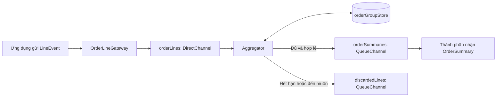

# Gom message bằng aggregator

## 1. Mục tiêu thực hành

Trong chương **Thực hành tổng hợp** của module `SPRING_INTEGRATION_CORE`, bài này xây dựng một luồng nhận các dòng đơn hàng độc lập và phát ra một bản tổng hợp khi đã nhận đủ dữ liệu. Bài tập kết nối `Message`, `MessageChannel`, messaging gateway, endpoint và Java DSL với một thành phần có trạng thái: **aggregator**.

Sau khi hoàn thành, bạn có thể:

- Chọn khóa tương quan để các message của cùng một đơn đi vào đúng nhóm.
- Viết điều kiện hoàn tất dựa trên các dòng nghiệp vụ duy nhất.
- Tạo payload kết quả có thứ tự và tổng tiền xác định.
- Quy định cách xử lý nhóm thiếu dữ liệu, dữ liệu mâu thuẫn và message đến muộn.
- Kiểm thử luồng gom nhóm mà không phụ thuộc vào broker hay cơ sở dữ liệu.
- Giải thích những thay đổi cần thiết khi chuyển từ một tiến trình thử nghiệm sang hệ thống có lưu trữ bền vững.

Kiến thức đầu vào: biết khai báo Spring bean, đọc Java DSL, gửi một `Message` vào channel và viết kiểm thử JUnit. Ví dụ sử dụng Java 17 và các API Spring Integration 6.5; có thể đặt trong một dự án Spring Boot 3.5 quản lý phiên bản thư viện. Đây là mốc để đọc ví dụ, không phải tuyên bố về phiên bản mới nhất.

## 2. Đề bài: gom các dòng đơn hàng

Một hệ thống tiếp nhận sự kiện dòng đơn hàng từ nhiều nguồn. Mỗi sự kiện mang mã khách thuê, mã đơn, phiên bản đơn, số thứ tự dòng, tổng số dòng dự kiến và thành tiền của dòng đó.

Ví dụ đơn `ORD-42`, khách thuê `SHOP-A`, phiên bản `1`:

| Thứ tự nhận | Dòng | Số dòng dự kiến | Thành tiền | Ý nghĩa |
| --- | --- | --- | --- | --- |
| 1 | 3 | 3 | 30000 | Dòng cuối đến trước |
| 2 | 1 | 3 | 10000 | Nhóm vẫn thiếu dòng 2 |
| 3 | 1 | 3 | 10000.00 | Bản gửi lại của dòng 1 |
| 4 | 2 | 3 | 20000 | Đủ các dòng 1, 2, 3 |

Kết quả mong muốn là một bản tổng hợp có ba dòng theo thứ tự `1, 2, 3`, tổng tiền `60000`, trạng thái `COMPLETE`. Bốn lần nhận message chỉ tạo ra ba dòng nghiệp vụ.

Hợp đồng của bài tập:

1. Khóa nhóm là bộ ba `(tenantId, orderId, revision)`.
2. Trong một nhóm, `expectedLines` phải thống nhất và nằm trong khoảng `1..1000`.
3. Mỗi `lineNo` phải thuộc `1..expectedLines`.
4. Gửi lại cùng dòng với cùng thành tiền được xem là bản trùng hợp lệ.
5. Cùng dòng nhưng khác thành tiền, hoặc khác `expectedLines`, làm nhóm không hợp lệ.
6. Chỉ nhóm hợp lệ, đủ toàn bộ dòng mới được phát kết quả thông thường.
7. Nhóm chưa hoàn tất sau một khoảng im lặng sẽ chuyển message sang kênh loại bỏ để điều tra hoặc xử lý bù.
8. Sau khi đóng nhóm, message đến muộn bị loại bỏ trong thời gian còn giữ dấu vết nhóm.

Giả sử mọi dòng dùng cùng đơn vị tiền tệ và `amount` đã là thành tiền sau khi tính số lượng. Nếu hệ thống hỗ trợ nhiều loại tiền, cần bổ sung `currency` vào hợp đồng và kiểm tra tính nhất quán trước khi cộng tiền.

## 3. Thiết kế một aggregator

Aggregator gom nhiều message có liên quan thành một kết quả. Cần tách ba quyết định: message thuộc nhóm nào, khi nào nhóm được phép phát kết quả và kết quả được tạo như thế nào. Các điểm mở rộng tương ứng là `CorrelationStrategy`, `ReleaseStrategy` và `MessageGroupProcessor`. [Tài liệu Aggregator](https://docs.spring.io/spring-integration/reference/6.5/aggregator.html).

| Thành phần | Câu hỏi phải trả lời | Quyết định trong bài |
| --- | --- | --- |
| Correlation | Message này thuộc nhóm nào? | Dùng `OrderKey` |
| Release | Nhóm đã đủ điều kiện chưa? | Hợp lệ và đủ dòng duy nhất |
| Output processor | Tạo kết quả gì từ nhóm? | `OrderSummary` |
| Message group store | Giữ dữ liệu đang chờ ở đâu? | `SimpleMessageStore` |
| Chính sách hết hạn | Nhóm thiếu dữ liệu sẽ đi đâu? | `discardedLines` |
| Dấu vết nhóm đã đóng | Message đến muộn được tiếp nhận thế nào? | Giữ metadata nhóm |



Trong thiết kế này, đầu vào là sự kiện độc lập; không có splitter tạo sẵn thông tin chuỗi. Vì vậy, luồng khai báo cả correlation và release thay vì dựa vào header mặc định. Ở luồng splitter–aggregator khác, cần hiểu các header `correlationId`, `sequenceNumber`, `sequenceSize`; không dùng số dòng nghiệp vụ và header sequence như những khái niệm có thể thay thế nhau trong mọi trường hợp. [Cơ chế correlation và sequence](https://docs.spring.io/spring-integration/reference/6.5/aggregator.html).

### 3.1. Khóa nhóm phải phản ánh vòng đời nghiệp vụ

Chỉ dùng `orderId` sẽ trộn hai khách thuê cùng có đơn `ORD-42`. Chỉ dùng `(tenantId, orderId)` sẽ trộn bản sửa đổi của đơn với phiên bản trước. Khóa có thêm `revision` cho phép xử lý lại một phiên bản mới mà vẫn nhận diện message đến muộn của phiên bản cũ.

Không dùng `MessageHeaders.ID` làm khóa nhóm: mỗi message có thể có một ID khác nhau nên các dòng cần gom lại bị phân tách. Cũng không dùng một hằng số cho mọi đơn: khi đó các đơn độc lập có thể bị cộng chung.

### 3.2. Đếm số dòng duy nhất

Với `expectedLines = 3`, nhóm nhận `1, 1, 2` chưa hoàn tất dù đã nhận ba message. Ngược lại, nhóm nhận `3, 1, 1, 2` đã hoàn tất dù có bốn message.

Điều kiện của bài là:

```text
valid = cùng khóa nhóm
        và cùng expectedLines
        và mọi lineNo hợp lệ
        và các bản trùng không mâu thuẫn

complete = valid
           và tập lineNo duy nhất bằng {1, ..., expectedLines}
```

Sau khi kiểm tra miền `1..expectedLines`, so sánh số phần tử duy nhất với `expectedLines` là đủ để xác nhận tập số dòng. Nếu không có kiểm tra miền, ba dòng `1, 2, 99` vẫn có thể bị đếm nhầm là đầy đủ.

## 4. Chuẩn bị dự án thực hành

Trong một dự án Spring Boot 3.5 với Java 17 đã cấu hình Maven, khai báo các dependency sau. Để BOM/parent của Boot quản lý phiên bản; không tự phối hợp các phiên bản Spring Framework và Spring Integration riêng lẻ. [Cơ chế quản lý dependency của Boot](https://docs.spring.io/spring-boot/3.5/appendix/dependency-versions/coordinates.html).

```xml
<dependencies>
    <dependency>
        <groupId>org.springframework.boot</groupId>
        <artifactId>spring-boot-starter-integration</artifactId>
    </dependency>
    <dependency>
        <groupId>org.springframework.boot</groupId>
        <artifactId>spring-boot-starter-test</artifactId>
        <scope>test</scope>
    </dependency>
</dependencies>
```

Các lớp dưới đây nằm trong package `example.orders`. Mỗi lớp hoặc record `public` đặt trong một tệp Java cùng tên. Các đoạn mở rộng ở cuối bài là lựa chọn thay thế hoặc bài tập bổ sung; chỉ các lớp ở phần triển khai chính cần được ghép thành ứng dụng ban đầu.

```text
src/main/java/example/orders/
  OrderAggregationApplication.java
  OrderKey.java
  LineEvent.java
  OrderSummary.java
  OrderAggregationPolicy.java
  OrderLineGateway.java
  OrderAggregationConfig.java

src/test/java/example/orders/
  OrderAggregationFlowTest.java
  OrderAggregationTimeoutTest.java
```

Lớp khởi động:

```java
package example.orders;

import org.springframework.boot.SpringApplication;
import org.springframework.boot.autoconfigure.SpringBootApplication;
import org.springframework.integration.annotation.IntegrationComponentScan;

@SpringBootApplication
@IntegrationComponentScan
public class OrderAggregationApplication {

    public static void main(String[] args) {
        SpringApplication.run(OrderAggregationApplication.class, args);
    }
}
```

`@IntegrationComponentScan` quét interface gateway trong package ứng dụng. Bài thực hành chưa kết nối một nguồn sự kiện bên ngoài; kiểm thử sẽ đóng vai trò producer qua gateway.

## 5. Mô hình dữ liệu

### 5.1. Khóa tương quan

```java
package example.orders;

public record OrderKey(String tenantId, String orderId, int revision) {

    public OrderKey {
        if (tenantId == null || tenantId.isBlank()) {
            throw new IllegalArgumentException("tenantId is required");
        }
        if (orderId == null || orderId.isBlank()) {
            throw new IllegalArgumentException("orderId is required");
        }
        if (revision < 1) {
            throw new IllegalArgumentException("revision must be positive");
        }
    }
}
```

Record tạo `equals()` và `hashCode()` dựa trên ba trường, phù hợp làm khóa trong store của bài. Nếu biểu diễn khóa thành chuỗi để lưu ở hệ thống khác, chọn một định dạng có mã hóa rõ ràng; nối chuỗi bằng dấu phân cách tùy ý có thể gây va chạm khi dữ liệu chứa chính dấu phân cách đó.

### 5.2. Sự kiện đầu vào

```java
package example.orders;

import java.math.BigDecimal;
import java.util.Objects;

public record LineEvent(
        String tenantId,
        String orderId,
        int revision,
        int lineNo,
        int expectedLines,
        BigDecimal amount) {

    public LineEvent {
        // Xác thực các trường tạo khóa trước khi gửi vào flow.
        new OrderKey(tenantId, orderId, revision);
        if (expectedLines < 1 || expectedLines > 1000) {
            throw new IllegalArgumentException("expectedLines must be 1..1000");
        }
        if (lineNo < 1 || lineNo > expectedLines) {
            throw new IllegalArgumentException("lineNo is outside expected range");
        }
        Objects.requireNonNull(amount, "amount is required");
        if (amount.signum() < 0) {
            throw new IllegalArgumentException("amount must not be negative");
        }
    }

    public OrderKey key() {
        return new OrderKey(tenantId, orderId, revision);
    }
}
```

Giới hạn 1000 là lựa chọn của bài tập để giới hạn quy mô một đơn. Nó chưa giới hạn tổng số message trùng được nhận hoặc tổng số đơn đang mở. Hai giới hạn đó cần chính sách riêng nếu xây dựng dịch vụ tiếp nhận thực tế.

Ví dụ dùng `new BigDecimal("10000.00")` để tránh sai số do khởi tạo từ `double`. Khi so sánh thành tiền của bản gửi lại, chính sách sẽ dùng `compareTo()`, vì `10000` và `10000.00` được xem là cùng giá trị trong hợp đồng này.

### 5.3. Kết quả tổng hợp

```java
package example.orders;

import java.math.BigDecimal;
import java.util.List;

public record OrderSummary(
        OrderKey key,
        int expectedLines,
        List<LineEvent> lines,
        BigDecimal total,
        Status status,
        List<String> issues) {

    public enum Status {
        COMPLETE, PARTIAL, INVALID
    }

    public OrderSummary {
        lines = List.copyOf(lines);
        issues = List.copyOf(issues);
    }
}
```

Trong cấu hình chính, chỉ `COMPLETE` được đưa ra kênh kết quả. `PARTIAL` và `INVALID` giúp mô tả trạng thái trong chính sách và phục vụ phần mở rộng về kết quả thiếu. Với một nhóm `INVALID`, `total` chỉ là tổng của các dòng được chọn để chẩn đoán, không đủ điều kiện dùng để thanh toán.

## 6. Viết chính sách gom nhóm

Chính sách dưới đây tạo một ảnh chụp dữ liệu nghiệp vụ của nhóm. Nó không sửa collection của `MessageGroup`, không gọi dịch vụ ngoài và không tự xóa message khỏi store. `MessageGroup` cung cấp các message và định danh nhóm; ảnh chụp nghiệp vụ là cấu trúc do ứng dụng tự tạo. [API MessageGroup](https://docs.spring.io/spring-integration/api/org/springframework/integration/store/MessageGroup.html).

```java
package example.orders;

import java.math.BigDecimal;
import java.util.ArrayList;
import java.util.LinkedHashSet;
import java.util.Set;
import java.util.TreeMap;

import org.springframework.integration.store.MessageGroup;
import org.springframework.messaging.Message;
import org.springframework.messaging.support.MessageBuilder;

public class OrderAggregationPolicy {

    public boolean canRelease(MessageGroup group) {
        return group.size() > 0
                && inspect(group).status() == OrderSummary.Status.COMPLETE;
    }

    public Message<OrderSummary> aggregate(MessageGroup group) {
        OrderSummary summary = inspect(group);
        return MessageBuilder.withPayload(summary)
                .setHeader("tenantId", summary.key().tenantId())
                .setHeader("orderId", summary.key().orderId())
                .setHeader("revision", summary.key().revision())
                .setHeader("aggregationStatus", summary.status().name())
                .build();
    }

    private OrderSummary inspect(MessageGroup group) {
        if (group.size() == 0) {
            throw new IllegalArgumentException("Cannot aggregate an empty group");
        }

        LineEvent first = (LineEvent) group.getOne().getPayload();
        OrderKey key = first.key();
        int expected = first.expectedLines();
        TreeMap<Integer, LineEvent> unique = new TreeMap<>();
        Set<String> issues = new LinkedHashSet<>();

        for (Message<?> message : group.getMessages()) {
            LineEvent line = (LineEvent) message.getPayload();

            if (!key.equals(line.key())) {
                issues.add("CORRELATION_MISMATCH");
            }
            if (line.expectedLines() != expected) {
                issues.add("EXPECTED_LINES_MISMATCH");
            }
            if (line.lineNo() < 1 || line.lineNo() > expected) {
                issues.add("LINE_OUT_OF_RANGE:" + line.lineNo());
            }

            LineEvent previous = unique.putIfAbsent(line.lineNo(), line);
            if (previous != null
                    && previous.amount().compareTo(line.amount()) != 0) {
                issues.add("LINE_AMOUNT_CONFLICT:" + line.lineNo());
            }
        }

        BigDecimal total = unique.values().stream()
                .map(LineEvent::amount)
                .reduce(BigDecimal.ZERO, BigDecimal::add);

        OrderSummary.Status status;
        if (!issues.isEmpty()) {
            status = OrderSummary.Status.INVALID;
        }
        else if (unique.size() == expected) {
            status = OrderSummary.Status.COMPLETE;
        }
        else {
            status = OrderSummary.Status.PARTIAL;
        }

        return new OrderSummary(
                key,
                expected,
                new ArrayList<>(unique.values()),
                total,
                status,
                new ArrayList<>(issues));
    }
}
```

Các quyết định có chủ đích:

- `TreeMap` tạo thứ tự kết quả theo `lineNo`, độc lập với thứ tự đến.
- `putIfAbsent()` giữ một đại diện cho mỗi dòng khi tính tổng.
- Bản trùng cùng giá trị không thêm một dòng vào kết quả.
- Mâu thuẫn được ghi thành `issues` và làm release trả về `false`; nhóm chờ chính sách hết hạn.
- `aggregate()` trả về một `Message<OrderSummary>` với các header nghiệp vụ được đặt rõ ràng. Không sao chép toàn bộ header của một dòng ngẫu nhiên.

`outputProcessor()` là điểm cấu hình dành cho `MessageGroupProcessor` trong Java DSL; khi processor tự trả về `Message`, ứng dụng phải chủ động xây dựng các header cần thiết của kết quả. [API AggregatorSpec](https://docs.spring.io/spring-integration/api/org/springframework/integration/dsl/AggregatorSpec.html), [quy tắc tạo header kết quả](https://docs.spring.io/spring-integration/reference/6.5/aggregator.html).

Thuật toán này loại trùng **trong phép tổng hợp**. Nó không ngăn các message trùng nằm trong store trước khi nhóm đóng. Khi lượng gửi lại lớn, cần bổ sung admission control hoặc một cơ chế idempotency ở đầu vào, đồng bộ với vòng đời tiếp nhận của nhóm.

## 7. Gateway và Java DSL

### 7.1. Gateway gửi từng sự kiện

```java
package example.orders;

import org.springframework.integration.annotation.MessagingGateway;

@MessagingGateway(defaultRequestChannel = "orderLines")
public interface OrderLineGateway {

    void submit(LineEvent line);
}
```

Phương thức trả về `void` vì mỗi lần gửi chỉ đóng góp một dòng. Ứng dụng nhận bản tổng hợp qua kênh kết quả riêng. Nếu khai báo `OrderSummary submit(LineEvent line)` và chờ trả lời cho từng dòng, những dòng đầu tiên có thể phải chờ các dòng chưa được gửi; một producer gửi tuần tự sẽ dễ tự chặn tiến trình của mình.

Trong cấu hình này, `void` chỉ biểu thị không chờ một reply nghiệp vụ. Đầu vào dùng `DirectChannel`, nên lời gọi vẫn thực thi các handler đồng bộ và có thể chờ khi kênh kết quả bị đầy. Không suy ra rằng gateway đã tự tạo xử lý bất đồng bộ.

### 7.2. Cấu hình luồng hoàn chỉnh

```java
package example.orders;

import org.springframework.beans.factory.annotation.Qualifier;
import org.springframework.beans.factory.annotation.Value;
import org.springframework.context.annotation.Bean;
import org.springframework.context.annotation.Configuration;
import org.springframework.integration.channel.DirectChannel;
import org.springframework.integration.channel.QueueChannel;
import org.springframework.integration.dsl.IntegrationFlow;
import org.springframework.integration.store.SimpleMessageStore;

@Configuration
public class OrderAggregationConfig {

    @Bean
    public DirectChannel orderLines() {
        return new DirectChannel();
    }

    @Bean
    public QueueChannel orderSummaries() {
        return new QueueChannel(100);
    }

    @Bean
    public QueueChannel discardedLines() {
        return new QueueChannel(100);
    }

    @Bean
    public SimpleMessageStore orderGroupStore() {
        return new SimpleMessageStore();
    }

    @Bean
    public OrderAggregationPolicy orderAggregationPolicy() {
        return new OrderAggregationPolicy();
    }

    @Bean
    public IntegrationFlow orderAggregationFlow(
            @Qualifier("orderGroupStore") SimpleMessageStore store,
            OrderAggregationPolicy policy,
            @Value("${orders.group-timeout-ms:30000}") long groupTimeoutMs) {

        return IntegrationFlow.from("orderLines")
                .aggregate(a -> a
                        .id("orderAggregator")
                        .messageStore(store)
                        .correlationStrategy(message ->
                                ((LineEvent) message.getPayload()).key())
                        .releaseStrategy(policy::canRelease)
                        .outputProcessor(policy::aggregate)
                        .groupTimeout(groupTimeoutMs)
                        .sendPartialResultOnExpiry(false)
                        .expireGroupsUponCompletion(false)
                        .expireGroupsUponTimeout(false)
                        .minimumTimeoutForEmptyGroups(0)
                        .discardIndividuallyOnExpiry(true)
                        .discardChannel("discardedLines")
                        .sendTimeout(1000))
                .channel("orderSummaries")
                .get();
    }
}
```

Các phương thức correlation, release, message store, timeout và discard thuộc nhóm cấu hình của `CorrelationHandlerSpec`; `outputProcessor()` và chính sách hết hạn sau hoàn tất nằm ở `AggregatorSpec`. Tham số thời gian dạng `long` trong các lời gọi ở đây dùng mili giây. [API CorrelationHandlerSpec 6.5](https://docs.spring.io/spring-integration/docs/6.5.0/api/org/springframework/integration/dsl/CorrelationHandlerSpec.html), [API AggregatingMessageHandler 6.5](https://docs.spring.io/spring-integration/docs/6.5.0/api/org/springframework/integration/aggregator/AggregatingMessageHandler.html).

### 7.3. Vì sao chọn cấu hình này?

| Lựa chọn | Hệ quả đối với bài thực hành |
| --- | --- |
| `DirectChannel` ở đầu vào | Có thể xác nhận ngay kết quả đồng bộ sau `submit()` |
| Hai `QueueChannel(100)` ở đầu ra | Kiểm thử chủ động nhận kết quả và message bị loại |
| Store riêng cho luồng đơn hàng | Tách dữ liệu nhóm và thao tác quản lý vòng đời |
| `sendPartialResultOnExpiry(false)` | Không phát một đơn thiếu dòng như kết quả thông thường |
| Hai tùy chọn `expireGroups...` đều `false` | Giữ dấu vết nhóm sau đóng bình thường và sau timeout |
| `minimumTimeoutForEmptyGroups(0)` | Không lập lịch xóa tự động dấu vết nhóm rỗng trong cấu hình bài tập |
| `discardIndividuallyOnExpiry(true)` | Khi hết hạn, mỗi message bị loại được nhận riêng |
| `sendTimeout(1000)` | Giới hạn thời gian chờ gửi vào các queue có dung lượng hữu hạn |

Cấu hình giữ metadata nhằm giúp quan sát message đến muộn trong một lượt chạy. Với lưu lượng liên tục, phải bổ sung thời hạn lưu dấu vết; để vô hạn sẽ khiến số nhóm đã đóng tăng mãi. Ý nghĩa của việc hoàn tất nhóm và xóa nhóm là hai thao tác khác nhau. [API quản lý vòng đời nhóm](https://docs.spring.io/spring-integration/docs/6.5.0/api/org/springframework/integration/aggregator/AbstractCorrelatingMessageHandler.html).

Hai queue đầu ra cần được tiêu thụ. Trong bài này, kiểm thử gọi `receive()`; trong dịch vụ thật, cần consumer tương ứng. Nếu thêm một Integration Flow bắt đầu từ `QueueChannel`, hãy cấu hình poller cho endpoint đọc queue. Việc gom nhóm không tự tạo consumer cho kết quả.

## 8. Quan sát vòng đời một nhóm

Với khóa `(SHOP-A, ORD-42, 1)`, hãy lần lượt gửi các dòng `3, 1, 1, 2` trong đề bài.

| Sau lần gửi | Message đang giữ | Dòng duy nhất | Trạng thái suy ra | Kênh kết quả |
| --- | --- | --- | --- | --- |
| Dòng 3 | 1 | `{3}` | `PARTIAL` | Rỗng |
| Dòng 1 | 2 | `{1, 3}` | `PARTIAL` | Rỗng |
| Dòng 1 gửi lại | 3 | `{1, 3}` | `PARTIAL` | Rỗng |
| Dòng 2 | Được xử lý để đóng nhóm | `{1, 2, 3}` | `COMPLETE` | Một `OrderSummary` |

Luồng bình thường:

```text
Nhận message
  → tính OrderKey
  → thêm vào nhóm tương ứng
  → đánh giá canRelease()
      false: giữ nhóm để chờ tiếp
      true : tạo OrderSummary → gửi kết quả → hoàn tất nhóm
```

Sau hoàn tất thành công, cấu hình giữ nhóm đã đóng với dữ liệu message đã được dọn khỏi nhóm. Có thể quan sát dấu vết này trong kiểm thử bằng `isComplete()` và `size()`. Một message cùng khóa đến sau sẽ đi vào `discardedLines`, thay vì được tính thành đơn mới. [API MessageGroup và trạng thái hoàn tất](https://docs.spring.io/spring-integration/api/org/springframework/integration/store/MessageGroup.html).

Không nhầm trạng thái `OrderSummary.Status.COMPLETE` của ứng dụng với cờ hoàn tất của `MessageGroup`. Trạng thái thứ nhất mô tả dữ liệu nghiệp vụ; cờ thứ hai phục vụ vòng đời nhóm trong endpoint. Bài tập chủ động thiết kế chúng tương thích với nhau trong nhánh thành công.

## 9. Kiểm thử luồng thành công và dữ liệu bất thường

Kiểm thử dùng gateway thật, channel thật và aggregator thật trong Spring context. Đầu vào đồng bộ giúp dùng `receive(0)` để kiểm tra kết quả đang có mà không chờ một khoảng thời gian tùy ý.

Đặt timeout nhóm ở mức 60 giây trong lớp kiểm thử này để tránh timeout ngắn xen vào các phép kiểm tra thông thường. Mỗi phương thức dùng context mới, tách queue và dấu vết nhóm giữa các kịch bản.

```java
package example.orders;

import java.math.BigDecimal;
import java.util.HashMap;
import java.util.Map;

import org.junit.jupiter.api.Test;
import org.springframework.beans.factory.annotation.Autowired;
import org.springframework.beans.factory.annotation.Qualifier;
import org.springframework.boot.test.context.SpringBootTest;
import org.springframework.integration.channel.QueueChannel;
import org.springframework.integration.store.MessageGroup;
import org.springframework.integration.store.SimpleMessageStore;
import org.springframework.messaging.Message;
import org.springframework.test.annotation.DirtiesContext;

import static org.assertj.core.api.Assertions.assertThat;

@SpringBootTest(
        classes = OrderAggregationApplication.class,
        properties = "orders.group-timeout-ms=60000")
@DirtiesContext(classMode = DirtiesContext.ClassMode.AFTER_EACH_TEST_METHOD)
class OrderAggregationFlowTest {

    @Autowired
    private OrderLineGateway gateway;

    @Autowired
    @Qualifier("orderSummaries")
    private QueueChannel output;

    @Autowired
    @Qualifier("discardedLines")
    private QueueChannel discarded;

    @Autowired
    @Qualifier("orderGroupStore")
    private SimpleMessageStore store;

    @Test
    void aggregatesOutOfOrderWithoutDoubleCountingAndDiscardsLateMessage() {
        gateway.submit(line("A", "ORD-42", 1, 3, 3, "30000"));
        gateway.submit(line("A", "ORD-42", 1, 1, 3, "10000"));
        gateway.submit(line("A", "ORD-42", 1, 1, 3, "10000.00"));

        assertThat(output.receive(0)).isNull();
        OrderKey key = new OrderKey("A", "ORD-42", 1);
        assertThat(store.getMessageGroup(key).size()).isEqualTo(3);

        gateway.submit(line("A", "ORD-42", 1, 2, 3, "20000"));

        OrderSummary result = receiveSummary();
        assertThat(result.key()).isEqualTo(key);
        assertThat(result.status()).isEqualTo(OrderSummary.Status.COMPLETE);
        assertThat(result.lines()).extracting(LineEvent::lineNo)
                .containsExactly(1, 2, 3);
        assertThat(result.total()).isEqualByComparingTo("60000");
        assertThat(result.issues()).isEmpty();
        assertThat(output.receive(0)).isNull();

        MessageGroup completed = store.getMessageGroup(key);
        assertThat(completed.isComplete()).isTrue();
        assertThat(completed.size()).isZero();

        LineEvent late = line("A", "ORD-42", 1, 2, 3, "20000");
        gateway.submit(late);
        Message<?> rejected = discarded.receive(0);
        assertThat(rejected).isNotNull();
        assertThat(rejected.getPayload()).isEqualTo(late);
        assertThat(output.receive(0)).isNull();
    }

    @Test
    void separatesTenantsAndRevisions() {
        gateway.submit(line("A", "SAME", 1, 1, 2, "10"));
        gateway.submit(line("B", "SAME", 1, 1, 2, "100"));
        gateway.submit(line("A", "SAME", 2, 1, 2, "1000"));
        assertThat(output.receive(0)).isNull();

        gateway.submit(line("B", "SAME", 1, 2, 2, "200"));
        gateway.submit(line("A", "SAME", 2, 2, 2, "2000"));
        gateway.submit(line("A", "SAME", 1, 2, 2, "20"));

        Map<OrderKey, BigDecimal> totals = new HashMap<>();
        for (int i = 0; i < 3; i++) {
            OrderSummary result = receiveSummary();
            assertThat(result.status()).isEqualTo(OrderSummary.Status.COMPLETE);
            totals.put(result.key(), result.total());
        }

        assertThat(totals).hasSize(3);
        assertThat(totals.get(new OrderKey("A", "SAME", 1)))
                .isEqualByComparingTo("30");
        assertThat(totals.get(new OrderKey("B", "SAME", 1)))
                .isEqualByComparingTo("300");
        assertThat(totals.get(new OrderKey("A", "SAME", 2)))
                .isEqualByComparingTo("3000");
        assertThat(output.receive(0)).isNull();
    }

    @Test
    void doesNotReleaseAConflictingDuplicate() {
        gateway.submit(line("A", "CONFLICT", 1, 1, 2, "10"));
        gateway.submit(line("A", "CONFLICT", 1, 1, 2, "99"));
        gateway.submit(line("A", "CONFLICT", 1, 2, 2, "20"));

        assertThat(output.receive(0)).isNull();
        MessageGroup group = store.getMessageGroup(
                new OrderKey("A", "CONFLICT", 1));
        assertThat(group.isComplete()).isFalse();
        assertThat(group.size()).isEqualTo(3);
        assertThat(discarded.receive(0)).isNull();
    }

    @Test
    void doesNotReleaseWhenExpectedCountsDisagree() {
        gateway.submit(line("A", "COUNT", 1, 1, 2, "10"));
        gateway.submit(line("A", "COUNT", 1, 2, 3, "20"));
        gateway.submit(line("A", "COUNT", 1, 3, 3, "30"));

        assertThat(output.receive(0)).isNull();
        assertThat(store.getMessageGroup(
                new OrderKey("A", "COUNT", 1)).isComplete()).isFalse();
    }

    private OrderSummary receiveSummary() {
        Message<?> message = output.receive(0);
        assertThat(message).isNotNull();
        assertThat(message.getPayload()).isInstanceOf(OrderSummary.class);
        return (OrderSummary) message.getPayload();
    }

    private LineEvent line(
            String tenant, String order, int revision,
            int number, int expected, String amount) {

        return new LineEvent(tenant, order, revision,
                number, expected, new BigDecimal(amount));
    }
}
```

Kiểm thử thứ nhất xác nhận cả thời điểm chưa được release và kết quả sau release. Nếu chỉ kiểm tra tổng tiền cuối cùng, một lỗi phát kết quả sớm hoặc phát thêm bản tổng hợp có thể bị bỏ qua.

Trong kiểm thử nhóm mâu thuẫn, `discardedLines` vẫn rỗng ngay sau gửi vì bài chọn đợi timeout để loại cả nhóm. Đó là hành vi đã quy định; nếu nghiệp vụ cần báo lỗi ngay, hãy thiết kế một nhánh lỗi riêng thay vì kỳ vọng `ReleaseStrategy` trả về `false` sẽ tự phát thông báo lỗi.

## 10. Timeout và nhóm thiếu dữ liệu

### 10.1. Khoảng im lặng và thời hạn tuyệt đối

`groupTimeout(30000)` của bài được hiểu là khoảng chờ khi nhóm chưa release và không có message mới trong 30 giây. Nó không bảo đảm nhóm đóng trong 30 giây kể từ dòng đầu tiên. Một dòng đến gần cuối khoảng chờ có thể làm lịch chờ thay đổi. [Hành vi group timeout](https://docs.spring.io/spring-integration/reference/6.5/aggregator.html#aggregator-and-group-timeout).

Ví dụ với timeout 30 giây:

```text
t =  0 giây: nhận dòng 1, còn thiếu dòng 2 và 3
t = 20 giây: nhận lại dòng 1
t = 40 giây: nhận dòng 2
t ≈ 70 giây: nhóm có thể bị đóng nếu không nhận thêm dữ liệu
```

Ngay cả bản trùng về nghiệp vụ cũng là một lần nhận message của endpoint. Do đó, nếu cần cam kết thời gian từ lúc tạo nhóm, phải chọn chính sách thời gian tương ứng thay vì chỉ giảm con số trong `groupTimeout()`.

Một lựa chọn thay thế trong cấu hình là dùng thời điểm tuyệt đối dựa trên timestamp nhóm:

```java
// Thay cho .groupTimeout(groupTimeoutMs), không đặt đồng thời cả hai.
.groupTimeoutExpression("new java.util.Date(timestamp + 30000)")
```

Ở đây, `timestamp` là thời gian tạo nhóm trong store. Nếu hạn chót nghiệp vụ là một thời điểm do producer cung cấp, nên đưa `deadline` vào hợp đồng và kiểm tra tính nhất quán giữa các dòng; thời gian tạo nhóm trong ứng dụng chưa chắc trùng với thời điểm bắt đầu nghiệp vụ. [Các dạng biểu thức timeout](https://docs.spring.io/spring-integration/reference/6.5/aggregator.html).

### 10.2. Kiểm thử nhánh hết hạn

Kiểm thử timeout chạy trong context riêng với thời gian chờ nhóm 500 ms. `receive(10000)` chờ trực tiếp sự kiện bị loại trong một khoảng có giới hạn; không cần `Thread.sleep()` và không khẳng định scheduler phải chạy đúng tại một mili giây cụ thể.

```java
package example.orders;

import java.math.BigDecimal;

import org.junit.jupiter.api.Test;
import org.springframework.beans.factory.annotation.Autowired;
import org.springframework.beans.factory.annotation.Qualifier;
import org.springframework.boot.test.context.SpringBootTest;
import org.springframework.integration.channel.QueueChannel;
import org.springframework.integration.store.MessageGroup;
import org.springframework.integration.store.SimpleMessageStore;
import org.springframework.messaging.Message;
import org.springframework.test.annotation.DirtiesContext;

import static org.assertj.core.api.Assertions.assertThat;

@SpringBootTest(
        classes = OrderAggregationApplication.class,
        properties = "orders.group-timeout-ms=500")
@DirtiesContext(classMode = DirtiesContext.ClassMode.AFTER_CLASS)
class OrderAggregationTimeoutTest {

    @Autowired
    private OrderLineGateway gateway;

    @Autowired
    @Qualifier("orderSummaries")
    private QueueChannel output;

    @Autowired
    @Qualifier("discardedLines")
    private QueueChannel discarded;

    @Autowired
    @Qualifier("orderGroupStore")
    private SimpleMessageStore store;

    @Test
    void discardsIncompleteGroupAndThenRejectsItsLateLine() {
        LineEvent first = new LineEvent(
                "A", "TIMEOUT", 1, 1, 2, new BigDecimal("10"));
        gateway.submit(first);

        Message<?> expired = discarded.receive(10000);
        assertThat(expired).isNotNull();
        assertThat(expired.getPayload()).isEqualTo(first);
        assertThat(output.receive(0)).isNull();

        LineEvent late = new LineEvent(
                "A", "TIMEOUT", 1, 2, 2, new BigDecimal("20"));
        gateway.submit(late);

        Message<?> rejected = discarded.receive(0);
        assertThat(rejected).isNotNull();
        assertThat(rejected.getPayload()).isEqualTo(late);
        assertThat(output.receive(0)).isNull();

        MessageGroup group = store.getMessageGroup(
                new OrderKey("A", "TIMEOUT", 1));
        assertThat(group.isComplete()).isTrue();
        assertThat(group.size()).isZero();
    }
}
```

Phép gửi message muộn đi qua cùng khóa nhóm, nên nó được đồng bộ với thao tác quản lý nhóm của endpoint. Kiểm tra store sau bước đó tránh giả định rằng nhận message hết hạn đã đồng nghĩa mọi thao tác dọn nhóm trên thread scheduler đều kết thúc tức thì.

Để thực hiện bài trong dự án Maven đã chuẩn bị, chạy `mvn test`. Kỳ vọng các kiểm thử trên đều thành công, kênh kết quả không chứa đơn thiếu dòng và các message đến muộn xuất hiện ở kênh loại bỏ. Các đoạn mã ở đây là nội dung thực hành để người học chạy; bài không trình bày một kết quả thực thi benchmark hoặc log kiểm thử đã đo sẵn.

## 11. Message đến muộn và việc xóa dấu vết nhóm

Giữ một nhóm đã hoàn tất giúp phân biệt một message đến muộn với dòng đầu tiên của nhóm mới. Khi xóa hoàn toàn nhóm khỏi store, endpoint không còn dấu vết để phân biệt hai trường hợp đó. [Chính sách expireGroupsUponCompletion](https://docs.spring.io/spring-integration/docs/6.5.0/api/org/springframework/integration/aggregator/AggregatingMessageHandler.html).

| Tùy chọn | Giá trị | Tình huống phải chấp nhận |
| --- | --- | --- |
| `expireGroupsUponCompletion` | `false` | Giữ dấu vết sau hoàn tất bình thường; cần kế hoạch dọn metadata |
| `expireGroupsUponCompletion` | `true` | Message cùng khóa về sau có thể mở một nhóm mới |
| `expireGroupsUponTimeout` | `false` | Nhóm bị đóng do hết hạn vẫn chặn message đến muộn |
| `expireGroupsUponTimeout` | `true` | Message đến sau timeout có thể bắt đầu gom lại từ đầu |

Trong hệ thống đơn hàng, việc mở lại cùng phiên bản sau khi đã chốt thường cần được kiểm soát. Bài chọn giữ dấu vết, đồng thời dùng `revision` để nhận biết một phiên bản nghiệp vụ mới có chủ đích.

Không dùng riêng dấu vết trong `SimpleMessageStore` để hứa hẹn loại trùng vĩnh viễn. Sau khi tiến trình mất dữ liệu bộ nhớ hoặc metadata bị xóa, các message cũ có thể được tiếp nhận lại. Nếu cần bảo vệ một nghiệp vụ đã hoàn thành, hãy lưu thêm trạng thái hoàn tất bằng khóa nghiệp vụ ở nơi bền vững và thiết kế consumer xử lý idempotent.

### 11.1. Chọn thời gian giữ dấu vết

Ví dụ, nếu nguồn có thể gửi lại một sự kiện tối đa trong 24 giờ, giữ dấu vết chỉ 5 phút có thể khiến phần lớn cửa sổ gửi lại không được bảo vệ. Ngược lại, giữ mọi dấu vết vô hạn khiến metadata tăng theo tổng số đơn từng xử lý.

Hợp đồng nên chỉ rõ:

- Khoảng trễ tối đa và cửa sổ gửi lại được hỗ trợ.
- Thời hạn giữ nhóm đã đóng.
- Hành vi khi nhận message cũ sau thời hạn đó.
- Cách tạo phiên bản hoặc mã lần xử lý mới khi cần chạy lại hợp lệ.

Một lựa chọn là đặt `minimumTimeoutForEmptyGroups()` bằng một giá trị dương phù hợp với thời gian lưu dấu vết. Với các thiết kế quản lý nhóm theo lịch, `MessageGroupStoreReaper` cung cấp một `Runnable` gọi cơ chế hết hạn của store. Cần cấu hình lịch thực thi; chỉ tạo bean reaper không tự bảo đảm nó quét định kỳ. [API MessageGroupStoreReaper](https://docs.spring.io/spring-integration/docs/6.5.0/api/org/springframework/integration/store/MessageGroupStoreReaper.html).

Không thêm đồng thời nhiều cơ chế hết hạn mà chưa xác định trách nhiệm của từng cơ chế. Một lượt quét store có thể tác động đến nhóm đang mở, trong khi mục tiêu ban đầu chỉ là dọn dấu vết nhóm đã đóng. Dành riêng store hoặc namespace cho endpoint giúp giới hạn phạm vi quản lý này.

## 12. Phân biệt discard với lỗi xử lý

Message thiếu dòng hoặc đến muộn là một nhánh xử lý được quy định trước. Exception khi truy cập store, tính toán hoặc gửi kết quả là một loại sự cố khác. Bài dùng `discardedLines` cho nhánh thứ nhất; queue đó không tự trở thành nơi nhận mọi exception.

| Tình huống | Hành vi của bài | Thông tin nên theo dõi |
| --- | --- | --- |
| Chưa đủ dòng | Giữ nhóm, chưa phát kết quả | Khóa nhóm, số dòng đã có và số dòng dự kiến |
| Bản trùng cùng giá trị | Không tính thêm vào tổng | Số bản gửi lại theo nguồn |
| Bản trùng khác giá trị | Nhóm không release, sau đó hết hạn | Dòng bị mâu thuẫn và các giá trị nhận được |
| Nhóm thiếu dữ liệu hết hạn | Message được gửi sang discard | Nhóm nào thiếu những dòng nào |
| Dòng đến sau khi đóng nhóm | Message đó đi vào discard | Thời gian đến muộn, phiên bản đơn |
| Constructor nhận dữ liệu sai | Từ chối trước khi gọi gateway | Dữ liệu đầu vào và nguyên nhân validation |
| Handler ném exception khi gửi đồng bộ | Caller có thể nhận exception | Endpoint, khóa nghiệp vụ, cause |
| Sự cố trong tác vụ scheduler | Cần xử lý lỗi trên thread chạy tác vụ | Error message, store và chính sách phục hồi |

Với `DirectChannel`, exception từ handler chạy trên thread gửi có thể truyền về caller. Không giả định rằng chỉ đặt header `errorChannel` sẽ chuyển mọi lỗi đồng bộ vào một queue. Các tác vụ bất đồng bộ và scheduler cần cơ chế công bố `ErrorMessage` phù hợp; khi tự cung cấp scheduler, hãy cấu hình cách xử lý lỗi của scheduler đó. [Tài liệu Error Handling](https://docs.spring.io/spring-integration/reference/error-handling.html).

Trong bài, mâu thuẫn dữ liệu là một kết quả kiểm tra không hợp lệ, nên `canRelease()` trả về `false` thay vì ném exception. Quyết định này giúp timeout vẫn có thể xử lý nhóm theo nhánh discard. Nếu đổi sang ném exception để báo ngay, cần thiết kế thêm việc cách ly hoặc sửa nhóm; không được giả định rằng exception sẽ tự hoàn tác dữ liệu đã thêm vào một store bộ nhớ.

### 12.1. Khi kênh kết quả đầy

Hai queue có dung lượng 100 để tránh tích lũy đầu ra không giới hạn trong bài tập. Nếu consumer ngừng đọc, việc gửi có thể chờ đến `sendTimeout(1000)` rồi thất bại. `QueueChannel` hỗ trợ giới hạn dung lượng và timeout của thao tác gửi; `DirectChannel` có mô hình gọi handler khác. [Các loại message channel](https://docs.spring.io/spring-integration/reference/channel/implementations.html).

Sự cố xảy ra sau khi một số dữ liệu đã được xử lý không đồng nghĩa ứng dụng đã đạt một giao dịch đầu cuối. Với hệ thống có yêu cầu khôi phục, cần xác định rõ:

1. Sau thất bại, nhóm còn giữ những dữ liệu nào?
2. Producer có gửi lại message cuối cùng hay không?
3. Consumer có thể nhận lại cùng một bản tổng hợp hay không?
4. Nghiệp vụ phía sau nhận biết một kết quả đã xử lý bằng khóa nào?

Ở đây, khóa kết quả có thể là `(tenantId, orderId, revision)`. Nếu consumer ghi cơ sở dữ liệu rồi gọi một API ngoài, phải thiết kế cơ chế khôi phục cho từng bước đó. Việc gom nhóm đúng chưa đủ để bảo đảm tác dụng phụ chỉ xảy ra một lần.

## 13. Lưu trữ, đồng thời và giới hạn tài nguyên

### 13.1. Phân biệt queue với message group store

`orderSummaries` giữ các kết quả đang chờ consumer. `orderGroupStore` giữ dữ liệu đang chờ hoàn tất theo từng khóa. Giảm dung lượng queue không làm giới hạn tự động số đơn đang mở trong store.

`SimpleMessageStore` là store trong bộ nhớ; constructor không tham số trong ví dụ không đặt giới hạn dung lượng. Nó phù hợp để học và kiểm thử, nhưng dữ liệu nhóm không tồn tại qua việc mất tiến trình. [API SimpleMessageStore](https://docs.spring.io/spring-integration/docs/6.5.0/api/org/springframework/integration/store/SimpleMessageStore.html).

Một ước lượng sơ bộ cho phần payload đang chờ:

```text
dung lượng payload ≈ số nhóm đang mở
                    × số message trung bình mỗi nhóm
                    × kích thước trung bình mỗi message
```

Ví dụ `5000 × 20 × 2 KiB` xấp xỉ `195 MiB`, chưa tính overhead đối tượng Java, header, cấu trúc collection, queue đầu ra và metadata nhóm đã đóng. Bản trùng vẫn có thể làm store lớn lên dù tổng tiền đã được loại trùng.

Đặt giới hạn `expectedLines` giúp chặn đơn quá lớn, nhưng chưa giải quyết số nhóm không giới hạn hoặc nguồn liên tục gửi lại một dòng. Một thiết kế tiếp nhận hoàn chỉnh còn cần giới hạn theo nhóm, theo nguồn, theo thời gian và quy tắc phản hồi khi quá tải.

### 13.2. Khi chuyển sang store bền vững

Spring Integration có nhiều triển khai message store, với cách lưu payload và header khác nhau. Cần kiểm tra serialization, khả năng khôi phục và dữ liệu header có thể tồn tại qua lưu trữ. Header chứa đối tượng channel tạm thời hoặc đối tượng không hỗ trợ serialization cần được xem xét riêng. [Tài liệu Message Store](https://docs.spring.io/spring-integration/reference/message-store.html).

Với JDBC, `JdbcMessageStore` phục vụ các thành phần tương quan như aggregator. `JdbcChannelMessageStore` hướng đến việc backing cho channel; không hoán đổi hai loại chỉ vì cùng dùng JDBC. Store JDBC còn yêu cầu schema tương ứng với cơ sở dữ liệu. [API JdbcMessageStore](https://docs.spring.io/spring-integration/docs/6.5.0/api/org/springframework/integration/jdbc/store/JdbcMessageStore.html).

Để mở rộng bài sang JDBC, công việc cần thực hiện gồm:

- Bổ sung dependency JDBC, driver, `DataSource` và schema.
- Đổi store cùng kiểu tham số nhận store trong cấu hình.
- Chọn serializer hoặc điều chỉnh các kiểu dữ liệu để phù hợp cơ chế lưu đã chọn; record Java không tự động là `Serializable` chỉ vì được khai báo bằng `record`.
- Quy định namespace hoặc region cho dữ liệu của endpoint.
- Kiểm thử khởi động lại khi nhóm đang thiếu dòng.
- Xử lý nhóm tồn đọng sau khởi động lại, vì giữ dữ liệu không có nghĩa mọi lịch timeout trong bộ nhớ cũng tự được tái tạo.

Endpoint có API xử lý nhóm tồn đọng với các tùy chọn như `expireTimeout`, `expireDuration` và `purgeOrphanedGroups()`. Chọn các giá trị theo hợp đồng dữ liệu còn hợp lệ sau khởi động lại, rồi kiểm thử tác động lên nhóm đang chờ. [API xử lý nhóm tồn đọng](https://docs.spring.io/spring-integration/docs/6.5.0/api/org/springframework/integration/aggregator/AbstractCorrelatingMessageHandler.html).

### 13.3. Nhiều thread và nhiều instance

Một aggregator cần phối hợp cập nhật cùng nhóm khi nhiều thread xử lý đồng thời. `LockRegistry` cung cấp khóa theo correlation key; khóa trong một JVM và khóa dùng giữa nhiều instance có phạm vi khác nhau. Nếu hai instance cùng truy cập nhóm trong store dùng chung, cần chọn giải pháp phối hợp liên instance hoặc phân vùng đầu vào để chỉ một instance sở hữu nhóm. [Tài liệu Distributed Locks](https://docs.spring.io/spring-integration/reference/distributed-locks.html).

Ví dụ, phân vùng broker theo khóa đơn có thể đưa toàn bộ dòng của một nhóm về cùng consumer tại một thời điểm. Khi thiết kế cách này, vẫn phải xử lý thay đổi chủ sở hữu khi rebalance hoặc tiến trình khởi động lại. Nếu chọn store dùng chung với khóa phân tán, phải kiểm thử mất khóa, mất kết nối và xử lý lại sau lỗi.

Không lấy collection nhóm từ store rồi tự sửa ở một thread khác để xóa trùng. Cách đó bỏ qua vòng đời và cơ chế đồng bộ của endpoint. Việc quan sát store trong các kiểm thử trên chỉ đọc dữ liệu tại những điểm đã xác định.

### 13.4. Chi phí của chính sách kiểm tra

`inspect()` duyệt các message và đưa dòng duy nhất vào `TreeMap`. Với `k` message và `u` dòng duy nhất hiện có, một lần kiểm tra có chi phí xấp xỉ `O(k log u)`. Trong trường hợp không trùng, gọi lại sau mỗi message khiến tổng chi phí gom một nhóm `n` dòng có thể tăng theo `O(n² log n)`.

Đây là lựa chọn dễ đọc cho bài thực hành có quy mô nhóm hữu hạn. Khi nhóm lớn hoặc có nhiều bản trùng, có thể cân nhắc lưu thông tin đếm và trạng thái kiểm tra theo cách tăng dần. Mọi trạng thái bổ sung phải cập nhật cùng quy tắc nhất quán với việc nhận message; dùng một `Map` phụ không được đồng bộ với store sẽ tạo thêm nguồn sai lệch khi lỗi hoặc khởi động lại.

Giữ correlation strategy, release strategy và output processor gọn. Tránh gọi API chậm trong các bước này vì nó làm kéo dài thời gian xử lý và thời gian chiếm tài nguyên của nhóm.

## 14. Hai biến thể để mở rộng bài thực hành

### 14.1. Cho phép trả kết quả thiếu

Một màn hình theo dõi có thể chấp nhận bản tổng hợp tạm thời, trong khi bước chốt đơn chỉ chấp nhận đầy đủ. Khi đó có thể thay:

```java
.sendPartialResultOnExpiry(true)
```

và bổ sung router sau aggregator để phân luồng theo `OrderSummary.status()`:

```java
// Thay đoạn .channel("orderSummaries") trong cấu hình chính.
// Khai báo ba channel đích và consumer của chúng trước khi sử dụng.
.route(OrderSummary.class, summary -> summary.status().name(), r -> r
        .channelMapping("COMPLETE", "completeOrders")
        .channelMapping("PARTIAL", "partialOrders")
        .channelMapping("INVALID", "invalidOrders"))
```

Chính sách hiện tại tạo được ba trạng thái nên có thể phân biệt nhóm thiếu và nhóm mâu thuẫn. Các trường `lines` và `issues` cung cấp dữ liệu để consumer quyết định bước tiếp theo. Nếu cần hiển thị trực tiếp danh sách dòng thiếu, tính hiệu giữa tập `1..expectedLines` và các `lineNo` đã nhận.

Khi bật tùy chọn này, nhóm mâu thuẫn vẫn không release bình thường, nhưng processor có thể được gọi khi hết hạn và tạo kết quả `INVALID`. Kênh kết quả và kiểm thử timeout phải được thay đổi tương ứng. Không dùng consumer chốt đơn chung cho mọi trạng thái.

Nhóm đã đóng với `expireGroupsUponTimeout(false)` vẫn từ chối dòng đến muộn. Phát một kết quả thiếu không tự động tạo cơ chế cập nhật kết quả đó khi các dòng còn lại xuất hiện; muốn hỗ trợ cập nhật, cần một hợp đồng phiên bản hoặc một mô hình xử lý khác.

### 14.2. Loại bỏ cả nhóm trong một message

Với Spring Integration 6.5, nếu giữ `sendPartialResultOnExpiry(false)`, có thể chọn:

```java
.discardIndividuallyOnExpiry(false)
```

Khi hết hạn, dữ liệu nhóm bị loại được đóng gói trong một message có payload là danh sách các message của nhóm. Biến thể này thuận tiện khi cần tạo một hồ sơ điều tra chứa toàn bộ các dòng đã nhận. [API discardIndividuallyOnExpiry](https://docs.spring.io/spring-integration/docs/6.5.0/api/org/springframework/integration/dsl/CorrelationHandlerSpec.html).

Đây là thay đổi hợp đồng payload của nhánh hết hạn. Consumer đang ép payload trực tiếp về `LineEvent` sẽ không còn phù hợp cho nhánh đó. Đồng thời, message đơn lẻ đến muộn vẫn cần được xử lý đúng. Một thiết kế có thể chuẩn hóa các trường hợp thành một kiểu sự kiện xử lý bù của ứng dụng, gồm khóa đơn, nguyên nhân, các message liên quan và thời điểm đóng nhóm.

## 15. Chẩn đoán các lỗi thường gặp

| Biểu hiện | Nguyên nhân có thể có | Cách xác minh và sửa |
| --- | --- | --- |
| Message không gom chung | Khóa chứa trường thay đổi theo từng lần gửi | Kiểm tra giá trị `OrderKey` của từng dòng |
| Dữ liệu hai đơn bị trộn | Khóa thiếu tenant hoặc revision | Gửi hai trường hợp cùng `orderId` trong kiểm thử |
| Nhóm release khi còn thiếu dòng | Chỉ so sánh `group.size()` với số dòng dự kiến | Gửi chuỗi `1, 1, 2` cho đơn ba dòng |
| Không release dù nhận nhiều message | Thiếu dòng duy nhất hoặc có mâu thuẫn | So sánh tập `lineNo`, `expectedLines` và `issues` |
| Luôn chờ dù đã gửi đủ dữ liệu | Dùng strategy mặc định với đầu vào thiếu hợp đồng sequence | Khai báo strategy nghiệp vụ như trong bài hoặc cung cấp đúng sequence |
| Tổng tiền bị nhân đôi | Cộng mọi payload trong nhóm | Loại trùng theo định danh dòng trước khi cộng |
| Thứ tự dòng thay đổi | Dựa vào thứ tự đến hoặc collection của store | Sắp xếp rõ ràng theo `lineNo` |
| Message cũ tạo đơn tổng hợp mới | Dấu vết nhóm bị xóa hoặc mất khi restart | Kiểm tra chính sách expiry và trạng thái hoàn tất bền vững |
| Bộ nhớ tăng dù đơn vẫn hoàn tất | Không dọn dấu vết, có nhóm mở hoặc nhiều bản trùng | Đo riêng nhóm mở, nhóm đã đóng và số message đang giữ |
| Timeout xảy ra muộn hơn dự tính | Đang dùng khoảng im lặng, có message đến thêm | Ghi lại thời điểm tạo nhóm và lần nhận gần nhất |
| Chỉ thấy exception ở caller | Luồng dùng `DirectChannel` | Kiểm tra đường đi của thread và cấu hình xử lý lỗi |
| Không có ai nhận kết quả | Queue đầu ra không có consumer | Kiểm tra số message trong queue và poller của consumer |

Nếu phía trước aggregator có splitter, rồi một filter loại bớt phần tử, hãy xem lại điều kiện hoàn tất. Tổng số phần tử được splitter công bố có thể không còn bằng số phần tử đi tới aggregator. Cần thống nhất lại hợp đồng: lọc trước khi split, gửi một kết quả trạng thái cho nhánh bị loại, hoặc dùng điều kiện release phù hợp với số kết quả thực tế dự kiến.

## 16. Dữ liệu cần quan sát khi vận hành

Mục tiêu quan sát là giải thích được vì sao một đơn đang chờ, đã đóng hoặc bị loại, đồng thời nhận ra tài nguyên tích lũy bất thường.

| Dữ liệu | Ý nghĩa vận hành |
| --- | --- |
| Số nhóm đang mở | Lượng nghiệp vụ chưa hoàn tất |
| Tuổi của nhóm mở lâu nhất | Dấu hiệu thiếu dữ liệu hoặc lịch hết hạn không hoạt động |
| Số message đang giữ | Chi phí bộ nhớ hoặc lưu trữ của dữ liệu chờ |
| Số dấu vết nhóm đã đóng | Chi phí của chính sách chống nhận lại |
| Số lần phát kết quả theo trạng thái | Phân biệt hoàn tất, thiếu và không hợp lệ |
| Số message bị loại và nguyên nhân | Nhận biết timeout, đến muộn và dữ liệu mâu thuẫn |
| Mức đầy queue đầu ra | Consumer chậm hoặc ngừng xử lý |
| Thời gian từ lúc tạo nhóm đến lúc đóng | Trải nghiệm xử lý một đơn |

Các API store như `getMessageGroupCount()` và `getMessageCountForAllMessageGroups()` hỗ trợ một phần quan sát tùy triển khai. Không suy ra `getMessageGroupCount()` luôn là số nhóm đang mở, vì store có thể còn giữ nhóm đã đóng. [API MessageGroupStore](https://docs.spring.io/spring-integration/docs/6.5.0/api/org/springframework/integration/store/MessageGroupStore.html).

Trong log hoặc trace, ghi khóa nghiệp vụ và endpoint để nối các sự kiện của cùng đơn. Với metric dùng nhãn, tránh đặt mọi `orderId` vào label vì số giá trị khác nhau tăng theo lượng đơn; dùng nhãn hữu hạn như trạng thái kết quả hoặc loại lỗi.

Kênh discard của cấu hình ban đầu chỉ mang message, chưa có một trường nguyên nhân được chuẩn hóa cho mọi nhánh. Nếu cần metric phân biệt timeout và đến muộn, bổ sung sự kiện vòng đời hoặc lớp xử lý bù có ngữ cảnh, thay vì tự đoán nguyên nhân từ kiểu payload.

## 17. Bài tập mở rộng và tiêu chí hoàn thành

Thực hiện từng thay đổi độc lập để quan sát tác động rõ ràng:

1. **Đổi phiên bản đơn:** hoàn tất `revision = 1`, gửi lại một dòng của phiên bản đó, sau đó gửi đủ `revision = 2`. Kỳ vọng bản cũ bị loại và bản mới có kết quả riêng.
2. **Phân biệt thời gian chờ:** gửi thêm một bản trùng trước khi hết khoảng im lặng, rồi so sánh với biến thể deadline tính từ lúc tạo nhóm. Kỳ vọng hai chính sách đóng nhóm tại các mốc khác nhau.
3. **Đơn một dòng:** gửi một sự kiện có `lineNo = expectedLines = 1`. Kỳ vọng release ngay một lần, không phải chờ timeout.
4. **Nhóm mâu thuẫn hết hạn:** gửi hai bản cùng dòng nhưng khác thành tiền; nhận các message ở discard và xác nhận không có `OrderSummary` thông thường.
5. **Kết quả thiếu có phân luồng:** bật gửi partial, bổ sung các channel và consumer tương ứng. Kỳ vọng nhóm thiếu đi vào `partialOrders`, nhóm mâu thuẫn đi vào `invalidOrders`.
6. **Đầu ra tắc nghẽn:** dùng queue dung lượng nhỏ và ngừng consumer. Xác định điểm phát sinh lỗi, dữ liệu nhóm còn lại và cách producer/consumer phục hồi mà không tạo tác dụng phụ trùng.
7. **Khởi động lại với store bền vững:** dừng ứng dụng sau một dòng, khởi động lại rồi gửi dòng còn lại. Xác nhận cả dữ liệu nhóm, chính sách timeout và trạng thái chống nhận lại hoạt động theo hợp đồng đã chọn.

Bài thực hành đạt yêu cầu khi luồng gom đúng các dòng cùng khóa, chỉ hoàn tất với dữ liệu đầy đủ và nhất quán, không cộng trùng, có thứ tự kết quả xác định, xử lý được nhóm thiếu cùng message đến muộn, và các kiểm thử xác nhận được cả thời điểm chưa release lẫn trạng thái sau đóng nhóm. Với biến thể có persistence hoặc nhiều instance, bổ sung bằng chứng phục hồi và phối hợp đồng thời trước khi xem biến thể đó là hoàn chỉnh.
