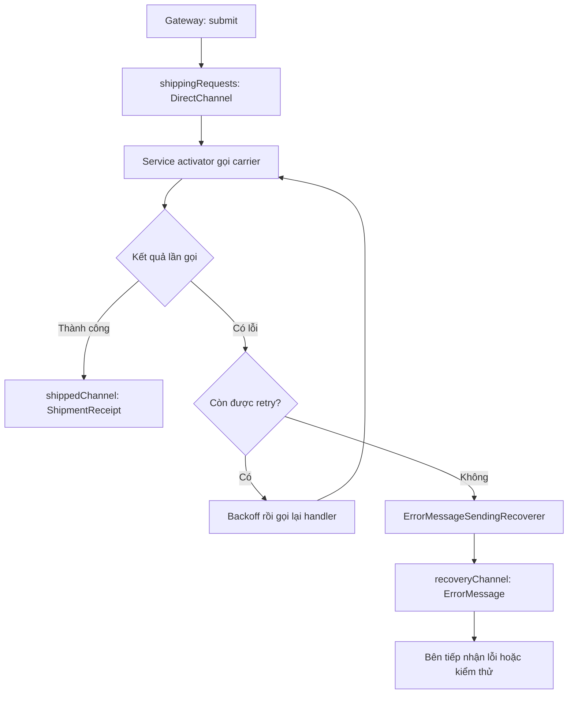

# Thêm retry và recovery

Trong chương **Thực hành tổng hợp** của **SPRING_INTEGRATION_CORE**, bài này bổ sung khả năng chịu lỗi cho một luồng thông điệp gọi dịch vụ vận chuyển. Ta sử dụng Message, MessageChannel, messaging gateway, service activator và Java DSL để thử lại đúng thao tác có thể phục hồi, sau đó giữ thông điệp lỗi ở một điểm recovery rõ ràng.

Kết quả cần đạt: phân biệt lỗi tạm thời với lỗi không nên thử lại; xác định chính xác số lần gọi; cấu hình backoff; giữ thông tin của thông điệp thất bại; và viết kiểm thử chứng minh nhánh thành công, nhánh recovery cùng hành vi khi recovery cũng thất bại.

## 1. Bối cảnh và tiêu chí hoàn thành

Giả sử hệ thống nhận lệnh tạo vận đơn. Dịch vụ vận chuyển có thể bị gián đoạn ngắn, nhưng cũng có thể từ chối một địa chỉ không hợp lệ. Nếu mọi ngoại lệ đều bị thử lại, hệ thống vừa tăng độ trễ vừa gây thêm tải cho đối tác.

Thiết kế của bài thực hành có các quy tắc:

- Một lệnh được gọi dịch vụ tối đa **3 lần**, tính cả lần gọi đầu.
- Chỉ `TemporaryCarrierException` và các lớp con của nó được thử lại.
- Khoảng chờ trước hai lần gọi tiếp theo là **100 ms** và **200 ms**.
- Nếu thành công, luồng đưa một `ShipmentReceipt` vào `shippedChannel`.
- Nếu không còn được thử tiếp, recovery gửi đúng một `ErrorMessage` vào `recoveryChannel`.
- Nếu không thể gửi vào kênh recovery, lời gọi phải báo lỗi cho bên gọi.
- Mỗi lần thử của cùng một thao tác sử dụng cùng `idempotencyKey`.

| Kịch bản | Số lần gọi dịch vụ | Khoảng chờ | Kết quả quan sát |
| --- | ---: | --- | --- |
| Thành công ngay | 1 | Không có | Một biên nhận |
| Lỗi tạm thời hai lần rồi thành công | 3 | 100 ms, 200 ms | Một biên nhận |
| Liên tục lỗi tạm thời | 3 | 100 ms, 200 ms | Một ErrorMessage |
| Địa chỉ không hợp lệ | 1 | Không có | Một ErrorMessage |
| Lỗi tạm thời và recoveryChannel đã đầy | 3 | 100 ms, 200 ms | Bên gọi nhận ngoại lệ |

Recovery cũng được áp dụng cho lỗi không retry được trong cấu hình này: lỗi địa chỉ chỉ gọi dịch vụ một lần rồi chuyển sang recovery. “Không retry” và “không recovery” là hai quyết định khác nhau.

## 2. Phạm vi phiên bản và kiến thức cần có

Ví dụ cố định nền tảng **Java 17, Spring Boot 3.5.0, Spring Integration 6.5.0 và Spring Retry 2.0.12** để người học có một cấu hình tái tạo được. Hai phiên bản thư viện cuối được quản lý bởi BOM của Spring Boot 3.5.0. Đây là mốc của bài lab; khi áp dụng vào dự án khác, cần giữ bộ dependency tương thích của dự án đó. Xem [BOM Spring Boot 3.5.0](https://github.com/spring-projects/spring-boot/blob/v3.5.0/spring-boot-project/spring-boot-dependencies/build.gradle).

Các import `org.springframework.retry.*` và phương thức `setRetryTemplate(...)` trong bài thuộc nền tảng nêu trên. Nếu mở tài liệu của một thế hệ API khác, cần chọn lại đúng tài liệu 6.5.x trước khi đối chiếu ví dụ.

Người học nên biết:

- Payload và header của `Message<?>`.
- Cách `DirectChannel` chuyển thông điệp cho một endpoint.
- Cách `QueueChannel` giữ thông điệp để bên nhận lấy ra.
- Cách khai báo một `IntegrationFlow` bằng Java DSL.
- Cách chạy kiểm thử Maven với JUnit 5 và AssertJ.

Lab không gọi HTTP thật hay cần broker. Kiểm thử khởi tạo trực tiếp Spring ApplicationContext; vì vậy không cần viết lớp `main` hoặc khởi động một web server.

## 3. Xác định ranh giới retry

Một luồng thực tế có thể gồm:

```text
Nhận đơn
  -> kiểm tra dữ liệu
  -> chuẩn hóa địa chỉ
  -> gọi dịch vụ vận chuyển
  -> lưu biên nhận
  -> phát sự kiện hoàn tất
```

Trong bài này, advice chỉ gắn vào service activator thực hiện **gọi dịch vụ vận chuyển**. Không bọc toàn bộ luồng bằng một vòng lặp gửi lại từ đầu. Gửi lại toàn bộ luồng có thể lặp cả thao tác đã hoàn tất, chẳng hạn tạo mã đơn hoặc phát sự kiện.

Với handler sinh kết quả đang dùng, `RequestHandlerRetryAdvice` bao quanh phần xử lý yêu cầu; việc gửi kết quả xuống endpoint kế tiếp nằm bên ngoài phần đó. Vì vậy lỗi phát sinh sau khi handler đã trả về không tự động làm dịch vụ vận chuyển bị gọi lại bởi advice này. Xem [ranh giới advice trong AbstractReplyProducingMessageHandler 6.5.0](https://github.com/spring-projects/spring-integration/blob/v6.5.0/spring-integration-core/src/main/java/org/springframework/integration/handler/AbstractReplyProducingMessageHandler.java).



Phần `G -> C` sử dụng stateless retry: vòng thử lại nằm trong cùng lần xử lý. Nó không yêu cầu bên gửi tạo một Message mới.

## 4. Những thành phần cần cấu hình

| Thành phần | Trách nhiệm trong bài |
| --- | --- |
| `RequestHandlerRetryAdvice` | Gắn hành vi retry vào endpoint |
| `RetryTemplate` | Điều phối lần gọi, policy, backoff và recovery |
| `SimpleRetryPolicy` | Giới hạn số lần gọi và phân loại ngoại lệ |
| `ExponentialBackOffPolicy` | Tăng khoảng chờ giữa các lần thử |
| `ErrorMessageSendingRecoverer` | Đưa lỗi cuối cùng vào kênh recovery |
| `QueueChannel` | Giữ ErrorMessage để quan sát hoặc chuyển tiếp |

Trong Spring Retry 2.0.12, `maxAttempts = 3` nghĩa là **một lần đầu và tối đa hai lần thử lại**. Không cấu hình 4 nếu yêu cầu nghiệp vụ chỉ cho phép 3 lần gọi. Constructor có `traverseCauses = true` cho phép policy tìm ngoại lệ phù hợp trong chuỗi nguyên nhân; `defaultValue = false` khiến loại ngoại lệ không được khai báo mặc định không được retry. Xem [SimpleRetryPolicy 2.0.12](https://docs.spring.io/spring-retry/docs/2.0.12/apidocs/org/springframework/retry/policy/SimpleRetryPolicy.html).

Ví dụ cố ý khai báo một loại lỗi tạm thời riêng thay vì retry mọi `RuntimeException`. Khi tích hợp HTTP thật, lớp client cần chuyển lỗi đã được đánh giá là có thể thử lại thành loại ngoại lệ này. Lỗi dữ liệu, lỗi lập trình và lỗi xác thực cần được phân loại theo hợp đồng dịch vụ, thay vì gom chung vào một nhóm retry.

## 5. Tạo dự án lab

Tạo các tệp sau trong **một dự án Maven thực hành riêng**:

```text
retry-recovery-lab/
  pom.xml
  src/main/java/example/retry/
    ShippingGateway.java
    RetryLabConfig.java
  src/test/java/example/retry/
    ShippingRetryTest.java
```

Đây là cấu trúc dự án để người học thực hành; các đoạn mã dưới đây nằm trong tài liệu và không yêu cầu module nội dung tự tạo thêm những tệp này.

### 5.1. Dependency

Nội dung `pom.xml`:

```xml
<?xml version="1.0" encoding="UTF-8"?>
<project xmlns="http://maven.apache.org/POM/4.0.0"
         xmlns:xsi="http://www.w3.org/2001/XMLSchema-instance"
         xsi:schemaLocation="http://maven.apache.org/POM/4.0.0 https://maven.apache.org/xsd/maven-4.0.0.xsd">
    <modelVersion>4.0.0</modelVersion>

    <parent>
        <groupId>org.springframework.boot</groupId>
        <artifactId>spring-boot-starter-parent</artifactId>
        <version>3.5.0</version>
        <relativePath/>
    </parent>

    <groupId>example</groupId>
    <artifactId>retry-recovery-lab</artifactId>
    <version>1.0.0</version>

    <properties>
        <java.version>17</java.version>
        <project.build.sourceEncoding>UTF-8</project.build.sourceEncoding>
    </properties>

    <dependencies>
        <dependency>
            <groupId>org.springframework.boot</groupId>
            <artifactId>spring-boot-starter-integration</artifactId>
        </dependency>
        <dependency>
            <groupId>org.springframework.retry</groupId>
            <artifactId>spring-retry</artifactId>
        </dependency>
        <dependency>
            <groupId>org.springframework.boot</groupId>
            <artifactId>spring-boot-starter-test</artifactId>
            <scope>test</scope>
        </dependency>
    </dependencies>
</project>
```

Khai báo `spring-retry` tường minh giúp người đọc thấy dependency phục vụ cơ chế này. Bài lab dùng advice của Spring Integration trực tiếp, nên không cần thêm `@EnableRetry` hay `@Retryable` vào client.

### 5.2. Gateway gửi lệnh

Nội dung `ShippingGateway.java`:

```java
package example.retry;

import example.retry.RetryLabConfig.ShipOrder;
import org.springframework.integration.annotation.MessagingGateway;
import org.springframework.messaging.handler.annotation.Header;

@MessagingGateway(defaultRequestChannel = "shippingRequests")
public interface ShippingGateway {

    void submit(ShipOrder order,
                @Header("idempotencyKey") String idempotencyKey);
}
```

Gateway có kiểu trả về `void` vì hợp đồng của lab là gửi lệnh và quan sát kết quả qua hai kênh. Nó không chờ một business reply. Tuy nhiên, vì đầu vào là `DirectChannel`, phần xử lý và backoff vẫn chạy trên luồng gọi: `void` không làm việc gửi trở thành bất đồng bộ. Xem [Messaging Gateways 6.5](https://docs.spring.io/spring-integration/reference/6.5/gateway.html).

Một lần `submit(...)` trở về bình thường có thể là “đã tạo vận đơn” hoặc “đã chuyển lỗi vào recovery”. Bên gọi không được suy ra vận đơn đã tạo chỉ từ việc không nhận ngoại lệ.

### 5.3. Model, client giả lập, retry và flow

Nội dung `RetryLabConfig.java`:

```java
package example.retry;

import java.util.List;
import java.util.Map;
import java.util.Objects;
import java.util.concurrent.ConcurrentHashMap;
import java.util.concurrent.CopyOnWriteArrayList;
import java.util.concurrent.atomic.AtomicInteger;

import org.springframework.beans.factory.annotation.Qualifier;
import org.springframework.context.annotation.Bean;
import org.springframework.context.annotation.Configuration;
import org.springframework.integration.annotation.IntegrationComponentScan;
import org.springframework.integration.channel.DirectChannel;
import org.springframework.integration.channel.QueueChannel;
import org.springframework.integration.config.EnableIntegration;
import org.springframework.integration.dsl.IntegrationFlow;
import org.springframework.integration.handler.advice.ErrorMessageSendingRecoverer;
import org.springframework.integration.handler.advice.RequestHandlerRetryAdvice;
import org.springframework.retry.backoff.ExponentialBackOffPolicy;
import org.springframework.retry.backoff.Sleeper;
import org.springframework.retry.backoff.ThreadWaitSleeper;
import org.springframework.retry.policy.SimpleRetryPolicy;
import org.springframework.retry.support.RetryTemplate;

@Configuration(proxyBeanMethods = false)
@EnableIntegration
@IntegrationComponentScan(basePackageClasses = ShippingGateway.class)
public class RetryLabConfig {

    public enum Scenario {
        SUCCESS,
        TRANSIENT_TWICE,
        ALWAYS_TRANSIENT,
        INVALID_ADDRESS
    }

    public record ShipOrder(String orderId, Scenario scenario) {
        public ShipOrder {
            Objects.requireNonNull(orderId, "orderId");
            Objects.requireNonNull(scenario, "scenario");
            if (orderId.isBlank()) {
                throw new IllegalArgumentException("orderId must not be blank");
            }
        }
    }

    public record ShipmentReceipt(
            String orderId,
            String trackingCode,
            String idempotencyKey) {
    }

    public static class TemporaryCarrierException extends RuntimeException {
        public TemporaryCarrierException(String message) {
            super(message);
        }
    }

    public static class InvalidAddressException extends RuntimeException {
        public InvalidAddressException(String message) {
            super(message);
        }
    }

    public static class SimulatedCarrier {

        private final Map<String, AtomicInteger> attempts =
                new ConcurrentHashMap<>();

        private final Map<String, CopyOnWriteArrayList<String>> observedKeys =
                new ConcurrentHashMap<>();

        public ShipmentReceipt createShipment(
                ShipOrder order, String idempotencyKey) {

            if (idempotencyKey == null || idempotencyKey.isBlank()) {
                throw new IllegalArgumentException("Missing idempotencyKey");
            }

            int attempt = attempts
                    .computeIfAbsent(order.orderId(), key -> new AtomicInteger())
                    .incrementAndGet();

            observedKeys
                    .computeIfAbsent(order.orderId(),
                            key -> new CopyOnWriteArrayList<>())
                    .add(idempotencyKey);

            switch (order.scenario()) {
                case SUCCESS -> {
                    // Thành công ngay.
                }
                case TRANSIENT_TWICE -> {
                    if (attempt <= 2) {
                        throw new TemporaryCarrierException(
                                "Carrier unavailable, attempt " + attempt);
                    }
                }
                case ALWAYS_TRANSIENT -> throw new TemporaryCarrierException(
                        "Carrier still unavailable, attempt " + attempt);
                case INVALID_ADDRESS -> throw new InvalidAddressException(
                        "Address must be corrected before resubmission");
            }

            return new ShipmentReceipt(
                    order.orderId(),
                    "SHIP-" + order.orderId(),
                    idempotencyKey);
        }

        public int attemptsFor(String orderId) {
            AtomicInteger value = attempts.get(orderId);
            return value == null ? 0 : value.get();
        }

        public List<String> keysFor(String orderId) {
            List<String> values = observedKeys.get(orderId);
            return values == null ? List.of() : List.copyOf(values);
        }
    }

    @Bean
    DirectChannel shippingRequests() {
        return new DirectChannel();
    }

    @Bean
    QueueChannel shippedChannel() {
        return new QueueChannel();
    }

    @Bean
    QueueChannel recoveryChannel() {
        // Dung lượng 1 để dễ kiểm thử tình huống recovery bị đầy.
        return new QueueChannel(1);
    }

    @Bean
    SimulatedCarrier carrier() {
        return new SimulatedCarrier();
    }

    @Bean
    Sleeper retrySleeper() {
        return new ThreadWaitSleeper();
    }

    @Bean
    RetryTemplate shippingRetryTemplate(Sleeper retrySleeper) {
        Map<Class<? extends Throwable>, Boolean> retryable = Map.of(
                TemporaryCarrierException.class, true);

        SimpleRetryPolicy policy = new SimpleRetryPolicy(
                3,          // Tổng số lần gọi, bao gồm lần đầu.
                retryable,
                true,       // Duyệt các cause của ngoại lệ bị bọc.
                false);     // Loại không khai báo mặc định không retry.

        ExponentialBackOffPolicy backoff = new ExponentialBackOffPolicy();
        backoff.setInitialInterval(100L);
        backoff.setMultiplier(2.0);
        backoff.setMaxInterval(1_000L);
        backoff.setSleeper(retrySleeper);

        RetryTemplate template = new RetryTemplate();
        template.setRetryPolicy(policy);
        template.setBackOffPolicy(backoff);
        return template;
    }

    @Bean
    RequestHandlerRetryAdvice shippingRetryAdvice(
            RetryTemplate shippingRetryTemplate,
            @Qualifier("recoveryChannel") QueueChannel recoveryChannel) {

        ErrorMessageSendingRecoverer recoverer =
                new ErrorMessageSendingRecoverer(recoveryChannel);
        recoverer.setSendTimeout(0L);

        RequestHandlerRetryAdvice advice = new RequestHandlerRetryAdvice();
        advice.setRetryTemplate(shippingRetryTemplate);
        advice.setRecoveryCallback(recoverer);
        return advice;
    }

    @Bean
    IntegrationFlow shippingFlow(
            @Qualifier("shippingRequests") DirectChannel shippingRequests,
            @Qualifier("shippedChannel") QueueChannel shippedChannel,
            SimulatedCarrier carrier,
            RequestHandlerRetryAdvice shippingRetryAdvice) {

        return IntegrationFlow.from(shippingRequests)
                .handle(ShipOrder.class,
                        (order, headers) -> carrier.createShipment(
                                order,
                                headers.get("idempotencyKey", String.class)),
                        endpoint -> endpoint
                                .id("createShipment")
                                .advice(shippingRetryAdvice))
                .channel(shippedChannel)
                .get();
    }
}
```

Java DSL nhận một handler có kiểu payload tường minh, nên lambda nhận `ShipOrder` và `MessageHeaders`. Tham số cấu hình endpoint là nơi gắn advice; đây vẫn là một service activator trong flow. Xem [Service Activators và handle() 6.5](https://docs.spring.io/spring-integration/reference/6.5/dsl/java-handle.html).

Một số chi tiết cần đọc cùng mã:

1. `@EnableIntegration` đăng ký hạ tầng tích hợp khi dùng ApplicationContext trực tiếp.
2. `@IntegrationComponentScan` tìm interface gateway; chỉ tạo interface chưa đủ để có bean gateway.
3. `shippingRetryAdvice` là bean do Spring quản lý, nên được khởi tạo theo lifecycle của advice.
4. `traverseCauses = true` cần thiết vì ngoại lệ nghiệp vụ có thể nằm bên trong `MessagingException`; việc tìm nguyên nhân là hành vi của policy, không cần tự bắt và bọc lại trong lambda.
5. `setSendTimeout(0L)` áp dụng cho việc gửi vào kênh recovery. Khi queue đã đầy, recoverer không chờ vô hạn.
6. `shippedChannel` dùng queue mặc định chỉ để bài lab dễ lấy kết quả. Dự án vận hành cần tự chọn dung lượng và cơ chế lưu trữ phù hợp.

`SimulatedCarrier` đếm theo orderId để tạo tình huống lỗi có tính quyết định. Nó chưa thực hiện chống tạo vận đơn trùng. Danh sách observedKeys chỉ phục vụ quan sát khóa đã đi qua từng lần gọi.

## 6. Hiểu đúng backoff và ngân sách thời gian

Với cấu hình trên:

```text
Lần gọi 1: thực hiện ngay
  thất bại tạm thời -> chờ 100 ms
Lần gọi 2
  thất bại tạm thời -> chờ 200 ms
Lần gọi 3
  thành công -> phát biên nhận
  hoặc thất bại -> recovery, không có lần chờ thứ ba
```

`ExponentialBackOffPolicy` tăng khoảng chờ theo hệ số và chặn ở `maxInterval`. Vì chỉ có hai khoảng chờ, giới hạn 1.000 ms chưa được chạm tới trong lab. Xem [ExponentialBackOffPolicy 2.0.12](https://docs.spring.io/spring-retry/docs/2.0.12/apidocs/org/springframework/retry/backoff/ExponentialBackOffPolicy.html).

Để lập ngân sách thời gian, có thể dùng gần đúng:

```text
Thời gian hoàn tất
  = tổng thời gian các lần gọi dịch vụ
  + tổng các khoảng backoff
  + thời gian chuyển kết quả hoặc recovery
  + chi phí xử lý khác
```

Nếu một lần gọi bị giới hạn bởi một deadline tổng cộng 500 ms, ba lần đều chạm deadline và hai khoảng chờ là 100 ms, 200 ms, thì riêng phần gọi dịch vụ và backoff đã chiếm tối đa khoảng:

```text
3 × 500 + 100 + 200 = 1.800 ms
```

Con số 500 ms ở đây phải là giới hạn cho **toàn bộ một lần gọi** theo giả định tính toán. Chỉ đặt connect timeout 500 ms không bảo đảm tổng một lần gọi cũng dưới 500 ms; còn có thời gian đọc, nhận dữ liệu và các bước khác của client.

`ThreadWaitSleeper` thực hiện chờ bằng cách chặn luồng hiện tại. Do đó backoff trong lab giữ luồng gọi gateway trong suốt vòng retry. Xem [ThreadWaitSleeper 2.0.12](https://docs.spring.io/spring-retry/docs/2.0.12/apidocs/org/springframework/retry/backoff/ThreadWaitSleeper.html).

Nếu thông điệp cần chờ nhiều phút hoặc giờ, hãy thiết kế một điểm lưu bền vững và lịch xử lý lại. Tăng thời gian sleep trên luồng xử lý không tạo ra một hàng đợi trì hoãn bền vững. Với nhiều instance cùng thử lại, cũng cần cân nhắc jitter để tránh tất cả đồng loạt gọi lại một dịch vụ vừa phục hồi.

## 7. Recovery thực sự tạo ra điều gì?

`ErrorMessageSendingRecoverer` công bố lỗi cuối cùng thành `ErrorMessage`, sau đó trả về `null`. Nó không tạo `ShipmentReceipt` thay thế. Trong flow hiện tại, điều này kết thúc nhánh xử lý thất bại và không phát thông điệp sang `shippedChannel`. Xem [mã ErrorMessageSendingRecoverer 6.5.0](https://github.com/spring-projects/spring-integration/blob/v6.5.0/spring-integration-core/src/main/java/org/springframework/integration/handler/advice/ErrorMessageSendingRecoverer.java).

Các thông tin cần phân biệt:

| Giá trị | Ý nghĩa |
| --- | --- |
| `ErrorMessage.getPayload()` | Throwable mô tả lỗi |
| `MessagingException.getFailedMessage()` | Message thất bại nếu ngoại lệ có giữ nó |
| `ErrorMessage.getOriginalMessage()` | Message gốc nếu ErrorMessageStrategy cung cấp |
| Header của failed Message | Nơi lấy idempotencyKey của lệnh trong ví dụ |

Không giả định payload của ErrorMessage là lệnh ban đầu. Cũng không giả định tất cả header của lệnh được chép lên header cấp ngoài của ErrorMessage.

Với recoverer mặc định trong lab, lỗi gửi ra được giữ hoặc bọc thành `MessagingException` cùng thông điệp thất bại. Đó là lý do kiểm thử bên dưới lấy lệnh qua `getFailedMessage()`. Xem [ErrorMessagePublisher 6.5.0](https://github.com/spring-projects/spring-integration/blob/v6.5.0/spring-integration-core/src/main/java/org/springframework/integration/core/ErrorMessagePublisher.java).

Khi xây dựng một bên tiếp nhận lỗi tổng quát, có thể lấy thông điệp như sau:

```java
static org.springframework.messaging.Message<?> failedMessageOf(
        org.springframework.messaging.support.ErrorMessage error) {

    Throwable failure = error.getPayload();

    if (failure instanceof org.springframework.messaging.MessagingException ex
            && ex.getFailedMessage() != null) {
        return ex.getFailedMessage();
    }

    if (error.getOriginalMessage() != null) {
        return error.getOriginalMessage();
    }

    throw new IllegalStateException("Recovery message has no failed input");
}
```

Đoạn này là một hàm tiện ích để đặt vào lớp tiếp nhận recovery khi mở rộng bài lab. Nó không phải phần bổ sung bắt buộc để chạy bộ kiểm thử ở mục tiếp theo.

### Recovery và hợp đồng trả lời

Nếu đổi gateway thành một phương thức cần trả business result, chẳng hạn `ShipmentReceipt submit(...)`, phải thiết kế cả kết quả khi thất bại. Recoverer gửi lỗi rồi trả `null` không đáp ứng hợp đồng có biên nhận. Bên gọi có thể phải đợi reply rồi timeout; nếu handler được đặt `requiresReply = true`, việc không có reply còn có thể tạo `ReplyRequiredException`.

Có thể chọn trả một outcome có trạng thái thành công/thất bại rõ ràng, hoặc trả một mã tiếp nhận và cho phép tra cứu kết quả sau. Không tạo biên nhận thành công giả chỉ để làm gateway hết chờ.

## 8. Kiểm thử qua gateway và IntegrationFlow

Bộ kiểm thử dưới đây dùng gateway thật của Spring Integration, không gọi `RetryTemplate.execute(...)` riêng lẻ. Nhờ đó nó kiểm tra được rằng advice đã gắn đúng endpoint, ngoại lệ đã được phân loại qua wrapper và kết quả đi đúng channel.

Backoff vẫn được tính theo policy thật. Riêng thao tác chờ được thay bằng một `Sleeper` ghi lại số mili giây được yêu cầu, nên kiểm thử không phải sleep. `Sleeper` là điểm mở rộng cho hành vi chờ. Xem [Sleeper 2.0.12](https://docs.spring.io/spring-retry/docs/2.0.12/apidocs/org/springframework/retry/backoff/Sleeper.html).

Nội dung `ShippingRetryTest.java`:

```java
package example.retry;

import java.util.ArrayList;
import java.util.List;

import example.retry.RetryLabConfig.InvalidAddressException;
import example.retry.RetryLabConfig.Scenario;
import example.retry.RetryLabConfig.ShipOrder;
import example.retry.RetryLabConfig.ShipmentReceipt;
import example.retry.RetryLabConfig.SimulatedCarrier;
import example.retry.RetryLabConfig.TemporaryCarrierException;

import org.junit.jupiter.api.AfterEach;
import org.junit.jupiter.api.BeforeEach;
import org.junit.jupiter.api.Test;
import org.springframework.context.annotation.AnnotationConfigApplicationContext;
import org.springframework.context.annotation.Bean;
import org.springframework.context.annotation.Configuration;
import org.springframework.context.annotation.Primary;
import org.springframework.integration.channel.QueueChannel;
import org.springframework.messaging.Message;
import org.springframework.messaging.MessagingException;
import org.springframework.messaging.support.ErrorMessage;
import org.springframework.messaging.support.GenericMessage;
import org.springframework.retry.backoff.Sleeper;

import static org.assertj.core.api.Assertions.assertThat;
import static org.assertj.core.api.Assertions.assertThatThrownBy;

class ShippingRetryTest {

    private static final String KEY = "ship-order-operation-001";

    private AnnotationConfigApplicationContext context;
    private ShippingGateway gateway;
    private SimulatedCarrier carrier;
    private QueueChannel shipped;
    private QueueChannel recovery;
    private RecordingSleeper sleeper;

    @BeforeEach
    void setUp() {
        context = new AnnotationConfigApplicationContext(
                RetryLabConfig.class, FastRetryConfig.class);

        gateway = context.getBean(ShippingGateway.class);
        carrier = context.getBean(SimulatedCarrier.class);
        shipped = context.getBean("shippedChannel", QueueChannel.class);
        recovery = context.getBean("recoveryChannel", QueueChannel.class);
        sleeper = context.getBean(RecordingSleeper.class);
    }

    @AfterEach
    void tearDown() {
        if (context != null) {
            context.close();
        }
    }

    @Test
    void succeedsOnFirstAttempt() {
        ShipOrder order = new ShipOrder("O-101", Scenario.SUCCESS);

        gateway.submit(order, KEY);

        assertThat(carrier.attemptsFor(order.orderId())).isEqualTo(1);
        assertThat(sleeper.periods()).isEmpty();

        Message<?> result = shipped.receive(0);
        assertThat(result).isNotNull();
        assertThat(result.getPayload()).isEqualTo(new ShipmentReceipt(
                "O-101", "SHIP-O-101", KEY));
        assertThat(shipped.receive(0)).isNull();
        assertThat(recovery.receive(0)).isNull();
    }

    @Test
    void retriesTwiceThenEmitsOneReceiptWithStableKey() {
        ShipOrder order = new ShipOrder("O-102", Scenario.TRANSIENT_TWICE);

        gateway.submit(order, KEY);

        assertThat(carrier.attemptsFor(order.orderId())).isEqualTo(3);
        assertThat(carrier.keysFor(order.orderId()))
                .containsExactly(KEY, KEY, KEY);
        assertThat(sleeper.periods()).containsExactly(100L, 200L);

        Message<?> result = shipped.receive(0);
        assertThat(result).isNotNull();
        assertThat(result.getPayload()).isEqualTo(new ShipmentReceipt(
                "O-102", "SHIP-O-102", KEY));
        assertThat(shipped.receive(0)).isNull();
        assertThat(recovery.receive(0)).isNull();
    }

    @Test
    void recoversAfterThreeTransientFailures() {
        ShipOrder order = new ShipOrder("O-103", Scenario.ALWAYS_TRANSIENT);

        gateway.submit(order, KEY);

        assertThat(carrier.attemptsFor(order.orderId())).isEqualTo(3);
        assertThat(sleeper.periods()).containsExactly(100L, 200L);
        assertSingleRecovery(order, TemporaryCarrierException.class);
    }

    @Test
    void doesNotRetryInvalidAddressButStillRecovers() {
        ShipOrder order = new ShipOrder("O-104", Scenario.INVALID_ADDRESS);

        gateway.submit(order, KEY);

        assertThat(carrier.attemptsFor(order.orderId())).isEqualTo(1);
        assertThat(sleeper.periods()).isEmpty();
        assertSingleRecovery(order, InvalidAddressException.class);
    }

    @Test
    void propagatesFailureWhenRecoveryQueueIsFull() {
        Message<String> occupied = new GenericMessage<>("occupied");
        assertThat(recovery.send(occupied, 0)).isTrue();

        ShipOrder order = new ShipOrder("O-105", Scenario.ALWAYS_TRANSIENT);

        assertThatThrownBy(() -> gateway.submit(order, KEY))
                .isInstanceOf(MessagingException.class);

        assertThat(carrier.attemptsFor(order.orderId())).isEqualTo(3);
        assertThat(sleeper.periods()).containsExactly(100L, 200L);
        assertThat(shipped.receive(0)).isNull();

        assertThat(recovery.receive(0)).isSameAs(occupied);
        assertThat(recovery.receive(0)).isNull();
    }

    private void assertSingleRecovery(
            ShipOrder order, Class<? extends Throwable> expectedCause) {

        Message<?> result = recovery.receive(0);
        assertThat(result).isInstanceOf(ErrorMessage.class);
        ErrorMessage error = (ErrorMessage) result;

        assertThat(error.getPayload())
                .isInstanceOf(MessagingException.class)
                .hasRootCauseInstanceOf(expectedCause);

        MessagingException failure = (MessagingException) error.getPayload();
        Message<?> failed = failure.getFailedMessage();

        assertThat(failed).isNotNull();
        assertThat(failed.getPayload()).isEqualTo(order);
        assertThat(failed.getHeaders().get("idempotencyKey"))
                .isEqualTo(KEY);

        assertThat(recovery.receive(0)).isNull();
        assertThat(shipped.receive(0)).isNull();
    }

    @Configuration(proxyBeanMethods = false)
    static class FastRetryConfig {

        @Bean
        @Primary
        RecordingSleeper recordingSleeper() {
            return new RecordingSleeper();
        }
    }

    static class RecordingSleeper implements Sleeper {

        private final List<Long> requestedPeriods = new ArrayList<>();

        @Override
        public void sleep(long backOffPeriod) {
            requestedPeriods.add(backOffPeriod);
        }

        List<Long> periods() {
            return List.copyOf(requestedPeriods);
        }
    }
}
```

Mỗi test tạo context mới để số lần gọi, các queue và danh sách backoff không ảnh hưởng nhau. `@Primary` khiến cấu hình retry chọn RecordingSleeper thay cho ThreadWaitSleeper trong context kiểm thử. Cơ chế giả lập này chỉ bỏ thời gian chờ, không thay số lần thử hoặc luật phân loại ngoại lệ.

Trong thư mục dự án thực hành, chạy:

```shell
mvn test
```

Khi triển khai và chạy đúng ví dụ, tiêu chí mong đợi là năm kiểm thử thành công. Mã kiểm thử trong tài liệu là hướng dẫn để người học thực thi; việc có mã kiểm thử không đồng nghĩa chúng đã được chạy trong bước biên soạn bài học.

Không kiểm tra backoff bằng cách đo tổng thời gian chạy rồi yêu cầu chính xác 300 ms. Độ trễ môi trường có thể khiến phép đo chập chờn. Ở đây ta kiểm tra các khoảng chờ policy yêu cầu: đúng 100 ms, 200 ms và không có khoảng chờ sau lần thất bại cuối.

## 9. Phân biệt recoveryChannel với errorChannel

Trong ví dụ, recoverer được cấu hình đích rõ ràng là `recoveryChannel`. Đó là quyết định của retry advice, không phụ thuộc vào việc hệ thống có sẵn một bean `errorChannel` hay không.

Đối với phần xử lý đồng bộ qua DirectChannel, một lỗi chưa được xử lý có thể truyền ngược về bên gọi. Không thể suy luận rằng mọi lỗi trong flow đều tự động được gửi vào global errorChannel. Sau khi thêm một ranh giới bất đồng bộ, cách công bố lỗi còn phụ thuộc endpoint, poller hoặc executor đang chịu trách nhiệm xử lý. Xem [Error Handling 6.5](https://docs.spring.io/spring-integration/reference/6.5/error-handling.html).

| Trường hợp | Hành vi cần dự kiến |
| --- | --- |
| Retry thành công | Không chạy recovery, phát biên nhận |
| Hết retry và recoverer gửi được | Đưa ErrorMessage vào recoveryChannel, nhánh thất bại kết thúc |
| Lỗi không retry được và recoverer gửi được | Recovery sau lần gọi đầu |
| Bỏ recovery callback | Lỗi cuối thoát khỏi advice; với đường gọi đồng bộ có thể về bên gọi |
| Recoverer gửi không được | Recovery thất bại; không thể xem lệnh đã được tiếp nhận lỗi thành công |

Một người tiêu thụ recovery có thể tách lỗi thành ba nhóm: lỗi dữ liệu cần sửa, lỗi tạm thời đã hết ngân sách tự động và lỗi bất ngờ cần điều tra. Không nên tự gửi mọi ErrorMessage trở lại `shippingRequests`; policy cho phép lại ba lần trong mỗi vòng mới có thể tạo ra chu trình vô hạn.

## 10. Queue recovery chưa phải nơi lưu lỗi bền vững

`QueueChannel(1)` trong lab có dung lượng hữu hạn, gửi được khi còn chỗ và có thể báo không gửi được khi timeout hết. Nó là queue trong bộ nhớ trong cấu hình này; ứng dụng dừng sẽ không giữ lại nội dung như một kho lưu trữ bền vững. Xem [QueueChannel 6.5](https://docs.spring.io/spring-integration/reference/6.5/channel/implementations.html).

Bài lab không cài consumer tự động cho kênh này. Test đóng vai bên nhận và lấy thông điệp bằng `receive(0)`. Nếu dùng cấu hình này ngoài kiểm thử mà không thêm bên nhận, thông điệp lỗi đầu sẽ chiếm chỗ; thông điệp lỗi tiếp theo có thể làm recovery thất bại.

Khi đưa ý tưởng vào hệ thống thật, cần xác định một điểm chuyển giao mà sau đó thông điệp có thể được truy vết và xử lý lại. Điểm đó có thể là bản ghi cơ sở dữ liệu, một message store phù hợp hoặc hàng đợi broker có hợp đồng lưu trữ và xác nhận rõ ràng.

Một bản ghi recovery dành cho vận hành có thể chứa:

| Trường | Mục đích |
| --- | --- |
| operationId hoặc idempotencyKey | Nhận diện thao tác cần phục hồi |
| orderId | Liên hệ với đối tượng nghiệp vụ |
| payload và payloadVersion | Dữ liệu đủ để xử lý lại theo schema xác định |
| failureCategory | Lỗi dữ liệu, hết retry hoặc lỗi bất ngờ |
| exceptionType, failureTime | Hỗ trợ phân tích |
| attemptsUsed, redriveCount | Theo dõi ngân sách đã sử dụng |
| status | Ví dụ: PENDING_REVIEW, READY, RESOLVED |

Chọn rõ nhóm header được lưu; không lưu nguyên một Message Java rồi mặc định mọi header đều tuần tự hóa được. Header nội bộ có thể chứa đối tượng channel chỉ có ý nghĩa trong tiến trình hiện tại. Payload và log lỗi cũng cần được giữ ở mức phù hợp với dữ liệu nghiệp vụ thực sự cần điều tra.

Đặc biệt, không bọc lỗi ghi recovery bằng một catch chỉ ghi log rồi trả về bình thường. Hành vi đó khiến bên gọi tưởng đã chuyển giao được trong khi bản ghi phục hồi chưa tồn tại.

## 11. Retry, redelivery và redrive là các vòng khác nhau

- **Retry cục bộ:** cùng lần xử lý, advice gọi lại handler theo ngân sách nhỏ.
- **Redelivery từ bên ngoài:** nguồn gửi lại một thông điệp, chẳng hạn sau một lỗi xử lý hoặc rollback.
- **Redrive nghiệp vụ:** một lệnh đã được đưa vào recovery được chọn để xử lý lại theo quy trình có kiểm soát.

Cấu hình stateless của lab không nhớ ngân sách retry xuyên qua mọi lần gọi gateway về sau. Nếu người gọi gửi lại một lệnh, đó là một vòng xử lý mới.

Trong 6.5.x, stateful retry có thể dùng `RetryStateGenerator` để nhận diện các lần gửi lại. Nó giữ trạng thái retry nhưng vẫn cần một bên ngoài thực sự gửi lại thông điệp; bản thân advice không thay vai trò của broker hay bộ điều phối. Xem [RequestHandlerRetryAdvice 6.5.0](https://github.com/spring-projects/spring-integration/blob/v6.5.0/spring-integration-core/src/main/java/org/springframework/integration/handler/advice/RequestHandlerRetryAdvice.java).

Cần tính cả những tầng đã retry sẵn. Ví dụ, một lần gửi vào handler có ngân sách 3 lần gọi, còn nguồn có thể thực hiện 4 lần giao tổng cộng cho cùng một lệnh. Khi cả hai tầng đều dùng hết ngân sách và không có cơ chế dừng sớm, số lần chạm đối tác có thể lên tới:

```text
3 lần gọi mỗi lượt giao × 4 lượt giao = 12 lần gọi đối tác
```

Đây là phép tính cho giả định nêu trên, không phải hành vi mặc định của mọi broker. Nếu HTTP client cũng tự retry, còn có thêm một tầng khuếch đại. Hãy quyết định tầng nào sở hữu ngân sách và việc xử lý lỗi thành công ở tầng đó ảnh hưởng thế nào đến xác nhận nguồn.

## 12. Idempotency khi kết quả lần gọi chưa rõ

Tình huống khó nhất thường là:

```text
Lần 1: đối tác đã tạo vận đơn
       -> phản hồi bị mất hoặc hết hạn chờ
Lần 2: hệ thống gọi lại cùng thao tác
```

Chỉ có retry thì vẫn có nguy cơ tạo hai vận đơn. Header `idempotencyKey` trong lab chứng minh khóa được giữ ổn định qua các lần gọi, nhưng không chứng minh đối tác đã loại bỏ bản trùng.

Để khóa có tác dụng trong hệ thống thật:

1. Sinh khóa theo **thao tác nghiệp vụ**, chẳng hạn một lần yêu cầu tạo vận đơn xác định.
2. Giữ khóa qua retry và qua các lần redrive của chính thao tác đó.
3. Truyền khóa theo giao thức mà đối tác hiểu và hỗ trợ.
4. Bên nhận kiểm tra khóa một cách nguyên tử và trả lại kết quả đã có khi nhận trùng.
5. Có quy tắc phát hiện cùng khóa nhưng payload khác nhau.

Không lấy MessageHeaders.ID làm khóa nghiệp vụ mặc định. Việc tạo một Message mới có thể sinh message id khác trong khi thao tác nghiệp vụ vẫn là một.

Nếu đối tác không hỗ trợ idempotency, hãy cân nhắc tra cứu trạng thái theo mã tham chiếu trước khi tạo lại. Với một kết quả chưa rõ, recovery có thể cần chuyển sang trạng thái đối soát thay vì kết luận chắc chắn “chưa tạo vận đơn”.

## 13. Quan sát retry mà không nhầm các bộ đếm

Trong lúc điều tra, nên có đủ thông tin để trả lời:

- Một operation đã gọi đối tác bao nhiêu lần?
- Nó thành công ở lần nào hay chuyển sang recovery?
- Có bao nhiêu trường hợp không thể ghi vào recovery?
- Lỗi thuộc nhóm nào và endpoint nào đang tạo lỗi?
- Kho recovery tăng nhanh đến mức nào, thông điệp cũ nhất đã chờ bao lâu?

Có thể đăng ký `RetryListener` trên RetryTemplate để quan sát các lỗi trong vòng retry. `onError` được gọi sau một lần thực thi thất bại; `close` là kết thúc vòng thực thi và không nên được dùng như đồng nghĩa với “đã vào recovery”. Xem [RetryListener 2.0.12](https://docs.spring.io/spring-retry/docs/2.0.12/apidocs/org/springframework/retry/RetryListener.html).

Ví dụ, thêm đoạn sau trước `return template;` trong phương thức tạo RetryTemplate nếu muốn in số lần thất bại để học:

```java
template.registerListener(new org.springframework.retry.RetryListener() {
    @Override
    public <T, E extends Throwable> void onError(
            org.springframework.retry.RetryContext context,
            org.springframework.retry.RetryCallback<T, E> callback,
            Throwable throwable) {

        System.out.printf(
                "failedAttempts=%d, exception=%s%n",
                context.getRetryCount(),
                throwable.getClass().getSimpleName());
    }
});
```

Trong callback sau lỗi, retryCount phản ánh số lần thất bại đã ghi nhận. Sau lỗi thứ nhất, giá trị này là 1. Với kịch bản lỗi hai lần rồi thành công, listener trên ghi 1 và 2; service vẫn được gọi tổng cộng 3 lần. Không cộng thêm số log onError vào số lần gọi thực tế.

Trong hệ thống vận hành, dùng bộ ghi log và metric của dự án thay vì System.out. Nhãn metric nên có tập giá trị hữu hạn như tên endpoint, nhóm lỗi và kết quả; orderId và idempotencyKey thích hợp hơn cho log hoặc trace có truy vấn.

## 14. Các quyết định cần làm rõ trước khi mở rộng

### Giao dịch

Thêm retry không tự tạo giao dịch bao trùm lời gọi từ xa và dữ liệu cục bộ. Nếu một lần thử đã gây hiệu ứng bên ngoài, rollback giao dịch cục bộ không tự hủy hiệu ứng đó.

Khi handler dùng transaction, phải xác định mỗi attempt có giao dịch phù hợp hay toàn bộ vòng retry đang nằm trong một giao dịch đã bị đánh dấu rollback-only. Thứ tự advice và ranh giới transaction cần được thiết kế theo thao tác thật. Không giả định đổi thứ tự khai báo là luôn đủ để đạt tính nguyên tử xuyên hệ thống.

### Thông điệp và trạng thái dùng chung

Trong retry stateless của lab, handler nhận lại cùng yêu cầu. Payload nên bất biến hoặc không bị sửa giữa các lần thử. Nếu lần đầu sửa địa chỉ hoặc gắn cờ vào một đối tượng mutable, lần sau có thể không còn xử lý cùng dữ liệu ban đầu.

Bộ đếm của client giả lập dùng concurrent collection để quan sát. Đó không phải kho trạng thái vận hành và không được dùng để phối hợp ngân sách giữa nhiều instance.

### Điều kiện dừng

Một lỗi được phân loại tạm thời không có nghĩa luôn phải tiêu hết maxAttempts. Hệ thống còn có deadline tổng thể, tín hiệu ngừng dịch vụ hoặc cơ chế bảo vệ tải. Cần bảo đảm chính sách retry không kéo dài xử lý vượt hợp đồng thời gian của thao tác.

Circuit breaker và retry giải quyết các quyết định khác nhau: retry quyết định thử lại một thao tác, còn circuit breaker quyết định có nên tiếp tục gọi một dịch vụ đang có dấu hiệu lỗi. Nếu phối hợp, hãy chỉ rõ thứ tự áp dụng và đơn vị mà mỗi bộ đếm quan sát.

## 15. Tự thực hành trên nền ví dụ

Sau khi chạy được bộ kiểm thử cơ bản, thực hiện lần lượt:

1. **Đổi ngân sách:** đặt maxAttempts thành 4, dự đoán số lần gọi và backoff của ALWAYS_TRANSIENT rồi mới sửa assertion tương ứng.
2. **Thử phân loại sai:** tạm tắt traverseCauses, quan sát kiểm thử lỗi tạm thời và giải thích tác động của MessagingException.
3. **Thử thiếu recovery:** bỏ recovery callback, dự đoán bên gọi nhận gì khi lỗi kéo dài và bổ sung kiểm thử phù hợp.
4. **Chứng minh ranh giới endpoint:** thêm một endpoint sau khi nhận biên nhận rồi làm endpoint mới phát lỗi; kiểm tra lỗi đó không làm carrier bị gọi lại bởi advice hiện tại.
5. **Lưu recovery:** thay điểm tiếp nhận lỗi trong bộ nhớ bằng một kho phù hợp; chỉ xác nhận chuyển giao sau khi dữ liệu thực sự đã được ghi.
6. **Redrive có giới hạn:** đọc bản ghi đủ điều kiện xử lý lại, giữ operation key và tăng redriveCount; dừng ở một ngân sách tổng thể đã định.
7. **Mô phỏng phản hồi bị mất:** cho đối tác giả lập lưu vận đơn trước khi ném lỗi ở lần đầu; triển khai kiểm tra khóa phía đối tác và chứng minh lần sau trả lại cùng vận đơn.

Với mỗi thay đổi, ghi rõ kỳ vọng trước khi chạy: số lần chạm carrier, số thông điệp thành công, số thông điệp recovery và trạng thái khi chuyển giao recovery thất bại. Bài tập này tập trung vào hành vi quan sát được qua flow, thay vì chỉ kiểm tra các giá trị đã gán vào bean.

## 16. Checklist hoàn thành bài

- [ ] Advice được gắn đúng service activator gọi dịch vụ vận chuyển.
- [ ] MaxAttempts bao gồm lần đầu và đúng ngân sách nghiệp vụ.
- [ ] Lỗi tạm thời được retry qua cả lớp wrapper của Spring Messaging.
- [ ] Lỗi địa chỉ không hợp lệ chỉ gọi một lần và có đích recovery rõ ràng.
- [ ] Backoff có giới hạn và nằm trong ngân sách thời gian của thao tác.
- [ ] Mỗi lần thử giữ nguyên operation key.
- [ ] Nhánh recovery không phát một biên nhận thành công giả.
- [ ] Có thể truy ra lệnh và header cần thiết từ ErrorMessage.
- [ ] Recovery thất bại được phát hiện bằng kiểm thử riêng.
- [ ] Có kế hoạch tiêu thụ, lưu trữ và xử lý lại lỗi khi triển khai thật.
- [ ] Phân biệt được retry cục bộ, redelivery và redrive.
- [ ] Các kiểm thử được thực thi trong dự án lab trước khi coi cấu hình đã được xác nhận.

Sản phẩm cần bàn giao của bài thực hành là một flow có hợp đồng lỗi rõ ràng: thành công tạo đúng một biên nhận; lỗi tạm thời được thử trong ngân sách hữu hạn; lỗi còn lại được chuyển giao có thể quan sát; và việc chuyển giao thất bại được báo về theo đúng ranh giới xử lý.

