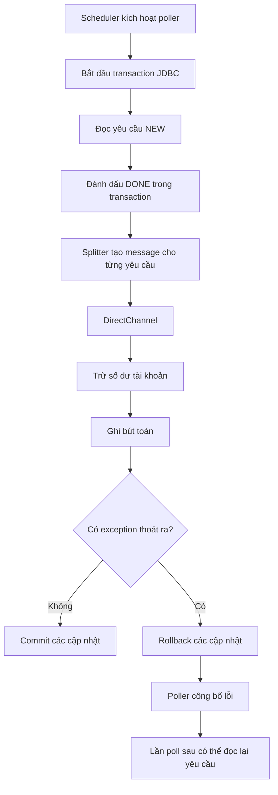

# Thêm transaction cho poller

## 1. Mục tiêu thực hành

Trong chương **Thực hành tổng hợp** của **SPRING_INTEGRATION_CORE**, bài này xây dựng một luồng thông điệp có transaction bắt đầu ngay tại poller. Bạn sẽ kết hợp Message, MessageChannel, endpoint và Java DSL để bảo đảm thao tác lấy dữ liệu và các cập nhật nghiệp vụ cùng thành công hoặc cùng bị hoàn tác.

Sau bài học, bạn có thể:

- Đặt transaction boundary bao quanh việc đọc nguồn và xử lý thông điệp đồng bộ.
- Chọn transaction manager phù hợp với tài nguyên được sử dụng.
- Quan sát commit, rollback và việc đọc lại dữ liệu sau lỗi bằng kiểm thử tích hợp.
- Nhận diện ảnh hưởng của DirectChannel, QueueChannel, ExecutorChannel, splitter và filter đến kết quả xử lý.
- Phân biệt rollback dữ liệu, xử lý lỗi và retry.

Bài thực hành sử dụng JDBC làm tài nguyên có thể rollback. Đây là cách tạo tình huống quan sát rõ ràng; cấu trúc luồng và cách cấu hình poller vẫn thuộc các thành phần cốt lõi của Spring Integration.

## 2. Bài toán: nhận yêu cầu ghi nợ từ cơ sở dữ liệu

Giả sử một hệ thống tiếp nhận yêu cầu ghi nợ vào bảng `debit_request`. Luồng tích hợp định kỳ đọc yêu cầu có trạng thái `NEW`, đánh dấu yêu cầu đã xử lý, trừ số dư tài khoản và ghi một bút toán.

Một lần xử lý thành công phải thỏa mãn đồng thời:

```text
debit_request.state = DONE
account.balance = số dư ban đầu - số tiền ghi nợ
debit_ledger có đúng một dòng tương ứng request_id
```

Nếu ghi sổ thất bại, hoặc một bước sau khi ghi sổ phát sinh lỗi, yêu cầu phải trở lại trạng thái có thể được đọc lại và số dư không được thay đổi.

Dữ liệu mẫu:

| Dữ liệu | Giá trị ban đầu |
| --- | --- |
| Mã yêu cầu | 101 |
| Tài khoản | A-01 |
| Số dư | 500000.00 |
| Số tiền ghi nợ | 125000.00 |
| Trạng thái yêu cầu | NEW |
| Số bút toán | 0 |

Kết quả sau commit phải là số dư `375000.00`, trạng thái `DONE` và một bút toán. Kết quả sau rollback phải giữ nguyên toàn bộ giá trị ban đầu.

### 2.1. Điều gì xảy ra nếu chỉ đặt transaction ở service?

Xét một nguồn JDBC được cấu hình cập nhật trạng thái ngay khi đọc:

```text
Nguồn SELECT yêu cầu NEW
  → nguồn UPDATE trạng thái DONE
  → service bắt đầu transaction riêng
  → service cập nhật số dư
  → service phát sinh lỗi
```

Nếu hai câu lệnh của nguồn đã chạy ngoài transaction của service, rollback ở service không hoàn tác được trạng thái `DONE` đã commit trước đó. Yêu cầu biến mất khỏi lần truy vấn tiếp theo dù nghiệp vụ chưa hoàn tất.

Đặt `@Transactional` trên một phương thức cấu hình tạo bean cũng không bao quanh những lần poll xảy ra sau khi ứng dụng khởi động. Cần đặt transaction tại điểm thực thi của poller.

## 3. Ranh giới transaction cần đạt



Trong mô hình transaction JDBC thông thường, tài nguyên được gắn với thread đang thực thi. Poller cần mở transaction trước `receive()`; các bước tiếp theo phải chạy đồng bộ và dùng cùng tài nguyên được quản lý để cùng tham gia. [Spring Integration: Transaction Support](https://docs.spring.io/spring-integration/reference/transactions.html)

Với bài này, các điều kiện cụ thể là:

1. Nguồn đọc dữ liệu và `JdbcTemplate` nghiệp vụ sử dụng cùng `DataSource`.
2. Poller dùng `DataSourceTransactionManager` quản lý `DataSource` đó.
3. Splitter và handler chạy trong thread của poller.
4. Luồng không chuyển sang một executor hoặc một hàng đợi ở giữa.
5. Lỗi cần rollback phải thoát ra đến transaction interceptor.

Không cần thêm gateway vào ví dụ: luồng bắt đầu bởi lịch poll và kết thúc bằng một handler không trả lời. Nếu cần gateway cho một luồng khác do ứng dụng gọi vào, phải xác định transaction boundary của lần gọi đó riêng.

## 4. Chuẩn bị môi trường thực hành

Ví dụ dùng Java 17, Spring Integration 6.5.10, H2, JUnit Jupiter và Awaitility. Đây là bộ phiên bản cố định để minh họa; không phải yêu cầu nâng phiên bản của một dự án đang có.

Tạo một dự án Maven độc lập với cấu trúc:

```text
pom.xml
src/main/java/example/pollertx/PollerTransactionLabConfig.java
src/test/java/example/pollertx/PollerTransactionLabTest.java
```

Nội dung `pom.xml`:

```xml
<project xmlns="http://maven.apache.org/POM/4.0.0"
         xmlns:xsi="http://www.w3.org/2001/XMLSchema-instance"
         xsi:schemaLocation="http://maven.apache.org/POM/4.0.0
                             https://maven.apache.org/xsd/maven-4.0.0.xsd">
    <modelVersion>4.0.0</modelVersion>

    <groupId>example</groupId>
    <artifactId>poller-transaction-lab</artifactId>
    <version>1.0.0</version>

    <properties>
        <maven.compiler.release>17</maven.compiler.release>
        <project.build.sourceEncoding>UTF-8</project.build.sourceEncoding>
    </properties>

    <dependencies>
        <dependency>
            <groupId>org.springframework.integration</groupId>
            <artifactId>spring-integration-jdbc</artifactId>
            <version>6.5.10</version>
        </dependency>
        <dependency>
            <groupId>com.h2database</groupId>
            <artifactId>h2</artifactId>
            <version>2.3.232</version>
        </dependency>
        <dependency>
            <groupId>org.junit.jupiter</groupId>
            <artifactId>junit-jupiter</artifactId>
            <version>5.11.4</version>
            <scope>test</scope>
        </dependency>
        <dependency>
            <groupId>org.awaitility</groupId>
            <artifactId>awaitility</artifactId>
            <version>4.2.2</version>
            <scope>test</scope>
        </dependency>
    </dependencies>

    <build>
        <plugins>
            <plugin>
                <groupId>org.apache.maven.plugins</groupId>
                <artifactId>maven-compiler-plugin</artifactId>
                <version>3.13.0</version>
            </plugin>
            <plugin>
                <groupId>org.apache.maven.plugins</groupId>
                <artifactId>maven-surefire-plugin</artifactId>
                <version>3.5.2</version>
            </plugin>
        </plugins>
    </build>
</project>
```

`spring-integration-jdbc` đưa vào các thành phần Integration core và JDBC cần cho ví dụ. Trong ứng dụng dùng Spring Boot, hãy để cơ chế quản lý dependency của Boot chọn các phiên bản Spring đồng bộ thay vì sao chép riêng phiên bản thư viện ở đây.

H2 được tạo trong bộ nhớ và dùng tên riêng cho từng application context. Dữ liệu được khởi tạo bằng Java để toàn bộ tình huống có thể đọc và chạy từ hai file mã nguồn bên dưới.

## 5. Cấu hình hoàn chỉnh bằng Java DSL

Đặt mã sau trong `PollerTransactionLabConfig.java`:

```java
package example.pollertx;

import java.math.BigDecimal;
import java.time.Duration;
import java.util.concurrent.atomic.AtomicBoolean;

import javax.sql.DataSource;

import org.springframework.context.annotation.Bean;
import org.springframework.context.annotation.Configuration;
import org.springframework.integration.channel.DirectChannel;
import org.springframework.integration.channel.QueueChannel;
import org.springframework.integration.config.EnableIntegration;
import org.springframework.integration.dsl.IntegrationFlow;
import org.springframework.integration.dsl.Pollers;
import org.springframework.integration.jdbc.JdbcPollingChannelAdapter;
import org.springframework.jdbc.core.JdbcTemplate;
import org.springframework.jdbc.core.namedparam.MapSqlParameterSource;
import org.springframework.jdbc.datasource.DataSourceTransactionManager;
import org.springframework.jdbc.datasource.embedded.EmbeddedDatabase;
import org.springframework.jdbc.datasource.embedded.EmbeddedDatabaseBuilder;
import org.springframework.jdbc.datasource.embedded.EmbeddedDatabaseType;
import org.springframework.transaction.PlatformTransactionManager;
import org.springframework.transaction.support.TransactionSynchronizationManager;

@Configuration(proxyBeanMethods = false)
@EnableIntegration
public class PollerTransactionLabConfig {

    public record DebitCommand(
            long id,
            String accountId,
            BigDecimal amount) {
    }

    public static class FailureSwitch {

        private final AtomicBoolean enabled = new AtomicBoolean(false);

        public void enable() {
            enabled.set(true);
        }

        public void disable() {
            enabled.set(false);
        }

        public void afterDatabaseWrites() {
            if (enabled.get()) {
                throw new IllegalStateException(
                        "Lỗi giả lập sau khi đã cập nhật dữ liệu");
            }
        }
    }

    public static class DebitService {

        private final JdbcTemplate jdbc;
        private final FailureSwitch failureSwitch;

        public DebitService(
                JdbcTemplate jdbc,
                FailureSwitch failureSwitch) {
            this.jdbc = jdbc;
            this.failureSwitch = failureSwitch;
        }

        public void apply(DebitCommand command) {
            if (!TransactionSynchronizationManager
                    .isActualTransactionActive()) {
                throw new IllegalStateException(
                        "Handler phải chạy trong transaction của poller");
            }

            int changed = jdbc.update("""
                    update account
                       set balance = balance - ?
                     where account_id = ?
                       and balance >= ?
                    """,
                    command.amount(),
                    command.accountId(),
                    command.amount());

            if (changed != 1) {
                throw new IllegalStateException(
                        "Không tìm thấy tài khoản hoặc số dư không đủ");
            }

            jdbc.update("""
                    insert into debit_ledger(
                        request_id, account_id, amount
                    ) values (?, ?, ?)
                    """,
                    command.id(),
                    command.accountId(),
                    command.amount());

            failureSwitch.afterDatabaseWrites();
        }
    }

    @Bean(destroyMethod = "shutdown")
    public EmbeddedDatabase dataSource() {
        return new EmbeddedDatabaseBuilder()
                .generateUniqueName(true)
                .setType(EmbeddedDatabaseType.H2)
                .build();
    }

    @Bean
    public JdbcTemplate jdbcTemplate(DataSource dataSource) {
        JdbcTemplate jdbc = new JdbcTemplate(dataSource);

        jdbc.execute("""
                create table account (
                    account_id varchar(40) primary key,
                    balance decimal(19, 2) not null,
                    check (balance >= 0)
                )
                """);

        jdbc.execute("""
                create table debit_request (
                    id bigint primary key,
                    account_id varchar(40) not null
                        references account(account_id),
                    amount decimal(19, 2) not null,
                    state varchar(10) not null,
                    check (amount > 0),
                    check (state in ('NEW', 'DONE'))
                )
                """);

        jdbc.execute("""
                create table debit_ledger (
                    request_id bigint primary key
                        references debit_request(id),
                    account_id varchar(40) not null
                        references account(account_id),
                    amount decimal(19, 2) not null
                )
                """);

        jdbc.update("""
                insert into account(account_id, balance)
                values ('A-01', 500000.00)
                """);

        jdbc.update("""
                insert into debit_request(
                    id, account_id, amount, state
                ) values (101, 'A-01', 125000.00, 'NEW')
                """);

        return jdbc;
    }

    @Bean
    public PlatformTransactionManager transactionManager(
            DataSource dataSource) {
        return new DataSourceTransactionManager(dataSource);
    }

    @Bean
    public FailureSwitch failureSwitch() {
        return new FailureSwitch();
    }

    @Bean
    public DebitService debitService(
            JdbcTemplate jdbcTemplate,
            FailureSwitch failureSwitch) {
        return new DebitService(jdbcTemplate, failureSwitch);
    }

    @Bean
    public JdbcPollingChannelAdapter debitSource(
            JdbcTemplate jdbcTemplate) {

        JdbcPollingChannelAdapter source =
                new JdbcPollingChannelAdapter(jdbcTemplate, """
                        select id, account_id, amount
                          from debit_request
                         where state = 'NEW'
                         order by id
                        """);

        source.setRowMapper((rs, rowNum) -> new DebitCommand(
                rs.getLong("id"),
                rs.getString("account_id"),
                rs.getBigDecimal("amount")));

        source.setMaxRows(1);
        source.setUpdateSql("""
                update debit_request
                   set state = 'DONE'
                 where id = :id
                """);
        source.setUpdatePerRow(true);
        source.setUpdateSqlParameterSourceFactory(row ->
                new MapSqlParameterSource(
                        "id", ((DebitCommand) row).id()));

        return source;
    }

    @Bean
    public DirectChannel debitWork() {
        return new DirectChannel();
    }

    @Bean
    public QueueChannel debitErrors() {
        return new QueueChannel();
    }

    @Bean
    public IntegrationFlow debitFlow(
            JdbcPollingChannelAdapter debitSource,
            PlatformTransactionManager transactionManager,
            DirectChannel debitWork,
            DebitService debitService) {

        return IntegrationFlow
                .from(debitSource, endpoint -> endpoint
                        .id("debitPoller")
                        .autoStartup(false)
                        .poller(Pollers
                                .fixedDelay(Duration.ofMillis(200))
                                .maxMessagesPerPoll(1)
                                .transactional(transactionManager)
                                .errorChannel("debitErrors")))
                .split()
                .channel(debitWork)
                .handle(debitService, "apply")
                .get();
    }
}
```

### 5.1. Vai trò của các thành phần

| Thành phần | Trách nhiệm trong ví dụ |
| --- | --- |
| `JdbcPollingChannelAdapter` | Truy vấn yêu cầu mới và cập nhật trạng thái những dòng đã đọc |
| `Message` từ nguồn | Mang payload là danh sách kết quả truy vấn |
| `split()` | Tách danh sách thành message có payload `DebitCommand` |
| `DirectChannel debitWork` | Gọi handler đồng bộ trong thread hiện tại |
| Handler `DebitService.apply` | Trừ số dư, ghi bút toán và tạo lỗi giả lập khi được yêu cầu |
| Poller endpoint `debitPoller` | Kích hoạt việc đọc nguồn theo lịch và bao quanh thao tác bằng transaction |
| `DataSourceTransactionManager` | Quản lý commit/rollback cho cơ sở dữ liệu H2 |
| `QueueChannel debitErrors` | Giữ lỗi để kiểm thử có thể quan sát |

Hàng đợi `debitErrors` chỉ dành cho bài thực hành. Nó không lưu lỗi bền vững và không có consumer tự động. Trong ứng dụng vận hành, cần một luồng nhận lỗi phù hợp để tránh hàng đợi trong bộ nhớ tăng mãi.

### 5.2. Dòng cấu hình quyết định

```java
.transactional(transactionManager)
```

Lệnh này thêm transaction interceptor vào advice của poller. Khai báo một bean transaction manager mà không gắn nó vào poller chưa tạo ra transaction cho lần đọc nguồn. [Mã nguồn PollerSpec 6.5.10](https://github.com/spring-projects/spring-integration/blob/v6.5.10/spring-integration-core/src/main/java/org/springframework/integration/dsl/PollerSpec.java)

Ví dụ không cần `@EnableTransactionManagement` vì không dựa vào proxy của phương thức `@Transactional`; transaction interceptor được DSL cấu hình trực tiếp. Nếu bổ sung service dùng annotation transaction, cần cấu hình hạ tầng annotation tương ứng.

### 5.3. Vì sao nguồn đã đánh dấu DONE trước handler?

`JdbcPollingChannelAdapter` thực hiện truy vấn rồi chạy câu lệnh cập nhật được cấu hình trước khi trả kết quả cho flow. Câu lệnh cập nhật ở đây dùng tham số từ từng `DebitCommand`, được khai báo rõ bằng `MapSqlParameterSource`. [Mã nguồn JdbcPollingChannelAdapter 6.5.10](https://github.com/spring-projects/spring-integration/blob/v6.5.10/spring-integration-jdbc/src/main/java/org/springframework/integration/jdbc/JdbcPollingChannelAdapter.java)

Trong thiết kế này, `DONE` chỉ trở thành kết quả đã commit sau khi handler kết thúc thành công. Nếu handler ném lỗi, transaction hoàn tác cả cập nhật trạng thái, cập nhật tài khoản và dòng bút toán.

Vì vậy, không được chèn một bước giao việc bất đồng bộ giữa nguồn và handler rồi vẫn hiểu `DONE` là nghiệp vụ đã hoàn tất.

### 5.4. Vì sao có kiểm tra transaction trong service?

Đoạn kiểm tra `isActualTransactionActive()` giúp bài thực hành phát hiện việc handler chạy ngoài transaction. Nó không tạo transaction và cũng không chứng minh mọi tài nguyên khác đều đã tham gia.

Ở đây bằng chứng đầy đủ hơn đến từ hai yếu tố: cùng `DataSource` trong cấu hình và kiểm thử xác nhận tất cả cập nhật cùng rollback.

`FailureSwitch` là trạng thái Java trong bộ nhớ. Rollback JDBC không đổi giá trị của công tắc; kiểm thử phải chủ động tắt nó trước khi thử xử lý lại.

## 6. Phân biệt kích thước kết quả và số lần đọc

Hai cấu hình sau điều khiển hai việc khác nhau:

```java
source.setMaxRows(1);
```

```java
.maxMessagesPerPoll(1)
```

- `maxRows` giới hạn số dòng trong kết quả của một lần đọc nguồn.
- `maxMessagesPerPoll` giới hạn số lần poller gọi đọc nguồn trong một chu kỳ được lịch kích hoạt.

Một message từ nguồn JDBC có thể chứa nhiều dòng; splitter tạo các message con sau đó. Vì vậy, `maxMessagesPerPoll(1)` không tự giới hạn payload còn một bản ghi. [Spring Integration: JDBC Inbound Channel Adapter](https://docs.spring.io/spring-integration/reference/jdbc/inbound-channel-adapter.html)

Trong cấu hình poller chuẩn của phiên bản dùng trong bài, transaction advice bao quanh từng lần thực hiện thao tác poll; tăng số lần đọc không tự ghép chúng thành một transaction chung cho cả chu kỳ lịch. [Mã nguồn AbstractPollingEndpoint 6.5.10](https://github.com/spring-projects/spring-integration/blob/v6.5.10/spring-integration-core/src/main/java/org/springframework/integration/endpoint/AbstractPollingEndpoint.java)

Ví dụ này đặt cả hai giá trị bằng `1` để một yêu cầu tương ứng với một đơn vị xử lý dễ quan sát.

Nếu đổi `maxRows` thành `10`, một lần đọc có thể lấy mười yêu cầu. Khi splitter và các handler vẫn chạy đồng bộ trong transaction đó, lỗi ở yêu cầu thứ mười có thể khiến các cập nhật của chín yêu cầu trước trong cùng lần đọc bị hoàn tác.

Với dữ liệu lớn, nên giới hạn kết quả ngay trong câu SQL bằng cú pháp phù hợp với cơ sở dữ liệu thay vì chỉ dựa vào giới hạn của adapter.

## 7. Kiểm thử commit, rollback và xử lý lại

Đặt mã sau trong `PollerTransactionLabTest.java`:

```java
package example.pollertx;

import java.math.BigDecimal;
import java.time.Duration;

import org.junit.jupiter.api.AfterEach;
import org.junit.jupiter.api.BeforeEach;
import org.junit.jupiter.api.Test;

import org.springframework.context.annotation.AnnotationConfigApplicationContext;
import org.springframework.integration.channel.QueueChannel;
import org.springframework.integration.endpoint.SourcePollingChannelAdapter;
import org.springframework.jdbc.core.JdbcTemplate;
import org.springframework.messaging.Message;
import org.springframework.messaging.support.ErrorMessage;

import static org.awaitility.Awaitility.await;
import static org.junit.jupiter.api.Assertions.*;

class PollerTransactionLabTest {

    private AnnotationConfigApplicationContext context;
    private JdbcTemplate jdbc;
    private SourcePollingChannelAdapter poller;
    private QueueChannel errors;
    private PollerTransactionLabConfig.FailureSwitch failureSwitch;

    @BeforeEach
    void setUp() {
        context = new AnnotationConfigApplicationContext(
                PollerTransactionLabConfig.class);

        jdbc = context.getBean(JdbcTemplate.class);
        poller = context.getBean(
                "debitPoller", SourcePollingChannelAdapter.class);
        errors = context.getBean("debitErrors", QueueChannel.class);
        failureSwitch = context.getBean(
                PollerTransactionLabConfig.FailureSwitch.class);
    }

    @AfterEach
    void tearDown() {
        if (context != null) {
            context.close();
        }
    }

    @Test
    void commitsSourceStateBalanceAndLedgerTogether() {
        poller.start();

        await().atMost(Duration.ofSeconds(5))
                .untilAsserted(() ->
                        assertEquals("DONE", requestState()));

        poller.stop();

        assertBalance("375000.00");
        assertEquals(1, ledgerCount());
        assertNull(errors.receive(0));
    }

    @Test
    void rollsBackAllWritesAndAllowsProcessingAgain() {
        failureSwitch.enable();
        poller.start();

        Message<?> error = errors.receive(5000);
        poller.stop();

        assertNotNull(error, "Phải quan sát được lỗi từ poller");
        assertInstanceOf(ErrorMessage.class, error);

        assertEquals("NEW", requestState());
        assertBalance("500000.00");
        assertEquals(0, ledgerCount());

        failureSwitch.disable();
        poller.start();

        await().atMost(Duration.ofSeconds(5))
                .untilAsserted(() ->
                        assertEquals("DONE", requestState()));

        poller.stop();

        assertBalance("375000.00");
        assertEquals(1, ledgerCount());
    }

    private String requestState() {
        return jdbc.queryForObject("""
                select state
                  from debit_request
                 where id = 101
                """, String.class);
    }

    private int ledgerCount() {
        return jdbc.queryForObject("""
                select count(*)
                  from debit_ledger
                 where request_id = 101
                """, Integer.class);
    }

    private void assertBalance(String expected) {
        BigDecimal actual = jdbc.queryForObject("""
                select balance
                  from account
                 where account_id = 'A-01'
                """, BigDecimal.class);

        assertNotNull(actual);
        assertEquals(0, new BigDecimal(expected).compareTo(actual));
    }
}
```

Chạy trong dự án thực hành:

```shell
mvn test
```

### 7.1. Tại sao poller không tự khởi động?

`autoStartup(false)` cho phép kiểm thử thiết lập lỗi trước lần đọc đầu tiên. Nếu poller chạy ngay khi application context được tạo, yêu cầu có thể đã commit trước khi kiểm thử bật `FailureSwitch`.

Mỗi kiểm thử tạo một application context và một cơ sở dữ liệu riêng. Điều này giữ tình huống độc lập mà không cần dựa vào thứ tự chạy các phương thức kiểm thử.

### 7.2. Vì sao không dùng Thread.sleep để chờ?

Đọc trạng thái cuối bằng Awaitility giúp kiểm thử chờ điều kiện nghiệp vụ thực sự, trong một khoảng thời gian giới hạn. Kiểm thử lỗi chờ một message trên `debitErrors`, sau đó mới kiểm tra dữ liệu.

Công tắc lỗi tiếp tục bật trong toàn bộ giai đoạn kiểm tra rollback. Ngay cả khi poller kịp thử thêm một lần, nó cũng không thể tạo một lần xử lý thành công che mất trạng thái cần quan sát.

### 7.3. Vì sao không đặt @Transactional lên lớp kiểm thử?

Poller chạy trong thread do hạ tầng Integration điều khiển. Một transaction bao quanh phương thức kiểm thử không tự lan sang thread đó.

Bài này cố ý đọc dữ liệu từ bên ngoài transaction của poller, sau khi có dấu hiệu hoàn tất, để xác minh trạng thái đã commit hoặc đã rollback.

### 7.4. Kết quả cần quan sát

| Thời điểm | Trạng thái yêu cầu | Số dư | Bút toán |
| --- | --- | --- | --- |
| Trước khi poller chạy | NEW | 500000.00 | 0 |
| Xử lý bình thường hoàn tất | DONE | 375000.00 | 1 |
| Lỗi sau các thao tác ghi và đã rollback | NEW | 500000.00 | 0 |
| Tắt lỗi, khởi động poller lại và xử lý thành công | DONE | 375000.00 | 1 |

Việc có một exception trong log chưa đủ chứng minh rollback. Ba cột dữ liệu trong bảng mới thể hiện điều kiện nhất quán mà bài toán yêu cầu.

## 8. Xử lý lỗi và quyết định rollback

Luồng lỗi của ví dụ diễn ra theo thứ tự:

```text
DebitService ném IllegalStateException
  → exception đi ngược qua flow đồng bộ
  → transaction interceptor rollback
  → cơ chế xử lý lỗi của poller công bố ErrorMessage
  → kiểm thử nhận message trên debitErrors
```

Cấu hình `.errorChannel("debitErrors")` chỉ định nơi nhận lỗi của poller. Nó không phải cấu hình khôi phục dữ liệu hoặc cơ chế tự gửi lại yêu cầu. [Spring Integration: Error Handling](https://docs.spring.io/spring-integration/reference/error-handling.html)

### 8.1. Đừng biến lỗi thành kết quả thành công trong transaction

Ví dụ sau có thể khiến transaction kết thúc bình thường:

```java
try {
    writeBusinessData();
} catch (RuntimeException exception) {
    logger.error("Xử lý thất bại", exception);
    // Trả về bình thường: transaction interceptor có thể không thấy lỗi.
}
```

Nếu nghiệp vụ yêu cầu rollback, hãy để exception phù hợp đi ra khỏi bước xử lý hoặc chủ động thiết kế cơ chế đánh dấu rollback. Việc gửi một message báo lỗi rồi trả về bình thường không tự thay thế quyết định rollback.

Nếu một thao tác đã đánh dấu transaction là rollback-only, việc bắt exception phía ngoài cũng không làm transaction đó sử dụng được trở lại.

### 8.2. Quy tắc rollback phải áp dụng ở đúng interceptor

Với cấu hình mặc định được dùng trong bài, `RuntimeException` và `Error` dẫn đến rollback. Checked exception cần được xem xét theo rollback rule của transaction interceptor thực tế; trong flow, exception cũng có thể được framework bọc trong một messaging exception. [Spring Framework: Rolling Back a Declarative Transaction](https://docs.spring.io/spring-framework/reference/data-access/transaction/declarative/rolling-back.html)

Ví dụ này dùng `IllegalStateException` để kết quả không phụ thuộc vào một quy tắc tùy chỉnh cho checked exception.

Nếu cần rollback theo quy tắc riêng, cấu hình transaction advice cho poller bằng thuộc tính transaction thích hợp. Chỉ thêm `rollbackFor` vào một phương thức service khác không tự thay thế cấu hình của interceptor đang bao quanh lần poll.

### 8.3. Filter và router cũng ảnh hưởng đến thành công của luồng

Một filter loại bỏ message bình thường có thể khiến lần poll kết thúc thành công. Nếu nguồn đã đánh dấu `DONE`, trạng thái đó có thể được commit dù handler ghi nợ không được gọi.

Bạn cần chọn rõ ý nghĩa nghiệp vụ:

- Loại bỏ là kết quả hợp lệ: lưu dấu vết hoặc trạng thái từ chối phù hợp.
- Loại bỏ phải giữ dữ liệu để xử lý lại: cấu hình hành vi ném lỗi khi từ chối và để lỗi đi tới transaction boundary.
- Dữ liệu sai vĩnh viễn: chuyển sang trạng thái lỗi hoặc luồng cách ly có thiết kế lưu trữ rõ ràng.

Với router, nhánh được chọn vẫn phải bảo đảm điều kiện transaction của mình. Một nhánh gửi qua executor đã thay đổi ranh giới thực thi dù các nhánh khác còn đồng bộ.

## 9. Điều gì thay đổi khi có channel bất đồng bộ?

### 9.1. DirectChannel giữ lời gọi trong cùng thread

Trong cấu hình đã viết:

```text
poller → splitter → DirectChannel → DebitService
```

Handler hoàn tất trước khi lời gọi của flow quay trở lại poller. Điều đó cho phép lỗi nghiệp vụ truyền ngược về transaction interceptor.

### 9.2. ExecutorChannel tạo một lần giao việc khác

Nếu thay đoạn giữa bằng:

```text
poller → ExecutorChannel → worker → DebitService
```

poller có thể hoàn tất việc giao message và commit cập nhật của nguồn trước khi worker xử lý xong. Một lỗi xảy ra sau đó ở worker không thể quay lại rollback transaction đã hoàn tất của poller.

Trong mã thực hành, kiểm tra transaction trong service giúp phát hiện handler chạy ngoài transaction. Nếu mở transaction riêng ở worker, transaction đó chỉ bao quanh công việc của worker.

Khi muốn xử lý bất đồng bộ, cần xác định các đơn vị giao việc và khôi phục riêng: chẳng hạn ghi một công việc bền vững trong transaction đầu, sau đó consumer xử lý công việc đó trong transaction tiếp theo.

### 9.3. QueueChannel trong bộ nhớ không tự hoàn trả message

Nếu một consumer poll dữ liệu từ `QueueChannel` thông thường, thao tác lấy khỏi hàng đợi bộ nhớ không trở thành thao tác rollback được chỉ vì consumer có transaction JDBC.

Ví dụ:

```text
QueueChannel trong bộ nhớ
  → consumer lấy message ra
  → handler cập nhật JDBC
  → handler phát sinh lỗi
```

JDBC có thể rollback, còn message đã lấy khỏi hàng đợi bộ nhớ không tự xuất hiện lại. Do đó, không thể dùng một hàng đợi bộ nhớ để chứng minh đầy đủ khả năng đọc lại message sau rollback.

Trong bài hiện tại, khả năng đọc lại đến từ dòng `debit_request` vẫn có trạng thái `NEW` sau rollback. Không có cơ chế tự đưa message vào lại một QueueChannel.

## 10. Transaction, retry và tính không trùng lặp

Ba khái niệm có vai trò khác nhau:

| Cơ chế | Câu hỏi nó giải quyết |
| --- | --- |
| Transaction | Những thay đổi dữ liệu nào phải cùng commit hoặc cùng rollback? |
| Retry | Sau thất bại, khi nào và ở phạm vi nào thử thực hiện lại? |
| Idempotency | Nếu cùng yêu cầu được xử lý nhiều lần, làm sao tránh tạo thêm tác dụng nghiệp vụ? |

### 10.1. Bài này xử lý lại bằng lần poll tiếp theo

Sau rollback, câu truy vấn vẫn tìm thấy yêu cầu `NEW`. Khi lỗi được tắt, một lần poll sau có thể xử lý lại. Không có retry advice được cấu hình trong mã.

Trong kiểm thử, poller được dừng sau khi quan sát lỗi và khởi động lại sau khi tắt công tắc. Trong ứng dụng chạy liên tục, lịch poll vẫn tiếp diễn theo cấu hình.

### 10.2. Lỗi vĩnh viễn cần một hướng xử lý khác

Nếu yêu cầu đầu tiên luôn lỗi và truy vấn luôn sắp xếp theo `id`, nó có thể chặn các yêu cầu phía sau khi mỗi lần chỉ đọc một dòng.

Một thiết kế vận hành có thể cần:

- Số lần thử và thời điểm được phép thử tiếp.
- Phân loại lỗi tạm thời và lỗi nghiệp vụ không thể tự phục hồi.
- Trạng thái cách ly hoặc bảng lưu yêu cầu lỗi.
- Quy trình cho phép xem, sửa và phát lại yêu cầu.

Nếu số lần thử được tăng trong chính transaction sẽ rollback, cập nhật bộ đếm cũng bị hoàn tác. Phải thiết kế cách lưu dấu lần thử có chủ đích, thay vì giả định bộ đếm tự tồn tại sau rollback.

### 10.3. Thứ tự retry advice và transaction advice có ý nghĩa

Thử lại riêng handler nhiều lần trong một transaction đã bị đánh dấu rollback-only có thể không tạo ra cơ hội xử lý hợp lệ.

Khi bổ sung retry, cần quyết định mỗi lần thử có transaction mới bao quanh việc đọc và ghi, hay chỉ thử lại một thao tác con. Cũng cần kiểm tra lỗi cuối cùng có còn truyền tới transaction interceptor sau khi hết lượt thử hay đã bị recovery callback chuyển thành kết quả bình thường.

### 10.4. Khóa chính của bút toán là một lớp bảo vệ

`debit_ledger.request_id` là khóa chính. Nếu cùng yêu cầu được ghi bút toán lần nữa, cơ sở dữ liệu từ chối bản ghi trùng.

Trong flow đồng bộ này, lỗi đó cũng khiến thao tác trừ tiền trong cùng transaction bị rollback. Tuy nhiên, ràng buộc duy nhất chưa tạo thành một chính sách xử lý yêu cầu lặp hoàn chỉnh: cần quyết định yêu cầu đã xử lý nên được bỏ qua, trả kết quả trước đó hay báo lỗi.

## 11. Giới hạn cần hiểu trước khi mở rộng

### 11.1. Một transaction manager JDBC quản lý tài nguyên của nó

Ví dụ chỉ có một cơ sở dữ liệu. Nếu thêm thao tác ghi vào cơ sở dữ liệu khác, một `DataSourceTransactionManager` không tự tạo tính nguyên tử cho cả hai.

Tương tự, lời gọi HTTP, email hoặc thao tác hệ thống tệp không tự bị hoàn tác cùng transaction JDBC. Với nhu cầu giao sự kiện ra ngoài sau khi lưu dữ liệu, có thể cân nhắc transactional outbox và consumer có khả năng xử lý lặp.

### 11.2. Transaction synchronization không biến tài nguyên thành transactional

Callback sau commit có thể dùng để phát tín hiệu hoặc kích hoạt công việc tiếp theo. Nó không làm cho thao tác gửi email hoặc di chuyển file trở thành một phần có thể rollback của JDBC.

Nếu tiến trình dừng sau commit nhưng trước khi callback hoàn thành, dữ liệu đã commit vẫn còn trong khi tác vụ bên ngoài có thể chưa xảy ra. Những công việc phải giao chắc chắn cần thông tin giao việc bền vững.

### 11.3. Nhiều instance cần cơ chế nhận việc đồng thời

Truy vấn của bài thực hành chưa triển khai cơ chế claim dành cho nhiều worker. Hai instance có thể cùng nhìn thấy một yêu cầu `NEW` trước khi cập nhật của instance kia được commit.

Khi mở rộng, cần lựa chọn cơ chế theo cơ sở dữ liệu và mô hình xử lý, chẳng hạn khóa hàng phù hợp, câu lệnh claim có điều kiện hoặc cấu trúc hàng đợi bền vững. Phải kiểm thử cạnh tranh trên cơ sở dữ liệu thực tế.

Không suy ra rằng `maxMessagesPerPoll(1)` hoặc mức isolation mặc định đã tự cung cấp quyền sở hữu duy nhất trên toàn hệ thống.

### 11.4. Transaction càng dài, tài nguyên giữ càng lâu

Một handler chờ dịch vụ bên ngoài có thể giữ connection và khóa trong thời gian dài. Hãy xem xét:

| Thuộc tính | Điều cần quyết định |
| --- | --- |
| Propagation | Các service con nên tham gia transaction của poller hay mở transaction độc lập? |
| Isolation | Mức cô lập nào phù hợp với các tranh chấp dữ liệu thực tế? |
| Timeout | Giới hạn bao lâu cho một đơn vị xử lý? |
| Read-only | Luồng này có thực sự chỉ đọc không? |
| Kích thước nhóm dữ liệu | Bao nhiêu yêu cầu nên cùng chịu chi phí rollback? |

Luồng trong bài có cập nhật dữ liệu nên không dùng transaction read-only. Cũng không nên đặt `REQUIRES_NEW` tùy tiện ở service ghi nợ: transaction riêng có thể commit trong khi transaction nguồn sau đó rollback, phá vỡ mục tiêu nhất quán ban đầu.

## 12. Chẩn đoán khi kết quả không như mong đợi

| Hiện tượng | Khả năng cần kiểm tra | Hướng kiểm tra |
| --- | --- | --- |
| Yêu cầu DONE nhưng số dư chưa đổi | Đã tách thread hoặc transaction nguồn chưa bao quanh handler | Vẽ lại flow, xác định channel và transaction boundary |
| Handler báo không có transaction | Poller chưa có transaction advice hoặc handler chạy ở thread khác | Kiểm tra DSL và chỗ sử dụng executor |
| Số dư rollback nhưng yêu cầu vẫn DONE | Nguồn chạy ngoài transaction chung | Xác nhận transaction bắt đầu trước khi đọc nguồn |
| Có log lỗi nhưng dữ liệu vẫn commit | Exception bị bắt, recovery trả bình thường hoặc rollback rule không khớp | Theo dõi lỗi thực tế thoát ra transaction interceptor |
| Message không được đọc lại từ hàng đợi | Hàng đợi bộ nhớ không hỗ trợ rollback receive | Kiểm tra tính transactional của nguồn |
| Liên tục lỗi trên cùng một mã yêu cầu | Dữ liệu không thể xử lý nhưng vẫn NEW | Phân loại lỗi và bổ sung cách ly có lưu trữ |
| Nhiều yêu cầu cùng rollback | Một lần đọc trả về nhiều dòng rồi xử lý đồng bộ | Kiểm tra maxRows, câu SQL và phạm vi splitter |
| Kiểm thử lúc đúng lúc sai | Poller tự chạy trước khi dựng tình huống hoặc chờ bằng thời gian cố định | Tắt auto-startup và chờ điều kiện nghiệp vụ |

Khi điều tra, nên ghi lại mã yêu cầu, tên endpoint, tên thread, loại exception và kết quả transaction. Dùng khóa nghiệp vụ như `request_id` để đối chiếu các lần thử thay vì mặc định message ID sẽ giữ nguyên qua các lần đọc lại từ cơ sở dữ liệu.

## 13. Bài tập mở rộng

1. Thêm yêu cầu `102` cho cùng tài khoản. Đặt `maxRows = 2` và chỉ tạo lỗi khi xử lý yêu cầu `102`. Xác minh cả hai yêu cầu vẫn `NEW`, số dư ban đầu và không có bút toán sau rollback.
2. Giữ `maxRows = 1`, tăng `maxMessagesPerPoll` lên `2`. Chỉ tạo lỗi cho yêu cầu thứ hai và quan sát yêu cầu đầu đã commit trong transaction của lần đọc trước.
3. Thay `DirectChannel` bằng channel dùng executor. Quan sát kiểm tra transaction trong service và trạng thái của nguồn để giải thích ranh giới mới.
4. Chèn một filter từ chối yêu cầu. So sánh việc loại bỏ bình thường với việc ném lỗi khi từ chối.
5. Thiết kế trạng thái `FAILED` và cơ chế lưu số lần thử mà rollback nghiệp vụ không xóa mất. Viết rõ transaction nào chịu trách nhiệm cho mỗi cập nhật.
6. Chạy thử hai consumer trên cùng cơ sở dữ liệu, bổ sung cơ chế claim và xác minh mỗi yêu cầu chỉ có một kết quả nghiệp vụ được commit.

Tiêu chí hoàn thành bài chính: hai kiểm thử chứng minh được commit đồng thời các cập nhật, rollback toàn bộ sau lỗi xảy ra sau khi ghi, và khả năng xử lý lại thành công mà chỉ còn đúng một bút toán.
