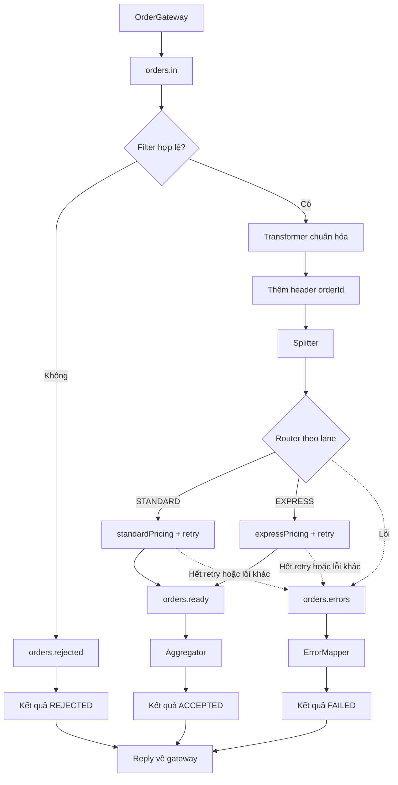

# Kiểm thử toàn bộ flow

## 1. Mục tiêu của bài thực hành

Trong chương **Thực hành tổng hợp** của module **SPRING_INTEGRATION_CORE**, bài này kết nối các thành phần đã học thành một đối tượng kiểm thử duy nhất: một luồng thông điệp nhận yêu cầu, kiểm tra dữ liệu, chuyển đổi, phân nhánh, gọi dịch vụ, tổng hợp và trả kết quả qua gateway.

Sau bài học, bạn có thể:

- Khởi động cấu hình Java DSL thật trong Spring TestContext và gọi flow qua gateway.
- Kiểm tra payload, header, số lần gọi dịch vụ và trạng thái lưu trữ của aggregator.
- Phân biệt từ chối nghiệp vụ, lỗi xử lý, retry và thiếu thông điệp thành phần.
- Chạy cùng hợp đồng kiểm thử với `DirectChannel` và `ExecutorChannel`.
- Khoanh vùng lỗi bằng kiểm thử tại channel mà vẫn duy trì kiểm thử từ đầu vào đến đầu ra.

“Toàn bộ flow” ở đây là toàn bộ luồng **trong một ApplicationContext**. Cổng tính giá được thay bằng test double để chủ động tạo thành công và lỗi. Bộ kiểm thử này chưa chứng minh kết nối HTTP, broker, cơ sở dữ liệu, serialization hoặc giao dịch với hệ thống bên ngoài. Những biên đó cần kiểm thử tích hợp riêng.

## 2. Xác định hợp đồng trước khi viết test

### 2.1. Bài toán xử lý đơn hàng

Một yêu cầu gồm mã đơn hàng và nhiều dòng hàng. Mỗi dòng có SKU, số lượng và tuyến xử lý `STANDARD` hoặc `EXPRESS`.

Quy tắc của bài thực hành:

1. Mã đơn phải có nội dung; danh sách dòng phải tồn tại và không rỗng.
2. Mỗi dòng phải có SKU, tuyến xử lý và số lượng lớn hơn 0.
3. Dữ liệu không hợp lệ được trả về với trạng thái `REJECTED`, không gọi dịch vụ tính giá.
4. SKU và tuyến được loại bỏ khoảng trắng hai đầu, chuyển sang chữ hoa.
5. Router đưa từng dòng đến đúng endpoint theo tuyến.
6. Endpoint tính thành tiền bằng đơn giá nhân số lượng.
7. Aggregator đợi đủ các dòng của một lần gửi rồi trả về một kết quả `ACCEPTED`.
8. Chỉ lỗi `TemporaryPriceException` được retry, tối đa **ba lần thực hiện**, bao gồm lần đầu.
9. Lỗi không retry được, hoặc lỗi sau khi hết lượt retry, được chuyển thành kết quả `FAILED`.
10. Header `traceId` phải có mặt trong phản hồi để nối yêu cầu với kết quả.

Tuyến khác `STANDARD` và `EXPRESS` được xem là lỗi định tuyến. Ví dụ này cố ý để router phát hiện trường hợp đó, qua đó có thể kiểm thử riêng nhánh lỗi định tuyến.

### 2.2. Sơ đồ cần được kiểm thử



Việc router có hai nhánh không có nghĩa hai nhánh tự chạy song song. Với các channel trực tiếp trong phần giữa flow, công việc vẫn chạy trên luồng gửi thông điệp. Khi bật chế độ bất đồng bộ ở đầu vào, toàn bộ phần xử lý phía sau được chuyển sang executor.

### 2.3. Ma trận kiểm thử

| Kịch bản | Đầu ra bắt buộc | Bằng chứng bổ sung |
|---|---|---|
| Đơn có cả hai tuyến | `ACCEPTED`, đúng tổng tiền | Mỗi endpoint được gọi cho đúng dòng; đủ sequence header |
| Dữ liệu sai | `REJECTED` | Không gọi cổng tính giá; không đến aggregator |
| Lỗi tạm thời một lần | `ACCEPTED` | Hai lần gọi dịch vụ, một dòng đến aggregator |
| Lỗi tạm thời liên tục | `FAILED` | Đúng ba lần gọi, một thông điệp lỗi cuối cùng |
| Lỗi không retry | `FAILED` | Một lần gọi |
| Tuyến không tồn tại | `FAILED` | Không gọi tính giá |
| Hai nhóm đến xen kẽ | Hai kết quả độc lập | Không trộn mã đơn, tổng tiền hoặc reply channel |
| Thiếu một phần | Chưa có kết quả tổng hợp | Nhóm còn lưu một thông điệp |
| Một dòng thành công rồi dòng sau lỗi | `FAILED` | Nhóm dở dang vẫn tồn tại; cần chính sách dọn ở thiết kế thực tế |

Một kiểm thử chỉ xác nhận `reply != null` chưa đủ cho bất kỳ hàng nào trong bảng này.

## 3. Chuẩn bị một dự án thực hành độc lập

Mẫu dưới đây dùng Java 17, Maven, Spring Boot parent `3.5.0` để quản lý dependency, và Spring Integration `6.5.0` do parent đó quản lý. Đây là mốc phiên bản cố định cho ví dụ, không phải khẳng định về bản mới nhất. Quan hệ phiên bản có thể đối chiếu trong [khai báo dependency của Spring Boot 3.5.0](https://raw.githubusercontent.com/spring-projects/spring-boot/v3.5.0/spring-boot-project/spring-boot-dependencies/build.gradle).

Không cần viết ứng dụng web hoặc hàm `main`: Spring TestContext sẽ dựng cấu hình tích hợp.

```text
spring-integration-flow-lab/
├── pom.xml
└── src/
    ├── main/java/example/integration/
    │   ├── OrderModels.java
    │   ├── PricePort.java
    │   └── OrderFlowConfig.java
    └── test/java/example/integration/
        ├── OrdersFlowTest.java
        └── AsyncOrdersFlowTest.java
```

### 3.1. Dependency

Nội dung `pom.xml` của dự án thực hành:

```xml
<project xmlns="http://maven.apache.org/POM/4.0.0"
         xmlns:xsi="http://www.w3.org/2001/XMLSchema-instance"
         xsi:schemaLocation="http://maven.apache.org/POM/4.0.0
                             https://maven.apache.org/xsd/maven-4.0.0.xsd">
    <modelVersion>4.0.0</modelVersion>

    <parent>
        <groupId>org.springframework.boot</groupId>
        <artifactId>spring-boot-starter-parent</artifactId>
        <version>3.5.0</version>
        <relativePath/>
    </parent>

    <groupId>example</groupId>
    <artifactId>spring-integration-flow-lab</artifactId>
    <version>1.0.0</version>

    <properties>
        <java.version>17</java.version>
    </properties>

    <dependencies>
        <dependency>
            <groupId>org.springframework.integration</groupId>
            <artifactId>spring-integration-core</artifactId>
        </dependency>
        <dependency>
            <groupId>org.springframework.retry</groupId>
            <artifactId>spring-retry</artifactId>
        </dependency>
        <dependency>
            <groupId>org.springframework.boot</groupId>
            <artifactId>spring-boot-starter-test</artifactId>
            <scope>test</scope>
        </dependency>
        <dependency>
            <groupId>org.springframework.integration</groupId>
            <artifactId>spring-integration-test</artifactId>
            <scope>test</scope>
        </dependency>
    </dependencies>
</project>
```

`spring-integration-test` được dùng khi cần công cụ thay thế endpoint ở phần mở rộng. Bộ kiểm thử chính chỉ cần Spring Test, JUnit Jupiter, AssertJ và Mockito từ test starter.

### 3.2. Mô hình thông điệp

Nội dung `OrderModels.java`:

```java
package example.integration;

import java.math.BigDecimal;
import java.util.List;

import org.springframework.messaging.Message;
import org.springframework.messaging.handler.annotation.Header;
import org.springframework.messaging.handler.annotation.Payload;

public final class OrderModels {

    private OrderModels() {
    }

    public enum Status {
        ACCEPTED, REJECTED, FAILED
    }

    public record OrderLine(String sku, int quantity, String lane) {
    }

    public record OrderRequest(String orderId, List<OrderLine> lines) {
    }

    public record PricedLine(
            String orderId,
            String sku,
            int quantity,
            String lane,
            BigDecimal amount) {
    }

    public record OrderOutcome(
            String orderId,
            Status status,
            List<PricedLine> lines,
            BigDecimal total,
            String code) {
    }

    public interface OrderGateway {

        Message<OrderOutcome> submit(
                @Payload OrderRequest request,
                @Header("traceId") String traceId);
    }
}
```

Gateway trả về `Message<OrderOutcome>` để bài thực hành có thể kiểm tra cả payload và header. Trong API nghiệp vụ khác, gateway có thể chỉ trả về DTO khi phía gọi không cần biết đến messaging.

Các test sẽ dùng `List.of(...)` cho dữ liệu hợp lệ. Record không tự làm cho một `List` được truyền vào trở thành bất biến; nếu sử dụng mô hình này trong ứng dụng, cần chủ động quyết định cách sao chép và kiểm tra đầu vào.

Nội dung `PricePort.java`:

```java
package example.integration;

import java.math.BigDecimal;

public interface PricePort {

    BigDecimal unitPrice(String sku, String lane);

    final class TemporaryPriceException extends RuntimeException {

        public TemporaryPriceException(String message) {
            super(message);
        }
    }
}
```

`PricePort` là biên phụ thuộc. Kiểm thử sẽ điều khiển nó để tạo tình huống trả giá, lỗi tạm thời và lỗi vĩnh viễn, trong khi filter, transformer, router, retry advice, channel và aggregator vẫn là thành phần thật.

## 4. Cấu hình flow thật

Nội dung đầy đủ của `OrderFlowConfig.java`:

```java
package example.integration;

import java.math.BigDecimal;
import java.util.Collection;
import java.util.Comparator;
import java.util.List;
import java.util.Locale;
import java.util.Map;

import org.springframework.beans.factory.annotation.Value;
import org.springframework.context.annotation.Bean;
import org.springframework.context.annotation.Configuration;
import org.springframework.integration.channel.DirectChannel;
import org.springframework.integration.channel.ExecutorChannel;
import org.springframework.integration.config.EnableIntegration;
import org.springframework.integration.dsl.IntegrationFlow;
import org.springframework.integration.gateway.GatewayProxyFactoryBean;
import org.springframework.integration.handler.advice.RequestHandlerRetryAdvice;
import org.springframework.integration.store.SimpleMessageStore;
import org.springframework.messaging.Message;
import org.springframework.messaging.MessageChannel;
import org.springframework.messaging.MessageHeaders;
import org.springframework.messaging.MessagingException;
import org.springframework.messaging.support.ErrorMessage;
import org.springframework.messaging.support.MessageBuilder;
import org.springframework.retry.backoff.NoBackOffPolicy;
import org.springframework.retry.policy.SimpleRetryPolicy;
import org.springframework.retry.support.RetryTemplate;
import org.springframework.scheduling.concurrent.ThreadPoolTaskExecutor;

import static example.integration.OrderModels.*;
import static example.integration.PricePort.TemporaryPriceException;

@Configuration(proxyBeanMethods = false)
@EnableIntegration
public class OrderFlowConfig {

    @Bean
    ThreadPoolTaskExecutor ordersExecutor() {
        ThreadPoolTaskExecutor executor = new ThreadPoolTaskExecutor();
        executor.setCorePoolSize(2);
        executor.setMaxPoolSize(2);
        executor.setQueueCapacity(20);
        executor.setThreadNamePrefix("orders-worker-");
        executor.setWaitForTasksToCompleteOnShutdown(true);
        executor.setAwaitTerminationSeconds(2);
        return executor;
    }

    @Bean(name = "orders.in")
    MessageChannel ordersIn(
            @Value("${orders.async:false}") boolean asynchronous,
            ThreadPoolTaskExecutor ordersExecutor) {
        return asynchronous
                ? new ExecutorChannel(ordersExecutor)
                : new DirectChannel();
    }

    @Bean(name = "orders.ready")
    DirectChannel ordersReady() {
        return new DirectChannel();
    }

    @Bean(name = "orders.errors")
    DirectChannel ordersErrors() {
        return new DirectChannel();
    }

    @Bean
    SimpleMessageStore orderStore() {
        return new SimpleMessageStore();
    }

    @Bean
    GatewayProxyFactoryBean<OrderGateway> orderGateway() {
        GatewayProxyFactoryBean<OrderGateway> gateway =
                new GatewayProxyFactoryBean<>(OrderGateway.class);
        gateway.setDefaultRequestChannelName("orders.in");
        gateway.setErrorChannelName("orders.errors");
        gateway.setDefaultRequestTimeout(1_000L);
        gateway.setDefaultReplyTimeout(3_000L);
        return gateway;
    }

    @Bean
    RequestHandlerRetryAdvice priceRetry() {
        RetryTemplate template = new RetryTemplate();
        template.setRetryPolicy(new SimpleRetryPolicy(
                3, Map.of(TemporaryPriceException.class, true), true));
        template.setBackOffPolicy(new NoBackOffPolicy());

        RequestHandlerRetryAdvice advice = new RequestHandlerRetryAdvice();
        advice.setRetryTemplate(template);
        return advice;
    }

    @Bean
    IntegrationFlow orderFlow() {
        return IntegrationFlow.from("orders.in")
                .filter(OrderRequest.class, OrderFlowConfig::isValid,
                        f -> f.discardChannel("orders.rejected"))
                .transform(OrderRequest.class, OrderFlowConfig::normalize)
                .enrichHeaders(h -> h.headerFunction("orderId",
                        m -> ((OrderRequest) m.getPayload()).orderId()))
                .split(OrderRequest.class, OrderRequest::lines)
                .route(OrderLine.class, OrderLine::lane, r -> r
                        .channelMapping("STANDARD", "orders.standard")
                        .channelMapping("EXPRESS", "orders.express"))
                .get();
    }

    @Bean
    IntegrationFlow rejectedFlow() {
        return IntegrationFlow.from("orders.rejected")
                .transform(OrderRequest.class, request -> new OrderOutcome(
                        request.orderId(), Status.REJECTED, List.of(),
                        BigDecimal.ZERO, "INVALID_ORDER"))
                .get();
    }

    @Bean
    IntegrationFlow standardFlow(
            PricePort prices, RequestHandlerRetryAdvice priceRetry) {
        return IntegrationFlow.from("orders.standard")
                .handle(OrderLine.class,
                        (line, headers) -> price(line, headers, prices, "STANDARD"),
                        e -> e.id("standardPricing").advice(priceRetry))
                .channel("orders.ready")
                .get();
    }

    @Bean
    IntegrationFlow expressFlow(
            PricePort prices, RequestHandlerRetryAdvice priceRetry) {
        return IntegrationFlow.from("orders.express")
                .handle(OrderLine.class,
                        (line, headers) -> price(line, headers, prices, "EXPRESS"),
                        e -> e.id("expressPricing").advice(priceRetry))
                .channel("orders.ready")
                .get();
    }

    @Bean
    IntegrationFlow resultFlow(SimpleMessageStore orderStore) {
        return IntegrationFlow.from("orders.ready")
                .aggregate(a -> a.id("orderAggregator")
                        .messageStore(orderStore)
                        .expireGroupsUponCompletion(true)
                        .outputProcessor(group -> summarize(group.getMessages())))
                .get();
    }

    @Bean
    ErrorMapper errorMapper() {
        return new ErrorMapper();
    }

    @Bean
    IntegrationFlow errorFlow(ErrorMapper errorMapper) {
        return IntegrationFlow.from("orders.errors")
                .handle(errorMapper, "map")
                .get();
    }

    private static boolean isValid(OrderRequest request) {
        return request.orderId() != null
                && !request.orderId().isBlank()
                && request.lines() != null
                && !request.lines().isEmpty()
                && request.lines().stream().allMatch(line ->
                        line != null
                        && line.sku() != null && !line.sku().isBlank()
                        && line.lane() != null && !line.lane().isBlank()
                        && line.quantity() > 0);
    }

    private static OrderRequest normalize(OrderRequest request) {
        List<OrderLine> lines = request.lines().stream()
                .map(line -> new OrderLine(
                        line.sku().strip().toUpperCase(Locale.ROOT),
                        line.quantity(),
                        line.lane().strip().toUpperCase(Locale.ROOT)))
                .toList();
        return new OrderRequest(request.orderId().strip(), lines);
    }

    private static PricedLine price(
            OrderLine line, MessageHeaders headers, PricePort prices, String lane) {
        BigDecimal unitPrice = prices.unitPrice(line.sku(), lane);
        return new PricedLine(
                headers.get("orderId", String.class),
                line.sku(), line.quantity(), lane,
                unitPrice.multiply(BigDecimal.valueOf(line.quantity())));
    }

    private static OrderOutcome summarize(Collection<Message<?>> messages) {
        List<PricedLine> lines = messages.stream()
                .map(message -> (PricedLine) message.getPayload())
                .sorted(Comparator.comparing(PricedLine::sku)
                        .thenComparing(PricedLine::lane))
                .toList();
        BigDecimal total = lines.stream()
                .map(PricedLine::amount)
                .reduce(BigDecimal.ZERO, BigDecimal::add);
        return new OrderOutcome(
                lines.get(0).orderId(), Status.ACCEPTED, lines, total, "OK");
    }

    public static class ErrorMapper {

        public Message<OrderOutcome> map(ErrorMessage error) {
            if (!(error.getPayload() instanceof MessagingException failure)
                    || failure.getFailedMessage() == null) {
                throw new IllegalStateException(
                        "Cannot identify the failed message", error.getPayload());
            }

            Message<?> failed = failure.getFailedMessage();
            String orderId = failed.getHeaders().get("orderId", String.class);
            if (orderId == null && failed.getPayload() instanceof OrderRequest request) {
                orderId = request.orderId();
            }

            OrderOutcome outcome = new OrderOutcome(
                    orderId, Status.FAILED, List.of(),
                    BigDecimal.ZERO, "PROCESSING_ERROR");

            return MessageBuilder.withPayload(outcome)
                    .copyHeaders(failed.getHeaders())
                    .copyHeaders(error.getHeaders())
                    .build();
        }
    }
}
```

### 4.1. Những điểm cấu hình ảnh hưởng trực tiếp đến test

**Đăng ký gateway.** `GatewayProxyFactoryBean` tạo proxy cho `OrderGateway`; test sẽ inject sản phẩm của factory. Cách đăng ký tường minh này không cần component scan cho interface gateway. Xem [API GatewayProxyFactoryBean 6.5.0](https://docs.spring.io/spring-integration/docs/6.5.0/api/org/springframework/integration/gateway/GatewayProxyFactoryBean.html).

**Nhánh bị từ chối vẫn có phản hồi.** `discardChannel` dẫn đến transformer tạo `REJECTED`. Nếu bỏ nhánh này và chỉ để filter loại bỏ yêu cầu, gateway có thể chờ đến hết thời gian nhận phản hồi. Xem [Filter](https://docs.spring.io/spring-integration/reference/6.5/filter.html).

**Đơn vị retry là endpoint tính giá.** Advice chỉ bao quanh lời gọi endpoint, không gửi lại cả đơn hàng từ gateway. Đối số `true` trong `SimpleRetryPolicy` cho phép dò nguyên nhân bên trong exception bọc ngoài; các loại lỗi không được khai báo không được retry. Không đặt recovery callback trong mẫu này, nên lỗi cuối cùng tiếp tục đi đến cơ chế xử lý lỗi của flow. Xem [Retry Advice](https://docs.spring.io/spring-integration/reference/6.5/handler-advice/classes.html).

**Bảo toàn đường trả lời khi xử lý lỗi.** `ErrorMapper` sao chép header của thông điệp lỗi gốc để giữ `traceId` và `orderId`, rồi ưu tiên header của envelope `ErrorMessage`. Thứ tự này giữ được reply channel mà cơ chế gateway dùng cho quá trình xử lý lỗi; không nên tự tạo một thông điệp mới rồi bỏ qua các header trả lời.

**Bộ nhớ nhóm là trạng thái có thể quan sát.** `expireGroupsUponCompletion(true)` xóa nhóm đã hoàn tất. Cấu hình cơ sở chưa gắn bộ hẹn giờ cho nhóm thiếu thành phần. Điều này giúp kiểm thử làm lộ nhóm dở dang; phần mở rộng phía sau sẽ bổ sung chính sách hết hạn.

**Sắp xếp kết quả là hợp đồng của ví dụ.** Aggregator gọi `summarize`, trong đó có sắp xếp SKU rồi đến tuyến. Không dựa vào thứ tự đến của thông điệp để mặc nhiên quyết định thứ tự kết quả.

## 5. Bộ kiểm thử từ gateway đến kết quả

### 5.1. Cấu hình test và các điểm quan sát

Nội dung `OrdersFlowTest.java` dưới đây gồm cả fixture, helper và các ca kiểm thử. Hai interceptor chỉ ghi nhận thông điệp, sau đó trả lại chính thông điệp đó để luồng thật tiếp tục xử lý.

Không thêm một subscriber đọc kết quả trực tiếp vào `DirectChannel` chỉ để quan sát: subscriber đó có thể tham gia cơ chế phân phối và lấy công việc của endpoint thật. Interceptor tại channel tránh thay đổi topology của ví dụ.

```java
package example.integration;

import java.math.BigDecimal;
import java.util.List;
import java.util.UUID;
import java.util.concurrent.CopyOnWriteArrayList;
import java.util.stream.Stream;

import org.junit.jupiter.api.AfterEach;
import org.junit.jupiter.api.BeforeEach;
import org.junit.jupiter.api.Test;
import org.junit.jupiter.api.Timeout;
import org.junit.jupiter.api.parallel.Execution;
import org.junit.jupiter.api.parallel.ExecutionMode;
import org.junit.jupiter.params.ParameterizedTest;
import org.junit.jupiter.params.provider.MethodSource;
import org.springframework.beans.factory.annotation.Autowired;
import org.springframework.beans.factory.annotation.Qualifier;
import org.springframework.context.annotation.Bean;
import org.springframework.context.annotation.Configuration;
import org.springframework.context.annotation.Import;
import org.springframework.integration.IntegrationMessageHeaderAccessor;
import org.springframework.integration.channel.AbstractMessageChannel;
import org.springframework.integration.channel.QueueChannel;
import org.springframework.integration.store.SimpleMessageStore;
import org.springframework.messaging.Message;
import org.springframework.messaging.MessageChannel;
import org.springframework.messaging.support.ChannelInterceptor;
import org.springframework.messaging.support.ErrorMessage;
import org.springframework.messaging.support.MessageBuilder;
import org.springframework.test.annotation.DirtiesContext;
import org.springframework.test.context.junit.jupiter.SpringJUnitConfig;

import static example.integration.OrderModels.*;
import static example.integration.PricePort.TemporaryPriceException;
import static org.assertj.core.api.Assertions.assertThat;
import static org.mockito.ArgumentMatchers.anyString;
import static org.mockito.Mockito.*;

@SpringJUnitConfig(OrdersFlowTest.TestPorts.class)
@DirtiesContext(classMode = DirtiesContext.ClassMode.AFTER_EACH_TEST_METHOD)
@Execution(ExecutionMode.SAME_THREAD)
@Timeout(10)
class OrdersFlowTest {

    @Configuration(proxyBeanMethods = false)
    @Import(OrderFlowConfig.class)
    static class TestPorts {

        @Bean
        PricePort prices() {
            return mock(PricePort.class);
        }
    }

    @Autowired
    private OrderGateway gateway;

    @Autowired
    private PricePort prices;

    @Autowired
    private SimpleMessageStore store;

    @Autowired
    @Qualifier("orders.ready")
    private AbstractMessageChannel ready;

    @Autowired
    @Qualifier("orders.errors")
    private AbstractMessageChannel errors;

    private final List<Message<?>> seenLines = new CopyOnWriteArrayList<>();
    private final List<ErrorMessage> seenErrors = new CopyOnWriteArrayList<>();
    private ChannelInterceptor lineProbe;
    private ChannelInterceptor errorProbe;

    @BeforeEach
    void prepare() {
        when(prices.unitPrice(anyString(), anyString())).thenAnswer(invocation -> {
            String lane = invocation.getArgument(1, String.class);
            return "STANDARD".equals(lane)
                    ? new BigDecimal("100.00")
                    : new BigDecimal("150.00");
        });

        lineProbe = new ChannelInterceptor() {
            @Override
            public Message<?> preSend(Message<?> message, MessageChannel channel) {
                seenLines.add(message);
                return message;
            }
        };
        errorProbe = new ChannelInterceptor() {
            @Override
            public Message<?> preSend(Message<?> message, MessageChannel channel) {
                seenErrors.add((ErrorMessage) message);
                return message;
            }
        };

        ready.addInterceptor(lineProbe);
        errors.addInterceptor(errorProbe);
    }

    @AfterEach
    void removeProbes() {
        ready.removeInterceptor(lineProbe);
        errors.removeInterceptor(errorProbe);
    }

    @Test
    void acceptsBothRoutesAndPreservesHeaders() {
        OrderRequest request = new OrderRequest(" O-100 ", List.of(
                new OrderLine(" book ", 2, " standard "),
                new OrderLine("pen", 1, "express")));

        Message<OrderOutcome> reply = replyFor(request, "T-100");
        OrderOutcome outcome = reply.getPayload();

        assertThat(outcome.orderId()).isEqualTo("O-100");
        assertThat(outcome.status()).isEqualTo(Status.ACCEPTED);
        assertThat(outcome.code()).isEqualTo("OK");
        assertThat(outcome.total()).isEqualByComparingTo("350.00");
        assertThat(outcome.lines()).containsExactly(
                new PricedLine("O-100", "BOOK", 2, "STANDARD",
                        new BigDecimal("200.00")),
                new PricedLine("O-100", "PEN", 1, "EXPRESS",
                        new BigDecimal("150.00")));
        assertThat(reply.getHeaders().get("traceId")).isEqualTo("T-100");

        verify(prices).unitPrice("BOOK", "STANDARD");
        verify(prices).unitPrice("PEN", "EXPRESS");
        verifyNoMoreInteractions(prices);

        assertThat(seenLines).hasSize(2);
        Object correlation = seenLines.get(0).getHeaders().get(
                IntegrationMessageHeaderAccessor.CORRELATION_ID);
        assertThat(correlation).isNotNull();

        for (int i = 0; i < seenLines.size(); i++) {
            Message<?> line = seenLines.get(i);
            assertThat(line.getHeaders().get("orderId")).isEqualTo("O-100");
            assertThat(line.getHeaders().get("traceId")).isEqualTo("T-100");
            assertThat(line.getHeaders().get(
                    IntegrationMessageHeaderAccessor.CORRELATION_ID))
                    .isEqualTo(correlation);
            assertThat(line.getHeaders().get(
                    IntegrationMessageHeaderAccessor.SEQUENCE_SIZE)).isEqualTo(2);
            assertThat(line.getHeaders().get(
                    IntegrationMessageHeaderAccessor.SEQUENCE_NUMBER))
                    .isEqualTo(i + 1);
        }

        assertThat(seenErrors).isEmpty();
        assertThat(store.getMessageGroupCount()).isZero();
    }

    static Stream<OrderRequest> invalidOrders() {
        return Stream.of(
                new OrderRequest("O-200", List.of()),
                new OrderRequest("O-201", null),
                new OrderRequest(" ", List.of(
                        new OrderLine("BOOK", 1, "STANDARD"))),
                new OrderRequest("O-203", List.of(
                        new OrderLine("BOOK", 0, "STANDARD"))),
                new OrderRequest("O-204", List.of(
                        new OrderLine(" ", 1, "STANDARD"))));
    }

    @ParameterizedTest
    @MethodSource("invalidOrders")
    void rejectsInvalidOrderWithoutPricing(OrderRequest request) {
        Message<OrderOutcome> reply = replyFor(request, "T-invalid");

        assertThat(reply.getPayload().status()).isEqualTo(Status.REJECTED);
        assertThat(reply.getPayload().code()).isEqualTo("INVALID_ORDER");
        assertThat(reply.getPayload().lines()).isEmpty();
        assertThat(reply.getPayload().total()).isEqualByComparingTo("0");
        assertThat(reply.getHeaders().get("traceId")).isEqualTo("T-invalid");
        verifyNoInteractions(prices);
        assertThat(seenLines).isEmpty();
        assertThat(seenErrors).isEmpty();
        assertThat(store.getMessageGroupCount()).isZero();
    }

    @Test
    void retriesTemporaryFailureAtPricingEndpoint() {
        when(prices.unitPrice("BOOK", "EXPRESS"))
                .thenThrow(new TemporaryPriceException("Try again"))
                .thenReturn(new BigDecimal("150.00"));

        Message<OrderOutcome> reply = replyFor(
                oneLine("O-300", "BOOK", "EXPRESS"), "T-300");

        assertThat(reply.getPayload().status()).isEqualTo(Status.ACCEPTED);
        assertThat(reply.getPayload().total()).isEqualByComparingTo("150.00");
        verify(prices, times(2)).unitPrice("BOOK", "EXPRESS");
        verifyNoMoreInteractions(prices);
        assertThat(seenLines).hasSize(1);
        assertThat(seenErrors).isEmpty();
        assertThat(store.getMessageGroupCount()).isZero();
    }

    @Test
    void mapsExhaustedRetryToFailure() {
        when(prices.unitPrice("BOOK", "STANDARD"))
                .thenThrow(new TemporaryPriceException("Unavailable"));

        Message<OrderOutcome> reply = replyFor(
                oneLine("O-400", "BOOK", "STANDARD"), "T-400");

        assertThat(reply.getPayload().status()).isEqualTo(Status.FAILED);
        assertThat(reply.getPayload().orderId()).isEqualTo("O-400");
        assertThat(reply.getPayload().code()).isEqualTo("PROCESSING_ERROR");
        assertThat(reply.getHeaders().get("traceId")).isEqualTo("T-400");
        verify(prices, times(3)).unitPrice("BOOK", "STANDARD");
        verifyNoMoreInteractions(prices);
        assertThat(seenLines).isEmpty();
        assertThat(seenErrors).hasSize(1);
        assertThat(seenErrors.get(0).getPayload())
                .hasRootCauseInstanceOf(TemporaryPriceException.class);
        assertThat(store.getMessageGroupCount()).isZero();
    }

    @Test
    void doesNotRetryPermanentFailure() {
        when(prices.unitPrice("BOOK", "STANDARD"))
                .thenThrow(new IllegalArgumentException("Unknown SKU"));

        Message<OrderOutcome> reply = replyFor(
                oneLine("O-500", "BOOK", "STANDARD"), "T-500");

        assertThat(reply.getPayload().status()).isEqualTo(Status.FAILED);
        verify(prices).unitPrice("BOOK", "STANDARD");
        verifyNoMoreInteractions(prices);
        assertThat(seenLines).isEmpty();
        assertThat(seenErrors).hasSize(1);
        assertThat(seenErrors.get(0).getPayload())
                .hasRootCauseInstanceOf(IllegalArgumentException.class);
    }

    @Test
    void reportsUnknownRoute() {
        Message<OrderOutcome> reply = replyFor(
                oneLine("O-600", "BOOK", "DRONE"), "T-600");

        assertThat(reply.getPayload().status()).isEqualTo(Status.FAILED);
        assertThat(reply.getPayload().orderId()).isEqualTo("O-600");
        assertThat(reply.getHeaders().get("traceId")).isEqualTo("T-600");
        verifyNoInteractions(prices);
        assertThat(seenLines).isEmpty();
        assertThat(seenErrors).hasSize(1);
    }

    @Test
    void failureReplyDoesNotAutomaticallyRemovePartialGroup() {
        when(prices.unitPrice("BROKEN", "EXPRESS"))
                .thenThrow(new IllegalArgumentException("Unknown SKU"));
        OrderRequest request = new OrderRequest("O-700", List.of(
                new OrderLine("BOOK", 1, "STANDARD"),
                new OrderLine("BROKEN", 1, "EXPRESS")));

        Message<OrderOutcome> reply = replyFor(request, "T-700");

        assertThat(reply.getPayload().status()).isEqualTo(Status.FAILED);
        verify(prices).unitPrice("BOOK", "STANDARD");
        verify(prices).unitPrice("BROKEN", "EXPRESS");
        verifyNoMoreInteractions(prices);
        assertThat(seenLines).hasSize(1);
        assertThat(seenErrors).hasSize(1);
        assertThat(store.getMessageGroupCount()).isEqualTo(1);
    }

    @Test
    void keepsInterleavedAggregationGroupsIndependent() {
        Object groupA = UUID.randomUUID();
        Object groupB = UUID.randomUUID();
        QueueChannel repliesA = new QueueChannel(10);
        QueueChannel repliesB = new QueueChannel(10);

        ready.send(partial("A", groupA, 1, 2, "A1", "100.00", repliesA));
        ready.send(partial("B", groupB, 1, 2, "B1", "900.00", repliesB));

        assertThat(repliesA.receive(0)).isNull();
        assertThat(repliesB.receive(0)).isNull();
        assertThat(store.getMessageGroupCount()).isEqualTo(2);

        ready.send(partial("B", groupB, 2, 2, "B2", "100.00", repliesB));

        assertOutcome(repliesB.receive(0), "B", "1000.00");
        assertThat(repliesA.receive(0)).isNull();
        assertThat(store.getMessageGroupCount()).isEqualTo(1);

        ready.send(partial("A", groupA, 2, 2, "A2", "200.00", repliesA));

        assertOutcome(repliesA.receive(0), "A", "300.00");
        assertThat(repliesA.receive(0)).isNull();
        assertThat(repliesB.receive(0)).isNull();
        assertThat(store.getMessageGroupCount()).isZero();
        verifyNoInteractions(prices);
    }

    @Test
    void keepsIncompleteGroupWithoutPublishingSuccess() {
        Object group = UUID.randomUUID();
        QueueChannel replies = new QueueChannel(10);

        ready.send(partial("C", group, 1, 2, "C1", "100.00", replies));

        assertThat(replies.receive(0)).isNull();
        assertThat(store.getMessageGroup(group).size()).isEqualTo(1);
        assertThat(store.getMessageGroupCount()).isEqualTo(1);
        assertThat(seenErrors).isEmpty();
        verifyNoInteractions(prices);
    }

    private Message<OrderOutcome> replyFor(OrderRequest request, String traceId) {
        Message<OrderOutcome> reply = gateway.submit(request, traceId);
        assertThat(reply)
                .as("Gateway must produce an explicit outcome for %s", traceId)
                .isNotNull();
        return reply;
    }

    private static OrderRequest oneLine(String orderId, String sku, String lane) {
        return new OrderRequest(orderId, List.of(new OrderLine(sku, 1, lane)));
    }

    private static Message<PricedLine> partial(
            String orderId, Object group, int number, int size,
            String sku, String amount, QueueChannel replies) {
        return MessageBuilder.withPayload(new PricedLine(
                        orderId, sku, 1, "STANDARD", new BigDecimal(amount)))
                .setHeader("orderId", orderId)
                .setHeader("traceId", "T-" + orderId)
                .setHeader(IntegrationMessageHeaderAccessor.CORRELATION_ID, group)
                .setHeader(IntegrationMessageHeaderAccessor.SEQUENCE_NUMBER, number)
                .setHeader(IntegrationMessageHeaderAccessor.SEQUENCE_SIZE, size)
                .setReplyChannel(replies)
                .build();
    }

    private static void assertOutcome(
            Message<?> message, String orderId, String expectedTotal) {
        assertThat(message).isNotNull();
        assertThat(message.getPayload()).isInstanceOf(OrderOutcome.class);
        OrderOutcome outcome = (OrderOutcome) message.getPayload();
        assertThat(outcome.status()).isEqualTo(Status.ACCEPTED);
        assertThat(outcome.orderId()).isEqualTo(orderId);
        assertThat(outcome.total()).isEqualByComparingTo(expectedTotal);
        assertThat(outcome.lines()).hasSize(2);
        assertThat(outcome.lines())
                .allSatisfy(line -> assertThat(line.orderId()).isEqualTo(orderId));
        assertThat(message.getHeaders().get("traceId")).isEqualTo("T-" + orderId);
    }
}
```

### 5.2. Đọc đúng ý nghĩa của các assertion

Ca thành công dùng đầu vào có khoảng trắng và chữ thường để buộc transformer thực hiện công việc. Nếu fixture đã được chuẩn hóa sẵn, bỏ transformer vẫn có thể khiến test xanh.

Tổng tiền `350.00` đến từ `2 × 100.00 + 1 × 150.00`. Hai lệnh `verify` còn chứng minh router chọn đúng endpoint, vì mỗi endpoint truyền một giá trị `lane` cố định vào `PricePort`. `verifyNoMoreInteractions` giúp phát hiện gọi thừa trong phạm vi phép thử.

`seenLines` được quan sát sau endpoint tính giá. Khi cổng giá lỗi một lần rồi thành công, nó bị gọi hai lần nhưng chỉ có một thông điệp thành công đến aggregator. Đây là bằng chứng retry đặt đúng vị trí, không phải chỉ là đếm số lần log lỗi.

Hai ca cuối gửi trực tiếp vào `orders.ready`. Chúng là **kiểm thử tập trung cho aggregator**, bổ sung cho các ca bắt đầu tại gateway. Chúng không kiểm tra lại filter, transformer hoặc router. Việc chủ động gửi theo thứ tự `A1, B1, B2, A2` tạo một tình huống xen kẽ xác định, không phụ thuộc may rủi của bộ lập lịch.

Lệnh `receive(0)` đọc ngay lập tức. Điều đó phù hợp tại `orders.ready` vì channel này là `DirectChannel`: khi `send` trả về, lượt xử lý aggregator tương ứng đã xong. Assertion đó không được mang nguyên sang một đoạn flow có xử lý bất đồng bộ phía sau.

### 5.3. Cô lập trạng thái giữa các phép thử

`@DirtiesContext(AFTER_EACH_TEST_METHOD)` yêu cầu dựng lại context cho phép thử sau. Mục đích của lựa chọn này là cô lập mock, message store và executor, đặc biệt sau ca cố ý để lại nhóm chưa hoàn tất.

Đây là cách rõ ràng cho bài thực hành nhỏ, nhưng có chi phí khởi động. Với bộ kiểm thử lớn, có thể tái sử dụng context và reset có chủ đích, miễn là có thể chứng minh không còn tác vụ đang chạy, nhóm lưu trữ, interceptor, thông điệp trong queue hay trạng thái mock từ phép thử trước.

`CopyOnWriteArrayList` làm điểm quan sát an toàn khi worker ghi và luồng test đọc. Nó không thay thế việc chờ tín hiệu hoàn tất: trong các ca gateway, tín hiệu đó là phản hồi hợp lệ; trong các ca aggregator trực tiếp, đó là việc `send` đã trả về.

`@Execution(SAME_THREAD)` tránh các phương thức trong bộ mẫu tranh chấp cấu hình test. Nếu cấu hình JUnit của dự án cho phép chạy nhiều lớp cùng lúc, vẫn phải đánh giá việc dùng chung context và tài nguyên ngoài; annotation này không tự tạo isolation cho mọi lớp của dự án.

## 6. Chạy lại hợp đồng với đầu vào bất đồng bộ

Nội dung `AsyncOrdersFlowTest.java`:

```java
package example.integration;

import org.springframework.test.context.TestPropertySource;

@TestPropertySource(properties = "orders.async=true")
class AsyncOrdersFlowTest extends OrdersFlowTest {
}
```

JUnit Jupiter chạy các phương thức kiểm thử được kế thừa. Spring TestContext kế thừa cấu hình của lớp cha và bổ sung property để bean `orders.in` trở thành `ExecutorChannel`.

Các ca gọi gateway lúc này thực sự đi qua ranh giới luồng. Phần xử lý tiếp theo vẫn dùng channel trực tiếp, nên thứ tự các dòng trong cùng một lần gọi splitter vẫn được giữ trong cấu hình mẫu. Việc đổi channel đầu vào chưa phải là kiểm thử mọi khả năng đảo thứ tự hoặc mọi lịch thực thi đồng thời.

Trong luồng trực tiếp, exception có thể quay về gateway trên call stack và gateway chuyển nó đến channel lỗi đã cấu hình. Trong luồng dùng executor, lỗi được công bố dưới dạng `ErrorMessage`; cơ chế xử lý ưu tiên `errorChannel` của thông điệp trước channel lỗi toàn cục. Vì vậy cần giữ header lỗi khi chuyển tiếp thông điệp. Xem [Error Handling](https://docs.spring.io/spring-integration/reference/6.5/error-handling.html).

### 6.1. Ba giới hạn thời gian có ý nghĩa khác nhau

| Cấu hình | Phạm vi trong mẫu | Điều không được suy ra |
|---|---|---|
| `defaultRequestTimeout = 1000` | Thời gian gửi yêu cầu nếu cơ chế gửi hỗ trợ chờ có timeout | Không phải deadline cho xử lý toàn đơn |
| `defaultReplyTimeout = 3000` | Giới hạn chờ nhận reply khi gateway đã đến bước chờ | Không hủy một handler đang chạy |
| `@Timeout(10)` | Giới hạn phép thử theo cơ chế của JUnit | Không phải timeout của dịch vụ ngoài hoặc giao dịch |

Đặc biệt, với flow hoàn toàn đồng bộ, một handler chạy lâu vẫn giữ call stack của gateway. `replyTimeout` không làm gateway tự thoát khỏi lời gọi handler đó. Với flow bất đồng bộ, gateway có thể hết thời gian chờ trong khi worker vẫn tiếp tục xử lý. Xem [Gateway Behavior When No Response Arrives](https://docs.spring.io/spring-integration/reference/6.5/gateway.html#gateway-behavior-no-response).

Helper `replyFor` cố ý báo lỗi ngay nếu nhận `null`, trước khi đọc payload. Với các API cần phân biệt rõ timeout, hãy thiết kế hợp đồng timeout và cơ chế phản hồi tương ứng; không biến `null` thành thành công mặc định.

### 6.2. Chạy bộ mẫu

Trong thư mục dự án thực hành đã tạo từ các đoạn mã trên:

```bash
mvn test
```

Để chạy riêng lớp đồng bộ hoặc bất đồng bộ:

```bash
mvn -Dtest=OrdersFlowTest test
mvn -Dtest=AsyncOrdersFlowTest test
```

Kết quả mong đợi là mỗi hợp đồng về payload, header, số lượt retry và trạng thái nhóm đều được kiểm tra ở hai cấu hình đầu vào. Đây là hướng dẫn thực thi cho người học; mã trong tài liệu cần được chạy trong dự án thực hành để có kết quả kiểm thử thực tế.

## 7. Những bất biến của splitter và aggregator

### 7.1. Kiểm tra sequence ở vị trí phù hợp

Splitter tạo các header giúp nhận diện nhóm, vị trí và số thành phần: `correlationId`, `sequenceNumber`, `sequenceSize`. Với danh sách hữu hạn trong ví dụ, kích thước nhóm được biết ngay khi tách. Xem [Splitter](https://docs.spring.io/spring-integration/reference/6.5/splitter.html).

Vì vậy test quan sát tại `orders.ready`, sau khi thông điệp đã đi qua router và endpoint. Nếu một bước ở giữa làm mất header, test sẽ phát hiện ngay tại nơi aggregator cần chúng.

Không buộc phản hồi cuối cùng phải giữ toàn bộ sequence header của từng phần. Phản hồi sau khi tổng hợp là một thông điệp ở cấp đơn hàng; các header phục vụ tách và ghép có thể được framework xử lý theo ngữ cảnh sequence.

### 7.2. Mã đơn hàng và correlation có mục đích khác nhau

Trong mẫu, `orderId` là thông tin nghiệp vụ được bổ sung vào header. Aggregator dùng chiến lược correlation mặc định dựa trên metadata do splitter tạo, không dùng `orderId` làm khóa nhóm do chúng ta tự đặt.

Hai yêu cầu khác nhau có cùng `orderId` vẫn có thể tạo hai nhóm khác nhau. Ngược lại, nếu tự cấu hình correlation chỉ bằng `orderId`, hai lần gửi cùng mã có nguy cơ ghép vào một nhóm ngoài ý muốn.

Ca xen kẽ dùng hai UUID chủ động, hai reply channel và hai `traceId` khác nhau. Nó kiểm tra độc lập ba điều: nhóm đúng dữ liệu, tính đúng tổng và trả đúng nơi nhận.

Một test chống trùng đơn hàng cần hợp đồng riêng, chẳng hạn khóa `(orderId, requestVersion)` hoặc `idempotencyKey`, cùng một nơi lưu quyết định đã xử lý. Việc test nhóm aggregator độc lập không tự chứng minh idempotency.

### 7.3. Thiếu phần không đồng nghĩa với lỗi được ném ra

Trong ca `keepsIncompleteGroupWithoutPublishingSuccess`, nhóm có một phần nhưng khai báo cần hai phần. Aggregator chưa phát kết quả và cũng không phát exception chỉ vì chưa đủ dữ liệu.

Nếu sửa flow bằng cách đặt một filter sau splitter, rồi loại bỏ một dòng mà không thay đổi giao thức hoàn tất, aggregator phía sau có thể chờ phần đã bị loại. Trước khi viết assertion timeout, cần quyết định rõ: từ chối toàn đơn trước splitter, tạo kết quả thất bại cho từng dòng, hay sử dụng release strategy và chính sách hết hạn phù hợp.

Đây là lý do validation của mẫu đặt trước splitter: một đơn không hợp lệ được kết thúc bằng `REJECTED` mà không tạo nhóm dở dang.

### 7.4. Hoàn tất, dọn nhóm và chống phát trùng là các yêu cầu riêng

`expireGroupsUponCompletion(true)` giúp các ca thành công có thể xác nhận store trở về không nhóm. Tuy nhiên, xóa nhóm hoàn tất cũng cho phép một thông điệp đến muộn với cùng correlation bắt đầu nhóm mới; tùy cấu hình, việc giữ metadata nhóm hoàn tất có thể giúp loại bỏ thông điệp muộn. Xem [Aggregator và quản lý trạng thái nhóm](https://docs.spring.io/spring-integration/reference/aggregator.html).

Trong bài thực hành, sequence được tạo trong bộ nhớ cho từng lần gửi và không có broker phát lại. Khi thêm redelivery hoặc lưu trữ lâu dài, cần thiết kế và kiểm thử chính sách thông điệp trùng, đến muộn, sai sequence hoặc tái sử dụng correlation; không được suy ra bảo đảm “exactly once” từ các test hiện tại.

## 8. Mở rộng: hết hạn nhóm thiếu thành phần

Phần này là **biến thể thực hành**, áp dụng sau khi đã chạy bộ cơ sở. Không thêm một flow thứ hai cùng tiêu thụ `orders.ready`, vì như vậy sẽ đổi cơ chế phân phối thay vì cấu hình lại aggregator đang kiểm thử.

### 8.1. Thay cấu hình aggregator

Trong `OrderFlowConfig`, bổ sung import `org.springframework.integration.channel.QueueChannel`, thêm bean `ordersExpired`, và **thay** phương thức `resultFlow` cũ bằng phương thức dưới đây:

```java
@Bean(name = "orders.expired")
QueueChannel ordersExpired() {
    return new QueueChannel(20);
}

@Bean
IntegrationFlow resultFlow(SimpleMessageStore orderStore) {
    return IntegrationFlow.from("orders.ready")
            .aggregate(a -> a.id("orderAggregator")
                    .messageStore(orderStore)
                    .groupTimeout(300)
                    .sendPartialResultOnExpiry(false)
                    .expireGroupsUponCompletion(true)
                    .expireGroupsUponTimeout(true)
                    .discardChannel("orders.expired")
                    .outputProcessor(group -> summarize(group.getMessages())))
            .get();
}
```

Hợp đồng của biến thể này là: nhóm chưa đủ khi hết hạn được đưa sang channel hết hạn, không tạo kết quả thành công một phần. Các lựa chọn timeout và discard thuộc [CorrelationHandlerSpec](https://docs.spring.io/spring-integration/docs/6.5.0/api/org/springframework/integration/dsl/CorrelationHandlerSpec.html); phần xử lý đầu ra thuộc [AggregatorSpec](https://docs.spring.io/spring-integration/docs/6.5.0/api/org/springframework/integration/dsl/AggregatorSpec.html).

`300 ms` là khoảng ngắn dành cho bài thực hành. Không dùng nó làm ngưỡng sản xuất một cách mặc định. Group timeout phụ thuộc tiến trình nhận thông điệp và scheduler, không đồng nghĩa deadline tuyệt đối cho toàn yêu cầu.

Queue giới hạn 20 phần tử chỉ là nơi nhận discard cho phép thử. Trong ứng dụng, channel này cần có consumer và chính sách vận hành phù hợp; một queue không được đọc không phải cơ chế xử lý lỗi hoàn chỉnh.

### 8.2. Kiểm thử tín hiệu hết hạn thay vì ngủ một khoảng cố định

Sau khi thay cấu hình như trên, có thể tạo lớp test riêng `GroupExpiryTest.java` trong cùng package:

```java
package example.integration;

import java.math.BigDecimal;
import java.time.Duration;
import java.util.UUID;

import org.junit.jupiter.api.Test;
import org.junit.jupiter.api.Timeout;
import org.springframework.beans.factory.annotation.Autowired;
import org.springframework.beans.factory.annotation.Qualifier;
import org.springframework.integration.IntegrationMessageHeaderAccessor;
import org.springframework.integration.channel.DirectChannel;
import org.springframework.integration.channel.QueueChannel;
import org.springframework.integration.store.SimpleMessageStore;
import org.springframework.messaging.Message;
import org.springframework.messaging.support.MessageBuilder;
import org.springframework.test.annotation.DirtiesContext;
import org.springframework.test.context.junit.jupiter.SpringJUnitConfig;

import static example.integration.OrderModels.PricedLine;
import static org.assertj.core.api.Assertions.assertThat;
import static org.awaitility.Awaitility.await;

@SpringJUnitConfig(OrdersFlowTest.TestPorts.class)
@DirtiesContext
@Timeout(10)
class GroupExpiryTest {

    @Autowired
    @Qualifier("orders.ready")
    private DirectChannel ready;

    @Autowired
    @Qualifier("orders.expired")
    private QueueChannel expired;

    @Autowired
    private SimpleMessageStore store;

    @Test
    void discardsIncompleteGroupAndRemovesItsState() {
        QueueChannel replies = new QueueChannel(10);
        PricedLine line = new PricedLine(
                "O-expired", "BOOK", 1, "STANDARD", new BigDecimal("100.00"));
        Message<PricedLine> partial = MessageBuilder.withPayload(line)
                .setHeader("orderId", "O-expired")
                .setHeader("traceId", "T-expired")
                .setHeader(IntegrationMessageHeaderAccessor.CORRELATION_ID,
                        UUID.randomUUID())
                .setHeader(IntegrationMessageHeaderAccessor.SEQUENCE_NUMBER, 1)
                .setHeader(IntegrationMessageHeaderAccessor.SEQUENCE_SIZE, 2)
                .setReplyChannel(replies)
                .build();

        ready.send(partial);

        Message<?> discarded = expired.receive(2_000);
        assertThat(discarded).isNotNull();
        assertThat(discarded.getPayload()).isEqualTo(line);
        assertThat(discarded.getHeaders().get("traceId")).isEqualTo("T-expired");
        await().atMost(Duration.ofSeconds(2)).untilAsserted(() ->
                assertThat(store.getMessageGroupCount()).isZero());
        assertThat(replies.receive(0)).isNull();
    }
}
```

Trong cấu hình này, discard được phát theo từng thông điệp của nhóm; fixture chỉ có một phần nên test chờ một thông điệp. Việc nhận discard và việc dọn xong store không nhất thiết là cùng một thời điểm, vì thế test chờ thêm điều kiện trạng thái với giới hạn rõ ràng.

Chạy riêng biến thể bằng `mvn -Dtest=GroupExpiryTest test`. Không gộp kỳ vọng “giữ nhóm vô thời hạn” của bộ cơ sở với cấu hình đã bật hết hạn. Khi đưa biến thể vào bộ test chính, cần viết lại các ca nhóm dở dang theo hợp đồng mới.

### 8.3. Kết quả hết hạn phải được định nghĩa ở cấp đơn hàng

Đẩy từng dòng quá hạn sang discard channel chưa tự tạo một phản hồi lỗi duy nhất cho toàn đơn. Một nhóm nhiều dòng có thể phát nhiều thông điệp discard. Nếu chuyển mỗi discard thành một reply, bạn có thể tạo nhiều phản hồi cho cùng yêu cầu.

Thiết kế thực tế cần quyết định nơi lưu trạng thái kết thúc của đơn, cách gom tín hiệu lỗi và cách ngăn phản hồi trùng. Sau đó kiểm thử các tình huống: gateway đã hết thời gian chờ, worker vẫn chạy, dòng muộn xuất hiện, và nhóm đã bị dọn.

## 9. Lựa chọn mức cô lập và công cụ kiểm thử

### 9.1. Khi nào dùng MockIntegrationContext

`@SpringIntegrationTest` cung cấp `MockIntegrationContext` để điều chỉnh thành phần trong context thật. `substituteMessageHandlerFor` nhận tên endpoint bao quanh handler; với cấu hình mẫu, tên tương ứng là `standardPricing` hoặc `expressPricing`. Sau phép thử cần khôi phục bằng `resetBeans()`. Xem [Spring Integration Testing Support](https://docs.spring.io/spring-integration/reference/testing.html).

Trong bộ cơ sở, việc mock `PricePort` giữ nguyên service activator và advice chain, nên phù hợp để kiểm tra retry ở endpoint thật. Nếu thay toàn bộ handler, phải xem lại phần hành vi nào vừa bị thay thế; một test như vậy không thể mặc nhiên chứng minh cấu hình handler gốc hoạt động.

Với hệ thống có inbound adapter tự kết nối ra ngoài, thuộc tính `noAutoStartup` của `@SpringIntegrationTest` có thể hỗ trợ chặn endpoint trong test. Cần khởi tạo dữ liệu và kích hoạt đầu vào theo đúng phạm vi cần kiểm tra, không để một nguồn chạy nền đưa thông điệp ngoài fixture vào bộ test.

### 9.2. Bốn lớp kiểm thử bổ sung cho nhau

| Mức kiểm thử | Thành phần thật | Phụ thuộc được kiểm soát | Sai sót thường phát hiện |
|---|---|---|---|
| Đơn vị cho logic nghiệp vụ | Phương thức chuẩn hóa, tính toán hoặc phân loại | Không có context | Biên dữ liệu, phép tính, quy tắc |
| Flow trong ApplicationContext | Gateway, channel, endpoint, advice và store trong bộ nhớ | `PricePort` | Wiring, header, routing, retry, aggregation |
| Adapter và hệ thống ngoài | Flow cùng adapter và dịch vụ kiểm thử tương ứng | Broker, HTTP server hoặc DB dành cho test | Serialization, kết nối, mapping, ack, transaction |
| Hệ thống sau triển khai | Đường đi qua ranh giới triển khai | Dữ liệu và môi trường kiểm thử | Cấu hình môi trường, quyền truy cập, tương tác giữa dịch vụ |

Khi bổ sung broker hoặc cơ sở dữ liệu, cần kiểm tra thêm cách tạo tài nguyên riêng cho từng test, khôi phục khi chạy lại và đóng kết nối. Dùng test double ở biên giúp bộ test flow nhanh và xác định, nhưng phải có lớp kiểm thử khác bao phủ biên thật.

### 9.3. Kiểm thử đồng thời cần một tình huống đồng thời thật

Lớp `AsyncOrdersFlowTest` kiểm tra ranh giới luồng cho từng yêu cầu. Nó chưa tạo hai lời gọi gateway cùng lúc. Để kiểm tra tranh chấp giữa nhiều yêu cầu, có thể mở rộng theo trình tự:

1. Tạo hai yêu cầu có mã đơn và `traceId` khác nhau.
2. Cho hai tác vụ gọi gateway trên executor của phía test.
3. Dùng `CountDownLatch` hoặc `CyclicBarrier` trong test double để biết cả hai yêu cầu đã đến điểm cần phối hợp.
4. Mở chốt, rồi lấy hai kết quả với `Future.get` có timeout.
5. Kiểm tra mỗi kết quả chỉ chứa dữ liệu của yêu cầu tương ứng; kiểm tra store sau khi cả hai hoàn tất.
6. Đóng executor của phía test trong `finally`.

Chốt phải có timeout và số worker phải đủ cho số bên chờ. Nếu đặt barrier cần hai bên trong một executor chỉ có một worker, chính phép thử sẽ gây bế tắc.

Ca xen kẽ trực tiếp ở phần 5 vẫn có giá trị riêng: nó tạo đúng thứ tự nhóm mong muốn một cách xác định. Ca đồng thời bổ sung bằng chứng về an toàn khi nhiều luồng truy cập, không thay thế assertion về dữ liệu và trạng thái nhóm.

## 10. Chẩn đoán khi test thất bại

| Biểu hiện | Điểm cần kiểm tra trước | Hướng xác minh |
|---|---|---|
| Gateway trả `null` | Nhánh không sinh reply, timeout, mất `replyChannel` | Quan sát điểm cuối của nhánh; kiểm tra error flow và header |
| Dữ liệu sai vẫn gọi tính giá | Filter sai hoặc nằm sau splitter | Dùng fixture vi phạm một điều kiện; `verifyNoInteractions` |
| Tổng tiền đúng nhưng test route thất bại | Dịch vụ bị gọi sai tuyến hoặc gọi thừa | Kiểm tra các cặp SKU/lane và số lượt gọi |
| Retry nhiều hơn dự kiến | Có thêm tầng retry hoặc phía gọi gửi lại | Đếm riêng lần vào gateway, lần gọi port và lần đến aggregator |
| Retry không xảy ra | Sai loại exception, sai advice hoặc phân loại cause | Kiểm tra exception cuối cùng và endpoint gắn advice |
| Có đủ payload nhưng aggregator không phát kết quả | Mất correlation, sai sequence size hoặc release strategy | Kiểm tra header tại `orders.ready` và nhóm trong store |
| Test trực tiếp xanh, async lỗi | Phụ thuộc luồng gọi, mất header lỗi hoặc assertion chạy sớm | Chờ kết quả có giới hạn; kiểm tra đường `ErrorMessage` |
| Ca sau bị ảnh hưởng bởi ca trước | Context hoặc tài nguyên còn trạng thái | Kiểm tra store, queue, mock, interceptor và worker chưa xong |
| Store còn nhóm sau `FAILED` | Một số phần đã đến aggregator trước lỗi | Áp dụng chính sách hết hạn hoặc hủy nhóm theo hợp đồng |
| Chạy từng test xanh, chạy cả bộ lỗi | Trạng thái dùng chung hoặc thứ tự ngầm | Cô lập context/tài nguyên và loại bỏ phụ thuộc thứ tự |

Khi cần thêm bằng chứng, ghi `traceId`, `orderId`, correlation, tên endpoint và loại lỗi. Không dùng số lượng dòng log làm bằng chứng duy nhất cho số lần xử lý: một lỗi có thể được ghi ở nhiều tầng.

## 11. Tiêu chí hoàn thành bài thực hành

Một bộ kiểm thử toàn flow đạt yêu cầu của bài này khi có thể chứng minh:

- Yêu cầu hợp lệ đi qua gateway thật và trả về kết quả đúng cả dữ liệu lẫn header cần thiết.
- Mỗi nhánh router và nhánh từ chối có ít nhất một fixture kích hoạt trực tiếp.
- Retry có số lượt và loại lỗi được kiểm tra; không chỉ xác nhận kết quả cuối.
- Aggregator được kiểm tra khi đủ phần, thiếu phần và khi hai nhóm đến xen kẽ.
- Cả đầu vào đồng bộ và bất đồng bộ tuân thủ cùng hợp đồng phản hồi.
- Trạng thái dở dang được nhìn thấy và có hướng xử lý rõ ràng khi bổ sung hết hạn.
- Mọi lần chờ đều có giới hạn; các tài nguyên test được khôi phục hoặc đóng.
- Phạm vi bằng chứng được ghi đúng: test flow trong bộ nhớ chưa xác nhận biên tích hợp bên ngoài.

Điều quan trọng khi bảo trì flow là biến mỗi yêu cầu xử lý thành một bằng chứng quan sát được. Khi sửa channel, thêm endpoint hoặc thay release strategy, những bằng chứng đó cho biết hành vi nghiệp vụ và giao thức thông điệp còn được giữ nguyên hay đã thay đổi.


