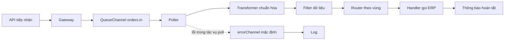
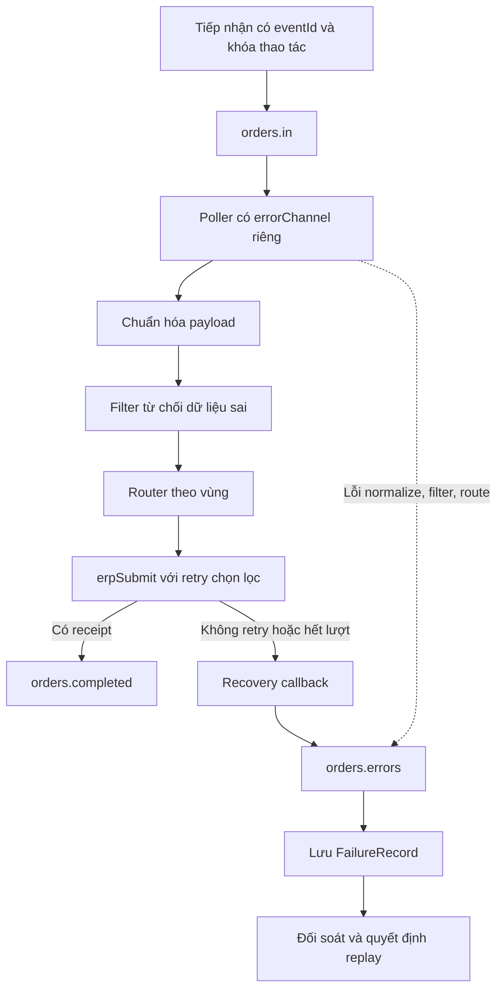
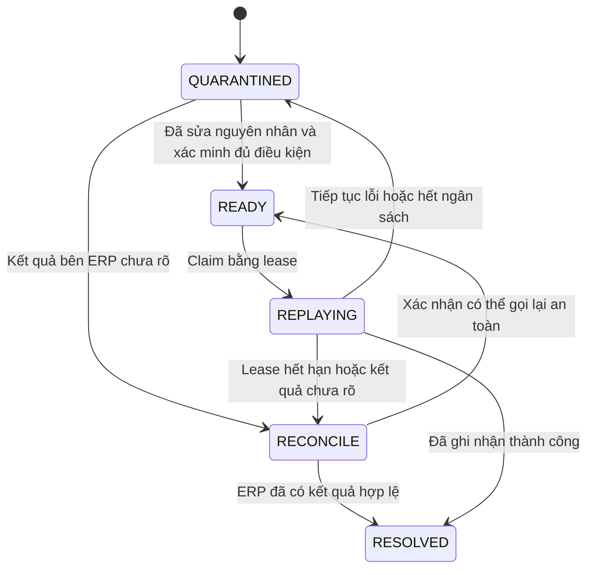

# Xử lý một flow lỗi trong production

## 1. Mục tiêu và phạm vi thực hành

Bài thực hành tổng hợp này thuộc module **SPRING_INTEGRATION_CORE**. Bạn đóng vai người trực vận hành một luồng tiếp nhận đơn hàng, dùng các thành phần cốt lõi của Spring Integration để tìm điểm hỏng, chặn tác động lan rộng, sửa cách xử lý lỗi và phục hồi thông điệp có kiểm soát.

Kết quả cần đạt:

- Đọc được đường đi của một `Message`, các header nhận diện và ranh giới giữa thread gửi với thread xử lý.
- Phân biệt lỗi transformer, filter, router, lời gọi hệ thống ngoài và chính nhánh xử lý lỗi.
- Dùng Java DSL, `RequestHandlerRetryAdvice` và một kênh lỗi riêng để giới hạn retry và giữ lại thông tin phục hồi.
- Thiết kế idempotency, quarantine và replay theo trạng thái nghiệp vụ.
- Viết kiểm thử cho hành vi thất bại; dùng bằng chứng để quyết định triển khai và kết thúc sự cố.

Các mã đơn, thời điểm, lưu lượng và log trong bài là **dữ liệu giả lập**. Không dùng payload thật của khách hàng khi tái hiện sự cố.

### Môi trường minh họa

Ví dụ dùng **Java 17+, Spring Boot 3.5.x, Spring Integration 6.5.x và Spring Retry 2.x**. Các tên package `org.springframework.retry.*` trong bài thuộc tổ hợp phiên bản này. Chọn một bản vá cụ thể cho dự án thực hành và để BOM của Spring Boot quản lý dependency; không tự ghép các thế hệ thư viện. Xem [dependency được Spring Boot 3.5 quản lý](https://docs.spring.io/spring-boot/3.5/appendix/dependency-versions/coordinates.html).

Trong một dự án Maven đã có parent/BOM Spring Boot phù hợp, thêm các dependency sau:

```xml
<dependencies>
    <dependency>
        <groupId>org.springframework.boot</groupId>
        <artifactId>spring-boot-starter-integration</artifactId>
    </dependency>
    <dependency>
        <groupId>org.springframework.retry</groupId>
        <artifactId>spring-retry</artifactId>
    </dependency>
    <dependency>
        <groupId>org.springframework.boot</groupId>
        <artifactId>spring-boot-starter-test</artifactId>
        <scope>test</scope>
    </dependency>
</dependencies>
```

Phần lab dưới đây chạy bằng Spring Test và ERP giả lập, không cần broker hoặc ERP thật. `QueueChannel` trong lab giữ dữ liệu trong bộ nhớ; `FailureStore` là cổng lưu lỗi được thay bằng mock trong test. Phần thiết kế production giải thích những việc cần bổ sung để bảo đảm khả năng phục hồi khi tiến trình chết.

## 2. Tình huống: đã nhận đơn nhưng chưa tạo được trên ERP

Một dịch vụ tiếp nhận sự kiện `OrderCreated` và chuyển sang ERP. Sau một lần thay đổi cấu hình, API tiếp nhận vẫn trả kết quả thành công, nhưng số đơn được tạo trên ERP giảm. Một nhóm vận hành phát lại sự kiện từ log, sau đó phát hiện đơn trùng.

Luồng trước sự cố:



Mốc thời gian giả lập:

| Thời điểm | Quan sát | Ý nghĩa cần kiểm tra |
| --- | --- | --- |
| 09:00 | Triển khai bản cấu hình mới | So sánh endpoint, timeout, retry và mapping vùng |
| 09:05 | ERP tăng thời gian đáp ứng | Có thể tạo backlog hoặc timeout |
| 09:08 | API vẫn tiếp nhận bình thường | Chỉ xác nhận đầu vào nếu chưa chờ kết quả ERP |
| 09:12 | Đơn đã nhận vượt xa đơn hoàn tất | Cần đối soát theo sự kiện, không chỉ đếm HTTP 2xx |
| 09:18 | Phát lại một số payload từ log | Có nguy cơ lặp side effect nếu thiếu khóa nghiệp vụ |
| 09:25 | ERP xuất hiện đơn trùng | Kiểm tra giao dịch đã thành công nhưng mất phản hồi |

Các bất biến nghiệp vụ dùng để đánh giá phương án sửa:

1. Mỗi sự kiện hợp lệ có một định danh ổn định.
2. Một thao tác tạo đơn có cùng khóa idempotency qua mọi lần thử lại.
3. Mỗi sự kiện đã được tiếp nhận bền vững phải đối soát được về trạng thái cuối hoặc trạng thái đang chờ có chủ đích.
4. Lỗi không được biến thành kết quả “đã tạo đơn” chỉ vì error handler chạy thành công.
5. Những trường hợp chưa biết ERP đã commit hay chưa phải được đối soát trước khi tạo lại.

## 3. Thu thập bằng chứng trước khi sửa

### 3.1. Lập bản đồ luồng thực tế

Ghi lại channel, loại channel, endpoint ID, poller, executor nếu có, timeout và mọi cấu hình retry. Một bản Java DSL ngắn vẫn có thể tạo nhiều bean, nên endpoint ID ổn định giúp nối log với cấu hình.

| Thành phần | Điều cần xác minh | Một lỗi dễ bỏ sót |
| --- | --- | --- |
| Gateway | Kiểu trả về, request channel, timeout gửi, timeout chờ reply | Đọc `void` như kết quả nghiệp vụ |
| Queue đầu vào | Dung lượng, nơi lưu, độ tuổi message | Queue trong bộ nhớ bị mất khi restart |
| Transformer | Kiểu đầu vào và đầu ra, header còn được giữ | Tạo message mới rồi mất khóa nghiệp vụ |
| Filter | Reject bằng exception hay chuyển discard channel | Sự kiện bị loại nhưng không có trạng thái |
| Router | Mapping đầy đủ, default route, xử lý route không tồn tại | Một vùng mới không có đích |
| ERP handler | Timeout, phân loại lỗi, phạm vi advice | Retry cả lỗi dữ liệu hoặc cả chuỗi side effect |
| Error flow | Subscriber, nơi lưu lỗi, hành vi khi lưu lỗi hỏng | Chỉ log rồi coi là đã phục hồi |
| Aggregator nếu có | Group ID, điều kiện release, expiry, message store | Một nhánh thất bại khiến group chờ mãi |

### 3.2. Nối các định danh đúng mục đích

| Trường | Mục đích | Quy tắc trong tình huống này |
| --- | --- | --- |
| `MessageHeaders.ID` | Nhận diện message của framework | Không dùng làm khóa tạo đơn trên ERP |
| `eventId` | Nhận diện sự kiện nghiệp vụ | Giữ nguyên khi retry hoặc replay cùng sự kiện |
| `correlationId` | Nối các bước của một quy trình | Giữ để truy vết; nhiều sự kiện có thể cùng correlation |
| `idempotencyKey` | Nhận diện một side effect cụ thể | Dùng tiền tố thao tác và event ID ổn định |
| `flowStage` | Vị trí đang xử lý | Cập nhật trước mỗi bước quan trọng |
| `replayId` | Nhận diện một đợt phát lại | Tạo mới cho từng lần replay, không thay `eventId` |
| `schemaVersion` | Chọn cách giải mã payload | Kiểm tra tương thích trước khi phát lại |

Một log đã lược dữ liệu nhạy cảm có thể là:

```text
eventId=evt-1042 correlationId=checkout-782
flowStage=erpSubmit endpoint=erpSubmit
idempotencyKey=erp-order:create:evt-1042
attempt=3 outcome=TIMEOUT elapsedMs=2000
```

Log này chưa chứng minh ERP chưa tạo đơn. Hãy tra ERP bằng khóa idempotency hoặc định danh nghiệp vụ theo hợp đồng tích hợp.

### 3.3. Phân biệt thread boundary và error boundary

Với `DirectChannel`, handler thường chạy trên thread gửi; exception có thể quay về caller. Khi dùng `QueueChannel` kèm poller, phần xử lý diễn ra sau khi gửi vào queue. Không thể trông chờ `try/catch` quanh thao tác enqueue bắt được exception xảy ra sau đó. Spring Integration có cơ chế `ErrorMessage` cho các lỗi tác vụ bất đồng bộ; gateway cũng có quy tắc xử lý lỗi riêng. Xem [Error Handling của Spring Integration 6.5](https://docs.spring.io/spring-integration/reference/6.5/error-handling.html).

```java
boolean accepted = ordersIn.send(message, 1_000);
// accepted chỉ cho biết message đã được channel chấp nhận.
// ERP có thể chưa được gọi tại thời điểm này.
```

Với gateway trả về `void`, caller không nhận receipt của ERP. Nếu dùng gateway request/reply, phải thiết kế đường reply, kiểu kết quả và ngân sách thời gian tương ứng. Timeout chờ reply không tự hủy side effect đang chạy. Xem [Messaging Gateways](https://docs.spring.io/spring-integration/reference/6.5/gateway.html).

Trong bản sửa của bài, lỗi ERP được gửi bằng recovery callback đến `orders.errors`; lỗi transformer, filter hoặc router được poller gửi đến cùng kênh. Đây là hai cơ chế cụ thể, không phải giả định mọi `DirectChannel` tự gửi exception vào kênh lỗi.

## 4. Khoanh vùng và giảm tác động

Thực hiện trên bản sao dữ liệu đã loại thông tin nhạy cảm trước khi thử trên môi trường vận hành.

1. **Giữ bằng chứng:** lấy deployment ID, cấu hình thay đổi, lỗi đầu tiên và mẫu sự kiện đại diện; tránh bật log toàn bộ payload.
2. **Bảo vệ đầu vào:** nếu còn tiếp nhận, phải có nơi lưu bền và giới hạn tải. Nếu chỉ có queue trong bộ nhớ, cần chặn hoặc chuyển nguồn sang cơ chế lưu bền trước khi dừng consumer.
3. **Giảm áp lực lên ERP:** giới hạn lượng gọi đồng thời, dừng replay hàng loạt, kiểm tra lỗi xác thực và tình trạng upstream.
4. **Phân loại tập bị ảnh hưởng:** đã thành công; đã thất bại rõ ràng; chưa rõ ERP đã commit; chưa được xử lý.
5. **Tái hiện bằng một sự kiện:** giữ nguyên event ID, header và kiểu lỗi. Không thử bằng một payload được nhập lại nhưng thiếu header.
6. **Chọn rollback hoặc bản vá:** rollback cấu hình khi điều đó giải quyết nguyên nhân và tương thích dữ liệu; giữ nguyên nghĩa của các khóa nghiệp vụ.
7. **Đối soát sau can thiệp:** lỗi giảm chỉ là một tín hiệu. Cần kiểm tra số đơn đúng, đơn trùng, backlog và các bản ghi chờ đối soát.

Dừng một endpoint nhận từ queue không đồng nghĩa queue đã an toàn khi restart. Khả năng lưu bền phải được xác minh riêng.

## 5. Giả thuyết và kết luận có thể kiểm chứng

| Giả thuyết | Bằng chứng cần tìm | Hướng xử lý |
| --- | --- | --- |
| Payload sai | Exception ở transformer/filter trước lần gọi ERP đầu tiên | Quarantine, sửa schema hoặc dữ liệu |
| Thiếu route | Region không có trong mapping, ERP không nhận request | Sửa mapping theo hợp đồng |
| ERP chậm tạm thời | Timeout hoặc lỗi có thể thử lại, tăng latency cùng thời điểm | Retry giới hạn, giảm tải, giữ khóa |
| ERP đã commit nhưng phản hồi mất | ERP tra ra receipt theo cùng khóa | Ghi nhận receipt, không tạo lại bằng khóa mới |
| Queue thiếu consumer | Backlog tăng, poller dừng hoặc sai lịch | Kiểm tra lifecycle và cấu hình |
| Consumer bị giữ bởi retry | Worker bận chờ backoff, throughput giảm | Giảm ngân sách retry, cân nhắc retry trì hoãn |
| Nhánh lưu lỗi bị hỏng | Exception trong error handler, không có bản ghi quarantine | Phục hồi nơi lưu và cơ chế redelivery |
| Đơn trùng do replay | Một sự kiện tạo nhiều khóa gọi ERP | Giữ khóa theo side effect, bổ sung đối soát |

Trong kịch bản thực hành, kết luận giả định là: ERP có timeout tạm thời; luồng chỉ ghi log lỗi; người vận hành hiểu kết quả enqueue là hoàn tất; thao tác phát lại không giữ khóa idempotency. Các yếu tố này kết hợp làm đơn bị bỏ sót trong đối soát và tạo nguy cơ trùng.

Bản sửa phải tác động vào cả đường xử lý, đường lưu trạng thái và cách vận hành replay. Chỉ tăng timeout sẽ không giải quyết đầy đủ các bất biến ở mục 2.

## 6. Thiết kế luồng đã sửa



Quyết định thiết kế:

- Retry đặt trực tiếp quanh lời gọi ERP, không bao quanh toàn bộ flow.
- Chỉ retry nhóm lỗi tạm thời được adapter ERP phân loại rõ.
- Dùng cùng `idempotencyKey` cho tất cả các lần gọi lại của một thao tác.
- Recovery gửi lỗi đến nhánh xử lý riêng và không tạo receipt giả.
- Filter chủ động ném exception khi từ chối để sự kiện được ghi nhận.
- Đặt tên endpoint để kiểm thử và tra log.
- Giới hạn queue trong lab để quan sát áp lực ngược khi đầu vào vượt khả năng xử lý.

`RequestHandlerRetryAdvice` dùng Spring Retry; retry kiểu stateless và backoff có thể giữ thread xử lý trong lúc chờ. Recovery callback là điểm xử lý sau khi không thể thử tiếp. Xem [Retry Advice](https://docs.spring.io/spring-integration/reference/6.5/handler-advice/classes.html).

## 7. Cài đặt lab bằng Java DSL

Đặt các lớp dưới đây cùng package `example.orders`. Tên tệp bên dưới là gợi ý cho dự án thực hành, không phải yêu cầu thay đổi mã nguồn production.

### 7.1. Mô hình dữ liệu và cổng tích hợp

Tệp `OrderModel.java`:

```java
package example.orders;

import java.math.BigDecimal;
import java.time.Instant;

public final class OrderModel {

    private OrderModel() {
    }

    public record OrderEvent(
            String eventId, String orderId,
            String region, BigDecimal amount) {
    }

    public record OrderCommand(
            String eventId, String orderId,
            String region, BigDecimal amount) {
    }

    public record ErpReceipt(String orderId, String erpReference) {
    }

    public record FailureRecord(
            String failureId,
            String eventId,
            String correlationId,
            String idempotencyKey,
            String stage,
            String category,
            String exceptionType,
            Object payloadSnapshot,
            Instant occurredAt) {
    }

    @FunctionalInterface
    public interface ErpClient {
        ErpReceipt submit(OrderCommand order, String idempotencyKey);
    }

    @FunctionalInterface
    public interface FailureStore {
        void save(FailureRecord failure);
    }

    public static final class TransientErpException
            extends RuntimeException {
        public TransientErpException(String message) {
            super(message);
        }
    }

    public static final class PermanentErpException
            extends RuntimeException {
        public PermanentErpException(String message) {
            super(message);
        }
    }
}
```

`ErpClient` thực tế cần chuyển lỗi transport và phản hồi ERP sang nhóm exception phù hợp. Ví dụ, lỗi dữ liệu không được chuyển thành `TransientErpException`. Với HTTP 429/503, còn phải xét giới hạn tốc độ, thời gian chờ được upstream yêu cầu và khả năng chống lặp của thao tác.

`FailureStore.save()` trong production phải trả về sau khi dữ liệu được lưu bền theo hợp đồng đã chọn. Lưu lỗi thất bại phải được báo ra ngoài. `payloadSnapshot` kiểu `Object` chỉ giúp quan sát payload trong lab; khi lưu thật, dùng schema có version, dữ liệu đã lọc và định dạng serialize rõ ràng.

### 7.2. Channel, retry và các endpoint

Tệp `ProductionFlowConfig.java`:

```java
package example.orders;

import static example.orders.OrderModel.*;

import java.time.Instant;
import java.util.Locale;
import java.util.Map;
import java.util.Objects;

import org.springframework.beans.factory.annotation.Qualifier;
import org.springframework.context.annotation.Bean;
import org.springframework.context.annotation.Configuration;
import org.springframework.integration.annotation.IntegrationComponentScan;
import org.springframework.integration.channel.DirectChannel;
import org.springframework.integration.channel.QueueChannel;
import org.springframework.integration.config.EnableIntegration;
import org.springframework.integration.dsl.IntegrationFlow;
import org.springframework.integration.dsl.Pollers;
import org.springframework.integration.handler.advice.ErrorMessageSendingRecoverer;
import org.springframework.integration.handler.advice.RequestHandlerRetryAdvice;
import org.springframework.integration.MessageRejectedException;
import org.springframework.messaging.Message;
import org.springframework.messaging.MessageHandler;
import org.springframework.messaging.MessagingException;
import org.springframework.messaging.support.ErrorMessage;
import org.springframework.retry.backoff.ExponentialBackOffPolicy;
import org.springframework.retry.policy.SimpleRetryPolicy;
import org.springframework.retry.support.RetryTemplate;

@Configuration
@EnableIntegration
@IntegrationComponentScan(basePackageClasses = ProductionFlowConfig.class)
public class ProductionFlowConfig {

    @Bean("orders.in")
    QueueChannel ordersIn() {
        return new QueueChannel(100);
    }

    @Bean("orders.erp")
    DirectChannel ordersErp() {
        return new DirectChannel();
    }

    @Bean("orders.errors")
    DirectChannel ordersErrors() {
        return new DirectChannel();
    }

    @Bean("orders.completed")
    QueueChannel ordersCompleted() {
        return new QueueChannel(100);
    }

    @Bean
    RequestHandlerRetryAdvice erpRetryAdvice(
            @Qualifier("orders.errors") DirectChannel errors) {

        Map<Class<? extends Throwable>, Boolean> retryable =
                Map.of(TransientErpException.class, true);

        SimpleRetryPolicy policy =
                new SimpleRetryPolicy(3, retryable, true, false);

        ExponentialBackOffPolicy backoff =
                new ExponentialBackOffPolicy();
        backoff.setInitialInterval(200);
        backoff.setMultiplier(2.0);
        backoff.setMaxInterval(1_000);

        RetryTemplate template = new RetryTemplate();
        template.setRetryPolicy(policy);
        template.setBackOffPolicy(backoff);

        RequestHandlerRetryAdvice advice =
                new RequestHandlerRetryAdvice();
        advice.setRetryTemplate(template);
        advice.setRecoveryCallback(
                new ErrorMessageSendingRecoverer(errors));
        return advice;
    }

    @Bean
    IntegrationFlow ordersFlow(
            @Qualifier("orders.in") QueueChannel input) {

        return IntegrationFlow
                .from(input)
                .bridge(endpoint -> endpoint
                        .id("ordersIngressPoller")
                        .poller(Pollers.fixedDelay(100)
                                .maxMessagesPerPoll(1)
                                .errorChannel("orders.errors")))
                .enrichHeaders(headers ->
                        headers.header("flowStage", "normalize", true))
                .transform(OrderEvent.class, event ->
                        new OrderCommand(
                                event.eventId(),
                                event.orderId(),
                                event.region() == null ? ""
                                        : event.region().trim()
                                                .toUpperCase(Locale.ROOT),
                                event.amount()))
                .enrichHeaders(headers ->
                        headers.header("flowStage", "validate", true))
                .filter(OrderCommand.class,
                        order -> hasText(order.eventId())
                                && hasText(order.orderId())
                                && order.amount() != null
                                && order.amount().signum() > 0,
                        endpoint -> endpoint
                                .id("ordersValidation")
                                .throwExceptionOnRejection(true))
                .enrichHeaders(headers ->
                        headers.header("flowStage", "route", true))
                .route(OrderCommand.class, OrderCommand::region,
                        router -> router
                                .channelMapping("VN", "orders.erp")
                                .channelMapping("SG", "orders.erp")
                                .resolutionRequired(true))
                .get();
    }

    @Bean
    IntegrationFlow erpFlow(
            ErpClient erpClient,
            RequestHandlerRetryAdvice erpRetryAdvice) {

        return IntegrationFlow.from("orders.erp")
                .enrichHeaders(headers ->
                        headers.header("flowStage", "erpSubmit", true))
                .handle(OrderCommand.class, (order, headers) -> {
                    String key = Objects.requireNonNull(
                            headers.get("idempotencyKey", String.class),
                            "Missing idempotencyKey");
                    return Objects.requireNonNull(
                            erpClient.submit(order, key),
                            "ERP must return a receipt");
                }, endpoint -> endpoint
                        .id("erpSubmit")
                        .requiresReply(false)
                        .advice(erpRetryAdvice))
                .channel("orders.completed")
                .get();
    }

    @Bean
    IntegrationFlow ordersErrorFlow(
            MessageHandler ordersErrorHandler) {

        return IntegrationFlow.from("orders.errors")
                .handle(ordersErrorHandler,
                        endpoint -> endpoint.id("persistOrderFailure"))
                .get();
    }

    @Bean
    MessageHandler ordersErrorHandler(FailureStore failureStore) {
        return message -> {
            ErrorMessage error = (ErrorMessage) message;
            Throwable failure = error.getPayload();

            Message<?> failed = failure instanceof MessagingException ex
                    ? ex.getFailedMessage() : null;
            if (failed == null) {
                failed = error.getOriginalMessage();
            }

            Throwable root = failure;
            while (root.getCause() != null && root.getCause() != root) {
                root = root.getCause();
            }

            String fallback = failed == null
                    ? message.getHeaders().getId().toString()
                    : failed.getHeaders().getId().toString();

            String eventId = header(failed, "eventId", fallback);
            String stage = header(failed, "flowStage", "unknown");

            String category;
            if (root instanceof TransientErpException) {
                category = "TEMPORARY_EXHAUSTED";
            } else if (root instanceof PermanentErpException
                    || root instanceof MessageRejectedException) {
                category = "PERMANENT_REJECTED";
            } else {
                category = "UNEXPECTED";
            }

            failureStore.save(new FailureRecord(
                    eventId + ":" + stage,
                    eventId,
                    header(failed, "correlationId", "unknown"),
                    header(failed, "idempotencyKey", "unknown"),
                    stage,
                    category,
                    root.getClass().getName(),
                    failed == null ? null : failed.getPayload(),
                    Instant.now()));
        };
    }

    private static boolean hasText(String value) {
        return value != null && !value.isBlank();
    }

    private static String header(
            Message<?> message, String name, String fallback) {
        if (message == null) {
            return fallback;
        }
        return Objects.toString(
                message.getHeaders().get(name), fallback);
    }
}
```

Trong `SimpleRetryPolicy(3, retryable, true, false)`, ba lần thử **đã gồm lần gọi đầu tiên**; `true` cho phép xét cause chain và `false` là kết quả mặc định cho exception chưa được phân loại. Xem [API SimpleRetryPolicy](https://docs.spring.io/spring-retry/docs/2.0.12/apidocs/org/springframework/retry/policy/SimpleRetryPolicy.html).

Với ba lần đều thất bại, backoff của ví dụ là 200 ms rồi 400 ms, tổng 600 ms. Nếu mỗi lần gọi ERP có thời hạn thực thi tối đa 2 giây, ngân sách cho đoạn này xấp xỉ:

```text
3 × 2.000 ms + 200 ms + 400 ms = 6.600 ms
```

Con số trên chưa gồm chờ queue, chi phí lưu lỗi và truyền kết quả. Một read timeout đơn lẻ chưa chắc là giới hạn cho toàn bộ lời gọi; adapter phải cấu hình cả các phần có thể chờ như lấy connection, connect và đọc phản hồi.

`requiresReply(false)` cho phép recovery kết thúc nhánh mà không phát receipt. Nhánh gọi ERP vẫn kiểm tra receipt `null` để không nhầm một lỗi adapter thành hoàn tất. Trong lab, kết quả thành công chỉ xuất hiện tại `orders.completed` khi ERP trả receipt.

`orders.errors` là `DirectChannel` có đúng một consumer lưu lỗi trong cấu hình này. Nếu bổ sung nhiều consumer vào `DirectChannel`, cần hiểu cơ chế phân phối; không dùng nó với kỳ vọng mọi subscriber đều nhận cùng lỗi. Xem [cấu hình channel](https://docs.spring.io/spring-integration/reference/6.5/channel/configuration.html).

### 7.3. Gateway tiếp nhận

Tệp `OrderIngress.java`:

```java
package example.orders;

import example.orders.OrderModel.OrderEvent;
import org.springframework.integration.annotation.MessagingGateway;
import org.springframework.messaging.Message;

@MessagingGateway(
        defaultRequestChannel = "orders.in",
        defaultRequestTimeout = "1000")
public interface OrderIngress {
    void submit(Message<OrderEvent> message);
}
```

`@IntegrationComponentScan` trong cấu hình đăng ký gateway của package này. Một ví dụ gọi gateway:

```java
OrderEvent event = new OrderEvent(
        "evt-1042", "order-782", "vn", new BigDecimal("125000"));

Message<OrderEvent> message = MessageBuilder.withPayload(event)
        .setHeader("eventId", event.eventId())
        .setHeader("correlationId", "checkout-782")
        .setHeader("idempotencyKey",
                "erp-order:create:" + event.eventId())
        .setHeader("schemaVersion", 1)
        .build();

orderIngress.submit(message);
```

Đoạn gọi trên cần các import của `OrderEvent`, `BigDecimal`, `Message` và `MessageBuilder`. API tiếp nhận phải tự xác thực và gắn các header nghiệp vụ, không cho caller tùy ý truyền `replyChannel` hoặc `errorChannel`.

Gateway ở đây chỉ xác nhận việc gửi vào channel trong giới hạn chờ đã cấu hình. Nếu queue đầy, gateway có thể báo lỗi gửi; API phải chuyển thành phản hồi phù hợp. Nếu chọn HTTP 202, hợp đồng API nên cung cấp định danh để tra trạng thái, và chỉ cam kết tiếp nhận bền vững khi sự kiện thực sự đã được lưu bền.

### 7.4. Điều cần quan sát khi chạy lab

Gửi lần lượt một sự kiện hợp lệ, một sự kiện số tiền âm, một sự kiện vùng chưa hỗ trợ và một sự kiện ERP timeout. Với từng trường hợp, ghi:

- Thời điểm gateway trả về và thời điểm xử lý kết thúc.
- Số lần ERP được gọi cùng khóa idempotency.
- Có receipt ở `orders.completed` hay có bản ghi lỗi.
- `flowStage`, loại lỗi, payload ở điểm hỏng và header còn giữ.
- Thời gian một message lỗi chiếm thread poller.

Với lỗi sau transformer, `failedMessage` thường chứa payload đã chuyển thành `OrderCommand`; đó không nhất thiết là payload ban đầu. Muốn tái tạo đầy đủ đầu vào, cần nơi lưu envelope gốc theo `eventId`, thay vì chỉ dựa vào snapshot tại bước hỏng.

## 8. Kiểm thử hành vi khi xảy ra lỗi

Các test sau dùng mock ở cổng `ErpClient` và `FailureStore`, còn channel, poller, transformer, filter, router và advice vẫn chạy thật. Nhờ vậy, test quan sát được retry và đường xử lý lỗi của cấu hình.

Tệp `OrdersFlowTest.java`:

```java
package example.orders;

import static example.orders.OrderModel.*;
import static org.assertj.core.api.Assertions.assertThat;
import static org.mockito.ArgumentMatchers.*;
import static org.mockito.Mockito.*;

import java.math.BigDecimal;

import org.junit.jupiter.api.Test;
import org.mockito.ArgumentCaptor;
import org.springframework.beans.factory.annotation.Autowired;
import org.springframework.beans.factory.annotation.Qualifier;
import org.springframework.context.annotation.Bean;
import org.springframework.context.annotation.Configuration;
import org.springframework.integration.channel.QueueChannel;
import org.springframework.messaging.Message;
import org.springframework.messaging.support.MessageBuilder;
import org.springframework.test.annotation.DirtiesContext;
import org.springframework.test.context.junit.jupiter.SpringJUnitConfig;

@SpringJUnitConfig({
        ProductionFlowConfig.class,
        OrdersFlowTest.Stubs.class
})
@DirtiesContext(
        classMode = DirtiesContext.ClassMode.AFTER_EACH_TEST_METHOD)
class OrdersFlowTest {

    @Configuration
    static class Stubs {
        @Bean
        ErpClient erpClient() {
            return mock(ErpClient.class);
        }

        @Bean
        FailureStore failureStore() {
            return mock(FailureStore.class);
        }
    }

    @Autowired
    @Qualifier("orders.in")
    QueueChannel input;

    @Autowired
    @Qualifier("orders.completed")
    QueueChannel completed;

    @Autowired
    ErpClient erp;

    @Autowired
    FailureStore failures;

    @Test
    void transientFailureThenSuccessKeepsTheSameKey() {
        when(erp.submit(any(OrderCommand.class), anyString()))
                .thenThrow(new TransientErpException("timeout-1"))
                .thenThrow(new TransientErpException("timeout-2"))
                .thenReturn(new ErpReceipt("order-782", "ERP-9001"));

        assertThat(input.send(
                message("evt-ok", new BigDecimal("125000")), 1_000))
                .isTrue();

        Message<?> result = completed.receive(3_000);
        assertThat(result).isNotNull();
        assertThat(result.getPayload()).isEqualTo(
                new ErpReceipt("order-782", "ERP-9001"));

        verify(erp, times(3)).submit(
                any(OrderCommand.class),
                eq("erp-order:create:evt-ok"));
        verifyNoInteractions(failures);
    }

    @Test
    void permanentFailureIsNotRetried() {
        when(erp.submit(any(OrderCommand.class), anyString()))
                .thenThrow(new PermanentErpException("invalid customer"));

        assertThat(input.send(
                message("evt-permanent", BigDecimal.TEN), 1_000))
                .isTrue();

        ArgumentCaptor<FailureRecord> captured =
                ArgumentCaptor.forClass(FailureRecord.class);
        verify(failures, timeout(3_000)).save(captured.capture());

        assertThat(captured.getValue().eventId())
                .isEqualTo("evt-permanent");
        assertThat(captured.getValue().stage()).isEqualTo("erpSubmit");
        assertThat(captured.getValue().category())
                .isEqualTo("PERMANENT_REJECTED");
        verify(erp, times(1)).submit(
                any(OrderCommand.class),
                eq("erp-order:create:evt-permanent"));
        assertThat(completed.receive(200)).isNull();
    }

    @Test
    void exhaustedRetryStoresFailureWithoutSuccessReceipt() {
        when(erp.submit(any(OrderCommand.class), anyString()))
                .thenThrow(new TransientErpException("ERP unavailable"));

        assertThat(input.send(
                message("evt-exhausted", BigDecimal.TEN), 1_000))
                .isTrue();

        ArgumentCaptor<FailureRecord> captured =
                ArgumentCaptor.forClass(FailureRecord.class);
        verify(failures, timeout(3_000)).save(captured.capture());

        FailureRecord record = captured.getValue();
        assertThat(record.eventId()).isEqualTo("evt-exhausted");
        assertThat(record.correlationId()).isEqualTo("checkout-782");
        assertThat(record.idempotencyKey())
                .isEqualTo("erp-order:create:evt-exhausted");
        assertThat(record.category()).isEqualTo("TEMPORARY_EXHAUSTED");
        assertThat(record.payloadSnapshot())
                .isInstanceOf(OrderCommand.class);

        verify(erp, times(3)).submit(
                any(OrderCommand.class),
                eq("erp-order:create:evt-exhausted"));
        assertThat(completed.receive(200)).isNull();
    }

    @Test
    void validationFailureUsesPollerErrorPathWithoutCallingErp() {
        assertThat(input.send(
                message("evt-invalid", new BigDecimal("-1")), 1_000))
                .isTrue();

        ArgumentCaptor<FailureRecord> captured =
                ArgumentCaptor.forClass(FailureRecord.class);
        verify(failures, timeout(3_000)).save(captured.capture());

        assertThat(captured.getValue().stage()).isEqualTo("validate");
        assertThat(captured.getValue().category())
                .isEqualTo("PERMANENT_REJECTED");
        verifyNoInteractions(erp);
        assertThat(completed.receive(200)).isNull();
    }

    private static Message<OrderEvent> message(
            String eventId, BigDecimal amount) {
        return MessageBuilder.withPayload(
                        new OrderEvent(
                                eventId, "order-782", "vn", amount))
                .setHeader("eventId", eventId)
                .setHeader("correlationId", "checkout-782")
                .setHeader("idempotencyKey",
                        "erp-order:create:" + eventId)
                .setHeader("schemaVersion", 1)
                .build();
    }
}
```

Các khoảng chờ có giới hạn phục vụ kiểm thử bất đồng bộ. Không dùng một `Thread.sleep` dài rồi giả định flow đã xong. Với máy CI chậm, điều chỉnh thời hạn test theo môi trường; không thay đổi policy nghiệp vụ để làm test xanh.

Bốn test trên xác nhận hành vi trong một JVM, chưa kiểm chứng việc ERP thực sự chống trùng hoặc hệ thống khôi phục được sau khi crash. Hoàn thiện thêm ma trận sau trong dự án thực hành:

| Trường hợp | Kết quả phải kiểm chứng |
| --- | --- |
| ERP thành công ngay | Một lần gọi, một receipt, không ghi lỗi |
| Region chưa hỗ trợ | Không gọi ERP, lỗi có stage `route` |
| Thiếu khóa idempotency | Không tạo side effect, ghi lỗi cấu hình/envelope |
| Sai kiểu payload ở đầu vào | Có lỗi normalize và định danh để tra đầu vào |
| Queue đầu vào đầy | Thao tác gửi kết thúc theo timeout, caller biết chưa được nhận |
| Lưu FailureRecord thất bại | Lỗi không bị nuốt; kiểm chứng redelivery với nguồn lưu bền |
| ERP commit rồi mất phản hồi | Retry cùng khóa trả lại cùng nghiệp vụ, không tạo đơn thứ hai |
| Hai worker replay cùng bản ghi | Chỉ một worker claim thành công |
| Tiến trình chết ở các điểm commit | Không mất sự kiện; đối soát được kết quả chưa rõ |
| Header không serialize được | Hợp đồng lưu bền loại bỏ hoặc chuyển đổi có chủ đích |

Nếu dự án dùng `spring-integration-test`, có thể dùng `@SpringIntegrationTest` và `MockIntegrationContext` để điều khiển nguồn hoặc thay component. Khi kiểm tra retry, thay dependency ERP như ví dụ sẽ giữ nguyên advice của endpoint; cần cẩn thận nếu thay chính handler đang được kiểm tra. Xem [Testing support](https://docs.spring.io/spring-integration/reference/6.5/testing.html).

## 9. Hoàn thiện khả năng phục hồi cho production

### 9.1. Lưu bền và transaction boundary

Một `QueueChannel` thông thường chỉ lưu trong bộ nhớ. Có thể dùng persistent message store hoặc một nguồn broker có cơ chế redelivery thích hợp. Khi poll khỏi queue, message đã bị lấy ra; việc lưu bền của queue không tự giải quyết thất bại xảy ra sau thao tác lấy. Xem [Message Store](https://docs.spring.io/spring-integration/reference/6.5/message-store.html).

Chọn và kiểm chứng một hợp đồng cụ thể:

| Cách tiếp nhận | Điểm có thể xác nhận đã nhận | Khi xử lý thất bại |
| --- | --- | --- |
| Broker có ack/redelivery | Theo hợp đồng publish/consumer đã cấu hình | Không ack hoặc rollback theo policy khi chưa lưu được kết quả |
| Queue dùng JDBC | Sau commit lưu đầu vào | Receive và thay đổi trạng thái cần transaction tương thích |
| Inbox trong database | Sau commit bản ghi inbox | Worker claim, xử lý, lưu trạng thái và retry theo lease |
| Queue trong bộ nhớ | Chỉ xác nhận nhận tạm vào tiến trình | Crash có thể làm mất message; phù hợp lab này |

Với đường xử lý đồng bộ trong cùng thread, transaction có thể đi qua nhiều endpoint. Ranh giới queue/executor đổi cách thực thi và không tự mang transaction của thread gửi sang thread khác. Cần đặt transaction ở đúng consumer/poller và dùng tài nguyên hỗ trợ rollback. Xem [Transaction Support](https://docs.spring.io/spring-integration/reference/6.5/transactions.html).

Một giao dịch database cục bộ không rollback được lời gọi HTTP đã commit trên ERP. Kiến trúc cần xử lý tình huống “ERP đã thành công nhưng ghi trạng thái nội bộ thất bại”, thường bằng khóa idempotency, đối soát và outbox cho thông báo tiếp theo.

### 9.2. Khi chính nhánh lưu lỗi thất bại

Trong cấu hình lab, recovery gọi `orders.errors` đồng bộ. Nếu `FailureStore.save()` ném exception, recovery chưa hoàn tất. Exception có thể tiếp tục đến error handler của poller; vì vậy không được coi một lần gọi error handler là bằng chứng đã lưu lỗi.

Production cần:

- Một nơi lưu lỗi có timeout hữu hạn và lỗi lưu được báo ra ngoài.
- Chính sách ack/rollback/redelivery gắn với nguồn dữ liệu thật.
- `failureId` hoặc khóa uniqueness để ghi lỗi theo kiểu upsert khi cùng lỗi được giao lại.
- Kênh cảnh báo riêng cho sự cố của nơi lưu lỗi, tránh phụ thuộc hoàn toàn vào chính nơi đang hỏng.
- Giới hạn redelivery để lỗi không tạo vòng lặp tải vô hạn.

Việc đổi `orders.errors` sang queue trong bộ nhớ chỉ chuyển thời điểm thất bại. Nó chưa làm cho bản ghi lỗi trở nên bền vững.

### 9.3. Envelope lỗi và dữ liệu được lưu

Một bản ghi phục hồi thực tế nên có:

| Nhóm | Trường gợi ý |
| --- | --- |
| Nhận diện | `failureId`, `eventId`, `correlationId`, khóa idempotency |
| Vị trí | Tên flow, endpoint, stage, deployment ID |
| Lỗi | Mã lỗi ổn định, category, loại exception, thông điệp đã lọc |
| Payload | Tham chiếu envelope gốc, snapshot cần thiết, schema version |
| Lịch sử | Thời điểm đầu/cuối, số lần thử, số lần replay |
| Vận hành | Trạng thái, chủ sở hữu, thời hạn lease, lý do và người replay |

Không serialize trực tiếp `Throwable`, bean channel hoặc toàn bộ header vào database theo thói quen. Chỉ lưu những trường nằm trong hợp đồng dữ liệu. Token, thông tin xác thực, chi tiết thanh toán và dữ liệu cá nhân không cần thiết phải được loại bỏ hoặc bảo vệ theo chính sách hệ thống.

`failureId = eventId + ":" + stage` của lab là khóa gộp đơn giản. Nếu cùng event có nhiều side effect hoặc nhiều phiên bản thao tác, thêm định danh thao tác thích hợp và lưu lịch sử attempt riêng; tránh ghi đè lịch sử cần điều tra.

## 10. Idempotency và replay an toàn

### 10.1. Chọn khóa theo tác động nghiệp vụ

Ví dụ:

```text
erp-order:create:evt-1042
erp-order:cancel:evt-1099
```

Tạo và hủy đơn là hai tác động khác nhau. Chỉ dùng `orderId` cho mọi loại thao tác có thể khiến các thao tác hợp lệ chặn lẫn nhau. Dùng UUID mới ở mỗi lần retry lại khiến hệ thống ngoài không thể nhận biết cùng thao tác.

Thỏa thuận với ERP cần xác định:

- Cùng khóa và cùng nội dung có trả lại receipt cũ hay không.
- Cùng khóa nhưng nội dung khác bị từ chối hay xử lý thế nào.
- Thời gian giữ khóa và cách tra cứu trạng thái.
- Tính nguyên tử khi hai request cùng khóa đến đồng thời.
- Hành vi khi trạng thái còn `IN_PROGRESS` hoặc kết quả chưa rõ.

Một local dedup store không tự bảo đảm ERP chỉ tạo một đơn: tiến trình có thể chết giữa lúc ERP commit và lúc cập nhật dedup store. Nếu ERP không hỗ trợ idempotency, cần cách tra cứu theo business reference, cơ chế đối soát hoặc biện pháp nghiệp vụ tương đương trước khi cho replay.

### 10.2. Trạng thái phục hồi

Có thể dùng mô hình trạng thái sau cho kho lỗi:



Không tự đưa bản ghi hết lease về `READY` khi chưa biết worker cũ đã tạo side effect hay chưa. Với thao tác có idempotency được kiểm chứng, có thể dùng cùng khóa để hỏi lại kết quả theo hợp đồng.

Ví dụ claim một bản ghi theo kiểu compare-and-set:

```sql
UPDATE integration_failure
SET status = 'REPLAYING',
    lease_owner = :worker_id,
    lease_until = :lease_until,
    replay_count = replay_count + 1
WHERE failure_id = :failure_id
  AND status = 'READY';
```

Chỉ worker cập nhật được **một dòng** mới tiếp tục xử lý. Câu SQL là minh họa; cần transaction, thời gian lease nhất quán và cập nhật kết quả có điều kiện theo owner/version để worker hết lease không ghi đè kết quả worker mới.

### 10.3. Quy trình phát lại

1. Chọn một tập nhỏ theo category, stage và thời gian, không chọn toàn bộ kho lỗi.
2. Kiểm tra bản vá đã áp dụng, upstream có đủ năng lực và payload tương thích schema.
3. Đối soát các trường hợp timeout chưa rõ kết quả với ERP.
4. Claim bản ghi, giữ `eventId`, `correlationId` và khóa idempotency; gắn `replayId` mới.
5. Đọc envelope gốc từ nơi lưu bền, kiểm tra hash/nội dung nếu cần; không gửi mù payload snapshot vào đầu flow.
6. Tạo lại message chỉ với các header được cho phép; bỏ reply/error channel tạm, cờ routing cũ và metadata của lần poll trước.
7. Đưa vào đúng điểm của flow, giới hạn tốc độ và ghi kết quả của đợt replay.
8. Đánh dấu `RESOLVED` sau khi kết quả nghiệp vụ đã được ghi nhận bền vững; nếu không rõ, chuyển sang đối soát.
9. Đối soát số sự kiện đã claim, đã thành công, thất bại và còn chờ.

Trong lab, đầu vào yêu cầu `OrderEvent`, còn lỗi ERP giữ snapshot `OrderCommand`. Phát snapshot đó thẳng vào `orders.in` sẽ tạo lỗi kiểu dữ liệu. Đây là lý do cần phân biệt envelope gốc với message tại điểm hỏng.

Nếu phải thay đổi dữ liệu nghiệp vụ, ghi lại phiên bản sửa và chính sách sự kiện thay thế. Không lặng lẽ đổi payload nhưng giữ khóa của một thao tác đã được ERP ghi nhận.

## 11. Quan sát, backpressure và ngân sách retry

### 11.1. Tín hiệu cần theo dõi

Các tên metric dưới đây là **gợi ý metric nghiệp vụ tự định nghĩa**, không phải khẳng định Actuator tự xuất đúng các tên này.

| Metric/tín hiệu | Mục đích |
| --- | --- |
| `orders.accepted` | Số sự kiện đã được tiếp nhận theo hợp đồng lưu bền |
| `orders.completed` | Số thao tác có kết quả nghiệp vụ thành công |
| `orders.quarantined` | Số sự kiện chờ xử lý lỗi |
| `orders.inflight` | Số sự kiện đang được xử lý |
| `orders.oldest_pending_age` | Phát hiện sự kiện bị mắc lâu dù queue chưa đầy |
| `erp.attempts` và latency | Quan sát số lần gọi, timeout và chi phí retry |
| `failure_store.errors` | Phát hiện nhánh xử lý lỗi đang hỏng |
| Replay rate và duplicate business result | Phát hiện replay gây tác dụng phụ |

Không dùng event ID hoặc order ID làm label metric vì số lượng giá trị tăng theo dữ liệu. Giữ các định danh này trong log/trace; label metric nên có tập giá trị nhỏ như flow, stage, category và outcome.

Khi đối soát, đếm **sự kiện duy nhất** trong cùng cohort và cùng mốc chốt dữ liệu:

```text
accepted_unique =
    completed_unique
  + quarantined_unique
  + pending_unique
```

Các trạng thái phải loại trừ nhau. Tổng số attempt và tổng số bản ghi lỗi không thể thay trực tiếp cho các số đếm sự kiện trên.

### 11.2. Ước lượng áp lực lên queue

Giả sử đầu vào là 40 sự kiện/giây, consumer xử lý được 25 sự kiện/giây:

```text
Tốc độ tăng backlog = 40 - 25 = 15 sự kiện/giây
Queue còn 300 chỗ -> khoảng 300 / 15 = 20 giây trước khi đầy
```

Đây là ước lượng khi tốc độ tương đối ổn định. Queue lớn hơn chỉ kéo dài thời gian trước khi đầy; cần giảm đầu vào, phục hồi downstream hoặc tăng năng lực trong giới hạn ERP cho phép.

Trong lab, một poller xử lý tối đa một message mỗi lần poll và chờ 100 ms sau tác vụ. Nó ưu tiên dễ quan sát, không phải cấu hình throughput cho production. Retry/backoff và latency ERP đều làm tăng thời gian chiếm worker.

Nếu broker có tối đa năm lần giao và mỗi lần giao gọi ERP tối đa ba lần, một sự kiện có thể phát sinh tới **15 lời gọi ERP**, trước cả replay thủ công. Cần tính ngân sách chung giữa retry của client HTTP, advice, broker và công cụ vận hành.

Chỉ retry đồng bộ trong một khoảng thời gian ngắn, có giới hạn. Với thời gian chờ dài, cân nhắc retry trì hoãn trên cơ chế lưu bền để giải phóng worker. Circuit breaker có thể giảm áp lực khi upstream hỏng kéo dài, nhưng vẫn phải xác định message đi đâu khi circuit mở.

## 12. Khi flow có splitter và aggregator

Không thêm aggregator vào đoạn gọi ERP chỉ để gom lỗi. Aggregator phù hợp khi nghiệp vụ thật sự cần gom nhiều kết quả thành một kết quả nhóm.

Ví dụ mở rộng: một đơn có nhiều dòng hàng; mỗi dòng được kiểm tra tồn kho. Nếu filter làm mất một dòng hoặc một nhánh lỗi chỉ ghi log, aggregator có thể không bao giờ đủ điều kiện release. Aggregator giữ trạng thái nhóm trong message store và cần chiến lược release/expiry phù hợp. Xem [Aggregator](https://docs.spring.io/spring-integration/reference/6.5/aggregator.html).

Khi điều tra nhóm bị treo, kiểm tra:

- Khóa nhóm có dựa trên định danh nghiệp vụ ổn định hay bị đổi qua replay.
- Mỗi phần tử dự kiến đã có kết quả terminal, gồm thành công hoặc thất bại, theo hợp đồng nào.
- Có loại trùng theo định danh dòng hàng trước khi quyết định “đủ số lượng” hay không.
- Group timeout dẫn tới kết quả thiếu, quarantine hay đối soát.
- Group đã đóng tiếp nhận message đến muộn hoặc replay theo quy tắc nào.
- Message store và lock của group có đáp ứng nhiều instance và restart hay không.

Không dùng số message nhận được làm bằng chứng đủ tất cả dòng hàng nếu có thể nhận trùng. Với kết quả nhóm có lỗi, output nên thể hiện trạng thái nghiệp vụ rõ ràng thay vì che lỗi thành nhóm hoàn tất.

## 13. Trình tự thực hành và bằng chứng bàn giao

Thực hiện bài theo các chặng sau:

1. **Tái hiện:** chạy ERP giả lập lần lượt thành công, timeout, lỗi vĩnh viễn; ghi event ID và quan sát đường đi.
2. **Giải thích sự cố:** vẽ thread boundary, error boundary và điểm dữ liệu trở nên bền vững.
3. **Sửa policy:** áp dụng retry chọn lọc, giới hạn thời gian, giữ khóa thao tác và lưu lỗi có cấu trúc.
4. **Kiểm thử:** chạy các test ở mục 8, bổ sung case route không tồn tại và queue đầy.
5. **Bổ sung lưu bền:** chọn inbox, persistent queue hoặc broker; thực hiện test crash và redelivery với tài nguyên thật.
6. **Diễn tập replay:** claim một bản ghi, đối soát ERP, phát lại với cùng khóa và kiểm tra không tạo side effect trùng.
7. **Canary:** xử lý một tập nhỏ, theo dõi backlog, tuổi sự kiện, ERP latency, lỗi lưu và kết quả đối soát.
8. **Đóng sự cố:** xác nhận mọi sự kiện bị ảnh hưởng có trạng thái và người chịu trách nhiệm phù hợp.

Bộ bằng chứng bàn giao nên gồm sơ đồ trước/sau, event envelope đã lọc, cấu hình retry, kết quả test, số liệu đối soát và runbook replay. Không kết luận production đã an toàn chỉ vì các test mock chạy thành công.

Tiêu chí nghiệm thu:

| Tiêu chí | Bằng chứng đạt |
| --- | --- |
| Retry có giới hạn | Lỗi tạm thời gọi tối đa ba lần trong lab; lỗi vĩnh viễn gọi một lần |
| Không báo thành công giả | Nhánh lỗi không sinh receipt hoàn tất |
| Theo dõi được điểm hỏng | FailureRecord có event, stage và category |
| Giữ tính nhất quán khóa | Mọi retry/replay của cùng thao tác dùng cùng khóa |
| Phục hồi sau crash | Test trên nguồn lưu bền và kho trạng thái thật |
| Đối soát được | Không có sự kiện đã nhận bị mất khỏi các trạng thái đã định nghĩa |
| Replay có kiểm soát | Claim có tính nguyên tử, có lease, giới hạn tải và lịch sử |
| Vận hành biết nhánh lỗi hỏng | Có tín hiệu riêng cho lỗi lưu FailureRecord |

### Mẫu ghi nhận sau sự cố

```text
Sự cố: Đơn đã tiếp nhận nhưng thiếu hoặc trùng trên ERP
Khoảng thời gian ảnh hưởng: ...
Tập eventId bị ảnh hưởng: ...
Tác động nghiệp vụ đã xác nhận: ...
Nguyên nhân trực tiếp và bằng chứng: ...
Các yếu tố làm tăng tác động: ...
Biện pháp giảm tải và bản vá đã áp dụng: ...
Kết quả đối soát: completed / quarantined / pending / unresolved
Số thao tác replay và số kết quả trùng: ...
Việc cần làm tiếp, người phụ trách, hạn hoàn thành: ...
```

Điểm kết thúc của bài là một flow có đường thất bại rõ ràng, một hợp đồng lưu trạng thái có thể kiểm chứng và một quy trình phục hồi giữ đúng danh tính nghiệp vụ của thông điệp.

## 14. Tài liệu tham khảo

- [Spring Integration 6.5 — Error Handling](https://docs.spring.io/spring-integration/reference/6.5/error-handling.html): exception và error message qua các ranh giới thực thi.
- [Spring Integration 6.5 — Provided Advice Classes](https://docs.spring.io/spring-integration/reference/6.5/handler-advice/classes.html): phạm vi retry, backoff và recovery.
- [Spring Retry 2.0.12 — SimpleRetryPolicy](https://docs.spring.io/spring-retry/docs/2.0.12/apidocs/org/springframework/retry/policy/SimpleRetryPolicy.html): số lần thử và phân loại exception.
- [Spring Integration 6.5 — Configuring Message Channels](https://docs.spring.io/spring-integration/reference/6.5/channel/configuration.html): các loại channel, queue và cơ chế lưu.
- [Spring Integration 6.5 — Messaging Gateways](https://docs.spring.io/spring-integration/reference/6.5/gateway.html): gateway, timeout và xử lý lỗi.
- [Spring Integration 6.5 — Transaction Support](https://docs.spring.io/spring-integration/reference/6.5/transactions.html): transaction và ranh giới thread.
- [Spring Integration 6.5 — Testing support](https://docs.spring.io/spring-integration/reference/6.5/testing.html): các công cụ kiểm thử flow.
