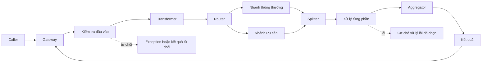

# Checklist review Spring Integration Core

## 1. Mục tiêu của buổi review

Một luồng chạy được với dữ liệu mẫu chưa chứng minh rằng luồng xử lý đúng khi message đến trễ, bị gửi lại, thiếu header hoặc gặp lỗi giữa chừng. Review Spring Integration Core cần trả lời được: message đi đâu, ai xử lý, chạy trên thread nào, khi nào tạo kết quả và ai chịu trách nhiệm nếu xử lý không hoàn tất.

Bài thực hành tổng hợp này thuộc phạm vi **SPRING_INTEGRATION_CORE**: Message, MessageChannel, endpoint, gateway, Java DSL, transformer, router, filter, aggregator, xử lý lỗi và kiểm thử các mẫu tích hợp doanh nghiệp. Checklist giúp chuyển kiến thức về từng thành phần thành bằng chứng có thể dùng khi review một thay đổi.

Sau bài học, người học cần có khả năng:

- Vẽ lại đường đi của message, reply và lỗi từ cấu hình thực tế.
- Giải thích ảnh hưởng của channel đến phân phối, thread, transaction và khả năng lưu đệm.
- Phát hiện nhánh làm mất reply, nhóm aggregator không thể hoàn thành và thao tác có thể bị thực hiện lặp.
- Chọn kiểm thử tương ứng với từng rủi ro thay vì chỉ kiểm tra kết quả thành công.
- Viết kết luận review có vị trí, tình huống tái hiện, tác động và điều kiện chấp nhận bản sửa.

Các ví dụ Java dùng `record`, cần Java 17 trở lên; phiên bản Java thực tế còn phải thỏa yêu cầu của bộ Spring mà dự án lựa chọn. Khi áp dụng, kiểm tra API và dependency theo BOM của dự án, đặc biệt với cấu hình retry giữa các thế hệ Spring. Bài học không yêu cầu nâng phiên bản hay kết nối broker bên ngoài.

## 2. Cách sử dụng checklist

Với mỗi mục, ghi một trong ba trạng thái:

| Trạng thái | Ý nghĩa | Bằng chứng phù hợp |
|---|---|---|
| PASS | Hành vi đã được giải thích và kiểm chứng | Cấu hình cụ thể, test có assertion, kết quả chạy hoặc số liệu |
| FAIL | Hành vi vi phạm hợp đồng hoặc chưa có cách xử lý tình huống bắt buộc | Input tái hiện, nhánh lỗi, tác động quan sát được |
| N/A | Không áp dụng cho luồng đang xét | Lý do gắn với thiết kế, chẳng hạn không có xử lý bất đồng bộ |

Không đánh dấu PASS chỉ vì tên một bean xuất hiện trong cấu hình. Ví dụ, có bean `errorChannel` chưa chứng minh rằng lỗi ở một handler đồng bộ sẽ được gửi đến bean đó.

Quy ước ưu tiên dùng riêng cho bài thực hành:

| Mức | Tình huống minh họa | Cách xử lý trong buổi review |
|---|---|---|
| P0 | Có thể tính tiền hai lần hoặc trộn dữ liệu của hai khách hàng | Chặn chấp nhận thay đổi và yêu cầu bằng chứng sửa |
| P1 | Luồng treo, mất message, thiếu reply hoặc không phục hồi được theo yêu cầu | Sửa trước khi chấp nhận thay đổi |
| P2 | Khó chẩn đoán, thiếu giới hạn tài nguyên hoặc thiếu test cho nhánh quan trọng | Xác định tác động và điều kiện khắc phục cụ thể |
| P3 | Tên endpoint khó hiểu, tài liệu chưa rõ | Góp ý gọn, không làm loãng lỗi hành vi |

Đây là quy ước review của bài học, không phải mức độ lỗi do Spring Integration định nghĩa. Mức thực tế phụ thuộc dữ liệu, tải và hợp đồng dịch vụ.

## 3. Chuẩn bị bản đồ luồng và hợp đồng

Trước khi đọc từng lời gọi DSL, yêu cầu tác giả mô tả một giao dịch nghiệp vụ cụ thể. Ví dụ: nhận yêu cầu đặt hàng, chuẩn hóa dữ liệu, chọn cách xử lý, xử lý từng dòng hàng và tổng hợp kết quả.



Sơ đồ biểu diễn quan hệ logic. Khi review cấu hình thực tế, bổ sung tên channel, loại channel và ranh giới thread; mũi tên sang nhánh lỗi không mặc nhiên đồng nghĩa với việc Spring tự publish mọi exception.

### Checklist hợp đồng

- [ ] Định nghĩa thành công: đã nhận yêu cầu, đã ghi bền vững hay đã hoàn tất nghiệp vụ.
- [ ] Phân biệt command cần xử lý với event thông báo một việc đã xảy ra.
- [ ] Ghi kiểu payload tại đầu vào, sau mỗi transformer và tại kết quả cuối.
- [ ] Xác định đầu vào không hợp lệ sẽ tạo exception, kết quả từ chối hay đi vào nơi lưu riêng.
- [ ] Xác định mỗi request cần một reply, nhiều reply hay không cần reply.
- [ ] Ghi thời hạn xử lý và hành vi khi không thể đáp ứng thời hạn.
- [ ] Xác định chính sách khi nhận lại cùng một yêu cầu nghiệp vụ.
- [ ] Liệt kê trạng thái còn tồn tại khi ứng dụng dừng hoặc khởi động lại.

Một hợp đồng đủ rõ có thể viết như sau: “Yêu cầu `order-42` có ba dòng hàng. Mỗi dòng phải có kết quả thành công hoặc từ chối. Chỉ trả kết quả hoàn tất khi có kết quả cho đủ ba dòng khác nhau. Việc gửi lại cùng khóa yêu cầu không được tạo thêm lần thanh toán.”

## 4. Review Message, payload và header

`Message<T>` bao gồm payload và headers. Cấu trúc header của message được thiết kế chỉ đọc, nhưng object làm payload hoặc giá trị header vẫn có thể mutable. Vì vậy, chia sẻ một message cho nhiều nhánh không tự tạo ra bản sao sâu của dữ liệu. Xem [Message](https://docs.spring.io/spring-integration/reference/message.html).

### Checklist

- [ ] Kiểu dữ liệu và đơn vị có nghĩa rõ ràng: tiền tệ, múi giờ, số lượng và mã định danh.
- [ ] Dữ liệu gửi qua nhiều nhánh không bị một nhánh sửa trực tiếp trong khi nhánh khác đang đọc.
- [ ] Phân biệt ID của message với khóa nghiệp vụ dùng chống xử lý trùng.
- [ ] Hợp đồng header ghi tên, kiểu, nơi tạo và nơi sử dụng của từng header bắt buộc.
- [ ] Code thay đổi header tạo message phù hợp thay vì gọi `put()` trên `getHeaders()`.
- [ ] Khi tự dựng message mới, có quyết định rõ về header cần giữ, thay hoặc loại bỏ.
- [ ] Giới hạn kích thước dữ liệu và tránh mang theo object tài nguyên sống như connection hoặc request HTTP.

### Bảng hợp đồng header mẫu

| Header | Vai trò trong ví dụ đặt hàng | Câu hỏi review |
|---|---|---|
| `businessRequestId` | Khóa ổn định của yêu cầu nghiệp vụ | Có giữ nguyên khi retry hoặc gửi lại không? |
| `tenantId` | Phân vùng khách hàng | Có được xác thực và đưa vào khóa chống trùng không? |
| `businessTraceId` | Liên kết log trong bài thực hành | Có xuyên qua transformer và nhánh xử lý không? |
| `replyChannel` | Đường về của request–reply | Có bị ghi đè hoặc đi qua biên không hỗ trợ không? |
| `errorChannel` | Đích lỗi khi cơ chế đang dùng có hỗ trợ | Thành phần nào thực sự đọc header này? |
| `correlationId` | Gom các phần thuộc một lần tổng hợp | Có nhầm với khóa theo dõi nghiệp vụ không? |
| `sequenceNumber`, `sequenceSize` | Mô tả các phần của một sequence | Có còn đúng sau khi lọc hoặc chia nhánh không? |

Các tên `businessRequestId`, `tenantId`, `businessTraceId` là quy ước ứng dụng trong bài. Không giả định Spring tự tạo hoặc tự kiểm tra chúng.

Ví dụ suy luận: nếu producer tạo một message mới cho mỗi lần gửi lại, `MessageHeaders.ID` có thể thay đổi. Chống trùng thanh toán nên dựa trên khóa có nghĩa nghiệp vụ, chẳng hạn cặp `(tenantId, businessRequestId)`.

## 5. Review lựa chọn MessageChannel

Chọn channel là chọn ngữ nghĩa giao tiếp. `send()` thành công có thể chỉ có nghĩa message đã vào hàng đợi hoặc được giao cho executor; điều đó chưa đủ để kết luận nghiệp vụ đã hoàn thành. Các hành vi cơ bản được mô tả tại [Message Channel Implementations](https://docs.spring.io/spring-integration/reference/channel/implementations.html).

| Channel | Phân phối thông thường | Điểm cần nhận diện |
|---|---|---|
| `DirectChannel` | Một subscriber được chọn cho một lần dispatch | Handler chạy trên thread gửi |
| `QueueChannel` | Một consumer nhận mỗi message được lấy ra | Có bộ đệm; cần hoạt động receive/poll |
| `ExecutorChannel` | Giao cho handler qua executor | Thường tạo ranh giới thread |
| `PublishSubscribeChannel` | Gửi đến các subscriber | Có hoặc không có executor theo cấu hình |
| `RendezvousChannel` | Bàn giao trực tiếp giữa bên gửi và nhận | Không có chỗ lưu đệm; cần phối hợp thời gian |

### Checklist cấu hình phân phối

- [ ] Luồng cần cạnh tranh xử lý hay cần mọi nhánh nhận được message?
- [ ] Với nhiều subscriber, đã kiểm tra load balancing, failover và thứ tự cấu hình chưa?
- [ ] Có phụ thuộc nhầm vào `DirectChannel` để thực hiện broadcast không?
- [ ] Với publish–subscribe đồng bộ, lỗi ở một subscriber ảnh hưởng các subscriber còn lại thế nào?
- [ ] Với executor, chính sách từ chối task có thể làm caller chạy task hoặc nhận exception không?
- [ ] Thứ tự hoàn thành có còn được bảo đảm khi nhiều task hoặc consumer cùng xử lý không?

Không xem failover của dispatcher là cơ chế bảo đảm nghiệp vụ chỉ chạy một lần. Nếu handler đã tạo tác dụng phụ rồi mới lỗi, việc xử lý ở subscriber khác vẫn cần được phân tích. Đối chiếu các tùy chọn trong [Configuring Message Channels](https://docs.spring.io/spring-integration/reference/channel/configuration.html).

### Checklist giới hạn tài nguyên

- [ ] Queue có capacity hữu hạn được chọn theo kích thước message và khả năng xử lý.
- [ ] Khi queue đầy, bên gửi sẽ chờ bao lâu và xử lý thất bại thế nào?
- [ ] Executor có số thread, queue task và chính sách quá tải cụ thể.
- [ ] Có đo độ sâu hàng đợi hoặc thời gian chờ, thay vì chỉ đo thời gian chạy handler.
- [ ] Có kế hoạch cho trường hợp tốc độ đến liên tục lớn hơn tốc độ xử lý.

Ví dụ ước lượng do nhóm tự tính: nếu message giữ khoảng 40 KiB và backlog lên tới 25.000 message thì riêng phần dữ liệu đã xấp xỉ 977 MiB, chưa tính overhead object. “Chỉ dùng queue trong bộ nhớ” vẫn cần ngân sách bộ nhớ và giới hạn tải.

## 6. Review endpoint, poller và lifecycle

Endpoint kết nối logic xử lý với channel. Consumer của `SubscribableChannel` nhận message theo cơ chế đăng ký; consumer của `PollableChannel` cần polling. Đây là khác biệt nền tảng khi chuyển từ `DirectChannel` sang `QueueChannel`. Xem [Poller](https://docs.spring.io/spring-integration/reference/polling-consumer.html).

### Checklist endpoint

- [ ] Xác định endpoint nào nhận message, handler nào xử lý và output đi đâu.
- [ ] Service activator trả dữ liệu phù hợp khi hợp đồng yêu cầu reply.
- [ ] Trường hợp trả `null` hoặc `void` được xét riêng; dùng `requiresReply` khi cần phát hiện thiếu reply tại thành phần hỗ trợ.
- [ ] Endpoint có ID đủ ổn định để tra log, metrics và thay thế trong kiểm thử.
- [ ] Không có consumer vô tình đăng ký thêm vào channel point-to-point.
- [ ] Thứ tự khởi động, dừng và `autoStartup` phù hợp với tài nguyên phụ thuộc.

Vai trò endpoint và cơ chế nối handler với channel được giải thích trong [Message Endpoints](https://docs.spring.io/spring-integration/reference/endpoint.html).

### Checklist poller

- [ ] Consumer của queue có poller riêng hoặc poller mặc định hợp lệ.
- [ ] Chọn rõ fixed delay, fixed rate hay trigger theo nhu cầu.
- [ ] Ghi khoảng polling, `maxMessagesPerPoll`, receive timeout và executor nếu có.
- [ ] Kiểm tra một lượt poll có thể chiếm scheduler bao lâu khi downstream chậm.
- [ ] Lỗi khi poll và lỗi khi xử lý message đều có đường quan sát.
- [ ] Cấu hình transaction gắn với hoạt động cần bảo vệ, không suy từ tên poller.

Ví dụ cần phản biện: đổi input channel thành queue để giảm thời gian chờ của producer nhưng giữ nguyên cấu hình consumer. Review phải kiểm tra cả poller, lỗi ở thread mới, backlog và điều kiện trả reply.

## 7. Review transformer, filter và router

### 7.1. Transformer: hợp đồng dữ liệu có được giữ đúng không?

- [ ] Ghi rõ kiểu input và output của từng phép biến đổi.
- [ ] Kiểm tra dữ liệu rỗng, sai định dạng, thiếu trường và giá trị biên.
- [ ] Chuẩn hóa chuỗi, tiền tệ và thời gian theo quy tắc xác định.
- [ ] Không làm mất thông tin cần cho chẩn đoán và hợp đồng downstream.
- [ ] Không che giấu thao tác thanh toán hoặc ghi dữ liệu trong một transformer tưởng như chỉ đổi định dạng.
- [ ] Có test cho dữ liệu gây lỗi, bên cạnh mẫu hợp lệ.

Transformer là điểm thích hợp để tách mô hình dữ liệu giữa producer và consumer. Khi trả hẳn một `Message` mới, cần kiểm tra chính sách header của phép biến đổi. Tham khảo [Transformer](https://docs.spring.io/spring-integration/reference/transformer.html).

### 7.2. Filter: message bị loại sẽ được xử lý thế nào?

- [ ] Predicate mô tả một quyết định rõ ràng, không trộn nhiều tác dụng phụ.
- [ ] Biết rõ rejected message bị bỏ, chuyển sang discard channel hay làm phát sinh exception.
- [ ] Nếu dùng discard channel, có consumer và cách theo dõi phù hợp.
- [ ] Nếu request cần reply, nhánh từ chối có hành vi kết thúc rõ ràng.
- [ ] Test chứng minh message bị loại không đi đến thao tác nghiệp vụ cần ngăn chặn.

Filter có thể loại message mà không tạo lỗi nếu dùng cấu hình mặc định tương ứng. Với request–reply, điều này có thể biến dữ liệu không hợp lệ thành tình huống chờ thiếu reply. `throwExceptionOnRejection(true)` là một lựa chọn khi hợp đồng yêu cầu báo lỗi. Xem [Filter](https://docs.spring.io/spring-integration/reference/filter.html).

### 7.3. Router: mọi giá trị định tuyến đã có kết quả xác định chưa?

- [ ] Có bảng ánh xạ giá trị nghiệp vụ sang channel hoặc subflow.
- [ ] Xử lý giá trị chưa biết, thiếu header và thay đổi chữ hoa/chữ thường.
- [ ] Hiểu tác động của `resolutionRequired`, `channelKeyFallback` và default output khi được sử dụng.
- [ ] Không để dữ liệu người dùng tự chọn tên channel nội bộ ngoài ý định thiết kế.
- [ ] Mỗi nhánh đáp ứng đúng số lượng reply mà caller mong đợi.
- [ ] Router nhiều đích có chính sách khi một đích gửi thất bại.

Default output và khả năng resolve channel là những quyết định riêng cần đọc từ cấu hình. Đối chiếu [Common Router Parameters](https://docs.spring.io/spring-integration/reference/router/common-parameters.html) và [RouterSpec](https://docs.spring.io/spring-integration/api/org/springframework/integration/dsl/RouterSpec.html).

Ví dụ bảng kiểm thử định tuyến do ứng dụng quy định:

| Giá trị đầu vào | Sau chuẩn hóa | Kết quả mong đợi |
|---|---|---|
| `standard` | `STANDARD` | Nhánh thông thường |
| ` EXPRESS ` | `EXPRESS` | Nhánh ưu tiên |
| `VIP` | `VIP` | Báo lỗi không có mapping hoặc đi nhánh từ chối được thiết kế |
| `null` | Theo hợp đồng chuẩn hóa | Không được vô tình chọn một channel không liên quan |

## 8. Review gateway và vòng đời request–reply

Gateway che API messaging sau một interface nghiệp vụ. Review cần theo dõi được request đi vào đâu và reply quay lại bằng cách nào. Với luồng đồng bộ, timeout chờ reply không ngắt một handler đang chạy lâu trên chính thread gọi; với luồng bất đồng bộ, caller hết chờ cũng không tự hủy tác dụng phụ downstream. Xem [Messaging Gateways](https://docs.spring.io/spring-integration/reference/gateway.html).

### Checklist

- [ ] Kiểu trả về của method phù hợp với hợp đồng một chiều hoặc request–reply.
- [ ] Gateway được đăng ký qua cơ chế cấu hình hoặc scan phù hợp của ứng dụng.
- [ ] Request channel và đường về của reply được xác định.
- [ ] Phân biệt thời gian chờ gửi vào channel với thời gian chờ reply.
- [ ] Mọi nhánh filter/router/service activator đều có kết thúc phù hợp.
- [ ] Client gọi từ bên trong handler có timeout riêng khi cần giới hạn thời gian I/O.
- [ ] Có quyết định xử lý reply đến sau khi caller đã hết chờ.
- [ ] Hợp đồng caller phân biệt được từ chối nghiệp vụ, lỗi xử lý và không nhận được kết quả đúng hạn.

Một nhận xét review cụ thể: “Gateway cần kết quả nhưng nhánh `VIP` không tạo reply. Hãy thêm kết quả từ chối hoặc exception theo hợp đồng và bổ sung test cho `VIP`.” Nhận xét “hãy thêm timeout” chưa giải quyết được nhánh thiếu kết quả.

## 9. Review splitter và aggregator

### 9.1. Xác định đúng số phần cần thu thập

Splitter tạo nhiều message từ một đầu vào, thường kèm các header sequence. Với nguồn không biết trước kích thước, cần kiểm tra cách xác định kết thúc phù hợp; không mặc định mọi trường hợp đều có tổng số phần dùng được. Xem [Splitter](https://docs.spring.io/spring-integration/reference/splitter.html).

- [ ] Mỗi phần có danh tính nghiệp vụ để nhận ra phần nào bị lặp.
- [ ] Đầu vào rỗng có kết quả được định nghĩa.
- [ ] Sau splitter, một phần bị loại vẫn được tính đến trong điều kiện hoàn thành.
- [ ] Phân biệt thứ tự đến, thứ tự hoàn thành và thứ tự cần trong kết quả.
- [ ] Nếu cần resequencer, có quy tắc cho phần thiếu và thời hạn chờ.

Giả sử tách ba dòng `A`, `B`, `C`, sau đó filter bỏ `B`. Nếu aggregator vẫn đợi đủ ba phần thì nhóm không hoàn thành bình thường. Một lựa chọn là chuyển mỗi dòng thành `LineResult` thành công hoặc từ chối, để cả ba dòng đều có kết quả. Lựa chọn khác là lọc trước khi tách nếu hợp đồng cho phép. Cách sửa phải giữ đúng nghĩa nghiệp vụ.

### 9.2. Tách ba trách nhiệm của aggregator

| Trách nhiệm | Câu hỏi phải trả lời | Ví dụ trong bài |
|---|---|---|
| Correlation | Message nào thuộc cùng nhóm? | Cùng tenant và cùng lần xử lý đơn hàng |
| Release | Khi nào được phép kết thúc nhóm? | Đủ kết quả cho các dòng khác nhau được mong đợi |
| Aggregation | Tạo output như thế nào? | Tạo kết quả tổng hợp có trạng thái từng dòng |

Không chọn correlation chỉ theo `customerId` nếu một khách hàng có thể gửi nhiều đơn đồng thời. Không dùng `group.size() == 3` để thay cho yêu cầu “đủ ba dòng khác nhau” nếu đầu vào có thể gửi lặp.

### Checklist aggregator

- [ ] Correlation tách được tenant, nghiệp vụ và lần xử lý cần phân biệt.
- [ ] Release strategy phù hợp metadata thực tế của message.
- [ ] Nếu dựa vào sequence, header vẫn còn đúng sau các bước trung gian.
- [ ] Với publish–subscribe hoặc recipient list đi vào aggregator, đã xem cấu hình tạo sequence cần thiết.
- [ ] Có chính sách với duplicate, phần lỗi, phần thiếu và phần đến trễ.
- [ ] Có quyết định khi hết hạn: kết quả một phần, từ chối hay chuyển nơi xử lý riêng.
- [ ] Phân biệt thời gian không có message mới với hạn tổng tính từ lúc bắt đầu nhóm.
- [ ] Có chính sách giữ hoặc xóa metadata nhóm hoàn tất.

`groupTimeout` dạng khoảng thời gian thông thường được lập lại khi message mới tới; không nên đọc nó như một hạn tổng tuyệt đối của yêu cầu. Việc xóa nhóm còn ảnh hưởng cách xử lý message đến trễ với cùng correlation. Đối chiếu [Aggregator](https://docs.spring.io/spring-integration/reference/aggregator.html).

### Checklist lưu trữ và phục hồi

- [ ] Store đáp ứng yêu cầu còn dữ liệu sau restart.
- [ ] Payload và header có thể lưu bằng cơ chế serialization được chọn.
- [ ] Nhiều instance có chiến lược phân phối cùng nhóm và phối hợp truy cập phù hợp.
- [ ] Có cách xử lý nhóm cũ sau restart và dọn metadata theo thời hạn.
- [ ] Test cho thấy kết quả đã phát và tác dụng phụ không bị lặp ngoài hợp đồng khi phục hồi.

Persistent store bảo vệ phần trạng thái được lưu; cần review thêm transaction, khóa và thời điểm phát output để đánh giá luồng hoàn chỉnh. Tham khảo [Message Store](https://docs.spring.io/spring-integration/reference/message-store.html).

### Bộ dữ liệu thực hành cho aggregator

| Tình huống | Thứ tự nhận | Điều cần chứng minh |
|---|---|---|
| Bình thường | `A, B, C` | Một kết quả đầy đủ |
| Đảo thứ tự | `C, A, B` | Nội dung kết quả vẫn đúng |
| Trùng dòng | `A, A, B` | Không bị hiểu nhầm là đã đủ `A, B, C` |
| Thiếu dòng | `A, C` | Hết hạn theo chính sách, có thể quan sát |
| Đến trễ | `A, C`, hết hạn, rồi `B` | Không phát sinh kết quả đầy đủ giả |
| Hai đơn đồng thời | `A1, A2, B1, B2` | Không trộn hai nhóm |
| Restart giữa chừng | Nhận `A`, dừng, nhận `B, C` | Hành vi đúng với yêu cầu phục hồi đã công bố |

## 10. Review lỗi, retry và phục hồi

### 10.1. Truy nguyên lỗi theo thread

| Nguồn lỗi | Đường truyền cần kiểm tra |
|---|---|
| Handler chạy đồng bộ qua direct channel | Exception có thể quay về caller theo call stack |
| Polling task | Error handler của poller/scheduler và nơi nhận lỗi |
| Xử lý qua executor | Cơ chế publish lỗi hoặc error handler được cấu hình |
| Gateway có cấu hình error channel | Error flow và tác động lên kết quả trả về |

Khi cơ chế publish lỗi được dùng, lỗi được biểu diễn bằng `ErrorMessage`; framework có thể xét header `errorChannel` rồi đến channel lỗi mặc định. Không suy rộng hành vi này sang mọi exception do code tự chạy. Xem [Error Handling](https://docs.spring.io/spring-integration/reference/error-handling.html).

### Checklist lỗi

- [ ] Test thực sự gây lỗi tại handler quan trọng.
- [ ] Lỗi đồng bộ và bất đồng bộ được kiểm chứng bằng cách quan sát tương ứng.
- [ ] Có liên kết lỗi với request nghiệp vụ và endpoint thất bại.
- [ ] Error flow không làm mất dấu thất bại khi chỉ ghi log rồi kết thúc.
- [ ] Lỗi xảy ra ngay trong error flow có cách phát hiện.
- [ ] Không biến mọi lỗi thành kết quả thành công có dữ liệu rỗng.
- [ ] Dữ liệu đưa vào log hoặc nơi lưu lỗi được giới hạn và che thông tin nhạy cảm.

### 10.2. Retry đúng đối tượng và đúng phạm vi

| Loại tình huống | Quyết định cần review | Bằng chứng |
|---|---|---|
| Mất kết nối tạm thời trước khi xử lý | Có thể retry theo chính sách | Số lần thử, khoảng chờ và giới hạn |
| Dữ liệu không hợp lệ | Thường kết thúc bằng từ chối | Không lặp lại cùng dữ liệu vô ích |
| Timeout sau khi gửi yêu cầu thanh toán | Chưa biết bên kia đã thành công hay chưa | Khóa idempotency hoặc cơ chế truy vấn đối soát |
| Hết lượt retry | Chuyển phục hồi đã định nghĩa | Bản ghi lỗi, hàng chờ riêng hoặc tác vụ xử lý lại |

- [ ] Advice bao quanh đúng endpoint hoặc thao tác cần thử lại.
- [ ] Kiểm tra retry có chạy lại downstream hay tác dụng phụ khác ngoài ý định không.
- [ ] Chọn số lần, backoff và loại exception phù hợp.
- [ ] Tính cả thời gian I/O và khoảng chờ vào ngân sách xử lý.
- [ ] Không nhân số lần thử ngoài ý muốn giữa client, handler và cơ chế redelivery nguồn.
- [ ] Cách phục hồi sau hết lượt có chủ sở hữu và điều kiện thử lại.

Spring Integration cung cấp các lớp advice cho retry và một số chính sách xử lý khác. API cụ thể phải khớp với phiên bản đang dùng; tham khảo [Provided Advice Classes](https://docs.spring.io/spring-integration/reference/handler-advice/classes.html).

## 11. Review transaction, idempotency và ranh giới bền vững

### Transaction

- [ ] Đánh dấu trên sơ đồ nơi bắt đầu và kết thúc transaction.
- [ ] Liệt kê resource tham gia transaction thực tế.
- [ ] Khi đổi thread, phân tích transaction mới và quyền sở hữu dữ liệu tại bên nhận.
- [ ] Kiểm thử rollback ở điểm đã có cập nhật trước đó.
- [ ] Phân biệt rollback database với khả năng hoàn tác một lời gọi dịch vụ ngoài.

`DirectChannel` cho phép tiếp tục call stack và transaction theo thread đang có; bản thân nó không tự mở transaction. Qua queue hoặc executor, không mặc định transaction của caller đi theo message. Xem [Transaction Support](https://docs.spring.io/spring-integration/reference/transactions.html).

### Idempotency

- [ ] Khóa chống trùng ổn định qua retry, restart và gửi lại.
- [ ] Khóa phân biệt đúng tenant và thao tác nghiệp vụ.
- [ ] Hai request trùng đến đồng thời không cùng vượt qua bước kiểm tra.
- [ ] Việc ghi dấu đã xử lý và tác dụng phụ có quan hệ nhất quán được giải thích.
- [ ] Kết quả trả lại cho request trùng tuân thủ hợp đồng.
- [ ] Thời gian giữ dấu chống trùng phù hợp cửa sổ gửi lại.

`IdempotentReceiverInterceptor` hỗ trợ mẫu Idempotent Receiver, nhưng người thiết kế vẫn phải xác định khóa và cách xử lý duplicate. Có interceptor không tự chứng minh hiệu ứng nghiệp vụ chỉ xảy ra một lần. Tham khảo [Idempotent Receiver](https://docs.spring.io/spring-integration/reference/handler-advice/idempotent-receiver.html).

### Tình huống cần tự phân tích

Luồng ghi đơn hàng vào database rồi gọi hệ thống vận chuyển. Database rollback không bảo đảm yêu cầu vận chuyển đã được hủy. Ngược lại, ghi dấu chống trùng trước khi gọi nhưng process dừng ngay sau đó có thể khiến lần gửi lại bị bỏ qua dù chưa tạo vận đơn.

Reviewer cần chỉ ra cửa sổ thất bại cụ thể. Tùy hợp đồng, nhóm có thể dùng transaction trong cùng resource, outbox, khóa idempotency của dịch vụ đích hoặc đối soát trạng thái. Không chấp nhận một câu “đã thêm retry” làm bằng chứng cho tính nhất quán.

## 12. Ví dụ Java DSL để thực hành review

Ví dụ dưới đây tạo luồng nhỏ: kiểm tra đơn hàng, chuẩn hóa service level, chọn một trong hai nhánh và trả kết quả. Các nhánh chỉ tạo object kết quả, không có thao tác I/O. Mục tiêu là quan sát cấu hình và hợp đồng; các tiêu chí aggregator, retry và lưu bền vững được thực hành riêng.

Java DSL tạo các thành phần Spring Integration và đăng ký chúng qua bean `IntegrationFlow`; DSL không tự bổ sung chính sách nghiệp vụ bị thiếu. Tham khảo [Java DSL](https://docs.spring.io/spring-integration/reference/dsl.html).

Giả sử đặt cấu hình trong package `example.review`, với dependency `spring-integration-core` phù hợp bộ Spring của dự án:

```java
package example.review;

import java.util.Locale;

import org.springframework.context.annotation.Bean;
import org.springframework.context.annotation.Configuration;
import org.springframework.integration.channel.DirectChannel;
import org.springframework.integration.config.EnableIntegration;
import org.springframework.integration.dsl.IntegrationFlow;

@Configuration(proxyBeanMethods = false)
@EnableIntegration
public class OrderReviewConfiguration {

    public record OrderCommand(
            String orderId, int quantity, String serviceLevel) {
    }

    public record OrderResult(String orderId, String selectedRoute) {
    }

    @Bean
    public DirectChannel reviewOrdersIn() {
        return new DirectChannel();
    }

    @Bean
    public DirectChannel reviewStandard() {
        return new DirectChannel();
    }

    @Bean
    public DirectChannel reviewExpress() {
        return new DirectChannel();
    }

    @Bean
    public IntegrationFlow reviewOrdersFlow() {
        return IntegrationFlow.from("reviewOrdersIn")
                .filter(OrderCommand.class,
                        command -> command.orderId() != null
                                && !command.orderId().isBlank()
                                && command.quantity() > 0,
                        endpoint -> endpoint
                                .id("review.validateOrder")
                                .throwExceptionOnRejection(true))
                .transform(OrderCommand.class,
                        command -> new OrderCommand(
                                command.orderId().trim(),
                                command.quantity(),
                                normalize(command.serviceLevel())),
                        endpoint -> endpoint.id("review.normalizeOrder"))
                .<OrderCommand, String>route(OrderCommand::serviceLevel,
                        router -> router
                                .id("review.selectRoute")
                                .channelKeyFallback(false)
                                .resolutionRequired(true)
                                .channelMapping("STANDARD", "reviewStandard")
                                .channelMapping("EXPRESS", "reviewExpress"))
                .get();
    }

    @Bean
    public IntegrationFlow reviewStandardFlow() {
        return IntegrationFlow.from("reviewStandard")
                .handle(OrderCommand.class,
                        (command, headers) -> new OrderResult(
                                command.orderId(), "STANDARD"),
                        endpoint -> endpoint.id("review.standardResult"))
                .get();
    }

    @Bean
    public IntegrationFlow reviewExpressFlow() {
        return IntegrationFlow.from("reviewExpress")
                .handle(OrderCommand.class,
                        (command, headers) -> new OrderResult(
                                command.orderId(), "EXPRESS"),
                        endpoint -> endpoint.id("review.expressResult"))
                .get();
    }

    private static String normalize(String value) {
        return value == null ? "" : value.trim().toUpperCase(Locale.ROOT);
    }
}
```

### Những kết luận cần rút ra từ cấu hình

1. Các channel đều là direct channel nên ví dụ này xử lý đồng bộ trên thread gửi.
2. Số lượng không dương hoặc mã đơn trống làm filter phát sinh lỗi; nhánh này không chờ một reply không tồn tại.
3. `standard` được chuẩn hóa thành `STANDARD` trước khi định tuyến.
4. Mapping chỉ cho phép hai giá trị đã chọn; `channelKeyFallback(false)` ngăn dùng key lạ như tên channel.
5. Không có default output, nên trường hợp không tìm được đích được xem là lỗi của ví dụ.
6. Handler trả `OrderResult`; đường về request–reply được cung cấp bởi thành phần gọi, chẳng hạn `MessagingTemplate` trong kiểm thử tiếp theo.

Không suy ra từ ví dụ rằng đơn đã được ghi bền vững hoặc đã chống trùng. Để chuyển thành luồng nghiệp vụ thực, phải định nghĩa thêm những hợp đồng đó.

## 13. Kiểm thử hành vi của ví dụ

Đoạn kiểm thử dùng JUnit Jupiter và Spring Test (`spring-test`), cùng `spring-integration-core` của ví dụ. Với dự án dùng Spring Boot, bộ dependency kiểm thử tương ứng thường được quản lý qua BOM của dự án. Các đoạn code là tài liệu thực hành để tích hợp và chạy trong môi trường phù hợp.

```java
package example.review;

import org.junit.jupiter.api.Test;
import org.springframework.beans.factory.annotation.Autowired;
import org.springframework.beans.factory.annotation.Qualifier;
import org.springframework.integration.core.MessagingTemplate;
import org.springframework.messaging.Message;
import org.springframework.messaging.MessageChannel;
import org.springframework.messaging.MessagingException;
import org.springframework.messaging.support.MessageBuilder;
import org.springframework.test.context.junit.jupiter.SpringJUnitConfig;

import example.review.OrderReviewConfiguration.OrderCommand;
import example.review.OrderReviewConfiguration.OrderResult;

import static org.junit.jupiter.api.Assertions.assertEquals;
import static org.junit.jupiter.api.Assertions.assertNotNull;
import static org.junit.jupiter.api.Assertions.assertThrows;

@SpringJUnitConfig(OrderReviewConfiguration.class)
class OrderReviewFlowTest {

    @Autowired
    @Qualifier("reviewOrdersIn")
    MessageChannel input;

    private final MessagingTemplate template = template();

    private static MessagingTemplate template() {
        MessagingTemplate value = new MessagingTemplate();
        value.setSendTimeout(500);
        value.setReceiveTimeout(500);
        return value;
    }

    @Test
    void normalizesPayloadAndPreservesBusinessTrace() {
        Message<?> request = MessageBuilder
                .withPayload(new OrderCommand(" order-42 ", 2, "standard"))
                .setHeader("businessTraceId", "trace-42")
                .build();

        Message<?> reply = template.sendAndReceive(input, request);

        assertNotNull(reply);
        assertEquals(new OrderResult("order-42", "STANDARD"),
                reply.getPayload());
        assertEquals("trace-42",
                reply.getHeaders().get("businessTraceId"));
    }

    @Test
    void selectsExpressRoute() {
        Message<?> request = MessageBuilder
                .withPayload(new OrderCommand("order-43", 1, " EXPRESS "))
                .build();

        Message<?> reply = template.sendAndReceive(input, request);

        assertNotNull(reply);
        assertEquals(new OrderResult("order-43", "EXPRESS"),
                reply.getPayload());
    }

    @Test
    void rejectsNonPositiveQuantity() {
        Message<?> request = MessageBuilder
                .withPayload(new OrderCommand("order-44", 0, "STANDARD"))
                .build();

        assertThrows(MessagingException.class,
                () -> template.sendAndReceive(input, request));
    }

    @Test
    void failsForUnknownRoute() {
        Message<?> request = MessageBuilder
                .withPayload(new OrderCommand("order-45", 1, "VIP"))
                .build();

        assertThrows(MessagingException.class,
                () -> template.sendAndReceive(input, request));
    }
}
```

Các test kiểm tra output, header ứng dụng, nhánh ưu tiên và hai đường lỗi. Trong dự án thực, assertion lỗi nên kiểm tra thêm loại hoặc nguyên nhân cần thiết theo hợp đồng, tránh một lỗi cấu hình không liên quan cũng làm test được xem là đạt.

Timeout của template trong đoạn này chỉ giới hạn các hoạt động gửi/nhận có hỗ trợ chờ; nó không ngắt một handler direct đang chạy lâu.

### Checklist kiểm thử rộng hơn

- [ ] Test logic thuần của transformer, predicate và hàm chọn khóa.
- [ ] Test wiring với Spring context để phát hiện channel hoặc endpoint cấu hình sai.
- [ ] Test qua gateway thật nếu muốn chứng minh hợp đồng của gateway.
- [ ] Test tác dụng phụ để chứng minh nhánh bị từ chối không gọi dịch vụ đích.
- [ ] Test bất đồng bộ chờ điều kiện có hạn, không dùng `Thread.sleep()` như bằng chứng hoàn thành.
- [ ] Assertion cho lỗi xem đúng kênh lỗi hoặc kết quả caller tương ứng.
- [ ] Test có cách dọn queue, store và mock để không phụ thuộc thứ tự chạy.

Khi cần thay nguồn message hoặc handler, có thể dùng `@SpringIntegrationTest` và `MockIntegrationContext`; tên thay thế cần là endpoint tương ứng theo API. Xem [Testing support](https://docs.spring.io/spring-integration/reference/testing.html).

## 14. Ma trận kiểm thử khi review luồng tổng hợp

Ma trận sau là kế hoạch áp dụng cho luồng nghiệp vụ mở rộng, không phải các bảo đảm đã được bốn test minh họa chứng minh.

| Nhóm | Tình huống | Assertion có ý nghĩa |
|---|---|---|
| Hợp đồng | Input hợp lệ | Output đúng kiểu và đúng trạng thái nghiệp vụ |
| Dữ liệu | Thiếu ID hoặc quantity không hợp lệ | Từ chối theo hợp đồng; không tạo tác dụng phụ |
| Header | Đi qua transformer và branch | Header ứng dụng cần thiết vẫn đúng |
| Router | Key không có mapping | Lỗi hoặc kết quả từ chối đã định nghĩa |
| Gateway | Một nhánh không tạo reply | Không treo vô hạn; caller thấy kết quả đã quy định |
| Lỗi đồng bộ | Handler ném exception | Caller nhận lỗi phù hợp |
| Lỗi bất đồng bộ | Consumer lỗi sau khi producer gửi xong | Nhận lỗi tại cơ chế quan sát đã cấu hình |
| Tải | Queue hoặc executor đầy | Chờ, từ chối hoặc điều tiết đúng chính sách |
| Retry | Lỗi tạm thời rồi phục hồi | Số lần gọi và kết quả đúng chính sách |
| Retry hết lượt | Đích tiếp tục lỗi | Có trạng thái phục hồi và dữ liệu cần xử lý lại |
| Idempotency | Hai request trùng đồng thời | Tác dụng phụ đúng số lần cho phép |
| Aggregator | Phần bị lặp hoặc thiếu | Không release sai; hết hạn được xử lý |
| Correlation | Hai tenant có cùng ID đơn | Không trộn dữ liệu |
| Restart | Dừng khi còn backlog hoặc nhóm dang dở | Hành vi đúng với yêu cầu lưu bền vững |
| Thứ tự | Hoàn thành đảo thứ tự | Kết quả cuối đúng theo hợp đồng thứ tự |

Với kiểm thử tải hoặc restart, ghi môi trường, kích thước dữ liệu và thời điểm gây lỗi. Một assertion “không có exception” chưa chứng minh được không mất message hoặc không tạo tác dụng phụ lặp.

## 15. Review khả năng quan sát và vận hành

### Checklist quan sát

- [ ] Tên channel và endpoint giúp liên hệ cấu hình với log và metrics.
- [ ] Có số liệu về thành công, lỗi, bị loại và xử lý lại theo nhu cầu.
- [ ] Theo dõi thời gian chờ và thời gian xử lý riêng khi có backlog.
- [ ] Có thể tìm các nhóm aggregator đang mở, bị hết hạn và cần xử lý tiếp.
- [ ] Không dùng ID từng request làm nhãn metrics có số lượng giá trị tăng không giới hạn.
- [ ] Trace hoặc thông tin theo dõi ứng dụng được truyền qua ranh giới thread theo cơ chế đã chọn.
- [ ] Logging hoặc wire tap có chi phí và dữ liệu được kiểm soát.

Spring Integration có hỗ trợ Micrometer cho nhiều thành phần; sự hiện diện của số liệu framework không thay thế số liệu nghiệp vụ như số đơn đã thanh toán. Đối chiếu [Metrics and Management](https://docs.spring.io/spring-integration/reference/metrics.html).

### Checklist dừng và khởi động lại

- [ ] Dừng nhận công việc mới theo trình tự phù hợp trước khi dừng phần xử lý còn lại.
- [ ] Có giới hạn chờ để message đang xử lý hoàn tất.
- [ ] Biết điều gì xảy ra với task chưa chạy, queue và nhóm aggregator còn mở.
- [ ] Có hướng dẫn khôi phục hoặc đối soát sau khi process bị dừng đột ngột.
- [ ] Kiểm thử hành vi của từng adapter và executor được sử dụng.

Khả năng orderly shutdown phụ thuộc thành phần và cấu hình; không xem đó là bảo đảm rằng mọi queue trong bộ nhớ sẽ sống qua restart. Tham khảo [Orderly Shutdown](https://docs.spring.io/spring-integration/reference/shutdown.html).

## 16. Bài thực hành review một thay đổi có rủi ro

Một nhóm đề xuất thay đổi sau:

1. Gateway nhận đơn và trả `OrderResult`.
2. Đưa input vào queue không đặt capacity để caller ít phải chờ.
3. Splitter tách dòng hàng; filter bỏ dòng không hợp lệ.
4. Handler gọi thanh toán; timeout thì thử lại ba lần.
5. Aggregator gom theo `customerId`, release khi có ba message.
6. Chỉ ghi log khi lỗi; nhóm cho rằng queue sẽ giữ dữ liệu qua restart.

Hãy ghi từng phát hiện theo mẫu tình huống → tác động → điều kiện sửa.

| Phát hiện | Tình huống cụ thể | Điều kiện cần kiểm chứng sau sửa |
|---|---|---|
| Hợp đồng gateway chưa rõ | Request được nhận nhưng tổng hợp chưa xong | Tách rõ kết quả nhận việc với kết quả nghiệp vụ hoặc giữ reply cuối |
| Queue chưa có giới hạn | Đích chậm kéo dài | Capacity, chính sách quá tải và số liệu backlog |
| Thiếu phân tích poller | Channel được đổi từ direct sang queue | Consumer thực sự chạy và lỗi được quan sát |
| Filter làm thiếu phần | Một trong ba dòng bị bỏ | Tổng hợp vẫn có kết thúc đúng cho mọi dòng |
| Retry thanh toán có thể lặp | Bên đích đã thu tiền nhưng response bị mất | Idempotency hoặc cơ chế xác định trạng thái trước khi gọi lại |
| Correlation quá rộng | Một khách có hai đơn đồng thời | Hai nhóm tách biệt theo khóa phù hợp |
| Release theo số lượng thô | Nhận `A, A, B` | Không hiểu ba message là ba dòng khác nhau |
| Yêu cầu phục hồi chưa đáp ứng | Process dừng khi queue còn dữ liệu | Store bền vững hoặc hợp đồng chấp nhận mất dữ liệu được xác định |
| Log chưa đủ để xử lý lại | Retry hết lượt | Có dữ liệu, trạng thái và người phụ trách phục hồi |

Ví dụ nhận xét hoàn chỉnh:

> **P1 — Nhóm tổng hợp có thể không hoàn thành khi một dòng bị filter loại.** Đơn có ba dòng tạo sequence size bằng ba, nhưng chỉ hai dòng tới aggregator. Theo cấu hình đang xét, nhóm không đủ điều kiện release. Cần giữ kết quả từ chối cho dòng lỗi hoặc thay đổi vị trí lọc theo hợp đồng; thêm test với một dòng không hợp lệ và xác nhận một kết quả cuối có đầy đủ trạng thái các dòng.

Mức P1 ở đây dựa trên giả định luồng cần trả kết quả hoàn tất cho caller. Nếu yêu cầu là thanh toán và có thể tính tiền hai lần, cần đánh giá mức nghiêm trọng riêng cho tác dụng phụ đó.

## 17. Mẫu biên bản review

```text
Luồng / thay đổi:
Phiên bản Spring và Java:
Hợp đồng đầu vào, đầu ra:
Ý nghĩa thành công:

Đường đi của message:
Ranh giới thread:
Ranh giới transaction:
Trạng thái cần lưu qua restart:

Phát hiện:
- Mức ưu tiên:
- Endpoint / channel liên quan:
- Input hoặc điều kiện tái hiện:
- Hành vi hiện tại:
- Tác động lên hợp đồng:
- Hành vi cần đạt:
- Test hoặc bằng chứng chấp nhận bản sửa:

Checklist chưa áp dụng và lý do:
Rủi ro còn lại đã được thống nhất:
Kết luận: chấp nhận / cần sửa và kiểm tra lại
```

Một buổi review có thể kết thúc khi nhóm giải thích được mọi nhánh, các phát hiện chặn đã được xử lý, và test chứng minh những tình huống thất bại quan trọng. Trạng thái “đã review” cần gắn với phiên bản cấu hình cùng bằng chứng cụ thể.

## 18. Checklist rút gọn để dùng khi mở thay đổi

- [ ] Tôi có thể lần theo request, reply và lỗi từ cấu hình thực tế.
- [ ] Payload và header có hợp đồng; khóa nghiệp vụ được phân biệt với ID message.
- [ ] Channel đáp ứng đúng kiểu phân phối, thread và giới hạn tài nguyên.
- [ ] Queue có consumer/poller và chính sách quá tải rõ ràng.
- [ ] Transformer, filter và router đều có hành vi cho dữ liệu không hợp lệ.
- [ ] Gateway có kết thúc phù hợp ở mọi nhánh và timeout được hiểu đúng.
- [ ] Aggregator có correlation, release, timeout và chính sách duplicate/late message phù hợp.
- [ ] Lỗi được quan sát đúng cơ chế đồng bộ hoặc bất đồng bộ đang sử dụng.
- [ ] Retry, transaction và idempotency được kiểm chứng tại tác dụng phụ quan trọng.
- [ ] Yêu cầu restart, dọn trạng thái và shutdown có bằng chứng phù hợp.
- [ ] Test bao phủ hợp đồng thành công cùng các tình huống thất bại có tác động lớn.
- [ ] Kết luận review ghi rõ phần chưa chứng minh và điều kiện cần hoàn tất.
