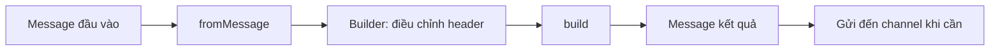
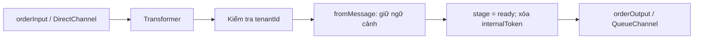

# MessageBuilder.fromMessage

## Mục tiêu và phạm vi

Trong module `SPRING_INTEGRATION_CORE`, `MessageBuilder.fromMessage(...)` giúp một bước xử lý tiếp tục luồng thông điệp với payload hiện có và metadata được điều chỉnh. Đây là thao tác thường gặp khi thêm thông tin phục vụ router, đánh dấu kết quả xử lý hoặc chuyển tiếp message mà vẫn giữ ngữ cảnh từ gateway.

Sau bài học, bạn có thể:

- Tạo builder từ một `Message<T>` và chọn cách cập nhật header phù hợp.
- Phân biệt giữ nguyên payload với tạo bản sao dữ liệu bên trong payload.
- Giải thích hành vi của `id`, `timestamp` và trường hợp builder trả lại message gốc.
- Dùng builder trong transformer của Java DSL, bảo toàn header cần thiết và kiểm thử kết quả.

Các ví dụ sử dụng `MessageBuilder` của **Spring Integration**:

```java
import org.springframework.integration.support.MessageBuilder;
import org.springframework.messaging.Message;
```

Spring Framework cũng có lớp `org.springframework.messaging.support.MessageBuilder`. Hai lớp có nhiều phương thức cùng tên nhưng là hai API khác nhau; các ví dụ dưới đây thống nhất dùng lớp thuộc Spring Integration. Khi IDE tự thêm import, hãy kiểm tra package trước khi dùng thêm API đặc thù. [Javadoc MessageBuilder của Spring Framework](https://docs.spring.io/spring-framework/docs/6.2.x/javadoc-api/org/springframework/messaging/support/MessageBuilder.html).

Bài dùng API của dòng Spring Integration 6.4 để minh họa, không yêu cầu thay đổi phiên bản dependency của dự án. Những nhận xét về tối ưu bên trong `build()` được đối chiếu với mã nguồn 6.4.9.

## 1. Từ một message đến builder

Chữ ký phương thức:

```java
public static <T> MessageBuilder<T> fromMessage(Message<T> message)
```

`T` là kiểu payload. Với đầu vào `Message<String>`, kết quả là `MessageBuilder<String>`. Bạn sửa metadata trên builder rồi gọi `build()` để lấy `Message<String>`.

Điểm khởi đầu của builder là payload và các header của message đầu vào. Phương thức không gửi dữ liệu đến channel và không gọi endpoint kế tiếp. Nó cũng không tự chạy quy tắc định tuyến, retry hay tổng hợp message. [Javadoc MessageBuilder của Spring Integration](https://docs.spring.io/spring-integration/docs/6.4.9/api/org/springframework/integration/support/MessageBuilder.html).



Lý do cần builder là cấu trúc header của message thông thường không hỗ trợ sửa trực tiếp:

```java
// Không hợp lệ với MessageHeaders thông thường:
input.getHeaders().put("stage", "validated");
```

Lệnh trên ném `UnsupportedOperationException`. Builder cung cấp vùng làm việc để tạo kết quả mà không sửa cấu trúc header của `input`. Tính bất biến của vỏ message không làm cho mọi đối tượng nằm bên trong nó trở thành bất biến. [Mô hình Message và MessageHeaders](https://docs.spring.io/spring-integration/reference/6.4/message.html).

## 2. Ví dụ: thêm trạng thái nhưng giữ ngữ cảnh

Giả sử hệ thống tiếp nhận mã đơn hàng. Sau khi kiểm tra hợp lệ, bạn muốn thêm header `stage` và loại bỏ thông tin tạm thời.

Đoạn mã sau đặt trong một phương thức; các ví dụ ngắn tiếp theo cũng sử dụng cách trình bày này.

```java
import org.springframework.integration.support.MessageBuilder;
import org.springframework.messaging.Message;

Message<String> input = MessageBuilder.withPayload("ORDER-2048")
        .setHeader("tenantId", "shop-hcm")
        .setHeader("traceId", "trace-2048")
        .setHeader("internalToken", "temporary-value")
        .build();

Message<String> output = MessageBuilder.fromMessage(input)
        .setHeader("stage", "validated")
        .removeHeader("internalToken")
        .build();

System.out.println(output.getPayload());                    // ORDER-2048
System.out.println(output.getHeaders().get("tenantId"));     // shop-hcm
System.out.println(output.getHeaders().get("traceId"));      // trace-2048
System.out.println(output.getHeaders().get("stage"));        // validated
System.out.println(output.getHeaders().get("internalToken"));// null

System.out.println(input.getHeaders().get("stage"));         // null
System.out.println(input.getHeaders().get("internalToken")); // temporary-value
System.out.println(input.getPayload() == output.getPayload());// true
```

Hợp đồng của bước xử lý này rất cụ thể:

| Thành phần | Trước xử lý | Sau xử lý |
| --- | --- | --- |
| Payload | `"ORDER-2048"` | Cùng đối tượng payload |
| `tenantId` | `shop-hcm` | Được giữ |
| `traceId` | `trace-2048` | Được giữ |
| `stage` | Chưa có | `validated` |
| `internalToken` | Có giá trị | Không còn trong kết quả |
| Header của `input` | Ngữ cảnh ban đầu | Không bị thao tác builder thay đổi |

Việc loại bỏ `internalToken` là quy tắc của ví dụ. Trong ứng dụng thực, danh sách header cần giữ hoặc loại bỏ phải xuất phát từ hợp đồng của bước tiếp theo.

## 3. Chọn phép cập nhật header

### 3.1. Ghi đè hoặc chỉ đặt mặc định

`setHeader(...)` thể hiện quyết định của bước hiện tại. `setHeaderIfAbsent(...)` thể hiện một giá trị dự phòng.

```java
Message<String> input = MessageBuilder.withPayload("ORDER-2048")
        .setHeader("region", "south")
        .build();

Message<String> output = MessageBuilder.fromMessage(input)
        .setHeaderIfAbsent("region", "unknown")
        .setHeaderIfAbsent("source", "order-api")
        .setHeader("stage", "validated")
        .build();

// region = south, source = order-api, stage = validated
```

Với header thông thường, `setHeader("name", null)` loại bỏ header `name`. Nếu mục đích là xóa rõ ràng, `removeHeader("name")` giúp người đọc hiểu ý định nhanh hơn.

### 3.2. Gộp một nhóm header

Có thể đưa cấu hình mặc định hoặc kết quả xử lý vào builder qua `Map`:

```java
import java.util.Map;

Message<String> defaultsApplied = MessageBuilder.fromMessage(input)
        .copyHeadersIfAbsent(Map.of(
                "region", "unknown",
                "schemaVersion", 1))
        .build();

Message<String> regionOverridden = MessageBuilder.fromMessage(input)
        .copyHeaders(Map.of("region", "central"))
        .build();

// defaultsApplied: region = south, schemaVersion = 1
// regionOverridden: region = central
```

`copyHeadersIfAbsent` giữ giá trị đã có. `copyHeaders` có thể ghi đè header thông thường. Thứ tự gọi cũng tạo ra khác biệt:

```java
Message<String> first = MessageBuilder.fromMessage(input)
        .setHeader("region", "north")
        .copyHeaders(Map.of("region", "central"))
        .build(); // region = central

Message<String> second = MessageBuilder.fromMessage(input)
        .copyHeaders(Map.of("region", "central"))
        .setHeader("region", "north")
        .build(); // region = north
```

Đặt phép cập nhật có quyền quyết định cuối cùng ở vị trí thể hiện rõ chính sách. Ví dụ, nếu cấu hình trung tâm chỉ cung cấp mặc định, dùng `copyHeadersIfAbsent` thay vì dựa vào thứ tự ghi đè.

### 3.3. Xóa một hoặc nhiều header

| Nhu cầu | API | Ví dụ |
| --- | --- | --- |
| Thêm hoặc thay một giá trị | `setHeader` | `setHeader("stage", "ready")` |
| Bổ sung giá trị còn thiếu | `setHeaderIfAbsent` | `setHeaderIfAbsent("source", "api")` |
| Gộp và cho phép ghi đè | `copyHeaders` | `copyHeaders(overrides)` |
| Gộp giá trị mặc định | `copyHeadersIfAbsent` | `copyHeadersIfAbsent(defaults)` |
| Xóa đúng một tên | `removeHeader` | `removeHeader("internalToken")` |
| Xóa theo mẫu tên đơn giản | `removeHeaders` | `removeHeaders("internal_*")` |

`removeHeaders` hỗ trợ các mẫu đơn giản như `prefix*`, `*suffix`, `*part*`; đây không phải API biểu thức chính quy. Quy tắc cập nhật trên áp dụng cho header có thể ghi; `id` và `timestamp` được framework quản lý. [API kế thừa trong BaseMessageBuilder](https://raw.githubusercontent.com/spring-projects/spring-integration/v6.4.9/spring-integration-core/src/main/java/org/springframework/integration/support/BaseMessageBuilder.java).

## 4. build(), message identity và thời điểm tạo

Không nên diễn giải `fromMessage(input).build()` thành “luôn cấp phát một message khác”.

Trong triển khai mặc định 6.4.9, `build()` có thể trả lại `originalMessage` khi builder chưa bị thay đổi và không cần loại bỏ header theo cấu hình read-only bổ sung. Vì vậy:

```java
Message<String> input = MessageBuilder.withPayload("ORDER-2048").build();

Message<String> unchanged = MessageBuilder.fromMessage(input).build();

// Với builder mặc định trong phạm vi minh họa:
System.out.println(unchanged == input); // true

Message<String> changed = MessageBuilder.fromMessage(input)
        .setHeader("stage", "validated")
        .build();

System.out.println(changed == input);   // false
```

Đây là tối ưu của triển khai đã nêu. Hợp đồng nghiệp vụ nên kiểm tra payload và header mong muốn, thay vì yêu cầu một object mới trong mọi trường hợp. [Nhánh trả lại originalMessage trong build()](https://raw.githubusercontent.com/spring-projects/spring-integration/v6.4.9/spring-integration-core/src/main/java/org/springframework/integration/support/BaseMessageBuilder.java#L276-L296).

Khi builder thực sự tạo message mới theo cơ chế mặc định, `id` và `timestamp` do framework sinh lại. Khi nhận lại chính message cũ, chúng vẫn thuộc message cũ. Hai message tạo gần nhau có thể có cùng giá trị timestamp tính bằng mili giây; đừng dùng điều kiện `timestamp mới > timestamp cũ` để chứng minh đã tạo message mới. [Message ID và các header chỉ đọc](https://docs.spring.io/spring-integration/reference/message.html).

```java
import org.springframework.messaging.MessageHeaders;

Message<String> input = MessageBuilder.withPayload("ORDER-2048")
        .setHeader("orderId", "ORDER-2048")
        .setHeader("traceId", "trace-2048")
        .build();

Message<String> output = MessageBuilder.fromMessage(input)
        .setHeader("stage", "validated")
        .build();

System.out.println(input.getHeaders().getId());
System.out.println(output.getHeaders().getId()); // id mới với cấu hình mặc định
System.out.println(output.getHeaders().get("orderId")); // ORDER-2048
System.out.println(output.getHeaders().get("traceId")); // trace-2048

// Không dùng setHeader(MessageHeaders.ID, ...) để giữ id cũ.
// Không dùng setHeader(MessageHeaders.TIMESTAMP, ...) để đặt thời gian nghiệp vụ.
```

Trong thiết kế đơn hàng của ví dụ:

- `orderId` nhận diện đơn hàng qua nhiều bước.
- `traceId` nối các bước của một lần xử lý theo quy ước ứng dụng.
- `MessageHeaders.ID` nhận diện message do framework tạo.
- Một header như `receivedAt` có thể lưu thời điểm nghiệp vụ cần bảo toàn.

Bạn có thể dùng khóa nghiệp vụ làm đầu vào cho cơ chế chống xử lý lặp. Chỉ sao chép `orderId` không tự tạo ra cơ chế đó.

## 5. Sao chép nông: payload và giá trị header vẫn có thể dùng chung

Mã nguồn `fromMessage` truyền trực tiếp `message.getPayload()` cho builder. Nó không gọi clone, không tuần tự hóa rồi giải tuần tự hóa payload. Đầu vào `null` cũng bị từ chối. [Triển khai fromMessage](https://raw.githubusercontent.com/spring-projects/spring-integration/v6.4.9/spring-integration-core/src/main/java/org/springframework/integration/support/MessageBuilder.java).

Xét payload và một header đều là danh sách có thể thay đổi:

```java
import java.util.ArrayList;
import java.util.List;
import org.springframework.integration.support.MessageBuilder;
import org.springframework.messaging.Message;

List<String> items = new ArrayList<>(List.of("book"));
List<String> tags = new ArrayList<>(List.of("new"));

Message<List<String>> input = MessageBuilder.withPayload(items)
        .setHeader("tags", tags)
        .build();

Message<List<String>> output = MessageBuilder.fromMessage(input)
        .setHeader("stage", "checked")
        .build();

items.add("pen");
tags.add("reviewed");

System.out.println(output.getPayload());          // [book, pen]
System.out.println(output.getHeaders().get("tags"));// [new, reviewed]
System.out.println(input.getPayload() == output.getPayload()); // true
System.out.println(input.getHeaders().get("tags")
        == output.getHeaders().get("tags"));      // true
```

Builder tách thao tác chỉnh cấu trúc header khỏi message nguồn; nó không tách tất cả đối tượng được tham chiếu. Nếu hai nhánh của luồng cùng sử dụng `items`, việc một nhánh sửa danh sách có thể làm thay đổi dữ liệu mà nhánh kia quan sát.

Với ví dụ danh sách chuỗi, có thể chủ động tạo dữ liệu bất biến:

```java
Message<List<String>> isolated = MessageBuilder
        .withPayload(List.copyOf(input.getPayload()))
        .copyHeaders(input.getHeaders())
        .setHeader("tags", List.copyOf(tags))
        .setHeader("stage", "isolated")
        .build();
```

`List.copyOf` tạo danh sách không cho sửa cấu trúc, nhưng không sao chép sâu từng phần tử. Ví dụ trên phù hợp vì phần tử là `String`. Nếu phần tử là đối tượng nghiệp vụ có thể thay đổi, bạn vẫn cần cách sao chép hoặc mô hình bất biến phù hợp.

Tạo builder cục bộ cho mỗi lần xử lý giúp tránh chia sẻ trạng thái làm việc giữa nhiều message. Nếu không còn sử dụng payload dạng stream sau một lần đọc, bọc cùng stream bằng `fromMessage` cũng không làm stream tự đọc lại được.

## 6. Khi cần thay payload

`fromMessage` phù hợp khi tiếp tục dùng payload hiện tại. Nếu cần đổi giá trị hoặc kiểu payload, bắt đầu bằng `withPayload(newPayload)`, sau đó chọn header cần kế thừa.

Ví dụ chuyển danh sách mã sản phẩm thành chuỗi:

```java
import java.util.List;
import org.springframework.integration.support.MessageBuilder;
import org.springframework.messaging.Message;
import org.springframework.messaging.MessageHeaders;
import org.springframework.util.MimeTypeUtils;

Message<List<String>> input = MessageBuilder
        .withPayload(List.of("SKU-01", "SKU-02"))
        .setHeader("traceId", "trace-2048")
        .setHeader("schemaVersion", 1)
        .setHeader(MessageHeaders.CONTENT_TYPE, MimeTypeUtils.APPLICATION_JSON)
        .build();

String newPayload = String.join(",", input.getPayload());

Message<String> output = MessageBuilder.withPayload(newPayload)
        .copyHeaders(input.getHeaders())
        .setHeader(MessageHeaders.CONTENT_TYPE, MimeTypeUtils.TEXT_PLAIN)
        .setHeader("schemaVersion", 2)
        .build();

// Payload: SKU-01,SKU-02
// traceId được giữ; contentType và schemaVersion khớp dạng dữ liệu mới.
```

Ví dụ này đổi kiểu từ `Message<List<String>>` sang `Message<String>` một cách tường minh. Nó cũng cho thấy vì sao kế thừa header cần đi cùng việc kiểm tra ý nghĩa: `contentType` mô tả dạng payload, còn `schemaVersion` trong ví dụ mô tả hợp đồng dữ liệu.

Nếu payload mới biểu diễn một sự kiện nghiệp vụ độc lập, hãy xác định lại danh sách header thay vì mặc định mang toàn bộ ngữ cảnh của yêu cầu trước đó sang sự kiện mới. Các phương thức copy không thay thế được quyết định thiết kế đó.

| Tình huống | Cách bắt đầu |
| --- | --- |
| Cùng payload, thêm kết quả kiểm tra | `fromMessage(input)` |
| Cùng payload, xóa header tạm | `fromMessage(input)` |
| Chuẩn hóa payload thành một giá trị khác | `withPayload(normalized)` rồi chọn header |
| Chuyển sang DTO mới | `withPayload(dto)` rồi chọn header |
| Chuyển message sang channel khác mà không đổi nội dung | Gửi message hiện có |
| Cần dữ liệu độc lập cho một nhánh xử lý | Tạo bản sao dữ liệu theo mô hình nghiệp vụ, rồi dựng message |

## 7. Giữ ngữ cảnh khi nối các endpoint

Header không chỉ phục vụ việc ghi log. Một số header ảnh hưởng đến cách luồng tiếp tục hoạt động.

| Ngữ cảnh | Điều cần xem xét khi dựng kết quả |
| --- | --- |
| Gateway chờ phản hồi | Giữ `replyChannel` nếu các bước sau dựa vào địa chỉ phản hồi đó |
| Xử lý lỗi theo cấu hình luồng | Giữ `errorChannel` khi nó thuộc chính sách xử lý hiện tại |
| Router theo header nghiệp vụ | Giữ đúng kiểu và giá trị của header mà router đọc |
| Filter theo metadata | Xác định rõ header bị thay đổi sẽ làm điều kiện lọc thay đổi thế nào |
| Splitter và aggregator | Giữ metadata tương quan và thứ tự nếu message vẫn thuộc cùng nhóm |
| Ghi nhận hoạt động ứng dụng | Giữ khóa theo dõi đã thống nhất, chẳng hạn `traceId` của ví dụ |

`replyChannel` và `errorChannel` có thể chứa tên channel hoặc đối tượng channel. Metadata nhóm của Spring Integration có các hằng như `IntegrationMessageHeaderAccessor.CORRELATION_ID`, `SEQUENCE_NUMBER` và `SEQUENCE_SIZE`. Dùng đúng hằng khi làm việc với các header tích hợp này. [Các header chuẩn của Spring Integration](https://docs.spring.io/spring-integration/reference/6.4/message.html).

Một tên tự đặt như `traceId` không tự trở thành khóa tương quan của aggregator. Ngược lại, nếu xóa metadata nhóm của những message đang nằm giữa splitter và aggregator, bạn có thể làm mất thông tin cần cho quy tắc gom nhóm.

Đối với transformer trả về nguyên một `Message`, mã ứng dụng chịu trách nhiệm cho message kết quả, bao gồm các header cần thiết. Trường hợp transformer chỉ trả về payload có quy tắc lan truyền header khác. Vì vậy, sử dụng `fromMessage` là cách diễn đạt rõ ý định kế thừa ngữ cảnh khi bạn tự dựng toàn bộ message đầu ra. [Quy tắc header của transformer](https://docs.spring.io/spring-integration/reference/7.0/message.html).

Ví dụ hai lựa chọn sau thể hiện hai hợp đồng khác nhau:

```java
// Tạo một message chỉ từ payload và header mới chỉ định:
Message<?> fresh = MessageBuilder.withPayload(input.getPayload())
        .setHeader("stage", "validated")
        .build();

// Tiếp tục ngữ cảnh của message hiện tại rồi chỉnh header:
Message<?> continued = MessageBuilder.fromMessage(input)
        .setHeader("stage", "validated")
        .build();
```

Ở lựa chọn đầu, `replyChannel`, `errorChannel` và các header nghiệp vụ của `input` không được đưa vào bằng đoạn mã này. Nếu một transformer trả trực tiếp `fresh`, đừng dựa vào giả định rằng framework sẽ luôn bổ sung lại tất cả header bạn đã bỏ qua.

## 8. Thực hành trong Java DSL

### 8.1. Luồng hoàn chỉnh

Luồng sau nhận mã đơn hàng, kiểm tra có `tenantId`, bổ sung nguồn mặc định, đặt trạng thái sẵn sàng và xóa token tạm.



Ví dụ cần `spring-integration-core` cùng các dependency Spring tương thích do dự án quản lý. Java DSL dùng `.transform(...)` để khai báo endpoint biến đổi message. [Transformer trong Java DSL](https://docs.spring.io/spring-integration/reference/6.4/dsl/java-transformers.html).

Lưu lớp sau vào `OrderFlowConfig.java` trong package của ví dụ:

```java
import org.springframework.context.annotation.Bean;
import org.springframework.context.annotation.Configuration;
import org.springframework.integration.channel.DirectChannel;
import org.springframework.integration.channel.QueueChannel;
import org.springframework.integration.config.EnableIntegration;
import org.springframework.integration.dsl.IntegrationFlow;
import org.springframework.integration.support.MessageBuilder;
import org.springframework.integration.transformer.Transformer;

@Configuration
@EnableIntegration
public class OrderFlowConfig {

    @Bean
    public DirectChannel orderInput() {
        return new DirectChannel();
    }

    @Bean
    public QueueChannel orderOutput() {
        return new QueueChannel();
    }

    @Bean
    public IntegrationFlow orderFlow() {
        return IntegrationFlow.from("orderInput")
                .transform((Transformer) message -> {
                    String tenantId = message.getHeaders()
                            .get("tenantId", String.class);

                    if (tenantId == null || tenantId.isBlank()) {
                        throw new IllegalArgumentException(
                                "tenantId must be provided");
                    }

                    return MessageBuilder.fromMessage(message)
                            .setHeaderIfAbsent("source", "order-api")
                            .setHeader("stage", "ready")
                            .removeHeader("internalToken")
                            .build();
                })
                .channel("orderOutput")
                .get();
    }
}
```

Kiểu `Transformer` được chỉ định tường minh để lambda nhận toàn bộ `Message<?>`. Điều này cũng làm rõ rằng bước xử lý trả về một message hoàn chỉnh.

Builder chỉ dựng kết quả bên trong lambda. Endpoint transformer nhận kết quả và chuyển nó đến `orderOutput` theo cấu hình flow.

### 8.2. Hành vi mong đợi

Với đầu vào:

```text
payload       = ORDER-2048
tenantId      = shop-hcm
traceId       = trace-2048
source        = partner-api
internalToken = temporary-value
```

Kết quả cần có:

```text
payload       = ORDER-2048
tenantId      = shop-hcm
traceId       = trace-2048
source        = partner-api
stage         = ready
internalToken = không có
```

`source` giữ giá trị `partner-api` vì flow dùng `setHeaderIfAbsent`. Nếu yêu cầu nghiệp vụ là mọi message qua bước này phải mang `source = order-api`, cần thay bằng `setHeader` và điều chỉnh kỳ vọng tương ứng.

Ví dụ dùng transformer để quan sát cách dựng message đầy đủ. Khi yêu cầu chỉ là thêm hoặc xóa header đơn giản, các endpoint Header Enricher và Header Filter cũng là lựa chọn phù hợp để thể hiện trực tiếp thao tác trên metadata.

### 8.3. Khi đầu vào không hợp lệ

Nếu thiếu `tenantId`, transformer ném ngoại lệ trước khi dựng kết quả. Không trả về `null` để biểu diễn việc loại message: transformer cần trả ra kết quả hợp lệ; việc chọn hoặc loại message thuộc vai trò của filter. [Hợp đồng của transformer](https://docs.spring.io/spring-integration/reference/6.4/transformer.html).

Luồng này bắt đầu bằng `DirectChannel`, nên xử lý diễn ra trên thread gửi. Ngoại lệ xử lý có thể truyền về bên gọi dưới dạng ngoại lệ messaging có nguyên nhân bên trong. Chỉ có header `errorChannel` không làm mọi lỗi đồng bộ tự được chuyển thành một error message gửi sang channel đó; cần cơ chế xử lý lỗi phù hợp tại gateway, endpoint hoặc ranh giới bất đồng bộ. [Xử lý lỗi theo thread và channel](https://docs.spring.io/spring-integration/reference/6.4/error-handling.html).

`fromMessage` bảo toàn ngữ cảnh theo thao tác builder; nó không thay thế chính sách xử lý ngoại lệ của luồng.

## 9. Kiểm thử theo hợp đồng đầu ra

Các kiểm thử dưới đây minh họa điều cần xác nhận. Đặt chúng trong test source của một dự án đã có JUnit Jupiter và Spring Integration; `OrderFlowConfig` ở cùng package với lớp kiểm thử luồng.

### 9.1. Kiểm tra thao tác builder độc lập

```java
import org.junit.jupiter.api.Test;
import org.springframework.integration.channel.QueueChannel;
import org.springframework.integration.support.MessageBuilder;
import org.springframework.messaging.Message;

import static org.junit.jupiter.api.Assertions.assertEquals;
import static org.junit.jupiter.api.Assertions.assertFalse;
import static org.junit.jupiter.api.Assertions.assertSame;
import static org.junit.jupiter.api.Assertions.assertTrue;

class MessageBuilderFromMessageTest {

    @Test
    void shouldKeepContextAndLeaveInputHeadersUnchanged() {
        QueueChannel replies = new QueueChannel();
        QueueChannel errors = new QueueChannel();

        Message<String> input = MessageBuilder.withPayload("ORDER-2048")
                .setHeader("tenantId", "shop-hcm")
                .setHeader("traceId", "trace-2048")
                .setHeader("internalToken", "temporary-value")
                .setReplyChannel(replies)
                .setErrorChannel(errors)
                .build();

        Message<String> output = MessageBuilder.fromMessage(input)
                .setHeader("stage", "validated")
                .removeHeader("internalToken")
                .build();

        assertSame(input.getPayload(), output.getPayload());
        assertEquals("shop-hcm", output.getHeaders().get("tenantId"));
        assertEquals("trace-2048", output.getHeaders().get("traceId"));
        assertEquals("validated", output.getHeaders().get("stage"));
        assertSame(replies, output.getHeaders().getReplyChannel());
        assertSame(errors, output.getHeaders().getErrorChannel());
        assertFalse(output.getHeaders().containsKey("internalToken"));

        assertFalse(input.getHeaders().containsKey("stage"));
        assertTrue(input.getHeaders().containsKey("internalToken"));
    }

    @Test
    void shouldKeepExistingValueWhenApplyingDefault() {
        Message<String> input = MessageBuilder.withPayload("ORDER-2048")
                .setHeader("source", "partner-api")
                .build();

        Message<String> output = MessageBuilder.fromMessage(input)
                .setHeaderIfAbsent("source", "order-api")
                .setHeaderIfAbsent("schemaVersion", 1)
                .build();

        assertEquals("partner-api", output.getHeaders().get("source"));
        assertEquals(1, output.getHeaders().get("schemaVersion"));
    }
}
```

Các kiểm thử này xác nhận hai mặt của hợp đồng: kết quả nhận thay đổi và header nguồn giữ trạng thái ban đầu. `assertSame` trên payload ghi nhận việc dùng lại tham chiếu; nó không chứng minh payload là một đối tượng bất biến.

### 9.2. Kiểm tra message đi hết flow

```java
import org.junit.jupiter.api.Test;
import org.springframework.context.annotation.AnnotationConfigApplicationContext;
import org.springframework.integration.channel.DirectChannel;
import org.springframework.integration.channel.QueueChannel;
import org.springframework.integration.support.MessageBuilder;
import org.springframework.messaging.Message;

import static org.junit.jupiter.api.Assertions.assertEquals;
import static org.junit.jupiter.api.Assertions.assertFalse;
import static org.junit.jupiter.api.Assertions.assertNotNull;
import static org.junit.jupiter.api.Assertions.assertSame;
import static org.junit.jupiter.api.Assertions.assertTrue;

class OrderFlowTest {

    @Test
    void shouldEnrichAndForwardOrder() {
        try (AnnotationConfigApplicationContext context =
                     new AnnotationConfigApplicationContext(OrderFlowConfig.class)) {

            DirectChannel input = context.getBean(
                    "orderInput", DirectChannel.class);
            QueueChannel output = context.getBean(
                    "orderOutput", QueueChannel.class);

            Message<String> request = MessageBuilder.withPayload("ORDER-2048")
                    .setHeader("tenantId", "shop-hcm")
                    .setHeader("traceId", "trace-2048")
                    .setHeader("source", "partner-api")
                    .setHeader("internalToken", "temporary-value")
                    .build();

            assertTrue(input.send(request));

            Message<?> result = output.receive(1_000);
            assertNotNull(result);
            assertSame(request.getPayload(), result.getPayload());
            assertEquals("shop-hcm", result.getHeaders().get("tenantId"));
            assertEquals("trace-2048", result.getHeaders().get("traceId"));
            assertEquals("partner-api", result.getHeaders().get("source"));
            assertEquals("ready", result.getHeaders().get("stage"));
            assertFalse(result.getHeaders().containsKey("internalToken"));

            assertFalse(request.getHeaders().containsKey("stage"));
            assertTrue(request.getHeaders().containsKey("internalToken"));
        }
    }
}
```

Thời gian chờ hữu hạn trong `receive(1_000)` giúp kiểm thử kết thúc khi flow không tạo đầu ra. Kiểm thử này đi qua channel, endpoint và channel kết quả, nên có thể phát hiện lỗi cấu hình mà kiểm thử builder độc lập không bao phủ.

Khi mở rộng flow, bổ sung tình huống phù hợp với hợp đồng mới: thiếu `tenantId`, chưa có `source`, có sẵn `stage`, hoặc header có kiểu dữ liệu sai. Với nhánh lỗi, kiểm tra nguyên nhân ngoại lệ hoặc channel lỗi đúng theo cấu hình thực tế; đừng dùng một kỳ vọng chung cho mọi kiểu channel.

## 10. Những lỗi thường gặp

| Biểu hiện | Nguyên nhân có thể | Cách xử lý |
| --- | --- | --- |
| `UnsupportedOperationException` khi thêm header | Sửa trực tiếp `MessageHeaders` | Dùng builder rồi nhận message từ `build()` |
| Thay đổi không xuất hiện trong flow | Gọi builder nhưng bỏ qua kết quả | Trả hoặc gửi message đã build |
| Giá trị mặc định không thay thế giá trị cũ | Dùng `setHeaderIfAbsent` | Chọn `setHeader` nếu bước hiện tại có quyền ghi đè |
| Header bị thay ngoài dự kiến | `copyHeaders` chạy sau một phép đặt giá trị | Chọn thứ tự rõ ràng hoặc dùng bản IfAbsent |
| Nhánh khác thấy danh sách payload thay đổi | Nhiều message cùng tham chiếu dữ liệu có thể sửa | Dùng dữ liệu bất biến hoặc sao chép theo mô hình |
| Ngữ cảnh phản hồi bị mất | Tạo message chỉ với `withPayload` | Kế thừa hoặc chỉ định lại header cần thiết |
| Muốn đổi kiểu payload nhưng vẫn dùng `fromMessage` | Nhầm kế thừa message với thay dữ liệu | Dùng `withPayload` và chọn header |
| Kiểm thử timestamp mới hơn bị chập chờn | Hai lần tạo rơi vào cùng mili giây | Kiểm tra nội dung hoặc định danh phù hợp |
| Aggregator không gom đúng nhóm | Metadata tương quan không còn đúng sau bước dựng message | Kiểm tra hợp đồng nhóm và các header liên quan |
| Lỗi không đến channel như kỳ vọng | Đồng nhất việc giữ `errorChannel` với thực thi chính sách lỗi | Xem ranh giới thread và cấu hình xử lý lỗi của endpoint |

Một lỗi rất dễ bỏ sót là xây dựng kết quả nhưng tiếp tục trả message nguồn:

```java
// Sai với yêu cầu thêm stage:
MessageBuilder.fromMessage(input)
        .setHeader("stage", "validated")
        .build();
return input;
```

Cần trả về chính kết quả đã dựng:

```java
return MessageBuilder.fromMessage(input)
        .setHeader("stage", "validated")
        .build();
```

## 11. Quy trình áp dụng vào một bước xử lý

1. Xác định payload có giữ nguyên cả giá trị lẫn kiểu hay không.
2. Liệt kê header bước sau cần dùng và header thuộc ngữ cảnh phản hồi, lỗi hoặc nhóm message.
3. Chọn `fromMessage` nếu tiếp tục dùng payload hiện tại; chọn `withPayload` khi dựng payload khác.
4. Ghi rõ chính sách cho từng header: ghi đè, chỉ bổ sung mặc định hoặc loại bỏ.
5. Trả hoặc gửi kết quả từ `build()`.
6. Kiểm tra đầu ra, header nguồn và hành vi của cả flow tại ranh giới channel.

Với bài toán đơn hàng, một hợp đồng có thể viết ngắn gọn như sau: “Giữ payload, tenant và khóa theo dõi; đặt `stage = ready`; giữ nguồn đã có; loại bỏ token tạm; chuyển kết quả sang channel tiếp theo.” Từ hợp đồng này, việc chọn API và nội dung cần kiểm thử trở nên cụ thể.
