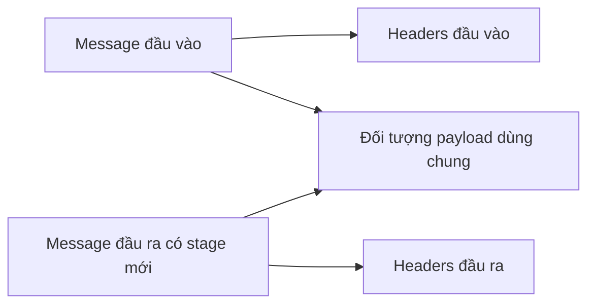

# Copy payload và header

Trong chương **MessageBuilder** của **SPRING_INTEGRATION_CORE**, việc copy payload và header giúp một bước xử lý tạo thông điệp đầu ra mà vẫn duy trì ngữ cảnh của luồng. Ví dụ, transformer đổi chuỗi mã đơn hàng thành đối tượng nghiệp vụ, router đọc header để chọn nhánh, còn gateway cần thông tin để nhận phản hồi đúng nơi.

Bài này tập trung vào cách chọn dữ liệu được giữ lại khi tạo `Message`: giữ payload, thay payload, giải quyết header trùng tên và tránh chia sẻ dữ liệu có thể thay đổi ngoài ý muốn. Các tình huống liên hệ với transformer, channel, aggregator và xử lý lỗi trong một luồng tích hợp.

## 1. Mục tiêu và quy ước ví dụ

Sau bài học, bạn có thể:

- Dùng `fromMessage` khi giữ payload và sửa ngữ cảnh.
- Dùng `withPayload` kết hợp `copyHeaders` hoặc `copyHeadersIfAbsent` khi thay payload.
- Giải thích giá trị header nào thắng khi có xung đột.
- Phân biệt copy cấu trúc thông điệp với copy sâu đối tượng.
- Giữ đúng metadata cần cho các bước tiếp theo và kiểm tra kết quả ở đầu ra của luồng.

Các ví dụ dùng Java 17 trở lên, thư viện `spring-integration-core` và builder của Spring Integration:

```java
import org.springframework.integration.support.MessageBuilder;
import org.springframework.messaging.Message;
import org.springframework.messaging.MessageHeaders;
```

Spring Framework cũng có lớp `org.springframework.messaging.support.MessageBuilder`. Hai lớp có tên đơn giản giống nhau; khi đọc hoặc chép ví dụ, cần kiểm tra dòng `import`. Toàn bộ builder trong bài là lớp thuộc `org.springframework.integration.support`. Xem [API MessageBuilder của Spring Integration](https://docs.spring.io/spring-integration/api/org/springframework/integration/support/MessageBuilder.html).

Các đoạn code ngắn ở phần 2–7 được đặt trong thân phương thức. Những đoạn sử dụng biến `incoming` kế thừa thông điệp mẫu ở phần 2; phần Java DSL phía sau có cấu hình riêng đầy đủ.

## 2. Copy một Message thực chất là copy điều gì?

Một thông điệp có hai phần:

| Thành phần | Vai trò | Câu hỏi khi tạo đầu ra |
| --- | --- | --- |
| Payload | Dữ liệu nghiệp vụ | Giữ nguyên đối tượng hay tạo kết quả mới? |
| Headers | Ngữ cảnh xử lý | Header nào còn đúng, cần thay hoặc cần bỏ? |

Tạo thông điệp đầu vào:

```java
Message<String> incoming = MessageBuilder
        .withPayload("  ORD-204  ")
        .setHeader("tenantId", "hcm")
        .setCorrelationId("flow-204")
        .setHeader(MessageHeaders.CONTENT_TYPE, "text/plain")
        .build();
```

Ở đây, chuỗi có khoảng trắng là payload. `tenantId` xác định đơn vị nghiệp vụ, `correlationId` liên kết các bước trong cùng một yêu cầu, còn `contentType` mô tả dạng dữ liệu hiện tại.

Với thông điệp thông thường được builder này tạo ra, không sửa trực tiếp map header:

```java
// Cách sai: MessageHeaders không cho phép thao tác cập nhật trực tiếp.
incoming.getHeaders().put("stage", "validated");
```

Lệnh trên ném `UnsupportedOperationException`. Hãy thay đổi qua builder rồi nhận `Message` kết quả. Quy tắc bất biến của map được mô tả trong [API MessageHeaders](https://docs.spring.io/spring-framework/docs/current/javadoc-api/org/springframework/messaging/MessageHeaders.html).

Tuy vậy, map không cho `put` không có nghĩa mọi đối tượng bên trong đều bất biến. Nếu payload là `ArrayList`, hoặc một header chứa `HashMap`, đối tượng đó vẫn có thể bị sửa qua tham chiếu của nó. Đây là điểm cần phân biệt trước khi chia sẻ thông điệp cho nhiều consumer.

## 3. Giữ payload: dùng fromMessage

Khi chỉ cần thêm hoặc thay header, bắt đầu từ thông điệp có sẵn:

```java
Message<String> validated = MessageBuilder
        .fromMessage(incoming)
        .setHeader("stage", "validated")
        .build();

// validated.getPayload() vẫn là "  ORD-204  "
// validated.getHeaders().get("tenantId") vẫn là "hcm"
// validated.getHeaders().get("stage") là "validated"
// incoming.getHeaders().get("stage") vẫn là null
```

Bạn đã thêm ngữ cảnh cho đầu ra mà không thêm header vào thông điệp đầu vào. Payload vẫn là đối tượng được lấy từ `incoming`; `fromMessage` không tự chuẩn hóa chuỗi, đổi DTO hay clone dữ liệu nghiệp vụ.

Khi không có thay đổi nào:

```java
Message<String> result = MessageBuilder
        .fromMessage(incoming)
        .build();
```

Không nên dùng `result != incoming` làm điều kiện xác nhận copy thành công. Builder có thể trả lại chính thông điệp ban đầu khi không cần tạo mới; hành vi này cũng phụ thuộc chính sách header chỉ đọc. Hãy kiểm tra nội dung và hợp đồng đầu ra. Xem mô tả [BaseMessageBuilder.build()](https://docs.spring.io/spring-integration/api/org/springframework/integration/support/BaseMessageBuilder.html#build()).

### Mô hình tham chiếu khi chỉ thay header



Trong ví dụ thêm `stage`, phần ngữ cảnh đầu ra thay đổi nhưng payload chưa được copy sâu. Nếu payload là đối tượng mutable, cả hai thông điệp vẫn có thể quan sát thay đổi trên đối tượng đó.

## 4. Thay payload: dùng withPayload và copy header

`fromMessage` phù hợp khi tiếp tục dùng payload cũ. Khi đã tạo dữ liệu mới, bắt đầu bằng `withPayload(newPayload)` và chọn các header muốn mang sang.

```java
String normalizedOrderId = incoming.getPayload().trim();

Message<String> normalized = MessageBuilder
        .withPayload(normalizedOrderId)
        .copyHeaders(incoming.getHeaders())
        .setHeader("stage", "normalized")
        .build();

// normalized.getPayload() là "ORD-204"
// normalized.getHeaders().get("tenantId") là "hcm"
// incoming.getPayload() vẫn là "  ORD-204  "
```

Payload đầu ra do `trim()` quyết định. `copyHeaders` chỉ làm việc với header, không đọc nội dung payload để tự chuyển đổi dữ liệu.

Kiểu payload cũng có thể thay đổi. Đoạn sau là ví dụ độc lập:

```java
Message<String> rawQuantity = MessageBuilder
        .withPayload("12")
        .setHeader("orderId", "ORD-204")
        .setHeader(MessageHeaders.CONTENT_TYPE, "text/plain")
        .build();

int quantity = Integer.parseInt(rawQuantity.getPayload());

Message<Integer> parsedQuantity = MessageBuilder
        .withPayload(quantity)
        .copyHeaders(rawQuantity.getHeaders())
        .removeHeader(MessageHeaders.CONTENT_TYPE)
        .setHeader("payloadType", "quantity")
        .build();
```

Đầu ra có kiểu `Message<Integer>`. Header `orderId` vẫn hữu ích nên được giữ; `contentType=text/plain` được bỏ vì ví dụ không còn chuyển tiếp payload chuỗi gốc. `payloadType` là header do ứng dụng tự định nghĩa, không phải cơ chế chuyển kiểu của Spring.

Nếu `Integer.parseInt` thất bại, đây là lỗi chuyển đổi dữ liệu. Việc copy header không thay thế validation hoặc cấu hình xử lý lỗi của endpoint.

## 5. Chọn quy tắc ghi đè header

Hai phương thức copy cùng nhận một `Map<String, ?>`, nhưng có quy tắc khác nhau khi builder đã có giá trị:

| Thao tác | Builder đã có header cùng tên | Mục đích thường gặp |
| --- | --- | --- |
| `copyHeaders(source)` | Giá trị nguồn ghi đè giá trị hiện có, trừ header được bảo vệ | Nguồn cung cấp metadata có độ ưu tiên cao hơn |
| `copyHeadersIfAbsent(source)` | Giữ giá trị hiện có | Nguồn chỉ bổ sung phần còn thiếu |
| `setHeader(name, value)` | Thay giá trị hiện có nếu header được phép sửa | Áp quy tắc cụ thể cho một header |
| `setHeaderIfAbsent(name, value)` | Giữ giá trị hiện có | Cung cấp giá trị mặc định |

Quy tắc copy và ngoại lệ đối với header hệ thống được nêu trong [API các phương thức copy của BaseMessageBuilder](https://docs.spring.io/spring-integration/api/org/springframework/integration/support/BaseMessageBuilder.html#copyHeaders(java.util.Map)).

### 5.1. copyHeaders: nguồn ghi đè

```java
Message<String> source = MessageBuilder
        .withPayload("ORD-204")
        .setHeader("region", "south")
        .build();

Message<String> copied = MessageBuilder
        .withPayload("processed")
        .setHeader("region", "north")
        .copyHeaders(source.getHeaders())
        .build();

// copied.getHeaders().get("region") là "south"
```

Builder có `region=north` trước, nhưng thao tác copy sau đó mang `region=south` vào và thay giá trị.

### 5.2. copyHeadersIfAbsent: builder giữ ưu tiên

Vẫn sử dụng `source` của ví dụ trên:

```java
Message<String> kept = MessageBuilder
        .withPayload("processed")
        .setHeader("region", "north")
        .copyHeadersIfAbsent(source.getHeaders())
        .build();

// kept.getHeaders().get("region") là "north"
```

Cách này phù hợp khi bước hiện tại đã xác định vùng xử lý, còn header nguồn chỉ bổ sung ngữ cảnh chưa có.

### 5.3. Thứ tự thao tác thể hiện chính sách

Nếu muốn mang toàn bộ header vào trước rồi áp kết quả tính toán của bước hiện tại:

```java
Message<String> output = MessageBuilder
        .withPayload("processed")
        .copyHeaders(source.getHeaders())
        .setHeader("region", "central")
        .setHeaderIfAbsent("retryLimit", 3)
        .build();

// region là "central"; retryLimit là 3 nếu nguồn chưa có giá trị.
```

Với header thông thường có giá trị khác null, thao tác có quyền ghi đè được gọi sau sẽ quyết định kết quả. Trong review, nên đọc chuỗi builder theo đúng thứ tự thay vì chỉ kiểm tra có gọi `copyHeaders` hay chưa.

Đây cũng là lý do cấu hình mặc định cần có chính sách rõ: `retryLimit` do đầu vào cung cấp có được ưu tiên hơn mặc định của dịch vụ hay không? `setHeaderIfAbsent` trả lời có; `setHeader` cho phép bước hiện tại quyết định lại.

## 6. Header hệ thống và định danh nghiệp vụ

Không coi mọi header đều là dữ liệu có thể sao chép nguyên trạng.

| Header | Ý nghĩa khi thiết kế luồng |
| --- | --- |
| `MessageHeaders.ID` | Định danh thông điệp, do framework quản lý |
| `MessageHeaders.TIMESTAMP` | Thời điểm gắn với thông điệp theo cơ chế tạo header |
| `correlationId` | Liên kết các thông điệp theo ngữ cảnh xử lý |
| `orderId`, `requestId` | Định danh do ứng dụng quy định |

Mặc định, `id` và `timestamp` là header chỉ đọc. Các thao tác copy không dùng giá trị nguồn để ghi đè chúng. Khi builder thực sự tạo một thông điệp mới theo cơ chế mặc định, framework cấp ID và timestamp cho thông điệp đó. Khi builder tái sử dụng thông điệp không thay đổi, những giá trị này có thể giữ nguyên. Xem [Message: Read-only Headers](https://docs.spring.io/spring-integration/reference/message.html#message-headers-read-only).

Không kiểm tra `newTimestamp > oldTimestamp`: hai thông điệp có thể được tạo trong cùng một mili giây. Cũng không dùng message ID làm mã đơn hàng ổn định qua mọi bước.

Nếu cần theo dõi yêu cầu xuyên suốt một chuỗi biến đổi, thiết kế header nghiệp vụ hoặc correlation riêng:

```java
Message<String> tracked = MessageBuilder
        .withPayload("ORD-204")
        .setHeader("requestId", "req-204")
        .setCorrelationId("flow-204")
        .build();
```

Ứng dụng có thể cấu hình thêm header chỉ đọc thông qua builder hoặc `MessageBuilderFactory`. Vì vậy, bảng ưu tiên ở phần trước áp dụng cho header có thể sửa; không dùng `copyHeaders` để vượt qua chính sách đó.

## 7. Copy nông và dữ liệu mutable

Xét payload và giá trị header đều là danh sách có thể sửa:

```java
import java.util.ArrayList;
import java.util.List;

List<String> items = new ArrayList<>(List.of("book"));
List<String> tags = new ArrayList<>(List.of("new"));

Message<List<String>> original = MessageBuilder
        .withPayload(items)
        .setHeader("tags", tags)
        .build();

Message<List<String>> branch = MessageBuilder
        .fromMessage(original)
        .setHeader("branch", "shipping")
        .build();

items.add("pen");
tags.add("priority");

// Cả original và branch đều thấy payload ["book", "pen"].
// Cả hai header "tags" đều tham chiếu danh sách ["new", "priority"].
```

Builder không cung cấp một phép deep copy tổng quát cho mọi object graph. Việc nhiều consumer có thể cùng giữ tham chiếu payload hoặc giá trị header được giải thích trong [MessageBuilder Helper Class](https://docs.spring.io/spring-integration/reference/7.0/message.html#message-builder).

Trong một `PublishSubscribeChannel`, nếu nhánh giao hàng thêm phần tử vào payload dùng chung, nhánh lập hóa đơn có thể đọc dữ liệu đã bị thay đổi. Dù việc phân phối đang đồng bộ hay chạy qua executor, ý nghĩa nghiệp vụ của hai nhánh đều có thể bị lẫn.

Nếu muốn đầu ra chứa snapshot của hai danh sách trên:

```java
Message<List<String>> snapshot = MessageBuilder
        .withPayload(List.copyOf(items))
        .copyHeaders(original.getHeaders())
        .setHeader("tags", List.copyOf(tags))
        .build();
```

`List.copyOf` tạo danh sách không cho phép thay đổi cấu trúc; nó không clone từng phần tử. Với `String`, phần tử đã bất biến. Nếu phần tử là `OrderLine` có setter, cần tạo bản sao từng `OrderLine` hoặc dùng mô hình dữ liệu bất biến.

Tương tự, record chỉ bất biến ở mức các field tham chiếu của nó: record chứa một `List` mutable vẫn có thể quan sát danh sách bị sửa. Hãy quyết định quyền sở hữu dữ liệu ở nơi tạo payload.

## 8. Chọn header theo ranh giới xử lý

Giữ mọi header thường thuận tiện khi tiếp tục cùng một luồng nội bộ. Khi chuyển sang một sự kiện mới hoặc giao tiếp với hệ thống khác, cần xem lại ý nghĩa từng header.

| Ngữ cảnh | Header cần xem xét | Lý do |
| --- | --- | --- |
| Tiếp tục cùng yêu cầu qua gateway | `replyChannel`, `errorChannel` | Có thể quyết định nơi nhận phản hồi hoặc lỗi |
| Splitter rồi aggregator | `correlationId`, `sequenceNumber`, `sequenceSize` | Phục vụ chiến lược nhóm và điều kiện hoàn tất đang cấu hình |
| Đổi dạng payload | `contentType` | Metadata cũ có thể không còn mô tả đúng dữ liệu |
| Tạo sự kiện cho hệ thống ngoài | Header giao thức và thông tin nội bộ | Chỉ nên đưa ra dữ liệu thuộc hợp đồng sự kiện |
| Chuyển tenant hoặc vùng xử lý | `tenantId`, `region` | Cần quyết định dựa trên ngữ cảnh đã xác thực |

Ví dụ dưới đây giả định ứng dụng đang tạo **sự kiện một chiều độc lập**; nó không phải bước trả lời trực tiếp cho gateway:

```java
Message<String> event = MessageBuilder
        .withPayload("OrderAccepted:ORD-204")
        .setHeader("eventType", "OrderAccepted")
        .setHeader("orderId", "ORD-204")
        .setHeader("requestId", "req-204")
        .build();
```

Cách tạo từ các header được chọn làm rõ hợp đồng đầu ra. Việc gửi qua HTTP, Kafka hoặc AMQP còn phụ thuộc adapter và header mapper; một phép copy map trong bộ nhớ không bảo đảm mọi header sẽ truyền nguyên dạng qua giao thức.

Nếu vẫn cần copy phần lớn metadata nội bộ rồi bỏ một vài header thông thường:

```java
Message<String> internalResult = MessageBuilder
        .withPayload("ORD-204")
        .copyHeaders(incoming.getHeaders())
        .removeHeader("temporaryLookup")
        .removeHeaders("debug_*")
        .build();
```

Đặt thao tác xóa sau thao tác copy để header bị loại không được đưa trở lại. Trong một luồng request–reply, việc xóa `replyChannel` cần đi cùng thiết kế đường trả lời phù hợp. Với splitter/aggregator, cũng cần hiểu chiến lược nhóm trước khi bỏ header correlation hoặc sequence.

## 9. Áp dụng trong transformer và Java DSL

Một transformer có thể trả payload hoặc trả cả `Message`. Khi trả cả thông điệp, code của transformer chịu trách nhiệm về bộ header đầu ra; khi chỉ trả payload, framework thông thường lan truyền header đầu vào theo quy tắc của endpoint. Không nên lấy hành vi này của transformer để suy rộng cho mọi endpoint. Xem [Message: Header Propagation](https://docs.spring.io/spring-integration/reference/message.html#message-header-propagation).

Ví dụ thực hành dưới đây nhận mã đơn hàng dạng chuỗi, chuẩn hóa thành `OrderCommand`, giữ ngữ cảnh đầu vào và bỏ `contentType` cũ:

```java
import org.springframework.context.annotation.Bean;
import org.springframework.context.annotation.Configuration;
import org.springframework.integration.config.EnableIntegration;
import org.springframework.integration.channel.DirectChannel;
import org.springframework.integration.channel.QueueChannel;
import org.springframework.integration.dsl.IntegrationFlow;
import org.springframework.integration.support.MessageBuilder;
import org.springframework.messaging.Message;
import org.springframework.messaging.MessageChannel;
import org.springframework.messaging.MessageHeaders;

@Configuration
@EnableIntegration
public class OrderFlowConfiguration {

    public record OrderCommand(String orderId) {
    }

    public static class OrderNormalizer {

        public Message<OrderCommand> normalize(Message<String> incoming) {
            String orderId = incoming.getPayload().trim();

            if (orderId.isEmpty()) {
                throw new IllegalArgumentException("orderId must not be blank");
            }

            OrderCommand command = new OrderCommand(orderId);

            return MessageBuilder
                    .withPayload(command)
                    .copyHeaders(incoming.getHeaders())
                    .removeHeader(MessageHeaders.CONTENT_TYPE)
                    .setHeader("stage", "normalized")
                    .build();
        }
    }

    @Bean
    public MessageChannel orderInput() {
        return new DirectChannel();
    }

    @Bean
    public QueueChannel normalizedOrders() {
        return new QueueChannel();
    }

    @Bean
    public OrderNormalizer orderNormalizer() {
        return new OrderNormalizer();
    }

    @Bean
    public IntegrationFlow orderFlow(OrderNormalizer orderNormalizer) {
        return IntegrationFlow.from("orderInput")
                .transform(orderNormalizer, "normalize")
                .channel("normalizedOrders")
                .get();
    }
}
```

Ở đây, transformer gọi phương thức nhận `Message<String>` để có cả payload lẫn header. Đầu ra là `Message<OrderCommand>` do chính phương thức xây dựng. `tenantId` và `correlationId` được copy; `stage` được bước hiện tại xác định sau copy.

Luồng kết thúc ở `QueueChannel` để có thể quan sát thông điệp đầu ra. Các phương thức kết nối channel và transformer thuộc [API Java DSL BaseIntegrationFlowDefinition](https://docs.spring.io/spring-integration/api/org/springframework/integration/dsl/BaseIntegrationFlowDefinition.html).

`DirectChannel` chạy xử lý đồng bộ trong cấu hình này. Nếu mã đơn hàng rỗng, lỗi được trả về phía gọi `send` qua cơ chế exception của endpoint. Chỉ copy `errorChannel` không tự biến luồng đồng bộ này thành luồng xử lý lỗi bất đồng bộ.

## 10. Minh họa kiểm thử hợp đồng đầu ra

Khi kiểm thử copy dữ liệu, các điều kiện hữu ích là: payload đã đổi đúng, header cần thiết còn tồn tại, header không còn phù hợp đã bị loại và thông điệp đầu vào không bị sửa.

Đoạn JUnit Jupiter dưới đây dùng cấu hình ở phần 9, đặt cùng package với `OrderFlowConfiguration`. Dự án cần có JUnit Jupiter trong classpath kiểm thử.

```java
import org.junit.jupiter.api.Test;
import org.springframework.context.annotation.AnnotationConfigApplicationContext;
import org.springframework.integration.channel.QueueChannel;
import org.springframework.integration.support.MessageBuilder;
import org.springframework.messaging.Message;
import org.springframework.messaging.MessageChannel;
import org.springframework.messaging.MessageHeaders;

import static org.junit.jupiter.api.Assertions.*;

class OrderFlowConfigurationTest {

    @Test
    void normalizesPayloadAndPreservesRequiredContext() {
        try (var context = new AnnotationConfigApplicationContext(
                OrderFlowConfiguration.class)) {

            MessageChannel input = context.getBean(
                    "orderInput", MessageChannel.class);
            QueueChannel output = context.getBean(
                    "normalizedOrders", QueueChannel.class);

            Message<String> incoming = MessageBuilder
                    .withPayload("  ORD-204  ")
                    .setHeader("tenantId", "hcm")
                    .setCorrelationId("flow-204")
                    .setHeader(MessageHeaders.CONTENT_TYPE, "text/plain")
                    .build();

            assertTrue(input.send(incoming));

            Message<?> result = output.receive(1000);
            assertNotNull(result);

            assertEquals(
                    new OrderFlowConfiguration.OrderCommand("ORD-204"),
                    result.getPayload());
            assertEquals("hcm", result.getHeaders().get("tenantId"));
            assertEquals("flow-204", result.getHeaders().get("correlationId"));
            assertEquals("normalized", result.getHeaders().get("stage"));
            assertNull(result.getHeaders().get(MessageHeaders.CONTENT_TYPE));

            assertEquals("  ORD-204  ", incoming.getPayload());
            assertEquals("text/plain",
                    incoming.getHeaders().get(MessageHeaders.CONTENT_TYPE));
            assertNull(incoming.getHeaders().get("stage"));

            assertNotEquals(
                    incoming.getHeaders().getId(),
                    result.getHeaders().getId());
        }
    }
}
```

Kiểm tra ID khác nhau phù hợp trong ví dụ này vì payload đã đổi và thông điệp mới được tạo bằng builder mặc định. Không dùng điều kiện đó cho trường hợp `fromMessage(incoming).build()` không thay đổi dữ liệu.

Nếu payload nghiệp vụ có collection mutable, bổ sung tình huống thay đổi collection nguồn sau khi tạo đầu ra để kiểm tra chính sách snapshot của ứng dụng. Đó là hành vi riêng cần bảo đảm; kiểm tra hai message có cùng giá trị ngay lúc tạo chưa chứng minh dữ liệu đã được tách độc lập.

## 11. Các lỗi thường gặp và cách chọn thao tác

| Biểu hiện | Nguyên nhân có thể có | Điều chỉnh |
| --- | --- | --- |
| Đổi payload xong mất ngữ cảnh nghiệp vụ | Chỉ gọi `withPayload` | Copy hoặc chọn lại các header thuộc hợp đồng |
| Giá trị vừa đặt bị đổi về giá trị cũ | `copyHeaders` chạy sau `setHeader` | Đặt giá trị quyết định sau copy, hoặc dùng `copyHeadersIfAbsent` |
| Hai nhánh cùng thấy dữ liệu bị sửa | Payload hoặc header mutable còn dùng chung tham chiếu | Dùng dữ liệu bất biến hoặc copy theo cấu trúc nghiệp vụ |
| Sửa header gây exception | Gọi `put` hoặc `remove` trực tiếp trên `MessageHeaders` | Tạo đầu ra qua builder |
| Transformer trả Message nhưng thiếu header | Code xây dựng chưa giữ đủ ngữ cảnh | Xây bộ header đầu ra tường minh |
| Aggregator nhóm sai hoặc không hoàn tất | Metadata nhóm/sequence bị mất hoặc sai ý nghĩa | Kiểm tra chiến lược correlation và release đang dùng |
| Không trả lời được gateway | Đường trả lời không còn đủ thông tin | Kiểm tra output channel và `replyChannel` trong ngữ cảnh luồng |
| Metadata mô tả sai payload | Copy cả header gắn với biểu diễn cũ | Sửa hoặc bỏ header đó sau chuyển đổi |

Khi viết một bước tạo đầu ra, hãy quyết định lần lượt: payload cần giữ hay thay, đối tượng nào được phép chia sẻ, header nào còn đúng và nguồn nào được ưu tiên khi trùng tên. Từ các quyết định đó, chọn `fromMessage`, `withPayload`, phương thức copy và các thao tác đặt/xóa header tương ứng.
