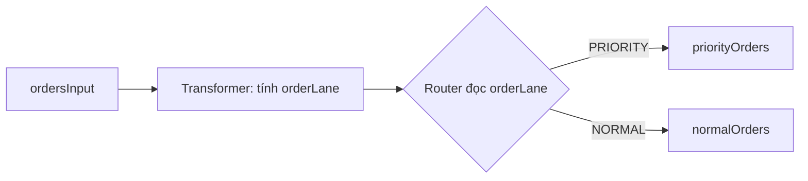

# MessageBuilder: setHeader

Trong module `SPRING_INTEGRATION_CORE`, `MessageBuilder` giúp tạo thông điệp mang dữ liệu nghiệp vụ cùng metadata để các endpoint phối hợp xử lý. Bài này tập trung vào `setHeader`: thêm hoặc thay thế một giá trị header, xóa header bằng `null`, rồi dùng kết quả trong luồng Spring Integration.

Sau bài học, bạn có thể chọn đúng cách bổ sung metadata mà vẫn giữ thông điệp đầu vào, phân biệt `setHeader` với `setHeaderIfAbsent`, và kiểm chứng header mà router hoặc endpoint phía sau thực sự nhận được.

## 1. Header giải quyết vấn đề gì?

Giả sử hệ thống tiếp nhận một đơn hàng. Payload chứa mã đơn và tổng tiền; luồng tích hợp còn cần biết đơn đến từ nguồn nào, thuộc nhánh xử lý nào và có mã truy vết nào. Những thông tin phục vụ quá trình truyền, định tuyến hoặc theo dõi này có thể đặt trong header.

```text
Message<Order>
├── payload: Order("DH-004", 15000000)
└── headers
    ├── sourceSystem: "web"
    ├── orderLane: "PRIORITY"
    └── requestId: "req-004"
```

Trong ví dụ này, router đọc `orderLane`; phần xử lý đơn hàng tiếp tục đọc payload. Chỉ đặt header chưa tạo ra hành vi định tuyến: phải có thành phần được cấu hình để sử dụng nó.

Với message thông thường do `MessageBuilder` tạo ra, hãy dùng builder để thay đổi tập header. Việc gọi `message.getHeaders().put(...)` trực tiếp sẽ ném `UnsupportedOperationException`. Tính bất biến này áp dụng cho cấu trúc header; một object được đặt làm giá trị vẫn có thể là object khả biến. Xem [Message trong Spring Integration](https://docs.spring.io/spring-integration/reference/message.html).

## 2. Cú pháp và hợp đồng của setHeader

Các ví dụ dùng đúng builder của Spring Integration:

```java
import org.springframework.integration.support.MessageBuilder;
import org.springframework.messaging.Message;
```

Spring Framework cũng có lớp `org.springframework.messaging.support.MessageBuilder`. Khi đọc ví dụ hoặc để IDE tự import, cần kiểm tra package, đặc biệt khi làm việc với các header dành riêng cho Integration. Bài này thống nhất sử dụng `org.springframework.integration.support.MessageBuilder`.

```java
Message<String> message = MessageBuilder
        .withPayload("DH-004")
        .setHeader("sourceSystem", "web")
        .setHeader("attempt", 1)
        .build();
```

`setHeader(headerName, headerValue)` nhận tên kiểu `String`, giá trị kiểu `Object` hoặc `null`, và trả về builder để tiếp tục nối lời gọi. `build()` trả về `Message<T>` có kiểu payload tương ứng. Hợp đồng thêm, ghi đè và xóa được mô tả trong [API AbstractIntegrationMessageBuilder.setHeader](https://docs.spring.io/spring-integration/api/org/springframework/integration/support/AbstractIntegrationMessageBuilder.html#setHeader(java.lang.String,java.lang.Object)).

Với một header ứng dụng được phép ghi như `orderLane`:

| Trạng thái trước lời gọi | Lời gọi | Trạng thái sau lời gọi |
| --- | --- | --- |
| Chưa có header | `setHeader("orderLane", "NORMAL")` | Có giá trị `"NORMAL"` |
| Đang là `"NORMAL"` | `setHeader("orderLane", "PRIORITY")` | Giá trị được thay bằng `"PRIORITY"` |
| Đang là `"NORMAL"` | `setHeader("orderLane", "NORMAL")` | Giá trị quan sát được vẫn là `"NORMAL"` |
| Đã có header | `setHeader("orderLane", null)` | Header bị xóa |
| Chưa có header | `setHeader("orderLane", null)` | Header tiếp tục vắng mặt |

Nhiều lời gọi cùng tên được áp dụng theo thứ tự:

```java
Message<String> result = MessageBuilder.withPayload("DH-004")
        .setHeader("orderLane", "NORMAL")
        .setHeader("orderLane", "PRIORITY")
        .build();

String lane = result.getHeaders().get("orderLane", String.class);
// lane có giá trị "PRIORITY".
```

Quy ước tên header nên rõ nghĩa và thống nhất giữa bên gửi với bên nhận. `orderLane` và `OrderLane` là hai khóa khác nhau. Đây là hợp đồng metadata của ứng dụng; có thể gom tên khóa dùng chung vào hằng số để tránh lỗi gõ sai.

## 3. Ví dụ đầy đủ: thêm, ghi đè và xóa

Ví dụ dưới đây dùng Java 17 trở lên và giả định classpath đã có `spring-integration-core` cùng các dependency tương ứng. Chương trình thao tác message trong bộ nhớ, không cần khởi tạo Spring ApplicationContext.

```java
import org.springframework.integration.support.MessageBuilder;
import org.springframework.messaging.Message;

public class SetHeaderDemo {

    public static void main(String[] args) {
        Message<String> original = MessageBuilder.withPayload("DH-004")
                .setHeader("orderLane", "NORMAL")
                .setHeader("requestId", "req-004")
                .build();

        Message<String> enriched = MessageBuilder.fromMessage(original)
                .setHeader("orderLane", "PRIORITY")
                .setHeader("attempt", 1)
                .build();

        Message<String> cleaned = MessageBuilder.fromMessage(enriched)
                .setHeader("attempt", null)
                .build();

        System.out.println(original.getHeaders()
                .get("orderLane", String.class));
        System.out.println(enriched.getHeaders()
                .get("orderLane", String.class));
        System.out.println(enriched.getHeaders()
                .get("attempt", Integer.class));
        System.out.println(cleaned.getHeaders().containsKey("attempt"));
        System.out.println(cleaned.getHeaders()
                .get("requestId", String.class));
        System.out.println(cleaned.getPayload());
    }
}
```

Đầu ra dự kiến:

```text
NORMAL
PRIORITY
1
false
req-004
DH-004
```

Ở đây, `original` vẫn có nhánh `NORMAL`; `enriched` có nhánh `PRIORITY` và số lần xử lý; `cleaned` bỏ `attempt` nhưng vẫn giữ `requestId` cùng payload. Gán `null` không tạo một mục có giá trị null trong message kết quả.

### Chọn withPayload hay fromMessage

`withPayload(payload)` bắt đầu từ payload được cung cấp. `fromMessage(input)` khởi tạo builder từ payload và các header của message đầu vào; dùng cách này khi mục tiêu là điều chỉnh metadata của thông điệp đang đi qua luồng. Xem [API MessageBuilder](https://docs.spring.io/spring-integration/api/org/springframework/integration/support/MessageBuilder.html).

```java
// input là Message<String> đã nhận từ bước trước.
Message<String> output = MessageBuilder.fromMessage(input)
        .setHeader("processedBy", "order-service")
        .build();
```

Nếu thay bằng `withPayload(input.getPayload())`, builder không tự mang theo `requestId`, `replyChannel`, `errorChannel` hay các header ứng dụng từ `input`. Chỉ lấy payload rồi xây message khác có thể làm đứt hợp đồng với những bước tiếp theo.

Không nên viết logic nghiệp vụ dựa vào giả định mọi lần gọi `build()` đều trả về một object khác. Với builder khởi tạo bằng `fromMessage`, implementation có thể trả lại message gốc nếu không có thay đổi thực sự và không có điều kiện buộc tạo lại. Xem [implementation BaseMessageBuilder.build](https://github.com/spring-projects/spring-integration/blob/v6.5.3/spring-integration-core/src/main/java/org/springframework/integration/support/BaseMessageBuilder.java).

## 4. Chọn chính sách ghi đè phù hợp

`setHeader` phù hợp khi bước hiện tại chịu trách nhiệm quyết định giá trị cuối cùng. `setHeaderIfAbsent` phù hợp khi bước hiện tại chỉ cung cấp giá trị mặc định cho một header chưa có.

```java
Message<String> input = MessageBuilder.withPayload("DH-004")
        .setHeader("sourceSystem", "partner")
        .build();

Message<String> withDefault = MessageBuilder.fromMessage(input)
        .setHeaderIfAbsent("sourceSystem", "web")
        .build();

Message<String> withOverride = MessageBuilder.fromMessage(input)
        .setHeader("sourceSystem", "web")
        .build();

// withDefault:  sourceSystem = "partner"
// withOverride: sourceSystem = "web"
```

Trong một luồng tiếp nhận đơn, có thể quy ước `sourceSystem` được gán ở điểm vào, còn `orderLane` được tính lại tại bước phân loại. Lúc đó chính sách của hai header khác nhau dù cùng được thao tác bằng builder.

### Dữ liệu tùy chọn và bẫy null

Giả sử một bước tra cứu trả về `null` khi không tìm được nhánh mới. Nếu muốn giữ giá trị hiện có, phải thể hiện điều kiện đó:

```java
static <T> Message<T> updateLaneIfAvailable(
        Message<T> input, String newLane) {

    MessageBuilder<T> builder = MessageBuilder.fromMessage(input);
    if (newLane != null) {
        builder.setHeader("orderLane", newLane);
    }
    return builder.build();
}
```

Đây là đoạn phương thức đặt trong lớp ứng dụng. Viết thẳng `setHeader("orderLane", newLane)` sẽ xóa header khi `newLane == null`, dẫn đến một hành vi khác với yêu cầu giữ nguyên. Khi mục tiêu chính là xóa một header ứng dụng, `removeHeader("orderLane")` diễn đạt ý định trực tiếp hơn.

## 5. Kiểu dữ liệu và những header do framework quản lý

### Header ứng dụng không tự chuyển kiểu

```java
Message<String> input = MessageBuilder.withPayload("DH-004")
        .setHeader("attempt", "1")
        .build();

String text = input.getHeaders().get("attempt", String.class);
// text = "1"

// Ném IllegalArgumentException vì giá trị thực tế là String.
Integer count = input.getHeaders().get("attempt", Integer.class);
```

Dùng `get(name, type)` là yêu cầu kiểm tra kiểu đang lưu, không phải yêu cầu parse chuỗi. Nếu hợp đồng cần số nguyên, hãy đặt `1` thay cho `"1"`. Header vắng mặt cho kết quả `null`, vì vậy tránh unbox trực tiếp khi chưa có giá trị mặc định. Xem [API MessageHeaders.get](https://docs.spring.io/spring-framework/docs/current/javadoc-api/org/springframework/messaging/MessageHeaders.html#get(java.lang.Object,java.lang.Class)).

### Không ghi đè id hoặc timestamp bằng setHeader

`MessageHeaders.ID` và `MessageHeaders.TIMESTAMP` là header chỉ đọc đối với builder này. Lời gọi `setHeader` trực tiếp lên các tên đó bị từ chối bằng `IllegalArgumentException`, kể cả khi giá trị truyền vào là `null`. Đây là quy tắc của accessor mà builder sử dụng. Xem [MessageHeaderAccessor.setHeader](https://github.com/spring-projects/spring-framework/blob/v6.2.11/spring-messaging/src/main/java/org/springframework/messaging/support/MessageHeaderAccessor.java).

```java
import org.springframework.messaging.MessageHeaders;

// Đoạn minh họa lỗi, không đặt trong đường chạy thành công.
MessageBuilder.withPayload("DH-004")
        .setHeader(MessageHeaders.ID, "DH-004");
```

Hãy giữ mã nghiệp vụ hoặc mã truy vết ở một header như `orderId` hay `requestId`. Khi tạo một message mới có thay đổi, các giá trị định danh kỹ thuật do framework quản lý; không dùng chúng làm mã nghiệp vụ bền vững. Cũng không kiểm thử rằng timestamp mới luôn lớn hơn timestamp cũ: hai message có thể được tạo trong cùng một mili giây.

### Header chuẩn cần đúng kiểu và đúng thành phần sử dụng

| Header | Cách sử dụng trong phạm vi bài này |
| --- | --- |
| `MessageHeaders.REPLY_CHANNEL` | Dùng `MessageChannel` hoặc tên kênh kiểu `String`; chỉ có ý nghĩa khi thành phần tạo reply sử dụng nó |
| `MessageHeaders.ERROR_CHANNEL` | Dùng `MessageChannel` hoặc tên kênh; cơ chế xử lý lỗi phụ thuộc endpoint và cách thực thi |
| `IntegrationMessageHeaderAccessor.PRIORITY` | Dùng giá trị số; đặt header chưa làm mọi loại channel xử lý theo ưu tiên |
| `IntegrationMessageHeaderAccessor.CORRELATION_ID` | Dùng khi thành phần phía sau cần liên kết các message theo cùng một khóa |

Builder Integration có kiểm tra kiểu cho một số header chuẩn; chẳng hạn chuỗi `"HIGH"` không hợp lệ cho `PRIORITY`. Hằng số và các kiểm tra này có trong [IntegrationMessageHeaderAccessor](https://github.com/spring-projects/spring-integration/blob/v6.5.3/spring-integration-core/src/main/java/org/springframework/integration/IntegrationMessageHeaderAccessor.java).

```java
import org.springframework.integration.IntegrationMessageHeaderAccessor;

Message<String> prioritized = MessageBuilder.withPayload("DH-004")
        .setHeader(IntegrationMessageHeaderAccessor.PRIORITY, 10)
        .build();
```

Ở ví dụ kế tiếp, `orderLane` là header riêng để router chọn kênh. Tên `PRIORITY` của một nhánh không biến các kênh nhận thành hàng đợi sắp xếp theo độ ưu tiên.

## 6. Thực hành trong Java DSL: phân loại đơn bằng header

Yêu cầu: đơn từ 10.000.000 VND đi vào `priorityOrders`, các đơn còn lại đi vào `normalOrders`. Bước phân loại tính lại `orderLane`, nhưng giữ `requestId` mà bên gửi cung cấp.



Chương trình độc lập sau đây dùng Java 17 trở lên, Spring Integration 6.5.x và bộ dependency Spring tương thích. Hai `QueueChannel` là nơi quan sát kết quả trong bộ nhớ; ví dụ không cần broker hoặc cơ sở dữ liệu.

```java
import java.util.Objects;

import org.springframework.context.annotation.AnnotationConfigApplicationContext;
import org.springframework.context.annotation.Bean;
import org.springframework.context.annotation.Configuration;
import org.springframework.integration.channel.DirectChannel;
import org.springframework.integration.channel.QueueChannel;
import org.springframework.integration.config.EnableIntegration;
import org.springframework.integration.dsl.IntegrationFlow;
import org.springframework.integration.support.MessageBuilder;
import org.springframework.messaging.Message;

public class HeaderRoutingDemo {

    public record Order(String id, long amountVnd) {
    }

    public static Message<?> classify(Message<?> input) {
        if (!(input.getPayload() instanceof Order order)) {
            throw new IllegalArgumentException("Payload phải là Order");
        }
        if (order.amountVnd() < 0) {
            throw new IllegalArgumentException("Tổng tiền không được âm");
        }

        String lane = order.amountVnd() >= 10_000_000L
                ? "PRIORITY" : "NORMAL";

        return MessageBuilder.fromMessage(input)
                .setHeader("orderLane", lane)
                .build();
    }

    @Configuration
    @EnableIntegration
    public static class Config {

        @Bean
        public DirectChannel ordersInput() {
            return new DirectChannel();
        }

        @Bean
        public QueueChannel priorityOrders() {
            return new QueueChannel();
        }

        @Bean
        public QueueChannel normalOrders() {
            return new QueueChannel();
        }

        @Bean
        public IntegrationFlow orderFlow() {
            return IntegrationFlow.from("ordersInput")
                    .transform(Message.class, message -> classify(message))
                    .route("headers['orderLane']", router -> router
                            .channelMapping("PRIORITY", "priorityOrders")
                            .channelMapping("NORMAL", "normalOrders"))
                    .get();
        }
    }

    public static void main(String[] args) {
        try (var context =
                new AnnotationConfigApplicationContext(Config.class)) {

            Message<Order> input = MessageBuilder
                    .withPayload(new Order("DH-004", 15_000_000L))
                    .setHeader("orderLane", "NORMAL")
                    .setHeader("requestId", "req-004")
                    .build();

            context.getBean("ordersInput", DirectChannel.class).send(input);

            QueueChannel priority = context.getBean(
                    "priorityOrders", QueueChannel.class);
            Message<?> output = Objects.requireNonNull(
                    priority.receive(1_000), "Không nhận được message");

            System.out.println(output.getHeaders()
                    .get("orderLane", String.class));
            System.out.println(output.getHeaders()
                    .get("requestId", String.class));
            System.out.println(input.getHeaders()
                    .get("orderLane", String.class));
        }
    }
}
```

Đầu ra dự kiến:

```text
PRIORITY
req-004
NORMAL
```

Điểm quyết định là `setHeader("orderLane", lane)` trong `classify`: bước này ghi đè nhánh cũ theo tổng tiền hiện tại. Nếu thay bằng `setHeaderIfAbsent`, đầu vào đã có `NORMAL` sẽ giữ nguyên giá trị đó dù đơn đạt ngưỡng ưu tiên.

`transform(Message.class, ...)` yêu cầu truyền toàn bộ message vào hàm, nhờ đó hàm đọc được cả payload và header. Router phía sau đánh giá biểu thức header rồi áp dụng mapping đã khai báo. Xem [API Java DSL cho transform và route](https://docs.spring.io/spring-integration/api/org/springframework/integration/dsl/BaseIntegrationFlowDefinition.html).

Có thể thử thêm các đầu vào sau để quan sát hợp đồng của ví dụ:

| Tổng tiền | orderLane trước phân loại | Kênh nhận dự kiến | orderLane đầu ra |
| --- | --- | --- | --- |
| `15_000_000L` | `NORMAL` | `priorityOrders` | `PRIORITY` |
| `10_000_000L` | Chưa có | `priorityOrders` | `PRIORITY` |
| `2_000_000L` | `PRIORITY` | `normalOrders` | `NORMAL` |

## 7. Khi nào dùng Header Enricher?

Nếu một bước chỉ bổ sung metadata, DSL còn có `enrichHeaders`. Đây là endpoint chuyên làm giàu header, giúp cấu hình ngắn gọn khi không cần một hàm transformer riêng. Xem [Header Enricher trong tài liệu Spring Integration](https://docs.spring.io/spring-integration/reference/content-enrichment.html#header-enricher).

Ví dụ một đoạn cấu hình trong phương thức tạo `IntegrationFlow`:

```java
return IntegrationFlow.from("ordersInput")
        .enrichHeaders(headers -> headers
                .header("sourceSystem", "web", false)
                .headerExpression("orderLane",
                        "payload.amountVnd() >= 10000000 "
                                + "? 'PRIORITY' : 'NORMAL'",
                        true))
        .route("headers['orderLane']", router -> router
                .channelMapping("PRIORITY", "priorityOrders")
                .channelMapping("NORMAL", "normalOrders"))
        .get();
```

Đoạn này giả định có các channel như mục trước và payload là `Order`. Nó minh họa phần làm giàu header, chưa bao gồm các kiểm tra dữ liệu của hàm `classify`.

Tham số `false` giữ `sourceSystem` đã có; `true` yêu cầu tính lại và ghi đè `orderLane`. Không nên chuyển từ builder sang enricher rồi mặc định hai cấu hình có cùng chính sách ghi đè: dạng `header(name, value)` của enricher không ghi đè header hiện có trừ khi bật chính sách phù hợp. Xem [API HeaderEnricherSpec](https://docs.spring.io/spring-integration/api/org/springframework/integration/dsl/HeaderEnricherSpec.html).

## 8. Sao chép header không phải sao chép sâu

Một header chứa `List` hoặc `Map` khả biến có thể được nhiều message cùng tham chiếu. Ví dụ dưới đây là đoạn mã đặt trong một phương thức:

```java
import java.util.ArrayList;
import java.util.List;

List<String> tags = new ArrayList<>();
tags.add("web");

Message<String> first = MessageBuilder.withPayload("DH-004")
        .setHeader("tags", tags)
        .build();

Message<String> second = MessageBuilder.fromMessage(first)
        .setHeader("processedBy", "routing")
        .build();

tags.add("changed-later");

// Cả hai message đều nhìn thấy List đã có thêm phần tử.
System.out.println(first.getHeaders().get("tags"));
System.out.println(second.getHeaders().get("tags"));
```

Trong thiết kế metadata của ví dụ, ưu tiên `String`, kiểu bao của số, enum hoặc object bất biến. Với danh sách nhãn chuỗi, có thể dùng `.setHeader("tags", List.copyOf(tags))` để chụp một danh sách không sửa được tại thời điểm gán. `List.copyOf` không sao chép sâu những phần tử khả biến bên trong.

Đặt builder trong phạm vi xử lý từng message. Không dùng một builder chung làm nơi giữ trạng thái cho nhiều yêu cầu đồng thời, vì chính builder đang tích lũy các thao tác thay đổi header.

## 9. Mẫu kiểm thử hành vi

Các mẫu dưới đây dùng JUnit Jupiter, đặt trong một dự án đã có dependency kiểm thử. Chúng kiểm tra hợp đồng của message đầu ra, không cần khởi tạo toàn bộ Spring context.

```java
import org.junit.jupiter.api.Test;
import org.springframework.integration.support.MessageBuilder;
import org.springframework.messaging.Message;
import org.springframework.messaging.MessageHeaders;

import static org.junit.jupiter.api.Assertions.*;

class MessageBuilderSetHeaderTest {

    @Test
    void addsAHeader() {
        Message<String> output = MessageBuilder.withPayload("DH-004")
                .setHeader("attempt", 1)
                .build();

        assertEquals(Integer.valueOf(1),
                output.getHeaders().get("attempt", Integer.class));
    }

    @Test
    void overridesWithoutChangingTheInput() {
        Message<String> input = MessageBuilder.withPayload("DH-004")
                .setHeader("orderLane", "NORMAL")
                .setHeader("requestId", "req-004")
                .build();

        Message<String> output = MessageBuilder.fromMessage(input)
                .setHeader("orderLane", "PRIORITY")
                .build();

        assertEquals("NORMAL", input.getHeaders().get("orderLane"));
        assertEquals("PRIORITY", output.getHeaders().get("orderLane"));
        assertEquals("req-004", output.getHeaders().get("requestId"));
        assertEquals(input.getPayload(), output.getPayload());
    }

    @Test
    void removesAHeaderWhenTheValueIsNull() {
        Message<String> input = MessageBuilder.withPayload("DH-004")
                .setHeader("attempt", 1)
                .build();

        Message<String> output = MessageBuilder.fromMessage(input)
                .setHeader("attempt", null)
                .build();

        assertFalse(output.getHeaders().containsKey("attempt"));
        assertEquals(Integer.valueOf(1),
                input.getHeaders().get("attempt", Integer.class));
    }

    @Test
    void rejectsWritingTheTechnicalMessageId() {
        assertThrows(IllegalArgumentException.class,
                () -> MessageBuilder.withPayload("DH-004")
                        .setHeader(MessageHeaders.ID, "DH-004"));
    }
}
```

Với luồng ở mục 6, cần kiểm tra thêm kết quả nhận tại đúng channel: đơn đạt ngưỡng phải đến `priorityOrders`, đơn dưới ngưỡng phải đến `normalOrders`, và `requestId` vẫn được giữ. Kiểm tra đầu ra giúp phát hiện tình huống header được tạo đúng nhưng router đọc sai tên hoặc mapping sai giá trị.

Không yêu cầu ID hoặc timestamp có giá trị cố định. Với message không có thay đổi, cũng không dùng `assertNotSame` như một điều kiện bắt buộc của mọi lời gọi builder.

## 10. Lỗi thường gặp và cách xử lý

| Biểu hiện | Nguyên nhân cần xem xét | Cách xử lý |
| --- | --- | --- |
| Header biến mất sau bước tra cứu | Kết quả tra cứu là `null` và được truyền vào `setHeader` | Phân biệt rõ yêu cầu xóa với yêu cầu giữ giá trị cũ |
| Router vẫn chọn nhánh cũ | Dùng `setHeaderIfAbsent` cho một giá trị cần tính lại | Dùng `setHeader` tại bước chịu trách nhiệm phân loại |
| `UnsupportedOperationException` | Sửa trực tiếp `message.getHeaders()` | Tạo kết quả bằng builder |
| `IllegalArgumentException` khi gán header | Gán header chỉ đọc hoặc sai kiểu của header chuẩn | Kiểm tra tên hằng số và kiểu giá trị |
| Đọc số nguyên thất bại | Header đang chứa chuỗi hoặc một kiểu số khác | Thống nhất kiểu giữa nơi ghi và nơi đọc |
| Bước sau mất mã truy vết hoặc thông tin reply | Chỉ lấy payload để xây message khác | Dùng `fromMessage` khi mục tiêu là bổ sung metadata |
| Gán `orderLane` nhưng không có nhánh xử lý | Chưa có router sử dụng header hoặc mapping chưa đúng | Kiểm tra cấu hình tiêu thụ header và kết quả tại channel nhận |
| Header của nhiều message cùng thay đổi | Cùng tham chiếu một giá trị header khả biến | Sử dụng giá trị bất biến hoặc sao chép theo hợp đồng dữ liệu |

Trong luồng tích hợp, `setHeader` là thao tác xây dựng metadata. Hành vi cuối cùng hình thành khi transformer, router, channel hoặc endpoint tiếp theo đọc và sử dụng metadata đó theo một hợp đồng rõ ràng.
