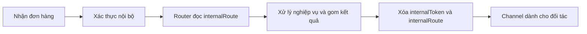

# removeHeader — Xóa một header bằng MessageBuilder

Trong module **SPRING_INTEGRATION_CORE**, `Message`, `MessageChannel`, endpoint, gateway và Java DSL phối hợp để tạo luồng thông điệp. Một phần của việc thiết kế luồng là quyết định metadata nào còn cần thiết ở mỗi chặng. Bài thuộc chương **MessageBuilder** này tập trung vào `removeHeader`: xóa đúng một header khỏi message đầu ra mà vẫn giữ payload và những header cần cho bước tiếp theo.

Giả sử một đơn hàng mang header `internalToken` để phục vụ xử lý nội bộ. Trước khi chuyển đơn hàng sang nhánh dành cho đối tác, bạn muốn loại bỏ header đó, đồng thời giữ `orderId` và `traceId`. Đây là tình huống phù hợp để dùng `MessageBuilder.fromMessage(message).removeHeader(...).build()`.

## 1. Mục tiêu và kiến thức cần có

Sau bài học, bạn có thể:

- Xóa một header bằng tên chính xác và lấy message kết quả bằng `build()`.
- Giải thích vì sao thao tác không sửa headers của message gốc.
- Phân biệt `removeHeader`, `removeHeaders`, `setHeader(name, null)` và header filter trong Java DSL.
- Chọn vị trí xóa metadata mà vẫn đáp ứng nhu cầu của router, gateway và aggregator.
- Viết kiểm thử cho cả hàm xử lý message và một luồng tích hợp.

Bạn cần biết cấu trúc `Message<T>` gồm payload và headers, cách dùng `withPayload`, `fromMessage`, `setHeader`, và cách một channel chuyển message đến endpoint.

Các ví dụ dùng builder của Spring Integration:

```java
import org.springframework.integration.support.MessageBuilder;
import org.springframework.messaging.Message;
```

Spring Framework cũng có lớp cùng tên trong package `org.springframework.messaging.support`. Hãy kiểm tra import khi IDE tự động bổ sung lớp. Bài này thống nhất dùng `org.springframework.integration.support.MessageBuilder`, đặc biệt khi nói đến các header chỉ đọc của Spring Integration.

## 2. Hợp đồng của removeHeader

Cách sử dụng cơ bản:

```java
Message<String> cleaned = MessageBuilder
        .fromMessage(original)
        .removeHeader("internalToken")
        .build();
```

Trong chuỗi lệnh này:

1. `fromMessage(original)` khởi tạo builder từ payload và headers của message đầu vào.
2. `removeHeader("internalToken")` loại bỏ header có đúng tên đó trong trạng thái đang xây dựng.
3. `build()` trả về `Message<String>` để bạn gửi hoặc trả về cho luồng.

`removeHeader` trả về builder để tiếp tục nối phương thức; nó không trả về giá trị header vừa bị xóa. Nếu cần giá trị cũ, hãy đọc từ message đầu vào trước khi xóa.

Theo hợp đồng API, `removeHeader` nhận một tên, còn `removeHeaders` nhận nhiều tên hoặc mẫu tên. Việc khởi tạo từ `fromMessage` sử dụng lại payload của message được truyền vào. [Javadoc MessageBuilder](https://docs.spring.io/spring-integration/api/org/springframework/integration/support/MessageBuilder.html), [Javadoc AbstractIntegrationMessageBuilder](https://docs.spring.io/spring-integration/api/org/springframework/integration/support/AbstractIntegrationMessageBuilder.html).

### 2.1. Tên header phải khớp chính xác

Với ba header sau:

```text
internalToken = demo-token
internalRoute = billing
traceId       = trace-100
```

Lệnh:

```java
builder.removeHeader("internalToken");
```

chỉ nhắm đến `internalToken`. Nó không xóa `internalRoute` hay `traceId`.

Tên được dùng như khóa của map. `internalToken` và `InternalToken` là hai tên khác nhau. Không tự áp dụng quy tắc không phân biệt chữ hoa, chữ thường của HTTP cho toàn bộ `MessageHeaders`.

### 2.2. Header không tồn tại

Với một tên hợp lệ nhưng không có trong message, `removeHeader` không yêu cầu bạn kiểm tra tồn tại trước:

```java
Message<String> output = MessageBuilder
        .fromMessage(input)
        .removeHeader("temporaryNote")
        .build();
```

Nếu `temporaryNote` vốn không có, kết quả vẫn không có header này. Từ góc độ dữ liệu, thao tác có tính lũy đẳng: xóa cùng một header nhiều lần vẫn dẫn đến trạng thái không có header đó.

Tính lũy đẳng ở đây nói về sự hiện diện của header. Đừng suy ra rằng mỗi lần `build()` luôn tạo một đối tượng mới hoặc rằng metadata hệ thống phải thay đổi sau mỗi lần gọi.

### 2.3. removeHeader không hiểu wildcard

```java
Message<String> output = MessageBuilder
        .fromMessage(input)
        .removeHeader("internal*")
        .build();
```

Lệnh trên nhắm đến khóa có tên đúng bằng `internal*`. Nó không mang nghĩa “xóa mọi header bắt đầu bằng internal”. Nếu input chỉ có `internalToken` và `internalRoute`, hai header này vẫn còn.

Để xóa theo tiền tố, API liên quan là:

```java
Message<String> output = MessageBuilder
        .fromMessage(input)
        .removeHeaders("internal*")
        .build();
```

Các mẫu đơn giản của `removeHeaders` dùng dấu `*`, chẳng hạn `prefix*`, `*suffix`, `*part*` hoặc `prefix*suffix`; đây không phải biểu thức chính quy. [Javadoc removeHeaders](https://docs.spring.io/spring-integration/api/org/springframework/integration/support/AbstractIntegrationMessageBuilder.html#removeHeaders(java.lang.String...)).

## 3. Ví dụ đầy đủ: làm sạch metadata của đơn hàng

Đoạn chương trình dưới đây chỉ dùng Spring Integration Core và các thư viện Spring liên quan trên classpath, không cần khởi động Spring ApplicationContext:

```java
import org.springframework.integration.support.MessageBuilder;
import org.springframework.messaging.Message;

public class RemoveHeaderExample {

    public static void main(String[] args) {
        Message<String> original = MessageBuilder
                .withPayload("ORDER-100")
                .setHeader("orderId", "ORDER-100")
                .setHeader("traceId", "trace-100")
                .setHeader("internalToken", "demo-token")
                .build();

        Message<String> cleaned = MessageBuilder
                .fromMessage(original)
                .removeHeader("internalToken")
                .build();

        System.out.println(cleaned.getPayload());
        System.out.println(cleaned.getHeaders().get("orderId"));
        System.out.println(cleaned.getHeaders().get("traceId"));
        System.out.println(
                cleaned.getHeaders().containsKey("internalToken"));
        System.out.println(
                original.getHeaders().containsKey("internalToken"));
    }
}
```

Kết quả quan sát mong đợi:

```text
ORDER-100
ORDER-100
trace-100
false
true
```

Bảng dưới đây chỉ mô tả các header ứng dụng trong ví dụ; message còn có thể mang metadata do framework quản lý.

| Thành phần | Message gốc | Message đã làm sạch |
| --- | --- | --- |
| Payload | `ORDER-100` | `ORDER-100` |
| `orderId` | `ORDER-100` | `ORDER-100` |
| `traceId` | `trace-100` | `trace-100` |
| `internalToken` | Có | Không có |

Tên `internalToken` và giá trị `demo-token` là dữ liệu giả lập của bài học. Hợp đồng xóa header không phụ thuộc vào kiểu giá trị cũ là chuỗi, số hay đối tượng.

## 4. Message gốc, payload và header hệ thống

### 4.1. Không xóa trực tiếp trên MessageHeaders

Với message bất biến chuẩn được tạo bằng builder trong bài, cách sau không hợp lệ:

```java
// Không dùng để sửa một message đã được build.
original.getHeaders().remove("internalToken");
```

`MessageHeaders` cung cấp giao diện đọc như map nhưng không cho phép sửa cấu trúc qua `put`, `remove` hoặc `clear`; các thao tác đó ném `UnsupportedOperationException`. Builder cung cấp nơi chuẩn bị thay đổi rồi tạo kết quả để chuyển tiếp. [Tài liệu Message Headers](https://docs.spring.io/spring-integration/reference/message.html#message-headers).

Vì vậy, hãy giữ hoặc trả về kết quả:

```java
Message<String> next = MessageBuilder
        .fromMessage(original)
        .removeHeader("internalToken")
        .build();
```

Một lỗi dễ bỏ sót là gọi builder nhưng tiếp tục gửi `original`:

```java
MessageBuilder.fromMessage(original)
        .removeHeader("internalToken")
        .build();

// Vẫn là message cũ, nên internalToken vẫn còn.
outputChannel.send(original);
```

Ở đây, việc xây dựng thành công không làm thay đổi đối tượng mà bạn gửi. Hãy chuyển `next` đến channel đầu ra.

### 4.2. Không có sao chép sâu payload

`fromMessage` không tự nhân bản sâu đồ thị đối tượng của payload. Trong ví dụ sau, hai message cùng tham chiếu đến danh sách:

```java
import java.util.ArrayList;
import java.util.List;
import org.springframework.integration.support.MessageBuilder;
import org.springframework.messaging.Message;

List<String> items = new ArrayList<>();
items.add("BOOK");

Message<List<String>> original = MessageBuilder
        .withPayload(items)
        .setHeader("temporaryNote", "checked")
        .build();

Message<List<String>> cleaned = MessageBuilder
        .fromMessage(original)
        .removeHeader("temporaryNote")
        .build();

System.out.println(cleaned.getPayload() == original.getPayload());
// true
```

Nếu sau đó một nhánh sửa danh sách, nhánh còn lại có thể quan sát thay đổi. Khi phát message đến nhiều consumer, nên chọn payload bất biến hoặc chủ động sao chép payload theo yêu cầu nghiệp vụ. Tương tự, việc xóa một header không tạo bản sao sâu cho các đối tượng nằm trong những header còn lại.

### 4.3. id và timestamp không phải header ứng dụng thông thường

`MessageHeaders.ID` và `MessageHeaders.TIMESTAMP` là metadata hệ thống. Với builder Spring Integration chuẩn, lời gọi `removeHeader` nhắm đến header chỉ đọc bị bỏ qua; không nên dùng cách này để yêu cầu tạo message thiếu ID hoặc timestamp. Quy tắc header chỉ đọc tùy biến còn phụ thuộc builder hoặc factory đang dùng. [Mã nguồn BaseMessageBuilder: removeHeader](https://github.com/spring-projects/spring-integration/blob/6.5.x/spring-integration-core/src/main/java/org/springframework/integration/support/BaseMessageBuilder.java).

Khi không có thay đổi thực tế, builder có thể trả lại message ban đầu. Khi tạo message mới theo cơ chế mặc định, ID và thời điểm tạo thuộc vòng đời của message mới. Đừng kiểm thử bằng giả định “timestamp nhất định lớn hơn”, vì hai message có thể được tạo trong cùng một mili giây.

Để nhận diện cùng một đơn hàng qua nhiều endpoint, hãy dùng `orderId` hoặc khóa nghiệp vụ đã thống nhất, thay vì coi ID của từng message là ID bất biến của toàn bộ quy trình.

## 5. Thứ tự thao tác quyết định header có thực sự biến mất

Builder xử lý các thao tác theo thứ tự bạn gọi. Ví dụ này xóa rồi thêm lại cùng tên:

```java
Message<String> output = MessageBuilder
        .fromMessage(input)
        .removeHeader("internalToken")
        .setHeader("internalToken", "new-demo-token")
        .build();
```

Kết quả có `internalToken = new-demo-token`.

Một tình huống thực tế hơn là sao chép lại headers của input:

```java
Message<String> output = MessageBuilder
        .fromMessage(input)
        .removeHeader("internalToken")
        .copyHeaders(input.getHeaders())
        .build();
```

Nếu input có `internalToken`, lần `copyHeaders` phía sau sẽ thêm nó lại. `copyHeadersIfAbsent` cũng không giải quyết được tình huống này: header vừa xóa đang vắng mặt, nên nó đủ điều kiện được sao chép trở lại.

Khi phải hợp nhất metadata, đặt thao tác xóa sau bước sao chép:

```java
Message<String> output = MessageBuilder
        .fromMessage(input)
        .copyHeaders(additionalHeaders)
        .removeHeader("internalToken")
        .build();
```

Trong ví dụ này, `additionalHeaders` là một `Map<String, ?>` được chuẩn bị trước bởi ứng dụng.

Cũng không cần gọi `copyHeaders(input.getHeaders())` ngay sau `fromMessage(input)` chỉ để “giữ header cũ”: `fromMessage` đã khởi tạo từ message đầu vào.

Hãy xem bước làm sạch là một quyết định tại một vị trí trong luồng. Một header enricher, interceptor hoặc endpoint phía sau vẫn có thể thêm lại cùng tên nếu được cấu hình như vậy.

## 6. Chọn API phù hợp

| Nhu cầu | API minh họa | Ý nghĩa |
| --- | --- | --- |
| Xóa một tên cụ thể | `removeHeader("internalToken")` | Xóa đúng khóa đó |
| Xóa hai tên đã biết | `removeHeader("a").removeHeader("b")` | Hai thao tác chính xác |
| Xóa nhiều tên hoặc mẫu | `removeHeaders("a", "internal*")` | Dùng API hỗ trợ mẫu tên |
| Bỏ giá trị một header qua setter | `setHeader("temporaryNote", null)` | Với header ứng dụng thông thường, null mang nghĩa xóa |
| Xóa header tại một bước Java DSL | `headerFilter("internalToken")` | Đặt một endpoint làm sạch vào flow |
| Loại bỏ cả message | Filter endpoint | Quyết định message có đi tiếp hay không |

`setHeader(name, null)` có hợp đồng xóa header khi giá trị truyền vào là null. Khi mục đích của đoạn code là dọn metadata, `removeHeader` thường diễn đạt ý định rõ hơn. Không dùng sự tương đồng này để suy rộng cách xử lý header chỉ đọc giữa các lớp builder khác nhau. [Javadoc setHeader](https://docs.spring.io/spring-integration/api/org/springframework/integration/support/AbstractIntegrationMessageBuilder.html#setHeader(java.lang.String,java.lang.Object)).

Phân biệt hai loại filter: header filter bỏ metadata được chọn, còn message filter có thể loại cả message khỏi nhánh xử lý. Dùng nhầm hai khái niệm này sẽ làm thay đổi số message đến consumer.

## 7. Đặt thao tác xóa ở đâu trong luồng?

Xét một luồng đơn hàng với các header do ứng dụng quy định:



Trong thiết kế minh họa này:

- `internalToken` phục vụ xác thực ở chặng nội bộ.
- `internalRoute` được router dùng để chọn nơi xử lý.
- `orderId` là khóa nghiệp vụ, còn `traceId` phục vụ theo dõi.
- Nhánh đối tác chỉ cần dữ liệu đơn hàng và metadata thuộc hợp đồng tích hợp.

Nếu xóa `internalRoute` trước router, router thiếu đầu vào mà cấu hình đang yêu cầu. Nếu giữ header nội bộ đến sau bước xuất dữ liệu, việc xóa xảy ra quá muộn đối với lần xuất đó. Vị trí phù hợp phải xét consumer cuối cùng còn cần header.

### 7.1. replyChannel và gateway

Trong luồng request/reply, `replyChannel` có thể là nơi framework cần gửi phản hồi khi không có output channel tường minh. Xóa nó giữa chừng có thể khiến phản hồi không tìm được đích. Việc có output channel hoặc cơ chế định tuyến khác cũng ảnh hưởng kết quả. [Tài liệu Service Activator](https://docs.spring.io/spring-integration/reference/service-activator.html).

Ví dụ dễ gây lỗi thiết kế:

```java
Message<?> cleaned = MessageBuilder
        .fromMessage(request)
        .removeHeader("replyChannel")
        .build();
```

Đừng xóa header này chỉ vì nó trông giống dữ liệu nội bộ. Trước hết cần biết đoạn luồng còn phải hoàn tất lời gọi gateway nào và phản hồi đi bằng đường nào.

### 7.2. errorChannel và xử lý lỗi

`errorChannel` là metadata liên quan đến đích nhận lỗi trong những cơ chế có sử dụng header này. Xóa header không có nghĩa lỗi bị tắt, cũng không thiết lập một chính sách retry hay chuyển mọi lỗi sang cùng một channel. Luồng đồng bộ, bất đồng bộ và endpoint cụ thể có thể có cách đưa lỗi về khác nhau.

Nếu yêu cầu nghiệp vụ chỉ là xóa token tạm thời, hãy chỉ nhắm đến tên token. Không mở rộng thao tác dọn dẹp sang các header điều khiển lỗi khi chưa thiết kế lại hợp đồng xử lý lỗi của luồng.

### 7.3. correlationId và các header sequence

Aggregator mặc định dùng `IntegrationMessageHeaderAccessor.CORRELATION_ID` để gom nhóm; chiến lược release mặc định dựa vào thông tin kích thước sequence. Vì vậy, xóa metadata gom nhóm trước aggregator có thể làm việc gom hoặc giải phóng nhóm không còn đáp ứng cấu hình. [Tài liệu Aggregator](https://docs.spring.io/spring-integration/reference/aggregator.html).

Giữ các header này cho đến khi đoạn xử lý phụ thuộc vào chúng đã hoàn tất. Với splitter và aggregator lồng nhau, hãy dùng cơ chế quản lý sequence phù hợp của framework; xóa riêng một vài khóa không thay thế được việc quản lý ngữ cảnh sequence.

| Header hoặc nhóm header | Consumer cần xem xét trước khi xóa |
| --- | --- |
| Header định tuyến của ứng dụng | Router đang đọc header đó |
| `replyChannel` | Các endpoint trả lời và gateway request/reply |
| `errorChannel` | Cơ chế đưa lỗi về đích nhận |
| `correlationId` | Aggregator hoặc thành phần tương quan |
| `sequenceNumber`, `sequenceSize` | Aggregator, resequencer hoặc chiến lược sequence liên quan |
| Header điều khiển giao thức | Adapter của giao thức tương ứng |

Các hằng số như `CORRELATION_ID`, `SEQUENCE_NUMBER` và `SEQUENCE_SIZE` được cung cấp bởi `IntegrationMessageHeaderAccessor`. Khi code làm việc với header chuẩn, dùng hằng số giúp tránh lỗi gõ tên. [Javadoc IntegrationMessageHeaderAccessor](https://docs.spring.io/spring-integration/api/org/springframework/integration/IntegrationMessageHeaderAccessor.html).

## 8. Đưa removeHeader vào một Java DSL flow

Nếu quy tắc xóa cần viết bằng Java, bạn có thể đặt nó trong một transformer nhận và trả về toàn bộ `Message`. Ví dụ dưới đây dùng API Java DSL của Spring Integration 6.x/7.x.

Đặt lớp này trong file `HeaderRemovalFlowConfig.java` khi thực hành trong dự án riêng:

```java
import org.springframework.context.annotation.Bean;
import org.springframework.context.annotation.Configuration;
import org.springframework.integration.config.EnableIntegration;
import org.springframework.integration.channel.DirectChannel;
import org.springframework.integration.channel.QueueChannel;
import org.springframework.integration.dsl.IntegrationFlow;
import org.springframework.integration.support.MessageBuilder;
import org.springframework.messaging.Message;
import org.springframework.messaging.MessageChannel;

@Configuration
@EnableIntegration
public class HeaderRemovalFlowConfig {

    @Bean
    public MessageChannel ordersToClean() {
        return new DirectChannel();
    }

    @Bean
    public QueueChannel cleanedOrders() {
        return new QueueChannel();
    }

    @Bean
    public OrderHeaderCleaner orderHeaderCleaner() {
        return new OrderHeaderCleaner();
    }

    @Bean
    public IntegrationFlow cleanOrderHeaders(
            OrderHeaderCleaner orderHeaderCleaner,
            QueueChannel cleanedOrders) {

        return IntegrationFlow.from("ordersToClean")
                .transform(orderHeaderCleaner, "clean")
                .channel(cleanedOrders)
                .get();
    }

    public static class OrderHeaderCleaner {

        public Message<?> clean(Message<?> input) {
            return MessageBuilder.fromMessage(input)
                    .removeHeader("internalToken")
                    .removeHeader("internalRoute")
                    .build();
        }
    }
}
```

Luồng này có một input channel, một transformer endpoint và một queue để quan sát output. Không cần gateway cho việc kiểm chứng thao tác xóa header. `QueueChannel` được dùng ở cuối để phía nhận chủ động đọc message.

Đối với transformer POJO, phương thức trả về một `Message` cho phép gửi tiếp message đã chuẩn bị, bao gồm bộ headers đã làm sạch. Nếu bạn chỉ trả về `cleaned.getPayload()`, framework phải tạo message đầu ra từ payload, nên không còn biểu đạt trực tiếp bộ header bạn vừa xây dựng. [Tài liệu Transformer](https://docs.spring.io/spring-integration/reference/transformer.html#transformer).

Vì vậy, phương thức có nhiệm vụ xóa header nên trả về `Message<?>` hoặc kiểu `Message<T>` thích hợp.

### 8.1. Khi chỉ cần danh sách tên cố định

Nếu không có logic điều kiện riêng, có thể thay transformer của ví dụ bằng header filter:

```java
@Bean
public IntegrationFlow cleanOrderHeaders(QueueChannel cleanedOrders) {
    return IntegrationFlow.from("ordersToClean")
            .headerFilter("internalToken", "internalRoute")
            .channel(cleanedOrders)
            .get();
}
```

Đây là phương án thay thế cho bean `cleanOrderHeaders` phía trên; không đăng ký đồng thời cả hai phiên bản để tránh tạo hai consumer ngoài ý định trên input channel.

Header filter được thiết kế cho tình huống loại metadata khỏi message đầu ra. Chọn nó khi yêu cầu có thể diễn đạt trực tiếp bằng danh sách header cần bỏ. [Tài liệu Header Filter](https://docs.spring.io/spring-integration/reference/transformer.html#header-filter).

### 8.2. Khi quy tắc xóa có điều kiện

Ví dụ một hệ thống quy định chỉ nhánh `PARTNER` mới bỏ ghi chú đánh giá nội bộ:

```java
public Message<?> clean(Message<?> input) {
    MessageBuilder<?> builder = MessageBuilder.fromMessage(input);
    String audience = input.getHeaders().get("audience", String.class);

    if ("PARTNER".equals(audience)) {
        builder.removeHeader("internalReviewNote");
    }

    return builder.build();
}
```

Quy tắc này giữ `internalReviewNote` cho các giá trị audience khác. Đó là lựa chọn nghiệp vụ của ví dụ, không phải một chính sách mặc định của framework. Trong ứng dụng thực, cần quy định rõ cách xử lý audience thiếu hoặc không hợp lệ.

Một builder mới được tạo cho từng lần xử lý message. Không giữ builder dùng chung như trạng thái mutable của singleton transformer.

## 9. Kiểm thử kết quả và message gốc

Các đoạn dưới là mã kiểm thử để thực hành trong dự án có Spring Integration Core, Spring Context và JUnit Jupiter. Kiểm thử đơn vị tập trung vào hợp đồng dữ liệu; kiểm thử luồng kiểm tra message sau endpoint.

### 9.1. Kiểm thử đơn vị với JUnit 5

Đặt lớp sau trong file `RemoveHeaderTest.java`:

```java
import org.junit.jupiter.api.Test;
import org.springframework.integration.support.MessageBuilder;
import org.springframework.messaging.Message;

import static org.junit.jupiter.api.Assertions.*;

class RemoveHeaderTest {

    @Test
    void removesOnlyTheSelectedHeaderAndKeepsTheOriginal() {
        Message<String> original = MessageBuilder
                .withPayload("ORDER-100")
                .setHeader("internalToken", "demo-token")
                .setHeader("traceId", "trace-100")
                .build();

        Message<String> cleaned = MessageBuilder
                .fromMessage(original)
                .removeHeader("internalToken")
                .build();

        assertFalse(cleaned.getHeaders().containsKey("internalToken"));
        assertEquals("trace-100", cleaned.getHeaders().get("traceId"));
        assertEquals("ORDER-100", cleaned.getPayload());
        assertSame(original.getPayload(), cleaned.getPayload());
        assertEquals(
                "demo-token",
                original.getHeaders().get("internalToken"));
    }

    @Test
    void removingAMissingHeaderDoesNotFail() {
        Message<String> input = MessageBuilder
                .withPayload("ORDER-100")
                .setHeader("traceId", "trace-100")
                .build();

        Message<String> output = assertDoesNotThrow(() ->
                MessageBuilder.fromMessage(input)
                        .removeHeader("missingHeader")
                        .build());

        assertFalse(output.getHeaders().containsKey("missingHeader"));
        assertEquals("trace-100", output.getHeaders().get("traceId"));
        assertEquals(input.getPayload(), output.getPayload());
    }

    @Test
    void removeHeaderUsesAnExactNameRatherThanAPattern() {
        Message<String> input = MessageBuilder
                .withPayload("ORDER-100")
                .setHeader("internalToken", "demo-token")
                .setHeader("internalRoute", "billing")
                .build();

        Message<String> exactNameResult = MessageBuilder
                .fromMessage(input)
                .removeHeader("internal*")
                .build();

        assertTrue(
                exactNameResult.getHeaders().containsKey("internalToken"));
        assertTrue(
                exactNameResult.getHeaders().containsKey("internalRoute"));

        Message<String> patternResult = MessageBuilder
                .fromMessage(input)
                .removeHeaders("internal*")
                .build();

        assertFalse(
                patternResult.getHeaders().containsKey("internalToken"));
        assertFalse(
                patternResult.getHeaders().containsKey("internalRoute"));
    }
}
```

Các assertion trên kiểm tra header mục tiêu, header cần giữ, payload và input ban đầu. Không kiểm tra toàn bộ số lượng headers, vì metadata hệ thống không phải trọng tâm của yêu cầu.

### 9.2. Kiểm thử qua channel và transformer

Dùng cấu hình `HeaderRemovalFlowConfig` ở mục 8, đặt kiểm thử sau trong cùng package:

```java
import org.junit.jupiter.api.Test;
import org.springframework.context.annotation.AnnotationConfigApplicationContext;
import org.springframework.integration.channel.QueueChannel;
import org.springframework.integration.support.MessageBuilder;
import org.springframework.messaging.Message;
import org.springframework.messaging.MessageChannel;

import static org.junit.jupiter.api.Assertions.*;

class HeaderRemovalFlowTest {

    @Test
    void outputOfTheFlowDoesNotContainInternalHeaders() {
        try (AnnotationConfigApplicationContext context =
                     new AnnotationConfigApplicationContext(
                             HeaderRemovalFlowConfig.class)) {

            MessageChannel inputChannel =
                    context.getBean("ordersToClean", MessageChannel.class);
            QueueChannel outputChannel =
                    context.getBean("cleanedOrders", QueueChannel.class);

            Message<String> input = MessageBuilder
                    .withPayload("ORDER-100")
                    .setHeader("internalToken", "demo-token")
                    .setHeader("internalRoute", "billing")
                    .setHeader("traceId", "trace-100")
                    .build();

            assertTrue(inputChannel.send(input, 1000));

            Message<?> output = outputChannel.receive(1000);

            assertNotNull(output);
            assertEquals("ORDER-100", output.getPayload());
            assertEquals("trace-100", output.getHeaders().get("traceId"));
            assertFalse(output.getHeaders().containsKey("internalToken"));
            assertFalse(output.getHeaders().containsKey("internalRoute"));
            assertTrue(input.getHeaders().containsKey("internalToken"));
        }
    }
}
```

Thời gian chờ hữu hạn giúp kiểm thử kết thúc nếu flow không tạo output. Việc đóng application context giải phóng các tài nguyên do context quản lý.

Kiểm thử qua luồng còn hữu ích khi một bước sau transformer làm header xuất hiện lại. Khi mở rộng flow, hãy đặt điểm kiểm chứng tại đầu vào consumer có yêu cầu không được nhận header đó.

## 10. Các lỗi thường gặp và cách nhận biết

| Hiện tượng | Nguyên nhân cần kiểm tra | Cách điều chỉnh |
| --- | --- | --- |
| Header vẫn xuất hiện ở output | Đang gửi input cũ | Gửi hoặc trả về kết quả `build()` |
| Lệnh xóa không ảnh hưởng header mong muốn | Sai tên hoặc sai chữ hoa, chữ thường | Dùng cùng hằng số tên tại nơi tạo và nơi xóa |
| `internal*` không xóa các header nội bộ | Dùng `removeHeader` cho một mẫu | Dùng API `removeHeaders` nếu cần mẫu |
| Header bị xóa rồi xuất hiện lại | Copy/enrich headers ở bước sau | Rà thứ tự và vị trí làm sạch |
| Gateway không nhận được phản hồi | Mất metadata hoặc đích dùng để trả lời | Kiểm tra `replyChannel` và output channel |
| Aggregator không hoạt động đúng dự kiến | Thiếu metadata tương quan hoặc sequence | Giữ metadata đến hết đoạn phụ thuộc |
| Test phụ thuộc số header bị lỗi | Đếm cả metadata framework | Kiểm tra tên và giá trị thuộc hợp đồng ứng dụng |
| Biến đổi payload ảnh hưởng nhánh khác | Cùng dùng payload mutable | Dùng dữ liệu bất biến hoặc sao chép có chủ đích |

Một header không tồn tại không tự tạo “danh sách cấm” trong message. Nếu một handler phía sau sao chép request headers vào kết quả, hoặc một enricher tạo lại header, tên đó có thể xuất hiện trở lại. Cơ chế sao chép phụ thuộc loại endpoint; nên kiểm chứng cả đoạn luồng thay vì suy ra từ một lời gọi builder. [Mã nguồn AbstractMessageProducingHandler](https://github.com/spring-projects/spring-integration/blob/6.5.x/spring-integration-core/src/main/java/org/springframework/integration/handler/AbstractMessageProducingHandler.java).

Khi chẩn đoán, so sánh danh sách tên header tại trước bước xóa, ngay sau bước xóa và trước consumer cuối. Với metadata nhạy cảm, chỉ ghi sự hiện diện hoặc giá trị đã che; không đưa nội dung token thật vào log để kiểm tra.

## 11. Phạm vi của việc xóa header

`removeHeader` chỉ tác động đến header của message được xây dựng. Trong tình huống đơn hàng ở đầu bài, cần phân biệt các nơi có thể chứa cùng dữ liệu:

| Nơi chứa giá trị | Có được xóa bởi removeHeader trên message đầu ra không? |
| --- | --- |
| Header mục tiêu của message đầu ra | Có, với header ứng dụng có thể sửa |
| Cùng header trong message đầu vào | Không |
| Trường dữ liệu nằm trong payload | Không |
| Log đã ghi ở chặng trước | Không |
| Message khác đã gửi đến channel khác | Không |
| Header được thêm lại ở endpoint sau | Không có cơ chế ngăn tự động |

Ví dụ, nếu token cũng có trong JSON payload thì xóa `internalToken` ở headers không sửa JSON. Khi xuất qua adapter, còn phải xem cấu hình ánh xạ header của giao thức. Việc message trong bộ nhớ không có một header không thay thế cho việc kiểm chứng dữ liệu thực tế được gửi ra.

Trong một nhánh publish-subscribe, consumer khác vẫn có thể nhận message gốc. Dọn metadata cho một nhánh chỉ bảo đảm điều bạn đã thiết kế và kiểm thử trong nhánh đó.

## 12. Áp dụng vào thiết kế luồng

Với mỗi header cần xóa, hãy xác định ba điểm: nơi tạo, consumer cuối cùng cần nó và điểm kiểm chứng nó đã vắng mặt. Ví dụ:

| Header của ví dụ | Nơi tạo | Consumer cuối cùng cần | Điểm xóa dự kiến |
| --- | --- | --- | --- |
| `internalToken` | Bước tiếp nhận nội bộ | Bước xác thực nội bộ | Trước nhánh đối tác, sau mọi bước còn cần token |
| `internalRoute` | Bước phân loại đơn hàng | Router nội bộ | Sau đoạn định tuyến |
| `traceId` | Bước thiết lập ngữ cảnh theo dõi | Các endpoint thuộc chính sách theo dõi | Giữ nếu hợp đồng đầu ra cho phép |
| `orderId` | Dữ liệu nghiệp vụ | Consumer xử lý đơn hàng | Giữ theo hợp đồng tích hợp |

Cách gọi trọng tâm của bài là:

```java
Message<?> output = MessageBuilder
        .fromMessage(input)
        .removeHeader("internalToken")
        .build();
```

Để thao tác này đáp ứng đúng yêu cầu, message được chuyển tiếp phải là `output`, header cần xóa phải được gọi đúng tên, và các endpoint phía sau phải tiếp tục tôn trọng bộ metadata mà consumer cuối cần nhận.

