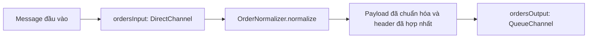

# copyHeaders — sao chép và hợp nhất header trong MessageBuilder

Trong module **SPRING_INTEGRATION_CORE**, `copyHeaders` là thao tác giúp giữ ngữ cảnh khi xây dựng thông điệp cho bước tiếp theo của một luồng tích hợp. Ví dụ, một transformer chuẩn hóa mã đơn hàng cần thay payload nhưng vẫn giữ `orderId`, `tenantId` và `traceId` để router, bộ tổng hợp và các thành phần xử lý tiếp tục làm việc đúng.

Bài này tập trung vào `copyHeaders` trong chương **MessageBuilder**: header nào được sao chép, giá trị nào thắng khi trùng tên, và cách dùng thao tác này trong Java DSL. Các ví dụ dùng API của Spring Integration 6.4.2, Java 17 trở lên; dự án thực hành cần có `org.springframework.integration:spring-integration-core` cùng các phụ thuộc tương thích do dự án quản lý.

## 1. Chọn đúng MessageBuilder

Các ví dụ trong bài dùng:

```java
import org.springframework.integration.support.MessageBuilder;
import org.springframework.messaging.Message;
```

Spring Framework còn có lớp cùng tên `org.springframework.messaging.support.MessageBuilder`. Cần kiểm tra import khi IDE tự hoàn thành, đặc biệt nếu ứng dụng dùng các khả năng riêng của Spring Integration.

`MessageBuilder.withPayload(payload)` khởi tạo builder từ payload; `MessageBuilder.fromMessage(message)` khởi tạo từ payload và header của message có sẵn. Gọi `build()` để nhận `Message<T>`. Việc xây dựng message chưa gửi nó vào `MessageChannel`. Xem [Javadoc MessageBuilder](https://docs.spring.io/spring-integration/docs/6.4.2/api/org/springframework/integration/support/MessageBuilder.html).

## 2. Hợp đồng của copyHeaders

Cách gọi cơ bản:

```java
Message<String> result = MessageBuilder
        .withPayload("ORDER-42")
        .copyHeaders(headersToCopy)
        .build();
```

Đối số `headersToCopy` có kiểu `Map<String, ?>`: tên header là chuỗi, giá trị có thể thuộc nhiều kiểu. Vì `MessageHeaders` triển khai giao diện `Map`, có thể truyền trực tiếp `source.getHeaders()`.

Với header thông thường, quy tắc hợp nhất là:

| Trạng thái ở builder | Giá trị trong map nguồn | Kết quả sau copyHeaders |
| --- | --- | --- |
| Chưa có header | Giá trị khác null | Thêm header |
| Đã có header | Giá trị khác null | Ghi đè bằng giá trị từ nguồn |
| Đã có header | Không có khóa tương ứng | Giữ giá trị đang có |
| Đã có header | Có khóa với giá trị null | Xóa header đó |
| Bất kỳ | Map nguồn rỗng | Không thay đổi |
| Bất kỳ | Cả map nguồn là null | Không thay đổi |

`copyHeaders` trả về builder để nối lời gọi. Thao tác không thay payload, không sửa map nguồn, và không xóa những header chỉ tồn tại ở builder. `id` và `timestamp` là ngoại lệ: chúng không được ghi đè bằng thao tác sao chép. Nếu cần giữ giá trị đã có, dùng `copyHeadersIfAbsent`. Xem [hợp đồng copyHeaders](https://docs.spring.io/spring-integration/docs/6.4.2/api/org/springframework/integration/support/AbstractIntegrationMessageBuilder.html#copyHeaders(java.util.Map)).

## 3. Ví dụ hoàn chỉnh: giá trị từ nguồn thắng khi trùng tên

Lớp dưới đây chỉ cần Spring Integration Core trên classpath, không cần khởi tạo Spring context:

```java
import java.util.LinkedHashMap;
import java.util.Map;

import org.springframework.integration.support.MessageBuilder;
import org.springframework.messaging.Message;

public class CopyHeadersDemo {

    public static void main(String[] args) {
        Map<String, Object> incoming = new LinkedHashMap<>();
        incoming.put("tenantId", "tenant-a");
        incoming.put("traceId", "trace-42");
        incoming.put("source", "web");

        Message<String> result = MessageBuilder
                .withPayload("ORDER-42")
                .setHeader("source", "batch")
                .setHeader("region", "vn")
                .copyHeaders(incoming)
                .build();

        System.out.println(result.getPayload());
        System.out.println(result.getHeaders().get("source", String.class));
        System.out.println(result.getHeaders().get("region", String.class));
        System.out.println(result.getHeaders().get("traceId", String.class));

        incoming.put("source", "mobile");
        System.out.println(result.getHeaders().get("source", String.class));
    }
}
```

Kết quả dự kiến:

```text
ORDER-42
web
vn
trace-42
web
```

`source=web` ghi đè `source=batch`; `region=vn` vẫn tồn tại vì map nguồn không có khóa `region`. Thay entry trong map `incoming` sau đó không thay entry đã đưa vào message. Phân biệt điều này với việc sửa một object mutable đang được dùng làm giá trị header ở mục 7.

## 4. Thứ tự gọi quyết định quyền ưu tiên

Hai chuỗi lời gọi dưới đây cho kết quả khác nhau:

```java
Map<String, Object> incoming = Map.of("source", "external");

Message<String> first = MessageBuilder.withPayload("ORDER-42")
        .setHeader("source", "internal")
        .copyHeaders(incoming)
        .build();
// first: source = external

Message<String> second = MessageBuilder.withPayload("ORDER-42")
        .copyHeaders(incoming)
        .setHeader("source", "internal")
        .build();
// second: source = internal
```

Với header được phép ghi, thao tác ghi sau cùng quyết định giá trị cuối. Nếu hợp nhất nhiều nguồn, hãy biểu diễn thứ tự ưu tiên ngay trong chuỗi builder:

```java
Map<String, Object> defaults = Map.of(
        "region", "vn",
        "source", "unknown");

Map<String, Object> requestMetadata = Map.of(
        "source", "web",
        "traceId", "trace-42");

String validatedTenantId = "tenant-a"; // Kết quả xác định từ ngữ cảnh đã xác thực.

Message<String> message = MessageBuilder.withPayload("ORDER-42")
        .copyHeaders(defaults)
        .copyHeaders(requestMetadata)
        .setHeader("tenantId", validatedTenantId)
        .build();
```

Trong ví dụ này, cấu hình mặc định có độ ưu tiên thấp nhất, metadata của yêu cầu đứng sau, và `tenantId` do ứng dụng xác định được gán cuối. Đây là chính sách của ứng dụng; `copyHeaders` không tự kiểm tra quyền sở hữu hay nguồn gốc của một header.

Nếu metadata chỉ được phép điền các chỗ còn thiếu:

```java
Message<String> message = MessageBuilder.withPayload("ORDER-42")
        .setHeader("source", "internal")
        .copyHeadersIfAbsent(Map.of(
                "source", "external",
                "traceId", "trace-42"))
        .build();
// source = internal; traceId = trace-42
```

| Nhu cầu | Cách dùng |
| --- | --- |
| Map mới được phép thay giá trị cũ | copyHeaders |
| Map chỉ bổ sung thông tin còn thiếu | copyHeadersIfAbsent |
| Chốt giá trị sau khi hợp nhất | setHeader sau các lệnh copyHeaders |
| Bổ sung một giá trị mặc định | setHeaderIfAbsent |

Không thay `copyHeaders` bằng `copyHeadersIfAbsent` một cách máy móc: chúng thể hiện hai chính sách ưu tiên khác nhau.

## 5. Sao chép header khi thay payload

Giả sử message đầu vào có mã đơn hàng chưa chuẩn hóa:

```java
Message<String> input = MessageBuilder.withPayload("  order-42  ")
        .setHeader("orderId", "42")
        .setHeader("traceId", "trace-42")
        .build();

String normalized = input.getPayload()
        .trim()
        .toUpperCase(java.util.Locale.ROOT);

Message<String> output = MessageBuilder.withPayload(normalized)
        .copyHeaders(input.getHeaders())
        .setHeader("normalized", true)
        .build();
```

`output` có payload `ORDER-42`, giữ `orderId`, `traceId` và thêm `normalized=true`. Payload ở `input` vẫn là chuỗi ban đầu. Có thể áp dụng cùng cấu trúc khi đổi kiểu payload, chẳng hạn từ `String` sang một đối tượng đơn hàng.

Nếu chỉ đổi header và giữ payload, dùng `fromMessage` cho rõ ý định:

```java
Message<String> enriched = MessageBuilder.fromMessage(input)
        .setHeader("processedBy", "normalizer")
        .build();
```

Đừng dùng phép so sánh tham chiếu để kết luận một thao tác đã thành công: `fromMessage(input).build()` có thể trả lại chính message gốc nếu không có thay đổi cần thiết. Khi có message mới được tạo, metadata kỹ thuật cũng cần được hiểu theo vòng đời message. Xem [hành vi build của builder](https://docs.spring.io/spring-integration/docs/6.4.2/api/org/springframework/integration/support/BaseMessageBuilder.html#build()).

### id và timestamp không phải mã nghiệp vụ

`MessageHeaders.ID` định danh message; `MessageHeaders.TIMESTAMP` biểu thị thời điểm tạo. Chúng là header chỉ đọc mặc định đối với API sửa và sao chép header. Vì vậy:

```java
Message<String> original = MessageBuilder.withPayload("raw")
        .setHeader("traceId", "trace-42")
        .build();

Message<String> converted = MessageBuilder.withPayload("normalized")
        .copyHeaders(original.getHeaders())
        .build();
```

Không kỳ vọng `converted` giữ `id` của `original`. Với builder mặc định trong ví dụ này, message mới có ID được tạo mới. Cũng không kiểm tra timestamp bằng điều kiện “phải lớn hơn”: hai message có thể được tạo trong cùng một mili giây.

Dùng header nghiệp vụ như `orderId`, `traceId` hoặc `correlationId` khi cần liên kết các message qua nhiều bước. `copyHeaders` giữ header đó nhưng không tự tạo trace hay thiết lập chiến lược tương quan cho aggregator. Xem [Message Headers và Header Propagation](https://docs.spring.io/spring-integration/reference/message.html).

## 6. null: bỏ qua cả map và xóa một header là hai trường hợp khác nhau

Với triển khai đang dùng, `copyHeaders(null)` không thay đổi builder. Ngược lại, một entry có giá trị `null` được chuyển thành thao tác xóa header thường. Có thể thấy cơ chế chuyển từng entry sang `setHeader` trong [mã nguồn MessageHeaderAccessor](https://raw.githubusercontent.com/spring-projects/spring-framework/v6.2.2/spring-messaging/src/main/java/org/springframework/messaging/support/MessageHeaderAccessor.java).

```java
Map<String, Object> patch = new java.util.HashMap<>();
patch.put("debugTag", null);
patch.put("traceId", "trace-new");

Message<String> result = MessageBuilder.withPayload("ORDER-42")
        .setHeader("debugTag", "temporary")
        .setHeader("traceId", "trace-old")
        .setHeader("region", "vn")
        .copyHeaders(patch)
        .build();

// debugTag không còn tồn tại.
// traceId = trace-new.
// region = vn.
```

`Map.of("debugTag", null)` không tạo được map vì `Map.of` không chấp nhận giá trị `null`. Ví dụ trên chủ động dùng `HashMap`.

Nếu yêu cầu nghiệp vụ coi `null` là “không cập nhật”, cần loại bỏ entry đó trước:

```java
Map<String, Object> nonNullPatch = new java.util.HashMap<>();
patch.forEach((name, value) -> {
    if (value != null) {
        nonNullPatch.put(name, value);
    }
});

Message<String> result = MessageBuilder.withPayload("ORDER-42")
        .setHeader("debugTag", "temporary")
        .copyHeaders(nonNullPatch)
        .build();
// debugTag vẫn là temporary.
```

Đoạn này là phương án thay thế cho lần build trước. Nó thể hiện việc chuẩn hóa dữ liệu đầu vào theo hợp đồng ứng dụng, không thay đổi quy tắc của `copyHeaders`.

## 7. Sao chép nông: giá trị mutable vẫn có thể được dùng chung

Header map của message thông thường không cho phép `put`, `remove` hay `clear`. Tuy nhiên, một object được lưu làm giá trị header vẫn có thể mutable. `copyHeaders` không đệ quy nhân bản `List`, `Map` hoặc đối tượng nghiệp vụ. Xem [quy tắc bất biến của Message Headers](https://docs.spring.io/spring-integration/reference/message.html#message-headers).

```java
java.util.List<String> tags =
        new java.util.ArrayList<>(java.util.List.of("new"));

Message<String> input = MessageBuilder.withPayload("raw")
        .setHeader("tags", tags)
        .build();

Message<String> output = MessageBuilder.withPayload("normalized")
        .copyHeaders(input.getHeaders())
        .build();

tags.add("changed");

System.out.println(input.getHeaders().get("tags"));
System.out.println(output.getHeaders().get("tags"));
```

Cả hai dòng đều in `[new, changed]`, vì giá trị header vẫn tham chiếu cùng danh sách.

Nếu muốn message giữ ảnh chụp danh sách tại thời điểm tạo, với phần tử `String` có thể dùng:

```java
Message<String> snapshot = MessageBuilder.withPayload("normalized")
        .copyHeaders(input.getHeaders())
        .setHeader("tags", java.util.List.copyOf(tags))
        .build();
```

Việc thêm hoặc xóa phần tử ở `tags` sau đó không thay đổi danh sách trong `snapshot`. Nếu phần tử là object mutable, vẫn phải xác định cách sao chép hoặc làm bất biến từng phần tử theo mô hình dữ liệu. `Map.copyOf` cũng không tự tạo deep copy.

Trong luồng có nhiều consumer hoặc xử lý bất đồng bộ, ưu tiên các giá trị header nhỏ, ổn định và bất biến. Tạo builder riêng cho từng lần xử lý message để chính sách hợp nhất không lẫn trạng thái giữa các yêu cầu.

## 8. Áp dụng trong transformer và Java DSL

Khi transformer trả về một `Message` hoàn chỉnh, mã transformer chịu trách nhiệm xây dựng các header đầu ra. Nếu transformer chỉ trả payload, framework thường truyền các header đầu vào sang đầu ra theo quy tắc propagation. Vì vậy `copyHeaders(input.getHeaders())` đặc biệt hữu ích khi chủ động trả một `Message`. Xem [Header Propagation](https://docs.spring.io/spring-integration/reference/message.html#message-header-propagation) và [cấu hình Transformer](https://docs.spring.io/spring-integration/reference/transformer.html).

Ví dụ sau tạo luồng đồng bộ từ `ordersInput`, qua transformer, rồi ghi kết quả vào `QueueChannel` để quan sát:



Lớp cấu hình có thể chạy trực tiếp trong một dự án đã có Spring Integration Core:

```java
import java.util.Locale;

import org.springframework.context.annotation.AnnotationConfigApplicationContext;
import org.springframework.context.annotation.Bean;
import org.springframework.context.annotation.Configuration;
import org.springframework.integration.channel.DirectChannel;
import org.springframework.integration.channel.QueueChannel;
import org.springframework.integration.config.EnableIntegration;
import org.springframework.integration.dsl.IntegrationFlow;
import org.springframework.integration.support.MessageBuilder;
import org.springframework.messaging.Message;
import org.springframework.messaging.MessageChannel;
import org.springframework.messaging.MessageHeaders;
import org.springframework.util.MimeTypeUtils;

@Configuration
@EnableIntegration
public class CopyHeadersFlowConfig {

    @Bean
    public MessageChannel ordersInput() {
        return new DirectChannel();
    }

    @Bean
    public QueueChannel ordersOutput() {
        return new QueueChannel();
    }

    @Bean
    public OrderNormalizer orderNormalizer() {
        return new OrderNormalizer();
    }

    @Bean
    public IntegrationFlow normalizeOrdersFlow(OrderNormalizer normalizer) {
        return IntegrationFlow.from("ordersInput")
                .transform(normalizer, "normalize")
                .channel("ordersOutput")
                .get();
    }

    public static final class OrderNormalizer {

        public Message<String> normalize(Message<String> input) {
            String normalized = input.getPayload()
                    .trim()
                    .toUpperCase(Locale.ROOT);

            return MessageBuilder.withPayload(normalized)
                    .copyHeaders(input.getHeaders())
                    .setHeader(MessageHeaders.CONTENT_TYPE, MimeTypeUtils.TEXT_PLAIN)
                    .setHeader("normalizedBy", "order-normalizer")
                    .build();
        }
    }

    public static void main(String[] args) {
        try (var context =
                     new AnnotationConfigApplicationContext(CopyHeadersFlowConfig.class)) {
            MessageChannel input = context.getBean("ordersInput", MessageChannel.class);
            QueueChannel output = context.getBean("ordersOutput", QueueChannel.class);

            input.send(MessageBuilder.withPayload("  order-42  ")
                    .setHeader("orderId", "42")
                    .setHeader("traceId", "trace-42")
                    .build());

            Message<?> result = output.receive(1000);
            if (result == null) {
                throw new IllegalStateException("Không nhận được message đầu ra");
            }

            System.out.println(result.getPayload());
            System.out.println(result.getHeaders().get("traceId"));
            System.out.println(result.getHeaders().get("normalizedBy"));
        }
    }
}
```

Ba dòng ứng dụng dự kiến in `ORDER-42`, `trace-42` và `order-normalizer`; framework có thể ghi thêm log. Header `contentType` được gán sau khi sao chép để mô tả payload đầu ra.

Phương thức `normalize` nhận toàn bộ `Message<String>`, nhờ đó có cả payload lẫn header. Cách nối một đối tượng và tên phương thức vào `.transform(...)` được mô tả trong [Transformer với Java DSL](https://docs.spring.io/spring-integration/reference/transformer.html#configuring-a-transformer-with-java-and-other-dsls).

### Chọn header theo phạm vi luồng

Trong luồng nội bộ dùng gateway, `replyChannel` có thể cần để trả lời khi không cấu hình output channel tường minh. `errorChannel` có thể tham gia cơ chế định tuyến lỗi tùy endpoint và cách thực thi. Khi xây message kế tiếp, cần xác định có tiếp tục giữ ngữ cảnh đó hay không.

Tương tự, `correlationId`, `sequenceNumber` và `sequenceSize` có ý nghĩa với việc gom nhóm hoặc sắp xếp thông điệp. Sao chép chúng chỉ phù hợp khi message vẫn thuộc cùng quan hệ nhóm. Nếu tạo một nghiệp vụ mới độc lập, cần quyết định lại các header liên quan.

Ở ranh giới truyền sang hệ thống khác, nên xây tập header nghiệp vụ được phép truyền và để adapter/header mapper xử lý phần giao thức. `copyHeaders` tự nó không chuyển một đối tượng channel nội bộ thành metadata có thể vận chuyển qua mạng.

## 9. Kiểm thử quy tắc hợp nhất

Những kiểm thử dưới đây dành cho người học chạy trong dự án có JUnit Jupiter. Chúng gọi trực tiếp builder, không cần Spring context. Kiểm thử không chỉ kiểm tra payload mà còn kiểm tra quyền ưu tiên và việc message nguồn giữ nguyên.

```java
import java.util.HashMap;
import java.util.Map;

import org.junit.jupiter.api.Test;
import org.springframework.integration.support.MessageBuilder;
import org.springframework.messaging.Message;

import static org.junit.jupiter.api.Assertions.*;

class CopyHeadersTest {

    @Test
    void copiedHeadersOverrideTargetWithoutChangingSource() {
        Message<String> source = MessageBuilder.withPayload("raw")
                .setHeader("source", "web")
                .setHeader("traceId", "trace-42")
                .build();

        Message<String> target = MessageBuilder.withPayload("normalized")
                .setHeader("source", "batch")
                .setHeader("region", "vn")
                .copyHeaders(source.getHeaders())
                .build();

        assertEquals("normalized", target.getPayload());
        assertEquals("web", target.getHeaders().get("source"));
        assertEquals("vn", target.getHeaders().get("region"));
        assertEquals("trace-42", target.getHeaders().get("traceId"));
        assertEquals("raw", source.getPayload());
        assertFalse(source.getHeaders().containsKey("region"));
        assertNotEquals(source.getHeaders().getId(), target.getHeaders().getId());
    }

    @Test
    void copyHeadersIfAbsentPreservesExplicitValue() {
        Message<String> target = MessageBuilder.withPayload("ORDER-42")
                .setHeader("source", "internal")
                .copyHeadersIfAbsent(Map.of(
                        "source", "external",
                        "traceId", "trace-42"))
                .build();

        assertEquals("internal", target.getHeaders().get("source"));
        assertEquals("trace-42", target.getHeaders().get("traceId"));
    }

    @Test
    void nullEntryRemovesHeaderWhileMissingEntryPreservesHeader() {
        Map<String, Object> patch = new HashMap<>();
        patch.put("debugTag", null);

        Message<String> target = MessageBuilder.withPayload("ORDER-42")
                .setHeader("debugTag", "temporary")
                .setHeader("region", "vn")
                .copyHeaders(patch)
                .build();

        assertFalse(target.getHeaders().containsKey("debugTag"));
        assertEquals("vn", target.getHeaders().get("region"));
    }
}
```

Có thể mở rộng kiểm thử ứng dụng bằng cách đưa một message qua luồng Java DSL rồi kiểm tra các header mà consumer thực sự sử dụng. Không dùng so sánh toàn bộ header map làm tiêu chí duy nhất, vì `id` và `timestamp` là metadata kỹ thuật của từng message.

## 10. Lỗi thường gặp và cách nhận biết

| Hiện tượng | Nguyên nhân có thể gặp | Cách xử lý |
| --- | --- | --- |
| Giá trị vừa gán bị thay mất | copyHeaders chạy sau setHeader | Đổi thứ tự hoặc dùng copyHeadersIfAbsent theo chính sách |
| Transformer trả đúng payload nhưng mất traceId | Chỉ tạo withPayload mà không đưa header vào Message trả về | Sao chép hoặc chọn các header cần giữ |
| Header biến mất sau cập nhật | Map nguồn có entry với giá trị null | Quy định rõ null là xóa hay bỏ qua |
| Hai message cùng thấy danh sách thay đổi | Dùng chung object mutable làm giá trị header | Tạo snapshot phù hợp với kiểu dữ liệu |
| ID của đầu ra khác đầu vào | Tạo một message mới bằng builder mặc định | Dùng header nghiệp vụ cho tương quan |
| Lỗi khi gọi message.getHeaders().put(...) | Header map của message là cấu trúc chỉ đọc | Dùng builder và build message phù hợp |
| Metadata cũ lấn metadata đã kiểm chứng | Map được sao chép quá muộn | Gán giá trị có thẩm quyền sau bước hợp nhất |
| Metadata nội bộ xuất hiện ở ranh giới hệ thống | Sao chép mọi header mà chưa xác định hợp đồng đầu ra | Chọn header nghiệp vụ và cấu hình mapping ở adapter |

Khi thiết kế một bước dùng `copyHeaders`, hãy xác định ba điều trước: tập header cần giữ, thứ tự ưu tiên giữa các nguồn, và cách xử lý giá trị mutable hoặc `null`. Khi các quyết định đó được biểu diễn rõ trong builder và kiểm thử, việc thay payload sẽ giữ được ngữ cảnh cần thiết cho các endpoint phía sau.