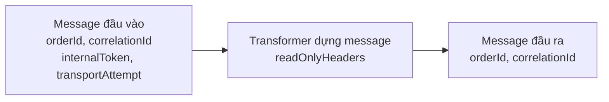

# readOnlyHeaders

Trong chương **MessageBuilder** của module **SPRING_INTEGRATION_CORE**, `readOnlyHeaders` giúp kiểm soát những header được phép đi vào message mà builder tạo ra. Kỹ thuật này hữu ích tại điểm chuyển tiếp giữa các luồng tích hợp: giữ dữ liệu cần cho nghiệp vụ, đồng thời loại metadata chỉ có ý nghĩa ở chặng xử lý trước.

Bài học sử dụng API của **Spring Integration 6.5**, đối chiếu mã nguồn **6.5.0** khi giải thích chi tiết hành vi. API `readOnlyHeaders(String...)` xuất hiện từ phiên bản 4.3.2. Các ví dụ Java giả định dự án đã có `spring-integration-core`; phần kiểm thử dùng JUnit Jupiter. Khi dùng Spring Boot, chọn dependency theo BOM của dự án.

Sau bài học, bạn có thể:

- Giải thích chính xác ý nghĩa của một custom header được đánh dấu read-only.
- Dùng builder để loại header khi sao chép hoặc dựng lại message.
- Phân biệt cấu hình cho một builder, một factory và các thành phần framework.
- Đặt bước xử lý header vào Java DSL và xác định các điều kiện cần kiểm thử.

## 1. Bài toán: metadata của chặng trước đi theo message quá xa

Giả sử luồng nhận đơn hàng tạo message như sau:

| Thành phần | Giá trị minh họa | Ý nghĩa |
| --- | --- | --- |
| Payload | `order-created` | Sự kiện nghiệp vụ |
| `orderId` | `ORD-2026-008` | Định danh đơn hàng |
| `correlationId` | `ORDER-FLOW-008` | Liên kết các message của cùng tiến trình |
| `internalToken` | `temporary-token` | Metadata dùng trong bước xử lý nội bộ |
| `transportAttempt` | `3` | Số lần thử ở chặng vận chuyển trước |

Khi chuyển sang luồng xử lý nghiệp vụ, ta muốn giữ `orderId` và `correlationId`, nhưng bỏ `internalToken` và `transportAttempt`. Quyết định này thuộc thiết kế của luồng: một ứng dụng khác có thể vẫn cần số lần thử để theo dõi.

Nếu chỉ sao chép toàn bộ headers, metadata cũ tiếp tục xuất hiện trong message đầu ra. `readOnlyHeaders` cho phép builder sử dụng một danh sách tên header cần ngăn đưa vào kết quả.



Đây là bước biến đổi message. `MessageChannel` vận chuyển message; chính transformer trong sơ đồ thực hiện chính sách loại header.

## 2. Hiểu đúng chữ “read-only”

### 2.1. Custom header bị loại khỏi kết quả dựng message

Với custom header, ý nghĩa quan trọng của `readOnlyHeaders` là **ngăn header được đưa vào message đầu ra**, kể cả header đã có trong message nguồn. API này không cung cấp cơ chế “giữ nguyên giá trị cũ nhưng cấm đổi sang giá trị mới”. Tài liệu mô tả nó như danh sách các header không nên được sao chép từ message phía trước. Xem [Read-only Headers](https://docs.spring.io/spring-integration/reference/6.5/message.html#message-header-accessor).

Ví dụ, yêu cầu:

```text
Giữ tenantId=tenant-A ở đầu ra và cấm thay đổi tenantId.
```

không được đáp ứng bằng cách đưa `tenantId` vào `readOnlyHeaders`. Cách đó sẽ làm `tenantId` vắng mặt trong message được dựng lại. Nếu cần bảo vệ giá trị tenant, hãy xác thực nó tại điểm nhận dữ liệu và giới hạn nơi được phép tạo message với giá trị tenant khác.

### 2.2. Khác với tính bất biến của MessageHeaders

Ở cách sử dụng thông thường, `MessageHeaders` không cho sửa trực tiếp qua `put`, `remove` hay `clear`. Để thay đổi headers, ứng dụng dùng builder tạo kết quả mới. Tính bất biến của cấu trúc headers cũng không đồng nghĩa mọi object chứa trong payload hoặc giá trị header đều bất biến. Xem [Message Headers](https://docs.spring.io/spring-integration/reference/6.5/message.html#message-headers).

Ba khái niệm cần tách biệt:

| Khái niệm | Câu hỏi nó giải quyết |
| --- | --- |
| Cấu trúc `MessageHeaders` bất biến | Có được sửa trực tiếp map headers của message này không? |
| `readOnlyHeaders` trên builder | Những tên header nào bị ngăn đưa vào kết quả dựng message? |
| Object bất biến | Bản thân payload hoặc object nằm trong một header có thể thay đổi trạng thái không? |

`readOnlyHeaders` không sao chép sâu payload và không làm một `List` đang nằm trong header trở thành immutable.

## 3. Đúng lớp MessageBuilder và cách khai báo

Spring có hai lớp cùng tên. Bài này dùng lớp thuộc Spring Integration:

```java
import org.springframework.integration.support.MessageBuilder;
import org.springframework.messaging.Message;
```

Không dùng import dưới đây cho các ví dụ gọi `readOnlyHeaders`:

```java
import org.springframework.messaging.support.MessageBuilder;
```

Lớp trong `org.springframework.messaging.support` thuộc Spring Framework và không cung cấp phương thức này. Đối chiếu [MessageBuilder của Spring Integration](https://docs.spring.io/spring-integration/docs/6.5.0/api/org/springframework/integration/support/MessageBuilder.html) và [MessageBuilder của Spring Framework](https://github.com/spring-projects/spring-framework/blob/v6.2.7/spring-messaging/src/main/java/org/springframework/messaging/support/MessageBuilder.java).

Cách gọi điển hình:

```java
Message<String> result = MessageBuilder.withPayload("order-created")
        .readOnlyHeaders("internalToken", "transportAttempt")
        .setHeader("orderId", "ORD-2026-008")
        .build();
```

Các tham số là **tên header chính xác**. Trong triển khai được đối chiếu, danh sách custom headers được kiểm tra bằng phép tìm tên trong tập hợp; vì vậy `"internal*"` không có ý nghĩa wildcard để khớp `internalToken`. Dùng `removeHeaders` hoặc một bước Header Filter có hỗ trợ pattern nếu muốn xử lý theo mẫu tên. Xem [IntegrationMessageHeaderAccessor 6.5.0](https://github.com/spring-projects/spring-integration/blob/v6.5.0/spring-integration-core/src/main/java/org/springframework/integration/IntegrationMessageHeaderAccessor.java).

Nên truyền đầy đủ danh sách trong một lần:

```java
.readOnlyHeaders("internalToken", "transportAttempt")
```

Một lần gọi mới với danh sách khác có thể thay danh sách custom đã cấu hình. Không dùng nhiều lần gọi liên tiếp với giả định mỗi lần sẽ cộng thêm một tên.

## 4. Ví dụ: dựng lại message và giữ nguyên message nguồn

Ví dụ hoàn chỉnh sau có thể đặt trong `ReadOnlyHeadersDemo.java` của một dự án đã có dependency phù hợp:

```java
import org.springframework.integration.IntegrationMessageHeaderAccessor;
import org.springframework.integration.support.MessageBuilder;
import org.springframework.messaging.Message;

public class ReadOnlyHeadersDemo {

    public static void main(String[] args) {
        Message<String> incoming = MessageBuilder.withPayload("order-created")
                .setHeader("orderId", "ORD-2026-008")
                .setHeader(
                        IntegrationMessageHeaderAccessor.CORRELATION_ID,
                        "ORDER-FLOW-008")
                .setHeader("internalToken", "temporary-token")
                .setHeader("transportAttempt", 3)
                .build();

        Message<String> outgoing = MessageBuilder.fromMessage(incoming)
                .readOnlyHeaders("internalToken", "transportAttempt")
                .build();

        System.out.println(outgoing.getPayload());
        System.out.println(outgoing.getHeaders().get("orderId"));
        System.out.println(outgoing.getHeaders().get(
                IntegrationMessageHeaderAccessor.CORRELATION_ID));
        System.out.println(outgoing.getHeaders().containsKey("internalToken"));
        System.out.println(outgoing.getHeaders().containsKey("transportAttempt"));

        // Message nguồn vẫn giữ cấu trúc headers ban đầu.
        System.out.println(incoming.getHeaders().containsKey("internalToken"));
    }
}
```

Kết quả mong đợi:

```text
order-created
ORD-2026-008
ORDER-FLOW-008
false
false
true
```

`fromMessage` lấy payload và headers của message nguồn làm cơ sở. Khi tạo kết quả, các custom headers thuộc danh sách bị loại. Việc này không xóa header trên `incoming`.

Không cần thêm `removeHeader("internalToken")` sau `readOnlyHeaders` để đạt kết quả trên. Trong triển khai 6.5.0, accessor lọc các tên custom read-only khi xuất map cho builder, còn builder tránh trả lại nguyên message nguồn nếu nó đang chứa một tên trong danh sách cần loại. Xem [BaseMessageBuilder 6.5.0](https://github.com/spring-projects/spring-integration/blob/v6.5.0/spring-integration-core/src/main/java/org/springframework/integration/support/BaseMessageBuilder.java).

## 5. Sao chép header và gán trực tiếp có hành vi khác nhau

Không nên hiểu rằng mọi thao tác liên quan đến read-only header đều được bỏ qua một cách im lặng.

### 5.1. copyHeaders bỏ qua tên bị chặn

Khi đã khai báo danh sách trước thao tác sao chép:

```java
import java.util.Map;
import org.springframework.integration.support.MessageBuilder;
import org.springframework.messaging.Message;

Message<String> result = MessageBuilder.withPayload("order-created")
        .readOnlyHeaders("internalToken")
        .copyHeaders(Map.of(
                "internalToken", "temporary-token",
                "orderId", "ORD-2026-008"))
        .build();
```

`result` có `orderId`, còn `internalToken` vắng mặt. `copyHeadersIfAbsent` cũng bỏ qua tên đã được xem là read-only; phần “if absent” chỉ quyết định có ghi đè header thông thường đã tồn tại hay không.

### 5.2. setHeader trực tiếp có thể ném ngoại lệ

Với danh sách đã được khai báo:

```java
MessageBuilder<String> builder = MessageBuilder.withPayload("order-created")
        .readOnlyHeaders("internalToken");

builder.setHeader("internalToken", "another-token");
// IllegalArgumentException tại lệnh setHeader.
```

Ở đường gọi này, builder chuyển thao tác sang `MessageHeaderAccessor.setHeader`, phương thức kiểm tra read-only và ném `IllegalArgumentException`. Cần phân biệt nó với việc copy bỏ qua tên bị chặn. Xem [MessageHeaderAccessor.setHeader và copyHeaders](https://github.com/spring-projects/spring-framework/blob/v6.2.7/spring-messaging/src/main/java/org/springframework/messaging/support/MessageHeaderAccessor.java).

### 5.3. Header đã được gán trước đó vẫn bị loại ở kết quả

```java
Message<String> result = MessageBuilder.withPayload("order-created")
        .setHeader("internalToken", "temporary-token")
        .readOnlyHeaders("internalToken")
        .build();
```

Lúc gọi `setHeader`, tên này chưa được cấu hình read-only nên thao tác hợp lệ. Sau đó, bước dựng kết quả loại nó. Đặt danh sách trước các lệnh copy thường giúp thể hiện chủ đích rõ hơn.

Bảng đối chiếu cho các tình huống trên:

| Thao tác | Điều kiện | Kết quả cần dự kiến |
| --- | --- | --- |
| `copyHeaders(map)` | Tên đã được cấu hình read-only | Bỏ qua tên đó |
| `copyHeadersIfAbsent(map)` | Tên đã được cấu hình read-only | Bỏ qua tên đó |
| `setHeader(name, value)` | Tên đã được cấu hình read-only | `IllegalArgumentException` |
| Gán header, sau đó khai báo nó read-only | Header đã nằm trong builder | Header bị loại khi dựng kết quả |
| `fromMessage(source)` rồi khai báo read-only | Header nằm trong message nguồn | Kết quả thiếu header đó; nguồn giữ nguyên |

Với `setHeaderIfAbsent`, đường thực thi còn phụ thuộc header đã có giá trị hay chưa. Không dùng nó như cách lách việc gán một read-only header. Trong kiểm thử nghiệp vụ, hãy kiểm tra headers của message đầu ra, thay vì dựa vào việc có hay không có một dòng log.

## 6. id và timestamp là hai header đặc biệt

`MessageHeaders.ID` và `MessageHeaders.TIMESTAMP` được bảo vệ sẵn. Thêm custom header vào danh sách không làm mất sự bảo vệ này.

Với đường tạo `GenericMessage` thông thường trong các ví dụ:

- Message mới nhận ID do framework tạo.
- Timestamp của message mới biểu diễn thời điểm tạo message đó.
- Gọi `setHeader` để tự ghi `id` hoặc `timestamp` không phải cách hợp lệ để gán metadata nguồn.
- Muốn giữ thông tin từ hệ thống bên ngoài, dùng custom header như `sourceMessageId` và `sourceTimestamp`.

Ví dụ lưu thông tin nguồn dưới tên riêng:

```java
Message<String> result = MessageBuilder.withPayload("order-created")
        .setHeader("sourceMessageId", "external-message-8842")
        .setHeader("sourceTimestamp", 1_795_132_800_000L)
        .build();
```

Không dùng ID kỹ thuật làm định danh đơn hàng ổn định xuyên suốt mọi bước biến đổi. `orderId` hoặc correlation ID phù hợp hơn cho mục đích đó.

Cũng không mặc định mọi lệnh `fromMessage(message).build()` luôn tạo object mới: builder có thể trả lại message nguồn nếu không có thay đổi cần áp dụng. Khi kiểm tra một trường hợp thật sự dựng message mới, không yêu cầu timestamp mới phải lớn hơn tuyệt đối timestamp cũ; hai lần tạo có thể nằm trong cùng một mili giây. Đối chiếu [MessageBuilder.build](https://docs.spring.io/spring-integration/docs/6.5.0/api/org/springframework/integration/support/BaseMessageBuilder.html#build()).

## 7. Phạm vi cấu hình: builder, factory và framework

### 7.1. Một builder chỉ áp dụng cho lần xử lý của nó

```java
Message<String> first = MessageBuilder.withPayload("event-1")
        .readOnlyHeaders("internalToken")
        .copyHeaders(Map.of("internalToken", "temporary-token"))
        .build();

Message<String> second = MessageBuilder.withPayload("event-2")
        .setHeader("internalToken", "another-token")
        .build();
```

`first` không có `internalToken`, còn `second` có header này. Danh sách read-only là cấu hình của builder/accessor, không phải một chính sách được ghi vào message rồi tự truyền cho mọi builder tiếp theo.

Do đó, một bước phía sau vẫn có thể thêm lại cùng tên header nếu nó sử dụng builder khác không có cấu hình tương ứng.

### 7.2. DefaultMessageBuilderFactory giúp tái sử dụng danh sách

```java
import org.springframework.integration.support.DefaultMessageBuilderFactory;
import org.springframework.messaging.Message;

DefaultMessageBuilderFactory factory = new DefaultMessageBuilderFactory();
factory.setReadOnlyHeaders("internalToken");
factory.addReadOnlyHeaders("transportAttempt");

Message<String> result = factory.withPayload("order-created")
        .copyHeaders(Map.of(
                "orderId", "ORD-2026-008",
                "internalToken", "temporary-token",
                "transportAttempt", 3))
        .build();
```

`setReadOnlyHeaders` thiết lập danh sách custom cho factory; `addReadOnlyHeaders` bổ sung tên. Các builder do `factory.withPayload` hoặc `factory.fromMessage` tạo ra nhận danh sách đó. Xem [DefaultMessageBuilderFactory API](https://docs.spring.io/spring-integration/docs/6.5.0/api/org/springframework/integration/support/DefaultMessageBuilderFactory.html).

Một factory do bạn tự tạo chỉ tác động đến code thực sự sử dụng nó. Nó không tự cấu hình mọi endpoint trong application context. Tương tự, lời gọi static `MessageBuilder.withPayload(...)` không tự tra cứu cấu hình từ một factory bean. Đối chiếu [mã nguồn DefaultMessageBuilderFactory](https://github.com/spring-projects/spring-integration/blob/v6.5.0/spring-integration-core/src/main/java/org/springframework/integration/support/DefaultMessageBuilderFactory.java).

### 7.3. Global property cho các thành phần framework

Cách cấu hình được tài liệu Spring Integration mô tả là đặt thuộc tính sau trong tài nguyên classpath `META-INF/spring.integration.properties`:

```properties
spring.integration.readOnly.headers=internalToken,transportAttempt
```

Trong dự án có bố cục Maven hoặc Gradle thông thường, tài nguyên này được đặt tại:

```text
src/main/resources/META-INF/spring.integration.properties
```

Đây là hướng dẫn vị trí cấu hình cho dự án thực hành; bài học không yêu cầu tạo file đó trong module tài liệu.

Giá trị là danh sách tên header phân tách bằng dấu phẩy. Framework dùng nó để cấu hình `DefaultMessageBuilderFactory` phục vụ các thành phần tương ứng. Không suy ra rằng chỉ cần chép thuộc tính này vào một file cấu hình bất kỳ là chắc chắn có hiệu lực; hãy dùng cơ chế được phiên bản framework của dự án hỗ trợ. Xem [Global Properties](https://docs.spring.io/spring-integration/reference/6.5/configuration/global-properties.html).

Cấu hình này cũng không có nghĩa toàn bộ message đang tồn tại trên mọi channel được quét để xóa header. Cần có đường xử lý sử dụng factory/builder với chính sách đó. Router hoặc bridge chuyển tiếp message hiện có không tự trở thành bước làm sạch headers.

## 8. Đưa chính sách vào một luồng Java DSL

Ví dụ dưới đây dùng một transformer nhận toàn bộ `Message<?>` và trả về một message đã dựng lại:

```java
import org.springframework.context.annotation.Bean;
import org.springframework.context.annotation.Configuration;
import org.springframework.integration.channel.DirectChannel;
import org.springframework.integration.channel.QueueChannel;
import org.springframework.integration.config.EnableIntegration;
import org.springframework.integration.dsl.IntegrationFlow;
import org.springframework.integration.support.MessageBuilder;
import org.springframework.integration.transformer.AbstractTransformer;
import org.springframework.messaging.Message;
import org.springframework.messaging.MessageChannel;

@Configuration
@EnableIntegration
public class SanitizedOrderFlowConfiguration {

    @Bean
    public MessageChannel orderInput() {
        return new DirectChannel();
    }

    @Bean
    public QueueChannel sanitizedOrders() {
        return new QueueChannel();
    }

    @Bean
    public IntegrationFlow sanitizeOrderHeaders() {
        return IntegrationFlow.from(orderInput())
                .transform(new AbstractTransformer() {
                    @Override
                    protected Object doTransform(Message<?> message) {
                        return MessageBuilder.fromMessage(message)
                                .readOnlyHeaders(
                                        "internalToken",
                                        "transportAttempt")
                                .build();
                    }
                })
                .channel(sanitizedOrders())
                .get();
    }
}
```

Điểm đáng chú ý là transformer trả về **toàn bộ message đầu ra**. Nếu transformer chỉ trả về payload, framework có thể xây message kết quả bằng cách mang headers đầu vào sang. Khi trả về `Message`, bước biến đổi có trách nhiệm cung cấp headers đầu ra theo chủ đích của nó. Xem [AbstractTransformer](https://github.com/spring-projects/spring-integration/blob/v6.5.0/spring-integration-core/src/main/java/org/springframework/integration/transformer/AbstractTransformer.java).

Có thể gửi thử trong một chương trình Java độc lập đã có các dependency:

```java
import org.springframework.context.annotation.AnnotationConfigApplicationContext;
import org.springframework.integration.channel.QueueChannel;
import org.springframework.integration.support.MessageBuilder;
import org.springframework.messaging.Message;
import org.springframework.messaging.MessageChannel;

public class SanitizedOrderFlowDemo {

    public static void main(String[] args) {
        try (var context = new AnnotationConfigApplicationContext(
                SanitizedOrderFlowConfiguration.class)) {

            MessageChannel input =
                    context.getBean("orderInput", MessageChannel.class);
            QueueChannel output =
                    context.getBean("sanitizedOrders", QueueChannel.class);

            input.send(MessageBuilder.withPayload("order-created")
                    .setHeader("orderId", "ORD-2026-008")
                    .setHeader("internalToken", "temporary-token")
                    .setHeader("transportAttempt", 3)
                    .build());

            Message<?> result = output.receive(1_000);

            if (result == null) {
                throw new IllegalStateException("Không nhận được message đầu ra");
            }

            System.out.println(result.getHeaders().get("orderId"));
            System.out.println(
                    result.getHeaders().containsKey("internalToken"));
        }
    }
}
```

Kết quả mong đợi:

```text
ORD-2026-008
false
```

Trong ứng dụng có gateway request–reply, hãy giữ đường trả lời cần thiết. Trong luồng có router dựa vào header, hãy đặt bước loại header sau lần cuối router cần dùng nó. Với splitter–aggregator, xem xét `correlationId`, `sequenceNumber` và `sequenceSize` trước khi quyết định loại bỏ.

Những điều kiện này là quyết định thiết kế: vị trí của bước biến đổi phải phù hợp với các endpoint còn sử dụng metadata phía sau.

## 9. Kiểm thử các hành vi quan trọng

Các kiểm thử mẫu sau tập trung vào hợp đồng của message đầu ra và lỗi gán trực tiếp. Chúng minh họa cách kiểm chứng trong dự án thực hành, không khẳng định đã được thực thi trong quá trình biên soạn tài liệu.

```java
import java.util.Map;

import org.junit.jupiter.api.Test;
import org.springframework.integration.support.DefaultMessageBuilderFactory;
import org.springframework.integration.support.MessageBuilder;
import org.springframework.messaging.Message;

import static org.junit.jupiter.api.Assertions.*;

class ReadOnlyHeadersTest {

    @Test
    void removesConfiguredHeadersAndPreservesSource() {
        Message<String> incoming = MessageBuilder.withPayload("order-created")
                .setHeader("orderId", "ORD-2026-008")
                .setHeader("internalToken", "temporary-token")
                .setHeader("transportAttempt", 3)
                .build();

        Message<String> outgoing = MessageBuilder.fromMessage(incoming)
                .readOnlyHeaders("internalToken", "transportAttempt")
                .build();

        assertEquals(incoming.getPayload(), outgoing.getPayload());
        assertEquals("ORD-2026-008", outgoing.getHeaders().get("orderId"));
        assertFalse(outgoing.getHeaders().containsKey("internalToken"));
        assertFalse(outgoing.getHeaders().containsKey("transportAttempt"));
        assertTrue(incoming.getHeaders().containsKey("internalToken"));
        assertNotEquals(
                incoming.getHeaders().getId(),
                outgoing.getHeaders().getId());
    }

    @Test
    void skipsBlockedNamesDuringHeaderCopy() {
        Message<String> outgoing = MessageBuilder.withPayload("order-created")
                .readOnlyHeaders("internalToken")
                .copyHeaders(Map.of(
                        "internalToken", "temporary-token",
                        "orderId", "ORD-2026-008"))
                .build();

        assertEquals("ORD-2026-008", outgoing.getHeaders().get("orderId"));
        assertFalse(outgoing.getHeaders().containsKey("internalToken"));
    }

    @Test
    void rejectsDirectAssignmentToBlockedHeader() {
        MessageBuilder<String> builder =
                MessageBuilder.withPayload("order-created")
                        .readOnlyHeaders("internalToken");

        assertThrows(IllegalArgumentException.class,
                () -> builder.setHeader("internalToken", "another-token"));
    }

    @Test
    void factoryPolicyDoesNotConfigureIndependentStaticBuilder() {
        DefaultMessageBuilderFactory factory =
                new DefaultMessageBuilderFactory();
        factory.setReadOnlyHeaders("internalToken");

        Message<String> throughFactory = factory.withPayload("event-1")
                .copyHeaders(Map.of("internalToken", "temporary-token"))
                .build();

        Message<String> throughStaticBuilder =
                MessageBuilder.withPayload("event-2")
                        .setHeader("internalToken", "another-token")
                        .build();

        assertFalse(
                throughFactory.getHeaders().containsKey("internalToken"));
        assertTrue(
                throughStaticBuilder.getHeaders().containsKey("internalToken"));
    }
}
```

Ở kiểm thử đầu, source chứa các header cần loại nên builder phải dựng kết quả khác. Kiểm tra ID khác nhau có ý nghĩa trong chính kịch bản này. Không áp dụng điều kiện đó một cách máy móc cho một lần `fromMessage(...).build()` không thay đổi gì.

Nếu triển khai global property, bổ sung kiểm thử với application context thật và endpoint thật đang dùng cấu hình đó. Một unit test tự gọi builder và tự đặt `readOnlyHeaders` chỉ chứng minh cấu hình cục bộ hoạt động.

## 10. Chọn đúng công cụ xử lý header

| Nhu cầu | Công cụ phù hợp | Cần lưu ý |
| --- | --- | --- |
| Ngăn một nhóm tên header xuất hiện trong kết quả của builder | `readOnlyHeaders` | Custom header bị loại khỏi kết quả |
| Xóa một header ở một điểm cụ thể | `removeHeader` hoặc Header Filter | Thể hiện trực tiếp bước xóa |
| Loại nhóm header có chung tiền tố | `removeHeaders` hoặc Header Filter có bật xử lý pattern | Kiểm tra cơ chế pattern của API đang dùng |
| Hạn chế headers được truyền từ request sang reply ở một handler | `notPropagatedHeaders` | Điều khiển việc truyền header ở endpoint |
| Bổ sung một header nếu chưa tồn tại | `setHeaderIfAbsent` | Không tạo chính sách bảo vệ xuyên suốt luồng |
| Chỉ cho một tập headers đi ra adapter bên ngoài | Header mapper hoặc dựng tập headers được phép | Phù hợp với hợp đồng của giao thức đích |

`notPropagatedHeaders` giới hạn việc framework mang headers từ message đầu vào sang kết quả của handler. Nó không tương đương một bước xóa mọi header đã được user code đặt trong message trả về. Tài liệu cũng nêu việc ngăn truyền headers không áp dụng cho endpoint chỉ chuyển tiếp message, chẳng hạn bridge và router. Xem [Header Propagation](https://docs.spring.io/spring-integration/reference/6.5/message.html#message-header-propagation).

Cũng cần phân biệt **Header Filter**, loại các headers được chọn, với **Message Filter**, quyết định cho đi tiếp hay loại cả message dựa trên một điều kiện.

## 11. Các lỗi thường gặp và cách xử lý

| Hiện tượng | Nguyên nhân cần kiểm tra | Hướng xử lý |
| --- | --- | --- |
| IDE không tìm thấy `readOnlyHeaders` | Import `MessageBuilder` thuộc Spring Framework | Đổi sang `org.springframework.integration.support.MessageBuilder` |
| `tenantId` mất sau khi build | Hiểu read-only là giữ nguyên giá trị | Không đưa header cần giữ vào danh sách loại |
| `setHeader` ném `IllegalArgumentException` | Gán trực tiếp tên đã được đánh dấu read-only | Loại lệnh gán hoặc điều chỉnh chính sách tại đúng bước |
| `internalToken` vẫn còn khi dùng `"internal*"` | Dùng pattern ở API nhận tên chính xác | Truyền tên đầy đủ hoặc dùng API hỗ trợ pattern |
| Một flow bỏ header, flow khác vẫn giữ | Cấu hình chỉ nằm trên một builder/factory | Xác định chính xác đường tạo message của từng flow |
| Header xuất hiện lại ở bước sau | Builder mới không có chính sách hoặc code gán lại | Kiểm tra toàn bộ chặng từ bước làm sạch đến đích |
| Gateway không nhận reply | Đã loại metadata cần cho đường trả lời | Giữ hoặc cấu hình rõ reply channel |
| Router chọn sai nhánh, aggregator thiếu nhóm | Loại header trước endpoint còn cần sử dụng | Dời bước loại header đến sau lần sử dụng cuối |

Đặc biệt với global property, đừng đưa `replyChannel`, `errorChannel` hay các sequence headers vào danh sách theo thói quen. Chỉ loại chúng khi luồng đã có cách định tuyến và điều phối thay thế phù hợp.

Một lỗi từ builder bên trong transformer có thể được bọc thành lỗi biến đổi message; cơ chế đưa lỗi đến bên gọi hoặc error flow phụ thuộc channel và cấu hình endpoint. Không giả định một header bị chặn luôn dẫn đến việc message được chuyển sang một error channel cụ thể.

## 12. Thực hành áp dụng vào thiết kế luồng

Với luồng nhận đơn hàng ở đầu bài, hãy thực hiện lần lượt:

1. Liệt kê từng header và endpoint cuối cùng còn sử dụng nó.
2. Đặt transformer sau bước cuối cùng cần `internalToken` và `transportAttempt`.
3. Dựng message đầu ra bằng `fromMessage(...).readOnlyHeaders(...).build()`.
4. Kiểm tra payload, `orderId` và correlation ID còn đúng; hai header cần loại vắng mặt; message nguồn giữ nguyên.
5. Gửi message qua các endpoint phía sau để xác nhận reply, routing và aggregation vẫn hoạt động theo thiết kế.

Chỉ đưa chính sách lên mức factory hoặc global khi các luồng thuộc phạm vi đó cùng cần một quy tắc. Nếu mỗi nhánh xử lý có hợp đồng metadata khác nhau, giữ cấu hình gần transformer sẽ giúp người đọc thấy rõ điểm chuyển đổi và nguyên nhân của nó.
