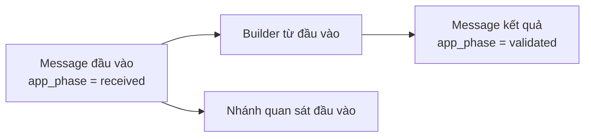

# MessageBuilder và header bất biến

Trong module **SPRING_INTEGRATION_CORE**, chương **MessageBuilder**, bài này giải thích cách xây dựng và biến đổi thông điệp mà vẫn giữ được ý nghĩa của metadata. Đây là nền tảng để nối Message, MessageChannel, endpoint và gateway thành luồng bằng Java DSL; đồng thời giúp transformer, router, filter và aggregator trao đổi đúng dữ liệu.

Một đơn hàng có thể đi qua bước chuẩn hóa, định tuyến và tổng hợp. Mỗi bước cần bổ sung thông tin như nguồn tiếp nhận, mã tương quan hoặc trạng thái xử lý. Với mô hình thông điệp bất biến, bước xử lý tạo ra kết quả mới thay vì sửa trực tiếp header của thông điệp đầu vào. Tuy nhiên, tính bất biến này có giới hạn: một danh sách đặt trong header vẫn có thể bị sửa nếu ứng dụng còn giữ tham chiếu đến nó.

## 1. Mục tiêu và kiến thức cần có

Sau bài này, bạn có thể:

- Tạo `Message<T>` bằng `withPayload(...)` và biến đổi từ thông điệp có sẵn bằng `fromMessage(...)`.
- Chọn đúng thao tác đặt, sao chép và xóa header; giải thích thứ tự ghi đè.
- Phân biệt tính bất biến của cấu trúc header với tính bất biến của các đối tượng được tham chiếu.
- Giữ metadata nghiệp vụ khi thay payload và phân biệt message ID với mã sự kiện, mã tương quan.
- Áp dụng builder trong transformer, đọc kết quả qua channel và viết kiểm thử cho hợp đồng thông điệp.

Bạn nên biết Java generics, collection, tham chiếu đối tượng và khái niệm channel trong Spring Integration. Ví dụ dùng cú pháp Java 17 và API Spring Integration 6.5.0 làm mốc đối chiếu. Các ví dụ kiểm thử dùng JUnit Jupiter; chúng là mã minh họa trong tài liệu, chưa được biên dịch hoặc chạy trong bước soạn bài này.

## 2. Thông điệp bất biến ở những điểm nào?

### 2.1. Payload và headers

Một `Message<T>` có hai phần truy cập chính:

```java
T payload = message.getPayload();
MessageHeaders headers = message.getHeaders();
```

Payload biểu diễn dữ liệu được xử lý, ví dụ đơn hàng. Headers mang metadata phục vụ định tuyến, tương quan, phản hồi hoặc theo dõi.

Đối với thông điệp thông thường được tạo bằng builder mặc định:

- Giao diện `Message` không cung cấp phương thức thay payload.
- `MessageHeaders` có giao diện đọc như một `Map<String, Object>`, nhưng các thao tác thay đổi cấu trúc như `put`, `remove`, `putAll` và `clear` bị từ chối.
- Bất biến ở lớp bao không tự làm payload hay giá trị header trở thành đối tượng bất biến.

Ví dụ sau ném `UnsupportedOperationException`:

```java
message.getHeaders().put("app_phase", "validated");
```

Muốn có header mới, hãy xây dựng thông điệp kết quả. Hợp đồng các thao tác trên `MessageHeaders` được mô tả trong [Javadoc MessageHeaders](https://docs.spring.io/spring-framework/docs/current/javadoc-api/org/springframework/messaging/MessageHeaders.html).

### 2.2. Builder có trạng thái thay đổi

Builder giữ trạng thái trong lúc lắp ráp thông điệp:

```text
Tạo builder → đặt/sao chép/xóa header → build() → nhận Message
```

Mỗi lời gọi `setHeader(...)` điều chỉnh trạng thái của builder. Sau `build()`, mã phía sau nhận một thông điệp với cấu trúc header chỉ đọc theo cách sử dụng thông thường.

Vì builder có trạng thái, nên tạo builder trong phạm vi từng lần xử lý. Không giữ một builder làm field dùng chung của singleton service để xây thông điệp cho nhiều yêu cầu. Ngay cả khi chỉ chạy tuần tự, header từ yêu cầu trước vẫn có thể bị mang sang yêu cầu sau.

### 2.3. Phạm vi của quy tắc bất biến

Spring còn có API `MessageHeaderAccessor`, bao gồm cơ chế giữ headers ở trạng thái mutable trong một số quy trình hạ tầng. Vì vậy, không nên diễn giải rằng mọi cách hiện thực `Message` đều có đồ thị đối tượng bất biến tuyệt đối.

Bài này dùng builder mặc định của Spring Integration. Trong mã nghiệp vụ, quy tắc áp dụng là tạo kết quả mới khi thay metadata. Những cơ chế như `setLeaveMutable(true)` đòi hỏi kiểm soát vòng đời riêng và không cần thiết cho ví dụ ở đây. Xem [Javadoc MessageHeaderAccessor](https://docs.spring.io/spring-framework/docs/current/javadoc-api/org/springframework/messaging/support/MessageHeaderAccessor.html).

## 3. Chọn đúng MessageBuilder

Có hai lớp cùng tên thường gặp:

| Lớp | Vai trò trong bài |
| --- | --- |
| `org.springframework.messaging.support.MessageBuilder` | Builder thuộc Spring Framework, phục vụ các abstraction messaging dùng chung. |
| `org.springframework.integration.support.MessageBuilder` | Builder thuộc Spring Integration, có thêm tiện ích gắn với metadata tích hợp, chẳng hạn correlation và sequence. |

Cả hai đều làm việc với `org.springframework.messaging.Message<T>`. Trong toàn bộ ví dụ tiếp theo, import được chọn là:

```java
import org.springframework.integration.support.MessageBuilder;
import org.springframework.messaging.Message;
import org.springframework.messaging.MessageHeaders;
```

Không import đồng thời hai lớp `MessageBuilder` bằng tên ngắn. Khi IDE tự thêm import, cần kiểm tra package nếu không tìm thấy phương thức như `setCorrelationId(...)`.

Builder của Spring Integration có hai điểm khởi đầu chính là `withPayload(...)` và `fromMessage(...)`. Xem [Javadoc MessageBuilder 6.5.0](https://docs.spring.io/spring-integration/docs/6.5.0/api/org/springframework/integration/support/MessageBuilder.html) và [mã nguồn builder của Spring Framework](https://raw.githubusercontent.com/spring-projects/spring-framework/v6.2.7/spring-messaging/src/main/java/org/springframework/messaging/support/MessageBuilder.java).

## 4. Tạo thông điệp từ payload

### 4.1. Ví dụ hoàn chỉnh đầu tiên

```java
import java.util.Objects;

import org.springframework.integration.support.MessageBuilder;
import org.springframework.messaging.Message;

public class MessageCreationExample {

    public record Order(String orderId, String email) {
    }

    public static void main(String[] args) {
        Order order = new Order("ORD-1001", "buyer@example.com");

        Message<Order> message = MessageBuilder
                .withPayload(order)
                .setHeader("app_tenant", "shop-vn")
                .setHeader("app_source", "mobile")
                .setHeader("app_phase", "received")
                .build();

        String tenant = Objects.requireNonNull(
                message.getHeaders().get("app_tenant", String.class));

        System.out.println(message.getPayload().orderId());
        System.out.println(tenant);
        System.out.println(message.getHeaders().getId());
    }
}
```

Hai dòng đầu in `ORD-1001` và `shop-vn`. Dòng cuối in message ID được framework cấp trong cấu hình mặc định.

Tiền tố `app_` trong bài là quy ước riêng cho header ứng dụng, giúp nhận diện chúng khi đọc log. Nó không có ý nghĩa đặc biệt với Spring Integration.

### 4.2. Payload phải khác null

Không dùng `withPayload(null)` để biểu diễn không có dữ liệu. Builder kiểm tra payload và từ chối giá trị null.

Cần lựa chọn theo ý nghĩa nghiệp vụ:

- Muốn loại thông điệp khỏi luồng: dùng filter và quyết định rõ nơi xử lý thông điệp bị loại.
- Muốn biểu diễn kết quả không tìm thấy: dùng kiểu kết quả tường minh, chẳng hạn một record chứa trạng thái.
- Muốn phản hồi lỗi: để cơ chế xử lý lỗi của endpoint quản lý, hoặc thiết kế một loại kết quả lỗi có chủ đích.

Một transformer có nhiệm vụ tạo kết quả cho đầu vào. Việc trả null từ transformer không phải là cách thay thế filter. Quy tắc này được giải thích trong [tài liệu Transformer](https://docs.spring.io/spring-integration/reference/transformer.html).

### 4.3. Đọc header theo kiểu

```java
String source = message.getHeaders().get("app_source", String.class);
```

Nếu header không có, kết quả là null. Nếu giá trị đang tồn tại có kiểu không tương thích, thao tác đọc theo kiểu báo lỗi; nó không tự chuyển một `Integer` thành `String`.

Với header bắt buộc, hãy kiểm tra tại đầu vào của bước xử lý. Không đợi đến khi router hoặc service ở cuối luồng mới phát hiện dữ liệu sai.

## 5. Biến đổi thông điệp mà giữ đầu vào nguyên vẹn

### 5.1. Giữ payload, thay header bằng fromMessage

```java
Message<String> received = MessageBuilder
        .withPayload("ORD-1001")
        .setHeader("app_phase", "received")
        .setHeader("app_tenant", "shop-vn")
        .build();

Message<String> validated = MessageBuilder
        .fromMessage(received)
        .setHeader("app_phase", "validated")
        .setHeader("app_validator", "order-validator")
        .build();
```

Kết quả mong đợi:

| Thuộc tính | `received` | `validated` |
| --- | --- | --- |
| Payload | `ORD-1001` | `ORD-1001`, dùng lại cùng đối tượng payload |
| `app_phase` | `received` | `validated` |
| `app_tenant` | `shop-vn` | `shop-vn` |
| `app_validator` | Không có | `order-validator` |

Đầu vào vẫn biểu diễn trạng thái đã nhận. Kết quả biểu diễn trạng thái đã xác thực. Cách tách này hữu ích khi một nhánh cần lưu dấu thông điệp gốc, trong khi nhánh khác tiếp tục xử lý.



Sơ đồ thể hiện hai phiên bản metadata. Nó không hàm ý builder đã nhân bản sâu payload hoặc tất cả giá trị header.

### 5.2. Thay payload bằng withPayload và copyHeaders

Builder không cung cấp thao tác thay payload trên một builder đã tạo. Khi chuẩn hóa payload hoặc đổi sang kiểu khác, bắt đầu bằng payload kết quả:

```java
import java.util.Locale;

Message<String> raw = MessageBuilder
        .withPayload("  buyer@EXAMPLE.COM  ")
        .setHeader("app_tenant", "shop-vn")
        .setHeader("app_phase", "received")
        .build();

String normalizedEmail = raw.getPayload()
        .strip()
        .toLowerCase(Locale.ROOT);

Message<String> normalized = MessageBuilder
        .withPayload(normalizedEmail)
        .copyHeaders(raw.getHeaders())
        .setHeader("app_phase", "normalized")
        .build();
```

Dùng `Locale.ROOT` giúp phép chuyển chữ thường không phụ thuộc locale mặc định của máy.

Phần `copyHeaders(...)` thể hiện chính sách của ví dụ: tiếp tục giữ metadata đầu vào, sau đó ghi trạng thái mới. Nếu bỏ thao tác này trong một hàm xây message thuần Java, các header như tenant, mã sự kiện hoặc kênh phản hồi không được tự sao chép.

Một số endpoint có quy tắc truyền header riêng khi tạo reply. Vì vậy, cần phân biệt hành vi của hàm builder độc lập với hành vi của endpoint đang bao quanh nó.

### 5.3. fromMessage không bảo đảm luôn cấp phát đối tượng mới

Với builder mặc định và không có cấu hình read-only bổ sung, trường hợp không sửa gì có thể trả lại thông điệp gốc:

```java
Message<String> result = MessageBuilder
        .fromMessage(received)
        .build();
```

Đây là tối ưu hợp lệ. Không dùng việc gọi `build()` như một cam kết luôn tạo bản sao độc lập, cũng không dùng phép so sánh tham chiếu để quyết định một bước nghiệp vụ đã hoàn thành.

Khi có thay đổi header thực sự như trong ví dụ `validated`, builder tạo message kết quả với metadata mới. Chi tiết kiểm tra thay đổi nằm trong [mã nguồn BaseMessageBuilder 6.5.0](https://raw.githubusercontent.com/spring-projects/spring-integration/v6.5.0/spring-integration-core/src/main/java/org/springframework/integration/support/BaseMessageBuilder.java).

## 6. Quy tắc đặt, sao chép và xóa header

### 6.1. Chọn thao tác theo chính sách ghi đè

| Thao tác | Chính sách đối với header thông thường |
| --- | --- |
| `setHeader(name, value)` | Đặt giá trị; thay giá trị cũ nếu có. |
| `setHeaderIfAbsent(name, value)` | Chỉ đặt khi chưa có giá trị. |
| `copyHeaders(map)` | Sao chép các cặp tên–giá trị, ghi đè header trùng tên. |
| `copyHeadersIfAbsent(map)` | Chỉ bổ sung những header còn thiếu. |
| `removeHeader(name)` | Loại một header theo tên chính xác. |
| `removeHeaders(patterns)` | Loại các header khớp mẫu tên đơn giản. |

Các header hệ thống read-only như `id` và `timestamp` có quy tắc riêng ở phần tiếp theo. Hợp đồng thao tác được mô tả trong [Javadoc AbstractIntegrationMessageBuilder](https://docs.spring.io/spring-integration/docs/6.5.0/api/org/springframework/integration/support/AbstractIntegrationMessageBuilder.html).

### 6.2. Thứ tự gọi quyết định giá trị cuối cùng

```java
import java.util.Map;

Map<String, Object> incomingHeaders = Map.of(
        "app_source", "mobile",
        "app_region", "south");

Message<String> first = MessageBuilder
        .withPayload("ORD-1001")
        .setHeader("app_source", "batch")
        .copyHeaders(incomingHeaders)
        .build();

Message<String> second = MessageBuilder
        .withPayload("ORD-1001")
        .copyHeaders(incomingHeaders)
        .setHeader("app_source", "batch")
        .build();

Message<String> third = MessageBuilder
        .withPayload("ORD-1001")
        .setHeader("app_source", "batch")
        .copyHeadersIfAbsent(incomingHeaders)
        .build();
```

Giá trị `app_source` lần lượt là `mobile`, `batch` và `batch`. Header `app_region` có ở cả ba kết quả.

Một quy ước dễ đọc khi xử lý thông điệp đầu vào là:

1. Sao chép metadata cần giữ.
2. Ghi các giá trị mà bước hiện tại chịu trách nhiệm quyết định.
3. Thêm giá trị mặc định bằng thao tác `IfAbsent`.
4. Loại metadata không còn phù hợp với đầu ra.

Thứ tự này diễn đạt rõ quyền quyết định từng giá trị. Nếu yêu cầu nghiệp vụ khác, hãy đổi thứ tự và kiểm thử kết quả cuối cùng.

### 6.3. Giá trị null có nghĩa là xóa

```java
Message<String> withoutDebug = MessageBuilder
        .fromMessage(first)
        .setHeader("app_debug", null)
        .build();
```

Với header thông thường, `setHeader(name, null)` loại header đó. Nó không tạo một mục có giá trị null.

Khi ý định là xóa, cách viết sau thường rõ hơn:

```java
Message<String> cleaned = MessageBuilder
        .fromMessage(first)
        .removeHeader("app_debug")
        .build();
```

Nếu cần phân biệt “không có header” với một trạng thái nghiệp vụ như “chưa xác định”, hãy dùng giá trị tường minh hoặc kiểu dữ liệu phù hợp.

### 6.4. Xóa theo mẫu có phạm vi rộng

```java
Message<String> cleaned = MessageBuilder
        .fromMessage(first)
        .removeHeaders("app_debug_*", "app_internal_*")
        .build();
```

Đây là mẫu tên với ký tự `*`, không phải biểu thức chính quy. Tránh dùng mẫu quá rộng như `"*"` nếu chưa xác định được tất cả metadata cần giữ.

Xóa header trong bản kết quả không ảnh hưởng đến bản đầu vào. Tuy nhiên, thao tác đó có thể làm bước sau mất dữ liệu định tuyến hoặc tương quan. Phải xét hợp đồng của consumer, không chỉ xét tên header trông có vẻ tạm thời.

## 7. id, timestamp và mã tương quan

### 7.1. Message ID thuộc vòng đời thông điệp

Trong cách xây message mặc định, framework quản lý:

- `MessageHeaders.ID`: UUID nhận diện một thông điệp.
- `MessageHeaders.TIMESTAMP`: thời điểm tạo thông điệp, dạng `Long`.

Không gán ID nghiệp vụ vào `MessageHeaders.ID`:

```java
// Không hợp lệ với builder mặc định.
MessageBuilder.withPayload("ORD-1001")
        .setHeader(MessageHeaders.ID, "ORD-1001");
```

Thao tác đặt trực tiếp header hệ thống read-only bị từ chối. Khi sao chép một map headers qua `copyHeaders(...)`, `id` và `timestamp` không được dùng để ghi đè các giá trị hệ thống.

Khi builder tạo message mới sau thay đổi, message mới nhận ID và timestamp mới theo cơ chế mặc định. Hai timestamp có thể bằng nhau nếu hai message được tạo trong cùng mili giây; không kiểm thử bằng điều kiện chúng phải khác nhau.

Trường hợp `fromMessage(...).build()` trả lại đầu vào thì vẫn giữ ID và timestamp của chính đầu vào. Cơ chế quản lý ID và các header tiêu chuẩn được giải thích trong [tài liệu Message](https://docs.spring.io/spring-integration/reference/message.html).

### 7.2. Chọn mã theo câu hỏi cần trả lời

| Nhu cầu | Header gợi ý trong bài | Vòng đời |
| --- | --- | --- |
| Nhận diện bản message đang xử lý | `MessageHeaders.ID` | Theo bản message do framework tạo. |
| Nhận diện sự kiện nghiệp vụ qua nhiều bước | `app_event_id` | Giữ ổn định trong cùng sự kiện. |
| Biết dữ liệu thuộc tenant nào | `app_tenant` | Theo ngữ cảnh nghiệp vụ đã xác thực. |
| Nhóm thông điệp cho aggregator | `IntegrationMessageHeaderAccessor.CORRELATION_ID` | Theo nhóm tích hợp được thiết kế. |
| Truy vết một yêu cầu của ứng dụng | `app_request_id` | Theo hợp đồng của ứng dụng; không tự trở thành tracing chuẩn. |

Đây là các vai trò khác nhau. Một yêu cầu có thể tạo nhiều sự kiện; một sự kiện có thể được đóng gói lại thành nhiều message.

Ví dụ:

```java
import java.util.UUID;

import org.springframework.integration.IntegrationMessageHeaderAccessor;

String eventId = UUID.randomUUID().toString();

Message<String> incoming = MessageBuilder
        .withPayload("ORD-1001")
        .setHeader("app_event_id", eventId)
        .setCorrelationId("order-group-1001")
        .setHeader("app_phase", "received")
        .build();

Message<String> next = MessageBuilder
        .fromMessage(incoming)
        .setHeader("app_phase", "validated")
        .build();

Object correlationId = next.getHeaders().get(
        IntegrationMessageHeaderAccessor.CORRELATION_ID);
```

Hai message giữ cùng `app_event_id` và mã tương quan, nhưng bản `next` có message ID mới trong cấu hình mặc định.

Một header do ứng dụng tự đặt tên `app_request_id` không tự cấu hình tracing, và `app_event_id` cũng không tự bật chống xử lý trùng. Muốn dùng mã sự kiện cho idempotency, phải có cơ chế lưu/kiểm tra tương ứng.

### 7.3. Không dùng message ID làm khóa nhóm mặc định của ứng dụng

Giả sử một đơn hàng được tách thành các dòng để xử lý rồi tổng hợp. Nếu ứng dụng chọn message ID hiện tại làm khóa nhóm sau mỗi lần biến đổi, các phần tử có thể bị chia thành những nhóm khác nhau.

Hãy xác định mã tương quan theo hợp đồng của splitter và aggregator. Nếu framework đã thiết lập correlation cùng sequence cho luồng đó, cần giữ chúng cho tới khi bước tổng hợp tương ứng hoàn tất.

## 8. Bất biến nông: sao chép header không phải deep copy

### 8.1. Giá trị mutable vẫn thay đổi được

Ví dụ sau hợp lệ về mặt API nhưng tạo ra trạng thái chia sẻ:

```java
import java.util.ArrayList;
import java.util.List;

List<String> tags = new ArrayList<>();
tags.add("new");

Message<String> original = MessageBuilder
        .withPayload("ORD-1001")
        .setHeader("app_tags", tags)
        .build();

Message<String> derived = MessageBuilder
        .fromMessage(original)
        .setHeader("app_phase", "validated")
        .build();

tags.add("priority");

System.out.println(original.getHeaders().get("app_tags"));
System.out.println(derived.getHeaders().get("app_tags"));
```

Cả hai lần đọc đều thấy `[new, priority]`. Việc thêm phần tử xảy ra trên đối tượng danh sách; ứng dụng không gọi `put` trên `MessageHeaders`.

Điều tương tự có thể xảy ra với:

- Payload là một JavaBean có setter.
- Header chứa `Map`, mảng hoặc collection thay đổi được.
- Đối tượng lồng trong một record hoặc collection chỉ đọc.

Giữ nguyên tham chiếu đến payload không đồng nghĩa với giữ nguyên trạng thái bên trong payload.

### 8.2. Tạo snapshot cho dữ liệu thuộc quyền sở hữu ứng dụng

Với danh sách chuỗi, có thể chụp lại giá trị trước khi đặt vào message:

```java
List<String> tagsSnapshot = List.copyOf(tags);

Message<String> stable = MessageBuilder
        .withPayload("ORD-1001")
        .setHeader("app_tags", tagsSnapshot)
        .build();

tags.clear();
```

Việc xóa `tags` không làm mất phần tử trong `tagsSnapshot`. Vì các phần tử ở đây là `String` bất biến, cách làm này phù hợp với yêu cầu snapshot của ví dụ.

Nếu danh sách chứa `Customer` có setter, `List.copyOf(customers)` chỉ bảo vệ cấu trúc danh sách. Nó không nhân bản mỗi `Customer`. Khi cần snapshot đầy đủ, hãy chuyển phần tử sang kiểu giá trị bất biến hoặc sao chép có chủ đích từng phần dữ liệu.

Một record cũng chỉ bảo vệ các trường tham chiếu khỏi bị gán lại. Record có trường `List<Item>` vẫn cần xử lý collection và trạng thái của từng `Item`.

### 8.3. Ý nghĩa khi xử lý nhiều nhánh

Trong luồng có các consumer chạy đồng thời, metadata hoặc payload mutable có thể bị một nhánh sửa khi nhánh khác đang đọc. Lỗi thường biểu hiện thành dữ liệu thay đổi theo thời điểm chạy.

Thiết kế nên làm rõ quyền sở hữu:

- Khi gửi dữ liệu như một snapshot, dùng kiểu giá trị và collection phù hợp để giữ snapshot đó.
- Khi một nhánh cần thay đổi dữ liệu, tạo dữ liệu đầu ra cho nhánh đó.
- Khi buộc phải dùng tài nguyên mutable có vòng đời riêng, quản lý đồng bộ và đóng tài nguyên theo hợp đồng của thành phần liên quan.

Không sao chép sâu máy móc các header hạ tầng như callback hoặc channel. Chúng mang ý nghĩa điều khiển và thường gắn với tài nguyên đang sống.

## 9. Giữ metadata theo hợp đồng của luồng

### 9.1. Các nhóm header cần xét khi biến đổi

| Nhóm | Ví dụ | Điều cần quyết định |
| --- | --- | --- |
| Ngữ cảnh nghiệp vụ | `app_tenant`, `app_event_id` | Bước sau có tiếp tục xử lý cùng ngữ cảnh không? |
| Tương quan và thứ tự | `correlationId`, `sequenceNumber`, `sequenceSize` | Thông điệp còn thuộc cùng nhóm cần tổng hợp không? |
| Phản hồi | `replyChannel` | Luồng có cần trả lời về caller hoặc gateway không? |
| Xử lý lỗi | `errorChannel` | Thành phần nào sẽ phát hiện và chuyển lỗi? |
| Biểu diễn dữ liệu | `contentType` | Payload mới có còn cùng định dạng không? |
| Chẩn đoán tạm thời | `app_debug_*` | Có cần truyền tiếp hay nên loại khỏi kết quả? |

Đây là bảng quyết định thiết kế. Nó không yêu cầu giữ toàn bộ header trong mọi hoàn cảnh.

Ví dụ, khi payload đổi từ JSON dạng chuỗi sang đối tượng Java, cần kiểm tra lại `contentType` trước một outbound adapter. Tương tự, bản tổng hợp cuối cùng không nên mang metadata sequence cũ chỉ vì một đoạn `copyHeaders` đã sao chép chúng.

### 9.2. replyChannel và errorChannel không tự tạo hành vi

Đặt `replyChannel` không tự gửi message. Endpoint hoặc thành phần xử lý reply phải sử dụng nó.

Đặt `errorChannel` cũng không biến mọi ngoại lệ thành một message lỗi gửi đến channel đó. Cách ngoại lệ được ném về caller hay được xuất bản phụ thuộc endpoint, gateway, poller và ranh giới thực thi.

Vì vậy, khi cần giữ hành vi phản hồi hoặc lỗi, phải kiểm tra cả metadata lẫn cấu hình thành phần xử lý. Builder chỉ xây dựng thông điệp.

### 9.3. Header chỉ đọc sau build và cấu hình read-only là hai phạm vi khác nhau

`MessageHeaders` chỉ đọc nói về giao diện truy cập của một message đã xây dựng.

Spring Integration còn có `readOnlyHeaders(...)` trên builder và cấu hình liên quan trong accessor để kiểm soát việc đưa một số header vào message. Đây là chính sách trong quá trình xây dựng, không phải cơ chế khai báo một header nghiệp vụ bất biến vĩnh viễn qua mọi message tiếp theo.

Đặc biệt, không dùng API này để suy ra rằng tenant không thể bị đổi ở một bước khác. Hãy kiểm tra tenant ở biên tiếp nhận và duy trì hợp đồng bằng mã xử lý, cấu hình cùng kiểm thử. Xem [Javadoc BaseMessageBuilder](https://docs.spring.io/spring-integration/docs/6.5.0/api/org/springframework/integration/support/BaseMessageBuilder.html).

### 9.4. Qua broker hoặc biên hệ thống cần chính sách khác

Trong cùng JVM, giá trị header có thể là đối tượng Java. Khi đi qua broker hoặc giao thức bên ngoài, header mapping và serialization quyết định giá trị nào có thể truyền được.

Không giả định một `MessageChannel`, callback hoặc đối tượng domain trong header sẽ được truyền nguyên vẹn sang hệ thống khác. Ở biên tích hợp, chọn tên, kiểu và tập header cần xuất ra theo adapter cụ thể.

## 10. Thực hành: chuẩn hóa đơn hàng trong Java DSL

Ví dụ này tập trung vào ba yêu cầu:

1. Chuẩn hóa email trong payload bằng cách tạo một `Order` mới.
2. Giữ tenant và metadata của đầu vào.
3. Gắn `app_phase=normalized`, giữ nguồn nếu đã có và thêm nguồn mặc định nếu thiếu.

### 10.1. Cấu hình và transformer

Đặt mã sau trong tệp Java của một dự án đã có Spring Integration Core. Ví dụ không yêu cầu broker hoặc cơ sở dữ liệu.

```java
import java.util.Locale;
import java.util.Objects;

import org.springframework.context.annotation.Bean;
import org.springframework.context.annotation.Configuration;
import org.springframework.integration.channel.DirectChannel;
import org.springframework.integration.channel.QueueChannel;
import org.springframework.integration.config.EnableIntegration;
import org.springframework.integration.dsl.IntegrationFlow;
import org.springframework.integration.support.MessageBuilder;
import org.springframework.messaging.Message;

@Configuration
@EnableIntegration
public class OrderFlowConfiguration {

    public record Order(String orderId, String email) {
    }

    public static class OrderNormalizer {

        public Message<Order> normalize(Message<Order> input) {
            String tenant = Objects.requireNonNull(
                    input.getHeaders().get("app_tenant", String.class),
                    "Missing app_tenant");

            if (tenant.isBlank()) {
                throw new IllegalArgumentException("app_tenant must not be blank");
            }

            Order current = input.getPayload();
            String email = Objects.requireNonNull(
                    current.email(), "Missing email");

            Order normalized = new Order(
                    current.orderId(),
                    email.strip().toLowerCase(Locale.ROOT));

            return MessageBuilder
                    .withPayload(normalized)
                    .copyHeaders(input.getHeaders())
                    .setHeader("app_phase", "normalized")
                    .setHeaderIfAbsent("app_source", "order-api")
                    .build();
        }
    }

    @Bean
    public DirectChannel ordersInput() {
        return new DirectChannel();
    }

    @Bean
    public QueueChannel ordersOutput() {
        return new QueueChannel();
    }

    @Bean
    public IntegrationFlow normalizeOrdersFlow(
            DirectChannel ordersInput,
            QueueChannel ordersOutput) {

        return IntegrationFlow
                .from(ordersInput)
                .transform(new OrderNormalizer(), "normalize")
                .channel(ordersOutput)
                .get();
    }
}
```

`@EnableIntegration` bật hạ tầng tích hợp cho cấu hình này. Ví dụ chưa khai báo gateway nên không cần thêm annotation quét gateway.

Transformer nhận cả message vì nó cần đọc tenant và xây kết quả gồm payload lẫn headers. Một transformer chỉ cần chuyển payload có thể dùng chữ ký đơn giản hơn.

### 10.2. Gửi đầu vào và đọc kết quả

```java
import java.util.Objects;
import java.util.UUID;

import org.springframework.context.annotation.AnnotationConfigApplicationContext;
import org.springframework.integration.channel.DirectChannel;
import org.springframework.integration.channel.QueueChannel;
import org.springframework.integration.support.MessageBuilder;
import org.springframework.messaging.Message;

public class OrderFlowDemo {

    public static void main(String[] args) {
        try (var context = new AnnotationConfigApplicationContext(
                OrderFlowConfiguration.class)) {

            DirectChannel input = context.getBean(
                    "ordersInput", DirectChannel.class);
            QueueChannel output = context.getBean(
                    "ordersOutput", QueueChannel.class);

            String eventId = UUID.randomUUID().toString();

            Message<OrderFlowConfiguration.Order> request = MessageBuilder
                    .withPayload(new OrderFlowConfiguration.Order(
                            "ORD-1001", "  Buyer@EXAMPLE.COM "))
                    .setHeader("app_tenant", "shop-vn")
                    .setHeader("app_event_id", eventId)
                    .setHeader("app_source", "mobile")
                    .setHeader("app_phase", "received")
                    .build();

            if (!input.send(request)) {
                throw new IllegalStateException("Message was not accepted");
            }

            Message<?> result = Objects.requireNonNull(
                    output.receive(1_000),
                    "No result within timeout");

            System.out.println(request.getPayload().email());
            System.out.println(result.getPayload());
            System.out.println(result.getHeaders().get("app_phase"));
            System.out.println(result.getHeaders().get("app_source"));
            System.out.println(result.getHeaders().get("app_event_id"));
        }
    }
}
```

Kết quả cần quan sát:

| Giá trị | Kỳ vọng |
| --- | --- |
| Email trong `request` | Vẫn là chuỗi ban đầu, có khoảng trắng và chữ hoa. |
| Email trong payload kết quả | `buyer@example.com`. |
| `app_phase` trong kết quả | `normalized`. |
| `app_source` trong kết quả | `mobile`, do `setHeaderIfAbsent` giữ giá trị đang có. |
| `app_event_id` trong kết quả | Trùng với giá trị của yêu cầu. |
| Message ID của kết quả | Khác message ID đầu vào trong cơ chế mặc định. |

`DirectChannel` ở đầu vào gọi consumer trong luồng gửi của ví dụ. `QueueChannel` cuối luồng giữ kết quả để chương trình nhận bằng `receive(...)`; không cần poller vì không có endpoint nào được khai báo để đọc queue này.

Nếu tenant bị thiếu, normalizer báo lỗi. Ví dụ chưa cấu hình một luồng lỗi riêng; không giả định lỗi đó tự đi vào queue kết quả.

### 10.3. Khi chỉ thêm header, dùng header enricher

Nếu không cần đổi payload, Java DSL có thể diễn đạt trực tiếp việc thêm metadata:

```java
@Bean
public IntegrationFlow markOrdersFlow() {
    return IntegrationFlow
            .from("ordersToMark")
            .enrichHeaders(headers -> headers
                    .header("app_phase", "validated", true)
                    .header("app_source", "order-api", false))
            .channel("markedOrders")
            .get();
}
```

Ở đây, `true` cho phép ghi đè `app_phase`; `false` giữ `app_source` hiện có. Khai báo rõ chính sách để người đọc không phải suy đoán giá trị mặc định của enricher.

Header enricher phù hợp khi thay đổi chỉ nằm ở metadata. Dùng builder trong một transformer khi logic cần phối hợp việc tạo payload mới với chính sách header riêng. Tài liệu chính thức có ví dụ về [Header Enricher bằng Java DSL](https://docs.spring.io/spring-integration/reference/content-enrichment.html#header-enricher).

## 11. Kiểm thử hợp đồng thông điệp

Các kiểm thử sau tập trung vào kết quả quan sát được: đầu vào được giữ nguyên, metadata có đúng giá trị và collection snapshot không bị thay đổi từ bên ngoài.

```java
import static org.junit.jupiter.api.Assertions.assertEquals;
import static org.junit.jupiter.api.Assertions.assertFalse;
import static org.junit.jupiter.api.Assertions.assertNotEquals;
import static org.junit.jupiter.api.Assertions.assertSame;
import static org.junit.jupiter.api.Assertions.assertThrows;
import static org.junit.jupiter.api.Assertions.assertTrue;

import java.util.ArrayList;
import java.util.List;
import java.util.Map;

import org.junit.jupiter.api.Test;
import org.springframework.integration.support.MessageBuilder;
import org.springframework.messaging.Message;

class MessageBuilderContractTest {

    @Test
    void builtHeadersRejectStructuralChanges() {
        Message<String> message = MessageBuilder
                .withPayload("ORD-1001")
                .setHeader("app_phase", "received")
                .build();

        assertThrows(UnsupportedOperationException.class,
                () -> message.getHeaders().put("app_phase", "changed"));

        assertThrows(UnsupportedOperationException.class,
                () -> message.getHeaders().remove("app_phase"));
    }

    @Test
    void derivingMessageKeepsInputAndBusinessIdentity() {
        Message<String> input = MessageBuilder
                .withPayload("ORD-1001")
                .setHeader("app_event_id", "EVENT-9001")
                .setHeader("app_phase", "received")
                .build();

        Message<String> output = MessageBuilder
                .fromMessage(input)
                .setHeader("app_phase", "validated")
                .build();

        assertEquals("received", input.getHeaders().get("app_phase"));
        assertEquals("validated", output.getHeaders().get("app_phase"));
        assertEquals("EVENT-9001",
                output.getHeaders().get("app_event_id"));
        assertSame(input.getPayload(), output.getPayload());
        assertNotEquals(input.getHeaders().getId(),
                output.getHeaders().getId());
    }

    @Test
    void defaultsDoNotOverwriteExistingMetadata() {
        Message<String> output = MessageBuilder
                .withPayload("ORD-1001")
                .setHeader("app_source", "mobile")
                .copyHeadersIfAbsent(Map.of(
                        "app_source", "batch",
                        "app_region", "south"))
                .build();

        assertEquals("mobile", output.getHeaders().get("app_source"));
        assertEquals("south", output.getHeaders().get("app_region"));
    }

    @Test
    void immutableSnapshotProtectsAgainstLaterListChanges() {
        List<String> originalTags = new ArrayList<>();
        originalTags.add("new");

        Message<String> unsafe = MessageBuilder
                .withPayload("ORD-1001")
                .setHeader("app_tags", originalTags)
                .build();

        Message<String> safe = MessageBuilder
                .withPayload("ORD-1001")
                .setHeader("app_tags", List.copyOf(originalTags))
                .build();

        originalTags.add("priority");

        List<?> unsafeTags = unsafe.getHeaders().get(
                "app_tags", List.class);
        List<?> safeTags = safe.getHeaders().get(
                "app_tags", List.class);

        assertTrue(unsafeTags.contains("priority"));
        assertFalse(safeTags.contains("priority"));
        assertEquals(List.of("new"), safeTags);
    }
}
```

Kiểm thử so sánh message ID ở trên giả định cơ chế sinh ID mặc định. Nếu dự án cấu hình `IdGenerator` riêng, điều chỉnh kỳ vọng theo hợp đồng đã chọn.

Đối với normalizer ở phần trước, nên kiểm thử thêm các kết quả sau khi tích hợp vào dự án:

- Email đầu vào không đổi và email đầu ra được chuẩn hóa.
- Tenant, mã sự kiện và kênh phản hồi cần thiết được giữ.
- Nguồn có sẵn được giữ; nguồn bị thiếu nhận giá trị mặc định.
- Tenant thiếu hoặc sai kiểu bị từ chối theo chính sách đã định.

Không khẳng định mã minh họa đã được thực thi chỉ dựa trên việc tài liệu đã được ghi thành công.

## 12. Lỗi thường gặp và cách sửa

| Hiện tượng | Nguyên nhân thường gặp | Cách xử lý |
| --- | --- | --- |
| `UnsupportedOperationException` khi thêm header | Gọi `put` trên `message.getHeaders()`. | Dùng builder và tiếp tục luồng bằng message kết quả. |
| Header biến mất sau bước đổi payload | Xây message mới mà không áp dụng chính sách truyền metadata. | Sao chép hoặc chọn rõ những header cần giữ. |
| Nguồn bị thay bằng giá trị mặc định | Dùng `setHeader` hoặc `copyHeaders` tại vị trí ghi đè. | Dùng thao tác `IfAbsent` khi giá trị đang có được ưu tiên. |
| Giá trị vừa đặt bị thay lại | Lời gọi sao chép phía sau ghi đè cùng tên. | Sắp xếp chuỗi builder theo quyền quyết định giá trị. |
| Header “bất biến” vẫn đổi nội dung | Giá trị header là đối tượng mutable được chia sẻ. | Tạo snapshot hoặc dùng kiểu giá trị bất biến. |
| Aggregator không nhận đủ nhóm mong đợi | Mất hoặc đổi correlation/sequence trong một bước biến đổi. | Kiểm tra metadata tại đầu ra của từng bước liên quan. |
| Không tìm thấy `setCorrelationId` | Import builder của Spring Framework trong ví dụ dùng API Integration. | Chọn đúng package hoặc dùng hằng header tương ứng. |
| Message ID đổi làm cơ chế chống trùng mất tác dụng | Dùng định danh của bản message làm định danh sự kiện. | Thiết kế mã sự kiện ổn định và cơ chế idempotency phù hợp. |
| Kiểm thử timestamp chập chờn | Yêu cầu hai lần tạo liên tiếp phải khác mili giây. | Kiểm thử hợp đồng thời gian phù hợp, tránh giả định độ phân giải không có. |
| Gateway không nhận được phản hồi | Mất metadata phản hồi hoặc cấu hình endpoint không tạo reply đúng. | Kiểm tra cả `replyChannel`, output channel và cơ chế reply của endpoint. |

## 13. Quy trình áp dụng khi xây một bước xử lý

Bắt đầu bằng việc xác định bước đó có thay payload hay chỉ thay metadata. Dùng `fromMessage` khi giữ payload, hoặc `withPayload` với payload kết quả khi có chuyển đổi.

Tiếp theo, phân loại header cần giữ, cần cập nhật và cần loại bỏ theo consumer phía sau. Với luồng request–reply, xem xét metadata phản hồi. Với luồng chia tách rồi tổng hợp, xem xét correlation và sequence. Với biên giao thức, xem xét kiểu dữ liệu được adapter chấp nhận.

Sau đó, kiểm tra đối tượng mutable ở payload và header thuộc quyền sở hữu của ứng dụng. Quyết định dữ liệu đang được gửi như snapshot hay là một tài nguyên có vòng đời riêng.

Cuối cùng, kiểm thử các giá trị đầu ra và tính nguyên vẹn của đầu vào. Sự hiện diện của một chuỗi `MessageBuilder` trong mã chưa đủ chứng minh hợp đồng thông điệp được giữ; chính kết quả mà consumer quan sát được mới xác nhận điều đó.

