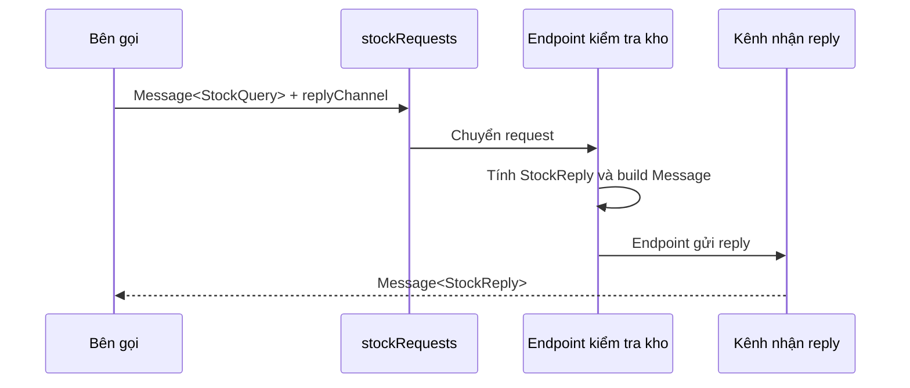

# Xây message reply

Trong module **SPRING_INTEGRATION_CORE**, xây message reply là bước biến kết quả xử lý thành một thông điệp có đủ dữ liệu và ngữ cảnh để tiếp tục luồng hoặc trả về bên gọi. Bài này thuộc chương **MessageBuilder**, tập trung vào cách tạo reply bằng Java, đặt header có chủ đích và kết nối reply với endpoint, Java DSL, gateway.

Tình huống xuyên suốt: ứng dụng hỏi kho còn đủ hàng cho một yêu cầu mua hay không. Request chứa mã hàng và số lượng; reply chứa số lượng tồn cùng kết luận có đáp ứng được yêu cầu. Kho chỉ tra cứu dữ liệu, chưa giữ hàng hay trừ tồn.

Sau bài học, bạn có thể:

- Chọn giữa trả về payload và trả về `Message<T>` từ một endpoint.
- Dùng `withPayload`, `fromMessage` và các phương thức sao chép header đúng mục đích.
- Phân biệt định danh message, liên kết hội thoại và địa chỉ nhận reply.
- Thiết kế đường trả lời qua Java DSL hoặc gateway, đồng thời nhận ra lỗi thiếu reply và mất header.

## 1. Reply gồm dữ liệu kết quả và ngữ cảnh trao đổi

Một reply vẫn là `Message<T>` thông thường. Vai trò “reply” đến từ việc nó là kết quả của một request và được đưa tới nơi đang chờ kết quả.

Ví dụ hợp đồng kiểm tra tồn kho:

| Thành phần | Ví dụ | Ý nghĩa |
| --- | --- | --- |
| Request payload | `StockQuery("BOOK-01", 3)` | Hỏi kho có đáp ứng được 3 sản phẩm hay không |
| Reply payload | `StockReply("BOOK-01", 3, 8, true)` | Hiện có 8 sản phẩm và đáp ứng được yêu cầu |
| `traceId` | `trace-2026-001` | Theo dõi hành trình của lần xử lý |
| `replyChannel` | Một channel do bên gọi cung cấp | Địa chỉ nhận kết quả |
| `correlationId` | Định danh hội thoại đã thống nhất | Liên kết các message trong cùng trao đổi |

Một kết quả “không đủ hàng” vẫn có thể là reply nghiệp vụ hợp lệ, chẳng hạn `accepted=false`. Không cần biến mọi kết quả bất lợi thành exception.

Cần phân biệt ba thao tác:

1. **Tính kết quả:** thực hiện logic nghiệp vụ.
2. **Tạo message:** đóng gói payload và header bằng builder.
3. **Gửi message:** endpoint hoặc mã gọi channel thực hiện việc chuyển thông điệp.

`build()` hoàn thành thao tác thứ hai. Nó không tự tìm channel, không gọi endpoint và không chờ bên nhận.



Ở luồng đồng bộ, các bước này có thể diễn ra trên cùng một thread. Từ “reply” không hàm ý rằng luồng bắt buộc bất đồng bộ.

## 2. Chọn đúng API và hiểu tính bất biến

Các ví dụ dùng builder của Spring Integration:

```java
import org.springframework.integration.IntegrationMessageHeaderAccessor;
import org.springframework.integration.support.MessageBuilder;
import org.springframework.messaging.Message;
import org.springframework.messaging.MessageHeaders;
```

Spring Framework cũng có lớp cùng tên `org.springframework.messaging.support.MessageBuilder`. Hai lớp cùng tạo `Message<T>`, nhưng tập phương thức không hoàn toàn giống nhau. Trong bài, các lệnh như `setCorrelationId(...)` thuộc builder của Spring Integration; hãy kiểm tra import khi IDE báo không tìm thấy phương thức. Xem [API MessageBuilder của Spring Integration](https://docs.spring.io/spring-integration/api/org/springframework/integration/support/MessageBuilder.html).

Không thay header bằng cách gọi `request.getHeaders().put(...)`. Hãy dựng message cần thiết qua builder. Payload hoặc object nằm trong header vẫn có thể là object mutable; sao chép header không tạo bản sao sâu cho mọi giá trị. Nếu dùng chung một `List` mutable trong hai message, thay đổi danh sách vẫn có thể ảnh hưởng cả hai. Tài liệu [Message](https://docs.spring.io/spring-integration/reference/message.html) phân biệt rõ cấu trúc message với tính mutable của object được chứa bên trong.

Đối với reply, nên chọn payload kết quả độc lập, chẳng hạn Java record. Điều này giúp tránh vô tình sửa request trong lúc tạo response.

## 3. Dùng builder theo mục đích của reply

### 3.1. Payload mới: bắt đầu bằng withPayload

Request và reply thường có kiểu dữ liệu khác nhau. Ví dụ tối giản:

```java
Message<String> request = MessageBuilder
        .withPayload("book-01")
        .setHeader("traceId", "trace-2026-001")
        .build();

Message<String> reply = MessageBuilder
        .withPayload(request.getPayload().toUpperCase(java.util.Locale.ROOT))
        .copyHeaders(request.getHeaders())
        .setHeader("resultSource", "catalog")
        .build();
```

Payload của `reply` là `BOOK-01`; `traceId` được giữ và `resultSource` được bổ sung. Đoạn này chỉ tạo hai message trong bộ nhớ, chưa gửi reply.

Khi kiểu thay đổi từ `StockQuery` sang `StockReply`, vẫn dùng cùng cấu trúc:

```java
StockReply result = new StockReply("BOOK-01", 3, 8, true);

Message<StockReply> reply = MessageBuilder
        .withPayload(result)
        .copyHeaders(request.getHeaders())
        .setHeader("resultSource", "stock")
        .build();
```

Hai record `StockQuery` và `StockReply` được định nghĩa trong ví dụ đầy đủ ở phần 6.

### 3.2. Giữ payload: fromMessage phù hợp với việc bổ sung ngữ cảnh

`fromMessage(request)` bắt đầu từ payload và header của request. Nó phù hợp khi cần chuyển tiếp cùng dữ liệu với một thay đổi về metadata:

```java
Message<String> forwarded = MessageBuilder
        .fromMessage(request)
        .setHeader("checkedBy", "catalog")
        .build();
```

`forwarded` vẫn chứa payload ban đầu. Chỉ gọi `fromMessage` không biến payload request thành kết quả nghiệp vụ.

Builder giữ kiểu payload đã chọn và không cung cấp `setPayload(...)` để thay payload tùy ý. Khi đã tính được một kết quả khác, hãy bắt đầu bằng `withPayload(result)`.

Cũng không nên coi `fromMessage(message).build()` là một cách bắt buộc tạo bản sao mới. Khi không có thay đổi cần áp dụng, builder có thể trả lại message ban đầu. Hành vi này được nêu trong [API BaseMessageBuilder](https://docs.spring.io/spring-integration/api/org/springframework/integration/support/BaseMessageBuilder.html).

### 3.3. Thứ tự sao chép header quyết định giá trị cuối cùng

`copyHeaders(...)` có thể ghi đè header đang có trong builder. `copyHeadersIfAbsent(...)` chỉ điền những header chưa tồn tại.

Giả sử request có `resultSource=client`:

```java
Message<String> reply = MessageBuilder
        .withPayload("OK")
        .copyHeaders(request.getHeaders())
        .setHeader("resultSource", "stock")
        .build();
```

Kết quả là `resultSource=stock`, vì giá trị của reply được đặt sau bước sao chép.

Có thể diễn đạt cùng chủ đích bằng thứ tự khác:

```java
Message<String> reply = MessageBuilder
        .withPayload("OK")
        .setHeader("resultSource", "stock")
        .copyHeadersIfAbsent(request.getHeaders())
        .build();
```

Hãy chọn thứ tự nhất quán trong một dự án. Một quy ước dễ đọc là “kế thừa ngữ cảnh trước, đặt giá trị riêng của kết quả sau”.

`setHeader(name, null)` loại header khỏi builder; không tạo một giá trị header `null`. Các thao tác này được mô tả trong [API MessageBuilder của Spring Framework](https://docs.spring.io/spring-framework/docs/current/javadoc-api/org/springframework/messaging/support/MessageBuilder.html); builder Spring Integration cung cấp các thao tác tương ứng.

## 4. Định danh message, correlation và địa chỉ trả lời

Ba thông tin sau giải quyết ba nhu cầu khác nhau:

| Header | Trả lời câu hỏi nào? | Cách dùng trong ví dụ |
| --- | --- | --- |
| `MessageHeaders.ID` | Đây là message cụ thể nào? | Framework tạo định danh cho message mới |
| `IntegrationMessageHeaderAccessor.CORRELATION_ID` | Message này liên quan đến hội thoại hoặc nhóm nào? | Giữ correlation đang có; nếu thiếu thì dùng ID request theo quy ước của ví dụ |
| `MessageHeaders.REPLY_CHANNEL` | Kết quả cần đi về đâu? | Giữ địa chỉ do bên gọi hoặc gateway cung cấp |
| Header ứng dụng `traceId` | Tra cứu lần xử lý trong log bằng khóa nào? | Kế thừa khóa truy vết do ứng dụng quản lý |

Không dùng `id` của reply để giả làm `id` của request. Với đường tạo reply mới bằng `withPayload(...).copyHeaders(...)` thông thường, framework quản lý `id` và `timestamp`; các giá trị này không được sao chép như header ứng dụng. Hai message được tạo gần nhau vẫn có thể có cùng giá trị timestamp tính theo mili giây, nên kiểm tra “timestamp phải khác nhau” không phải phép kiểm tra hợp lệ cho mọi trường hợp.

Ví dụ chọn correlation:

```java
Message<StockReply> reply = MessageBuilder
        .withPayload(result)
        .copyHeaders(request.getHeaders())
        .setHeaderIfAbsent(
                IntegrationMessageHeaderAccessor.CORRELATION_ID,
                request.getHeaders().getId())
        .build();
```

Đây là **quy ước của ví dụ**, không phải cam kết rằng Spring Integration tự đặt mọi correlation ID của reply bằng ID request. Nếu request đã có correlation ID, đoạn mã giữ giá trị đó.

Trong một luồng có splitter và aggregator, correlation ID có thể đang dùng để xác định nhóm. Ghi đè nó giữa luồng có thể làm các phần tử không được ghép đúng nhóm. Khi cần thêm khóa nghiệp vụ như mã đơn hàng, hãy cân nhắc header riêng, chẳng hạn `orderId`, với ý nghĩa đã định rõ.

Correlation ID cũng không phải địa chỉ gửi. Hai message cùng correlation ID không có nghĩa framework tự biết phải gửi reply tới gateway nào. Đường quay về của gateway nội bộ thường dựa trên channel tạm được đặt trong header, còn các giao thức ngoài tiến trình có cơ chế ánh xạ riêng.

## 5. Endpoint chọn kênh trả lời như thế nào?

Xét service activator thông thường, **không cấu hình routing slip**. Khi phương thức trả về một kết quả khác `null`, thứ tự chọn đích là:

| Thứ tự | Nguồn đích gửi | Ví dụ |
| --- | --- | --- |
| 1 | Output channel được cấu hình trên endpoint | `outputChannel="stockReplies"` hoặc channel nối tiếp trong DSL |
| 2 | `replyChannel` trên request | Channel tạm do gateway thêm vào |
| 3 | `replyChannel` trên message kết quả, nếu request không có | Hàm xử lý trả về message chứa địa chỉ |
| 4 | Không tìm được đích | Phát sinh lỗi phân giải đích |

Nếu header là tên channel, tên đó phải phân giải được thành channel trong ngữ cảnh phù hợp. Nếu là một `MessageChannel`, endpoint sử dụng đối tượng channel đó. Quy tắc này được mô tả trong tài liệu [Service Activator](https://docs.spring.io/spring-integration/reference/service-activator.html).

Có hai hệ quả thiết kế:

- Đặt `replyChannel` khác trên message trả về chưa chắc thay đổi đích gửi của endpoint hiện tại, vì request có thể đã cung cấp địa chỉ ưu tiên hơn.
- Một endpoint có output channel sẽ chuyển kết quả tới bước kế tiếp. Bước cuối của chuỗi vẫn cần một đường về bên gọi nếu hợp đồng là request–reply.

Ví dụ, nếu luồng có bước kiểm tra kho rồi ghi nhận kết quả vào một service trả về `void`, kết quả có thể dừng ở service cuối. Việc bước kiểm tra kho đã tạo đúng `Message<StockReply>` chưa đủ để gateway nhận được reply.

Khi có routing slip, endpoint còn xử lý lộ trình đó trước khi dùng cơ chế fallback về reply channel. Vì vậy, bảng trên được giới hạn rõ cho trường hợp không dùng routing slip.

## 6. Ví dụ đầy đủ: kiểm tra kho bằng Java DSL

Ví dụ dưới đây dùng Java 17 trở lên, Spring Integration Core dòng 6.x với Java DSL, cùng các dependency Spring tương thích. Có thể dùng bộ dependency do Spring Boot quản lý; không tự trộn các phiên bản Spring khác dòng. Nếu dùng Java mới hơn hoặc Spring Integration dòng khác, chọn cấu hình dependency phù hợp với nền tảng đó.

Đây là một lớp minh họa độc lập trong package `example.reply`. Chương trình khởi tạo Spring context, gửi một request và nhận reply qua `QueueChannel`.

```java
package example.reply;

import java.util.Map;

import org.springframework.context.annotation.AnnotationConfigApplicationContext;
import org.springframework.context.annotation.Bean;
import org.springframework.context.annotation.Configuration;
import org.springframework.integration.IntegrationMessageHeaderAccessor;
import org.springframework.integration.channel.DirectChannel;
import org.springframework.integration.channel.QueueChannel;
import org.springframework.integration.config.EnableIntegration;
import org.springframework.integration.dsl.IntegrationFlow;
import org.springframework.integration.support.MessageBuilder;
import org.springframework.messaging.Message;
import org.springframework.messaging.MessageChannel;

public final class StockReplyDemo {

    public record StockQuery(String sku, int quantity) {
    }

    public record StockReply(
            String sku,
            int requested,
            int available,
            boolean accepted) {
    }

    public static final class StockService {

        private final Map<String, Integer> stock =
                Map.of("BOOK-01", 8, "PEN-01", 20);

        public Message<StockReply> reply(Message<StockQuery> request) {
            StockQuery query = request.getPayload();

            if (query.sku() == null
                    || query.sku().isBlank()
                    || query.quantity() <= 0) {
                throw new IllegalArgumentException(
                        "sku phải có giá trị và quantity phải lớn hơn 0");
            }

            int available = stock.getOrDefault(query.sku(), 0);
            boolean accepted = available >= query.quantity();

            StockReply result = new StockReply(
                    query.sku(),
                    query.quantity(),
                    available,
                    accepted);

            return MessageBuilder
                    .withPayload(result)
                    .copyHeaders(request.getHeaders())
                    .setHeaderIfAbsent(
                            IntegrationMessageHeaderAccessor.CORRELATION_ID,
                            request.getHeaders().getId())
                    .setHeader("resultSource", "stock")
                    .build();
        }
    }

    @Configuration(proxyBeanMethods = false)
    @EnableIntegration
    public static class FlowConfiguration {

        @Bean
        public DirectChannel stockRequests() {
            return new DirectChannel();
        }

        @Bean
        public StockService stockService() {
            return new StockService();
        }

        @Bean
        public IntegrationFlow stockFlow(
                DirectChannel stockRequests,
                StockService stockService) {

            return IntegrationFlow
                    .from(stockRequests)
                    .handle(stockService, "reply",
                            endpoint -> endpoint.requiresReply(true))
                    .get();
        }
    }

    public static void main(String[] args) {
        try (var context = new AnnotationConfigApplicationContext(
                FlowConfiguration.class)) {

            QueueChannel replies = new QueueChannel(1);

            Message<StockQuery> request = MessageBuilder
                    .withPayload(new StockQuery("BOOK-01", 3))
                    .setHeader("traceId", "trace-2026-001")
                    .setReplyChannel(replies)
                    .build();

            MessageChannel requests =
                    context.getBean("stockRequests", MessageChannel.class);

            if (!requests.send(request, 1000)) {
                throw new IllegalStateException("Không gửi được request");
            }

            Message<?> response = replies.receive(1000);
            if (response == null) {
                throw new IllegalStateException("Không nhận được reply");
            }

            System.out.println(response.getPayload());
            System.out.println(response.getHeaders().get("traceId"));
        }
    }
}
```

Kết quả payload mong đợi:

```text
StockReply[sku=BOOK-01, requested=3, available=8, accepted=true]
trace-2026-001
```

Cấu hình `IntegrationFlow` được đăng ký như một Spring bean; DSL tạo các endpoint và channel cần thiết trong context. Xem cơ chế đăng ký ở tài liệu [Java DSL](https://docs.spring.io/spring-integration/reference/dsl.html).

Đường đi trong ví dụ:

1. Bên gọi đặt `replies` vào `replyChannel` của request.
2. `DirectChannel` chuyển request tới service activator do `.handle(...)` tạo.
3. `StockService.reply(...)` tính kết quả và tạo message mới.
4. Endpoint không có output channel cố định nên gửi kết quả về địa chỉ trong request.
5. Bên gọi đọc kết quả từ `replies`.

`StockService` không gọi `replies.send(...)`. Nó trả message cho endpoint quản lý. Nếu một phương thức vừa tự gửi cùng reply vừa trả nó cho endpoint, bên nhận có thể nhận hai kết quả.

`QueueChannel` ở đây làm nơi chứa kết quả cho bên gọi đọc; không có endpoint poll request nên không cần cấu hình poller cho nó. Request đi qua `DirectChannel` vẫn được xử lý đồng bộ. Ý nghĩa gửi và nhận trên queue được trình bày ở tài liệu [Message Channel Implementations](https://docs.spring.io/spring-integration/reference/channel/implementations.html).

Giới hạn nghiệp vụ của ví dụ: `accepted=true` chỉ phản ánh ảnh chụp dữ liệu đang tra cứu. Nó không bảo đảm rằng một giao dịch mua khác sẽ không dùng số hàng đó trước khi đơn này được xử lý.

## 7. Khi nào chỉ cần trả payload?

Nếu phương thức chỉ cần tạo dữ liệu kết quả và không đặt header riêng, có thể trả trực tiếp `StockReply`:

```java
public StockReply check(StockQuery query) {
    int available = 8;
    return new StockReply(
            query.sku(),
            query.quantity(),
            available,
            available >= query.quantity());
}
```

Khi phương thức này được gọi qua service activator, endpoint tạo reply message từ giá trị trả về. Một lời gọi Java trực tiếp tới `check(...)` chỉ nhận object `StockReply`; lời gọi đó không tự tạo một luồng tích hợp.

Chọn kiểu trả về theo nhu cầu:

| Nhu cầu | Cách biểu đạt phù hợp |
| --- | --- |
| Chỉ thay dữ liệu kết quả | Trả payload |
| Đặt header riêng cho kết quả | Trả `Message<StockReply>` tạo bằng builder |
| Chuyển đổi định dạng dữ liệu giữa các bước | Cân nhắc transformer |
| Chỉ thực hiện tác vụ và không có hợp đồng reply | Có thể dùng phương thức `void` |
| Bắt buộc phải sinh kết quả | Bật `requiresReply` ở endpoint phù hợp |

Hợp đồng nhận tham số và trả kết quả của service activator được nêu tại [API ServiceActivator](https://docs.spring.io/spring-integration/api/org/springframework/integration/annotation/ServiceActivator.html).

Với service activator thông thường, framework có thể bổ sung các header request còn thiếu vào message kết quả theo chính sách propagation của endpoint. Vì vậy, không được kết luận rằng “trả một message được tạo chỉ bằng `withPayload` luôn làm mất tất cả header”. Kết quả cuối cùng còn tùy endpoint.

Ở chiều ngược lại, một transformer trả về `Message` được xem là đã cung cấp message kết quả, bao gồm trách nhiệm với header cần giữ. Không nên áp dụng máy móc hành vi của service activator sang mọi loại endpoint. Xem tài liệu [Transformer](https://docs.spring.io/spring-integration/reference/transformer.html).

Trong ví dụ kho, việc sao chép header được viết rõ để hàm tạo reply có hành vi dễ quan sát ngay cả khi được kiểm tra bằng lời gọi Java trực tiếp.

## 8. Dùng gateway để bên gọi nhận kết quả nghiệp vụ

Gateway giúp bên gọi làm việc qua một interface thay vì tự tạo request message và tự đọc channel. Có thể dùng lại flow ở phần 6 với interface sau trong cùng package:

```java
package example.reply;

import org.springframework.integration.annotation.MessagingGateway;

@MessagingGateway(
        defaultRequestChannel = "stockRequests",
        defaultReplyTimeout = "1500")
public interface StockGateway {

    StockReplyDemo.StockReply check(StockReplyDemo.StockQuery query);
}
```

Đăng ký việc quét gateway bằng một cấu hình bổ sung:

```java
package example.reply;

import org.springframework.context.annotation.Configuration;
import org.springframework.integration.annotation.IntegrationComponentScan;

@Configuration(proxyBeanMethods = false)
@IntegrationComponentScan(basePackageClasses = StockGateway.class)
public class GatewayConfiguration {
}
```

Khi dùng context thủ công như ví dụ, đăng ký cả `StockReplyDemo.FlowConfiguration.class` và `GatewayConfiguration.class` vào `AnnotationConfigApplicationContext`. Sau đó lấy bean `StockGateway` và gọi:

```java
StockGateway gateway = context.getBean(StockGateway.class);

StockReplyDemo.StockReply result = gateway.check(
        new StockReplyDemo.StockQuery("BOOK-01", 3));
```

Gateway thông thường tạo một reply channel tạm và đặt địa chỉ vào request. Với interface trên, bên gọi nhận payload `StockReply`; nếu cần quan sát header ở ranh giới gọi, có thể thiết kế phương thức trả về `Message<StockReplyDemo.StockReply>`.

Mốc `1500` là thời gian chờ reply tính bằng mili giây, không phải cơ chế cưỡng bức dừng service. Với chuỗi xử lý hoàn toàn đồng bộ, service chạy chậm trên thread gọi có thể khiến lời gọi kéo dài hơn mốc này. Không dùng riêng reply timeout làm giới hạn cho toàn bộ thời gian nghiệp vụ.

Cơ chế channel tạm, cấu hình gateway và giới hạn của timeout được trình bày trong [Messaging Gateways](https://docs.spring.io/spring-integration/reference/gateway.html).

## 9. Giữ và loại header theo ranh giới của luồng

Sao chép toàn bộ header thuận tiện cho ví dụ nội bộ. Trong một hệ thống thực tế, từng header cần có phạm vi sử dụng rõ ràng.

Một chính sách minh họa cho luồng kiểm tra kho:

| Nhóm header | Chính sách gợi ý cho tình huống này |
| --- | --- |
| `traceId`, khóa yêu cầu nghiệp vụ | Giữ để bên gọi đối chiếu kết quả |
| `replyChannel` | Giữ đường quay về trong luồng nội bộ |
| `errorChannel` | Giữ khi bước tiếp theo còn cần ngữ cảnh xử lý lỗi |
| Header kết quả như `resultSource` | Đặt từ service sinh kết quả |
| Header tạm của bước đọc dữ liệu | Loại sau bước cuối sử dụng |
| Header chứa thông tin xác thực | Chỉ truyền tới bước cần dùng theo hợp đồng của ứng dụng |
| `id`, `timestamp` | Để framework quản lý theo cơ chế tạo message |

Đây là một quyết định thiết kế cho ví dụ, không phải danh sách header áp dụng mặc định cho mọi hệ thống.

### 9.1. Chỉ xóa trong builder có thể chưa đủ

Giả sử service tạo reply bằng:

```java
Message<StockReply> reply = MessageBuilder
        .withPayload(result)
        .copyHeaders(request.getHeaders())
        .removeHeader("transportHint")
        .build();
```

Tại thời điểm hàm trả về, message này không có `transportHint`. Tuy nhiên, service activator có chính sách bổ sung header request còn thiếu có thể đưa header đó trở lại trước khi gửi.

Nếu muốn loại header tại một ranh giới rõ ràng trong flow, có thể đặt header filter sau service:

```java
return IntegrationFlow
        .from(stockRequests)
        .handle(stockService, "reply",
                endpoint -> endpoint.requiresReply(true))
        .headerFilter("transportHint")
        .get();
```

Hoặc cấu hình `notPropagatedHeaders` của endpoint để chặn bước tự bổ sung header tương ứng. Tùy chọn đó kiểm soát việc sao chép tự động từ request; nó không tự xóa một header mà hàm xử lý đã đưa trực tiếp vào reply.

Cơ chế bổ sung header và `notPropagatedHeaders` có thể đối chiếu trong [mã nguồn AbstractMessageProducingHandler nhánh 6.5.x](https://raw.githubusercontent.com/spring-projects/spring-integration/6.5.x/spring-integration-core/src/main/java/org/springframework/integration/handler/AbstractMessageProducingHandler.java).

### 9.2. Channel nội bộ không phải địa chỉ mạng

Một đối tượng `MessageChannel` trong header có ý nghĩa trong tiến trình và context đang dùng nó. Không thể mặc nhiên gửi object này qua JSON để một ứng dụng khác gọi lại.

Nếu flow mở rộng qua HTTP, JMS hoặc AMQP, hãy định nghĩa hợp đồng request–reply của giao thức đó: nơi nhận response, khóa đối chiếu và quy tắc ánh xạ header. Bài toán này cần cấu hình gateway hoặc adapter tương ứng, vượt ra ngoài thao tác tạo message bằng builder.

Đối với bài kiểm tra kho, chỉ cần giữ rõ ranh giới: message nội bộ được dùng trong cùng ứng dụng; dữ liệu xuất ra ngoài cần một hợp đồng truyền tải riêng.

## 10. Reply bình thường, thiếu reply và exception

Có ba kết quả cần phân biệt:

| Kết quả xử lý | Ví dụ kho | Hành vi cần thiết kế |
| --- | --- | --- |
| Có reply nghiệp vụ | Không đủ hàng, `accepted=false` | Bên gọi nhận dữ liệu và quyết định bước tiếp theo |
| Không sinh reply | Service trả `null` | Có thể khiến bên gọi hết thời gian chờ |
| Có exception | Dữ liệu đầu vào vi phạm hợp đồng hoặc hệ thống kho gặp lỗi | Truyền lỗi hoặc xử lý qua cơ chế lỗi phù hợp |

Trong ví dụ, `requiresReply(true)` làm endpoint báo lỗi khi hàm trả `null`, thay vì kết thúc im lặng. Nó không bảo đảm bên gọi sẽ nhận được kết quả: vẫn có thể có lỗi gửi, sai đích, bước sau loại message hoặc bên gọi đã ngừng chờ.

Không dùng `MessageBuilder.withPayload(null)` làm “reply rỗng”. Payload phải khác `null`. Nếu nghiệp vụ cho phép không tìm thấy dữ liệu, có thể thiết kế một payload cụ thể như `StockReply` với kết luận rõ ràng hoặc một kiểu kết quả riêng.

Với `DirectChannel` đồng bộ, exception từ handler thường truyền về thread gửi. Chỉ đặt `errorChannel` trong header không có nghĩa mọi exception của một lời gọi đồng bộ tự chuyển thành message lỗi trên channel đó.

Trong luồng dùng executor hoặc poller, Spring Integration có cơ chế phát `ErrorMessage` qua bộ xử lý lỗi phù hợp. Việc bên gọi có nhận được một reply thay thế hay không còn phụ thuộc flow xử lý lỗi được cấu hình. Không coi `errorChannel` là tên khác của `replyChannel`. Xem tài liệu [Error Handling](https://docs.spring.io/spring-integration/reference/error-handling.html).

Ở ví dụ kiểm tra kho, lựa chọn được dùng là: thiếu hàng trả kết quả bình thường, đầu vào sai hợp đồng phát sinh exception. Ứng dụng khác có thể chọn payload lỗi nghiệp vụ riêng, nhưng cần thống nhất hợp đồng đó với bên gọi.

## 11. Kiểm tra hành vi tạo và gửi reply

Hai lớp kiểm tra bổ sung cho nhau:

- Gọi trực tiếp service để quan sát payload và header mà hàm tạo.
- Gửi qua flow để xác nhận endpoint thực sự đưa kết quả tới channel dự kiến.

Đoạn JUnit 5 dưới đây dùng các lớp ở phần 6. Đặt nó trong package `example.reply` của một dự án đã có dependency kiểm thử tương thích.

```java
package example.reply;

import org.junit.jupiter.api.Test;
import org.springframework.context.annotation.AnnotationConfigApplicationContext;
import org.springframework.integration.IntegrationMessageHeaderAccessor;
import org.springframework.integration.channel.QueueChannel;
import org.springframework.integration.support.MessageBuilder;
import org.springframework.messaging.Message;
import org.springframework.messaging.MessageChannel;

import static org.junit.jupiter.api.Assertions.*;

class StockReplyTest {

    @Test
    void createsReplyWithNewIdentityAndExistingConversation() {
        QueueChannel replies = new QueueChannel(1);

        Message<StockReplyDemo.StockQuery> request = MessageBuilder
                .withPayload(new StockReplyDemo.StockQuery("BOOK-01", 3))
                .setHeader("traceId", "trace-001")
                .setHeader("resultSource", "client")
                .setCorrelationId("conversation-001")
                .setReplyChannel(replies)
                .build();

        Message<StockReplyDemo.StockReply> reply =
                new StockReplyDemo.StockService().reply(request);

        assertEquals(
                new StockReplyDemo.StockReply("BOOK-01", 3, 8, true),
                reply.getPayload());
        assertNotEquals(
                request.getHeaders().getId(),
                reply.getHeaders().getId());
        assertEquals("trace-001", reply.getHeaders().get("traceId"));
        assertEquals("stock", reply.getHeaders().get("resultSource"));
        assertEquals("client", request.getHeaders().get("resultSource"));
        assertSame(replies, reply.getHeaders().getReplyChannel());
        assertEquals(
                "conversation-001",
                reply.getHeaders().get(
                        IntegrationMessageHeaderAccessor.CORRELATION_ID));
    }

    @Test
    void usesRequestIdWhenConversationHeaderIsMissing() {
        Message<StockReplyDemo.StockQuery> request = MessageBuilder
                .withPayload(new StockReplyDemo.StockQuery("BOOK-01", 3))
                .build();

        Message<StockReplyDemo.StockReply> reply =
                new StockReplyDemo.StockService().reply(request);

        assertEquals(
                request.getHeaders().getId(),
                reply.getHeaders().get(
                        IntegrationMessageHeaderAccessor.CORRELATION_ID));
    }

    @Test
    void flowSendsOneReplyToTheRequestAddress() {
        try (var context = new AnnotationConfigApplicationContext(
                StockReplyDemo.FlowConfiguration.class)) {

            QueueChannel replies = new QueueChannel(2);
            Message<StockReplyDemo.StockQuery> request = MessageBuilder
                    .withPayload(new StockReplyDemo.StockQuery("BOOK-01", 30))
                    .setReplyChannel(replies)
                    .build();

            MessageChannel requests =
                    context.getBean("stockRequests", MessageChannel.class);

            assertTrue(requests.send(request, 1000));

            Message<?> response = replies.receive(1000);
            assertNotNull(response);
            assertEquals(
                    new StockReplyDemo.StockReply("BOOK-01", 30, 8, false),
                    response.getPayload());
            assertNull(replies.receive(0));
        }
    }
}
```

Phép kiểm tra nhận lần hai phù hợp với flow đồng bộ này: khi `send` hoàn tất, handler đã xử lý xong. Với flow bất đồng bộ, một lần `receive(0)` không đủ chứng minh rằng tương lai sẽ không xuất hiện reply trùng.

Khi mở rộng luồng, hãy kiểm tra thêm những hành vi thuộc hợp đồng mới: service không trả kết quả khi đã bật `requiresReply`, header bị loại tại ranh giới, hoặc kết quả quay về gateway. Không chỉ kiểm tra rằng `build()` trả về một object khác `null`.

## 12. Chẩn đoán lỗi theo dấu hiệu

| Dấu hiệu | Điều cần kiểm tra trước |
| --- | --- |
| Service tạo reply nhưng bên gọi không nhận được | Output channel của endpoint, địa chỉ reply trong request và các bước sau service |
| Lỗi không tìm được đích gửi | Có output channel hoặc reply channel hợp lệ hay chưa |
| Kết quả vào một channel cố định thay vì quay về gateway | Endpoint có output channel được cấu hình ưu tiên hay không |
| Header vừa xóa lại xuất hiện | Chính sách propagation của service activator và vị trí header filter |
| Giá trị header kết quả bị thay bằng giá trị request | Thứ tự `copyHeaders`, `copyHeadersIfAbsent` và `setHeader` |
| Aggregator không ghép được nhóm sau khi thêm reply | Correlation ID hoặc thông tin sequence có bị thay đổi sai hợp đồng hay không |
| Gateway chờ dù service đã chạy | Service trả `void`/`null`, message bị filter hoặc flow kết thúc trước đường về |
| Nhận hai reply cho một request | Handler vừa tự gửi vừa trả kết quả, hoặc một request đi qua nhiều nhánh sinh reply |
| Reply timeout không dừng được service | Có đang chạy hoàn toàn đồng bộ trên thread gọi hay không |

Một reply được thiết kế tốt có dữ liệu kết quả rõ ràng, header mang đúng ý nghĩa và đường gửi xác định. Với ví dụ kho, công thức thực hành là: tạo `StockReply`, dùng `withPayload(result)`, giữ ngữ cảnh cần thiết, đặt header riêng của kết quả rồi trả message cho endpoint. Việc kiểm tra qua flow xác nhận rằng thông điệp đó thực sự trở về bên gọi.
