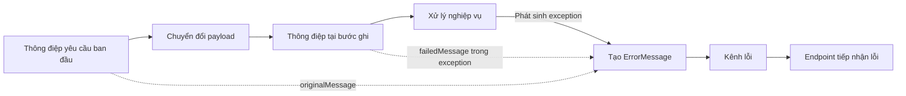

# Xây error message

Trong chương **MessageBuilder** của module **SPRING_INTEGRATION_CORE**, xây thông điệp lỗi là bước biến một thất bại khi xử lý thành thông tin mà các thành phần khác của luồng tích hợp có thể tiếp nhận. Một thông điệp lỗi hữu ích cần cho biết lỗi gì đã xảy ra, thông điệp nào bị xử lý thất bại và ngữ cảnh nào giúp truy vết yêu cầu.

Bài học kết nối `Message`, `MessageChannel`, endpoint và Java DSL qua một luồng xử lý lỗi đơn hàng. Trọng tâm là cách tạo `ErrorMessage`, bảo toàn exception và dữ liệu liên quan, rồi chuyển thông điệp sang một kênh lỗi rõ ràng.

Các ví dụ sử dụng Java 17 trở lên và API Spring Integration 6.4.x với Spring Framework 6.2.x làm mốc tham chiếu. Phần so sánh hành vi sao chép thông điệp ghi rõ phiên bản đối chiếu. Ví dụ giả định ứng dụng đã có `spring-integration-core` và các phụ thuộc Spring tương thích; phần kiểm thử sử dụng JUnit Jupiter.

## 1. Vì sao cần một thông điệp lỗi có cấu trúc?

Giả sử hệ thống nhận yêu cầu tạo đơn hàng, chuyển JSON thành đối tượng Java rồi ghi vào kho dữ liệu. Nếu bước ghi thất bại, một chuỗi như `"Lưu đơn hàng thất bại"` chưa đủ để quyết định cách xử lý tiếp theo:

- Có thể cần loại exception để phân biệt lỗi dữ liệu với lỗi kết nối.
- Cần biết đối tượng Java nào đã được đưa vào bước ghi.
- Có thể cần đối chiếu với yêu cầu JSON ban đầu.
- Cần mã truy vết để nối sự kiện lỗi với log của yêu cầu.

Thông điệp lỗi đóng vai trò đầu vào cho một luồng xử lý khác, chẳng hạn ghi nhận sự cố, phân loại lỗi hoặc chuyển một bản ghi lỗi đã chuẩn hóa tới nơi lưu trữ. Tạo được thông điệp lỗi chưa có nghĩa là đã gửi nó, thử lại nghiệp vụ hoặc khôi phục giao dịch.



Mũi tên tới kênh lỗi trong sơ đồ biểu diễn một bước gửi thực sự. Nó phải do mã ứng dụng hoặc cơ chế xử lý lỗi của framework thực hiện.

## 2. Cấu trúc của `ErrorMessage`

`org.springframework.messaging.support.ErrorMessage` kế thừa `GenericMessage<Throwable>`. Payload của nó là một `Throwable` khác `null`; ngoài headers, nó có thuộc tính `originalMessage` tùy chọn. Khi payload là `MessagingException`, exception đó có thể giữ thông điệp tại điểm thất bại trong `failedMessage`. [API ErrorMessage](https://docs.spring.io/spring-framework/docs/6.2.0/javadoc-api/org/springframework/messaging/support/ErrorMessage.html).

| Thành phần | Ý nghĩa trong ví dụ đơn hàng | Cách truy cập |
| --- | --- | --- |
| Payload | Exception mô tả lỗi xử lý | `error.getPayload()` |
| Cause của payload | Nguyên nhân được giữ khi bọc exception | `error.getPayload().getCause()` |
| `failedMessage` | Thông điệp được xử lý ở điểm thất bại | `MessagingException.getFailedMessage()` |
| `originalMessage` | Thông điệp được giữ ở ranh giới tạo thông điệp lỗi | `error.getOriginalMessage()` |
| Headers | Mã lỗi, bước xử lý, mã truy vết và metadata của thông điệp lỗi | `error.getHeaders()` |

`originalMessage` và `failedMessage` không phải hai tên gọi cho cùng một thuộc tính. Chúng có thể trỏ tới cùng một đối tượng nếu chưa có bước biến đổi, hoặc khác nhau nếu payload hay headers đã thay đổi trong luồng.

Trong ví dụ xuyên suốt bài học:

```text
originalMessage.payload = JSON yêu cầu tạo đơn hàng
failedMessage.payload   = đối tượng OrderCommand sau chuyển đổi
ErrorMessage.payload    = MessageHandlingException
payload.cause           = IllegalStateException từ thao tác ghi
```

Tên `originalMessage` cũng không bảo đảm luôn trỏ tới thông điệp đầu tiên của toàn hệ thống. Nó phụ thuộc vào ranh giới mà thành phần tạo lỗi có khả năng lưu giữ. Với ví dụ này, ứng dụng chủ động giữ yêu cầu JSON làm thông điệp ban đầu.

Một `Throwable` thông thường không có `getFailedMessage()`. Một `ErrorMessage` hợp lệ cũng có thể không có `originalMessage`. Consumer phải kiểm tra trước khi dùng các dữ liệu tùy chọn này.

## 3. Tạo thông điệp lỗi bằng `MessageBuilder`

### 3.1. Payload là `Throwable`

Lớp được sử dụng trong các ví dụ chính là:

```java
import org.springframework.integration.support.MessageBuilder;
```

Khi builder này tạo một thông điệp mới với payload là `Throwable`, kết quả là một `ErrorMessage`. Kiểu trả về của `build()` vẫn là `Message<T>`, vì vậy biến thường được khai báo theo giao diện `Message`. Hành vi này được thể hiện trong [BaseMessageBuilder của Spring Integration 6.4.1](https://github.com/spring-projects/spring-integration/blob/v6.4.1/spring-integration-core/src/main/java/org/springframework/integration/support/BaseMessageBuilder.java).

```java
import org.springframework.integration.support.MessageBuilder;
import org.springframework.messaging.Message;
import org.springframework.messaging.support.ErrorMessage;

Throwable cause = new IllegalStateException("Không thể truy cập kho đơn hàng");

Message<Throwable> message = MessageBuilder
        .withPayload(cause)
        .setHeader("errorCode", "ORDER_STORE_UNAVAILABLE")
        .setHeader("requestId", "req-1042")
        .build();

System.out.println(message instanceof ErrorMessage); // true
System.out.println(message.getPayload() == cause);  // true
```

Khai báo `cause` với kiểu `Throwable` làm cho generic được suy luận là `Message<Throwable>`. Nếu truyền trực tiếp `new IllegalStateException(...)`, có thể cần chỉ định `MessageBuilder.<Throwable>withPayload(...)` khi muốn nhận kết quả vào biến `Message<Throwable>`, vì generic Java không có tính hiệp biến giữa các kiểu này.

Builder không tự xác định thông điệp nghiệp vụ nào thất bại khi chỉ nhận một exception độc lập. Muốn giữ thông điệp đó, hãy dùng một exception có ngữ cảnh, như `MessageHandlingException`, hoặc constructor thích hợp của `ErrorMessage`.

### 3.2. Phân biệt payload chứa lỗi với chuỗi mô tả lỗi

```java
Message<String> textMessage = MessageBuilder
        .withPayload("Không thể lưu đơn hàng")
        .setHeader("errorCode", "ORDER_WRITE_FAILED")
        .build();
```

Thông điệp trên chứa một chuỗi, nên không trở thành `ErrorMessage` chỉ vì có header `errorCode`. Tương tự, một DTO tên `ErrorResponse` có thể là hợp đồng lỗi của ứng dụng, nhưng không phải payload `Throwable` của `ErrorMessage`.

| Cách tạo | Dữ liệu được giữ | Mục đích phù hợp |
| --- | --- | --- |
| `MessageBuilder.withPayload(throwable).build()` | Đối tượng exception và headers được gán | Xây lỗi cho luồng Spring nội bộ |
| `new ErrorMessage(throwable)` | Đối tượng exception | Cần trực tiếp một biến kiểu `ErrorMessage` |
| `MessageBuilder.withPayload("...").build()` | Chuỗi mô tả | Thông báo văn bản theo hợp đồng riêng |
| `MessageBuilder.withPayload(errorDto).build()` | DTO do ứng dụng định nghĩa | Giao tiếp qua API hoặc hệ thống ngoài |

Không thay exception bằng `exception.getMessage()` chỉ để đơn giản hóa payload nội bộ: thao tác đó làm mất kiểu lỗi, chuỗi nguyên nhân và stack trace khỏi đối tượng đang truyền.

### 3.3. Hai lớp `MessageBuilder` và việc giữ `originalMessage`

Spring có hai lớp cùng tên:

| Lớp | Vị trí |
| --- | --- |
| `org.springframework.integration.support.MessageBuilder` | Spring Integration |
| `org.springframework.messaging.support.MessageBuilder` | Spring Framework, module Spring Messaging |

Cả hai đều có thể tạo `ErrorMessage` từ payload `Throwable`. Tuy nhiên, cần kiểm tra lớp import khi sao chép một `ErrorMessage` có `originalMessage` rồi sửa headers.

Ở Spring Framework **6.2.0**, `MessageBuilder.fromMessage(error).setHeader(...).build()` có logic chuyển `originalMessage` sang đối tượng mới. Ở Spring Integration **6.4.1**, nhánh tạo mới của builder chỉ truyền payload và headers vào constructor `ErrorMessage`, nên không chuyển thuộc tính đó. Nếu builder trả lại nguyên đối tượng cũ vì không có thay đổi, thuộc tính vẫn còn. Đây là đối chiếu theo các phiên bản cụ thể, không phải cam kết cho mọi phiên bản. [MessageBuilder của Spring Framework 6.2.0](https://github.com/spring-projects/spring-framework/blob/v6.2.0/spring-messaging/src/main/java/org/springframework/messaging/support/MessageBuilder.java), [BaseMessageBuilder của Spring Integration 6.4.1](https://github.com/spring-projects/spring-integration/blob/v6.4.1/spring-integration-core/src/main/java/org/springframework/integration/support/BaseMessageBuilder.java).

Khi việc giữ thông điệp ban đầu là yêu cầu bắt buộc, cách diễn đạt rõ nhất là gọi constructor có tham số `originalMessage`.

## 4. Giữ exception, thông điệp thất bại và thông điệp ban đầu

### 4.1. Bọc lỗi nghiệp vụ bằng `MessageHandlingException`

Ví dụ sau giả định các biến `inputMessage`, `failedMessage` và `cause` đã có tại điểm bắt lỗi:

```java
import org.springframework.messaging.MessageHandlingException;
import org.springframework.messaging.support.ErrorMessage;

MessageHandlingException failure = new MessageHandlingException(
        failedMessage,
        "Không thể ghi nhận đơn hàng",
        cause
);

ErrorMessage error = new ErrorMessage(failure, inputMessage);
```

Constructor của `MessageHandlingException` cho phép gắn thông điệp thất bại và nguyên nhân gốc vào exception. Nhờ đó consumer có thể tìm dữ liệu gây lỗi mà không cần phân tích chuỗi thông báo. [Mã nguồn MessageHandlingException](https://github.com/spring-projects/spring-framework/blob/v6.2.0/spring-messaging/src/main/java/org/springframework/messaging/MessageHandlingException.java).

Các quan hệ cần được giữ trong ví dụ là:

```java
error.getPayload() == failure;
failure.getCause() == cause;
failure.getFailedMessage() == failedMessage;
error.getOriginalMessage() == inputMessage;
```

Nếu exception nhận được đã là `MessagingException` và chứa đúng `failedMessage`, có thể dùng lại nó làm payload. Chỉ tạo một lớp bọc mới khi lớp đó bổ sung ngữ cảnh cần thiết; việc bọc nhiều lần làm chuỗi lỗi khó đọc hơn.

### 4.2. Thêm headers bằng constructor

```java
import java.util.Map;
import org.springframework.messaging.support.ErrorMessage;

Map<String, Object> errorHeaders = Map.of(
        "errorCode", "ORDER_WRITE_FAILED",
        "errorStage", "persist-order",
        "requestId", "req-1042"
);

ErrorMessage errorWithHeaders = new ErrorMessage(
        failure,
        errorHeaders,
        inputMessage
);
```

Overload nhận một `Map` sao chép nội dung map; overload nhận `MessageHeaders` sử dụng trực tiếp đối tượng headers được truyền. Hai cách gọi không có cùng ý nghĩa sao chép. Các constructor nhận `originalMessage` giữ nó ở một thuộc tính riêng, không tự đưa headers của nó vào headers thông điệp lỗi. [Các constructor ErrorMessage](https://docs.spring.io/spring-framework/docs/6.2.0/javadoc-api/org/springframework/messaging/support/ErrorMessage.html).

Với `Map` headers được chọn lọc như trên, thông điệp lỗi nhận danh tính riêng. Để nối nó với lần xử lý thất bại, hãy lưu `failedMessageId` hoặc mã truy vết riêng thay vì gán ID của thông điệp nghiệp vụ cho thông điệp lỗi.

Việc sao chép map cũng không tạo bản sao sâu của payload, exception hay những đối tượng nằm trong headers. Nếu các đối tượng đó có thể thay đổi, ứng dụng vẫn phải quản lý việc chia sẻ chúng giữa các luồng.

## 5. Một hàm xây lỗi cho luồng đơn hàng

Đoạn mã dưới đây tập trung quy tắc xây lỗi vào một chỗ. Hàm nhận lỗi gốc chưa được bọc bởi Spring, thông điệp ban đầu và thông điệp tại bước thất bại. Nó chỉ chuyển tiếp các headers truy vết đã chọn, rồi bổ sung metadata của sự cố.

Trong ví dụ, `requestId`, `correlationId`, `orderId`, `failedMessageId`, `errorCode` và `errorStage` là quy ước của ứng dụng. Các headers này không tự kích hoạt router, retry hay xử lý lỗi của framework.

```java
import java.util.LinkedHashMap;
import java.util.List;
import java.util.Map;
import java.util.Objects;

import org.springframework.messaging.Message;
import org.springframework.messaging.MessageHandlingException;
import org.springframework.messaging.support.ErrorMessage;

public final class OrderErrorMessages {

    private static final List<String> CONTEXT_HEADERS = List.of(
            "requestId", "correlationId", "orderId"
    );

    private OrderErrorMessages() {
    }

    public static ErrorMessage build(
            Message<?> inputMessage,
            Message<?> failedMessage,
            Exception cause) {

        Objects.requireNonNull(inputMessage, "inputMessage");
        Objects.requireNonNull(failedMessage, "failedMessage");
        Objects.requireNonNull(cause, "cause");

        Map<String, Object> headers = new LinkedHashMap<>();
        copyContextHeaders(inputMessage, headers);
        copyContextHeaders(failedMessage, headers);

        headers.put("failedMessageId", failedMessage.getHeaders().getId());
        headers.put("errorCode", "ORDER_WRITE_FAILED");
        headers.put("errorStage", "persist-order");

        MessageHandlingException failure = new MessageHandlingException(
                failedMessage,
                "Không thể ghi nhận đơn hàng",
                cause
        );

        return new ErrorMessage(failure, headers, inputMessage);
    }

    private static void copyContextHeaders(
            Message<?> source,
            Map<String, Object> target) {

        for (String name : CONTEXT_HEADERS) {
            Object value = source.getHeaders().get(name);
            if (value != null) {
                target.put(name, value);
            }
        }
    }
}
```

Một vài quyết định trong hàm này có chủ đích:

- Giá trị truy vết ở `failedMessage` được ưu tiên nếu cả hai thông điệp cùng có header đó. Đây là chính sách của ví dụ, cần điều chỉnh theo hợp đồng ứng dụng.
- `failedMessageId` dùng kiểu UUID có sẵn trong headers; khi xuất ra JSON có thể chuyển thành chuỗi theo schema đích.
- `replyChannel`, `errorChannel`, thông tin xác thực và các headers vận chuyển không được sao chép qua map.
- `originalMessage` vẫn giữ tham chiếu tới thông điệp ban đầu, nên việc chọn lọc headers không loại dữ liệu khỏi đối tượng gốc đó.
- Hàm chỉ xây lỗi. Nơi gọi quyết định gửi tới đâu và làm gì nếu bước gửi thất bại.

Không sao chép headers điều khiển một cách máy móc giúp tránh đưa luồng lỗi trở lại tuyến nghiệp vụ hoặc trả một kết quả lỗi ngoài ý muốn vào kênh phản hồi của yêu cầu cũ.

Nếu bắt lỗi ngay sau một Spring endpoint, hãy xem exception có phải `MessagingException` đã đủ ngữ cảnh hay chưa. Với trường hợp đó, có thể tạo trực tiếp `new ErrorMessage(existingException, headers, inputMessage)` thay vì gọi hàm vốn được thiết kế cho lỗi gốc.

## 6. Gửi lỗi vào một luồng Java DSL

Ví dụ sau dùng `OrderErrorMessages` ở mục trước và một cấu hình Java hoàn chỉnh. Thao tác ghi cố ý phát sinh lỗi để có thể quan sát thông điệp được tạo. Kênh `orderErrors` nhận lỗi; một endpoint bridge do DSL tạo chuyển nguyên thông điệp sang `capturedOrderErrors` để chương trình đọc ra.

```java
import org.springframework.beans.factory.annotation.Qualifier;
import org.springframework.context.annotation.AnnotationConfigApplicationContext;
import org.springframework.context.annotation.Bean;
import org.springframework.context.annotation.Configuration;
import org.springframework.integration.channel.DirectChannel;
import org.springframework.integration.channel.QueueChannel;
import org.springframework.integration.config.EnableIntegration;
import org.springframework.integration.dsl.IntegrationFlow;
import org.springframework.integration.support.MessageBuilder;
import org.springframework.messaging.Message;
import org.springframework.messaging.MessagingException;
import org.springframework.messaging.support.ErrorMessage;

@Configuration
@EnableIntegration
public class OrderErrorFlowDemo {

    record OrderCommand(String orderId) {
    }

    @Bean
    DirectChannel orderErrors() {
        return new DirectChannel();
    }

    @Bean
    QueueChannel capturedOrderErrors() {
        return new QueueChannel(10);
    }

    @Bean
    IntegrationFlow orderErrorFlow(
            @Qualifier("orderErrors") DirectChannel errors,
            @Qualifier("capturedOrderErrors") QueueChannel captured) {

        return IntegrationFlow.from(errors)
                .channel(captured)
                .get();
    }

    public static void main(String[] args) {
        try (var context = new AnnotationConfigApplicationContext(
                OrderErrorFlowDemo.class)) {

            DirectChannel errors = context.getBean(
                    "orderErrors", DirectChannel.class);
            QueueChannel captured = context.getBean(
                    "capturedOrderErrors", QueueChannel.class);

            Message<String> inputMessage = MessageBuilder
                    .withPayload("{\"orderId\":\"O-1042\"}")
                    .setHeader("requestId", "req-1042")
                    .setHeader("orderId", "O-1042")
                    .build();

            // Minh họa kết quả chuyển đổi JSON thành đối tượng Java.
            Message<OrderCommand> failedMessage = MessageBuilder
                    .withPayload(new OrderCommand("O-1042"))
                    .copyHeaders(inputMessage.getHeaders())
                    .build();

            try {
                persist(failedMessage.getPayload());
            }
            catch (IllegalStateException cause) {
                ErrorMessage error = OrderErrorMessages.build(
                        inputMessage, failedMessage, cause);

                if (!errors.send(error, 1_000)) {
                    throw new IllegalStateException(
                            "Không chuyển được thông điệp sang kênh lỗi",
                            cause
                    );
                }
            }

            Message<?> received = captured.receive(1_000);
            if (!(received instanceof ErrorMessage error)) {
                throw new IllegalStateException("Không nhận được ErrorMessage");
            }

            MessagingException failure =
                    (MessagingException) error.getPayload();

            System.out.println(error.getHeaders().get("errorCode"));
            System.out.println(error.getHeaders().get("requestId"));
            System.out.println(error.getOriginalMessage() == inputMessage);
            System.out.println(failure.getFailedMessage() == failedMessage);
        }
    }

    private static void persist(OrderCommand order) {
        throw new IllegalStateException("Kho dữ liệu tạm thời không sẵn sàng");
    }
}
```

Kết quả mong đợi của bốn lệnh `println`, bên cạnh log khởi tạo Spring, là:

```text
ORDER_WRITE_FAILED
req-1042
true
true
```

`IntegrationFlow.from(MessageChannel)` thiết lập đầu vào của luồng DSL. Cấu hình trên nối hai kênh; nó không cần poller để đưa thông điệp vào queue, vì chương trình tự đọc queue bằng `receive(...)`. [API khởi tạo IntegrationFlow](https://github.com/spring-projects/spring-integration/blob/v6.4.1/spring-integration-core/src/main/java/org/springframework/integration/dsl/IntegrationFlow.java).

Trong luồng thực tế, có thể thay queue quan sát bằng endpoint ghi sự cố hoặc tuyến phân loại lỗi. Khi consumer của queue do framework quản lý, phải cấu hình poller hoặc cơ chế nhận phù hợp cho consumer đó.

Ví dụ này gọi `persist(...)` trong mã ứng dụng rồi tự bắt lỗi. Nó thể hiện đầy đủ ba việc riêng: xây thông điệp lỗi, gửi sang kênh và tiếp nhận tại luồng lỗi. Việc gửi thành công trong ví dụ chỉ chứng minh thông điệp đã vào queue quan sát; nó không chứng minh thao tác ghi đơn hàng đã thành công.

## 7. Dùng cơ chế xây lỗi của framework

### 7.1. `DefaultErrorMessageStrategy`

Khi cần tích hợp với cơ chế phát lỗi của Spring Integration, `ErrorMessageStrategy` là điểm mở rộng dành cho việc xây thông điệp lỗi từ exception và ngữ cảnh. `DefaultErrorMessageStrategy` lấy thông điệp đầu vào dưới khóa `ErrorMessageUtils.INPUT_MESSAGE_CONTEXT_KEY` để đặt vào `originalMessage`; nếu không có, nó tạo thông điệp lỗi chỉ từ exception. Strategy mặc định không sao chép các headers nghiệp vụ từ thông điệp ban đầu. [DefaultErrorMessageStrategy](https://github.com/spring-projects/spring-integration/blob/v6.4.1/spring-integration-core/src/main/java/org/springframework/integration/support/DefaultErrorMessageStrategy.java).

Ví dụ dưới đây dùng lại `inputMessage`, `failedMessage` và `cause` tại điểm bắt lỗi:

```java
import org.springframework.core.AttributeAccessor;
import org.springframework.integration.support.DefaultErrorMessageStrategy;
import org.springframework.integration.support.ErrorMessageUtils;
import org.springframework.messaging.MessageHandlingException;
import org.springframework.messaging.support.ErrorMessage;

MessageHandlingException failure = new MessageHandlingException(
        failedMessage, "Không thể ghi nhận đơn hàng", cause);

AttributeAccessor attributes = ErrorMessageUtils.getAttributeAccessor(
        inputMessage, failedMessage);

ErrorMessage error = new DefaultErrorMessageStrategy()
        .buildErrorMessage(failure, attributes);
```

`ErrorMessageUtils.getAttributeAccessor(...)` đặt hai thông điệp vào ngữ cảnh bằng hai khóa riêng. Việc có `failedMessage` trong ngữ cảnh không khiến strategy mặc định tự bọc một exception thông thường thành `MessagingException`; đoạn mã chủ động tạo `MessageHandlingException` trước khi gọi strategy. [ErrorMessageUtils](https://github.com/spring-projects/spring-integration/blob/v6.4.1/spring-integration-core/src/main/java/org/springframework/integration/support/ErrorMessageUtils.java).

### 7.2. `ErrorMessagePublisher`

`ErrorMessagePublisher` phối hợp xây và gửi lỗi. Nếu đã có một `MessagingException` đầy đủ ngữ cảnh, có thể truyền nó cùng thông điệp đầu vào:

```java
import org.springframework.integration.core.ErrorMessagePublisher;

ErrorMessagePublisher publisher = new ErrorMessagePublisher();
publisher.setChannel(orderErrors);
publisher.publish(inputMessage, failure);
```

Ở đây `orderErrors` là đối tượng `MessageChannel` đã được cấu hình và có consumer phù hợp. Kênh đích được chỉ định trực tiếp bằng `setChannel(...)`. Không suy ra rằng đoạn mã này sẽ tự chọn một kênh khác từ header của yêu cầu. Publisher cũng cho phép gắn `ErrorMessageStrategy` tùy chỉnh để bổ sung quy tắc xây lỗi. [ErrorMessagePublisher](https://github.com/spring-projects/spring-integration/blob/v6.4.1/spring-integration-core/src/main/java/org/springframework/integration/core/ErrorMessagePublisher.java).

Chọn một nơi chịu trách nhiệm phát lỗi cho mỗi lần thất bại. Nếu vừa tự gửi trong `catch`, vừa ném tiếp để cơ chế phía ngoài phát cùng lỗi, hệ thống có thể nhận nhiều thông điệp cho cùng một sự cố.

## 8. Header `errorChannel` và lỗi đồng bộ, bất đồng bộ

`errorChannel` là thông tin để cơ chế xử lý lỗi phù hợp xác định đích đến; builder chỉ đặt header và không cài đặt một khối `try/catch`. Với `DirectChannel` đồng bộ, exception thường quay lại caller. Khi lỗi được phát bởi cơ chế xử lý lỗi bất đồng bộ của framework, kênh trong header của yêu cầu được ưu tiên, sau đó mới tới bean toàn cục tên `errorChannel`. [Error Handling của Spring Integration](https://docs.spring.io/spring-integration/reference/6.4/error-handling.html).

```java
Message<String> request = MessageBuilder
        .withPayload("create-order")
        .setErrorChannel(orderErrors)
        .build();
```

Đoạn mã này tạo thông điệp yêu cầu; nó chưa gửi yêu cầu và chưa tạo `ErrorMessage`.

| Tình huống | Điều cần xác định |
| --- | --- |
| Gửi trực tiếp qua `DirectChannel` | Caller bắt exception hoặc để exception truyền lên |
| Xử lý qua executor hoặc poller | Thành phần nào phát lỗi và kênh nào nhận |
| Gọi qua messaging gateway | Gateway có cấu hình chuyển lỗi sang kênh hay trả exception cho caller |
| Tự tạo và tự gửi `ErrorMessage` | Mã gửi phải chọn đích và xử lý thất bại khi gửi |

Với `setErrorChannelName("orderErrors")`, giá trị header là tên kênh. Việc đổi tên thành đối tượng channel cần bộ phân giải và ngữ cảnh Spring phù hợp ở thành phần sử dụng header đó. Chỉ gán tên không tạo bean channel.

Thời hạn truyền vào `send(message, timeout)` cũng không phải thời hạn tối đa để nghiệp vụ chạy xong. Với một handler đồng bộ đang thực thi trên caller thread, tham số đó không cung cấp cơ chế ngắt handler khi hết thời gian.

## 9. Kiểm thử những quan hệ quan trọng của thông điệp lỗi

Một kiểm thử hữu ích cần xác nhận dữ liệu vẫn đi cùng lỗi: exception gốc, thông điệp thất bại, thông điệp ban đầu và mã truy vết. Chỉ kiểm tra thông điệp khác `null` sẽ bỏ sót các mất mát ngữ cảnh này.

Các kiểm thử dưới đây dùng `OrderErrorMessages` ở mục 5. Chúng là ví dụ để chạy trong dự án đã cấu hình JUnit Jupiter; kết quả mong đợi được mô tả trong bài, không phải báo cáo thực thi kiểm thử.

```java
import static org.junit.jupiter.api.Assertions.*;

import org.junit.jupiter.api.Test;
import org.springframework.integration.channel.QueueChannel;
import org.springframework.integration.support.MessageBuilder;
import org.springframework.messaging.Message;
import org.springframework.messaging.MessageHeaders;
import org.springframework.messaging.MessagingException;
import org.springframework.messaging.support.ErrorMessage;

class OrderErrorMessagesTest {

    @Test
    void throwablePayloadCreatesErrorMessage() {
        Throwable cause = new IllegalArgumentException("orderId bị thiếu");

        Message<Throwable> message = MessageBuilder
                .withPayload(cause)
                .build();

        ErrorMessage error = assertInstanceOf(ErrorMessage.class, message);
        assertSame(cause, error.getPayload());
        assertNull(error.getOriginalMessage());
    }

    @Test
    void errorKeepsBothMessagesAndTheCause() {
        Message<String> input = MessageBuilder.withPayload("raw-order")
                .setHeader("requestId", "req-1042")
                .build();
        Message<Integer> failed = MessageBuilder.withPayload(1042)
                .setHeader("requestId", "req-1042")
                .build();
        IllegalStateException cause =
                new IllegalStateException("Kho dữ liệu không sẵn sàng");

        ErrorMessage error = OrderErrorMessages.build(input, failed, cause);
        MessagingException failure = assertInstanceOf(
                MessagingException.class, error.getPayload());

        assertSame(cause, failure.getCause());
        assertSame(failed, failure.getFailedMessage());
        assertSame(input, error.getOriginalMessage());
        assertEquals("req-1042", error.getHeaders().get("requestId"));
        assertEquals("persist-order", error.getHeaders().get("errorStage"));
        assertEquals(failed.getHeaders().getId(),
                error.getHeaders().get("failedMessageId"));
        assertNotEquals(failed.getHeaders().getId(), error.getHeaders().getId());
    }

    @Test
    void controlHeadersAreNotCopiedAndErrorCanBeSent() {
        QueueChannel queue = new QueueChannel(1);
        Message<String> request = MessageBuilder.withPayload("order")
                .setErrorChannel(queue)
                .setReplyChannel(queue)
                .build();

        ErrorMessage error = OrderErrorMessages.build(
                request, request, new IllegalStateException("write failed"));

        assertFalse(error.getHeaders().containsKey(MessageHeaders.ERROR_CHANNEL));
        assertFalse(error.getHeaders().containsKey(MessageHeaders.REPLY_CHANNEL));
        assertSame(queue, error.getOriginalMessage().getHeaders()
                .get(MessageHeaders.ERROR_CHANNEL));

        assertTrue(queue.send(error, 100));
        assertSame(error, queue.receive(100));
    }
}
```

Kiểm thử thứ ba cũng làm rõ giới hạn của việc chọn lọc headers: headers điều khiển không xuất hiện ở lớp ngoài của thông điệp lỗi, nhưng vẫn tồn tại trong `originalMessage` được giữ lại.

Với một integration test của luồng DSL, có thể đưa một lỗi có ngữ cảnh xác định vào `orderErrors`, đọc từ `capturedOrderErrors` với thời gian chờ hữu hạn, rồi xác nhận các quan hệ tương tự. Kiểm thử cơ chế tự phát lỗi bất đồng bộ cần một luồng có executor hoặc poller thật; chỉ kiểm thử factory không chứng minh cơ chế đó hoạt động.

## 10. Các lỗi thường gặp khi xây thông điệp lỗi

| Hiện tượng | Nguyên nhân cần kiểm tra | Hướng xử lý |
| --- | --- | --- |
| Payload chỉ còn một chuỗi | Đã dùng `exception.getMessage()` làm payload | Giữ exception cho luồng nội bộ; chuyển thành DTO ở ranh giới giao tiếp |
| Không tìm được dữ liệu gây lỗi | Payload exception không giữ `failedMessage` | Dùng `MessagingException` phù hợp hoặc giữ ngữ cảnh rõ ràng |
| `getOriginalMessage()` trả về `null` | Chưa truyền thông điệp ban đầu hoặc bị mất khi xây lại | Dùng constructor có tham số này và kiểm tra lớp builder import |
| Thêm header xong mất thông điệp ban đầu | Builder tạo mới không chuyển thuộc tính ngoài headers | Tạo `ErrorMessage` mới và truyền lại `originalMessage` |
| Có header `errorChannel` nhưng caller vẫn nhận exception | Đang chạy đồng bộ và không có cơ chế chuyển lỗi được cấu hình | Xác định nơi bắt hoặc phát lỗi trong luồng thực tế |
| Consumer không nhận được lỗi | Chỉ xây thông điệp hoặc kênh chưa có consumer | Kiểm tra bước gửi, cấu hình consumer và kết quả gửi |
| Luồng lỗi quay lại nhánh nghiệp vụ | Sao chép headers điều khiển hoặc nối sai đích | Chọn lọc headers và đặt rõ đầu ra của luồng lỗi |
| Một sự cố được ghi nhiều lần | Có nhiều tầng cùng phát lỗi | Chọn một nơi chịu trách nhiệm phát và dùng mã truy vết |
| Đã phát lỗi nhưng đơn hàng vẫn chưa được xử lý | Hiểu việc báo lỗi như một lần khôi phục thành công | Thiết kế riêng chính sách retry, khôi phục và giao dịch |

Không đặt khả năng retry chỉ theo việc payload là một exception. Ví dụ, lỗi dữ liệu đầu vào và lỗi kho dữ liệu tạm thời có thể yêu cầu chính sách khác nhau dù cùng được biểu diễn bằng `ErrorMessage`.

## 11. Chọn cách xây lỗi theo ranh giới xử lý

Khi một thành phần chỉ cần phát exception với vài headers, `MessageBuilder.withPayload(throwable)` là cách ngắn gọn. Khi phải giữ riêng thông điệp ban đầu và thông điệp tại điểm thất bại, constructor `ErrorMessage` kết hợp với `MessagingException` thể hiện hợp đồng rõ hơn. Khi cần quy tắc thống nhất cho nhiều thành phần phát lỗi, sử dụng `ErrorMessageStrategy` trong cơ chế publisher phù hợp.

Trong bộ nhớ của cùng ứng dụng, giữ exception và tham chiếu thông điệp giúp chẩn đoán. Khi đưa sự cố ra HTTP, broker hoặc kho lưu trữ lâu dài, nên chuyển sang schema lỗi có chủ đích, chẳng hạn mã lỗi, mã truy vết, bước xử lý và dữ liệu đã chọn lọc. Không giả định mọi exception, channel hay payload Java đều có thể tuần tự hóa bằng cùng một cơ chế.

Luồng lỗi của một ứng dụng tích hợp cần giữ được ngữ cảnh, có consumer thực sự và có cách nhận biết khi chính bước phát lỗi thất bại. Một `ErrorMessage` được xây đúng là nền tảng để các bước phân loại, thử lại hoặc xử lý thủ công có đủ thông tin ra quyết định.
