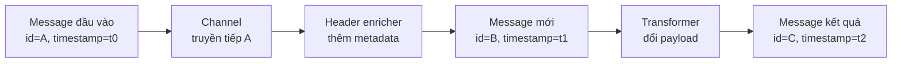

# id và timestamp

Trong một luồng Spring Integration, payload cho biết dữ liệu cần xử lý, còn headers cung cấp ngữ cảnh cho việc truyền và xử lý dữ liệu. Hai header nền tảng là `id` và `timestamp`: một giá trị giúp nhận diện message, giá trị còn lại ghi nhận lúc message được tạo.

Bài này thuộc chương **Message headers** của module **SPRING_INTEGRATION_CORE**. Trọng tâm là đọc và hiểu vòng đời của hai header khi message đi qua `MessageChannel`, endpoint và luồng Java DSL; từ đó thiết kế cách theo dõi, xử lý lại và kiểm thử phù hợp. Các thành phần như transformer, router, filter hay aggregator chỉ được xét ở khía cạnh ảnh hưởng đến danh tính message.

## 1. Hai header trả lời hai câu hỏi khác nhau

| Header | Hằng số | Kiểu dữ liệu | Ý nghĩa |
| --- | --- | --- | --- |
| `id` | `MessageHeaders.ID` | `java.util.UUID` | Định danh kỹ thuật của message đang quan sát |
| `timestamp` | `MessageHeaders.TIMESTAMP` | `java.lang.Long` | Thời điểm tạo message, tính bằng mili giây kể từ Unix epoch |

Với cách tạo message mặc định của Spring Integration, hai giá trị được framework sinh. Khi xử lý làm phát sinh một message mới, các giá trị hệ thống được tạo cho message mới đó. Vì vậy, cần xác định đang quan sát message ở bước nào trong luồng. [Tham chiếu Message của Spring Integration](https://docs.spring.io/spring-integration/reference/message.html).

Ví dụ một log có thể chứa:

```text
payload=order-42
id=ed20bc57-6716-4cd7-b6ed-3c1752bf9c9b
timestamp=1805695200000
```

Ở đây, `order-42` có thể là mã đơn hàng trong dữ liệu nghiệp vụ. UUID nhận diện message mang dữ liệu đó. Nếu ứng dụng tạo một message khác cho cùng đơn hàng, UUID có thể khác dù mã đơn hàng không đổi.

`timestamp` là một con số biểu diễn thời điểm tuyệt đối. Nó không chứa múi giờ hiển thị. Chuyển sang `Instant`, rồi áp dụng múi giờ khi trình bày, giúp tránh nhầm lẫn giữa dữ liệu lưu trữ và cách người dùng đọc thời gian.

## 2. Đọc header với đúng kiểu dữ liệu

Các ví dụ sau dùng Java 17 và API Spring Integration 6.5.x. Phần code chạy trong ứng dụng cần dependency `spring-integration-core`; phần kiểm thử dùng JUnit Jupiter và Spring Test. Phiên bản thư viện nên theo cấu hình quản lý dependency của ứng dụng.

### 2.1. Tạo và quan sát message đầu tiên

Chú ý import `MessageBuilder` từ package của **Spring Integration** trong ví dụ này:

```java
import java.time.Instant;
import java.util.UUID;

import org.springframework.integration.support.MessageBuilder;
import org.springframework.messaging.Message;
import org.springframework.messaging.MessageHeaders;

public final class MessageMetadataExample {

    public static void main(String[] args) {
        Message<String> message = MessageBuilder
                .withPayload("order-42")
                .setHeader("eventId", "evt-order-created-42")
                .build();

        UUID id = message.getHeaders().getId();
        Long timestamp = message.getHeaders().getTimestamp();

        // Hai cách đọc cùng một header với kiểu UUID.
        UUID typedId = message.getHeaders()
                .get(MessageHeaders.ID, UUID.class);

        String createdAt = timestamp == null
                ? "<absent>"
                : Instant.ofEpochMilli(timestamp).toString();

        System.out.println("payload=" + message.getPayload());
        System.out.println("id=" + id);
        System.out.println("typedId=" + typedId);
        System.out.println("createdAt=" + createdAt);
    }
}
```

`getId()` và `getTimestamp()` thể hiện rõ ý định đọc header tiêu chuẩn. Nếu dùng `get("id")`, kiểu trả về chỉ là `Object`, khiến code phải ép kiểu thủ công.

### 2.2. Vì sao vẫn cần xử lý giá trị null?

Ví dụ trên dùng builder mặc định của Spring Integration nên message mới có cả ID và timestamp. Tuy nhiên, API cho phép các cách xây dựng header chuyên biệt; `MessageHeaderAccessor` và bộ khởi tạo header có thể điều khiển việc sinh hai giá trị này. Khi nhận message từ adapter hoặc code ngoài phạm vi kiểm soát, hãy kiểm tra hợp đồng đầu vào trước khi mặc định chúng luôn tồn tại. [API MessageHeaderAccessor](https://docs.spring.io/spring-framework/docs/current/javadoc-api/org/springframework/messaging/support/MessageHeaderAccessor.html).

Đặc biệt, có hai class cùng tên:

```text
org.springframework.integration.support.MessageBuilder
org.springframework.messaging.support.MessageBuilder
```

Không nên đổi import rồi suy luận rằng mọi chi tiết sinh header đều giữ nguyên. Trong Spring Framework 6.2.x, accessor dùng để xây dựng header không bật sinh timestamp theo mặc định; builder của Spring Integration trong bài tạo `GenericMessage` bằng một đường xử lý khác. Đây là một nguyên nhân cần kiểm tra khi thấy timestamp bị thiếu. [Mã nguồn MessageHeaderAccessor 6.2.x](https://github.com/spring-projects/spring-framework/blob/6.2.x/spring-messaging/src/main/java/org/springframework/messaging/support/MessageHeaderAccessor.java), [mã nguồn builder của Spring Integration 6.5.x](https://github.com/spring-projects/spring-integration/blob/6.5.x/spring-integration-core/src/main/java/org/springframework/integration/support/BaseMessageBuilder.java).

Code dùng ở nhiều biên tích hợp nên giữ kiểu `Long` cho timestamp cho đến khi kiểm tra xong. Gán ngay sang `long` sẽ gây lỗi unboxing nếu header vắng mặt.

## 3. Vòng đời: truyền tiếp message và tạo message mới

Phân biệt hai thao tác sau giúp giải thích hầu hết tình huống đổi ID:

- **Truyền tiếp:** thành phần chuyển tiếp message đang có, không tạo nội dung hoặc metadata mới.
- **Tạo kết quả mới:** thành phần xây dựng một message mang payload hoặc headers đã thay đổi.

### 3.1. Channel thông thường không cấp lại ID chỉ vì gửi nhận

Ví dụ độc lập sau sử dụng hàng đợi trong bộ nhớ, không có interceptor và không có message store tùy biến:

```java
import org.springframework.integration.channel.QueueChannel;
import org.springframework.integration.support.MessageBuilder;
import org.springframework.messaging.Message;

QueueChannel queue = new QueueChannel(10);
Message<String> sent = MessageBuilder.withPayload("order-42").build();

if (!queue.send(sent, 1000)) {
    throw new IllegalStateException("Không gửi được message");
}

Message<?> received = queue.receive(1000);
if (received == null) {
    throw new IllegalStateException("Không nhận được message");
}

System.out.println(sent == received); // true trong ví dụ này
System.out.println(received.getHeaders().getId());
```

`QueueChannel` lưu message để bên nhận lấy ra; thời gian message nằm chờ không làm timestamp tăng theo. [Tham chiếu QueueChannel](https://docs.spring.io/spring-integration/reference/channel/implementations.html#queuechannel).

Nếu hệ thống có interceptor thay message, chuyển đổi giao thức hoặc phục hồi từ lưu trữ, cần xét cơ chế đó riêng. Kết luận về cùng tham chiếu Java trong ví dụ không phải hợp đồng cho mọi channel hay mọi biên truyền tin.

### 3.2. Đổi một header nghiệp vụ cũng có thể tạo danh tính mới

Với `MessageBuilder` của Spring Integration đã import ở phần trước:

```java
Message<String> original = MessageBuilder
        .withPayload("order-42")
        .setHeader("eventId", "evt-42")
        .build();

Message<String> forwarded = MessageBuilder
        .fromMessage(original)
        .build();

Message<String> enriched = MessageBuilder
        .fromMessage(original)
        .setHeader("processingStage", "validated")
        .build();

System.out.println(original == forwarded); // true với builder mặc định này
System.out.println(original == enriched);  // false
System.out.println(original.getHeaders().getId());
System.out.println(enriched.getHeaders().getId()); // ID khác
```

Trong trường hợp mặc định này, `fromMessage(original).build()` có thể trả lại message gốc nếu không có thay đổi. Khi thêm `processingStage`, builder tạo message mới. Quy tắc này có điều kiện; factory tùy biến hoặc danh sách header chỉ đọc bổ sung có thể ảnh hưởng việc tái sử dụng. [Phương thức build của BaseMessageBuilder](https://github.com/spring-projects/spring-integration/blob/6.5.x/spring-integration-core/src/main/java/org/springframework/integration/support/BaseMessageBuilder.java).

Hai message được tạo sát nhau có thể có **timestamp bằng nhau** vì độ phân giải là mili giây. Vì vậy, việc ID khác nhau không kéo theo điều kiện timestamp phải khác nhau.

### 3.3. Đọc một luồng qua danh tính message



`t0`, `t1`, `t2` biểu diễn thời điểm tạo từng message. Các giá trị có thể trùng nhau; sơ đồ không khẳng định đồng hồ luôn tăng nghiêm ngặt.

Khi đọc cấu hình endpoint, có thể dùng bảng sau để đặt câu hỏi đúng:

| Thao tác trong luồng | Cách suy luận về ID và timestamp |
| --- | --- |
| Bridge hoặc channel chỉ truyền tiếp | Quan sát message đang có; không suy ra có ID mới chỉ vì thêm một chặng |
| Filter chấp nhận và chuyển tiếp nguyên message | Message được chấp nhận giữ metadata hiện có nếu không có xử lý bổ sung |
| Router chỉ chọn nơi nhận | Việc chọn tuyến tự nó không yêu cầu dựng lại message |
| Header enricher thực sự thêm hoặc đổi header | Kỳ vọng một message kết quả với metadata hệ thống mới khi dùng factory mặc định |
| Transformer tạo payload khác | Xem kết quả là message mới; theo dõi quan hệ với đầu vào bằng metadata riêng |
| Splitter hoặc aggregator tạo các kết quả | Cần phân biệt danh tính từng kết quả với dữ liệu tương quan của cả nhóm |
| Gọi lại handler trên cùng request khi retry | Không mặc định mỗi lần thử đều tạo ID hoặc timestamp mới |

Với các cấu hình phức tạp, cần kiểm tra message thực tế ở đầu vào và đầu ra của thành phần. Tên endpoint không thay thế được việc hiểu nó đang chuyển tiếp hay xây dựng kết quả.

## 4. Header chỉ đọc và cách sao chép đúng

### 4.1. Không gán mã nghiệp vụ vào id

Với API mặc định, `id` và `timestamp` là các header hệ thống chỉ đọc. Cách viết sau không hợp lệ:

```java
// MessageBuilder của Spring Integration.
MessageBuilder.withPayload("order-42")
        .setHeader(MessageHeaders.ID, "order-42")
        .build();
```

Lệnh `setHeader` trên đường xử lý này bị từ chối bằng `IllegalArgumentException`. Ngay cả khi truyền một `UUID` đúng kiểu, ứng dụng cũng không có quyền gán trực tiếp header hệ thống qua thao tác đó. [Mã nguồn kiểm tra header chỉ đọc](https://github.com/spring-projects/spring-framework/blob/6.2.x/spring-messaging/src/main/java/org/springframework/messaging/support/MessageHeaderAccessor.java).

Tương tự, với message bất biến thông thường, gọi `message.getHeaders().put(...)` gây `UnsupportedOperationException`. Metadata riêng nên có tên thể hiện rõ ý nghĩa, chẳng hạn `eventId`, `orderId` hoặc `eventOccurredAt`. [API MessageHeaders](https://docs.spring.io/spring-framework/docs/current/javadoc-api/org/springframework/messaging/MessageHeaders.html).

### 4.2. copyHeaders không giữ nguyên id và timestamp

Khi thay đổi payload, có thể sao chép các header ứng dụng cần dùng:

```java
Message<String> normalized = MessageBuilder
        .withPayload(original.getPayload().toUpperCase(java.util.Locale.ROOT))
        .copyHeaders(original.getHeaders())
        .build();
```

Trong ví dụ này, `eventId` được sao chép. Hai header hệ thống được bảo vệ; không dùng `copyHeaders` hay `copyHeadersIfAbsent` để ép kết quả mang ID và timestamp của đầu vào. API của builder cũng nêu rõ hai giá trị này không bị ghi đè khi sao chép headers. [API copyHeaders của Spring Framework](https://docs.spring.io/spring-framework/docs/current/javadoc-api/org/springframework/messaging/support/MessageBuilder.html#copyHeaders(java.util.Map)).

Không nên chuyển sang một constructor cấp thấp chỉ để lách quy tắc. Constructor `MessageHeaders(Map)` công khai cũng sinh lại ID và timestamp, ghi đè hai giá trị cũ trong map. Các API chuyên biệt phục vụ phục hồi hoặc khởi tạo hạ tầng cần được sử dụng theo đúng hợp đồng riêng. [Constructor MessageHeaders](https://docs.spring.io/spring-framework/docs/current/javadoc-api/org/springframework/messaging/MessageHeaders.html#%3Cinit%3E(java.util.Map)).

## 5. Thiết kế metadata ổn định cho nghiệp vụ

Giả sử một sự kiện “đơn hàng được tạo” đi qua bước chuẩn hóa dữ liệu, kiểm tra hợp lệ và ghi dữ liệu. Ứng dụng cần phân biệt ba cấp độ:

| Giá trị | Ví dụ | Phạm vi ứng dụng lựa chọn |
| --- | --- | --- |
| `id` | UUID do framework sinh | Message kỹ thuật đang được xử lý |
| `eventId` | `evt-order-created-42` | Một sự kiện logic, giữ nguyên khi phân phối lại cùng sự kiện |
| `orderId` | `order-42` | Thực thể nghiệp vụ có thể liên quan đến nhiều sự kiện |
| `originMessageId` | ID message lúc vào luồng | Liên kết các message phát sinh trong một lần nhận dữ liệu |
| `eventOccurredAt` | Thời điểm nguồn ghi nhận sự kiện | Thời gian nghiệp vụ theo hợp đồng với bên phát |
| `ingestedAt` | Thời điểm hệ thống nhận dữ liệu | Mốc đo thời gian xử lý trong phạm vi hệ thống |

Các tên ngoài `id` trong bảng là quy ước minh họa của ứng dụng. Spring Integration không tự hiểu hay tự bảo toàn ý nghĩa nghiệp vụ chỉ vì header được đặt như vậy. Hãy quy định kiểu dữ liệu, nguồn sinh và thành phần nào được phép thay đổi chúng.

### 5.1. Lưu thông tin gốc trước khi biến đổi

```java
Message<String> tracked = MessageBuilder
        .fromMessage(original)
        .setHeader("originMessageId", original.getHeaders().getId())
        .setHeader("ingestedAt", original.getHeaders().getTimestamp())
        .build();
```

Message `tracked` có danh tính kỹ thuật riêng. `originMessageId` giữ ID của `original`, còn `ingestedAt` giữ mốc thời gian đã chọn trước khi biến đổi.

Ví dụ này dùng timestamp của message đầu vào làm mốc nhận, với giả thiết message vừa được tạo tại biên vào ứng dụng. Nếu message đã tồn tại trước đó, nên ghi thời gian nhận thực tế bằng `Clock` tại biên vào. Nếu cần giữ cả hai khái niệm, hãy dùng `originMessageTimestamp` cho timestamp ban đầu và dành `ingestedAt` cho thời điểm hệ thống nhận.

Một message có timestamp vắng mặt cần được xử lý theo hợp đồng: bổ sung thời gian nhận ở biên, hoặc từ chối đầu vào nếu thiếu metadata bắt buộc. Gán một giá trị mặc định tùy tiện có thể làm số liệu vận hành khó giải thích.

### 5.2. Chọn khóa chống xử lý trùng

Nếu cùng `eventId` được gửi lại và adapter tạo message mới, ID kỹ thuật có thể đổi. Dùng `headers.id` làm khóa chống trùng trong trường hợp đó sẽ coi mỗi lần nhận là một sự kiện mới.

Một thiết kế phù hợp hơn cho ví dụ đơn hàng là khóa theo cặp `(consumerName, eventId)`. `eventId` phải được bên phát giữ ổn định qua việc gửi lại; phía nhận cần lưu trạng thái và đồng bộ việc ghi nhận với tác dụng nghiệp vụ theo yêu cầu của ứng dụng.

Spring Integration có `IdempotentReceiverInterceptor` và `MetadataStoreSelector` để hỗ trợ kiểm tra trạng thái. Lựa chọn khóa và bảo đảm tác dụng nghiệp vụ vẫn thuộc thiết kế ứng dụng. [Tham chiếu Idempotent Receiver](https://docs.spring.io/spring-integration/reference/handler-advice/idempotent-receiver.html).

`correlationId` lại phục vụ liên kết nhiều message trong một nhóm xử lý. Một đơn hàng có thể có nhiều sự kiện cùng liên quan, nên correlation và chống trùng thường cần các khóa có ý nghĩa khác nhau. Khi dùng splitter hoặc aggregator, hãy xác định hợp đồng tương quan trước khi chọn bất kỳ ID nào làm khóa nhóm.

## 6. Ví dụ Java DSL: giữ nguồn gốc qua transformer

Luồng dưới đây nhận chuỗi chứa mã đơn hàng, chụp metadata đầu vào, chuẩn hóa payload rồi đưa kết quả vào channel đầu ra. Các mốc được chụp một lần tại biên nhận của luồng minh họa.

```java
import java.util.Locale;

import org.springframework.beans.factory.annotation.Qualifier;
import org.springframework.context.annotation.Bean;
import org.springframework.context.annotation.Configuration;
import org.springframework.integration.channel.DirectChannel;
import org.springframework.integration.channel.QueueChannel;
import org.springframework.integration.config.EnableIntegration;
import org.springframework.integration.dsl.IntegrationFlow;
import org.springframework.messaging.MessageChannel;

@Configuration
@EnableIntegration
public class MessageHeadersFlowConfig {

    @Bean
    public MessageChannel ordersInput() {
        return new DirectChannel();
    }

    @Bean
    public QueueChannel ordersOutput() {
        return new QueueChannel(10);
    }

    @Bean
    public IntegrationFlow normalizeOrders(
            @Qualifier("ordersInput") MessageChannel input,
            @Qualifier("ordersOutput") QueueChannel output) {

        return IntegrationFlow.from(input)
                .enrichHeaders(headers -> headers
                        .headerExpression("originMessageId", "headers['id']")
                        .headerExpression("ingestedAt", "headers['timestamp']"))
                .<String, String>transform(text ->
                        text.strip().toUpperCase(Locale.ROOT))
                .channel(output)
                .get();
    }
}
```

Java DSL đăng ký các channel và endpoint thành bean trong Spring context; `IntegrationFlow` mô tả cách ghép chúng thành luồng. [Tham chiếu Java DSL](https://docs.spring.io/spring-integration/reference/dsl.html).

Với input được tạo bằng builder của Spring Integration, kết quả mong đợi là:

| Thuộc tính | Đầu vào | Đầu ra |
| --- | --- | --- |
| Payload | `"  order-42  "` | `"ORDER-42"` |
| `id` | ID của message đầu vào | ID của message kết quả |
| `originMessageId` | Chưa có | ID của message đầu vào |
| `ingestedAt` | Chưa có | Timestamp được chụp từ message đầu vào |
| `eventId` | `evt-42` | `evt-42` |
| `timestamp` | Thời điểm tạo đầu vào | Thời điểm tạo kết quả, có thể bằng giá trị đầu vào |

Header enricher tự tạo một kết quả trung gian khi bổ sung metadata. Vì thế, đừng giả định luồng chỉ có đúng hai ID vì người dùng chỉ quan sát đầu vào và đầu ra.

Ví dụ transformer ở đây trả về **payload**. Nếu thay bằng transformer trả về toàn bộ `Message<?>`, code xây dựng kết quả cần chủ động cung cấp các header ứng dụng muốn giữ; không mặc định mọi header cũ đều được bổ sung giúp. [Quy tắc truyền header của Spring Integration](https://docs.spring.io/spring-integration/reference/message.html#header-propagation).

## 7. Kiểm thử các bất biến có ý nghĩa

Kiểm thử nên xác nhận điều ứng dụng phụ thuộc vào: dữ liệu được chuẩn hóa, ID phản ánh message kết quả, và metadata nguồn gốc vẫn còn. Không cố định một UUID cụ thể hoặc yêu cầu hai timestamp tạo liên tiếp phải khác nhau.

### 7.1. Kiểm thử luồng trong Spring context

Đặt lớp test cùng package với `MessageHeadersFlowConfig`:

```java
import org.junit.jupiter.api.Test;
import org.springframework.beans.factory.annotation.Autowired;
import org.springframework.beans.factory.annotation.Qualifier;
import org.springframework.integration.channel.QueueChannel;
import org.springframework.integration.support.MessageBuilder;
import org.springframework.messaging.Message;
import org.springframework.messaging.MessageChannel;
import org.springframework.test.context.junit.jupiter.SpringJUnitConfig;

import static org.junit.jupiter.api.Assertions.assertEquals;
import static org.junit.jupiter.api.Assertions.assertNotEquals;
import static org.junit.jupiter.api.Assertions.assertNotNull;
import static org.junit.jupiter.api.Assertions.assertTrue;

@SpringJUnitConfig(MessageHeadersFlowConfig.class)
class MessageHeadersFlowTest {

    @Autowired
    @Qualifier("ordersInput")
    MessageChannel input;

    @Autowired
    @Qualifier("ordersOutput")
    QueueChannel output;

    @Test
    void preservesOriginWhileCreatingANormalizedMessage() {
        Message<String> request = MessageBuilder
                .withPayload("  order-42  ")
                .setHeader("eventId", "evt-42")
                .build();

        assertNotNull(request.getHeaders().getId());
        assertNotNull(request.getHeaders().getTimestamp());
        assertTrue(input.send(request, 1000));

        Message<?> result = output.receive(1000);
        assertNotNull(result);
        assertEquals("ORDER-42", result.getPayload());
        assertNotNull(result.getHeaders().getId());
        assertNotEquals(request.getHeaders().getId(),
                result.getHeaders().getId());
        assertEquals(request.getHeaders().getId(),
                result.getHeaders().get("originMessageId"));
        assertEquals(request.getHeaders().getTimestamp(),
                result.getHeaders().get("ingestedAt"));
        assertEquals("evt-42", result.getHeaders().get("eventId"));
        assertNotNull(result.getHeaders().getTimestamp());
    }
}
```

Test không phụ thuộc UUID được sinh ra là chuỗi nào. Nó cũng không dùng `Thread.sleep` để ép timestamp khác nhau. Timeout ở `receive` chỉ giới hạn thời gian chờ lấy kết quả.

### 7.2. Kiểm thử trường hợp chỉ truyền qua hàng đợi

```java
import org.junit.jupiter.api.Test;
import org.springframework.integration.channel.QueueChannel;
import org.springframework.integration.support.MessageBuilder;
import org.springframework.messaging.Message;

import static org.junit.jupiter.api.Assertions.assertEquals;
import static org.junit.jupiter.api.Assertions.assertSame;
import static org.junit.jupiter.api.Assertions.assertTrue;

class QueueMessageHeadersTest {

    @Test
    void keepsTheMessageWhenOnlyPassingThroughAnInMemoryQueue() {
        QueueChannel queue = new QueueChannel(1);
        Message<String> sent = MessageBuilder.withPayload("order-42").build();

        assertTrue(queue.send(sent, 1000));
        Message<?> received = queue.receive(1000);

        assertSame(sent, received);
        assertEquals(sent.getHeaders().getId(), received.getHeaders().getId());
        assertEquals(sent.getHeaders().getTimestamp(),
                received.getHeaders().getTimestamp());
    }
}
```

`assertSame` ở đây mô tả đúng cấu hình hàng đợi trong bộ nhớ đang được kiểm thử. Nếu đổi sang cơ chế lưu trữ hoặc truyền tải khác, hãy xem xét hợp đồng mới trước khi giữ nguyên assertion này.

## 8. Dùng timestamp cho đo lường và quyết định thời gian

### 8.1. Tuổi của message hiện tại và thời gian từ lúc tiếp nhận

Giả sử ứng dụng nhận sự kiện tại `T0`, chuyển đổi payload tại `T1` và hoàn thành tại `T2`:

```text
Thời gian tính từ lúc nhận dữ liệu = T2 - T0
Tuổi của message kết quả          = T2 - T1
```

Hai phép tính trả lời hai câu hỏi khác nhau. Nếu muốn theo dõi toàn bộ hành trình trong hệ thống, hãy chọn một mốc nhận ổn định và giữ qua các bước chuyển đổi.

Với quy ước `ingestedAt` là `Long` theo mili giây epoch:

```java
import java.time.Clock;

import org.springframework.messaging.Message;

static long elapsedSinceIngestion(Message<?> message, Clock clock) {
    Long ingestedAt = message.getHeaders().get("ingestedAt", Long.class);
    if (ingestedAt == null) {
        throw new IllegalArgumentException("Thiếu header ingestedAt");
    }
    return clock.millis() - ingestedAt;
}
```

Hàm là một phương thức minh họa đặt trong lớp tiện ích của ứng dụng. Truyền `Clock` giúp kiểm thử với thời gian cố định. Kết quả âm có thể phản ánh đồng hồ lệch hoặc mốc đầu vào ở tương lai; ứng dụng cần quyết định cách ghi nhận theo yêu cầu vận hành.

### 8.2. Đo thời lượng một đoạn code

Đối với thời lượng cục bộ trong cùng tiến trình, có thể lấy chênh lệch `System.nanoTime()`:

```java
long started = System.nanoTime();
try {
    processOrder();
}
finally {
    long elapsedNanos = System.nanoTime() - started;
    recordDuration(elapsedNanos);
}
```

`processOrder` và `recordDuration` là các hàm nghiệp vụ và đo lường do ứng dụng cung cấp. Giá trị nanoTime phù hợp cho phép đo chênh lệch trong tiến trình; không gửi nó sang máy khác rồi xem như thời điểm lịch.

### 8.3. Giới hạn xử lý cần một hợp đồng riêng

Một message cũ không tự biến mất chỉ vì timestamp đã cách hiện tại một khoảng lớn. Nếu quy tắc là “chỉ xử lý trong 30 giây từ lúc tiếp nhận”, ứng dụng cần giữ mốc nhận hoặc `deadlineAt`, rồi có filter hay logic nghiệp vụ kiểm tra mốc đó.

Khi đi qua nhiều máy, cần xem xét đồng bộ đồng hồ và định nghĩa thời gian từ nguồn. `eventOccurredAt`, thời gian broker nhận sự kiện và timestamp của message nội bộ có thể là ba thời điểm khác nhau. Đặt tên rõ cho chúng giúp việc tính SLA và điều tra sự cố có cơ sở.

## 9. Quan sát lỗi, retry và các biên giao thức

Một dòng log hữu ích có thể bao gồm:

```text
stage=normalize
messageId=<ID hiện tại>
originMessageId=<ID ở biên nhận>
eventId=evt-42
messageTimestamp=<timestamp hiện tại>
ingestedAt=<mốc nhận đã chọn>
```

Nhờ đó, người vận hành có thể nối các kết quả của một lần nhận bằng `originMessageId`, rồi nhận diện những lần phân phối lại cùng sự kiện bằng `eventId`.

Khi có lỗi, cần phân biệt message gây lỗi với message dùng để mang thông tin lỗi. Message lỗi được tạo riêng có thể có ID riêng. Muốn tìm đúng request, hãy dùng metadata hoặc thông tin message gốc mà cơ chế xử lý lỗi cung cấp, thay vì tìm request bằng ID của vỏ chứa lỗi.

Retry cũng cần được đọc theo cơ chế thực tế. Gọi lại handler với cùng request có thể giữ nguyên ID, trong khi nhận lại từ broker và dựng message mới có thể tạo ID khác. Số lần thử nên được ghi nhận bằng metadata dành cho lần giao hoặc lần xử lý, theo khả năng adapter và chính sách ứng dụng.

Tại biên HTTP, JMS, AMQP hoặc Kafka, không mặc định `id` nội bộ đồng nghĩa với mã của giao thức ngoài. Cần quyết định trường nào được ánh xạ qua biên, kiểu dữ liệu được mã hóa thế nào và cách giữ `eventId` qua việc gửi lại. Bài này không giả định một quy tắc ánh xạ chung cho mọi adapter.

## 10. Các lỗi thiết kế thường gặp

| Biểu hiện | Giả định dẫn đến lỗi | Hướng sửa |
| --- | --- | --- |
| Không nối được log sau transformer | ID kỹ thuật phải ổn định suốt nghiệp vụ | Giữ metadata nguồn gốc và mã sự kiện ở biên nhận |
| Sự kiện gửi lại vẫn bị xử lý hai lần | ID message mới là khóa chống trùng ổn định | Chọn khóa theo sự kiện hoặc thao tác nghiệp vụ và lưu trạng thái phù hợp |
| Số liệu thời gian xử lý thấp bất thường | Timestamp đầu ra là thời điểm nhận ban đầu | Tính từ mốc nhận được giữ qua các bước |
| Test thỉnh thoảng thất bại | Hai message khác nhau bắt buộc có timestamp khác nhau | Kiểm tra quan hệ ID và metadata nghiệp vụ; tránh điều kiện thời gian không có bảo đảm |
| Lỗi unboxing khi đọc timestamp | Mọi nguồn tạo message đều sinh đủ header | Kiểm tra null và chuẩn hóa hợp đồng ở biên |
| Lỗi khi enrich header hệ thống | `id` và `timestamp` là header ứng dụng có thể sửa | Dùng header riêng cho mã nghiệp vụ và thời gian từ nguồn |
| Header nghiệp vụ mất sau transformer tùy biến | Trả về toàn bộ Message vẫn luôn được bổ sung header đầu vào | Chủ động xây dựng headers cần thiết cho kết quả |

## 11. Thực hành có định hướng

### Bài thực hành 1: Quan sát danh tính qua từng bước

Từ `MessageHeadersFlowConfig`, ghi lại ID và timestamp ở đầu vào, sau header enricher và ở đầu ra. Giữ nguyên payload trong một lần thử, rồi thay đổi payload trong lần thử khác.

Kết quả cần giải thích được là message nào chỉ được chuyển tiếp và message nào được tạo mới. Khi hai timestamp bằng nhau, xác định xem ID và metadata nguồn gốc đang cho biết điều gì, thay vì thêm thời gian chờ để thay đổi kết quả.

### Bài thực hành 2: Phân biệt lần nhận và sự kiện

Tạo hai message độc lập có cùng `eventId` nhưng khác ID kỹ thuật, rồi gửi lần lượt vào luồng. Đối chiếu `eventId`, `originMessageId` và `id` ở đầu ra.

Kết quả mong đợi: cả hai đầu ra cùng liên quan một sự kiện logic, trong khi metadata nguồn gốc phân biệt hai message đầu vào. Từ đó thiết kế khóa nhận diện lần xử lý và khóa chống xử lý trùng cho consumer.

### Bài thực hành 3: Quy định mốc thời gian tiếp nhận

Thay việc chụp timestamp đầu vào bằng một mốc `ingestedAt` lấy từ `Clock` tại biên nhận. Dùng thời gian cố định trong test, cho dữ liệu đi qua transformer, rồi kiểm tra mốc này vẫn được giữ.

Kết quả cần đạt: tính được thời gian từ lúc tiếp nhận theo hợp đồng ứng dụng mà không phụ thuộc thời điểm tạo message trung gian hoặc tốc độ chạy của máy kiểm thử.
