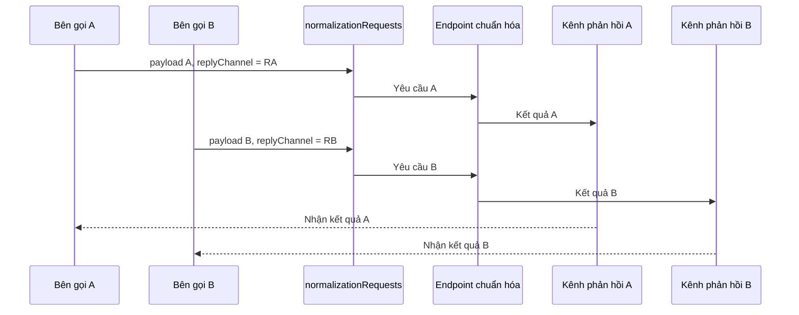

# replyChannel: xác định đường về của thông điệp phản hồi

Trong module `SPRING_INTEGRATION_CORE`, `replyChannel` là mảnh ghép nối `Message`, `MessageChannel`, endpoint và gateway thành một luồng request–reply. Bài học thuộc chương **Message headers**, tập trung vào cách trả kết quả sau khi thông điệp đi qua transformer, router, filter hoặc aggregator, cùng những tình huống lỗi và kiểm thử liên quan đến đường phản hồi.

## 1. Bài toán: xử lý xong thì trả kết quả cho ai?

Giả sử một dịch vụ nhận yêu cầu chuẩn hóa tên sản phẩm. Hai nơi gọi cùng gửi dữ liệu vào `normalizationRequests`:

- Màn hình quản trị gửi `"  spring integration  "`.
- Tác vụ nhập dữ liệu gửi `"  message channel  "`.

Cả hai dùng chung logic xử lý nhưng mỗi nơi cần nhận đúng kết quả của mình. Nếu endpoint luôn gửi ra một hàng đợi chung và các nơi gọi tự lấy thông điệp kế tiếp, chúng có thể lấy nhầm phản hồi của nhau.

Mẫu **Return Address** giải quyết bằng cách đặt địa chỉ nhận kết quả trong chính yêu cầu. Trong Spring Integration, header `replyChannel` đóng vai trò địa chỉ đó. Endpoint có thể tái sử dụng mà không cần biết lớp Java nào đã gửi yêu cầu. Đây là cơ chế được mô tả trong [Service Activator](https://docs.spring.io/spring-integration/reference/service-activator.html).



Sơ đồ minh họa hai địa chỉ phản hồi riêng. Việc xử lý đồng thời hay tuần tự còn phụ thuộc loại channel và cấu hình thực thi.

## 2. Tên header và kiểu giá trị

Tên chuẩn là `replyChannel`; hằng số tương ứng nằm trong Spring Messaging:

```java
import org.springframework.messaging.Message;
import org.springframework.messaging.MessageHeaders;

Object destination = message.getHeaders().get(MessageHeaders.REPLY_CHANNEL);
Object sameDestination = message.getHeaders().getReplyChannel();
```

Trong đoạn trên, `message` là một `Message<?>` đang được xử lý. Giá trị trả về có kiểu `Object` vì đích phản hồi có thể được biểu diễn theo nhiều cách.

| Giá trị | Ví dụ | Cách sử dụng |
| --- | --- | --- |
| Đối tượng `MessageChannel` | Một `QueueChannel` tạo riêng cho yêu cầu | Endpoint gửi trực tiếp tới đối tượng đó |
| Chuỗi tên channel | `"normalizationReplies"` | Framework phân giải tên thành channel trong ngữ cảnh ứng dụng |
| Không có header | `null` khi đọc header | Endpoint cần một đường ra hợp lệ khác nếu tạo kết quả |

`MessageHeaders.REPLY_CHANNEL` thuộc `org.springframework.messaging`, không phải `IntegrationMessageHeaderAccessor`. Cấu trúc `MessageHeaders` là bất biến; không dùng `put()` để sửa trực tiếp. Xem [MessageHeaders API](https://docs.spring.io/spring-framework/docs/current/javadoc-api/org/springframework/messaging/MessageHeaders.html).

Header mang tên `replyChannel` không buộc channel đích phải có bean name `replyChannel`. Tương tự, đặt một bean tên `replyChannel` không tự gắn địa chỉ đó vào mọi thông điệp.

## 3. Endpoint chọn kênh đầu ra theo thứ tự nào?

Với endpoint thông thường có khả năng sinh phản hồi, chẳng hạn service activator, và không dùng cơ chế định tuyến bổ sung như routing slip, xét thứ tự:

1. Nếu endpoint có `outputChannel` được cấu hình, dùng kênh đó.
2. Nếu không, đọc `replyChannel` của thông điệp yêu cầu.
3. Nếu yêu cầu không có header này và kết quả là một `Message<?>`, xét `replyChannel` trong thông điệp kết quả.
4. Nếu vẫn không có đích hợp lệ khi cần gửi kết quả, phát sinh lỗi phân giải đích.

Giá trị dạng chuỗi phải phân giải được thành channel; một tên sai không tự tạo ra channel mới. Các quy tắc trên được trình bày trong [cấu hình Service Activator](https://docs.spring.io/spring-integration/reference/service-activator.html).

| Cấu hình endpoint | Header trên request | Header trên Message kết quả | Đích được chọn |
| --- | --- | --- | --- |
| `outputChannel = nextStep` | `callerReplies` | Bất kỳ | `nextStep` |
| Không có output channel | `callerReplies` | `anotherReplies` | `callerReplies` |
| Không có output channel | Không có | `resultReplies` | `resultReplies` |
| Không có output channel | Không có | Không có | Lỗi khi gửi kết quả |

Bảng áp dụng khi handler thực sự tạo kết quả. Handler không sinh kết quả là trường hợp riêng ở phần sau.

### Vì sao thông điệp không quay về ngay sau bước đầu?

Trong Java DSL:

```java
IntegrationFlow.from("requests")
        .<String, String>transform(String::trim)
        .<String, String>transform(value -> value.toUpperCase(Locale.ROOT))
        .get();
```

DSL nối các endpoint bằng channel trung gian. Transformer đầu đã có đường ra đến transformer tiếp theo. Khi đến endpoint cuối không có output channel riêng, `replyChannel` mới có thể được dùng để trả kết quả. `.get()` hoàn tất cấu hình flow; nó không phải thao tác nhận phản hồi.

Đọc thêm về cách DSL biểu diễn endpoint trong [DSL Basics](https://docs.spring.io/spring-integration/reference/dsl/java-basics.html).

## 4. Ví dụ đầy đủ: trả về một QueueChannel riêng

Ví dụ dưới đây dùng Spring Integration Core và Spring Context có phiên bản tương thích, được quản lý bởi dependency management của dự án. Không cần broker, cơ sở dữ liệu hoặc Spring Boot. Lưu lớp ví dụ vào `ReplyChannelDemo.java` trong một dự án Java đã có các thư viện đó.

```java
package learning.reply;

import java.util.Locale;

import org.springframework.context.annotation.AnnotationConfigApplicationContext;
import org.springframework.context.annotation.Bean;
import org.springframework.context.annotation.Configuration;
import org.springframework.integration.channel.DirectChannel;
import org.springframework.integration.channel.QueueChannel;
import org.springframework.integration.config.EnableIntegration;
import org.springframework.integration.dsl.IntegrationFlow;
import org.springframework.messaging.Message;
import org.springframework.messaging.MessageChannel;
import org.springframework.messaging.support.MessageBuilder;

@Configuration
@EnableIntegration
public class ReplyChannelDemo {

    @Bean
    public DirectChannel normalizationRequests() {
        return new DirectChannel();
    }

    @Bean
    public IntegrationFlow normalizationFlow(
            DirectChannel normalizationRequests) {

        return IntegrationFlow.from(normalizationRequests)
                .<String, String>transform(String::trim)
                .<String, String>transform(
                        value -> value.toUpperCase(Locale.ROOT))
                .get();
    }

    public static void main(String[] args) {
        try (AnnotationConfigApplicationContext context =
                     new AnnotationConfigApplicationContext(
                             ReplyChannelDemo.class)) {

            MessageChannel requests = context.getBean(
                    "normalizationRequests", MessageChannel.class);

            QueueChannel replies = new QueueChannel(1);

            Message<String> request = MessageBuilder
                    .withPayload("  spring integration  ")
                    .setHeader("requestId", "req-42")
                    .setReplyChannel(replies)
                    .build();

            if (!requests.send(request, 1_000)) {
                throw new IllegalStateException("Không gửi được yêu cầu");
            }

            Message<?> response = replies.receive(1_000);

            if (response == null) {
                throw new IllegalStateException("Không nhận được phản hồi");
            }

            System.out.println(response.getPayload());
            System.out.println(response.getHeaders().get("requestId"));
        }
    }
}
```

Kết quả mong đợi:

```text
SPRING INTEGRATION
req-42
```

`replies` không cần là Spring bean: request giữ tham chiếu trực tiếp tới nó. `QueueChannel` lưu phản hồi cho đến khi bên gọi thực hiện `receive()`; constructor `new QueueChannel(1)` giới hạn sức chứa ở một thông điệp. `DirectChannel` gọi handler trên thread gửi trong cấu hình này. Xem [các loại MessageChannel](https://docs.spring.io/spring-integration/reference/channel/implementations.html).

Bên gọi đang làm hai việc riêng: `send()` gửi yêu cầu, còn `receive()` lấy kết quả. Giá trị `true` từ `send()` không thay thế việc kiểm tra phản hồi nghiệp vụ.

### Dùng tên bean thay cho đối tượng channel

Bổ sung bean sau vào cấu hình:

```java
@Bean
public QueueChannel normalizationReplies() {
    return new QueueChannel(10);
}
```

Khi gửi, đổi cách tạo request:

```java
Message<String> request = MessageBuilder
        .withPayload("  spring integration  ")
        .setReplyChannelName("normalizationReplies")
        .build();

QueueChannel replies = context.getBean(
        "normalizationReplies", QueueChannel.class);
```

`context` là application context ở ví dụ đầy đủ. Tiếp tục gọi `requests.send(request, 1_000)` và `replies.receive(1_000)` như trước. Hai API `setReplyChannel()` và `setReplyChannelName()` giúp thể hiện rõ ý định hơn việc viết tên header thủ công; xem [MessageBuilder API](https://docs.spring.io/spring-framework/docs/current/javadoc-api/org/springframework/messaging/support/MessageBuilder.html).

Để thử tình huống nhiều bên gọi, hãy giữ phương án mỗi request có một `QueueChannel` riêng. Phương án bean chung ở đây chỉ minh họa phân giải tên; nếu các caller cùng gọi `receive()` trên một queue chung thì cần thêm cơ chế ghép phản hồi với yêu cầu.

## 5. Gateway quản lý địa chỉ phản hồi như thế nào?

Gateway cho phép bên gọi dùng một phương thức Java:

```java
String result = gateway.normalize("  spring integration  ");
```

Đối với lời gọi request–reply thông thường, gateway tạo kênh phản hồi tạm, đưa nó vào header `replyChannel` rồi chờ kết quả. Endpoint cuối dùng địa chỉ đó; gateway chuyển payload nhận được thành giá trị trả về.

Không cần khai báo một bean channel cố định cho từng lời gọi. Khi cấu hình `defaultReplyChannel`, gateway còn thiết lập cầu nối từ kênh được chỉ định về kênh tạm. Vì vậy cấu hình này không đồng nghĩa mọi caller tự lấy thông điệp kế tiếp từ một hàng đợi chung. Xem [Messaging Gateways — Setting the Default Reply Channel](https://docs.spring.io/spring-integration/reference/gateway.html#gateway-default-reply-channel).

### Interface gateway cho flow chuẩn hóa

```java
package learning.reply;

import org.springframework.integration.annotation.MessagingGateway;

@MessagingGateway(
        defaultRequestChannel = "normalizationRequests",
        defaultRequestTimeout = "1000",
        defaultReplyTimeout = "2000")
public interface NormalizationGateway {

    String normalize(String value);
}
```

Để dùng interface này với cấu hình ở mục 4, thêm annotation sau trên lớp `ReplyChannelDemo`:

```java
import org.springframework.integration.annotation.IntegrationComponentScan;

@IntegrationComponentScan(
        basePackageClasses = NormalizationGateway.class)
```

Giữ nguyên `@Configuration` và `@EnableIntegration`. Sau khi khởi tạo context, thay đoạn gửi/nhận thủ công bằng:

```java
NormalizationGateway gateway =
        context.getBean(NormalizationGateway.class);

String result = gateway.normalize("  spring integration  ");
System.out.println(result);
```

`@IntegrationComponentScan` dùng để phát hiện interface có `@MessagingGateway`; component scan thông thường không đảm nhiệm việc tạo gateway proxy này. Hai timeout trong annotation có đơn vị mili giây. Các thuộc tính được mô tả trong [MessagingGateway API](https://docs.spring.io/spring-integration/api/org/springframework/integration/annotation/MessagingGateway.html).

Tránh ghi đè `replyChannel` của request do gateway tạo chỉ để “đưa kết quả về một queue dễ nhìn”. Cách đó có thể chuyển phản hồi ra khỏi nơi gateway đang chờ. Nếu mục tiêu là quan sát, hãy cân nhắc wire tap hoặc interceptor tại channel thích hợp.

## 6. outputChannel được ưu tiên: ví dụ dễ gây timeout

Giả sử thay method cấu hình flow ở mục 4 bằng phiên bản sau và thêm bean `normalizationReplies`:

```java
@Bean
public IntegrationFlow normalizationFlow(
        DirectChannel normalizationRequests) {

    return IntegrationFlow.from(normalizationRequests)
            .<String, String>transform(
                    value -> value.trim().toUpperCase(Locale.ROOT))
            .channel("normalizationReplies")
            .get();
}
```

Dù request có `replyChannel = callerReplies`, kết quả của transformer vẫn được đưa vào `normalizationReplies` vì endpoint đã có output channel. Nếu không có consumer hoặc bridge đưa thông điệp đi tiếp, `callerReplies` không nhận được gì.

Khi một channel trung gian là chủ ý thiết kế, thêm flow tiếp tục xử lý hoặc một bridge phù hợp. Chẳng hạn, với một `DirectChannel` trung gian đã đăng ký:

```java
@Bean
public DirectChannel normalizedResults() {
    return new DirectChannel();
}

@Bean
public IntegrationFlow normalizationFlow(
        DirectChannel normalizationRequests,
        DirectChannel normalizedResults) {

    return IntegrationFlow.from(normalizationRequests)
            .<String, String>transform(
                    value -> value.trim().toUpperCase(Locale.ROOT))
            .channel(normalizedResults)
            .get();
}

@Bean
public IntegrationFlow returnToCaller(
        DirectChannel normalizedResults) {

    return IntegrationFlow.from(normalizedResults)
            .bridge()
            .get();
}
```

Đây là một phương án thay thế cho method `normalizationFlow` trước, không đăng ký đồng thời các method trùng tên. Bridge cuối chuyển thông điệp theo đường phản hồi còn giữ trong header. Nếu dùng `QueueChannel` cho kênh trung gian, phía tiêu thụ cần poller.

Điểm cần quan sát khi đọc cấu hình: phân biệt **kênh bước kế tiếp** với **kênh trả cho caller**. Một endpoint có output channel vẫn có thể là một mắt xích trong luồng sẽ trả về caller ở bước sau.

## 7. Bảo toàn replyChannel khi biến đổi thông điệp

Spring Integration thường truyền header từ request sang output của endpoint tạo message. Tuy nhiên, transformer trả về một `Message<?>` hoàn chỉnh là trường hợp đặc biệt: mã ứng dụng chịu trách nhiệm về header của message đó. Transformer chỉ trả payload thì framework truyền các header đầu vào theo cơ chế thông thường.

Ví dụ một hàm biến đổi có nguy cơ bỏ mất địa chỉ phản hồi:

```java
public static Message<String> rebuildWithoutHeaders(
        Message<String> request) {

    return MessageBuilder
            .withPayload(request.getPayload().trim())
            .build();
}
```

Nếu kết quả này được gửi qua output channel sang một endpoint tiếp theo, request mà endpoint tiếp theo nhận không còn `replyChannel`. Lỗi có thể chỉ xuất hiện ở cuối flow.

Khi cần tự dựng message, giữ các header cần thiết:

```java
public static Message<String> rebuildWithHeaders(
        Message<String> request) {

    return MessageBuilder
            .withPayload(request.getPayload().trim())
            .copyHeaders(request.getHeaders())
            .build();
}
```

Các đoạn trên dùng `Message` và `MessageBuilder` đã import trong ví dụ đầy đủ. Nếu chỉ đổi payload, trả về payload thường giúp cấu hình dễ hiểu hơn.

Một nuance quan trọng: transformer đang xử lý vẫn có thể chọn đích từ **request hiện tại** dù message kết quả do bạn tạo thiếu header. Vì vậy cần kiểm tra cả message gửi sang **bước tiếp theo**; thành công tại một endpoint chưa chứng minh header được bảo toàn suốt flow.

Xem quy tắc cụ thể tại [Message — Header Propagation](https://docs.spring.io/spring-integration/reference/message.html#message-header-propagation).

## 8. Không có phản hồi khác với không có địa chỉ phản hồi

Hai trường hợp có biểu hiện rất khác:

| Tình huống | Ý nghĩa | Hướng xử lý |
| --- | --- | --- |
| Handler trả `null` hoặc `void` | Có thể không tạo message kết quả | Kiểm tra hợp đồng request–reply |
| Handler tạo kết quả nhưng không có đích gửi | Không tìm được output channel hoặc reply channel | Sửa cấu hình hoặc header |
| Filter loại bỏ request | Nhánh xử lý không đi đến bước trả lời | Trả kết quả từ chối hoặc phát sinh lỗi rõ ràng |
| Có địa chỉ nhưng gửi không thành công | Channel có vấn đề nhận/gửi | Kiểm tra subscriber, capacity và vòng đời |

Với service activator, có thể yêu cầu luôn có kết quả:

```java
@Bean
public IntegrationFlow validateFlow() {
    return IntegrationFlow.from("validationRequests")
            .<String>handle(
                    (payload, headers) ->
                            payload.isBlank() ? null : payload,
                    endpoint -> endpoint.requiresReply(true))
            .get();
}
```

Đầu vào rỗng dẫn đến `ReplyRequiredException` thay vì kết thúc handler mà không tạo phản hồi. Yêu cầu này chỉ phát hiện việc handler không trả kết quả; nó không cấp thêm địa chỉ trả lời. Xem [Service Activator — requiresReply](https://docs.spring.io/spring-integration/reference/service-activator.html).

Ở mức handler tạo message, thiếu cả output channel và reply channel có thể dẫn tới `DestinationResolutionException`. Header mang kiểu không được hỗ trợ cũng là lỗi, không phải một kênh dự phòng. Khi chẩn đoán, đọc cả nguyên nhân bên trong nếu exception đã được bọc. Có thể đối chiếu [AbstractMessageProducingHandler](https://github.com/spring-projects/spring-integration/blob/main/spring-integration-core/src/main/java/org/springframework/integration/handler/AbstractMessageProducingHandler.java).

### Filter trong luồng có caller đang chờ

Nếu việc từ chối là lỗi, cấu hình rõ:

```java
@Bean
public IntegrationFlow nonBlankFlow() {
    return IntegrationFlow.from("nonBlankRequests")
            .<String>filter(
                    value -> !value.isBlank(),
                    endpoint -> endpoint
                            .throwExceptionOnRejection(true))
            .get();
}
```

Nếu từ chối là kết quả nghiệp vụ bình thường, có thể thiết kế nhánh trả về DTO như `ValidationResult(false, "EMPTY_INPUT")`. Chỉ chuyển request sang một discard channel để ghi log sẽ chưa đáp ứng hợp đồng phải trả lời caller.

Các lựa chọn discard và exception được mô tả trong [Filter](https://docs.spring.io/spring-integration/reference/filter.html).

## 9. replyChannel và errorChannel đảm nhiệm hai đường khác nhau

`replyChannel` chỉ đường cho phản hồi; `errorChannel` chỉ đường xử lý lỗi trong những cơ chế có hỗ trợ phát thông điệp lỗi. Chỉ gắn `errorChannel` không biến mọi exception thành message và không tự tạo kết quả nghiệp vụ cho caller.

Với luồng đồng bộ qua `DirectChannel`, exception có thể truyền ngược trên call stack tới bên gửi. Khi chuyển xử lý sang executor hoặc poller, cơ chế phát `ErrorMessage` và nơi nhận lỗi cần được xét theo thành phần đang thực thi. Không thể giả định `try/catch` quanh `send()` bắt được lỗi xảy ra trên một thread khác. Xem [Error Handling](https://docs.spring.io/spring-integration/reference/error-handling.html).

Khi thiết kế một luồng có gateway, hãy quyết định caller cần nhận:

- Kết quả thành công.
- Một kết quả nghiệp vụ biểu thị bị từ chối.
- Exception biểu thị lỗi xử lý.

Đối với phương án chuyển lỗi thành kết quả, error flow phải tạo phản hồi và giữ hoặc khôi phục đúng ngữ cảnh yêu cầu. Một error handler chỉ ghi log có thể khiến caller tiếp tục chờ.

Nếu chủ ý bỏ một kết quả, cấu hình `nullChannel` làm output là lựa chọn rõ ràng. Đối với API có hợp đồng request–reply, hãy xác định trước bên gọi sẽ kết thúc bằng cơ chế nào thay vì trông chờ kết quả đã bị loại bỏ.

## 10. Timeout không phải cơ chế dừng tác vụ

Ví dụ gateway đặt `defaultReplyTimeout = "2000"`. Cần phân biệt:

| Mốc thời gian | Điều nó kiểm soát |
| --- | --- |
| Request/send timeout | Thời gian chờ gửi khi thao tác gửi có thể bị chặn |
| Reply/receive timeout | Thời gian chờ phản hồi ở phía nhận |
| Timeout của HTTP, JDBC hoặc dịch vụ đích | Thời gian của thao tác bên ngoài, cấu hình riêng |
| Chính sách hủy tác vụ | Cần thiết kế và hỗ trợ riêng |

Trong luồng hoàn toàn đồng bộ, tác vụ chậm vẫn chạy trên thread gọi; reply timeout không ngắt tác vụ đó. Với luồng có điểm bàn giao sang thread khác, caller có thể hết thời gian chờ trước khi kết quả được tạo. Hết thời gian chờ không tự hoàn tác công việc downstream. Xem [Gateway Behavior When No Response Arrives](https://docs.spring.io/spring-integration/reference/gateway.html#gateway-no-response).

Ví dụ suy luận để đọc một luồng:

```text
t = 0 ms       caller gọi gateway
t = 50 ms      flow bàn giao yêu cầu sang executor
t ≈ 2050 ms    caller hết khoảng chờ 2000 ms
t = 5000 ms    downstream mới hoàn thành
```

Đây là mốc minh họa, không phải cam kết thời gian thực. Khi phép gọi hết thời gian chờ, ứng dụng phải có cách xử lý kết quả đến muộn và tránh tạo tác dụng phụ lặp lại nếu caller gửi lại yêu cầu.

Trong ví dụ thủ công ở mục 4, `receive(1_000)` chạy sau khi `send()` trả về. Nếu `send()` đang thực thi handler đồng bộ rất lâu, thời gian chờ nhận này chưa bắt đầu.

## 11. replyChannel không phải khóa tương quan

`replyChannel` trả lời câu hỏi **gửi kết quả tới đâu**. Một khóa như `requestId` hoặc `correlationId` phục vụ việc liên hệ hoặc gom nhóm thông điệp theo quy tắc của ứng dụng. Một địa chỉ nhận chung không tự chia phản hồi thành từng cuộc gọi.

Trong thiết kế splitter–aggregator:

1. Một request có thể được chia thành nhiều phần.
2. Các phần được xử lý và gom vào đúng nhóm.
3. Khi đủ điều kiện release, aggregator tạo kết quả tổng hợp.
4. Kết quả tổng hợp cần đường trả về phù hợp.

Aggregator mặc định dùng `correlationId` để gom nhóm và có logic tổng hợp header; các header xung đột có thể bị loại khỏi tập header tổng hợp. Vì vậy không nên tùy tiện gom message của nhiều cuộc gọi có địa chỉ phản hồi khác nhau vào một nhóm. Xem [Aggregator](https://docs.spring.io/spring-integration/reference/aggregator.html).

Tình huống thiết kế: một đơn hàng có ba dòng sản phẩm. Hãy giữ các phần thuộc cùng một lần yêu cầu trong một nhóm, rồi trả một kết quả tổng hợp cho caller. Nếu muốn trả từng phần dưới dạng luồng kết quả, cần chọn hợp đồng API và cơ chế nhận phù hợp với nhiều phản hồi.

## 12. Qua ranh giới serialization: đối tượng channel có giới hạn

Một tham chiếu `MessageChannel` trong JVM không phải địa chỉ mạng có thể dùng nguyên trạng ở tiến trình khác. Khi lưu message hoặc chuyển qua transport, cần xét serializer và header mapping của chính thành phần đó.

Spring Integration cung cấp `HeaderChannelRegistry` để lưu ánh xạ từ chuỗi sang channel. Có thể chuyển header channel sang chuỗi bằng Java DSL:

```java
.enrichHeaders(headers -> headers.headerChannelsToString())
```

Đây là một đoạn trong flow, đặt trước bước cần lưu hoặc serialize message; xem [HeaderEnricherSpec API](https://docs.spring.io/spring-integration/api/org/springframework/integration/dsl/HeaderEnricherSpec.html).

Cơ chế này áp dụng cho `replyChannel` và `errorChannel` hiện có khi giá trị là channel. Ánh xạ có thời hạn và cần registry để phân giải lại. Xem [Content Enricher — Header Channel Registry](https://docs.spring.io/spring-integration/reference/content-enrichment.html#header-channel-registry).

Từ việc registry giữ tham chiếu tới channel trong bộ nhớ, có thể suy ra giới hạn triển khai: một token như vậy không tự tạo cơ chế phản hồi bền vững giữa các node và không tự phục hồi caller sau khi tiến trình khởi động lại.

Với trao đổi liên tiến trình, hãy thiết kế destination phản hồi, correlation, timeout và header mapping theo giao thức hoặc gateway của transport. Đừng coi việc đổi một tham chiếu channel thành chuỗi là đã hoàn thành thiết kế request–reply phân tán.

## 13. Kiểm thử đường về của phản hồi

Kiểm thử cần chứng minh kết quả tới đúng nơi nhận, thay vì chỉ xác nhận đã gọi `send()`. Lớp dưới dùng JUnit Jupiter và cấu hình `ReplyChannelDemo` nguyên bản ở mục 4, chưa thay bằng các biến thể có output channel cố định.

```java
package learning.reply;

import org.junit.jupiter.api.Test;
import org.springframework.context.annotation.AnnotationConfigApplicationContext;
import org.springframework.integration.channel.QueueChannel;
import org.springframework.messaging.Message;
import org.springframework.messaging.MessageChannel;
import org.springframework.messaging.support.MessageBuilder;

import static org.junit.jupiter.api.Assertions.assertEquals;
import static org.junit.jupiter.api.Assertions.assertNotNull;
import static org.junit.jupiter.api.Assertions.assertNull;
import static org.junit.jupiter.api.Assertions.assertTrue;

class ReplyChannelDemoTest {

    @Test
    void sendsEachResultToItsOwnReplyChannel() {
        try (AnnotationConfigApplicationContext context =
                     new AnnotationConfigApplicationContext(
                             ReplyChannelDemo.class)) {

            MessageChannel requests = context.getBean(
                    "normalizationRequests", MessageChannel.class);

            QueueChannel repliesA = new QueueChannel(1);
            QueueChannel repliesB = new QueueChannel(1);

            Message<String> requestA = MessageBuilder
                    .withPayload("  alpha  ")
                    .setHeader("requestId", "A")
                    .setReplyChannel(repliesA)
                    .build();

            Message<String> requestB = MessageBuilder
                    .withPayload("  beta  ")
                    .setHeader("requestId", "B")
                    .setReplyChannel(repliesB)
                    .build();

            assertTrue(requests.send(requestA, 1_000));
            assertTrue(requests.send(requestB, 1_000));

            Message<?> responseA = repliesA.receive(1_000);
            Message<?> responseB = repliesB.receive(1_000);

            assertNotNull(responseA);
            assertNotNull(responseB);

            assertEquals("ALPHA", responseA.getPayload());
            assertEquals("A", responseA.getHeaders().get("requestId"));
            assertEquals("BETA", responseB.getPayload());
            assertEquals("B", responseB.getHeaders().get("requestId"));

            assertNull(repliesA.receive(0));
            assertNull(repliesB.receive(0));
        }
    }
}
```

Ca kiểm thử này xác nhận phân phối đúng địa chỉ và giữ `requestId` trong ví dụ đồng bộ. Nó chưa kiểm tra cạnh tranh giữa các thread, tải lớn hoặc transport bên ngoài.

Các tình huống nên bổ sung khi phát triển ứng dụng:

| Ca kiểm thử | Kết quả cần chứng minh |
| --- | --- |
| Có output channel và request có reply channel khác | Kết quả đi vào output channel; kênh còn lại không nhận |
| Header chứa tên bean hợp lệ | Nhận được phản hồi tại bean đó |
| Header chứa tên không tồn tại | Phát sinh lỗi phân giải; không chờ một channel tự xuất hiện |
| Transformer trả Message, phía sau còn endpoint | Header cần thiết còn ở message nhận bởi bước sau |
| Filter từ chối request | Caller nhận đúng kết quả từ chối hoặc exception theo hợp đồng |
| Handler không trả kết quả | `requiresReply` phát hiện đúng nếu đã bật |
| Xử lý bất đồng bộ tạo kết quả muộn | Caller và tác vụ downstream kết thúc theo chính sách đã chọn |

Với timeout, dùng giới hạn chờ hữu hạn trong kiểm thử để ca thất bại không treo cả bộ test. Với bài kiểm tra bất đồng bộ, hãy dùng điểm đồng bộ có kiểm soát thay cho việc chỉ chèn `Thread.sleep()` rồi đoán tác vụ đã xong.

## 14. Chẩn đoán khi caller không nhận kết quả

Bắt đầu từ điểm caller vào flow và theo dõi cùng một mã yêu cầu:

1. Kiểm tra request có `replyChannel` nào; giá trị là đối tượng channel hay chuỗi.
2. Xác nhận request đã đến endpoint và endpoint tạo ra kết quả.
3. Kiểm tra output channel của endpoint đang xét trước khi kết luận header bị bỏ qua.
4. Theo dõi header sau mỗi bước tự dựng lại `Message` hoặc lọc header.
5. Kiểm tra nhánh router, filter và điều kiện release của aggregator.
6. Kiểm tra nơi tiêu thụ phản hồi: subscriber với subscribable channel, hoặc `receive()`/poller với pollable channel.
7. Xem exception và error flow, đặc biệt khi xử lý đã chuyển sang thread khác.
8. Đối chiếu thời gian xử lý với khoảng chờ và chính sách phản hồi đến muộn.

Ví dụ ghi thông tin phục vụ chẩn đoán trong một handler:

```java
Object replyTo = message.getHeaders().getReplyChannel();

logger.debug(
        "requestId={}, replyChannelType={}, replyChannel={}",
        message.getHeaders().get("requestId"),
        replyTo == null ? "absent" : replyTo.getClass().getName(),
        replyTo);
```

Ở đây `message` và `logger` là các biến đã có trong handler. Dùng mã yêu cầu để liên hệ các log; tên lớp hoặc chuỗi biểu diễn của channel chỉ hỗ trợ quan sát, không thay thế định danh nghiệp vụ.

## 15. Bài thực hành

Dựa trên ví dụ ở mục 4, thực hiện lần lượt:

1. Gửi hai request với hai `QueueChannel` riêng, kiểm tra đúng payload và `requestId`.
2. Thay tham chiếu channel bằng `setReplyChannelName()` cùng bean tương ứng.
3. Cấu hình output channel cố định, quan sát kênh nào nhận kết quả.
4. Tạo transformer trả message mới không sao chép header, đặt thêm endpoint phía sau, rồi quan sát nơi đường phản hồi bị mất.
5. Giữ lại header cần thiết và lặp lại phép kiểm tra.
6. Thêm filter từ chối chuỗi trống, xác định rõ caller phải nhận gì.
7. Chuyển một bước sang xử lý bất đồng bộ và kiểm tra cả trường hợp trả đúng hạn lẫn đến muộn.

Tiêu chí hoàn thành: giải thích được địa chỉ phản hồi đến từ đâu, endpoint nào quyết định đích gửi, và caller kết thúc bằng kết quả, exception hay timeout trong từng trường hợp. Khi đọc một flow mới, luôn xác định cả đường xử lý yêu cầu lẫn đường trả kết quả.
