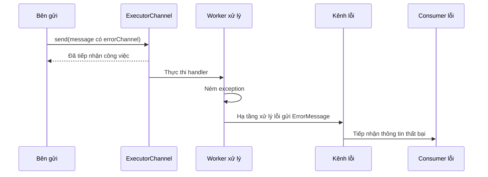
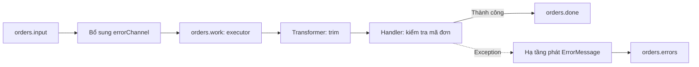

# errorChannel

## 1. Vai trò của errorChannel trong luồng thông điệp

Trong chương **Message headers** của module **SPRING_INTEGRATION_CORE**, `errorChannel` biểu diễn địa chỉ nhận thông điệp lỗi. Khi thiết kế luồng bằng `Message`, `MessageChannel`, endpoint, gateway và Java DSL, cần xác định cả đường đi thành công lẫn nơi tiếp nhận thất bại.

Giả sử hệ thống nhận đơn hàng, chuẩn hóa mã đơn rồi kiểm tra nghiệp vụ. Nếu một worker xử lý đơn sau khi bên gửi đã tiếp tục công việc khác, việc ném exception trên worker không làm exception xuất hiện trong khối `try/catch` đã kết thúc ở bên gửi. Một thông điệp lỗi giúp chuyển thông tin thất bại đến thành phần chịu trách nhiệm.

Sau bài này, người học có thể:

- Phân biệt header `errorChannel`, bean toàn cục `errorChannel` và cấu hình kênh lỗi của gateway hoặc poller.
- Xác định thành phần nào bắt exception và phát `ErrorMessage`.
- Gắn kênh lỗi bằng `MessageBuilder` và Java DSL, đồng thời bảo toàn ngữ cảnh yêu cầu.
- Viết consumer đọc lỗi, kiểm thử đường thành công và thất bại.
- Thiết kế ranh giới giữa thông báo lỗi, retry và quyết định phục hồi nghiệp vụ.

Các ví dụ lấy Java 17 và Spring Integration 6.5 làm mốc, sử dụng `spring-integration-core`. Ví dụ kiểm thử dùng JUnit Jupiter. Khi dùng Spring Boot, chọn bộ phiên bản do Boot quản lý thay vì ghép riêng các phiên bản Spring Framework và Spring Integration.

## 2. Ba nơi thường xuất hiện tên errorChannel

| Vị trí | Ý nghĩa | Ví dụ |
| --- | --- | --- |
| Header của message | Địa chỉ nhận lỗi dành cho yêu cầu đang xử lý | `MessageHeaders.ERROR_CHANNEL` mang giá trị `"orders.errors"` |
| Bean trong ApplicationContext | Một đối tượng kênh thực tế | Bean `orders.errors` là `QueueChannel` |
| Thuộc tính cấu hình endpoint | Chính sách xử lý lỗi của thành phần tương ứng | `@MessagingGateway(errorChannel = "quotes.errors")` |

Tên header chuẩn là `errorChannel`, được khai báo bởi `MessageHeaders.ERROR_CHANNEL`. `MessageHeaders` là cấu trúc bất biến đối với các thao tác `Map` thông thường; hãy dùng builder để tạo message mới khi cần thay header. Xem [API MessageHeaders](https://docs.spring.io/spring-framework/docs/current/javadoc-api/org/springframework/messaging/MessageHeaders.html).

Header có thể chứa đối tượng `MessageChannel` hoặc tên bean dạng `String` trong cơ chế phân giải kênh được framework hỗ trợ. Java DSL có overload nhận trực tiếp hai dạng giá trị này. Xem [API HeaderEnricherSpec.errorChannel](https://docs.spring.io/spring-integration/api/org/springframework/integration/dsl/HeaderEnricherSpec.html).

Ví dụ hai cách biểu diễn cùng một đích đến:

```java
import org.springframework.messaging.Message;
import org.springframework.messaging.MessageChannel;
import org.springframework.messaging.MessageHeaders;
import org.springframework.messaging.support.MessageBuilder;

Message<String> byName = MessageBuilder.withPayload("ORDER-17")
        .setHeader(MessageHeaders.ERROR_CHANNEL, "orders.errors")
        .build();

// ordersErrors là MessageChannel đã được ứng dụng cung cấp.
Message<String> byReference = MessageBuilder.withPayload("ORDER-17")
        .setHeader(MessageHeaders.ERROR_CHANNEL, ordersErrors)
        .build();
```

`"orders.errors"` trong ví dụ là tên bean mà bộ phân giải trong Spring context phải tìm thấy. Đây không phải tên queue tại broker hay địa chỉ của một dịch vụ bên ngoài.

## 3. Ai thực sự biến exception thành thông điệp lỗi?

Header chỉ cung cấp địa chỉ. Cần một thành phần bắt exception, dựng thông điệp lỗi và gửi nó đi. `MessagePublishingErrorHandler` là một cơ chế thực hiện công việc đó; ứng dụng cũng có thể chủ động xuất bản lỗi. Xem [API MessagePublishingErrorHandler](https://docs.spring.io/spring-integration/api/org/springframework/integration/channel/MessagePublishingErrorHandler.html).

### 3.1. Đường đồng bộ qua DirectChannel

```text
Thread gọi:
  send(message) -> DirectChannel -> handler -> exception
       ^_________________________________________|
```

Khi handler chạy trên cùng thread, exception có thể truyền ngược theo Java call stack. Gắn header `errorChannel` vào message không tự khiến lời gọi `DirectChannel.send(...)` được bao bởi một bộ bắt lỗi mới.

```java
import org.springframework.integration.channel.DirectChannel;
import org.springframework.messaging.MessageHeaders;
import org.springframework.messaging.MessagingException;
import org.springframework.messaging.support.MessageBuilder;

DirectChannel input = new DirectChannel();
input.subscribe(message -> {
    throw new IllegalStateException("Kho hàng chưa sẵn sàng");
});

try {
    input.send(MessageBuilder.withPayload("ORDER-17")
            .setHeader(MessageHeaders.ERROR_CHANNEL, "orders.errors")
            .build());
} catch (MessagingException ex) {
    // Bên gửi vẫn chịu trách nhiệm với thất bại đồng bộ này.
    System.out.println(ex.getMessage());
}
```

Trong ví dụ độc lập này, `DirectChannel` không tra cứu bean `orders.errors` để xuất bản lỗi. Đường exception đồng bộ và đường phát `ErrorMessage` cần được phân biệt khi đọc cấu hình. Tài liệu [Error Handling](https://docs.spring.io/spring-integration/reference/6.5/error-handling.html) mô tả ranh giới này.

### 3.2. Đường xử lý trên worker

`ExecutorChannel` chuyển công việc qua `Executor`. Với executor sử dụng thread khác, bên gửi và handler không còn chia sẻ cùng Java call stack. Chúng cũng không mặc nhiên chia sẻ transaction gắn với thread của bên gửi. Xem [API ExecutorChannel](https://docs.spring.io/spring-integration/api/org/springframework/integration/channel/ExecutorChannel.html).



Trong hạ tầng xử lý lỗi mặc định, header của yêu cầu được ưu tiên; nếu không có, đích mặc định là bean toàn cục `errorChannel`. Khi ứng dụng cấu hình đích mặc định riêng cho một thành phần, cần đọc thêm chính sách của thành phần đó. Xem [Error Handling: phân giải kênh lỗi](https://docs.spring.io/spring-integration/reference/6.5/error-handling.html).

Đừng suy ra kết quả nghiệp vụ từ giá trị `true` của `send()` trên kênh bất đồng bộ. Đơn hàng có thể được tiếp nhận vào executor rồi thất bại sau đó. Tương tự, lỗi tiếp nhận như executor từ chối task vẫn có thể xảy ra ngay trong lời gọi gửi; cần phân biệt với lỗi do handler trên worker gây ra.

### 3.3. QueueChannel cần bên nhận

`QueueChannel` lưu message chờ bên nhận. Một polling consumer do Spring Integration quản lý có thể nhận message và xử lý nó trong task được lên lịch. Cấu hình poller có `errorChannel(...)` để chỉ định đích cho lỗi của polling task. Xem [API PollerSpec](https://docs.spring.io/spring-integration/api/org/springframework/integration/dsl/PollerSpec.html).

Nếu tự gọi `queue.receive()` rồi xử lý trong một thread do ứng dụng tạo, ứng dụng phải thiết kế cách bắt và phát lỗi cho đoạn xử lý ấy. Bản thân thao tác lấy message khỏi queue không tạo consumer nghiệp vụ.

## 4. Đọc ErrorMessage và ngữ cảnh thất bại

`ErrorMessage` triển khai `Message<Throwable>`. Payload là exception, thường là `MessagingException` có `failedMessage`. Thuộc tính tùy chọn `originalMessage` cung cấp message ở vị trí tạo ngữ cảnh lỗi; message này có thể khác message đã qua biến đổi tại điểm thất bại. Xem [API ErrorMessage](https://docs.spring.io/spring-framework/docs/current/javadoc-api/org/springframework/messaging/support/ErrorMessage.html).

| Thành phần | Nên dùng để tìm gì? |
| --- | --- |
| `error.getPayload()` | Exception và chuỗi nguyên nhân |
| `MessagingException.getFailedMessage()` | Message gắn với điểm xử lý thất bại, nếu có |
| `error.getOriginalMessage()` | Ngữ cảnh message ban đầu được bên tạo lỗi lưu lại, nếu có |
| Headers của message nghiệp vụ | Mã đơn, trace ID và các khóa đối chiếu đã được giữ lại |

Không mặc định mọi header nghiệp vụ được sao chép lên chính `ErrorMessage`. Ví dụ, thay vì chỉ đọc `error.getHeaders().get("traceId")`, hãy chủ động tìm message liên quan:

```java
import org.springframework.messaging.Message;
import org.springframework.messaging.MessagingException;
import org.springframework.messaging.support.ErrorMessage;

public final class ErrorContext {

    private ErrorContext() {
    }

    public static Message<?> findMessage(ErrorMessage error) {
        Throwable current = error.getPayload();
        while (current != null) {
            if (current instanceof MessagingException messaging
                    && messaging.getFailedMessage() != null) {
                return messaging.getFailedMessage();
            }
            Throwable next = current.getCause();
            if (next == current) {
                break;
            }
            current = next;
        }
        return error.getOriginalMessage();
    }
}
```

Đây là quy ước của ví dụ: ưu tiên message ở điểm lỗi, sau đó dùng `originalMessage`. Nếu yêu cầu nghiệp vụ cần cả đầu vào lẫn trạng thái sau biến đổi, hãy ghi nhận cả hai thay vì chọn một và làm mất phần còn lại. Consumer cũng phải chấp nhận trường hợp cả hai nguồn ngữ cảnh đều vắng mặt.

## 5. Ví dụ Java DSL: mỗi luồng đơn hàng có một kênh lỗi

Ví dụ gồm bốn kênh:

| Bean | Kiểu | Nhiệm vụ |
| --- | --- | --- |
| `orders.input` | `DirectChannel` | Nhận yêu cầu và bổ sung địa chỉ lỗi |
| `orders.work` | `ExecutorChannel` | Chuyển xử lý sang worker |
| `orders.done` | `QueueChannel` | Giữ kết quả thành công cho bên nhận |
| `orders.errors` | `QueueChannel` | Giữ thông điệp lỗi cho bên nhận |



### 5.1. Cấu hình đầy đủ

Đặt lớp sau trong package ví dụ của ứng dụng. Spring context quản lý vòng đời executor và các thành phần integration thông qua `@EnableIntegration`.

```java
import org.springframework.beans.factory.annotation.Qualifier;
import org.springframework.context.annotation.Bean;
import org.springframework.context.annotation.Configuration;
import org.springframework.integration.channel.DirectChannel;
import org.springframework.integration.channel.ExecutorChannel;
import org.springframework.integration.channel.QueueChannel;
import org.springframework.integration.config.EnableIntegration;
import org.springframework.integration.dsl.IntegrationFlow;
import org.springframework.scheduling.concurrent.ThreadPoolTaskExecutor;

@Configuration
@EnableIntegration
public class OrderErrorDemo {

    @Bean
    public ThreadPoolTaskExecutor ordersExecutor() {
        ThreadPoolTaskExecutor executor = new ThreadPoolTaskExecutor();
        executor.setCorePoolSize(2);
        executor.setMaxPoolSize(2);
        executor.setQueueCapacity(20);
        executor.setThreadNamePrefix("orders-worker-");
        return executor;
    }

    @Bean("orders.input")
    public DirectChannel ordersInput() {
        return new DirectChannel();
    }

    @Bean("orders.work")
    public ExecutorChannel ordersWork(
            @Qualifier("ordersExecutor") ThreadPoolTaskExecutor executor) {
        return new ExecutorChannel(executor);
    }

    @Bean("orders.done")
    public QueueChannel ordersDone() {
        return new QueueChannel(100);
    }

    @Bean("orders.errors")
    public QueueChannel ordersErrors() {
        return new QueueChannel(100);
    }

    @Bean
    public IntegrationFlow ordersFlow() {
        return IntegrationFlow.from("orders.input")
                .enrichHeaders(headers ->
                        headers.errorChannel("orders.errors", false))
                .channel("orders.work")
                .<String, String>transform(String::trim)
                .handle(String.class, (orderId, headers) -> {
                    if (orderId.isBlank() || orderId.startsWith("BAD-")) {
                        throw new IllegalArgumentException("Mã đơn không hợp lệ");
                    }
                    return "ACCEPTED:" + orderId;
                })
                .channel("orders.done")
                .get();
    }
}
```

`errorChannel("orders.errors", false)` bổ sung giá trị mặc định mà giữ lại header đã có. Chính sách này hữu ích khi bên gọi đã chỉ định nơi nhận lỗi riêng. Chọn `true` chỉ khi luồng phải chủ động thay địa chỉ lỗi hiện hữu. Các overload và tùy chọn overwrite được mô tả trong [HeaderEnricherSpec](https://docs.spring.io/spring-integration/api/org/springframework/integration/dsl/HeaderEnricherSpec.html).

Header được bổ sung **trước** bước chuyển sang executor. Nhờ đó, lỗi ở transformer hoặc handler phía sau có thể dùng địa chỉ đã gắn. Những bước chạy trước header enricher vẫn cần chính sách xử lý tương ứng.

`orders.errors` trong ví dụ là queue trong bộ nhớ, có sức chứa hữu hạn. Khi ứng dụng dừng, nội dung queue không mặc nhiên được lưu bền vững. Thiết kế vận hành phải bổ sung bên nhận và cơ chế lưu trữ phù hợp với yêu cầu phục hồi.

### 5.2. Gửi yêu cầu và đọc kết quả

```java
import org.springframework.context.annotation.AnnotationConfigApplicationContext;
import org.springframework.integration.channel.QueueChannel;
import org.springframework.messaging.Message;
import org.springframework.messaging.MessageChannel;
import org.springframework.messaging.support.ErrorMessage;
import org.springframework.messaging.support.MessageBuilder;

try (var context = new AnnotationConfigApplicationContext(OrderErrorDemo.class)) {
    MessageChannel input = context.getBean("orders.input", MessageChannel.class);
    QueueChannel errors = context.getBean("orders.errors", QueueChannel.class);

    boolean accepted = input.send(MessageBuilder.withPayload("  BAD-17  ")
            .setHeader("traceId", "trace-order-17")
            .build(), 1_000);

    System.out.println("Đã tiếp nhận: " + accepted);

    Message<?> received = errors.receive(5_000);
    if (received instanceof ErrorMessage error) {
        Message<?> failed = ErrorContext.findMessage(error);
        Object traceId = failed == null ? null : failed.getHeaders().get("traceId");
        System.out.println("traceId=" + traceId);
        System.out.println("exception=" + error.getPayload().getClass().getName());
    }
}
```

Với yêu cầu này, handler nhận mã `BAD-17` đã được trim và ném lỗi. Mã đối chiếu `trace-order-17` giúp liên kết thất bại với yêu cầu. Nếu không nhận được message trong thời hạn, đoạn ví dụ kết thúc mà không kết luận rằng xử lý đã thành công.

Hai lệnh gọi có thời hạn khác nhau: `send(..., 1_000)` đặt thời hạn gửi theo khả năng hỗ trợ của kênh; `receive(5_000)` chờ message tối đa năm giây. Thời hạn gửi không giới hạn thời gian thực thi handler trên worker.

### 5.3. Thêm consumer lỗi trong ứng dụng thực tế

Thay cho việc chờ bằng `receive()` trong mã gọi, có thể thêm bean sau vào cấu hình. Đây là một lựa chọn **thay thế bên nhận lỗi của ví dụ thủ công**; nếu vừa chạy poller vừa gọi `receive()` trên cùng queue, hai bên sẽ tranh nhận từng message.

```java
import java.time.Duration;

import org.springframework.context.annotation.Bean;
import org.springframework.integration.dsl.IntegrationFlow;
import org.springframework.integration.dsl.Pollers;
import org.springframework.messaging.Message;
import org.springframework.messaging.support.ErrorMessage;

@Bean
public IntegrationFlow consumeOrderErrors() {
    return IntegrationFlow.from("orders.errors")
            .handle(message -> {
                if (message instanceof ErrorMessage error) {
                    Message<?> failed = ErrorContext.findMessage(error);
                    Object traceId = failed == null
                            ? null : failed.getHeaders().get("traceId");
                    System.err.println("Order failed; traceId=" + traceId
                            + "; exception="
                            + error.getPayload().getClass().getSimpleName());
                }
            }, endpoint -> endpoint.poller(Pollers
                    .fixedDelay(Duration.ofMillis(200))
                    .receiveTimeout(0)
                    .maxMessagesPerPoll(10)))
            .get();
}
```

Consumer minh họa chỉ ghi nhận mã đối chiếu và loại exception. Trong sản phẩm thực tế, thay bằng logger, metric hoặc lưu bản ghi lỗi theo hợp đồng vận hành. Tránh ghi tràn toàn bộ payload đơn hàng, thông tin xác thực và dữ liệu cá nhân vào log.

## 6. Kênh lỗi toàn cục và kênh riêng

Khi hạ tầng mặc định được bật, Spring Integration cung cấp bean `errorChannel` kiểu `PublishSubscribeChannel` với subscriber ghi log mức `ERROR`. Kênh riêng không mặc nhiên chuyển tiếp lỗi sang kênh toàn cục. Xem [Error Handling: global error channel](https://docs.spring.io/spring-integration/reference/6.5/error-handling.html).

| Lựa chọn | Phù hợp khi | Điều cần thiết kế |
| --- | --- | --- |
| Dùng kênh toàn cục | Cần quan sát lỗi chung của ứng dụng | Xác định consumer và cách phân loại lỗi giữa các luồng |
| Kênh riêng theo nghiệp vụ | Đơn hàng và thanh toán có quy trình phục hồi khác nhau | Chủ động ghi log, lưu lỗi và chuyển cảnh báo |
| Kênh riêng theo yêu cầu | Một bên gọi cần nhận kết quả lỗi của chính yêu cầu đó | Bảo toàn địa chỉ và thời hạn nhận phản hồi |

`PublishSubscribeChannel` phát message cho các subscriber; khi không cấu hình executor, các subscriber chạy trong thread gửi. Vì vậy thêm nhiều subscriber không tự làm việc ghi log hoặc lưu lỗi chạy song song. Xem [API PublishSubscribeChannel](https://docs.spring.io/spring-integration/api/org/springframework/integration/channel/PublishSubscribeChannel.html).

Nếu thêm một bridge từ kênh riêng đến kênh toàn cục, đó là một bước chuyển tiếp cần thiết kế rõ. Với `QueueChannel`, không thể thêm hai polling consumer rồi kỳ vọng cả hai cùng nhận một bản sao lỗi: mỗi message sẽ được một bên lấy ra. Muốn nhiều bên quan sát, hãy dùng mô hình phân phối phù hợp hoặc một consumer phát tiếp đến các nhánh.

Khi tự khai báo bean tên `errorChannel`, ứng dụng chủ động chọn kiểu và hành vi của kênh này. Nếu đổi nó thành `QueueChannel`, cần bổ sung polling consumer và kiểm soát dung lượng; đừng dựa vào hành vi ghi log của cấu hình mặc định.

## 7. Gateway có thể chuyển lỗi đồng bộ thành một phản hồi

Gateway là một ranh giới có thể bắt lỗi cho lời gọi của bên sử dụng. `@MessagingGateway(errorChannel = "quotes.errors")` cấu hình luồng nhận lỗi; một transformer trong luồng ấy có thể tạo payload trả về theo hợp đồng của gateway. Nếu không cấu hình kênh lỗi, gateway mặc định truyền exception về bên gọi, có cơ chế gỡ các lớp exception của messaging. Xem [Messaging Gateways: Error Handling](https://docs.spring.io/spring-integration/reference/6.5/gateway.html#error-handling).

Ví dụ độc lập sau sử dụng luồng đồng bộ để thể hiện chính vai trò của gateway:

```java
import org.springframework.context.annotation.Bean;
import org.springframework.context.annotation.Configuration;
import org.springframework.context.annotation.Import;
import org.springframework.integration.annotation.MessagingGateway;
import org.springframework.integration.channel.DirectChannel;
import org.springframework.integration.config.EnableIntegration;
import org.springframework.integration.dsl.IntegrationFlow;

@Configuration
@EnableIntegration
@Import(GatewayErrorDemo.QuoteGateway.class)
public class GatewayErrorDemo {

    @MessagingGateway(
            defaultRequestChannel = "quotes.input",
            errorChannel = "quotes.errors",
            defaultReplyTimeout = "2000")
    public interface QuoteGateway {
        String quote(String productCode);
    }

    @Bean("quotes.input")
    public DirectChannel quotesInput() {
        return new DirectChannel();
    }

    @Bean("quotes.errors")
    public DirectChannel quotesErrors() {
        return new DirectChannel();
    }

    @Bean
    public IntegrationFlow quoteFlow() {
        return IntegrationFlow.from("quotes.input")
                .<String, String>transform(code -> {
                    if (code.startsWith("BAD-")) {
                        throw new IllegalArgumentException("Mã sản phẩm không hợp lệ");
                    }
                    return "AVAILABLE:" + code;
                })
                .get();
    }

    @Bean
    public IntegrationFlow quoteErrorFlow() {
        return IntegrationFlow.from("quotes.errors")
                .<Throwable, String>transform(failure -> "UNAVAILABLE")
                .get();
    }
}
```

Kết quả mong đợi khi lấy bean `QuoteGateway` từ context:

| Lời gọi | Giá trị trả về |
| --- | --- |
| `gateway.quote("SKU-17")` | `AVAILABLE:SKU-17` |
| `gateway.quote("BAD-17")` | `UNAVAILABLE` |

`@Import` đăng ký interface gateway trong ví dụ. Với cấu trúc ứng dụng khác, có thể dùng `@IntegrationComponentScan` phù hợp; component scan thông thường không đủ để tự tạo proxy cho một interface gateway. Xem [Messaging Gateways: cấu hình annotation](https://docs.spring.io/spring-integration/reference/6.5/gateway.html).

Ở đây `UNAVAILABLE` là lựa chọn nghiệp vụ của ví dụ. Hệ thống thực tế có thể dùng DTO gồm `status`, `errorCode`, `traceId` thay vì một chuỗi chung cho tất cả lỗi. Cần quyết định loại lỗi nào được chuyển thành phản hồi dự kiến và loại nào phải làm bên gọi thất bại.

Nếu luồng lỗi chỉ ghi log và kết thúc, nó không tạo payload phản hồi cho phương thức trả về `String`. Do đó phải thiết kế rõ hành vi không có phản hồi và thời hạn chờ của gateway. Khi đưa executor vào luồng gateway, cũng cần bảo toàn những header dùng cho việc trả lỗi hoặc trả lời; thay `errorChannel` bằng một queue lưu lỗi rồi kết thúc có thể khiến bên gọi chờ mà không nhận được kết quả nghiệp vụ.

## 8. Poller và lỗi khi chưa có message nghiệp vụ

Một task poll có thể thất bại ngay khi đọc từ nguồn: lỗi kết nối, lỗi xác thực hoặc lỗi giải mã xảy ra trước khi tạo được `Message`. Khi đó không có request message để tra header `errorChannel`.

Với polling consumer, có thể đặt đích lỗi trên poller. Đoạn cấu hình sau giả định ứng dụng đã cung cấp queue `incoming.orders`, handler bean `orderHandler` với phương thức `process`, và kênh `polling.errors`:

```java
import java.time.Duration;

import org.springframework.context.annotation.Bean;
import org.springframework.integration.dsl.IntegrationFlow;
import org.springframework.integration.dsl.Pollers;

@Bean
public IntegrationFlow polledOrdersFlow() {
    return IntegrationFlow.from("incoming.orders")
            .handle("orderHandler", "process", endpoint -> endpoint
                    .poller(Pollers.fixedDelay(Duration.ofSeconds(1))
                            .errorChannel("polling.errors")))
            .get();
}
```

Đây là cấu hình endpoint/poller, còn `headers.errorChannel(...)` ở ví dụ đơn hàng là phép bổ sung header lên từng message. Cả hai cùng tham gia thiết kế đường lỗi nhưng tác động ở hai vị trí khác nhau. Xem các phương thức [PollerSpec.errorChannel](https://docs.spring.io/spring-integration/api/org/springframework/integration/dsl/PollerSpec.html).

Khi cần xét thứ tự ưu tiên trong một luồng cụ thể, hãy xác định error handler nào đang bắt lỗi, message có hiện diện hay không, và thành phần ấy có chính sách mặc định riêng hay không. Lỗi poll không có message phải được quan sát được dù consumer không tìm thấy `failedMessage`.

## 9. Quan hệ với transformer, filter, router và aggregator

Đường lỗi thường cắt ngang nhiều mẫu tích hợp. Bảng dưới giúp xác định vấn đề cần thiết kế khi kết hợp các thành phần cốt lõi:

| Thành phần | Tình huống | Cách thiết kế trong luồng ví dụ |
| --- | --- | --- |
| Transformer | Dữ liệu không đổi được sang định dạng đích | Giữ mã đối chiếu để biết bản ghi nào thất bại |
| Filter | Đơn không thỏa điều kiện nhận | Chọn nhánh loại bỏ như kết quả dự kiến, hoặc cấu hình ném lỗi nếu hợp đồng yêu cầu |
| Router | Không xác định được nơi chuyển tiếp | Định nghĩa đích dự phòng hoặc chủ động để luồng thất bại theo chính sách |
| Aggregator | Thiếu một phần của nhóm sau khi một nhánh lỗi | Xác định timeout, kết quả thiếu và cách giải phóng nhóm |
| Gateway | Bên gọi cần kết quả phản ánh thất bại | Chọn phản hồi lỗi có cấu trúc hoặc truyền exception |

Ví dụ một nhóm gồm ba yêu cầu báo giá, trong đó hai yêu cầu thành công và một yêu cầu được gửi sang kênh lỗi. Chỉ việc ghi log lỗi thứ ba chưa tạo ra phản hồi thứ ba cho bộ gom nhóm. Người thiết kế phải chọn: trả kết quả một phần sau timeout, tạo một phần tử thất bại có cùng khóa nhóm, hoặc hủy quy trình theo hợp đồng.

Tương tự, thông điệp bị filter loại bỏ theo điều kiện bình thường không đương nhiên là một exception cần chuyển vào `errorChannel`. Hãy mô tả rõ trạng thái nghiệp vụ như `REJECTED`, `SKIPPED`, `FAILED` thay vì gom mọi kết quả vào một danh sách lỗi không phân biệt nguyên nhân.

## 10. Retry, recovery và kênh lỗi

`errorChannel` cung cấp một đích nhận thông tin lỗi. Chính sách retry quyết định có gọi lại thao tác hay không, thử bao nhiêu lần và chờ giữa các lần. Trong Spring Integration 6.5, `RequestHandlerRetryAdvice` dùng Spring Retry; `ErrorMessageSendingRecoverer` có thể phát lỗi khi quá trình retry kết thúc thất bại. Xem [Provided Advice Classes: Retry Advice](https://docs.spring.io/spring-integration/reference/6.5/handler-advice/classes.html).

Một chính sách minh họa cho bước gọi kho hàng:

```text
Thử thao tác
  -> thành công: đi tiếp
  -> thất bại tạm thời: thử lại có giới hạn và khoảng chờ
  -> thất bại không thể khắc phục bằng retry: chuyển sang xử lý lỗi
  -> hết lượt retry: phục hồi hoặc phát thông điệp lỗi cuối cùng
```

Khi dùng recovery callback, hãy xác định callback trả về gì hoặc có ném lỗi tiếp hay không. Nếu callback đã xử lý thất bại và kết thúc bình thường, đừng kỳ vọng lớp bên ngoài vẫn thấy nguyên exception để rollback hoặc phát thêm một thông điệp lỗi.

Không đưa message lỗi trở lại đầu luồng vô điều kiện. Đơn có mã sai như `BAD-17` sẽ tiếp tục sai ở mọi lần thử. Ngay cả lỗi tạm thời cũng cần số lần thử, thời điểm thử tiếp và chính sách khi đã hết lượt.

Với thao tác có tác dụng phụ, hãy lưu khóa idempotency ổn định theo nghiệp vụ. Ví dụ một yêu cầu trừ tồn kho đã được phía đích ghi nhận nhưng phản hồi bị mất; thử lại phải tránh trừ lần thứ hai. `traceId` hỗ trợ tìm dấu vết, còn khóa idempotency phục vụ quy tắc chống thực thi trùng; hai mục đích này cần được định nghĩa riêng.

Kênh lỗi trong bộ nhớ cũng không tương đương hàng đợi dead-letter của broker. Muốn lưu thông tin thất bại để xử lý sau khi khởi động lại, cần chủ động dùng kho lưu bền vững hoặc đích vận chuyển đáp ứng yêu cầu đó. Việc acknowledgment, rollback và redelivery phụ thuộc adapter, container và transaction của luồng cụ thể.

## 11. Kiểm thử hành vi thay vì chỉ kiểm tra có header

Một test chỉ khẳng định `getHeaders().getErrorChannel()` khác `null` chưa chứng minh rằng lỗi được chuyển đến consumer mong muốn. Cần kiểm tra kết quả quan sát được tại từng ranh giới.

Lớp dưới dùng các cấu hình `OrderErrorDemo` và `GatewayErrorDemo` đã trình bày. Giữ nguyên `OrderErrorDemo` ở mục 5.1, chưa thêm consumer tùy chọn ở mục 5.3, để test trực tiếp nhận message trong queue lỗi.

```java
import org.junit.jupiter.api.Test;
import org.springframework.context.annotation.AnnotationConfigApplicationContext;
import org.springframework.integration.channel.DirectChannel;
import org.springframework.integration.channel.QueueChannel;
import org.springframework.messaging.Message;
import org.springframework.messaging.MessageChannel;
import org.springframework.messaging.MessageHeaders;
import org.springframework.messaging.MessagingException;
import org.springframework.messaging.support.ErrorMessage;
import org.springframework.messaging.support.MessageBuilder;

import static org.junit.jupiter.api.Assertions.*;

class ErrorChannelExamplesTest {

    @Test
    void validOrderProducesBusinessResult() {
        try (var context = new AnnotationConfigApplicationContext(OrderErrorDemo.class)) {
            MessageChannel input = context.getBean("orders.input", MessageChannel.class);
            QueueChannel done = context.getBean("orders.done", QueueChannel.class);
            QueueChannel errors = context.getBean("orders.errors", QueueChannel.class);

            assertTrue(input.send(MessageBuilder.withPayload("  ORDER-17  ").build()));

            Message<?> result = done.receive(5_000);
            assertNotNull(result);
            assertEquals("ACCEPTED:ORDER-17", result.getPayload());
            assertNull(errors.receive(0));
        }
    }

    @Test
    void invalidOrderPublishesFailureWithBusinessContext() {
        try (var context = new AnnotationConfigApplicationContext(OrderErrorDemo.class)) {
            MessageChannel input = context.getBean("orders.input", MessageChannel.class);
            QueueChannel errors = context.getBean("orders.errors", QueueChannel.class);

            assertTrue(input.send(MessageBuilder.withPayload("  BAD-17  ")
                    .setHeader("traceId", "trace-order-17")
                    .build()));

            ErrorMessage error = assertInstanceOf(ErrorMessage.class, errors.receive(5_000));
            MessagingException failure = assertInstanceOf(
                    MessagingException.class, error.getPayload());
            Message<?> failed = failure.getFailedMessage();
            assertNotNull(failed);
            assertEquals("BAD-17", failed.getPayload());
            assertEquals("trace-order-17", failed.getHeaders().get("traceId"));
            assertTrue(hasCause(failure, IllegalArgumentException.class));
        }
    }

    @Test
    void existingErrorDestinationIsPreserved() {
        try (var context = new AnnotationConfigApplicationContext(OrderErrorDemo.class)) {
            MessageChannel input = context.getBean("orders.input", MessageChannel.class);
            QueueChannel defaultErrors = context.getBean("orders.errors", QueueChannel.class);
            QueueChannel callerErrors = new QueueChannel(1);

            assertTrue(input.send(MessageBuilder.withPayload("BAD-18")
                    .setHeader(MessageHeaders.ERROR_CHANNEL, callerErrors)
                    .build()));

            assertInstanceOf(ErrorMessage.class, callerErrors.receive(5_000));
            assertNull(defaultErrors.receive(0));
        }
    }

    @Test
    void directSendStillThrowsEvenWithErrorHeader() {
        DirectChannel input = new DirectChannel();
        QueueChannel errors = new QueueChannel(1);
        input.subscribe(message -> {
            throw new IllegalStateException("Lỗi đồng bộ");
        });

        Message<String> request = MessageBuilder.withPayload("ORDER-19")
                .setHeader(MessageHeaders.ERROR_CHANNEL, errors)
                .build();

        assertThrows(MessagingException.class, () -> input.send(request));
        assertNull(errors.receive(0));
    }

    @Test
    void gatewayMapsExceptionToItsReplyContract() {
        try (var context = new AnnotationConfigApplicationContext(GatewayErrorDemo.class)) {
            var gateway = context.getBean(GatewayErrorDemo.QuoteGateway.class);

            assertEquals("AVAILABLE:SKU-17", gateway.quote("SKU-17"));
            assertEquals("UNAVAILABLE", gateway.quote("BAD-17"));
        }
    }

    private static boolean hasCause(Throwable failure, Class<? extends Throwable> type) {
        for (Throwable current = failure; current != null; current = current.getCause()) {
            if (type.isInstance(current)) {
                return true;
            }
            if (current.getCause() == current) {
                break;
            }
        }
        return false;
    }
}
```

Mỗi test tạo context riêng và đóng lại sau khi kết thúc để tránh lẫn message giữa các lần chạy. `receive(5_000)` chờ một điều kiện quan sát được thay vì đoán worker sẽ hoàn thành sau một lệnh `Thread.sleep(...)` cố định.

Năm tình huống trên kiểm tra các hợp đồng khác nhau: kết quả nghiệp vụ, ngữ cảnh lỗi, ưu tiên địa chỉ đã có, exception đồng bộ và phản hồi gateway. Khi thêm poller, retry hoặc lưu lỗi bền vững vào ứng dụng, bổ sung test cho hành vi mới thay vì chỉ lặp lại các assertion về header.

## 12. Những lỗi thiết kế thường gặp

| Biểu hiện | Nguyên nhân cần kiểm tra | Hướng xử lý |
| --- | --- | --- |
| `try/catch` ở bên gửi không bắt được lỗi nghiệp vụ | Handler chạy sau khi đã qua executor hoặc poller | Đọc đường lỗi bất đồng bộ và xác định consumer nhận `ErrorMessage` |
| Đã gắn header nhưng lỗi vẫn bị ném tại `send()` | Lỗi xảy ra trong đường gọi đồng bộ | Chọn caller, gateway hoặc advice làm ranh giới xử lý lỗi |
| Kênh riêng không có log mặc định | Chưa đăng ký consumer ghi nhận cho kênh đó | Bổ sung consumer hoặc chuyển tiếp có chủ đích |
| Message nằm mãi trong queue lỗi | Không có bên nhận hoặc poller chưa hoạt động | Theo dõi trạng thái endpoint và độ sâu queue |
| Bên gọi gateway không nhận kết quả | Error flow kết thúc mà không trả lời, hoặc header cần thiết bị thay | Kiểm tra hợp đồng phản hồi và thời hạn chờ |
| Không lấy được `traceId` trên `ErrorMessage` | Ngữ cảnh nằm ở message liên quan | Đọc `failedMessage`, rồi xét `originalMessage` |
| Tên kênh không tìm được | Sai tên bean hoặc bộ phân giải không có Spring context phù hợp | Kiểm tra tên đích và cách thành phần phát lỗi được khởi tạo |
| Gửi lại nhiều lần nhưng đơn vẫn lỗi | Retry áp dụng cho dữ liệu không hợp lệ | Phân loại lỗi và kết thúc retry theo chính sách |
| Lỗi tăng mạnh khi consumer lỗi bị chậm | Đường lỗi có tài nguyên hữu hạn, không được tiêu thụ kịp | Đặt dung lượng, timeout gửi và phương án khi không lưu được lỗi |

Consumer lỗi cũng có thể thất bại. Ví dụ lưu bản ghi vào cơ sở dữ liệu lỗi rồi lại phát về chính kênh đang xử lý có thể tạo vòng lặp. Hãy thiết kế một đường kết thúc rõ ràng: số lần thử hữu hạn, cảnh báo tối thiểu và nơi lưu thất bại cuối cùng phù hợp.

## 13. Quy trình áp dụng cho một luồng mới

1. Vẽ các bước chạy trên thread của bên gọi và các bước chạy trên worker; đánh dấu nơi đổi thread.
2. Xác định từng ranh giới bắt exception: caller, gateway, polling task, executor task hoặc advice.
3. Chọn nơi nhận lỗi mặc định và nơi nhận lỗi riêng theo hợp đồng nghiệp vụ.
4. Bổ sung header trước các bước cần sử dụng; quyết định rõ có giữ địa chỉ bên gọi đã cung cấp hay không.
5. Xác định dữ liệu cần giữ để đối chiếu yêu cầu: mã nghiệp vụ, trace ID, khóa nhóm và khóa idempotency khi cần.
6. Thiết kế consumer lỗi, khả năng lưu trữ, dung lượng và hành vi khi chính consumer ấy thất bại.
7. Kiểm thử đồng thời đường thành công, đường lỗi và hành vi bên gọi quan sát được.

Với ví dụ đơn hàng, quy trình này dẫn đến một kết quả cụ thể: `ORDER-17` tạo `ACCEPTED:ORDER-17`; `BAD-17` tạo thông điệp lỗi có ngữ cảnh đối chiếu; bên sử dụng có thể theo dõi cả hai đường mà không suy đoán kết quả từ thao tác gửi.
