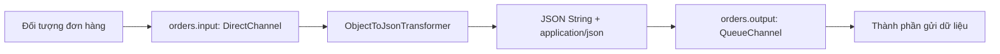

# contentType

## Mục tiêu bài học

Trong chương **Message headers** của module **SPRING_INTEGRATION_CORE**, `contentType` giúp các thành phần thống nhất cách hiểu dữ liệu mà một message đang mang. Khi luồng đi qua gateway, channel, transformer rồi tới adapter, thông tin này cần phù hợp với biểu diễn của payload tại từng ranh giới.

Sau bài học, bạn có thể:

- Phân biệt kiểu Java của payload, kiểu nội dung và thao tác chuyển đổi dữ liệu.
- Đọc, đặt và cập nhật `MessageHeaders.CONTENT_TYPE` đúng cách.
- Thiết kế bước chuyển đối tượng thành JSON bằng Java DSL mà không giữ nhầm header cũ.
- Xử lý header thiếu, sai định dạng hoặc không được hỗ trợ.
- Viết kiểm thử xác nhận cả nội dung dữ liệu lẫn metadata.

Các ví dụ dưới đây dùng Java 17, Spring Integration 6.5.x, Spring Framework 6.2.x, Jackson 2 và JUnit Jupiter 5. Đây là mốc API cho ví dụ; phiên bản dependency cụ thể nên theo BOM của ứng dụng.

## 1. `contentType` mô tả điều gì?

Một message có thể hình dung như sau:

```text
Message
├── payload: dữ liệu đang được chuyển đi
└── headers
    └── contentType: mô tả kiểu nội dung của dữ liệu
```

Spring cung cấp hằng `MessageHeaders.CONTENT_TYPE`, tương ứng khóa `contentType`. Nên dùng hằng để tránh viết sai tên. Với message thông thường được tạo bằng `MessageBuilder`, cập nhật header bằng builder để tạo message kết quả; gọi trực tiếp `message.getHeaders().put(...)` sẽ gặp `UnsupportedOperationException`. Xem [MessageHeaders trong Spring Framework](https://docs.spring.io/spring-framework/docs/6.2.x/javadoc-api/org/springframework/messaging/MessageHeaders.html).

Một số giá trị thường gặp:

| Giá trị | Ý nghĩa trong hợp đồng dữ liệu |
| --- | --- |
| `application/json` | Dữ liệu theo cú pháp JSON |
| `application/xml` | Tài liệu XML |
| `text/plain;charset=UTF-8` | Văn bản thuần; khi biểu diễn thành byte, dùng UTF-8 |
| `text/csv;charset=UTF-8` | Văn bản CSV; quy ước cột, dấu phân cách cần được thỏa thuận thêm |
| `application/octet-stream` | Dữ liệu nhị phân tổng quát, chưa mô tả cấu trúc chuyên biệt |

Một media type có phần kiểu và kiểu con, chẳng hạn `application` và `json`; sau đó có thể có tham số. `MimeType` hỗ trợ biểu diễn và phân tích các thành phần này. Xem [API MimeType](https://docs.spring.io/spring-framework/docs/6.2.x/javadoc-api/org/springframework/util/MimeType.html).

Có ba câu hỏi riêng cần trả lời:

| Câu hỏi | Ví dụ |
| --- | --- |
| Payload hiện là đối tượng Java nào? | `String`, `byte[]`, `Map` hoặc `Order` |
| Dữ liệu được biểu diễn theo định dạng nào? | JSON, XML, CSV hoặc văn bản thuần |
| Thành phần nào thực hiện chuyển đổi? | JSON transformer hoặc message converter đã cấu hình |

Một `String` có thể chứa JSON, XML hoặc câu văn. Một `byte[]` có thể chứa JSON mã hóa UTF-8 hoặc dữ liệu ảnh. Vì vậy, chỉ kiểm tra `payload.getClass()` chưa xác định đủ định dạng.

Ngược lại, `contentType=application/json` không chứng minh payload là JSON hợp lệ, không cho biết schema nghiệp vụ và không xác định lớp đích khi giải tuần tự hóa. Receiver vẫn cần parser, kiểu đích và kiểm tra dữ liệu phù hợp.

## 2. Đặt header không tự chuyển đổi payload

Xét message sau:

```java
import java.util.Map;

import org.springframework.messaging.Message;
import org.springframework.messaging.MessageHeaders;
import org.springframework.messaging.support.MessageBuilder;
import org.springframework.util.MimeTypeUtils;

Map<String, Object> order = Map.of(
        "orderId", "DH-004",
        "quantity", 2
);

Message<Map<String, Object>> message = MessageBuilder
        .withPayload(order)
        .setHeader(MessageHeaders.CONTENT_TYPE,
                MimeTypeUtils.APPLICATION_JSON)
        .build();

boolean stillAMap = message.getPayload() instanceof Map; // true
```

Builder chỉ gắn metadata; không gọi Jackson để tạo chuỗi JSON. Gửi message này qua `DirectChannel` cũng không tự kích hoạt một bộ chuyển đổi JSON.

Trong một ứng dụng cụ thể, converter hoặc adapter có thể chấp nhận `Map` cùng header JSON rồi thực hiện serialization. Điều đó phụ thuộc vào thành phần đã cấu hình. Nếu hợp đồng của consumer yêu cầu JSON dạng văn bản, cần một bước tạo văn bản JSON rõ ràng.

Quy tắc thiết kế là: **thành phần thay đổi biểu diễn dữ liệu phải xác lập metadata phù hợp với đầu ra**.

Ví dụ, một flow nhận văn bản CSV, phân tích thành đối tượng rồi xuất JSON cần ba quyết định:

1. Parser nào hiểu CSV đầu vào?
2. Đối tượng nội bộ có cấu trúc nghiệp vụ nào?
3. Bước nào tạo JSON và đặt `application/json` cho message đầu ra?

Đổi nhãn CSV thành JSON trước khi chạy parser sẽ che mất ý nghĩa ban đầu của dữ liệu.

## 3. Đọc header dưới dạng `MimeType`

Trong thực tế, header có thể là một `String` như `"application/json"` hoặc một đối tượng `MimeType`. `DefaultContentTypeResolver` hỗ trợ cả hai dạng. Khi không có header và chưa cấu hình giá trị mặc định, resolver trả về `null`. Xem [DefaultContentTypeResolver](https://docs.spring.io/spring-framework/docs/6.2.x/javadoc-api/org/springframework/messaging/converter/DefaultContentTypeResolver.html).

```java
import org.springframework.messaging.Message;
import org.springframework.messaging.converter.DefaultContentTypeResolver;
import org.springframework.util.MimeType;

public final class ContentTypes {

    private static final DefaultContentTypeResolver RESOLVER =
            new DefaultContentTypeResolver();

    private ContentTypes() {
    }

    public static MimeType resolve(Message<?> message) {
        return RESOLVER.resolve(message.getHeaders());
    }

    public static boolean isApplicationJson(Message<?> message) {
        MimeType type = resolve(message);
        return type != null
                && "application".equalsIgnoreCase(type.getType())
                && "json".equalsIgnoreCase(type.getSubtype());
    }
}
```

Hàm `isApplicationJson` thể hiện một chính sách cụ thể: chấp nhận `application/json`, kể cả khi có thêm tham số, nhưng không tự mở rộng sang mọi media type kết thúc bằng `+json`. Nếu nghiệp vụ nhận `application/vnd.example.order+json`, hãy bổ sung trường hợp đó cùng kiểm thử tương ứng.

Không nên so sánh toàn bộ header bằng:

```java
"application/json".equals(
        message.getHeaders().get("contentType")
);
```

Phép so sánh này bỏ sót header dạng `MimeType` và chuỗi có tham số. Dùng resolver rồi kiểm tra phần kiểu và kiểu con giúp thể hiện chính xác quy tắc cần áp dụng.

Header sai cú pháp hoặc sai kiểu đối tượng có thể khiến quá trình resolve phát sinh lỗi. Tại đầu vào không tin cậy, cần phân biệt ba tình huống: thiếu header, header không hợp lệ và media type hợp lệ nhưng ngoài danh sách được hỗ trợ.

Không gán mặc định JSON chỉ để làm mất lỗi thiếu header. Chỉ dùng mặc định nếu hợp đồng đầu vào đã quy định rằng mọi message thiếu header đều có một định dạng xác định.

## 4. Tạo message mới khi cập nhật `contentType`

Hai thao tác dưới đây có ý nghĩa khác nhau:

```java
import org.springframework.messaging.Message;
import org.springframework.messaging.MessageHeaders;
import org.springframework.messaging.support.MessageBuilder;
import org.springframework.util.MimeTypeUtils;

// Chỉ phù hợp khi đã biết đầu vào thiếu nhãn nhưng payload thực sự là JSON.
Message<?> withDefault = MessageBuilder.fromMessage(input)
        .setHeaderIfAbsent(MessageHeaders.CONTENT_TYPE,
                MimeTypeUtils.APPLICATION_JSON)
        .build();

// Phù hợp khi bước trước vừa tạo ra biểu diễn JSON mới.
Message<?> withCurrentType = MessageBuilder.fromMessage(input)
        .setHeader(MessageHeaders.CONTENT_TYPE,
                MimeTypeUtils.APPLICATION_JSON)
        .build();
```

Ở đây `input` là message đã có trong luồng. `setHeaderIfAbsent` giữ nguyên giá trị hiện hữu; `setHeader` chủ động thay giá trị. Lựa chọn phụ thuộc vào việc bạn đang bổ sung thông tin còn thiếu hay mô tả biểu diễn vừa được tạo.

Ví dụ thực tế:

| Tình huống | Cách xử lý |
| --- | --- |
| Đầu vào đã có JSON đúng định dạng nhưng thiếu nhãn theo hợp đồng | Có thể bổ sung header mặc định |
| Payload vừa chuyển từ XML sang JSON | Ghi đè thành `application/json` |
| Payload vừa chuyển từ JSON sang văn bản báo cáo | Ghi đè thành `text/plain`, kèm quy ước charset ở biên byte |
| Payload đã trở thành đối tượng nghiệp vụ nội bộ | Xác định rõ header còn mô tả biểu diễn nguồn hay cần được bỏ theo hợp đồng nội bộ |

Nếu cần giữ kiểu nội dung lúc tiếp nhận để truy vết, có thể lưu vào header riêng như `sourceContentType` trước khi đổi biểu diễn. Không dùng cùng một header để đồng thời mang ý nghĩa “định dạng nguồn” và “định dạng đầu ra”.

## 5. Điểm dễ nhầm của `ObjectToJsonTransformer`

`ObjectToJsonTransformer` thực hiện chuyển payload sang biểu diễn JSON. Theo cấu hình mặc định, transformer đặt `application/json` khi message đầu vào chưa có `contentType`; header có sẵn có thể được giữ lại. Xem [JSON Transformers](https://docs.spring.io/spring-integration/reference/6.5/transformer.html#json-transformers).

Hãy xét tình huống:

```text
Đầu vào:
  payload     = Map chứa dữ liệu đơn hàng
  contentType = text/plain

Sau bước tạo JSON nhưng chưa chủ động thay nhãn:
  payload     = chuỗi JSON
  contentType = text/plain   ← metadata không còn phù hợp
```

Trong ví dụ này, `text/plain` là metadata cũ đi theo đối tượng sau các bước xử lý trước đó. Đầu ra có thể chứa JSON hợp lệ nhưng consumer chọn bộ xử lý văn bản do nhìn thấy nhãn cũ.

Với một endpoint luôn tạo JSON thông thường, cấu hình:

```java
transformer.setContentType("application/json");
```

Setter này xác lập kiểu nội dung đầu ra, kể cả khi đầu vào có giá trị khác. API và các constructor lựa chọn dạng kết quả được mô tả tại [ObjectToJsonTransformer](https://docs.spring.io/spring-integration/docs/6.5.0/api/org/springframework/integration/json/ObjectToJsonTransformer.html).

Cấu hình này phải đi cùng quá trình tạo JSON thực sự. Không đặt nhãn JSON cho một payload tùy ý rồi coi đó là bước serialization.

## 6. Ví dụ hoàn chỉnh bằng Java DSL

Bài toán: hệ thống nhận đối tượng đơn hàng, tạo JSON để bàn giao cho một thành phần gửi dữ liệu ra ngoài. Luồng nội bộ kết thúc tại `QueueChannel` để có thể quan sát và kiểm thử kết quả mà không cần HTTP server hay broker.



Ứng dụng cần `spring-integration-core`, `jackson-databind` và các dependency Spring tương thích; phần kiểm thử cần `junit-jupiter`. Các dependency Spring nên do BOM hoặc Spring Boot quản lý. Với cấu hình Spring thuần bên dưới, `@EnableIntegration` đăng ký hạ tầng Integration.

```java
import com.fasterxml.jackson.databind.ObjectMapper;

import org.springframework.context.annotation.Bean;
import org.springframework.context.annotation.Configuration;
import org.springframework.integration.channel.DirectChannel;
import org.springframework.integration.channel.QueueChannel;
import org.springframework.integration.config.EnableIntegration;
import org.springframework.integration.dsl.IntegrationFlow;
import org.springframework.integration.json.ObjectToJsonTransformer;
import org.springframework.integration.support.json.Jackson2JsonObjectMapper;

@Configuration
@EnableIntegration
public class ContentTypeFlowConfig {

    @Bean(name = "orders.input")
    public DirectChannel ordersInput() {
        return new DirectChannel();
    }

    @Bean(name = "orders.output")
    public QueueChannel ordersOutput() {
        return new QueueChannel();
    }

    @Bean
    public ObjectMapper orderObjectMapper() {
        return new ObjectMapper();
    }

    @Bean
    public ObjectToJsonTransformer orderJsonTransformer(
            ObjectMapper orderObjectMapper) {

        ObjectToJsonTransformer transformer = new ObjectToJsonTransformer(
                new Jackson2JsonObjectMapper(orderObjectMapper),
                ObjectToJsonTransformer.ResultType.STRING
        );

        transformer.setContentType("application/json");
        return transformer;
    }

    @Bean
    public IntegrationFlow orderJsonFlow(
            ObjectToJsonTransformer orderJsonTransformer) {

        return IntegrationFlow.from("orders.input")
                .transform(orderJsonTransformer)
                .channel("orders.output")
                .get();
    }
}
```

Java DSL cung cấp `.transform(...)` để đặt transformer vào flow. Ví dụ dùng bean riêng nhằm đặt chính sách header ngay cạnh cấu hình tạo JSON. Tham khảo [Transformers trong Java DSL](https://docs.spring.io/spring-integration/reference/6.5/dsl/java-transformers.html).

Theo hợp đồng của flow này:

- Đầu vào là đối tượng Java có thể serialize bằng Jackson.
- Đầu ra là `String` chứa JSON, với header `application/json`.
- Một header nghiệp vụ như `traceId` cần tiếp tục đi cùng message để truy vết.
- Adapter gửi dữ liệu về sau phải được cấu hình phù hợp với việc payload đã là JSON.

Đặc biệt, nếu đầu vào đã là một chuỗi JSON, serialize chuỗi đó có thể tạo JSON string chứa chuỗi đã escape, thay vì giữ nguyên JSON object. Vì vậy, không đưa mọi payload có nhãn JSON qua object-to-JSON transformer một cách máy móc. Hãy xác định payload đang là đối tượng cần serialize hay là tài liệu JSON đã hoàn chỉnh.

Một messaging gateway có thể làm cửa vào cho flow này, nhưng gateway và channel không thay thế trách nhiệm serialization của transformer.

## 7. Kiểm thử payload và header cùng nhau

Một test chỉ kiểm tra `contentType` có thể bỏ sót payload không phải JSON. Một test chỉ đọc được JSON có thể bỏ sót nhãn `text/plain` còn sót lại.

Đặt lớp kiểm thử trong cùng package với `ContentTypeFlowConfig`:

```java
import java.util.Map;

import com.fasterxml.jackson.databind.JsonNode;
import com.fasterxml.jackson.databind.ObjectMapper;
import org.junit.jupiter.api.Test;

import org.springframework.context.annotation.AnnotationConfigApplicationContext;
import org.springframework.integration.channel.QueueChannel;
import org.springframework.messaging.Message;
import org.springframework.messaging.MessageChannel;
import org.springframework.messaging.MessageHeaders;
import org.springframework.messaging.converter.DefaultContentTypeResolver;
import org.springframework.messaging.support.MessageBuilder;
import org.springframework.util.MimeType;
import org.springframework.util.MimeTypeUtils;

import static org.junit.jupiter.api.Assertions.*;

class ContentTypeFlowTest {

    @Test
    void writesJsonAndReplacesStaleContentType() throws Exception {
        try (AnnotationConfigApplicationContext context =
                     new AnnotationConfigApplicationContext(
                             ContentTypeFlowConfig.class)) {

            MessageChannel input =
                    context.getBean("orders.input", MessageChannel.class);
            QueueChannel output =
                    context.getBean("orders.output", QueueChannel.class);
            ObjectMapper mapper = context.getBean(ObjectMapper.class);

            Message<Map<String, Object>> request = MessageBuilder
                    .withPayload(Map.<String, Object>of(
                            "orderId", "DH-004",
                            "customer", "Nguyễn Ánh",
                            "quantity", 2))
                    .setHeader(MessageHeaders.CONTENT_TYPE,
                            MimeTypeUtils.TEXT_PLAIN)
                    .setHeader("traceId", "trace-004")
                    .build();

            assertTrue(input.send(request));

            Message<?> result = output.receive(1_000);
            assertNotNull(result);

            String json = assertInstanceOf(String.class, result.getPayload());
            JsonNode document = mapper.readTree(json);

            assertEquals("DH-004", document.path("orderId").asText());
            assertEquals("Nguyễn Ánh", document.path("customer").asText());
            assertEquals(2, document.path("quantity").asInt());

            MimeType type = new DefaultContentTypeResolver()
                    .resolve(result.getHeaders());

            assertEquals(MimeTypeUtils.APPLICATION_JSON, type);
            assertEquals("trace-004", result.getHeaders().get("traceId"));
        }
    }

    @Test
    void resolvesStringAndMimeTypeHeaders() {
        DefaultContentTypeResolver resolver =
                new DefaultContentTypeResolver();

        Message<String> stringHeader = MessageBuilder.withPayload("{}")
                .setHeader(MessageHeaders.CONTENT_TYPE, "application/json")
                .build();

        Message<String> mimeTypeHeader = MessageBuilder.withPayload("{}")
                .setHeader(MessageHeaders.CONTENT_TYPE,
                        MimeTypeUtils.APPLICATION_JSON)
                .build();

        assertEquals(resolver.resolve(stringHeader.getHeaders()),
                resolver.resolve(mimeTypeHeader.getHeaders()));

        Message<String> missingHeader = MessageBuilder.withPayload("{}")
                .build();

        assertNull(resolver.resolve(missingHeader.getHeaders()));
    }
}
```

Test đầu chứng minh bốn thuộc tính quan sát được: đầu ra là chuỗi JSON có thể phân tích, dữ liệu nghiệp vụ được giữ, nhãn cũ bị thay và `traceId` còn tồn tại. Không so sánh toàn bộ chuỗi JSON vì thứ tự thuộc tính không phải trọng tâm của hợp đồng này.

Khi áp dụng vào dự án, bổ sung các ca phù hợp với đầu vào thực:

| Ca kiểm thử | Điều cần chứng minh |
| --- | --- |
| Đối tượng hợp lệ, chưa có header | Có JSON đầu ra và đúng nhãn |
| Header đầu vào đang là XML hoặc văn bản | Bước tạo JSON cập nhật nhãn |
| Chuỗi JSON lỗi ở flow tiếp nhận JSON | Parser từ chối dữ liệu; header đúng không làm dữ liệu trở nên hợp lệ |
| Media type có tham số | Bộ phân loại áp dụng đúng chính sách |
| Có ký tự tiếng Việt ở biên truyền byte | Byte được mã hóa và giải mã bằng cùng charset |
| Payload đã là JSON string | Không vô tình serialize thêm một lớp |

Các đoạn test là nội dung thực hành cho người học; việc chạy chúng cần môi trường dependency của ứng dụng.

## 8. `charset`, `String` và `byte[]`

Một Java `String` chứa ký tự; vấn đề charset phát sinh khi chuyển giữa ký tự và byte. Header `charset=UTF-8` không tự sửa một mảng byte đã được tạo bằng bộ mã khác.

Ví dụ với văn bản thuần:

```java
import java.nio.charset.StandardCharsets;

import org.springframework.messaging.Message;
import org.springframework.messaging.MessageHeaders;
import org.springframework.messaging.support.MessageBuilder;
import org.springframework.util.MimeType;

String text = "Đơn hàng DH-004 đã được tiếp nhận";
byte[] body = text.getBytes(StandardCharsets.UTF_8);

Message<byte[]> message = MessageBuilder.withPayload(body)
        .setHeader(MessageHeaders.CONTENT_TYPE,
                new MimeType("text", "plain", StandardCharsets.UTF_8))
        .build();

String decoded = new String(message.getPayload(), StandardCharsets.UTF_8);
```

Ở đây byte và header thống nhất vì thao tác mã hóa đã chọn UTF-8 rõ ràng. Nếu adapter sẽ thực hiện bước mã hóa, hãy cấu hình và kiểm thử adapter đó thay vì giả định mọi thành phần đều sử dụng tham số charset theo cùng cách.

Với luồng JSON xuất ra ngoài, cần thỏa thuận cả định dạng và cách truyền byte. Kiểm thử có dữ liệu tiếng Việt giúp phát hiện trường hợp JSON đúng cấu trúc nhưng văn bản bị lỗi dấu.

## 9. Qua ranh giới HTTP, broker và converter

Trong message nội bộ, khóa là `contentType`. Trong HTTP, trường giao thức tương ứng có tên `Content-Type`. Không nên tạo thêm một header nội bộ mang chuỗi `"Content-Type"` rồi kỳ vọng tất cả adapter đều dùng nó như `MessageHeaders.CONTENT_TYPE`.

Spring Integration cung cấp header mapper cho HTTP. Các standard HTTP header được ánh xạ theo cấu hình mặc định; khi tùy chỉnh danh sách header, cần kiểm tra vì cấu hình mới có thể thay đổi tập header được ánh xạ. Xem [HTTP Header Mappings](https://docs.spring.io/spring-integration/reference/6.5/http/header-mapping.html).

Tại ranh giới giao thức, nên xác nhận ba phần:

1. **Payload:** thành phần gửi nhận đang làm việc với đối tượng, chuỗi hay byte?
2. **Converter:** thành phần nào serialize hoặc deserialize, với kiểu đích nào?
3. **Header mapper:** metadata nội bộ được ánh xạ sang thuộc tính giao thức ra sao?

Ví dụ, nếu flow đã tạo JSON string, converter phía gửi cần hiểu đó là nội dung đã được serialize. Nếu converter tiếp tục coi chuỗi này là một đối tượng cần serialize, receiver có thể nhận thêm lớp dấu nháy và ký tự escape.

HTTP `Accept` mô tả loại nội dung mong muốn nhận lại; `Content-Type` mô tả nội dung của body đang gửi. Cấu hình `Accept: application/json` không thay cho việc khai báo và tạo đúng JSON body của request.

Với broker, tên thuộc tính giao thức, khả năng giữ kiểu header và cách chọn converter phụ thuộc adapter cùng thư viện transport. Cần kiểm thử tại biên thật khi chuyển từ flow nội bộ sang giao thức bên ngoài.

## 10. Dùng `contentType` để lọc và định tuyến

Trong một flow tiếp nhận nhiều định dạng, có thể dùng media type để chọn nhánh JSON hoặc XML. Đây là bước phân loại đầu vào; parser của nhánh vẫn phải xác minh dữ liệu.

```text
Message đầu vào
  → đọc và phân tích contentType
  → thiếu / sai cú pháp / không hỗ trợ: nhánh từ chối
  → application/json: JSON parser
  → application/xml: XML parser
  → đối tượng nghiệp vụ đã kiểm tra
```

Đây là thiết kế đề xuất cho một hệ thống cần hợp đồng đầu vào chặt chẽ. Với một nguồn chỉ cung cấp đúng một định dạng và có quy ước mặc định rõ ràng, chính sách xử lý header thiếu có thể khác.

Khi dùng router hoặc filter:

- Parser media type thất bại phải được xử lý như lỗi metadata.
- Media type đúng nhưng body sai phải được xử lý như lỗi phân tích dữ liệu.
- Body đúng cú pháp nhưng thiếu trường nghiệp vụ phải được xử lý ở bước validation.
- Message bị từ chối nên có mã lý do và thông tin truy vết để vận hành phân biệt các nhóm lỗi.

Một filter trả về `false` không mặc nhiên tạo bản ghi lỗi đầy đủ. Nếu cần lưu message bị loại, hãy cấu hình nhánh discard; nếu cần báo thất bại cho bên gọi, hãy chọn cơ chế lỗi phù hợp.

Với flow đồng bộ qua `DirectChannel`, lỗi từ endpoint thường có thể truyền về bên gửi. Khi có executor hoặc poller, lỗi xảy ra ở luồng xử lý khác; cần cấu hình cơ chế báo lỗi của endpoint và theo dõi error flow phù hợp. Không giả định chỉ đặt header `errorChannel` là mọi lỗi đều được tự động gửi vào đó.

## 11. Chẩn đoán lỗi thường gặp

| Triệu chứng | Nguyên nhân cần kiểm tra | Hướng xử lý |
| --- | --- | --- |
| Header ghi JSON nhưng payload vẫn là `Map` | Chỉ thêm header, chưa serialize | Đặt transformer hoặc converter tại ranh giới yêu cầu JSON |
| Payload là JSON nhưng header vẫn là `text/plain` | Nhãn cũ được giữ sau bước chuyển đổi | Cấu hình kiểu nội dung đầu ra rõ ràng |
| Bộ kiểm tra từ chối JSON có tham số | So sánh nguyên chuỗi header | Parse thành `MimeType`, áp dụng chính sách theo thành phần |
| Phát sinh lỗi ép kiểu header | Giả định mọi giá trị đều là `String` hoặc đều là `MimeType` | Dùng resolver và quy định kiểu được chấp nhận |
| Chữ tiếng Việt bị sai dấu | Byte được mã hóa và giải mã bằng charset khác nhau | Kiểm tra bước chuyển ký tự ↔ byte |
| Receiver nhận JSON chứa nhiều dấu escape | Payload đã serialize bị serialize thêm lần nữa | Chỉ định một bước chịu trách nhiệm serialization |
| HTTP không nhận đúng kiểu nội dung | Mapper, converter hoặc cấu hình body không thống nhất | Quan sát request thật và đối chiếu ba phần tại biên |

Khi quan sát hệ thống, ghi nhận lớp payload, giá trị `contentType`, endpoint đang xử lý và mã truy vết. Những dữ kiện này thường đủ để khoanh vùng việc sai nhãn xảy ra trước hay sau transformer.

## 12. Bài thực hành

Dùng cấu hình ở mục 6 để thực hiện các bước:

1. Gửi một `Map` có mã đơn hàng, số lượng và tên khách hàng tiếng Việt; để trống `contentType`.
2. Kiểm tra kết quả là JSON có thể phân tích và mang nhãn `application/json`.
3. Gửi cùng dữ liệu nhưng gắn header đầu vào `text/plain`; xác nhận nhãn đầu ra vẫn đúng.
4. Tạm bỏ `setContentType("application/json")`, chạy lại trường hợp có nhãn cũ và quan sát khác biệt.
5. Khôi phục cấu hình, thêm `traceId` và xác nhận metadata nghiệp vụ vẫn đi cùng kết quả.
6. Thiết kế thêm một cửa vào nhận JSON dạng văn bản, có chính sách cho header thiếu và JSON sai cú pháp.

Kết quả cần giải thích được là: `contentType` mô tả hợp đồng nội dung; transformer hoặc converter tạo biểu diễn tương ứng; kiểm thử phải xác nhận cả hai cùng đúng tại ranh giới bàn giao.
