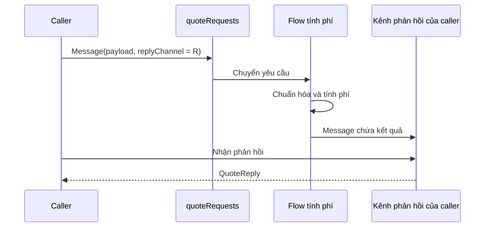

# returnAddress: địa chỉ nhận phản hồi trong Spring Integration

## 1. Mục tiêu và tình huống sử dụng

Trong một luồng request–reply, thành phần gửi yêu cầu cần chỉ ra nơi nhận kết quả. **Return Address** là mẫu tích hợp đặt thông tin đó trên thông điệp yêu cầu để bên xử lý biết nơi gửi phản hồi. Xem định nghĩa của [Enterprise Integration Patterns](https://www.enterpriseintegrationpatterns.com/patterns/messaging/ReturnAddress.html).

Ví dụ, một dịch vụ tính phí nhận yêu cầu từ website và công cụ quản trị. Hai bên cùng gửi vào `quoteRequests`, nhưng mỗi bên cần nhận kết quả của mình. Nếu dịch vụ tính phí luôn gửi vào một kênh cố định, việc bổ sung caller sẽ kéo theo thay đổi cấu hình xử lý. Đặt địa chỉ nhận phản hồi trên từng yêu cầu giúp flow phục vụ nhiều caller.

Bài học thuộc chương **Message headers** của **SPRING_INTEGRATION_CORE**, tập trung vào cách kết nối `Message`, `MessageChannel`, endpoint, gateway và Java DSL để thực hiện cơ chế này.

Sau bài học, bạn có thể:

- Phân biệt tên mẫu `returnAddress` với header thực tế được Spring sử dụng.
- Tạo yêu cầu mang địa chỉ nhận phản hồi bằng đối tượng channel hoặc tên channel.
- Giải thích cách endpoint chọn nơi gửi kết quả và cách gateway nhận kết quả đó.
- Nhận diện lỗi mất header, ghi đè địa chỉ, thiếu phản hồi và vượt ranh giới tiến trình.

## 2. `returnAddress` được biểu diễn bằng header nào?

Trong API Spring Messaging mà Spring Integration sử dụng, địa chỉ nhận phản hồi được biểu diễn bằng **`MessageHeaders.REPLY_CHANNEL`**, có tên header là **`replyChannel`**. `returnAddress` trong tên bài là khái niệm của mẫu tích hợp; không nên tự tạo header cùng tên rồi kỳ vọng framework tự sử dụng nó. Danh sách header chuẩn được mô tả trong [Message](https://docs.spring.io/spring-integration/reference/message.html).

| Thành phần | Ý nghĩa trong bài |
| --- | --- |
| Return Address | Nơi caller muốn nhận phản hồi |
| `MessageHeaders.REPLY_CHANNEL` | Hằng số dùng trong mã Java |
| `replyChannel` | Khóa header mà endpoint đọc |
| Một `MessageChannel` | Địa chỉ đã là đối tượng channel trong ứng dụng |
| Một `String` | Tên channel hoặc khóa do registry cấp, cần được phân giải |

Hai cách tạo yêu cầu tương đương về mục đích:

```java
// Đối tượng MessageChannel đã có trong JVM hiện tại.
Message<String> byReference = MessageBuilder.withPayload("ORDER-001")
        .setReplyChannel(replyChannel)
        .build();

// Tên bean MessageChannel mà ứng dụng nhận có thể phân giải.
Message<String> byName = MessageBuilder.withPayload("ORDER-001")
        .setReplyChannelName("quoteReplies")
        .build();
```

Ở đoạn trên, `replyChannel` là biến kiểu `MessageChannel`; hai kiểu `Message` và `MessageBuilder` lần lượt thuộc `org.springframework.messaging` và `org.springframework.messaging.support`. Các phương thức dựng message này được công bố trong [MessageBuilder API](https://docs.spring.io/spring-framework/docs/current/javadoc-api/org/springframework/messaging/support/MessageBuilder.html).

Đoạn dưới chỉ tạo một header tùy chỉnh:

```java
Message<String> customHeader = MessageBuilder.withPayload("ORDER-001")
        .setHeader("returnAddress", "quoteReplies")
        .build();
```

Muốn dùng tên tùy chỉnh đó, ứng dụng phải tự ánh xạ sang `replyChannel` hoặc tự triển khai logic xử lý. Trong các ví dụ tiếp theo, ta dùng trực tiếp API chuẩn.

## 3. Endpoint quyết định gửi kết quả đi đâu?

Với service activator tạo ra kết quả, khi không sử dụng routing slip, cách chọn đích được hiểu như sau:

1. Dùng `outputChannel` của endpoint nếu có.
2. Nếu chưa có đích, đọc `replyChannel` trên message yêu cầu.
3. Nếu yêu cầu không có header đó và kết quả là một `Message`, có thể lấy `replyChannel` từ message kết quả.

Giá trị dạng `String` phải phân giải được thành channel; tên không tồn tại có thể gây `DestinationResolutionException`. Xem [Service Activator](https://docs.spring.io/spring-integration/reference/service-activator.html).

Nếu flow dùng routing slip thì phải tính thêm các đích còn lại trong routing slip trước khi quay về `replyChannel`; không áp dụng sơ đồ rút gọn trên một cách máy móc.



Trong một pipeline, các endpoint giữa luồng có kênh ra để tiếp tục xử lý; endpoint cuối có thể dùng địa chỉ do caller cung cấp. Ví dụ:

```text
quoteRequests -> chuẩn hóa -> tính phí -> replyChannel của yêu cầu
```

Đừng gắn một kênh ra cố định ở cuối chỉ vì tên của nó là `replyChannel`. Một bean mang tên đó vẫn là một đích cố định; header cùng tên cho phép đích thay đổi theo từng yêu cầu.

## 4. Ví dụ đầy đủ: caller tự chọn kênh nhận phí

### 4.1. Chuẩn bị

Ví dụ dùng Java 17 trở lên và các thư viện Spring Integration tương thích, với `spring-integration-core` và Spring Context trên classpath. Nếu dùng Spring Boot, dự án có thể quản lý dependency qua `spring-boot-starter-integration`. Ví dụ tạo `AnnotationConfigApplicationContext` trực tiếp để tập trung vào cơ chế thông điệp.

Các kiểu dữ liệu và cấu hình được đặt chung trong lớp `ReturnAddressDemo`. Phí vận chuyển minh họa bằng 5% giá trị đơn hàng; đây chỉ là quy tắc cho bài thực hành.

### 4.2. Mã nguồn

```java
package example.returnaddress;

import java.math.BigDecimal;

import org.springframework.context.annotation.AnnotationConfigApplicationContext;
import org.springframework.context.annotation.Bean;
import org.springframework.context.annotation.Configuration;
import org.springframework.integration.channel.DirectChannel;
import org.springframework.integration.channel.QueueChannel;
import org.springframework.integration.config.EnableIntegration;
import org.springframework.integration.dsl.IntegrationFlow;
import org.springframework.messaging.Message;
import org.springframework.messaging.support.MessageBuilder;

public class ReturnAddressDemo {

    public record QuoteRequest(String orderId, BigDecimal orderAmount) {
    }

    public record QuoteReply(String orderId, BigDecimal shippingFee) {
    }

    @Configuration(proxyBeanMethods = false)
    @EnableIntegration
    public static class FlowConfiguration {

        @Bean
        public DirectChannel quoteRequests() {
            return new DirectChannel();
        }

        @Bean
        public QueueChannel namedQuoteReplies() {
            return new QueueChannel(10);
        }

        @Bean
        public IntegrationFlow quoteFlow(DirectChannel quoteRequests) {
            return IntegrationFlow.from(quoteRequests)
                    .<QuoteRequest, QuoteRequest>transform(request ->
                            new QuoteRequest(
                                    request.orderId().trim(),
                                    request.orderAmount()))
                    .<QuoteRequest>handle((request, headers) ->
                            new QuoteReply(
                                    request.orderId(),
                                    request.orderAmount()
                                            .multiply(new BigDecimal("0.05"))))
                    .get();
        }
    }

    public static void main(String[] args) {
        try (AnnotationConfigApplicationContext context =
                     new AnnotationConfigApplicationContext(
                             FlowConfiguration.class)) {

            DirectChannel requests = context.getBean(
                    "quoteRequests", DirectChannel.class);

            // Kênh cục bộ do caller tạo, không cần đăng ký thành bean.
            QueueChannel returnTo = new QueueChannel(1);

            Message<QuoteRequest> request = MessageBuilder.withPayload(
                            new QuoteRequest(
                                    " ORDER-001 ",
                                    new BigDecimal("1000000")))
                    .setReplyChannel(returnTo)
                    .setHeader("requestId", "REQ-001")
                    .build();

            if (!requests.send(request, 1_000)) {
                throw new IllegalStateException("Không gửi được yêu cầu");
            }

            Message<?> response = returnTo.receive(1_000);
            if (response == null) {
                throw new IllegalStateException("Không nhận được phản hồi");
            }

            System.out.println(response.getPayload());
            System.out.println(response.getHeaders().get("requestId"));
        }
    }
}
```

Kết quả mong đợi:

```text
QuoteReply[orderId=ORDER-001, shippingFee=50000.00]
REQ-001
```

### 4.3. Đọc đường đi của yêu cầu

Caller tạo `returnTo`, gắn nó vào header, rồi gửi yêu cầu vào `quoteRequests`. Transformer bỏ khoảng trắng của mã đơn; handler tạo `QuoteReply`. Ở cuối flow không có `.channel(...)` chỉ định đích cố định nên phản hồi được gửi về `returnTo`.

Java DSL biểu diễn transformer bằng `.transform()` và service activator bằng `.handle()`. Các endpoint liền nhau được nối thành luồng; xem [DSL Basics](https://docs.spring.io/spring-integration/reference/dsl/java-basics.html).

Trong ví dụ, handler chỉ trả về đối tượng nghiệp vụ. Caller vẫn nhận được một `Message` có payload là đối tượng đó và các header được truyền qua flow theo cơ chế mặc định.

`quoteRequests` là `DirectChannel`, còn `returnTo` là `QueueChannel`: việc xử lý yêu cầu chạy trên thread gửi; kết quả được đưa vào hàng đợi để caller lấy sau khi `send()` trở về. Hàng đợi phản hồi không tự làm toàn bộ flow trở thành bất đồng bộ. Xem đặc tính của [các triển khai MessageChannel](https://docs.spring.io/spring-integration/reference/channel/implementations.html).

`receive(1_000)` giới hạn thời gian chờ lấy phản hồi tại bước nhận. Đối số timeout của `send()` không thể ngắt một handler đang chạy lâu trên thread hiện tại.

## 5. Dùng tên channel và phục vụ nhiều caller

### 5.1. Địa chỉ là tên bean

Trong cùng khối `try` của ví dụ, có thể thay phần tạo và nhận yêu cầu bằng:

```java
QueueChannel replies = context.getBean(
        "namedQuoteReplies", QueueChannel.class);

Message<QuoteRequest> request = MessageBuilder.withPayload(
                new QuoteRequest("ORDER-002", new BigDecimal("2000000")))
        .setReplyChannelName("namedQuoteReplies")
        .setHeader("requestId", "REQ-002")
        .build();

if (!requests.send(request, 1_000)) {
    throw new IllegalStateException("Không gửi được yêu cầu");
}

Message<?> response = replies.receive(1_000);
if (response == null) {
    throw new IllegalStateException("Không nhận được phản hồi");
}

System.out.println(response.getPayload());
```

Flow vẫn xử lý cùng loại yêu cầu; caller lựa chọn bean `namedQuoteReplies` làm nơi nhận. Kết quả của ví dụ này có `shippingFee=100000.00`.

Trong môi trường dùng bean name, kiểm tra chính tả và context phân giải. Chuỗi `namedQuoteReplies` trong một JVM khác không tự trỏ về bean của JVM đã gửi yêu cầu.

### 5.2. Mỗi caller có địa chỉ riêng

Giả sử hai yêu cầu cùng đi vào một flow:

| Caller | Mã yêu cầu | Giá trị `replyChannel` |
| --- | --- | --- |
| Website | `REQ-WEB-01` | Đối tượng `webReturnTo` |
| Công cụ quản trị | `REQ-ADMIN-01` | Đối tượng `adminReturnTo` |

Flow tính phí không cần đọc loại caller để chọn đích. Để quan sát điều này, tạo hai `QueueChannel(1)`, gửi hai yêu cầu với địa chỉ khác nhau, rồi nhận từ từng channel.

Nếu nhiều caller cùng gọi `receive()` trên một `QueueChannel` dùng chung, phản hồi có thể được lấy bởi caller khác với bên gửi yêu cầu. Khi dùng chung đường nhận, cần có bộ phận ghép phản hồi với yêu cầu đang chờ; chỉ thêm một trường ID không tự tạo ra bộ phận ghép đó.

## 6. Gateway quản lý địa chỉ nhận phản hồi

Khi mã nghiệp vụ chỉ muốn gọi `quote(request)` rồi nhận `QuoteReply`, có thể dùng messaging gateway. Gateway tạo một kênh phản hồi tạm thời, đặt nó trong header `replyChannel`, rồi nhận kết quả để trả cho người gọi. Thông thường không cần chỉ định một reply channel cố định. Xem [Messaging Gateways](https://docs.spring.io/spring-integration/reference/gateway.html).

Đặt interface sau cùng package với ví dụ:

```java
package example.returnaddress;

import org.springframework.integration.annotation.MessagingGateway;

@MessagingGateway(
        defaultRequestChannel = "quoteRequests",
        defaultReplyTimeout = "2000")
public interface QuoteGateway {

    ReturnAddressDemo.QuoteReply quote(
            ReturnAddressDemo.QuoteRequest request);
}
```

Để Spring phát hiện interface, thêm annotation này vào `FlowConfiguration`:

```java
import org.springframework.integration.annotation.IntegrationComponentScan;

// Đặt trên lớp cấu hình, cùng @Configuration và @EnableIntegration.
@IntegrationComponentScan(basePackageClasses = QuoteGateway.class)
```

Khi context đã chứa proxy của gateway, phần gọi bên trong khối `try` trở thành:

```java
QuoteGateway gateway = context.getBean(QuoteGateway.class);

ReturnAddressDemo.QuoteReply reply = gateway.quote(
        new ReturnAddressDemo.QuoteRequest(
                "ORDER-003", new BigDecimal("3000000")));

if (reply == null) {
    throw new IllegalStateException("Gateway không nhận được kết quả");
}

System.out.println(reply.shippingFee()); // 150000.00
```

Không gắn thêm `replyChannel` cố định trong flow chỉ để phục vụ gateway này. Nếu thay địa chỉ tạm mà gateway đang chờ bằng một kênh khác, kết quả có thể đi đến kênh đó trong khi lệnh gọi vẫn không nhận được phản hồi.

`defaultReplyTimeout = "2000"` cấu hình thời gian chờ nhận phản hồi, tính bằng mili giây. Với flow chạy đồng bộ trên `DirectChannel`, nó không cưỡng chế dừng một dịch vụ đang chạy lâu. Nếu chuyển sang xử lý trên thread khác, hết thời gian chờ cũng không đồng nghĩa tác vụ đã bị hủy. Ứng dụng cần thiết kế riêng giới hạn thời gian gọi dịch vụ ngoài và cách xử lý kết quả đến muộn.

## 7. Giữ địa chỉ phản hồi khi biến đổi message

### 7.1. Trả về payload và tự tạo message là hai thao tác khác nhau

Trong ví dụ chính, transformer trả về một `QuoteRequest`, không tự xây toàn bộ message. Khi tự xây message để gửi tiếp, cần quyết định rõ header nào phải đi theo.

```java
// input là Message<String> nhận từ bước trước.
Message<String> next = MessageBuilder
        .withPayload(input.getPayload().trim())
        .copyHeaders(input.getHeaders())
        .build();
```

Đoạn này phù hợp với luồng nội bộ muốn tiếp tục mang các header đầu vào. Nếu chỉ chọn một số header, phải giữ cả địa chỉ cần thiết:

```java
Message<String> next = MessageBuilder
        .withPayload(input.getPayload().trim())
        .setHeader(
                org.springframework.messaging.MessageHeaders.REPLY_CHANNEL,
                input.getHeaders().getReplyChannel())
        .setHeader(
                org.springframework.messaging.MessageHeaders.ERROR_CHANNEL,
                input.getHeaders().getErrorChannel())
        .setHeader("requestId", input.getHeaders().get("requestId"))
        .build();
```

`getReplyChannel()` trả về `Object` vì địa chỉ có thể là channel hoặc chuỗi. Không ép kiểu trực tiếp sang `MessageChannel` khi chưa biết dữ liệu thực tế.

Header đọc từ `MessageHeaders` không phải map để sửa trực tiếp. Hãy tạo message mới bằng builder thay vì gọi `put()`; xem [MessageHeaders API](https://docs.spring.io/spring-framework/docs/current/javadoc-api/org/springframework/messaging/MessageHeaders.html).

### 7.2. Khi nào header dễ bị mất?

Một đoạn mã như `new GenericMessage<>(newPayload)` không mang theo header nghiệp vụ hay địa chỉ của message cũ. Nếu gửi message đó sang bước khác, đích nhận không còn đủ thông tin để quay về caller, trừ khi có cơ chế bổ sung header.

Không nên suy luận rằng mọi endpoint trả về `Message` mới đều có cùng hành vi sao chép header: cần xét loại endpoint và cấu hình truyền header của nó. Với mã tự tạo rồi tự gửi message, trách nhiệm giữ địa chỉ thuộc về đoạn mã đó.

Header filter cũng có thể chủ động bỏ `replyChannel`. Vì vậy, khi lọc header trước một ranh giới hệ thống, hãy xác định đường phản hồi thay thế trước. Spring Integration hỗ trợ loại bỏ header qua `.headerFilter(...)`; xem [Transformer và Header Filter](https://docs.spring.io/spring-integration/reference/transformer.html).

## 8. Phân biệt địa chỉ, định tuyến và ghép phản hồi

Xét yêu cầu cụ thể:

```text
payload.orderId = ORDER-010
requestId = REQ-010
replyChannel = webReturnTo
```

| Thông tin | Câu hỏi được giải quyết | Áp dụng vào ví dụ |
| --- | --- | --- |
| Kênh đầu vào | Gửi yêu cầu đến đâu? | `quoteRequests` |
| Router | Bước hoặc nhánh nào xử lý tiếp? | Nhánh phí thường hoặc phí nhanh |
| `replyChannel` | Gửi kết quả về đâu? | `webReturnTo` |
| `requestId` tùy chỉnh | Kết quả liên quan yêu cầu nghiệp vụ nào? | `REQ-010` |
| `errorChannel` | Hạ tầng xử lý lỗi gửi thông báo lỗi đến đâu? | Kênh lỗi được cấu hình |

`requestId` trong bài là header do ứng dụng đặt và giữ qua flow; không phải một tính năng tự động ghép phản hồi của Spring. Nếu ứng dụng chọn dùng `correlationId` hoặc ID của giao thức ngoài, vẫn phải xác định quy ước tạo và sử dụng ID đó.

Một router có thể chọn nhánh phí nhanh nhưng không tạo ra phí. Một aggregator có thể gom nhiều phần kết quả nhưng vẫn cần điều kiện hoàn tất nhóm. Địa chỉ nhận phản hồi chỉ hữu ích khi nhánh xử lý cuối cùng thực sự tạo ra kết quả để gửi.

Khi dùng splitter và aggregator, hợp đồng với caller cần xác định rõ trả một kết quả tổng hợp hay nhiều kết quả riêng. Đối với gateway trả một `QuoteReply`, nên thiết kế flow sao cho một yêu cầu thành công tạo một kết quả cuối cùng.

## 9. Xử lý lỗi và trường hợp không có phản hồi

`replyChannel` không tự chuyển mọi ngoại lệ thành phản hồi nghiệp vụ. Với `DirectChannel`, ngoại lệ từ handler có thể truyền về thread gửi. Khi xử lý bất đồng bộ qua hạ tầng Spring Integration, lỗi thường được xuất bản dưới dạng `ErrorMessage`, sử dụng `errorChannel` của yêu cầu hoặc kênh lỗi mặc định. Xem [Error Handling](https://docs.spring.io/spring-integration/reference/error-handling.html).

Trong ứng dụng tính phí, có thể chọn hợp đồng trả kết quả gồm trạng thái thành công hoặc từ chối. Khi đó error flow phải chủ động chuyển lỗi phù hợp thành kết quả của hợp đồng và đưa kết quả về đúng người chờ. Chỉ ghi log trên một kênh lỗi riêng không tạo phản hồi cho gateway.

| Hiện tượng | Nguyên nhân cần kiểm tra | Hướng xử lý |
| --- | --- | --- |
| Phản hồi đến một channel khác | Endpoint cuối có `outputChannel` cố định | Kiểm tra kênh ra của endpoint cuối |
| Không phân giải được địa chỉ | Tên bean sai, sai context hoặc khóa registry hết hạn | Đối chiếu giá trị header với nơi phân giải |
| Handler báo không có kênh ra | Không có đích cố định và thiếu địa chỉ phản hồi | Xem header tại đầu vào endpoint cuối |
| Caller chờ dù đã tính xong | Địa chỉ bị ghi đè hoặc message mới mất header | Theo dõi địa chỉ ở từng bước |
| Caller chờ nhưng flow đã kết thúc | Service activator trả `null`/`void`, filter loại bỏ message | Xác định rõ kết quả hoặc lỗi cho trường hợp đó |
| Đã gửi yêu cầu nhưng chưa xử lý | Đầu vào là hàng đợi mà chưa có consumer hoặc poller | Kiểm tra consumer và cấu hình nhận |
| Caller hết thời gian chờ | Phản hồi đến muộn hoặc không được tạo | Kiểm tra cả thời gian xử lý lẫn đường phản hồi |

Với service activator buộc phải tạo kết quả, có thể bật `requiresReply` để `null` trở thành lỗi ngay tại endpoint. Ví dụ một cấu hình thay thế cho handler tính phí:

```java
import org.springframework.integration.annotation.ServiceActivator;

@ServiceActivator(inputChannel = "quoteRequests", requiresReply = "true")
public ReturnAddressDemo.QuoteReply quote(
        ReturnAddressDemo.QuoteRequest request) {
    return new ReturnAddressDemo.QuoteReply(
            request.orderId().trim(),
            request.orderAmount().multiply(new BigDecimal("0.05")));
}
```

Đây là **phương án thay thế** cho flow nhận từ `quoteRequests` trong ví dụ, không đăng ký đồng thời cả hai consumer để mong chúng cùng xử lý một yêu cầu. Với chữ ký bắt buộc phản hồi, trả `null` sẽ gây `ReplyRequiredException`; xem tùy chọn này trong [Service Activator](https://docs.spring.io/spring-integration/reference/service-activator.html).

Không dùng một handler chỉ `System.out.println(...)` làm bước cuối của flow cần trả phí: thao tác in ra không tạo `QuoteReply` cho caller.

## 10. Địa chỉ phản hồi khi lưu trữ hoặc đi qua broker

Một `MessageChannel` cục bộ có thể chứa subscriber, hàng đợi và trạng thái của ứng dụng. Không thể xem đối tượng đó như một địa chỉ mạng dùng trực tiếp giữa hai JVM.

Khi cần lưu message hoặc chuyển qua một phương tiện chỉ hỗ trợ dữ liệu tuần tự hóa, `HeaderChannelRegistry` có thể thay tham chiếu channel bằng khóa chuỗi, rồi phân giải lại tại ứng dụng có registry. Spring Integration cung cấp cơ chế `header-channels-to-string` cho các header `replyChannel` và `errorChannel`; xem [Header Channel Registry](https://docs.spring.io/spring-integration/reference/content-enrichment.html#header-channel-registry).

Hình dung việc xử lý như sau:

```text
Ứng dụng A:
  channel cục bộ -> đăng ký -> khóa chuỗi trong header

Message được lưu hoặc vận chuyển:
  payload + khóa chuỗi được bảo toàn

Trở về ứng dụng A:
  khóa chuỗi -> registry còn hiệu lực -> channel cục bộ
```

Registry không biến channel trong A thành channel mà B có thể gọi trực tiếp. Với hai ứng dụng độc lập, thiết kế request–reply còn cần đích phản hồi của transport, header mapping và cơ chế ghép phản hồi. Ví dụ, một reply destination của JMS không thể được thay thế đơn giản bằng tên bean Spring ở phía A.

Từ giới hạn đó, khi thiết kế luồng phân tán, cần trả lời:

- Phản hồi quay về đúng instance đang giữ channel bằng đường nào?
- Các header cần thiết có được transport và message store giữ lại không?
- Khóa registry còn hiệu lực khi phản hồi đến không?
- Nếu instance khởi động lại hoặc caller đã hết thời gian chờ, kết quả sẽ được xử lý ở đâu?

Đối với tác vụ dài cần tồn tại qua lần khởi động lại, một mô hình lưu kết quả theo mã yêu cầu có thể phù hợp hơn việc giữ caller chờ trên một địa chỉ tạm.

## 11. Thực hành quan sát cơ chế

Thực hiện lần lượt các thay đổi sau trên ví dụ để quan sát hành vi. Mỗi lần chỉ thay một yếu tố rồi khôi phục trước bước kế tiếp.

### Thực hành 1: hai địa chỉ, một flow

Tạo hai `QueueChannel(1)` và hai yêu cầu có `requestId` khác nhau. Gắn mỗi yêu cầu với một channel rồi gửi qua `quoteRequests`.

Kết quả cần quan sát: mỗi channel nhận đúng `QuoteReply` của yêu cầu gắn với nó; cấu hình `quoteFlow` không cần biết có hai caller.

### Thực hành 2: địa chỉ dạng tên

Dùng `.setReplyChannelName("namedQuoteReplies")`, nhận từ bean cùng tên, rồi thử đổi tên header thành một tên bean không tồn tại.

Kết quả cần quan sát: lần đầu trả được phí, lần sau không tìm được đích hợp lệ. Với flow đồng bộ, lỗi có thể xuất hiện ngay khi gọi `send()`.

### Thực hành 3: ưu tiên kênh ra

Thêm `.channel("namedQuoteReplies")` sau handler tính phí trong DSL, nhưng yêu cầu vẫn mang `.setReplyChannel(returnTo)`.

Kết quả cần quan sát: phí đến `namedQuoteReplies`; `returnTo.receive(...)` không nhận được kết quả đó. Khôi phục flow sau khi quan sát.

### Thực hành 4: kiểm tra tên header chuẩn

Thay `.setReplyChannel(returnTo)` bằng `.setHeader("returnAddress", returnTo)` và giữ nguyên flow.

Kết quả cần quan sát: header tùy chỉnh không cung cấp đích phản hồi chuẩn; endpoint cuối không tự dùng nó. Đổi lại `setReplyChannel(...)` để khôi phục hành vi.

Khi quan sát, ghi lại `requestId`, loại payload và giá trị `replyChannel` tại điểm nhận yêu cầu, sau transformer và trước khi tạo kết quả. Những dữ kiện này giúp phân biệt lỗi tính phí với lỗi đường phản hồi.
