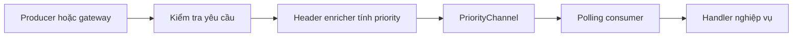

# priority — Điều khiển thứ tự thông điệp trong Spring Integration

## Mục tiêu bài học

Trong chương **Message headers** của module **SPRING_INTEGRATION_CORE**, `priority` là metadata mô tả mức ưu tiên của một thông điệp. Bài này nối kiến thức về `Message`, `MessageChannel` và endpoint với một tình huống cụ thể: nhiều yêu cầu cùng chờ xử lý, nhưng một số yêu cầu cần được lấy ra trước.

Sau bài học, bạn có thể:

- Gắn, đọc và thay đổi `priority` đúng kiểu dữ liệu.
- Chọn channel có cơ chế ưu tiên và đặt header tại đúng vị trí trong luồng.
- Xây dựng luồng Java DSL gồm bước phân loại, hàng đợi và consumer có poller.
- Kiểm tra thứ tự nhận một cách xác định, đồng thời nhận ra giới hạn của ưu tiên khi hệ thống chạy thực tế.

Các ví dụ dùng Java 17 và API Spring Integration 6.5. Dự án cần có `spring-integration-core` cùng các dependency Spring tương ứng; nếu dùng Spring Boot, có thể dùng `spring-boot-starter-integration` theo phiên bản do dự án quản lý. Ví dụ kiểm thử dùng JUnit Jupiter. Các đoạn cấu hình và kiểm thử được trình bày để người học thực hành, không yêu cầu sửa cấu hình build để hiểu nội dung bài.

## 1. Từ yêu cầu nghiệp vụ đến header `priority`

Giả sử dịch vụ nhận yêu cầu xử lý đơn hàng. Khi lượng yêu cầu tăng, các đơn phải chờ trong hàng đợi. Nhóm nghiệp vụ đặt quy tắc:

| Loại yêu cầu | Mức do ứng dụng quy định | Lý do |
| --- | --- | --- |
| Đơn thông thường | `3` | Xử lý theo năng lực còn lại |
| Đơn cần giao gấp | `9` | Cần được lấy ra trước các đơn thường đang chờ |

Thông tin về đơn hàng nằm trong payload. Mức ưu tiên dùng để điều phối luồng nằm trong header. Cách tách này giúp thành phần xếp hàng xử lý metadata chung mà không phải hiểu toàn bộ mô hình đơn hàng.

```text
Message<OrderCommand>
├── payload: OrderCommand(orderId="ORD-208", expedited=true)
└── headers:
    ├── priority: 9
    ├── id: ...
    └── timestamp: ...
```

`priority` là một header được Spring Integration định nghĩa, có kiểu quy ước `Integer`; hằng tên header là `IntegrationMessageHeaderAccessor.PRIORITY`. Đừng nhầm hằng này với các hằng header chung trong `MessageHeaders`. Xem [danh mục header của Spring Integration](https://docs.spring.io/spring-integration/reference/message.html#message-headers).

Hai mức `3` và `9` ở trên là chính sách minh họa của ứng dụng. Chúng không tạo ra một chuẩn nghiệp vụ chung cho mọi hệ thống. Khi nhiều nhóm cùng gửi thông điệp, cần thống nhất ý nghĩa của từng mức trước khi triển khai.

## 2. Hợp đồng dữ liệu của header

| Thuộc tính | Quy tắc nên áp dụng |
| --- | --- |
| Tên trong message | `priority` |
| Hằng dùng trong mã | `IntegrationMessageHeaderAccessor.PRIORITY` |
| Kiểu ứng dụng nên thống nhất | `java.lang.Integer` |
| Cách hiểu với comparator mặc định | Giá trị lớn được lấy ra trước giá trị nhỏ |
| Khi thiếu header trong `PriorityChannel` mặc định | Được so sánh như mức `0` |
| Thành phần thực thi thứ tự | Channel hoặc thành phần có logic đọc mức ưu tiên |

Với triển khai `PriorityChannel` trong bộ nhớ của Spring Integration 6.5, các thông điệp bằng mức được phân xử tiếp bằng thứ tự nội bộ của channel. Khi một producer gửi tuần tự, chúng được nhận theo thứ tự gửi trong cùng mức. Đây là quy tắc của triển khai channel này; không suy rộng thành thứ tự toàn cục của nhiều máy hoặc mọi message store. Có thể đối chiếu trực tiếp [comparator và cơ chế sequence của `PriorityChannel` 6.5.4](https://github.com/spring-projects/spring-integration/blob/v6.5.4/spring-integration-core/src/main/java/org/springframework/integration/channel/PriorityChannel.java).

Nên chuẩn hóa dữ liệu ngay tại đầu vào. Chuỗi `"9"` và số nguyên `9` là hai giá trị có kiểu khác nhau. Không dựa vào việc channel tự phân tích chuỗi thành số. Header accessor của Spring Integration nhận giá trị số và đọc về giá trị nguyên; thống nhất `Integer` giúp tránh chuyển đổi ngầm hoặc mất thông tin. Xem [cách kiểm tra kiểu của `IntegrationMessageHeaderAccessor`](https://github.com/spring-projects/spring-integration/blob/main/spring-integration-core/src/main/java/org/springframework/integration/IntegrationMessageHeaderAccessor.java).

Nếu hợp đồng ứng dụng chỉ cho phép `3` và `9`, hãy kiểm tra hai giá trị đó. Không dùng trực tiếp mọi số mà bên gọi tự cung cấp: khi tất cả yêu cầu đều tự nhận mức cao nhất, chính sách ưu tiên mất ý nghĩa.

## 3. Tạo, đọc và thay đổi mức ưu tiên

Ví dụ sau dùng `MessageBuilder` của Spring Messaging để tạo message và dùng hằng header của Spring Integration để tránh lỗi gõ tên:

```java
import org.springframework.integration.IntegrationMessageHeaderAccessor;
import org.springframework.messaging.Message;
import org.springframework.messaging.support.MessageBuilder;

public class PriorityHeaderExample {

    public static void main(String[] args) {
        Message<String> original = MessageBuilder
                .withPayload("ORD-208")
                .setHeader(IntegrationMessageHeaderAccessor.PRIORITY, 3)
                .build();

        Integer current = original.getHeaders().get(
                IntegrationMessageHeaderAccessor.PRIORITY,
                Integer.class);

        Message<String> promoted = MessageBuilder
                .fromMessage(original)
                .setHeader(IntegrationMessageHeaderAccessor.PRIORITY, 9)
                .build();

        System.out.println(current);
        System.out.println(promoted.getHeaders().get(
                IntegrationMessageHeaderAccessor.PRIORITY,
                Integer.class));
        System.out.println(original.getHeaders().get(
                IntegrationMessageHeaderAccessor.PRIORITY,
                Integer.class));
    }
}
```

Kết quả dự kiến:

```text
3
9
3
```

`promoted` mang mức mới, còn `original` vẫn giữ mức `3`. Với message thông thường, map header không cho phép sửa trực tiếp bằng `put()`; hãy tạo message mới qua builder. Quy tắc bất biến này áp dụng cho cấu trúc message, không tự biến mọi đối tượng nằm trong payload thành bất biến. Xem [mô hình Message và MessageHeaders](https://docs.spring.io/spring-integration/reference/message.html).

Với message luôn được chuẩn hóa về `Integer`, phép đọc có kiểm tra kiểu như ví dụ là đủ. Khi cần đọc theo API chuyên dụng của Spring Integration, có thể dùng:

```java
Integer priority = org.springframework.integration
        .StaticMessageHeaderAccessor.getPriority(original);
```

Kết quả có thể là `null` khi header không tồn tại. Mức so sánh mặc định `0` là cách channel xử lý trường hợp thiếu header; không có nghĩa mọi message thiếu header đều được tự thêm một header `priority=0`. Xem [API của `StaticMessageHeaderAccessor`](https://docs.spring.io/spring-integration/api/org/springframework/integration/StaticMessageHeaderAccessor.html).

Nếu muốn chỉ bổ sung mặc định và giữ nguyên giá trị đã có, có thể dùng `setHeaderIfAbsent(...)`. Nếu muốn áp lại chính sách của ứng dụng, dùng `setHeader(...)`. Hai lựa chọn này có ý nghĩa nghiệp vụ khác nhau, cần quyết định rõ tại nơi tiếp nhận yêu cầu.

## 4. Header cần một channel thực thi cơ chế ưu tiên

Việc gắn `priority` chỉ cung cấp dữ liệu cho luồng. Bạn còn phải chọn thành phần sử dụng dữ liệu đó:

| Channel | Cách chuyển thông điệp | Tác dụng của `priority` mặc định |
| --- | --- | --- |
| `DirectChannel` | Gọi handler qua dispatcher, thông thường trên thread gửi | Không tạo hàng đợi ưu tiên |
| `QueueChannel` dùng hàng đợi mặc định | Lưu thông điệp để consumer lấy ra theo FIFO | Không đổi FIFO chỉ vì có header |
| `PriorityChannel` | Lưu thông điệp và chọn phần tử theo comparator | Comparator mặc định đọc `priority` |
| `ExecutorChannel` | Giao việc qua executor | Không tự trở thành hàng đợi ưu tiên theo header |

Các đặc điểm channel trên được mô tả trong [Message Channel Implementations](https://docs.spring.io/spring-integration/reference/6.5/channel/implementations.html). Với `PriorityChannel`, ứng dụng cũng có thể cấp comparator riêng qua constructor; khi đó thứ tự phụ thuộc comparator được cấp. Xem [API của `PriorityChannel`](https://docs.spring.io/spring-integration/docs/current/api/org/springframework/integration/channel/PriorityChannel.html).

Luồng cần đặt bước tính mức ưu tiên **trước** hàng đợi:



Nếu enricher nằm sau `PriorityChannel`, lần xếp hàng trước đó chưa có giá trị mà bạn vừa tính. Việc thay header ở phía sau không thể tác động ngược đến lựa chọn đã xảy ra.

## 5. Quan sát thứ tự nhận bằng ví dụ nhỏ

Để nhìn rõ cơ chế, hãy đưa tất cả message vào channel trước rồi mới bắt đầu nhận. Ví dụ này không cần khởi tạo Spring context:

```java
import java.util.List;

import org.springframework.integration.IntegrationMessageHeaderAccessor;
import org.springframework.integration.channel.PriorityChannel;
import org.springframework.messaging.Message;
import org.springframework.messaging.support.MessageBuilder;

public class PriorityQueueExample {

    public static void main(String[] args) {
        PriorityChannel channel = new PriorityChannel(10);

        List<Message<String>> messages = List.of(
                message("ORD-A", 3),
                message("ORD-B", 9),
                message("ORD-C", 6),
                MessageBuilder.withPayload("ORD-D").build());

        for (Message<String> message : messages) {
            if (!channel.send(message, 0)) {
                throw new IllegalStateException("Không còn chỗ trong channel");
            }
        }

        for (int index = 0; index < messages.size(); index++) {
            Message<?> received = channel.receive(0);
            if (received == null) {
                throw new IllegalStateException("Thiếu message dự kiến");
            }
            System.out.println(received.getPayload());
        }
    }

    private static Message<String> message(String orderId, int priority) {
        return MessageBuilder.withPayload(orderId)
                .setHeader(IntegrationMessageHeaderAccessor.PRIORITY, priority)
                .build();
    }
}
```

Kết quả dự kiến:

```text
ORD-B
ORD-C
ORD-A
ORD-D
```

`ORD-C` dùng mức `6` để minh họa phép so sánh, độc lập với chính sách hai mức của dịch vụ đơn hàng ở phần tiếp theo. `ORD-D` không có header nên xếp sau các message có mức dương trong ví dụ này.

Điều kiện quan trọng của thí nghiệm là cả bốn message đang chờ tại thời điểm nhận đầu tiên. Trong hệ thống có consumer hoạt động đồng thời, message thường có thể đã được lấy ra trước khi message gấp đến. Khi đó kết quả quan sát không còn là một phép sắp xếp toàn bộ lịch sử gửi.

## 6. Xây dựng luồng Java DSL cho đơn hàng

Cấu hình dưới đây có hai luồng:

1. `classifyOrders`: nhận đơn, tính lại mức ưu tiên theo chính sách nội bộ rồi đưa vào channel.
2. `processOrders`: poll channel, xử lý đơn và gửi kết quả sang channel đầu ra.

```java
import org.springframework.context.annotation.Bean;
import org.springframework.context.annotation.Configuration;
import org.springframework.integration.IntegrationMessageHeaderAccessor;
import org.springframework.integration.channel.DirectChannel;
import org.springframework.integration.channel.PriorityChannel;
import org.springframework.integration.channel.QueueChannel;
import org.springframework.integration.config.EnableIntegration;
import org.springframework.integration.dsl.IntegrationFlow;
import org.springframework.integration.dsl.Pollers;

@Configuration
@EnableIntegration
public class PriorityOrderConfiguration {

    public record OrderCommand(String orderId, boolean expedited) {
    }

    @Bean
    public DirectChannel orderInput() {
        return new DirectChannel();
    }

    @Bean
    public PriorityChannel priorityOrders() {
        return new PriorityChannel(100);
    }

    @Bean
    public QueueChannel completedOrders() {
        return new QueueChannel(100);
    }

    @Bean
    public IntegrationFlow classifyOrders() {
        return IntegrationFlow.from(orderInput())
                .enrichHeaders(headers -> headers
                        .<OrderCommand>headerFunction(
                                IntegrationMessageHeaderAccessor.PRIORITY,
                                message -> message.getPayload().expedited() ? 9 : 3,
                                true))
                .channel(priorityOrders())
                .get();
    }

    @Bean
    public IntegrationFlow processOrders() {
        return IntegrationFlow.from(priorityOrders())
                .handle(OrderCommand.class,
                        (order, headers) -> "PROCESSED:" + order.orderId(),
                        endpoint -> endpoint.poller(
                                Pollers.fixedDelay(100)
                                        .maxMessagesPerPoll(1)))
                .channel(completedOrders())
                .get();
    }
}
```

`headerFunction` tính giá trị từ message hiện tại. Đối số `true` yêu cầu ghi đè mức đã có, để bước phân loại áp lại chính sách của dịch vụ. Nếu chọn giữ mức từ upstream, phải xác định upstream nào được phép gán mức đó. Xem [API `HeaderEnricherSpec`](https://docs.spring.io/spring-integration/api/org/springframework/integration/dsl/HeaderEnricherSpec.html).

Hai flow cùng tham chiếu bean `priorityOrders()`. Khai báo channel dùng chung thành một bean giúp tránh tạo hai hàng đợi độc lập hoặc đăng ký trùng tên khi ghép nhiều flow. Đây cũng là cách dùng được hướng dẫn trong [Java DSL: Message Channels](https://docs.spring.io/spring-integration/reference/dsl/java-channels.html).

`PriorityChannel` là channel có thể poll. Poller gắn vào endpoint xử lý ngay sau đầu vào hàng đợi. Ví dụ dùng khoảng nghỉ `100` mili giây và tối đa một message mỗi lần poll để luồng dễ theo dõi. Hai tham số này cần được điều chỉnh theo tải; chúng không phải cấu hình thông lượng khuyến nghị cho mọi hệ thống.

Để thực hành, tạo `AnnotationConfigApplicationContext` với lớp cấu hình trên, lấy bean `orderInput`, rồi gửi một `Message<OrderCommand>`. Có thể lấy kết quả từ bean `completedOrders` bằng `receive(timeout)`. Đầu ra là nơi quan sát kết quả trong bài học; khi vận hành, cần có consumer để hàng đợi đầu ra không tích tụ mãi.

Nếu ứng dụng có messaging gateway, gateway có thể đưa yêu cầu vào `orderInput`. Dù lời gọi bắt đầu từ gateway hay từ `MessageChannel.send(...)`, mức cuối cùng trong ví dụ vẫn do bước phân loại quyết định. Nếu thêm cơ chế request/reply, cần thiết kế đường trả lời và timeout tương ứng; ví dụ hiện tại đưa kết quả vào một channel riêng.

## 7. Phân biệt thứ tự lấy ra, bắt đầu xử lý và hoàn thành

Xét một consumer đang xử lý đơn thường `A`:

```text
Thời điểm   Trạng thái
10:00:00    Consumer lấy A(priority=3), bắt đầu xử lý
10:00:01    B(priority=9) được đưa vào hàng đợi
10:00:02    C(priority=3) được đưa vào hàng đợi
10:00:05    A hoàn thành; consumer lấy B trước C
```

B được ưu tiên trong nhóm đang chờ. Consumer không tự ngắt handler đang xử lý A để chạy B.

Khi có nhiều consumer, cần quan sát ba thứ tự riêng:

| Thứ tự | Câu hỏi quan sát |
| --- | --- |
| Lấy khỏi hàng đợi | Message nào được chọn tại mỗi lần `receive()`? |
| Bắt đầu nghiệp vụ | Thread nào thực sự bắt đầu gọi dịch vụ trước? |
| Hoàn thành | Kết quả nào xuất hiện trước khi các tác vụ có thời lượng khác nhau? |

Một tác vụ ưu tiên cao vẫn có thể hoàn thành sau một tác vụ ưu tiên thấp nếu nó xử lý lâu hơn hoặc chờ tài nguyên khác. Vì vậy, tiêu chí kiểm thử ưu tiên của channel nên đo thứ tự nhận; yêu cầu về thời gian hoàn tất cần được kiểm tra riêng ở cấp luồng.

Tương tự, đừng dùng `priority` để thay thế thứ tự nghiệp vụ bắt buộc. Ví dụ, thao tác trừ tiền và hoàn tiền cho cùng giao dịch có quan hệ trước sau. Cần giữ ràng buộc đó bằng thiết kế khóa, phân vùng hoặc điều phối phù hợp, kể cả khi mức ưu tiên giữa hai message khác nhau.

## 8. Capacity và thời gian chờ gửi

Channel có giới hạn giúp kiểm soát lượng công việc đang chờ. Khi dùng constructor nhận capacity, `PriorityChannel` hỗ trợ giới hạn số message trong hàng đợi. Xem [cấu hình `PriorityChannel`](https://docs.spring.io/spring-integration/reference/channel/configuration.html).

```java
PriorityChannel channel = new PriorityChannel(1);

boolean firstAccepted = channel.send(
        MessageBuilder.withPayload("NORMAL")
                .setHeader(IntegrationMessageHeaderAccessor.PRIORITY, 3)
                .build(),
        0);

boolean urgentAccepted = channel.send(
        MessageBuilder.withPayload("URGENT")
                .setHeader(IntegrationMessageHeaderAccessor.PRIORITY, 9)
                .build(),
        0);

// Dự kiến: firstAccepted == true, urgentAccepted == false.
```

Ở đây `send(message, 0)` không đợi chỗ trống. Message khẩn không được tự động thay thế message đang chiếm chỗ. Vì thế, chỉ thiết kế thứ tự nhận chưa đủ để bảo đảm tiếp nhận được yêu cầu quan trọng khi quá tải.

Ứng dụng cần chọn rõ hành vi khi gửi không thành công: báo lỗi cho bên gọi, chuyển sang nơi tiếp nhận dự phòng hoặc thử lại theo chính sách có giới hạn. Nếu chờ chỗ trống, hãy chọn timeout phù hợp với thời hạn của yêu cầu. Không bỏ qua kết quả `false` rồi ghi nhận rằng yêu cầu đã được tiếp nhận.

Capacity chỉ giới hạn số message đang nằm trong channel, không phải tổng số tác vụ đã được consumer lấy ra nhưng còn đang chạy. Khi tăng số worker, cần tính cả lượng công việc đang thực thi và giới hạn tài nguyên của dịch vụ phía sau.

## 9. Kiểm tra cơ chế bằng JUnit Jupiter

Bài kiểm tra dưới đây chỉ tạo channel trong bộ nhớ, không khởi chạy poller hay thread nền. Mọi message đều được gửi trước khi gọi `receive(0)`, nên không cần `Thread.sleep()` để đoán thời điểm channel đã sẵn sàng.

```java
import org.junit.jupiter.api.Test;
import org.springframework.integration.IntegrationMessageHeaderAccessor;
import org.springframework.integration.channel.PriorityChannel;
import org.springframework.integration.channel.QueueChannel;
import org.springframework.messaging.Message;
import org.springframework.messaging.support.MessageBuilder;

import static org.junit.jupiter.api.Assertions.assertEquals;
import static org.junit.jupiter.api.Assertions.assertFalse;
import static org.junit.jupiter.api.Assertions.assertNotNull;
import static org.junit.jupiter.api.Assertions.assertNull;
import static org.junit.jupiter.api.Assertions.assertTrue;

class PriorityChannelLessonTest {

    @Test
    void receivesHigherPriorityFirstAndPreservesEqualPriorityOrder() {
        PriorityChannel channel = new PriorityChannel(10);

        assertTrue(channel.send(message("NORMAL", 3), 0));
        assertTrue(channel.send(message("URGENT-1", 9), 0));
        assertTrue(channel.send(message("URGENT-2", 9), 0));
        assertTrue(channel.send(
                MessageBuilder.withPayload("NO-PRIORITY").build(), 0));

        assertEquals("URGENT-1", nextPayload(channel));
        assertEquals("URGENT-2", nextPayload(channel));
        assertEquals("NORMAL", nextPayload(channel));
        assertEquals("NO-PRIORITY", nextPayload(channel));
        assertNull(channel.receive(0));
    }

    @Test
    void defaultQueueChannelStillUsesFifo() {
        QueueChannel channel = new QueueChannel(10);

        assertTrue(channel.send(message("NORMAL", 3), 0));
        assertTrue(channel.send(message("URGENT", 9), 0));

        assertEquals("NORMAL", nextPayload(channel));
        assertEquals("URGENT", nextPayload(channel));
    }

    @Test
    void fullChannelDoesNotEvictNormalMessageForUrgentMessage() {
        PriorityChannel channel = new PriorityChannel(1);

        assertTrue(channel.send(message("NORMAL", 3), 0));
        assertFalse(channel.send(message("URGENT", 9), 0));
        assertEquals("NORMAL", nextPayload(channel));
        assertNull(channel.receive(0));
    }

    private static Message<String> message(String payload, int priority) {
        return MessageBuilder.withPayload(payload)
                .setHeader(IntegrationMessageHeaderAccessor.PRIORITY, priority)
                .build();
    }

    private static Object nextPayload(QueueChannel channel) {
        Message<?> message = channel.receive(0);
        assertNotNull(message);
        return message.getPayload();
    }
}
```

Mỗi phép kiểm tra trả lời một câu hỏi riêng: comparator có chọn mức cao trước không, channel FIFO có bỏ qua ưu tiên không, và capacity có ngăn tiếp nhận message mới không. Kiểm tra bằng mức chỉ khác nhau sẽ bỏ sót hành vi khi bằng mức; chỉ kiểm tra thứ tự thành công sẽ bỏ sót tình huống hàng đợi đầy.

Với kiểm thử toàn luồng Java DSL, nên bổ sung kiểm tra bước phân loại: đơn gấp thành `9`, đơn thường thành `3`, và mức do bên gửi tự gắn được ghi đè đúng chính sách. Nếu cần kiểm tra thứ tự của một lô message trong flow, hãy kiểm soát vòng đời consumer để nạp lô trước khi bắt đầu nhận; không suy ra kết quả cố định chỉ từ tốc độ gửi của máy chạy test.

## 10. Ưu tiên trong các thành phần còn lại của luồng

Giá trị header cần được đặt trong bối cảnh endpoint cụ thể:

| Thành phần hoặc thao tác | Điều cần quyết định |
| --- | --- |
| Transformer | Nếu tự tạo message mới, cần chuyển tiếp các header nào? |
| Router | Có cần định tuyến theo mức hay theo tiêu chí nghiệp vụ khác? |
| Filter | Yêu cầu nào bị loại, và có ghi nhận lý do loại hay không? |
| Aggregator | Nhóm message dùng khóa nào, khi nào được phát hành và kết quả mang mức nào? |
| Luồng thử lại | Giữ mức cũ, tính lại mức hay chuyển sang luồng riêng? |

Ví dụ, sau khi gom nhiều phần của một đơn, bạn có thể chọn mức cao nhất của nhóm hoặc tính lại từ thông tin nghiệp vụ. Đây là quy tắc cần triển khai rõ; việc gom nhóm và việc ưu tiên xử lý là hai quyết định độc lập. `correlationId` phục vụ xác định quan hệ giữa message, còn `priority` phục vụ điều phối thứ tự khi thành phần liên quan sử dụng nó.

Nếu mã transformer tự gọi `MessageBuilder.withPayload(...)` để dựng message mới, hãy chủ động sao chép những header cần thiết. Mất `priority` trước khi vào hàng đợi có thể khiến yêu cầu gấp trở về hành vi mặc định. Đồng thời, việc sao chép phải có chủ đích với các header có ý nghĩa ở từng chặng, như đường trả lời hoặc đường xử lý lỗi.

## 11. Xử lý lỗi sau khi đã vào hàng đợi

Trong flow có polling consumer, bên gửi có thể hoàn thành thao tác đưa message vào channel trước khi handler nghiệp vụ chạy. Vì vậy, một lần gửi thành công không chứng minh việc xử lý đơn đã thành công.

Lỗi xảy ra trong tác vụ do poller thực thi cần được quan sát qua cơ chế xử lý lỗi của luồng. Spring Integration hỗ trợ phát `ErrorMessage` đến error channel; với lời gọi đồng bộ trên thread gửi, exception có thể truyền về bên gọi. Xem [Error Handling](https://docs.spring.io/spring-integration/reference/error-handling.html).

Khi thiết kế luồng lỗi cho ví dụ đơn hàng, cần xác định:

- Đơn nào thất bại và tại bước nghiệp vụ nào.
- Có thể thử lại an toàn hay phải ngăn xử lý trùng theo `orderId`.
- Lần thử lại giữ mức cũ hay được phân loại lại.
- Khi nào dừng thử lại để một yêu cầu lỗi không chiếm toàn bộ năng lực ưu tiên cao.

Không mặc định rằng message báo lỗi luôn có cùng tập header với message gốc. Nếu quyết định thử lại phụ thuộc mức ưu tiên, cần lấy đúng message thất bại khi thông tin đó có sẵn, rồi áp dụng quy tắc của luồng thử lại.

## 12. Các giới hạn cần đưa vào thiết kế

### Thông điệp ưu tiên thấp có thể phải chờ lâu

Nếu yêu cầu mức `9` đến liên tục nhanh bằng hoặc nhanh hơn năng lực xử lý, yêu cầu mức `3` có thể liên tục bị vượt qua. Hiện tượng này gọi là starvation.

Tùy yêu cầu nghiệp vụ, có thể tách hàng đợi theo nhóm mức và phân bổ lượt phục vụ, dành một phần worker cho nhóm thường, hoặc chuyển yêu cầu chờ quá lâu sang một mức khác theo quy trình rõ ràng. Chỉ thay comparator để đọc đồng hồ hiện tại không đủ bảo đảm hàng đợi đang có tự tái sắp xếp theo thời gian; nếu áp dụng aging, cần thiết kế cả cách cập nhật hoặc đưa lại message vào cấu trúc xếp hàng.

Nên theo dõi thời gian chờ theo từng mức, đặc biệt là message lâu nhất chưa được xử lý. Một chỉ số trung bình chung có thể che khuất việc nhóm thường bị bỏ đói.

### Lưu trong bộ nhớ và lưu bền là hai quyết định riêng

`new PriorityChannel(100)` trong bài là hàng đợi trong bộ nhớ tiến trình. Nếu yêu cầu nghiệp vụ cần giữ các message đang chờ qua lần khởi động lại, phải chọn thiết kế lưu bền phù hợp. Spring Integration có cơ chế dùng message store hỗ trợ ưu tiên; cần kiểm tra riêng cách store áp dụng thứ tự, giao dịch và giới hạn của nó. Xem [cấu hình channel với message store](https://docs.spring.io/spring-integration/reference/channel/configuration.html).

### Biên giao thức cần quy tắc ánh xạ rõ ràng

Khi đi qua adapter hoặc broker bên ngoài, cần xác nhận header nào được chuyển tiếp, kiểu nào được chấp nhận và thành phần nào thực sự quyết định thứ tự. Đừng chỉ kiểm tra rằng message trong bộ nhớ có `priority` rồi kết luận hệ thống bên ngoài sẽ ưu tiên tương tự. Hãy kiểm tra cả đường đi qua giao thức mà ứng dụng sử dụng.

## 13. Chẩn đoán các lỗi thường gặp

| Biểu hiện | Nguyên nhân có thể xảy ra | Cách kiểm tra |
| --- | --- | --- |
| Message vẫn đến theo thứ tự gửi | Đang dùng `QueueChannel` mặc định | Xác nhận kiểu bean channel thực tế |
| Message gấp không vượt được đơn trước | Đơn trước đã được consumer lấy ra | Phân biệt thời gian nhận khỏi queue và thời gian hoàn tất |
| Bước đọc mức báo sai kiểu | Header là chuỗi hoặc dữ liệu chưa chuẩn hóa | Ghi nhận tên kiểu và kiểm tra dữ liệu đầu vào |
| Header có lúc không còn | Thành phần tự tạo message mới chưa chuyển tiếp header cần thiết | Kiểm tra ngay trước hàng đợi |
| Đơn thường chờ rất lâu | Lưu lượng mức cao chiếm hết năng lực | Đo tuổi message và lượng chờ theo mức |
| Không tiếp nhận được đơn gấp | Channel đã đầy và hết thời gian chờ gửi | Kiểm tra kết quả gửi, capacity và đường xử lý quá tải |
| Kết quả kiểm thử thứ tự thay đổi | Consumer đã chạy trong lúc đang nạp message | Kiểm soát thời điểm bắt đầu nhận |
| Mọi yêu cầu đều có mức cao | Upstream tự gán mức mà đầu vào không phân loại lại | Kiểm tra nguồn gán mức và chính sách overwrite |

## 14. Bài tập thực hành

1. Chạy ví dụ channel độc lập, đổi `PriorityChannel` sang `QueueChannel` mặc định và ghi lại thứ tự nhận. Giải thích bằng cơ chế của channel.
2. Thêm hai message cùng mức `9`, gửi tuần tự và quan sát thứ tự của riêng hai message đó.
3. Giảm capacity xuống `1`, gửi hai message mà chưa nhận message nào. Ghi lại kết quả của từng lần `send(message, 0)`.
4. Trong cấu hình Java DSL, gửi một đơn thường nhưng tự gắn mức `9`. Kiểm tra bước phân loại có đưa mức về `3` theo chính sách hay không.
5. Cho handler xử lý đơn thường mất nhiều thời gian, rồi mới gửi đơn gấp. Giải thích vì sao đơn gấp vẫn phải chờ tác vụ đang chạy.
6. Đề xuất một chính sách phục vụ bảo đảm nhóm thường vẫn có tiến độ khi nhóm gấp liên tục có tải. Nêu thêm chỉ số dùng để đánh giá chính sách đó.

Đạt yêu cầu khi bạn giải thích được lựa chọn của hàng đợi tại từng lần nhận, chỉ ra thành phần gán mức ưu tiên và phân biệt được việc tiếp nhận yêu cầu với kết quả nghiệp vụ cuối cùng.
