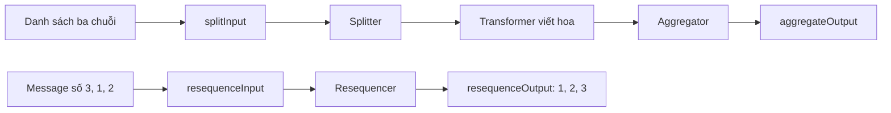

# sequenceNumber và sequenceSize

Trong chương **Message headers** của module **SPRING_INTEGRATION_CORE**, `sequenceNumber` và `sequenceSize` giúp các endpoint hiểu vị trí và quy mô của một chuỗi thông điệp. Chúng đặc biệt hữu ích khi một yêu cầu được tách thành nhiều phần, xử lý độc lập rồi sắp xếp hoặc gom lại.

Bài học này đi từ ý nghĩa của header đến cách sử dụng với `Message`, `MessageChannel`, splitter, aggregator, resequencer và Java DSL. Sau khi học, bạn có thể đọc đúng thông tin chuỗi, phân biệt thứ tự logic với thứ tự đến, và nhận ra các nguyên nhân khiến một nhóm thông điệp không hoàn tất.

## 1. Bài toán: các phần của cùng một yêu cầu có thể đến lệch thứ tự

Giả sử hệ thống nhận yêu cầu kiểm tra ba mặt hàng của một đơn hàng:

```text
Đơn hàng: [bàn phím, chuột, màn hình]
```

Splitter tạo ba thông điệp. Khi mỗi thông điệp được xử lý trên một luồng khác nhau hoặc gửi đến dịch vụ bên ngoài, kết quả có thể trở về theo thứ tự:

```text
chuột → màn hình → bàn phím
```

Endpoint phía sau cần biết ba điều:

1. Kết quả thuộc lần xử lý nào?
2. Kết quả ứng với phần thứ mấy của yêu cầu ban đầu?
3. Dự kiến có tổng cộng bao nhiêu phần?

Bộ ba header thường dùng để trả lời là:

```text
(correlationId, sequenceNumber, sequenceSize)
```

Với nhóm có khóa minh họa `batch-A`, dữ liệu có thể là:

| Payload | correlationId | sequenceNumber | sequenceSize |
| --- | --- | ---: | ---: |
| Kết quả bàn phím | batch-A | 1 | 3 |
| Kết quả chuột | batch-A | 2 | 3 |
| Kết quả màn hình | batch-A | 3 | 3 |

Giá trị `batch-A` chỉ là khóa ví dụ. Trong luồng splitter tiêu chuẩn, khóa tương quan thường được tạo từ ID của thông điệp đầu vào, không nhất thiết là mã đơn hàng trong nghiệp vụ.

## 2. Ý nghĩa và quy ước của hai header

### 2.1. sequenceNumber: vị trí trong chuỗi

`sequenceNumber` biểu diễn số thứ tự logic của thông điệp trong một chuỗi. Với chuỗi hữu hạn do splitter tiêu chuẩn sinh ra, số thứ tự bắt đầu từ **1**:

```text
Phần đầu tiên: sequenceNumber = 1
Phần thứ hai:  sequenceNumber = 2
Phần thứ ba:   sequenceNumber = 3
```

Vị trí này được xác định khi tạo chuỗi. Thông điệp có `sequenceNumber = 3` đến trước không trở thành phần số 1. Việc đọc giá trị header cũng không làm kênh tự sắp xếp lại thông điệp.

Đừng dùng header này như chỉ số mảng Java bắt đầu từ 0. Nếu cần ánh xạ vào một mảng, chương trình phải chủ động chuyển đổi và kiểm tra phạm vi:

```java
int arrayIndex = sequenceNumber - 1;
```

### 2.2. sequenceSize: số phần dự kiến của chuỗi

`sequenceSize` biểu diễn số thông điệp dự kiến của chuỗi hiện tại. Khi tách một danh sách có ba phần tử, mỗi thông điệp con đều có:

```text
sequenceSize = 3
```

Đây là tổng số phần, không phải số phần đã nhận hoặc số phần còn thiếu. Vì vậy, `sequenceSize` không giảm từ 3 xuống 2 rồi xuống 1 trong quá trình xử lý.

Với chuỗi hữu hạn có kích thước đã biết, hợp đồng dữ liệu nên bảo đảm:

```text
sequenceSize = N, với N > 0
1 <= sequenceNumber <= N
Mỗi vị trí từ 1 đến N đại diện cho một phần logic
Các phần của cùng chuỗi có cùng correlationId và sequenceSize
```

Đó là hợp đồng mà ứng dụng cần duy trì; không nên giả định mọi endpoint sẽ tự kiểm tra tất cả điều kiện này.

### 2.3. Kiểu dữ liệu và tên hằng

Hai header được dùng dưới dạng `Integer` trong bản đồ header. Spring Integration cung cấp tên hằng trong `IntegrationMessageHeaderAccessor`:

| Tên header | Hằng | Ý nghĩa |
| --- | --- | --- |
| `sequenceNumber` | `SEQUENCE_NUMBER` | Vị trí của phần trong chuỗi |
| `sequenceSize` | `SEQUENCE_SIZE` | Tổng số phần dự kiến |
| `correlationId` | `CORRELATION_ID` | Khóa liên kết các phần |

Nên sử dụng hằng thay vì tự gõ tên chuỗi để tránh lỗi chính tả và nhầm với header nghiệp vụ. Các hằng và phương thức truy cập tương ứng được mô tả trong [API IntegrationMessageHeaderAccessor](https://docs.spring.io/spring-integration/api/org/springframework/integration/IntegrationMessageHeaderAccessor.html).

## 3. Phân biệt ID của message, khóa nhóm và số thứ tự

Ba khái niệm này có vai trò khác nhau:

| Thông tin | Phạm vi | Ví dụ |
| --- | --- | --- |
| `id` | Định danh một message | Mỗi message con có ID riêng |
| `correlationId` | Liên kết các message trong cùng nhóm | Ba kết quả cùng thuộc một lần tách |
| `sequenceNumber` | Xác định vị trí trong nhóm | Phần 1, phần 2, phần 3 |
| `sequenceSize` | Mô tả quy mô chuỗi | Cả nhóm dự kiến có 3 phần |
| `orderId` tùy biến | Định danh đối tượng nghiệp vụ | Đơn hàng `ORD-2026-018` |

Hai đơn hàng đều có thể sinh các phần mang số thứ tự `1`, `2`, `3`. Aggregator cần khóa nhóm để tránh trộn chúng với nhau.

Một đơn hàng cũng có thể được xử lý nhiều lần. Nếu chủ động dùng mã đơn hàng làm khóa tương quan mà không có mã lần xử lý, kết quả từ hai lần chạy có thể rơi vào cùng nhóm. Một khóa như `orderId + processingRunId` thường diễn đạt rõ phạm vi hơn khi ứng dụng tự thiết kế cơ chế correlation.

Không suy ra rằng message số 3 là message cuối cùng **đến nơi** chỉ vì `sequenceNumber == sequenceSize`. Nó chỉ đứng cuối trong thứ tự logic; các phần số 1 và số 2 vẫn có thể chưa đến.

## 4. Thành phần nào tạo và sử dụng sequence header?

### 4.1. Splitter tạo thông tin chuỗi

Splitter tiêu chuẩn bật `applySequence` mặc định. Khi tách một collection có kích thước xác định, nó gắn khóa tương quan, số thứ tự và kích thước chuỗi lên các thông điệp con. Các endpoint xử lý tiếp cần giữ được thông tin này nếu phía sau còn sử dụng nó.

Với payload đầu vào là `List.of("alpha", "beta", "gamma")`, có thể hình dung kết quả:

```text
Message gốc có id = X
    ├── payload = alpha, correlationId = X, sequenceNumber = 1, sequenceSize = 3
    ├── payload = beta,  correlationId = X, sequenceNumber = 2, sequenceSize = 3
    └── payload = gamma, correlationId = X, sequenceNumber = 3, sequenceSize = 3
```

Nếu tắt `applySequence`, splitter không còn đảm nhiệm việc tạo thông tin chuỗi cho lần tách đó. Luồng downstream phải có cơ chế correlation và hoàn tất phù hợp với thiết kế riêng. Tham khảo mô hình splitter trong [Spring Integration: Splitter](https://docs.spring.io/spring-integration/reference/splitter.html).

### 4.2. PublishSubscribeChannel và recipient list router

Một thông điệp cũng có thể được phát đến nhiều nhánh, mỗi nhánh sinh một kết quả để gom lại. Trong trường hợp đó, số thứ tự có thể mô tả nhánh nhận thay vì vị trí của phần tử trong một danh sách.

`PublishSubscribeChannel` có tùy chọn `applySequence`; mặc định tùy chọn này tắt. Có thể bật bằng Java:

```java
import org.springframework.context.annotation.Bean;
import org.springframework.integration.channel.PublishSubscribeChannel;

@Bean
public PublishSubscribeChannel enrichmentBranches() {
    PublishSubscribeChannel channel = new PublishSubscribeChannel();
    channel.setApplySequence(true);
    return channel;
}
```

Khi bật, kênh cung cấp thông tin chuỗi cho các bản thông điệp gửi đến subscriber. Xem [cấu hình PublishSubscribeChannel](https://docs.spring.io/spring-integration/reference/channel/configuration.html).

Recipient list router cũng có tùy chọn tương ứng cho mô hình nhiều người nhận. Không nên suy diễn rằng mọi router đều tự sinh một chuỗi mới: một router chỉ chọn đường đi không đồng nghĩa với splitter.

### 4.3. Aggregator và resequencer sử dụng thông tin chuỗi

| Endpoint | Công việc chính | Vai trò của header |
| --- | --- | --- |
| Aggregator | Gom nhiều message thành kết quả của nhóm | Correlation xác định nhóm; release strategy xác định lúc nhóm sẵn sàng |
| Resequencer | Phát các message riêng lẻ theo thứ tự logic | `sequenceNumber` xác định thứ tự; `sequenceSize` hỗ trợ nhận biết chuỗi đầy đủ |

Aggregator cần trả lời “khi nào đủ dữ liệu để gom?”. Resequencer cần trả lời thêm “có thể phát phần nào tiếp theo mà vẫn giữ thứ tự?”. Java DSL cung cấp `.aggregate()` và `.resequence()` cho hai mục đích này; xem [Aggregators and Resequencers](https://docs.spring.io/spring-integration/reference/dsl/java-aggregators.html).

## 5. Đọc và tạo header bằng Java

### 5.1. Đọc bằng tên hằng và kiểu dữ liệu

Ví dụ sau là một phương thức tiện ích có thể đặt trong lớp xử lý message:

```java
import org.springframework.integration.IntegrationMessageHeaderAccessor;
import org.springframework.messaging.Message;

static void printSequence(Message<?> message) {
    Object correlationId = message.getHeaders().get(
            IntegrationMessageHeaderAccessor.CORRELATION_ID);

    Integer number = message.getHeaders().get(
            IntegrationMessageHeaderAccessor.SEQUENCE_NUMBER,
            Integer.class);

    Integer size = message.getHeaders().get(
            IntegrationMessageHeaderAccessor.SEQUENCE_SIZE,
            Integer.class);

    System.out.printf("group=%s, number=%s, size=%s%n",
            correlationId, number, size);
}
```

Nếu header không tồn tại, cách đọc trên trả về `null`. Điều này hữu ích để phân biệt **không có header** với **có header mang giá trị 0**. Nếu dữ liệu vào có kiểu sai, chẳng hạn chuỗi `"3"` thay cho `Integer`, cách đọc có kiểu không tự chuyển đổi thành số nguyên.

### 5.2. Tạo một phần của chuỗi bằng MessageBuilder

Spring Integration có builder với các phương thức dành cho sequence:

```java
import org.springframework.integration.support.MessageBuilder;
import org.springframework.messaging.Message;

Message<String> secondPart = MessageBuilder.withPayload("beta")
        .setCorrelationId("batch-A")
        .setSequenceNumber(2)
        .setSequenceSize(3)
        .setHeader("orderId", "ORD-2026-018")
        .build();
```

Ở đây import là `org.springframework.integration.support.MessageBuilder`. Spring Framework cũng có lớp `MessageBuilder` trong package khác; cần kiểm tra import khi sử dụng các phương thức tiện ích riêng của Spring Integration. Xem [API MessageBuilder](https://docs.spring.io/spring-integration/api/org/springframework/integration/support/MessageBuilder.html).

Nếu nhận message đã có payload phù hợp và chỉ muốn bổ sung một header, có thể bắt đầu từ message đó:

```java
Message<String> tagged = MessageBuilder.fromMessage(secondPart)
        .setHeader("processedBy", "inventory-service")
        .build();
```

Không sửa trực tiếp bản đồ do `message.getHeaders()` trả về. Hãy tạo message qua builder hoặc sử dụng endpoint làm giàu header.

Việc đặt header thủ công phù hợp khi ứng dụng tự tạo các phần từ một nguồn ngoài hoặc cần thiết kế hợp đồng chuỗi riêng. Với splitter thông thường, nên để framework tạo sequence thay vì ghi đè lại sau mỗi bước.

## 6. Ví dụ đầy đủ: tách, biến đổi, gom và sắp xếp

Ví dụ sử dụng Java 17 trở lên với Spring Integration 6.x và dependency `org.springframework.integration:spring-integration-core`. Phiên bản dependency nên được quản lý thống nhất bởi BOM hoặc cấu hình dependency của dự án. Mã đặt trong một tệp `SequenceHeadersDemo.java`, không cần Spring Boot.

Ứng dụng có hai luồng độc lập:



```java
import java.util.List;
import java.util.Locale;

import org.springframework.context.annotation.AnnotationConfigApplicationContext;
import org.springframework.context.annotation.Bean;
import org.springframework.context.annotation.Configuration;
import org.springframework.integration.IntegrationMessageHeaderAccessor;
import org.springframework.integration.channel.DirectChannel;
import org.springframework.integration.channel.QueueChannel;
import org.springframework.integration.config.EnableIntegration;
import org.springframework.integration.dsl.IntegrationFlow;
import org.springframework.integration.support.MessageBuilder;
import org.springframework.messaging.Message;

@Configuration
@EnableIntegration
public class SequenceHeadersDemo {

    @Bean
    public DirectChannel splitInput() {
        return new DirectChannel();
    }

    @Bean
    public QueueChannel aggregateOutput() {
        return new QueueChannel();
    }

    @Bean
    public IntegrationFlow splitAggregateFlow() {
        return IntegrationFlow.from(splitInput())
                .split()
                .transform(String.class,
                        value -> value.toUpperCase(Locale.ROOT))
                .aggregate()
                .channel(aggregateOutput())
                .get();
    }

    @Bean
    public DirectChannel resequenceInput() {
        return new DirectChannel();
    }

    @Bean
    public QueueChannel resequenceOutput() {
        return new QueueChannel();
    }

    @Bean
    public IntegrationFlow resequenceFlow() {
        return IntegrationFlow.from(resequenceInput())
                .resequence()
                .channel(resequenceOutput())
                .get();
    }

    private static Message<String> part(
            String correlationId, int number, int size, String payload) {

        if (size <= 0 || number < 1 || number > size) {
            throw new IllegalArgumentException("Invalid finite sequence");
        }

        return MessageBuilder.withPayload(payload)
                .setCorrelationId(correlationId)
                .setSequenceNumber(number)
                .setSequenceSize(size)
                .build();
    }

    public static void main(String[] args) {
        try (AnnotationConfigApplicationContext context =
                     new AnnotationConfigApplicationContext(
                             SequenceHeadersDemo.class)) {

            DirectChannel splitInput = context.getBean(
                    "splitInput", DirectChannel.class);
            QueueChannel aggregateOutput = context.getBean(
                    "aggregateOutput", QueueChannel.class);

            splitInput.send(MessageBuilder.withPayload(
                            List.of("alpha", "beta", "gamma"))
                    .setHeader("orderId", "ORD-2026-018")
                    .build());

            Message<?> aggregated = aggregateOutput.receive(1_000);
            if (aggregated == null) {
                throw new IllegalStateException("No aggregate result");
            }
            System.out.println("Aggregate payload: "
                    + aggregated.getPayload());

            DirectChannel resequenceInput = context.getBean(
                    "resequenceInput", DirectChannel.class);
            QueueChannel resequenceOutput = context.getBean(
                    "resequenceOutput", QueueChannel.class);

            resequenceInput.send(part("demo-run-A", 3, 3, "gamma"));
            resequenceInput.send(part("demo-run-A", 1, 3, "alpha"));

            System.out.println("Before part 2: "
                    + resequenceOutput.receive(0));

            resequenceInput.send(part("demo-run-A", 2, 3, "beta"));

            for (int i = 0; i < 3; i++) {
                Message<?> result = resequenceOutput.receive(1_000);
                if (result == null) {
                    throw new IllegalStateException("Incomplete sequence");
                }

                Integer number = result.getHeaders().get(
                        IntegrationMessageHeaderAccessor.SEQUENCE_NUMBER,
                        Integer.class);

                System.out.printf("Resequenced: %s -> %s%n",
                        number, result.getPayload());
            }
        }
    }
}
```

Ở luồng thứ nhất, splitter tạo ba message có số thứ tự `1`, `2`, `3` và cùng kích thước `3`. Transformer đổi payload sang chữ hoa, còn aggregator tạo một message chứa collection các payload kết quả. Bạn sẽ nhận collection chứa `ALPHA`, `BETA`, `GAMMA`.

Ở luồng thứ hai, các phần được gửi theo thứ tự `3 → 1 → 2`. Với cấu hình resequencer mặc định chờ chuỗi đầy đủ, dòng in trước khi gửi phần số 2 là:

```text
Before part 2: null
```

Sau khi phần số 2 đến, ba message được phát theo thứ tự:

```text
Resequenced: 1 -> alpha
Resequenced: 2 -> beta
Resequenced: 3 -> gamma
```

`receive(1_000)` chỉ giới hạn thời gian ứng dụng chờ đọc một message từ queue. Nó không thiết lập timeout cho nhóm trong aggregator hoặc resequencer.

`QueueChannel` ở đây được ứng dụng đọc trực tiếp nên không cần poller cho consumer. Nếu nối một endpoint tiêu thụ queue bằng polling trong luồng khác, endpoint đó phải có cấu hình poller thích hợp.

## 7. Đủ số lượng và đúng thứ tự là hai yêu cầu riêng

### 7.1. Điều kiện hoàn tất nhóm

Với một chuỗi hợp lệ có kích thước `N`, aggregator thường có thể gom khi đã nhận đủ `N` phần của cùng nhóm. Tuy nhiên, không nên biến nhận định đó thành giả định rằng aggregator mặc định đã xác minh đầy đủ các vị trí `1..N`.

`SimpleSequenceSizeReleaseStrategy` so sánh số message hiện có trong nhóm với `sequenceSize` dự kiến. Chiến lược này không cung cấp kiểm tra trùng số thứ tự. Ví dụ, nếu ba message riêng biệt mang các vị trí `1`, `1`, `3` với `sequenceSize = 3`, số lượng có thể đủ trong khi phần số 2 vẫn thiếu. Chi tiết này được nêu trong [API SimpleSequenceSizeReleaseStrategy](https://docs.spring.io/spring-integration/api/org/springframework/integration/aggregator/SimpleSequenceSizeReleaseStrategy.html).

Vì vậy, hệ thống có khả năng phát lại dữ liệu cần chính sách chống trùng hoặc xác thực hợp đồng chuỗi. Có thể cân nhắc release strategy có kiểm tra sequence phù hợp; [SequenceSizeReleaseStrategy](https://docs.spring.io/spring-integration/api/org/springframework/integration/aggregator/SequenceSizeReleaseStrategy.html) hỗ trợ cơ chế liên quan đến sequence và phát chuỗi từng phần. Việc chọn strategy vẫn phải đi cùng chính sách định danh phần nghiệp vụ.

### 7.2. Sắp xếp thứ tự phát ra

Resequencer giữ các message riêng lẻ và phát chúng theo `sequenceNumber`. Nó không thực hiện phép cộng, ghép văn bản hay tạo một kết quả nghiệp vụ tổng hợp như aggregator.

Nếu có yêu cầu phát các đoạn liên tiếp ngay khi có thể, resequencer có tùy chọn `releasePartialSequences(true)`:

```java
.resequence(spec -> spec.releasePartialSequences(true))
```

Với các phần đến lần lượt `1`, `3`, `2`, cấu hình này có thể phát phần 1 trước; phần 3 phải chờ khoảng trống tại vị trí 2 được lấp. Đây là phát một tiền tố liên tục, không phải cho phép bỏ qua phần bị thiếu. Xem [Spring Integration: Resequencer](https://docs.spring.io/spring-integration/reference/resequencer.html).

Nếu downstream dùng executor hoặc một cơ chế xử lý song song khác sau resequencer, thời điểm hoàn thành tác vụ vẫn có thể đảo thứ tự. Cần phân biệt thứ tự endpoint **gửi ra** với thứ tự tác vụ **hoàn thành**.

Không thêm resequencer chỉ vì luồng có aggregator. Hãy dùng nó khi có yêu cầu cụ thể về thứ tự message đi qua một ranh giới. Nếu cần collection kết quả được sắp xếp theo một quy tắc nghiệp vụ, hãy xác định rõ quy tắc đó trong bộ xử lý kết quả nhóm.

## 8. sequenceSize bằng 0: kích thước chưa biết

Không phải nguồn dữ liệu nào cũng biết trước số phần tử. Với iterator hoặc nguồn duyệt lười mà splitter không xác định được kích thước, các phần có thể được gắn:

```text
correlationId = batch-stream-A
sequenceNumber = 1, sequenceSize = 0
sequenceNumber = 2, sequenceSize = 0
sequenceNumber = 3, sequenceSize = 0
...
```

Trong ngữ cảnh này, `sequenceSize = 0` biểu thị kích thước chưa biết. Nó không có nghĩa nhóm đã hoàn tất, và cũng không nói rằng message hiện tại không thuộc chuỗi.

Không được lấy tổng số phần đã thấy ở thời điểm hiện tại để cập nhật `sequenceSize` tùy tiện. Ví dụ, đánh dấu phần đầu tiên là `1/1` có thể khiến downstream kết luận chuỗi đã đủ ngay lập tức.

Với nguồn không biết trước kích thước, cần chọn một hợp đồng hoàn tất khác:

| Phương án | Cách áp dụng | Điều cần cân nhắc |
| --- | --- | --- |
| Biết trước tổng số phần | Lấy số lượng từ metadata của nguồn | Tổng số phải tương ứng đúng tập dữ liệu thực tế |
| Chuyển thành collection trước khi tách | Xác định đầy đủ danh sách rồi mới split | Chi phí bộ nhớ và độ trễ trước khi xử lý |
| Có tín hiệu kết thúc nghiệp vụ | Custom release strategy theo trạng thái nhóm | Tín hiệu kết thúc có thể đến trước các phần khi xử lý bất đồng bộ |
| Giới hạn thời gian gom | Timeout và chính sách kết quả chưa đủ | Phải chấp nhận và thể hiện rõ tính không đầy đủ |

Đừng chỉ kiểm tra “đã thấy cờ cuối” nếu các phần có thể đến lệch thứ tự. Hợp đồng kết thúc có thể cần kèm tổng số phần và xác thực các phần đã nhận. Ngoài ra, danh sách rỗng thường không tạo ra message con nào để aggregator nhận; cần xử lý yêu cầu rỗng tại ranh giới phù hợp.

## 9. Filter và router có thể làm thay đổi tập phần đến nơi

Xét luồng:

```text
List gồm 3 phần
    → split
    → filter loại phần số 2
    → aggregate
```

Splitter đã gắn `sequenceSize = 3`, nhưng aggregator chỉ nhận được phần số 1 và số 3. Header trên hai phần còn lại không tự đổi thành kích thước 2.

Một lỗi tương tự xảy ra khi router đưa các phần của cùng chuỗi sang các nhánh khác nhau, trong khi mỗi nhánh lại có aggregator chờ đủ toàn bộ chuỗi gốc.

Tùy yêu cầu nghiệp vụ, có thể chọn:

1. Lọc danh sách đầu vào trước khi splitter tạo sequence nếu việc lọc có thể quyết định từ đầu.
2. Sinh một kết quả biểu diễn “bị loại”, “không hợp lệ” hoặc “xử lý thất bại” cho phần bị loại để nhóm vẫn nhận đủ các vị trí.
3. Thiết kế một chuỗi mới ở nhánh cần gom, với khóa nhóm và kích thước được xác định lại theo hợp đồng của nhánh.
4. Dùng release strategy khác nếu mục tiêu là gom theo thời gian, theo số lượng nghiệp vụ hoặc theo tín hiệu hoàn tất riêng.

Không sửa `sequenceSize` trên một vài message thành “số phần tôi nghĩ sẽ đến”. Các thành viên của nhóm phải dùng cùng một hợp đồng. Đặc biệt, một nhánh thường không có đủ thông tin để biết nhánh khác còn đang xử lý bao nhiêu phần.

## 10. Giữ header qua transformer, endpoint và ranh giới hệ thống

Trong ví dụ Java DSL, transformer trả về payload mới và framework quản lý việc tạo message trả lời. Khi viết endpoint tự xây dựng `Message`, cần chú ý các header cần giữ lại.

Đoạn mã sau tạo message từ payload mà không sao chép header của đầu vào:

```java
Message<String> output = MessageBuilder.withPayload("processed")
        .build();
```

Nếu message này đi vào aggregator dùng correlation mặc định, thông tin nhóm cần thiết có thể đã mất. Khi thực sự phải tự tạo message mới, hãy giữ những header phù hợp:

```java
static Message<String> replacePayload(Message<String> input) {
    return MessageBuilder.withPayload("processed: " + input.getPayload())
            .copyHeaders(input.getHeaders())
            .build();
}
```

Sao chép header cũng cần xét ngữ cảnh: không giữ một sequence cũ cho tập message mới có ý nghĩa khác. Nếu tác vụ tạo thêm nhiều phần, hãy xác định một cấp sequence mới thay vì cho tất cả kết quả cùng mang số thứ tự của phần đầu vào.

Khi truyền qua HTTP, broker hoặc định dạng JSON, cần xác định header mapping và kiểu dữ liệu ở phía nhận. Chỉ thấy `sequenceNumber` trong log bên gửi chưa đủ để khẳng định header vẫn tồn tại với đúng kiểu khi message trở lại luồng.

Gateway có thể cung cấp API phương thức Java cho điểm vào hoặc điểm ra của luồng, nhưng gateway không tự thay thế hợp đồng sequence. Tương tự, `errorChannel` nhận lỗi không đồng nghĩa aggregator đã nhận một kết quả thay thế cho phần bị lỗi.

## 11. Tách và gom lồng nhau

Một đơn hàng có thể tách thành các dòng hàng; mỗi dòng hàng lại tách thành các lần kiểm tra kho:

```text
Đơn hàng
    → split các dòng hàng: sequence cấp ngoài
        → split các kho cần kiểm tra: sequence cấp trong
        → aggregate kết quả kho
    → aggregate kết quả dòng hàng
```

Ở cấp trong, các header `sequenceNumber`, `sequenceSize`, `correlationId` đang hiển thị mô tả chuỗi kiểm tra kho. Chúng không đồng thời biểu diễn trực tiếp cả chuỗi dòng hàng phía ngoài.

Spring Integration có cơ chế lưu thông tin sequence lồng nhau qua `sequenceDetails` và các thao tác `pushSequenceDetails`/`popSequenceDetails`. Các API liên quan được trình bày trong [BaseMessageBuilder](https://docs.spring.io/spring-integration/api/org/springframework/integration/support/BaseMessageBuilder.html).

Với mô hình splitter–aggregator tiêu chuẩn, việc gom có hỗ trợ xử lý thông tin sequence để khôi phục cấp bên ngoài. Cấu hình `popSequence` và cách custom processor tạo kết quả có ảnh hưởng đến hành vi này; xem [Aggregator và thông tin sequence lồng nhau](https://docs.spring.io/spring-integration/reference/aggregator.html).

Khi viết custom endpoint, không xóa `sequenceDetails` hoặc tự ghi đè ba header hiện tại mà chưa xét cấp chuỗi. Nếu cần giữ vị trí nghiệp vụ qua nhiều cấp, có thể dùng thêm header riêng như `orderLineIndex`; đừng buộc một `sequenceNumber` biểu diễn mọi cấp cùng lúc.

## 12. Thiếu phần, phát lại và timeout

### 12.1. Timeout của nhóm khác timeout của người gọi

Giả sử nhóm có `sequenceSize = 3`, nhưng phần số 2 bị lỗi vĩnh viễn. Nếu không có chính sách hết hạn hoặc hoàn tất khác, nhóm có thể tiếp tục chờ.

Một đoạn cấu hình aggregator cho phép kết quả chưa đủ khi nhóm hết thời gian có thể là:

```java
.aggregate(spec -> spec
        .groupTimeout(5_000)
        .sendPartialResultOnExpiry(true))
```

Đoạn này cần đặt vào một `IntegrationFlow` đang cấu hình; nó không phải một luồng độc lập. `groupTimeout` phục vụ xử lý hết hạn nhóm, trong khi `sendPartialResultOnExpiry(true)` chọn cách xử lý kết quả còn thiếu. Timeout không làm phần bị mất xuất hiện.

Đối với nghiệp vụ bắt buộc đủ ba phần, nên thiết kế luồng lỗi hoặc đối soát thay vì coi collection hai phần là thành công. Khi chấp nhận kết quả một phần, hãy trả thêm trạng thái như `complete=false` và thông tin phần còn thiếu theo hợp đồng ứng dụng. Framework không tự suy ra các trường nghiệp vụ này.

Một gateway hết thời gian chờ trả lời cũng không tự động xóa nhóm đang lưu trong aggregator. Cần thiết kế timeout của người gọi, vòng đời nhóm và xử lý kết quả đến muộn thống nhất với nhau.

### 12.2. Retry không tạo ra vị trí logic mới

Nếu phần số 2 phải xử lý lại, nó vẫn đại diện cho phần số 2 của cùng lần xử lý. Không tăng `sequenceNumber` mỗi lần retry và không tăng `sequenceSize` chỉ vì có thêm một lần giao message.

Một message được tạo mới trong quá trình phát lại có thể có ID kỹ thuật mới nhưng vẫn là bản sao của cùng phần nghiệp vụ. Vì vậy, chống trùng nên dựa trên định danh phần ổn định, chẳng hạn cặp `(processingRunId, partId)`, theo yêu cầu thực tế.

Sau khi nhóm đã hoàn tất hoặc hết hạn, kết quả đến muộn cần một chính sách rõ ràng. Tùy vòng đời metadata của nhóm, chúng có thể bị loại hoặc tham gia một nhóm được tạo lại; không tái sử dụng khóa nhóm thiếu kiểm soát.

## 13. Cách kiểm chứng hành vi khi thực hành

Khi áp dụng vào dự án, hãy quan sát message tại ba vị trí: ngay sau splitter, trước endpoint gom hoặc sắp xếp, và tại đầu ra. Ghi lại khóa nhóm, số thứ tự, kích thước và định danh phần nghiệp vụ để phân biệt lỗi mất header với lỗi thiếu kết quả.

| Dữ liệu thử | Hành vi cần quan sát |
| --- | --- |
| Một nhóm, gửi các phần `1 → 2 → 3` | Gom một kết quả sau khi đủ phần |
| Một nhóm, gửi `3 → 1 → 2` vào resequencer mặc định | Chờ đủ rồi phát `1 → 2 → 3` |
| Hai nhóm gửi xen kẽ, cùng có vị trí `1`, `2`, `3` | Mỗi nhóm được xử lý riêng theo khóa tương quan |
| Chỉ gửi phần `1` và `3`, khai báo kích thước `3` | Nhóm chưa đủ; chính sách timeout quyết định bước tiếp theo |
| Phần có header kiểu chuỗi thay cho số nguyên | Phát hiện lỗi hợp đồng kiểu dữ liệu ở ranh giới nhận |
| Các message khác nhau có cùng vị trí logic | Kiểm tra chính sách chống trùng và release strategy đã chọn |
| Một phần bị filter loại bỏ | Xác nhận nhóm có cơ chế bù, hết hạn hoặc hoàn tất khác |
| Iterator không xác định được tổng số phần | Không dựa vào `sequenceSize = 0` để kết luận hoàn tất |

Khi kiểm thử đầu ra qua `QueueChannel`, nên dùng thời gian chờ hữu hạn để một lỗi thiếu phần không làm bài kiểm thử treo vô thời hạn. Đồng thời, đừng coi một lần đọc trả về `null` là bằng chứng rằng nhóm đã bị hủy: nó chỉ cho biết chưa có message đầu ra trong khoảng chờ đó.

Hai header này phát huy tác dụng khi mọi thành phần chia sẻ cùng một hợp đồng: phần nào thuộc nhóm nào, vị trí nào là hợp lệ và điều kiện nào cho phép kết thúc. Khi hợp đồng đó rõ ràng, bạn có thể kết hợp splitter, transformer, router, filter, aggregator và resequencer mà vẫn hiểu được tác động của từng bước lên chuỗi thông điệp.
