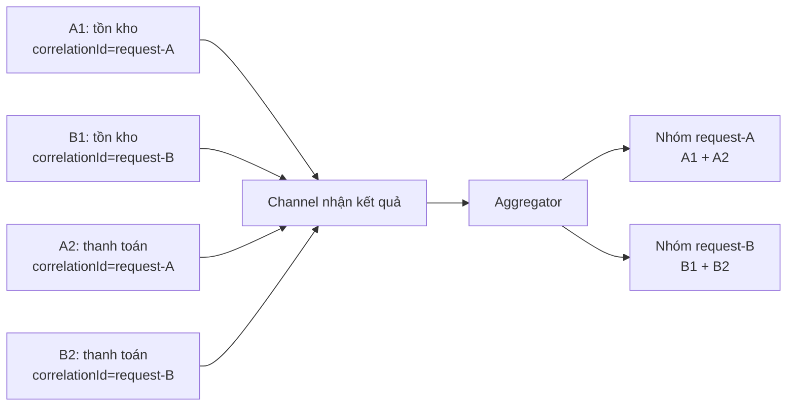

# correlationId

> Chương: **Message headers** — Module **Spring Integration Core** (`SPRING_INTEGRATION_CORE`).

Trong một luồng tích hợp, một yêu cầu có thể được tách thành nhiều message, chạy qua các endpoint khác nhau rồi tạo ra nhiều kết quả đến không cùng thời điểm. Header `correlationId` biểu diễn mối liên hệ giữa các message đó. Hiểu đúng header này giúp thiết kế luồng với `Message`, `MessageChannel`, splitter, transformer, aggregator và gateway mà không ghép nhầm kết quả của những yêu cầu đang xử lý đồng thời.

Bài học tập trung vào cơ chế correlation của Spring Integration Core. Những ví dụ về giao tiếp bên ngoài chỉ nhằm làm rõ ranh giới truyền header; chúng không đòi hỏi triển khai thêm một hệ thống broker.

## 1. Mục tiêu và kiến thức nền

Sau bài học, bạn có thể:

- Đọc và thiết lập `correlationId` bằng API Java.
- Phân biệt định danh message, định danh nhóm, định danh nghiệp vụ và địa chỉ nhận phản hồi.
- Giải thích quan hệ giữa `correlationId`, `sequenceNumber` và `sequenceSize`.
- Xây dựng luồng Java DSL gom các message liên quan.
- Giữ đúng ngữ cảnh khi biến đổi message, xử lý lỗi và đi qua ranh giới hệ thống.
- Thiết kế khóa nhóm và tình huống kiểm thử để phát hiện việc trộn kết quả.

Bạn nên biết cấu trúc `Message<T>` gồm payload và headers, cách khai báo bean Spring, và vai trò cơ bản của channel, endpoint. Các đoạn Java cấu hình dùng `spring-integration-core`; ví dụ kiểm thử bổ sung JUnit Jupiter và `spring-test`. Dùng bộ phiên bản Spring tương thích do dự án quản lý. Các lớp cấu hình và kiểm thử bên dưới có thể đặt cùng package trong một dự án đã có những dependency này.

## 2. Bài toán: kết quả này thuộc yêu cầu nào?

Giả sử hệ thống nhận hai yêu cầu đặt hàng:

- Yêu cầu A kiểm tra tồn kho và thanh toán cho đơn A.
- Yêu cầu B kiểm tra tồn kho và thanh toán cho đơn B.

Các kết quả có thể đến theo thứ tự:

| Thứ tự đến | Payload kết quả | Nhóm cần thuộc về |
| --- | --- | --- |
| 1 | `A:inventory-ok` | Yêu cầu A |
| 2 | `B:inventory-ok` | Yêu cầu B |
| 3 | `A:payment-ok` | Yêu cầu A |
| 4 | `B:payment-ok` | Yêu cầu B |

Nếu chỉ lấy hai kết quả đến đầu tiên để tổng hợp, hệ thống sẽ ghép tồn kho của A với tồn kho của B. Cần một giá trị nhóm đi cùng từng message:

```text
Message A1: correlationId = request-A
Message A2: correlationId = request-A

Message B1: correlationId = request-B
Message B2: correlationId = request-B
```

Hai message có payload khác nhau vẫn có thể thuộc cùng một nhóm. Hai message có payload giống nhau cũng có thể thuộc hai nhóm khác nhau.



Channel chuyển message đến thành phần xử lý; aggregator quyết định cách gom nhóm. Một channel không tự trở thành bộ ghép kết quả chỉ vì message có cùng `correlationId`.

## 3. Định nghĩa và API chính xác

### 3.1. Tên header và hằng số

Tên header là `correlationId`. Trong mã Java, dùng hằng số:

```java
import org.springframework.integration.IntegrationMessageHeaderAccessor;

String headerName = IntegrationMessageHeaderAccessor.CORRELATION_ID;
```

Hằng số này thuộc `IntegrationMessageHeaderAccessor`, không thuộc `MessageHeaders`. Trong API của Spring Integration, giá trị correlation có kiểu tổng quát `Object`; có thể dùng chuỗi, UUID hoặc một kiểu khóa khác phù hợp. Không có yêu cầu chung rằng mọi correlation ID phải là UUID. Xem [API IntegrationMessageHeaderAccessor](https://docs.spring.io/spring-integration/api/org/springframework/integration/IntegrationMessageHeaderAccessor.html).

Trong luồng nội bộ, một đối tượng bất biến có `equals()` và `hashCode()` nhất quán là lựa chọn hợp lý. Khi phải truyền qua giao thức khác hoặc lưu bền vững, cần kiểm tra khả năng biểu diễn và tuần tự hóa của khóa. Một chuỗi có cấu trúc rõ ràng thường dễ trao đổi hơn một đối tượng Java riêng của ứng dụng.

### 3.2. Không phải message nào cũng có correlationId

Việc tạo một `Message` thông thường không có nghĩa nó đã có `correlationId`. Header này xuất hiện khi ứng dụng thiết lập hoặc khi một thành phần có hành vi tạo thông tin sequence, chẳng hạn splitter, bổ sung nó.

Đọc header không có trong message sẽ nhận `null`. Không nên mặc định coi một message thiếu khóa là thành viên của một nhóm chung tên “null”.

Nếu endpoint cần correlation bắt buộc, hãy xác thực sớm và xác định cách trả lỗi hoặc chuyển message không hợp lệ sang luồng riêng.

### 3.3. Tính bất biến của headers

Không cập nhật trực tiếp cấu trúc `MessageHeaders` bằng `put()`. Tạo message thông qua builder khi cần thay đổi header. Cấu trúc headers được bảo vệ khỏi sửa trực tiếp; điều đó không biến mọi đối tượng nằm trong header thành bất biến. Vì thế, không dùng một đối tượng khóa mà nội dung có thể bị thay đổi trong lúc message đang được xử lý. Xem [Message và Message Headers](https://docs.spring.io/spring-integration/reference/message.html).

## 4. Phân biệt các loại định danh và địa chỉ

| Thành phần | Ý nghĩa | Quan hệ với correlationId |
| --- | --- | --- |
| `MessageHeaders.ID` — `id` | Định danh một message | Các message con có thể có ID riêng và chung correlation ID |
| `correlationId` | Liên hệ nhiều message trong một phạm vi xử lý | Thường được dùng làm khóa nhóm |
| `sequenceNumber` | Vị trí của message trong một sequence | Có ý nghĩa bên trong nhóm tương ứng |
| `sequenceSize` | Số phần tử dự kiến của sequence khi biết trước | Hỗ trợ xác định khi nào nhận đủ nhóm |
| `replyChannel` | Nơi gửi phản hồi trong luồng messaging | Không được suy ra chỉ từ correlation ID |
| `businessRequestId` hoặc `orderId` | Header do ứng dụng định nghĩa để diễn đạt nghiệp vụ | Có thể dùng để xây dựng khóa nhóm riêng |
| `traceId` | Định danh phục vụ truy vết của hệ thống quan sát | Cần hợp đồng ánh xạ riêng nếu muốn liên hệ với correlation |

Một cách đọc hữu ích là:

- `id`: “Đây là message nào?”
- `correlationId`: “Message này liên quan đến nhóm nào?”
- `replyChannel`: “Gửi phản hồi đến đâu?”
- `sequenceNumber`: “Đây là phần thứ mấy?”
- `sequenceSize`: “Dự kiến có bao nhiêu phần?”

Không dùng `id` của từng message kết quả làm correlation ID riêng nếu mục tiêu là gom chúng vào cùng một nhóm. Khi mỗi kết quả mang một khóa khác nhau, aggregator sẽ tạo các nhóm tách biệt.

Cũng không dùng cùng một `correlationId` cố định cho mọi yêu cầu. Khi đó, kết quả của các yêu cầu khác nhau có thể cùng đi vào một nhóm.

Một `orderId` có thể tồn tại lâu dài qua nhiều thao tác như đặt hàng, thu tiền và hoàn tiền. Chỉ dùng `orderId` làm khóa nhóm là chưa đủ nếu những thao tác này có thể chồng lấn. Khóa cần phản ánh phạm vi tổng hợp thực tế.

## 5. Đọc, tạo và giữ correlationId bằng Java

### 5.1. Tạo hai message thuộc cùng một nhóm

Ví dụ sau chủ động tạo các message kết quả để minh họa hợp đồng header:

```java
import org.springframework.messaging.Message;
import org.springframework.messaging.support.MessageBuilder;

import static org.springframework.integration.IntegrationMessageHeaderAccessor.CORRELATION_ID;
import static org.springframework.integration.IntegrationMessageHeaderAccessor.SEQUENCE_NUMBER;
import static org.springframework.integration.IntegrationMessageHeaderAccessor.SEQUENCE_SIZE;

String requestId = "request-A";

Message<String> inventoryResult = MessageBuilder
        .withPayload("A:inventory-ok")
        .setHeader(CORRELATION_ID, requestId)
        .setHeader(SEQUENCE_NUMBER, 1)
        .setHeader(SEQUENCE_SIZE, 2)
        .build();

Message<String> paymentResult = MessageBuilder
        .withPayload("A:payment-ok")
        .setHeader(CORRELATION_ID, requestId)
        .setHeader(SEQUENCE_NUMBER, 2)
        .setHeader(SEQUENCE_SIZE, 2)
        .build();
```

Hai message dùng chung khóa `request-A` và cùng khai báo sequence gồm hai phần tử. Mỗi phần tử có vị trí riêng.

Ở đây, nhà phát triển tự chịu trách nhiệm bảo đảm số thứ tự và kích thước sequence nhất quán. Nếu luồng dùng splitter phù hợp, nên để splitter quản lý các header kỹ thuật này.

### 5.2. Đọc header theo hợp đồng kiểu dữ liệu

```java
Object genericKey = inventoryResult.getHeaders().get(CORRELATION_ID);

String stringKey = inventoryResult.getHeaders()
        .get(CORRELATION_ID, String.class);

if (stringKey == null || stringKey.isBlank()) {
    throw new IllegalArgumentException("Thiếu correlationId hợp lệ");
}
```

Cách đọc có `String.class` phù hợp vì ví dụ quy định khóa là chuỗi. Trong một luồng mà splitter tạo khóa từ ID của message đầu vào, giá trị có thể là UUID. Không áp dụng một phép đọc ép kiểu chuỗi cho tất cả các luồng.

Cùng nội dung hiển thị chưa chắc là cùng khóa. Chẳng hạn, một UUID và chuỗi tạo bằng `uuid.toString()` là hai đối tượng khác kiểu và không bằng nhau theo `equals()`. Hãy thống nhất kiểu dữ liệu khi ghi và đọc khóa.

### 5.3. Bổ sung header mà giữ ngữ cảnh sẵn có

```java
Message<String> markedResult = MessageBuilder
        .fromMessage(inventoryResult)
        .setHeader("processedBy", "inventory-service")
        .build();
```

`fromMessage()` giúp mang tiếp payload và các header từ message nguồn khi bổ sung thông tin. Không cần lấy toàn bộ headers ra rồi sửa trực tiếp.

Ở cổng vào do ứng dụng quản lý, có thể chỉ bổ sung correlation ID nếu chưa tồn tại:

```java
import java.util.UUID;

Message<String> request = MessageBuilder
        .withPayload("check-order")
        .setHeaderIfAbsent(CORRELATION_ID, UUID.randomUUID().toString())
        .build();
```

`setHeaderIfAbsent()` không xác thực một giá trị đã có sẵn. Nếu đầu vào đã chứa chuỗi rỗng hoặc một khóa sai phạm vi, vẫn cần bước kiểm tra riêng.

Chỉ tạo khóa mới khi bắt đầu một phạm vi xử lý mới. Nếu tạo UUID mới cho từng kết quả thuộc cùng một yêu cầu, bạn sẽ làm mất mối liên hệ cần thiết để gom nhóm.

## 6. Correlation và sequence trong splitter–aggregator

### 6.1. Ba header phối hợp với nhau

Một tình huống điển hình:

```text
Message gốc:
  id = P
  payload = [item-1, item-2, item-3]

Sau splitter có applySequence=true:
  message con 1: correlationId=P, sequenceNumber=1, sequenceSize=3
  message con 2: correlationId=P, sequenceNumber=2, sequenceSize=3
  message con 3: correlationId=P, sequenceNumber=3, sequenceSize=3
```

Trong trường hợp thông thường này, splitter lấy ID của message đầu vào làm correlation ID cho sequence mới. Các message con được tạo cho các phần tử khác nhau và cùng liên hệ đến message cha.

Thông tin sequence giúp mô tả một tập kết quả dự kiến. Với đầu vào dạng iterator hoặc stream mà không biết trước kích thước, không được tự giả định `sequenceSize` luôn là một số dương chính xác; cần chiến lược kết thúc phù hợp. Xem [Splitter](https://docs.spring.io/spring-integration/reference/splitter.html).

### 6.2. Khóa nhóm và điều kiện hoàn tất là hai quyết định riêng

Aggregator cần trả lời hai câu hỏi:

1. **Message thuộc nhóm nào?** Đây là trách nhiệm của correlation strategy.
2. **Nhóm đã sẵn sàng để tổng hợp chưa?** Đây là trách nhiệm của release strategy.

Mặc định, correlation strategy của aggregator đọc `correlationId`. Release strategy mặc định dựa trên thông tin kích thước sequence để xác định nhóm đã đủ số message.

Chỉ có `correlationId` không làm cho aggregator biết phải chờ bao nhiêu kết quả. Nếu không có sequence hợp lệ và cũng không cấu hình release strategy thích hợp, nhóm có thể không được phát hành như mong đợi. Xem [Aggregator](https://docs.spring.io/spring-integration/reference/aggregator.html).

Ví dụ, nhóm `request-A` đã nhận một message với `sequenceSize=2`:

```text
correlation: request-A
đã nhận:    1 message
dự kiến:    2 message
kết luận:  chưa đủ nhóm
```

Nhóm `request-B` có thể hoàn tất trước A nếu hai kết quả của B đều đến trước kết quả còn thiếu của A.

### 6.3. Header không thay thế kiểm tra nghiệp vụ

Đủ hai message không nhất thiết có nghĩa là đã nhận đúng một kết quả tồn kho và một kết quả thanh toán. Có thể đó là hai lần gửi lại của cùng một nhánh.

Với dữ liệu thực tế, hãy xác định:

- Có cần chống message trùng trước khi vào aggregator không?
- Có cần nhận đủ các loại kết quả khác nhau thay vì chỉ đủ số lượng không?
- Kết quả thất bại có được tính là một kết quả hoàn tất của nhánh không?
- Nếu một nhánh bị filter loại bỏ, luồng sẽ tạo kết quả thay thế hay đánh dấu yêu cầu không hoàn tất?

Không coi `correlationId` là cơ chế chống trùng hoặc bảo đảm xử lý đúng một lần.

### 6.4. Nhiều tầng splitter cần nhiều tầng correlation

Một đơn hàng có thể được tách thành các kiện hàng; mỗi kiện lại được tách thành các mặt hàng. Khi đó có hai phạm vi gom nhóm.

Spring Integration có cơ chế lưu ngữ cảnh sequence lồng nhau và phục hồi ngữ cảnh khi aggregator kết thúc một tầng. Việc xử lý này liên quan đến `sequenceDetails` và hành vi `popSequence`. Không ghi đè các header kỹ thuật giữa luồng chỉ để giữ một định danh nghiệp vụ. Có thể giữ định danh nghiệp vụ trong `businessRequestId` hoặc `orderId` riêng. Xem [cơ chế sequence lồng nhau của Aggregator](https://docs.spring.io/spring-integration/reference/aggregator.html).

Do ngữ cảnh sequence có thể được phục hồi hoặc loại bỏ sau tổng hợp, không giả định output của aggregator luôn giữ nguyên `correlationId` đang dùng ở tầng con. Nếu hệ thống cần một mã yêu cầu xuyên suốt, hãy đưa mã đó vào hợp đồng nghiệp vụ riêng.

## 7. Ví dụ Java DSL: gom hai nhóm có kết quả xen kẽ

### 7.1. Cấu hình một luồng tối thiểu

Cấu hình dưới đây dùng:

- `DirectChannel` nhận các message đã có header correlation và sequence.
- Aggregator mặc định để gom nhóm và tạo payload kết quả gồm các payload thành phần.
- `QueueChannel` giữ kết quả để chương trình hoặc kiểm thử đọc ra.

```java
import org.springframework.context.annotation.Bean;
import org.springframework.context.annotation.Configuration;
import org.springframework.integration.channel.DirectChannel;
import org.springframework.integration.channel.QueueChannel;
import org.springframework.integration.config.EnableIntegration;
import org.springframework.integration.dsl.IntegrationFlow;

@Configuration
@EnableIntegration
public class CorrelationFlowConfig {

    @Bean
    public DirectChannel correlationInput() {
        return new DirectChannel();
    }

    @Bean
    public QueueChannel correlationOutput() {
        return new QueueChannel();
    }

    @Bean
    public IntegrationFlow correlationFlow() {
        return IntegrationFlow
                .from("correlationInput")
                .aggregate()
                .channel("correlationOutput")
                .get();
    }
}
```

Input là channel có subscriber nên aggregator xử lý khi message được gửi vào. Output là hàng đợi mà bên nhận chủ động gọi `receive()`; trong ví dụ này không có endpoint tự polling output, vì vậy không cần khai báo poller cho nó.

Cú pháp `.aggregate()` cho phép dùng cấu hình mặc định; callback của DSL cho phép thay correlation strategy, release strategy và message store khi cần. Xem [Aggregators and Resequencers trong Java DSL](https://docs.spring.io/spring-integration/reference/dsl/java-aggregators.html).

### 7.2. Kiểm thử hành vi gom nhóm

Đây là mã kiểm thử để người học chạy trong dự án, không phải kết quả chạy được giả định trước.

```java
import java.util.Collection;
import java.util.HashSet;
import java.util.Set;

import org.junit.jupiter.api.Test;
import org.springframework.beans.factory.annotation.Autowired;
import org.springframework.beans.factory.annotation.Qualifier;
import org.springframework.messaging.Message;
import org.springframework.messaging.MessageChannel;
import org.springframework.messaging.PollableChannel;
import org.springframework.messaging.support.MessageBuilder;
import org.springframework.test.context.junit.jupiter.SpringJUnitConfig;

import static org.junit.jupiter.api.Assertions.assertEquals;
import static org.junit.jupiter.api.Assertions.assertInstanceOf;
import static org.junit.jupiter.api.Assertions.assertNotNull;
import static org.junit.jupiter.api.Assertions.assertNull;
import static org.junit.jupiter.api.Assertions.assertTrue;
import static org.springframework.integration.IntegrationMessageHeaderAccessor.CORRELATION_ID;
import static org.springframework.integration.IntegrationMessageHeaderAccessor.SEQUENCE_NUMBER;
import static org.springframework.integration.IntegrationMessageHeaderAccessor.SEQUENCE_SIZE;

@SpringJUnitConfig(CorrelationFlowConfig.class)
class CorrelationFlowTest {

    @Autowired
    @Qualifier("correlationInput")
    MessageChannel input;

    @Autowired
    @Qualifier("correlationOutput")
    PollableChannel output;

    @Test
    void groupsInterleavedResultsByCorrelationId() {
        assertTrue(input.send(part("request-A", 1, "A:inventory-ok")));
        assertTrue(input.send(part("request-B", 1, "B:inventory-ok")));

        // Mỗi nhóm mới có một trong hai kết quả.
        assertNull(output.receive(0));

        assertTrue(input.send(part("request-A", 2, "A:payment-ok")));

        Message<?> resultA = output.receive(1_000);
        assertPayloads(resultA, Set.of("A:inventory-ok", "A:payment-ok"));
        assertNull(output.receive(0));

        assertTrue(input.send(part("request-B", 2, "B:payment-ok")));

        Message<?> resultB = output.receive(1_000);
        assertPayloads(resultB, Set.of("B:inventory-ok", "B:payment-ok"));
        assertNull(output.receive(0));
    }

    private static Message<String> part(
            String correlationId, int sequenceNumber, String payload) {

        return MessageBuilder.withPayload(payload)
                .setHeader(CORRELATION_ID, correlationId)
                .setHeader(SEQUENCE_NUMBER, sequenceNumber)
                .setHeader(SEQUENCE_SIZE, 2)
                .build();
    }

    private static void assertPayloads(Message<?> message, Set<String> expected) {
        assertNotNull(message);
        assertInstanceOf(Collection.class, message.getPayload());

        Collection<?> payloads = (Collection<?>) message.getPayload();
        assertEquals(expected.size(), payloads.size());
        assertEquals(expected, new HashSet<>(payloads));
    }
}
```

Điểm cần quan sát:

1. Sau A1 và B1, tổng số message đã nhận là hai nhưng chưa có nhóm nào đủ hai phần tử.
2. A2 chỉ làm hoàn tất nhóm A.
3. B2 làm hoàn tất nhóm B.
4. Kiểm thử so sánh thành phần của kết quả thay vì gắn yêu cầu về thứ tự danh sách vào bài toán gom nhóm.

Đây là kiểm thử dữ liệu đến xen kẽ. Nó không thay thế kiểm thử nhiều thread, retry, dữ liệu trùng hoặc khởi động lại khi dùng store bền vững.

## 8. Khi cần correlation strategy riêng

### 8.1. Một khóa nghiệp vụ có nhiều thành phần

Giả sử mỗi message kết quả có ba header chuỗi bắt buộc:

| Header | Ví dụ | Vai trò |
| --- | --- | --- |
| `tenantId` | `tenant-01` | Phân biệt khách hàng hoặc tổ chức |
| `businessRequestId` | `req-471` | Phân biệt yêu cầu nghiệp vụ |
| `operation` | `reserve-stock` | Phân biệt loại thao tác |

Chỉ dùng `businessRequestId` có thể gây va chạm nếu hai tenant dùng cùng mã, hoặc nếu mã được dùng lại cho một thao tác khác. Trong luồng nội bộ Java, có thể dùng một record làm khóa:

```java
import org.springframework.integration.aggregator.CorrelationStrategy;
import org.springframework.messaging.Message;

record RequestGroupKey(
        String tenantId,
        String requestId,
        String operation) {
}

final class BusinessCorrelation {

    private BusinessCorrelation() {
    }

    static CorrelationStrategy strategy() {
        return message -> new RequestGroupKey(
                requiredHeader(message, "tenantId"),
                requiredHeader(message, "businessRequestId"),
                requiredHeader(message, "operation"));
    }

    private static String requiredHeader(Message<?> message, String name) {
        String value = message.getHeaders().get(name, String.class);
        if (value == null || value.isBlank()) {
            throw new IllegalArgumentException("Header không hợp lệ: " + name);
        }
        return value;
    }
}
```

Áp dụng bằng cách thay bước aggregator trong luồng đã có:

```java
.aggregate(a -> a.correlationStrategy(BusinessCorrelation.strategy()))
```

Đoạn thay thế này chỉ đổi cách chọn nhóm. Nếu vẫn giữ release strategy mặc định, các message vẫn cần thông tin sequence phù hợp.

Không khai báo thêm một flow cùng nhận `correlationInput` chỉ để thử chiến lược thay thế: nhiều subscriber trên một `DirectChannel` không có nghĩa mọi subscriber đều nhận cùng một bản sao message.

Record tạo sẵn `equals()` và `hashCode()` dựa trên các thành phần của khóa. Nếu dùng kiểu khóa này với message store bền vững, cần kiểm tra yêu cầu của store và serializer; ví dụ không mặc định rằng record trên đã đáp ứng mọi cơ chế lưu trữ.

### 8.2. Release strategy phải phù hợp hợp đồng kết quả

Nếu kết quả không xuất phát từ một splitter biết trước số phần tử, có thể cần release strategy nhận đủ hai loại kết quả:

```java
import java.util.Set;
import java.util.stream.Collectors;

// Thay bước aggregate trong luồng; mỗi message có header resultType.
.aggregate(a -> a
        .correlationStrategy(BusinessCorrelation.strategy())
        .releaseStrategy(group -> group.getMessages().stream()
                .map(message -> message.getHeaders()
                        .get("resultType", String.class))
                .collect(Collectors.toSet())
                .containsAll(Set.of("inventory", "payment"))))
```

Đây là một đoạn nối tiếp trong builder DSL, không phải một compilation unit độc lập.

Chiến lược trên trả lời “đã thấy đủ hai loại kết quả chưa?”. Nó không loại bỏ bản sao của cùng một loại và không tự diễn giải thành công hay thất bại nghiệp vụ. Nếu có nhiều kết quả `inventory`, output processor vẫn cần chính sách xử lý chúng, hoặc luồng cần chống trùng trước bước gom.

Correlation strategy quyết định phạm vi nhóm; release strategy quyết định thời điểm phát hành; output processor quyết định dữ liệu kết quả. Thiết kế riêng ba phần giúp yêu cầu trở nên rõ ràng.

## 9. Những endpoint khác tương tác với correlationId thế nào?

### 9.1. Transformer và service activator

Một transformer chỉ đổi payload thường có thể để framework mang tiếp ngữ cảnh header theo cơ chế của endpoint. Khi tự tạo hoặc trả về cả `Message`, cấu hình bỏ truyền header, hoặc chuyển message qua một thành phần tùy chỉnh, cần kiểm tra hợp đồng header của đầu ra.

Đặc biệt, một bộ chuyển đổi chỉ xuất payload thành JSON không làm cho các header Java tự động xuất hiện trong JSON. Muốn bên nhận có correlation ID, cần một bước ánh xạ rõ ràng.

Nếu bổ sung thông tin vào một message có sẵn bằng code riêng, cách dùng `MessageBuilder.fromMessage()` ở trên giúp thể hiện ý định giữ ngữ cảnh.

### 9.2. Router và filter

Router chọn đích nhận. Việc chọn cùng một channel không tạo ra cùng một nhóm, và việc đi qua hai channel khác nhau không nhất thiết làm mất quan hệ nếu các header còn được giữ.

Filter có thể làm thiếu một phần tử mà aggregator đang chờ. Ví dụ, splitter tạo ba phần tử với `sequenceSize=3`, nhưng filter loại bỏ một phần tử; hai message còn lại vẫn không đủ nhóm theo hợp đồng ban đầu. Cần thiết kế kết quả thay thế, timeout hoặc thay đổi quy tắc hoàn tất.

Không giảm `sequenceSize` tùy tiện trên một message đơn lẻ để “giải quyết” nhóm bị thiếu, vì các thành viên có thể mang những kỳ vọng mâu thuẫn.

### 9.3. Publish-subscribe và recipient list router

Khi dùng publish-subscribe channel hoặc recipient list router để phát đến nhiều nhánh rồi tổng hợp, cần xem xét bật `applySequence`. Các thành phần này không mặc định tạo thông tin sequence như splitter.

Bật `applySequence` bổ sung thông tin sequence phục vụ tổng hợp; nó không bảo đảm mọi nhánh sẽ thành công hoặc gửi về đúng một kết quả. Xem [cấu hình channel và apply-sequence](https://docs.spring.io/spring-integration/reference/channel/configuration.html).

### 9.4. Resequencer

Resequencer cũng dùng thông tin correlation để xác định nhóm, rồi phát message theo thứ tự sequence. Aggregator tạo kết quả tổng hợp; resequencer giải quyết thứ tự phát các message. Có cùng correlation ID không tự làm cho xử lý song song hoàn tất theo thứ tự. Xem [Resequencer](https://docs.spring.io/spring-integration/reference/resequencer.html).

## 10. Gateway và request–reply: tránh suy diễn sai

Một messaging gateway thường tạo channel phản hồi tạm thời và đặt thông tin đó trong header `replyChannel`. Luồng phản hồi cần gửi kết quả về đúng địa chỉ này hoặc đến output được cấu hình phù hợp. Xem [Messaging Gateways](https://docs.spring.io/spring-integration/reference/gateway.html).

Vì vậy:

- Gắn cùng `correlationId` vào request và response chưa đủ để một Java gateway tự tìm ra lời gọi đang chờ.
- Có correlation ID nhưng mất thông tin hoặc cấu hình đường phản hồi vẫn có thể khiến lời gọi không nhận được kết quả.
- Timeout của lời gọi gateway không tự chứng minh rằng mọi công việc downstream đã bị hủy.
- Hai request có cùng khóa nhóm nhưng có địa chỉ phản hồi khác nhau là dấu hiệu cần xem lại phạm vi correlation; có thể bạn đang gộp những lời gọi độc lập.

Trong giao tiếp với hệ thống khác, adapter hoặc giao thức có thể có cơ chế correlation riêng. Không coi header Java `correlationId`, HTTP header do ứng dụng đặt tên và trường correlation của broker là một trường duy nhất có sẵn phép ánh xạ.

Một hợp đồng trao đổi có thể quy định:

```text
Ứng dụng A:
  businessRequestId = req-471
        |
        | ánh xạ ra trường requestId trong thông điệp trao đổi
        v
Hệ thống B:
  xử lý và trả lại requestId = req-471
        |
        | ánh xạ vào businessRequestId tại cổng nhận
        v
Ứng dụng A:
  dùng chiến lược correlation đã cấu hình
```

Nếu dùng `businessRequestId` làm khóa, hãy cấu hình strategy đọc header đó. Aggregator mặc định không tự chuyển sang đọc một header nghiệp vụ chỉ vì tên của nó chứa từ “request”.

Địa chỉ channel nội bộ là chi tiết của runtime đang chạy; không truyền một đối tượng channel như thể đó là một địa chỉ có thể sử dụng trực tiếp trong hệ thống bên ngoài.

## 11. Lỗi, timeout, dữ liệu trùng và vòng đời nhóm

### 11.1. Thiếu correlationId

Với correlation strategy mặc định, một khóa bị thiếu làm cho aggregator không có khóa hợp lệ để gắn message vào nhóm. Không thiết kế ứng dụng dựa trên giả định mọi message thiếu khóa sẽ được gom chung.

Có thể chọn một trong các hợp đồng:

- Từ chối ngay tại cổng vào và trả lỗi có ý nghĩa.
- Chuyển message không hợp lệ sang channel xử lý lỗi dữ liệu.
- Tạo khóa tại nơi bắt đầu yêu cầu nếu nghiệp vụ cho phép và chưa có khóa.

Không tự sinh khóa mới tại aggregator cho từng message kết quả, vì những kết quả liên quan sẽ không còn chung nhóm.

### 11.2. Nhánh xử lý thất bại

Nếu một nhánh lỗi trước khi tạo kết quả, aggregator có thể chờ phần tử không bao giờ đến.

Ứng dụng phải quyết định lỗi có trở thành một kết quả nghiệp vụ của nhánh hay làm thất bại toàn bộ yêu cầu. Một message “payment-failed” vẫn có thể là kết quả đã hoàn tất của nhánh thanh toán; nghiệp vụ tổng hợp mới quyết định có chấp nhận đơn hay không.

Với lỗi trong cùng thread, exception có thể truyền về caller. Với xử lý bất đồng bộ, lỗi cần cơ chế chuyển tiếp phù hợp, thường thông qua error channel. Khi đọc correlation trong luồng lỗi, hãy xem message gây lỗi, chẳng hạn `failedMessage` của `MessagingException` khi có, thay vì mặc định mọi header của message gốc đã nằm ở mức ngoài cùng của `ErrorMessage`. Xem [Error Handling](https://docs.spring.io/spring-integration/reference/error-handling.html).

### 11.3. Timeout của nhóm

Timeout cần trả lời các câu hỏi cụ thể:

1. Có được trả kết quả một phần không?
2. Nhóm thiếu thành viên được chuyển đến đâu?
3. Khi kết quả đến sau timeout, có chấp nhận, bỏ qua hay mở một lượt xử lý khác?
4. Ai dọn dữ liệu nhóm và thông tin đánh dấu nhóm đã hoàn tất?

Các tùy chọn như `groupTimeout`, `sendPartialResultOnExpiry` và `discardChannel` hỗ trợ hiện thực chính sách. Cấu hình cần thống nhất với release strategy và yêu cầu nghiệp vụ; không bật trả kết quả một phần nếu thiếu kết quả thanh toán có thể dẫn đến quyết định sai. Các điểm mở rộng được mô tả trong [AggregatorSpec](https://docs.spring.io/spring-integration/api/org/springframework/integration/dsl/AggregatorSpec.html).

### 11.4. Retry và message trùng

Giữ cùng mã yêu cầu qua một lần retry có thể giúp theo dõi cùng thao tác, nhưng không thay thế chống trùng.

Nếu nghiệp vụ mở một lượt thu thập kết quả mới trong khi kết quả cũ còn có thể đến muộn, cần thêm thành phần phân biệt lượt xử lý vào khóa nhóm. Nếu không, một kết quả cũ có thể được ghép vào lượt mới.

Ví dụ:

```text
Khóa nhóm:
  tenantId + requestId + operation + generation

Khóa chống trùng của kết quả:
  phạm vi nhóm + branchId + resultId
```

Đây là các thành phần logic của khóa; không bắt buộc nối chuỗi bằng dấu cộng. Cần một định dạng hoặc kiểu dữ liệu tránh va chạm.

### 11.5. Message store và nhóm đã hoàn tất

Aggregator giữ trạng thái nhóm trong message store. Khi nhóm bị treo hoặc lượng yêu cầu tăng liên tục, cần giới hạn thời gian sống và theo dõi số nhóm chưa hoàn tất.

Việc giữ dấu vết nhóm hoàn tất giúp phân biệt một số message đến muộn; xóa nhóm ngay sau khi hoàn tất có thể cho phép một message muộn tạo lại nhóm theo cùng khóa. Ngược lại, giữ dấu vết vô thời hạn có thể tăng dung lượng lưu trữ.

Store trong bộ nhớ không giữ trạng thái qua việc khởi động lại tiến trình. Nếu yêu cầu cần khôi phục nhóm sau restart, chọn store bền vững và kiểm tra cả dữ liệu header, khả năng tuần tự hóa, khóa nhóm và phối hợp truy cập khi có nhiều instance.

## 12. Quan sát và chẩn đoán lỗi correlation

Một dòng log hữu ích nên phân biệt:

```text
messageId=...
correlationId=...
businessRequestId=...
resultType=...
sequenceNumber=...
sequenceSize=...
endpoint=...
```

Không cần log toàn bộ payload để kiểm tra correlation. Giá trị quan trọng là theo được message trước và sau các điểm biến đổi, tách nhánh, nhận kết quả và tổng hợp.

| Hiện tượng | Điều cần kiểm tra |
| --- | --- |
| Mỗi nhóm chỉ có một message rồi chờ mãi | Có sinh khóa khác nhau cho các phần tử cùng yêu cầu không? |
| Kết quả của hai yêu cầu bị trộn | Khóa có bị dùng cố định hoặc thiếu tenant, operation, lượt xử lý không? |
| Đã nhận nhiều message nhưng chưa có output | Mỗi nhóm đã đủ điều kiện release riêng chưa? |
| Sau splitter, mã correlation khác mã request nghiệp vụ | Đó có phải ID message cha của sequence mới không? |
| Giá trị nhìn giống nhau nhưng vẫn tách nhóm | Có trộn UUID với String hoặc kiểu khóa khác nhau không? |
| Gateway không nhận được phản hồi | Đường `replyChannel` hoặc output có còn phù hợp không? |
| Nhóm không hoàn tất sau filter | Có mất một phần tử nhưng vẫn giữ sequenceSize ban đầu không? |
| Nhóm hoàn tất quá sớm | Có message trùng hoặc release strategy chỉ đếm số lượng không? |
| Sau khi truyền ra ngoài, mất khóa | Bộ ánh xạ ở hai đầu có truyền và phục hồi đúng trường không? |
| Nhóm tăng liên tục trong store | Có chính sách timeout, expiry và xử lý kết quả muộn không? |

Trace ID hỗ trợ truy vết, còn correlation key điều khiển nhóm theo hợp đồng của luồng. Nếu muốn liên kết cả hai, hãy ghi chúng thành các trường riêng để không vô tình thay đổi khóa nhóm khi cấu hình quan sát thay đổi.

## 13. Bài tập thực hành

### Bài 1: Nhóm hoàn tất theo thứ tự khác nhau

Dựa trên cấu hình và kiểm thử ở phần 7, thay thứ tự gửi thành B2, A1, B1, A2.

Yêu cầu quan sát:

- Nhóm B hoàn tất khi B1 đến dù sequence 2 đến trước sequence 1.
- Nhóm A chỉ hoàn tất khi A2 đến.
- Mỗi output chỉ chứa payload thuộc đúng yêu cầu.

Bài tập này kiểm tra quan hệ nhóm; nếu ứng dụng cần cam kết thứ tự đầu ra của từng phần tử, hãy xác định thêm hợp đồng sắp xếp.

### Bài 2: Làm mất một phần tử

Chỉ gửi A1, B1 và B2.

Kết quả cần giải thích: B có thể hoàn tất, A còn thiếu một phần tử. Thiết kế tiếp chính sách timeout và nơi tiếp nhận nhóm A chưa hoàn tất. Không dùng thời gian chờ tùy ý trong bài kiểm thử để coi timeout đã được cấu hình.

### Bài 3: Va chạm khóa giữa hai tenant

Tạo hai yêu cầu của hai tenant cùng có `businessRequestId=req-001`.

So sánh:

1. Strategy chỉ đọc `businessRequestId`.
2. Strategy dùng `RequestGroupKey` gồm tenant, request và operation.

Hãy viết kiểm thử chứng minh kết quả của hai tenant không vào cùng nhóm ở phương án thứ hai.

### Bài 4: Hai kết quả đến từ cùng một nhánh

Gửi hai message có `resultType=inventory` cho cùng yêu cầu, sau đó mới gửi `payment`.

Yêu cầu:

- Giải thích vì sao việc chỉ đếm hai message có thể kết thúc sai.
- Dùng release strategy dựa trên tập loại kết quả.
- Quyết định xử lý bản sao inventory trong bước chống trùng hoặc output processor.

### Bài 5: Kiểm tra ranh giới biến đổi

Đặt một bước biến đổi payload trước aggregator.

Xác nhận correlation key và thông tin sequence tại đầu ra của bước đó. Tiếp theo, mô tả hợp đồng cần có nếu payload được gửi ra ngoài tiến trình dưới dạng JSON rồi nhận kết quả quay về.

## 14. Tự kiểm tra kiến thức

**Một message có bắt buộc phải có correlationId không?**

Không. Nó cần header hoặc chiến lược correlation phù hợp khi tham gia thành phần đòi hỏi gom nhóm theo quan hệ.

**Hai message có cùng correlationId có luôn được phát hành thành một kết quả ngay không?**

Không. Chúng cùng nhóm theo strategy tương ứng, nhưng release strategy quyết định nhóm đã đủ điều kiện hay chưa.

**Có thể dùng orderId làm correlationId không?**

Có thể nếu nó phân biệt đúng phạm vi tổng hợp. Khi có nhiều tenant, nhiều loại thao tác hoặc nhiều lượt xử lý cho cùng một đơn, cần thêm thông tin vào khóa.

**Chỉ đặt correlationId có đủ cho gateway nhận phản hồi không?**

Không. Luồng còn cần cơ chế gửi phản hồi đúng channel hoặc cơ chế correlation riêng của adapter được cấu hình.

**correlationId có chống gửi lại message không?**

Không. Correlation và chống trùng là hai trách nhiệm riêng.

**Vì sao nên có businessRequestId riêng khi dùng splitter?**

Vì splitter có thể tạo một phạm vi correlation kỹ thuật mới. Header nghiệp vụ riêng giúp giữ ý nghĩa mã yêu cầu xuyên suốt mà không can thiệp vào ngữ cảnh sequence.

**Cần kiểm tra gì trước khi đưa luồng gom nhóm vào sử dụng?**

Khóa nhóm phải đúng phạm vi; kiểu dữ liệu phải thống nhất; điều kiện hoàn tất phải đúng nghiệp vụ; các nhánh phải giữ ngữ cảnh cần thiết; lỗi, dữ liệu trùng, timeout và kết quả đến muộn phải có cách xử lý rõ ràng.
