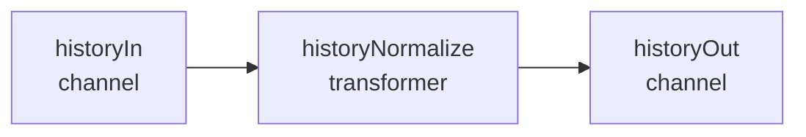
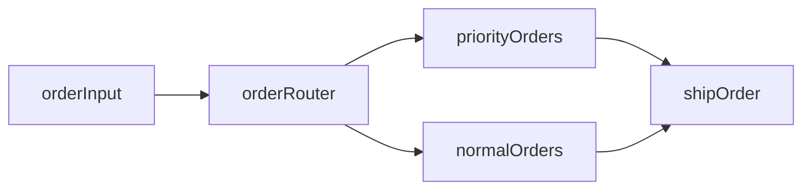

# history header — Theo dõi đường đi của thông điệp

## 1. Mục tiêu và bối cảnh

Trong chương **Message headers** của module **SPRING_INTEGRATION_CORE**, `history` giúp quan sát những thành phần Spring Integration mà một thông điệp đã đi qua. Kiến thức này nối cấu trúc `Message`, `MessageChannel`, endpoint và Java DSL với công việc tìm lỗi trong một luồng tích hợp thực tế.

Sau bài học, bạn có thể:

- Bật Message History và giới hạn các thành phần cần theo dõi.
- Đọc tên thành phần, loại thành phần và thời điểm ghi nhận từ header `history`.
- Tạo một flow Java DSL có lịch sử đường đi dễ kiểm tra.
- Tìm lịch sử của thông điệp gây lỗi thay vì chỉ nhìn thông điệp báo lỗi.
- Hiểu giới hạn khi có phân nhánh, xử lý bất đồng bộ và giao tiếp với hệ thống ngoài.

Ví dụ xuyên suốt là một luồng nhận mã đơn hàng, chuẩn hóa rồi đưa kết quả vào channel đầu ra. Khi đơn hàng không tới nơi mong đợi, câu hỏi đầu tiên là: **Thông điệp đã tới những điểm nào trong flow?**

## 2. `history` chứa điều gì?

`history` là header hạ tầng do cơ chế Message History của Spring Integration ghi nhận khi thông điệp đi qua các thành phần được chọn theo dõi. Nó nằm trong headers, không phải nội dung nghiệp vụ của payload. Việc bật theo dõi không yêu cầu bổ sung trường lịch sử vào đối tượng đơn hàng.

Giá trị header là `MessageHistory`, một kiểu triển khai `List<Properties>`. Mỗi phần tử biểu diễn một lần đi qua thành phần, thường gồm ba thuộc tính:

| Thuộc tính | Ý nghĩa | Ví dụ minh họa |
| --- | --- | --- |
| `name` | Tên thành phần được theo dõi | `historyNormalize` |
| `type` | Loại thành phần do framework cung cấp | `transformer` |
| `timestamp` | Thời điểm ghi nhận, biểu diễn bằng chuỗi số mili giây kể từ Unix epoch | `1730000000012` |

Dùng các hằng `MessageHistory.HEADER_NAME`, `NAME_PROPERTY`, `TYPE_PROPERTY`, `TIMESTAMP_PROPERTY` khi truy cập bằng Java để tránh gõ sai tên thuộc tính. `MessageHistory.read(message)` có thể trả về `null` khi không có header. Xem [API MessageHistory](https://docs.spring.io/spring-integration/api/org/springframework/integration/history/MessageHistory.html).

Dưới đây là **biểu diễn minh họa các phần tử**, không phải cam kết về định dạng của `history.toString()`:

```text
[
  {name=historyIn,        type=channel,     timestamp=1730000000000},
  {name=historyNormalize, type=transformer, timestamp=1730000000012},
  {name=historyOut,       type=channel,     timestamp=1730000000015}
]
```

Có thể đọc nó thành một đường đi:



Đường đi này cho biết những điểm đã được ghi nhận trong phạm vi theo dõi. Một entry của handler chưa chứng minh thao tác nghiệp vụ bên trong handler đã hoàn tất; thành phần có thể nhận thông điệp rồi ném exception. Tương tự, thấy channel đầu ra chưa đồng nghĩa một hệ thống bên ngoài đã ghi dữ liệu thành công.

## 3. Bật Message History và chọn phạm vi

### 3.1. Cấu hình bằng annotation

Trong ứng dụng cấu hình Java, có thể bật theo dõi các thành phần Spring Integration đủ điều kiện bằng:

```java
@Configuration
@EnableIntegration
@EnableMessageHistory
public class IntegrationConfiguration {
}
```

Các annotation tương ứng thuộc các package:

```java
import org.springframework.context.annotation.Configuration;
import org.springframework.integration.config.EnableIntegration;
import org.springframework.integration.config.EnableMessageHistory;
```

`@EnableMessageHistory` mặc định dùng pattern `*`. Đây là lựa chọn theo tên các thành phần Spring Integration, không phải cơ chế ghi nhận mọi bean, mọi phương thức hay mọi dòng lệnh Java. Trong một application context, tập trung cấu hình Message History tại một nơi. Xem [hướng dẫn Message History](https://docs.spring.io/spring-integration/reference/message-history.html).

### 3.2. Theo dõi có chọn lọc

Ví dụ chỉ theo dõi ba thành phần của luồng đang điều tra:

```java
@EnableMessageHistory({
    "historyIn",
    "historyNormalize",
    "historyOut"
})
```

Nếu nhiều thành phần cùng tuân theo quy ước đặt tên, có thể dùng pattern:

```java
@EnableMessageHistory({"order*", "*Gateway"})
```

`order*` chọn tên bắt đầu bằng `order`; `*Gateway` chọn tên kết thúc bằng `Gateway`. Đây là pattern tên thành phần, không phải biểu thức chính quy. Mỗi pattern là một phần tử riêng trong mảng annotation. Xem [API EnableMessageHistory](https://docs.spring.io/spring-integration/api/org/springframework/integration/config/EnableMessageHistory.html).

Trong ví dụ của bài, tên các bean được đặt tường minh để pattern và dữ liệu quan sát khớp nhau. Với DSL dùng lambda tạo handler tự động, hãy phân biệt tên endpoint với tên handler thực sự xuất hiện trong history. Phương thức `.id(...)` của endpoint cấu hình tên endpoint; cần kiểm tra tên thành phần được ghi nhận trước khi đặt pattern quá hẹp. Xem [DSL và cấu hình endpoint](https://docs.spring.io/spring-integration/reference/dsl/java-endpoints.html).

## 4. Ví dụ Java DSL hoàn chỉnh

### 4.1. Điều kiện chạy

Ví dụ dưới đây dùng Java 17 và Spring Integration 6.3.x làm mốc. Dự án cần có `spring-integration-core` cùng các dependency Spring tương thích. Nếu đã dùng Spring Boot với `spring-boot-starter-integration`, dùng phiên bản do dependency management của dự án quản lý.

Đoạn dependency sau áp dụng khi dự án đã quản lý phiên bản Spring Integration bằng BOM hoặc cấu hình tương đương:

```xml
<dependency>
    <groupId>org.springframework.integration</groupId>
    <artifactId>spring-integration-core</artifactId>
</dependency>
```

Dự án Spring thuần cần khai báo phiên bản phù hợp; không trộn các phiên bản Spring tùy ý. Bài học không yêu cầu HTTP, cơ sở dữ liệu hay message broker.

### 4.2. Cấu hình và chương trình chạy thử

Đặt lớp sau trong dự án Java đã có dependency nêu trên:

```java
import java.util.Locale;
import java.util.Properties;

import org.springframework.context.annotation.AnnotationConfigApplicationContext;
import org.springframework.context.annotation.Bean;
import org.springframework.context.annotation.Configuration;
import org.springframework.integration.channel.DirectChannel;
import org.springframework.integration.channel.QueueChannel;
import org.springframework.integration.config.EnableIntegration;
import org.springframework.integration.config.EnableMessageHistory;
import org.springframework.integration.dsl.IntegrationFlow;
import org.springframework.integration.history.MessageHistory;
import org.springframework.integration.transformer.MessageTransformingHandler;
import org.springframework.messaging.Message;
import org.springframework.messaging.MessageChannel;
import org.springframework.messaging.support.MessageBuilder;

@Configuration(proxyBeanMethods = false)
@EnableIntegration
@EnableMessageHistory({
    "historyIn",
    "historyNormalize",
    "historyOut"
})
public class HistoryHeaderExample {

    @Bean
    public DirectChannel historyIn() {
        return new DirectChannel();
    }

    @Bean
    public MessageTransformingHandler historyNormalize() {
        return new MessageTransformingHandler(message -> {
            String input = (String) message.getPayload();
            String normalized = input.trim().toUpperCase(Locale.ROOT);

            return MessageBuilder.withPayload(normalized)
                    .copyHeaders(message.getHeaders())
                    .build();
        });
    }

    @Bean
    public QueueChannel historyOut() {
        return new QueueChannel(10);
    }

    @Bean
    public IntegrationFlow historyFlow(
            DirectChannel historyIn,
            MessageTransformingHandler historyNormalize,
            QueueChannel historyOut) {

        return IntegrationFlow.from(historyIn)
                .handle(historyNormalize)
                .channel(historyOut)
                .get();
    }

    public static void main(String[] args) {
        try (var context = new AnnotationConfigApplicationContext(
                HistoryHeaderExample.class)) {

            Message<String> request = MessageBuilder
                    .withPayload("  order-009  ")
                    .setHeader("orderId", "O-009")
                    .build();

            MessageChannel input = context.getBean(
                    "historyIn", MessageChannel.class);

            if (!input.send(request, 1_000)) {
                throw new IllegalStateException("Không gửi được thông điệp");
            }

            QueueChannel output = context.getBean(
                    "historyOut", QueueChannel.class);
            Message<?> result = output.receive(1_000);

            if (result == null) {
                throw new IllegalStateException("Không nhận được kết quả");
            }

            System.out.println("payload=" + result.getPayload());
            System.out.println("orderId="
                    + result.getHeaders().get("orderId"));

            MessageHistory history = MessageHistory.read(result);
            if (history == null) {
                throw new IllegalStateException("Thiếu header history");
            }

            for (Properties entry : history) {
                System.out.printf("name=%s, type=%s, timestamp=%s%n",
                        entry.getProperty(MessageHistory.NAME_PROPERTY),
                        entry.getProperty(MessageHistory.TYPE_PROPERTY),
                        entry.getProperty(MessageHistory.TIMESTAMP_PROPERTY));
            }
        }
    }
}
```

`MessageTransformingHandler` là handler tạo reply bằng cách ủy quyền cho một `Transformer`. Việc khai báo handler thành bean riêng giúp ví dụ có tên thành phần ổn định là `historyNormalize`. Xem [API MessageTransformingHandler](https://docs.spring.io/spring-integration/api/org/springframework/integration/transformer/MessageTransformingHandler.html).

### 4.3. Điều cần quan sát

Kết quả nghiệp vụ mong đợi:

```text
payload=ORDER-009
orderId=O-009
```

Sau đó là các entry tương ứng với `historyIn`, `historyNormalize` và `historyOut`, theo thứ tự của flow này. Giá trị timestamp thực tế thay đổi mỗi lần chạy; nhiều entry có thể cùng timestamp vì các bước diễn ra trong cùng một mili giây.

Các chi tiết đáng chú ý:

1. `DirectChannel` đưa thông điệp tới handler trong luồng gọi hiện tại.
2. Transformer đổi payload và sao chép headers của thông điệp đầu vào, bao gồm `orderId` và `history` nếu đã có.
3. `QueueChannel` giữ kết quả để chương trình chủ động `receive(...)`; không cần poller vì ở đây không cấu hình một consumer tự động đọc queue.
4. Chương trình đọc history từ **kết quả thực tế** nhận ở đầu ra. Không dùng biến `request` ban đầu như thể nó chắc chắn chứa toàn bộ lịch sử sau xử lý.
5. Pattern chỉ chọn ba thành phần; các bean hạ tầng hoặc endpoint sinh tự động không làm thay đổi mục tiêu quan sát của ví dụ.

`receive(1_000)` giúp chương trình kết thúc với thông báo rõ ràng khi thiếu kết quả. Nó không bổ sung một entry biểu diễn thời gian chờ queue vào history.

## 5. Đọc history an toàn trong mã ứng dụng

Trong mã giám sát hoặc ghi log, thiếu history có thể là trạng thái hợp lệ: cấu hình đang tắt, tên không khớp pattern, hoặc thông điệp chưa đi qua thành phần nào được theo dõi.

```java
import java.util.List;

import org.springframework.integration.history.MessageHistory;
import org.springframework.messaging.Message;

public final class HistoryReader {

    private HistoryReader() {
    }

    public static List<String> componentNames(Message<?> message) {
        MessageHistory history = MessageHistory.read(message);
        if (history == null) {
            return List.of();
        }

        return history.stream()
                .map(entry -> entry.getProperty(
                        MessageHistory.NAME_PROPERTY))
                .toList();
    }
}
```

Cũng có thể đọc trực tiếp theo kiểu:

```java
MessageHistory history = message.getHeaders()
        .get(MessageHistory.HEADER_NAME, MessageHistory.class);
```

Không ép `history` thành `String` hoặc `List<String>`. Khi cần đưa thông tin vào log, hãy tạo biểu diễn riêng từ các entry. Cách này giúp bạn chọn trường cần ghi và không phụ thuộc cách triển khai `toString()`.

## 6. Bảo toàn header và hiểu đúng tính bất biến

### 6.1. Khi tạo thông điệp mới

Một đoạn mã tự xây thông điệp rồi gửi trực tiếp sang channel khác có thể làm đứt lịch sử nếu chỉ giữ payload:

```java
// Trong đoạn mã tự tạo và gửi Message độc lập:
Message<?> replacement = MessageBuilder
        .withPayload(newPayload)
        .build();

targetChannel.send(replacement);
```

`replacement` không kế thừa history của thông điệp cũ. Nếu mục đích là tiếp tục cùng một đường xử lý và không có yêu cầu loại bỏ header, hãy truyền những headers phù hợp:

```java
Message<?> replacement = MessageBuilder
        .withPayload(newPayload)
        .copyHeaders(original.getHeaders())
        .build();
```

Đây là ví dụ cho **mã tự tạo và gửi thông điệp**. Trong endpoint Spring Integration, cách kế thừa headers còn tùy loại handler, transformer và cấu hình header propagation. Không suy ra rằng mọi phương thức trả về payload mới đều làm mất history; hãy xem thông điệp tại đầu ra thực tế của thành phần.

Khi cấu hình loại bỏ hoặc không truyền một số header, kiểm tra xem `history` có nằm trong tập bị loại không. Framework có API kiểm soát header propagation trên các handler tạo output; xem [mã nguồn AbstractMessageProducingHandler](https://raw.githubusercontent.com/spring-projects/spring-integration/main/spring-integration-core/src/main/java/org/springframework/integration/handler/AbstractMessageProducingHandler.java).

### 6.2. Khác biệt trước và từ phiên bản 6.3

Trước Spring Integration 6.3, ghi thêm history tạo bản lịch sử mới cùng bản sao message. Từ 6.3, sau lần khởi tạo header, framework nối thêm entry vào container history hiện có để giảm việc tạo đối tượng. Vì thế, không mặc định rằng giữ một tham chiếu `MessageHistory` cũng là giữ một ảnh chụp cố định của thời điểm trước đó. Đây là thay đổi được mô tả trong [hướng dẫn Message History](https://docs.spring.io/spring-integration/reference/message-history.html).

Nếu cần lưu một ảnh chụp phục vụ log hoặc xử lý sau, chuyển dữ liệu cần thiết thành đối tượng riêng tại thời điểm quan sát, chẳng hạn danh sách chuỗi tên trong `HistoryReader.componentNames(...)`. Không sửa các `Properties` nhận từ history; coi dữ liệu lịch sử của framework là dữ liệu chỉ đọc trong mã nghiệp vụ.

Không dùng các thao tác như `history.add(...)`, `history.clear()` hay `history.set(...)` để chỉnh đường đi. API danh sách công khai không cho ứng dụng sửa bằng những thao tác này. Cơ chế framework ghi thêm entry qua `MessageHistory.write(...)` là chuyện riêng; xem [mã nguồn MessageHistory](https://raw.githubusercontent.com/spring-projects/spring-integration/main/spring-integration-core/src/main/java/org/springframework/integration/history/MessageHistory.java).

## 7. Dùng history để điều tra lỗi

### 7.1. Xác định đúng thông điệp cần xem

Giả sử flow xử lý đơn hàng gồm các bước:

```text
orderInput -> normalizeOrder -> validateOrder -> reserveStock -> orderOutput
```

Một đơn hàng lỗi tại `reserveStock`. Lịch sử của thông điệp gây lỗi giúp trả lời liệu nó đã qua `validateOrder` hay chưa. Nó không tự chỉ ra số lượng tồn kho, nội dung SQL hoặc kết quả giao dịch; những dữ liệu đó cần được quan sát ở tầng nghiệp vụ tương ứng.

Khi có `ErrorMessage`, hãy phân biệt:

- `errorMessage.getHeaders()` mô tả thông điệp báo lỗi đang đi trên flow xử lý lỗi.
- `MessagingException.getFailedMessage()` có thể cung cấp thông điệp gắn với lỗi.
- `ErrorMessage.getOriginalMessage()` có thể cung cấp thông điệp gốc tùy cách tạo lỗi.

Không bảo đảm các tham chiếu trên đều tồn tại hoặc chứa cùng một giai đoạn của flow. Cách xây `ErrorMessage` và `originalMessage` phụ thuộc error strategy; xem [hướng dẫn xử lý lỗi](https://docs.spring.io/spring-integration/reference/error-handling.html).

### 7.2. Hàm lấy thông điệp phục vụ chẩn đoán

Hàm sau ưu tiên failed message gần exception ngoài cùng, rồi tìm trong cause chain, cuối cùng dùng original message nếu có:

```java
import java.util.Collections;
import java.util.IdentityHashMap;
import java.util.Set;

import org.springframework.messaging.Message;
import org.springframework.messaging.MessagingException;
import org.springframework.messaging.support.ErrorMessage;

public final class FailedMessageReader {

    private FailedMessageReader() {
    }

    public static Message<?> find(ErrorMessage errorMessage) {
        Throwable current = errorMessage.getPayload();
        Set<Throwable> visited = Collections.newSetFromMap(
                new IdentityHashMap<Throwable, Boolean>());

        while (current != null && visited.add(current)) {
            if (current instanceof MessagingException messagingException) {
                Message<?> failed = messagingException.getFailedMessage();
                if (failed != null) {
                    return failed;
                }
            }
            current = current.getCause();
        }

        return errorMessage.getOriginalMessage();
    }
}
```

Tại nơi đã nhận được `ErrorMessage`, có thể dùng:

```java
Message<?> failed = FailedMessageReader.find(errorMessage);
if (failed != null) {
    System.out.println("failedRoute="
            + HistoryReader.componentNames(failed));
}
```

Hàm có thể trả về `null`; phía gọi cần xử lý trường hợp đó. Đây là hàm đọc dữ liệu đã có, không phải cấu hình đưa mọi exception vào `errorChannel`.

### 7.3. Đồng bộ và bất đồng bộ

Ví dụ `HistoryHeaderExample` gửi qua `DirectChannel`. Nếu transformer ném exception, phía gọi `send(...)` có thể nhận exception trong cùng call stack. Không mặc định chờ một `ErrorMessage` ở `errorChannel` cho trường hợp gửi trực tiếp này.

Với tác vụ bất đồng bộ do Spring Integration quản lý hoặc tác vụ poller, lỗi có thể được đưa thành thông điệp lỗi theo cơ chế xử lý lỗi đã cấu hình. Khi điều tra, cần xác định cả nơi nhận lỗi và thông điệp mà lỗi tham chiếu. Xem [phân biệt xử lý lỗi đồng bộ và bất đồng bộ](https://docs.spring.io/spring-integration/reference/error-handling.html).

## 8. Đọc timestamp mà không suy luận quá mức

Giả sử trích được ba mốc sau:

| Thành phần | Timestamp minh họa | Chênh lệch với mốc trước |
| --- | --- | --- |
| `orderInput` | `1730000000000` | — |
| `validateOrder` | `1730000000003` | `3 ms` |
| `reserveStock` | `1730000000123` | `120 ms` |

Khoảng `120 ms` gợi ý cần xem đoạn đường giữa hai lần ghi nhận. Nó không tự chứng minh `reserveStock` đã chạy trong `120 ms`. Khoảng đó có thể chứa thời gian xử lý ở bước trước, chờ chuyển giao, chờ queue, scheduling và những bước không được theo dõi.

Khi cần đo độ trễ của một thao tác, đặt phép đo bao quanh đúng thao tác đó hoặc dùng cơ chế metrics/observation phù hợp. Khi cần phân tích thời gian qua nhiều dịch vụ, dùng các mốc và thông tin trace có quy ước rõ ràng. History hữu ích để chọn vị trí cần quan sát sâu hơn.

Không viết kiểm thử buộc timestamp của mọi entry phải khác nhau. Độ phân giải mili giây và đồng hồ hệ thống không phù hợp để chứng minh thứ tự nhân quả tuyệt đối trong hệ thống phân tán.

## 9. Phân nhánh, splitter, router và aggregator

### 9.1. Lịch sử thuộc về đường xử lý của từng thông điệp

Xét flow giả định:



Với router chọn một nhánh theo mức ưu tiên, lịch sử của một đơn hàng cần phản ánh nhánh đã được chọn. Nếu thông điệp tới `normalOrders`, không suy diễn rằng nó cũng đã đi qua `priorityOrders` chỉ vì cả hai nhánh đều có trong cấu hình.

Với splitter hoặc publish-subscribe, một đầu vào có thể dẫn tới nhiều thông điệp hoặc nhiều nhánh. Khi đọc từng đầu ra, hãy xem đó là lịch sử của đường xử lý tương ứng, không phải một danh sách hợp nhất mọi hoạt động của toàn bộ flow.

Từ cơ chế history của 6.3, các thành phần phân nhánh chuẩn của framework có xử lý sao chép history để các nhánh có đường ghi nhận riêng. Nếu tự viết mã tạo nhiều đầu ra chạy song song, xem API `AbstractIntegrationMessageBuilder.cloneMessageHistoryIfAny()` của builder Spring Integration trước khi chia sẻ cùng một history container. Việc chỉ sao chép map headers không tạo một history container độc lập. Xem [quy tắc history khi phân nhánh](https://docs.spring.io/spring-integration/reference/message-history.html).

### 9.2. Trường hợp aggregator

Một đơn hàng được tách thành ba dòng hàng, rồi aggregator tạo một kết quả tổng hợp. Không mặc định history của kết quả tổng hợp là phép nối history của cả ba dòng hàng. Kết quả phụ thuộc cách aggregator tạo output và cách headers được chọn hoặc bảo toàn.

Muốn biết đầy đủ từng dòng đã được xử lý ra sao, hãy lưu thông tin quan sát của từng dòng và dùng định danh nghiệp vụ hoặc correlation để liên kết chúng. History ở một output không tự thay thế dữ liệu quan sát của toàn bộ nhóm.

## 10. Giới hạn ở biên hệ thống và chi phí vận hành

### 10.1. Qua HTTP, Kafka, AMQP hoặc lưu trữ

Trong một ứng dụng, `history` là một giá trị header Java. Khi đi qua adapter, gateway hoặc broker bên ngoài, việc giữ được header phụ thuộc header mapper, serializer, giao thức và cấu hình cụ thể.

Vì vậy, khi history dừng ở một biên tích hợp, cần kiểm tra hợp đồng truyền dữ liệu tại biên đó. Không suy ra dịch vụ bên nhận đã xử lý lỗi chỉ vì history phía sau không còn các entry phía trước.

Nếu cần theo dõi nhiều dịch vụ, chọn một mã nghiệp vụ hoặc cơ chế trace được truyền có chủ đích. Chỉ đưa những metadata phù hợp với hợp đồng tích hợp ra ngoài.

### 10.2. Chi phí tăng theo số entry và số thông điệp

Giả sử một đường đi có 25 thành phần được theo dõi. Khi chuyển từ 2.000 sang 20.000 thông điệp mỗi giây, số entry cần tạo tăng từ khoảng 50.000 lên 500.000 mỗi giây, chưa tính phân nhánh và retry. Đây là phép ước lượng số entry, không phải phép đo bộ nhớ của một entry.

Với queue hoặc nhóm aggregation giữ nhiều thông điệp, history cũng được giữ cùng chúng. Một vòng lặp gửi thông điệp trở lại flow có thể làm history dài thêm. Chiến lược hợp lý là chọn các điểm có ý nghĩa chẩn đoán, đặt tên rõ ràng và đo tác động bằng lưu lượng đại diện.

### 10.3. Phân biệt các loại metadata

| Dữ liệu | Câu hỏi nó giúp trả lời |
| --- | --- |
| `history` | Thông điệp đã đi qua những thành phần nào được theo dõi? |
| `correlationId` | Những thông điệp nào thuộc cùng một nhóm tương quan? |
| `sequenceNumber`, `sequenceSize` | Vị trí và kích thước chuỗi thông điệp là gì? |
| `errorChannel` | Trong cơ chế xử lý lỗi tương ứng, lỗi được gửi về đâu? |
| Mã đơn hàng hoặc request ID | Thao tác nghiệp vụ nào đang được xử lý? |
| Dữ liệu trace/span | Các thao tác được liên kết và quan sát qua những ranh giới nào? |

Không dùng lịch sử các tên thành phần làm khóa tương quan hoặc khóa chống xử lý trùng. Việc đổi cấu hình flow có thể đổi lịch sử trong khi mã đơn hàng vẫn giữ nguyên.

## 11. Kiểm thử hành vi history của flow mẫu

Kiểm thử nên chứng minh hai việc song song: kết quả nghiệp vụ đúng và history chứa các điểm quan sát đã chủ động cấu hình. Không cần cố định timestamp hay mọi tên bean hạ tầng sinh tự động.

Ví dụ JUnit 5 dưới đây dùng lại `HistoryHeaderExample` và `HistoryReader`:

```java
import static org.junit.jupiter.api.Assertions.assertEquals;
import static org.junit.jupiter.api.Assertions.assertNotNull;
import static org.junit.jupiter.api.Assertions.assertTrue;

import java.util.List;

import org.junit.jupiter.api.Test;
import org.springframework.context.annotation.AnnotationConfigApplicationContext;
import org.springframework.integration.channel.QueueChannel;
import org.springframework.messaging.Message;
import org.springframework.messaging.MessageChannel;
import org.springframework.messaging.support.MessageBuilder;

class HistoryHeaderExampleTest {

    @Test
    void recordsTheConfiguredRouteAndPreservesBusinessHeaders() {
        try (var context = new AnnotationConfigApplicationContext(
                HistoryHeaderExample.class)) {

            MessageChannel input = context.getBean(
                    "historyIn", MessageChannel.class);
            QueueChannel output = context.getBean(
                    "historyOut", QueueChannel.class);

            Message<String> request = MessageBuilder
                    .withPayload("  order-009  ")
                    .setHeader("orderId", "O-009")
                    .build();

            assertTrue(input.send(request, 1_000));
            Message<?> result = output.receive(1_000);
            assertNotNull(result);
            assertEquals("ORDER-009", result.getPayload());
            assertEquals("O-009", result.getHeaders().get("orderId"));

            List<String> names = HistoryReader.componentNames(result);
            int inputIndex = names.indexOf("historyIn");
            int normalizeIndex = names.indexOf("historyNormalize");
            int outputIndex = names.indexOf("historyOut");

            assertTrue(inputIndex >= 0, names.toString());
            assertTrue(normalizeIndex > inputIndex, names.toString());
            assertTrue(outputIndex > normalizeIndex, names.toString());
        }
    }
}
```

Kiểm thử kiểm tra thứ tự các điểm quan trọng, thay vì buộc danh sách phải có đúng một số phần tử cố định trong mọi cấu hình tương lai. Với flow phân nhánh, bổ sung kiểm thử riêng cho từng nhánh và kiểm tra tên nhánh mong đợi tại output của nhánh đó.

Để kiểm tra cấu hình không bật history, dùng một application context riêng không có `@EnableMessageHistory` và gửi một thông điệp mới không mang sẵn header này. Nếu đầu vào đã mang history từ trước, việc không bật tracking không tự xóa header đó.

## 12. Các tình huống dễ gây hiểu nhầm

| Hiện tượng | Hướng kiểm tra |
| --- | --- |
| Không thấy `history` | Cấu hình đã được nạp chưa, tên có khớp pattern không, đang đọc thông điệp ở giai đoạn nào? |
| Thiếu một bước trong danh sách | Bước đó có phải thành phần được theo dõi không, hay chỉ là lời gọi Java bên trong một handler? |
| Chỉ thấy tên sinh tự động | Đặt tên channel/handler có ý nghĩa và kiểm tra tên component trước khi chọn pattern. |
| History dừng sau transformer tùy chỉnh | Kiểm tra output message, việc tạo message mới và cách truyền headers. |
| Có entry của handler nhưng tác vụ thất bại | Xem failed message và exception; entry không phải chứng nhận xử lý thành công. |
| History của flow lỗi khác flow chính | Phân biệt headers của `ErrorMessage` với failed/original message. |
| Hai nhánh có lịch sử lẫn nhau trong mã tự viết | Kiểm tra việc dùng chung history container khi tự fan-out, đặc biệt từ 6.3. |
| Thiếu entry sau khi gọi dịch vụ ngoài | Kiểm tra mapper, serializer và hợp đồng metadata ở biên hệ thống. |
| Timestamp trùng nhau | Không suy ra mất entry; nhiều lần ghi nhận có thể diễn ra trong cùng mili giây. |
| History kéo dài bất thường | Tìm vòng lặp, retry có đi lại qua flow hay không, và phạm vi tracking quá rộng. |

## 13. Thực hành có hướng dẫn

Thực hiện trên flow mẫu theo thứ tự sau:

1. Chạy ví dụ với payload `"  order-009  "`, xác nhận kết quả `ORDER-009`, header `orderId` và ba tên thành phần quan trọng.
2. Đổi cấu hình thành `@EnableMessageHistory({"historyIn", "historyOut"})`, tạo lại application context và gửi thông điệp mới. Kết quả nghiệp vụ giữ nguyên, còn lịch sử không ghi nhận transformer ở giữa.
3. Đổi tên bean transformer và cập nhật cả nơi sử dụng nó. Giữ pattern cũ để quan sát việc thiếu entry, sau đó sửa pattern cho khớp tên mới.
4. Trong transformer, chủ động ném `IllegalArgumentException` với một payload nhất định. Bắt exception tại phía gọi `send(...)`, tìm `MessagingException` có failed message trong cause chain và đọc history của failed message đó.
5. Tạo thêm một nhánh xử lý đơn ưu tiên. Với mỗi đầu ra, kiểm tra các điểm quan sát phù hợp với nhánh đã chọn; không dùng một history để kết luận về mọi nhánh.

Sản phẩm thực hành cần cho thấy sự liên hệ giữa **cấu hình chọn thành phần**, **đường đi thực tế** và **thông điệp được quan sát**. Khi ba yếu tố này khớp nhau, `history` trở thành công cụ chẩn đoán hữu ích mà không buộc logic nghiệp vụ phải biết cấu trúc toàn bộ flow.
