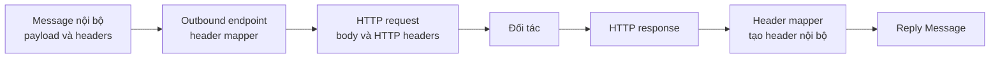

# Header mapper trong Spring Integration

Trong chương **Message headers** của module **SPRING_INTEGRATION_CORE**, header mapper giúp kiểm soát metadata khi thông điệp đi qua biên giao tiếp: từ một `Message<?>` trong ứng dụng sang HTTP request, JMS message hoặc AMQP message, rồi theo chiều ngược lại.

Một luồng có thể chạy đúng transformer, router và service activator nhưng vẫn tích hợp sai nếu mất mã yêu cầu, đổi kiểu correlation ID hoặc đưa header nội bộ sang hệ thống đối tác. Học header mapper là học cách biến các header được phép trao đổi thành một hợp đồng rõ ràng.

## 1. Mục tiêu và kiến thức cần có

Sau bài học, bạn có thể:

- Giải thích trách nhiệm của header mapper và vị trí của nó trong adapter/gateway.
- Phân biệt chiều `fromHeaders`, `toHeaders` với chiều request/reply.
- Cấu hình `DefaultHttpHeaderMapper` và gắn nó vào Java DSL.
- Viết mapper tùy chỉnh khi cần đổi tên, chuẩn hóa kiểu hoặc kiểm tra giá trị.
- Thiết kế kiểm thử để phát hiện header bị mất, bị rò rỉ hoặc bị chuyển đổi sai.

Bạn nên biết `Message<T>` gồm payload và headers, `MessageChannel` vận chuyển message, endpoint xử lý message, và gateway cung cấp điểm gọi request/reply.

Các ví dụ sử dụng Java DSL với `IntegrationFlow`, HTTP support và JUnit Jupiter. Khi đưa vào dự án, dùng các phiên bản Spring do cùng một Spring Boot BOM hoặc Spring Integration BOM quản lý; không chọn phiên bản riêng lẻ cho từng thư viện.

## 2. Vấn đề thực tế: message nội bộ khác thông điệp trên giao thức

Giả sử dịch vụ đặt hàng tạo message:

```text
payload:
  {"orderId":"O-1001"}

headers:
  requestId    = "req-42"
  tenantId     = "tenant-a"
  retryAttempt = Integer(2)
  replyChannel = đối tượng MessageChannel trong ứng dụng
  internalNote = "pricing-cache-hit"
```

Đối tác nhận HTTP yêu cầu hợp đồng:

```http
POST /partner/orders HTTP/1.1
Content-Type: application/json
X-Request-Id: req-42
X-Tenant-Id: tenant-a
X-Retry-Attempt: 2

{"orderId":"O-1001"}
```

Hai mô hình khác nhau ở cả tên và kiểu:

- `requestId` phải trở thành `X-Request-Id`.
- `retryAttempt` là `Integer` trong ứng dụng nhưng được biểu diễn bằng chuỗi trên HTTP.
- `replyChannel` có ý nghĩa trong tiến trình hiện tại, không phải địa chỉ phản hồi mà đối tác có thể sử dụng.
- `internalNote` phục vụ xử lý nội bộ, không nằm trong hợp đồng trao đổi.

Header mapper là nơi thích hợp để thực hiện phần ánh xạ metadata này. Việc chuyển JSON thành đối tượng Java hoặc ngược lại thuộc phần xử lý payload.



Trong tình huống này, tên header trên HTTP là quyết định của hợp đồng đối tác. Tiền tố `X-` không phải điều kiện bắt buộc để tạo custom HTTP header.

## 3. Hợp đồng `HeaderMapper<T>`

Spring Integration cung cấp interface:

```java
package org.springframework.integration.mapping;

import java.util.Map;
import org.springframework.messaging.MessageHeaders;

public interface HeaderMapper<T> {

    void fromHeaders(MessageHeaders headers, T target);

    Map<String, Object> toHeaders(T source);
}
```

`T` là kiểu dữ liệu chứa metadata ở phía giao thức. Ví dụ, mapper HTTP sử dụng `HttpHeaders`. Hai phương thức được đặt tên theo `MessageHeaders`: `fromHeaders` đi **từ header nội bộ**, còn `toHeaders` đi **về header nội bộ**. [API HeaderMapper](https://docs.spring.io/spring-integration/api/org/springframework/integration/mapping/HeaderMapper.html)

| Phương thức | Nguồn | Đích | Công việc thường gặp |
| --- | --- | --- | --- |
| `fromHeaders(headers, target)` | `MessageHeaders` | Đối tượng metadata giao thức | Chọn header, đổi tên, chuyển kiểu để gửi đi |
| `toHeaders(source)` | Đối tượng metadata giao thức | `Map<String, Object>` | Đọc metadata, chuẩn hóa để tạo message nội bộ |

`fromHeaders` ghi vào đối tượng `target` được truyền vào. `toHeaders` trả về map để thành phần gọi sử dụng khi xây dựng message; nó không tự tạo payload hay gửi message vào channel.

Trong một ứng dụng Spring thông thường, hãy xem message đã được chuyển giao là bất biến. Khi cần thêm hoặc thay header, dùng builder để tạo message phù hợp; đừng dùng mapper để sửa trực tiếp map header của message đầu vào.

### 3.1. Mapper không tự chạy chỉ vì đã khai báo bean

Một bean triển khai `HeaderMapper<?>` chỉ trở thành thành phần của luồng khi adapter/gateway hoặc mã xử lý gọi nó.

Ví dụ HTTP Java DSL sử dụng `.headerMapper(mapper)` trên endpoint HTTP. Gửi message qua một `DirectChannel` thông thường không tự kích hoạt header mapper.

### 3.2. Phân biệt với các thành phần gần giống

| Thành phần | Trách nhiệm chính | Ví dụ |
| --- | --- | --- |
| Header enricher | Bổ sung hoặc thay header trong message nội bộ | Tính `tenantId` từ ngữ cảnh nghiệp vụ |
| Header filter | Loại bỏ header khỏi message nội bộ | Xóa một header tạm trước bước tiếp theo |
| Header mapper | Ánh xạ metadata tại biên giao thức | `requestId` sang `X-Request-Id` |
| Payload transformer/converter | Chuyển đổi phần dữ liệu | Đối tượng đơn hàng sang JSON |
| Router | Quyết định tuyến xử lý | Chọn flow theo tenant hoặc loại sự kiện |

Chẳng hạn, enricher có thể tạo `requestId`, còn mapper xuất giá trị đó sang HTTP. Hai bước giải quyết hai công việc khác nhau.

## 4. Phân biệt inbound/outbound với request/reply

Một HTTP outbound gateway vừa gửi request ra ngoài vừa nhận response trở lại. Vì vậy, từ “outbound” trong tên gateway không có nghĩa là mapper chỉ thực hiện chiều gửi.

| Vai trò endpoint HTTP | Chặng giao tiếp | Phương thức mapper |
| --- | --- | --- |
| Inbound gateway: ứng dụng nhận lời gọi | HTTP request vào ứng dụng | `toHeaders` |
| Inbound gateway: ứng dụng trả kết quả | Message nội bộ thành HTTP response | `fromHeaders` |
| Outbound gateway: ứng dụng gọi đối tác | Message nội bộ thành HTTP request | `fromHeaders` |
| Outbound gateway: ứng dụng nhận kết quả | HTTP response thành message nội bộ | `toHeaders` |

Với `DefaultHttpHeaderMapper`, `setOutboundHeaderNames(...)` chọn tên header đi từ message sang HTTP; `setInboundHeaderNames(...)` chọn tên header đi từ HTTP về message. Các factory `outboundMapper()` và `inboundMapper()` thiết lập mặc định theo vai trò endpoint. [API DefaultHttpHeaderMapper](https://docs.spring.io/spring-integration/api/org/springframework/integration/http/support/DefaultHttpHeaderMapper.html)

Cách tự kiểm tra chiều ánh xạ là mô tả điểm đầu và điểm cuối bằng kiểu dữ liệu: “từ `MessageHeaders` sang `HttpHeaders`” rõ ràng hơn “header đầu ra”, nhất là khi gateway có cả request và reply.

## 5. Thiết kế hợp đồng header trước khi cấu hình

Với luồng đặt hàng, có thể định nghĩa hợp đồng:

| Header nghiệp vụ | Kiểu nội bộ | Biểu diễn bên ngoài | Chính sách |
| --- | --- | --- | --- |
| `requestId` | `String` | `X-Request-Id` | Dùng để đối chiếu yêu cầu; giới hạn độ dài |
| `tenantId` | `String` | `X-Tenant-Id` | Chỉ xuất giá trị đã xác định từ nguồn tin cậy |
| `retryAttempt` | `Integer` | `X-Retry-Attempt` dạng chuỗi | Không nhận số âm hoặc vượt giới hạn |
| `contentType` | Kiểu media phù hợp | `Content-Type` | Phải phù hợp với body và converter |
| `replyChannel`, `errorChannel` | Tham chiếu hoặc tên channel | Không thuộc hợp đồng đối tác | Giữ ở phạm vi xử lý nội bộ |
| `internalNote` | `String` | Không xuất | Chỉ dùng cho chẩn đoán nội bộ |

Ngoài tên và kiểu, hãy xác định:

1. Header có bắt buộc hay không.
2. Nguồn nào được phép cung cấp hoặc ghi đè nó.
3. Thiếu hoặc sai giá trị thì bỏ qua, dùng giá trị mặc định hay báo lỗi.
4. Header nhiều giá trị có hợp lệ không.
5. Chiều reply có dùng cùng hợp đồng với chiều request không.

### 5.1. ID kỹ thuật và correlation nghiệp vụ

`MessageHeaders.ID` xác định một message instance. `MessageHeaders.TIMESTAMP` thể hiện thời điểm tạo message. `replyChannel` và `errorChannel` phục vụ định tuyến phản hồi/lỗi trong hệ thống messaging. [Mô hình Message và các header định sẵn](https://docs.spring.io/spring-integration/reference/message.html)

Để đối chiếu một quy trình qua nhiều dịch vụ, nên thiết kế mã yêu cầu hoặc correlation ID nghiệp vụ rõ ràng. Đừng dùng tính bằng nhau của mọi `MessageHeaders.ID` qua các lần tạo message làm điều kiện thành công.

Nếu dùng aggregator, cần bảo toàn những giá trị mà correlation strategy và release strategy thực sự đọc. Một header tên `X-Request-Id` chỉ giúp gom nhóm khi flow chủ động sử dụng hoặc ánh xạ nó thành khóa gom nhóm.

## 6. Cấu hình mapper HTTP mặc định bằng Java DSL

Ví dụ đầu tiên giữ cùng tên custom header trong message nội bộ và trên HTTP. Chỉ khi cần đổi tên như `requestId` sang `X-Request-Id` mới dùng mapper tùy chỉnh ở phần sau.

Cần các dependency `org.springframework.integration:spring-integration-core` và `org.springframework.integration:spring-integration-http`. Các lớp ví dụ đặt trong package `example.integration`.

### 6.1. Bean mapper và integration flow

```java
package example.integration;

import org.springframework.context.annotation.Bean;
import org.springframework.context.annotation.Configuration;
import org.springframework.http.HttpHeaders;
import org.springframework.http.HttpMethod;
import org.springframework.integration.annotation.IntegrationComponentScan;
import org.springframework.integration.config.EnableIntegration;
import org.springframework.integration.dsl.IntegrationFlow;
import org.springframework.integration.http.dsl.Http;
import org.springframework.integration.http.support.DefaultHttpHeaderMapper;

@Configuration
@EnableIntegration
@IntegrationComponentScan(basePackageClasses = PartnerGateway.class)
public class PartnerHttpConfiguration {

    @Bean
    public DefaultHttpHeaderMapper partnerHeaderMapper() {
        DefaultHttpHeaderMapper mapper =
                DefaultHttpHeaderMapper.outboundMapper();

        mapper.setUserDefinedHeaderPrefix("");

        mapper.setOutboundHeaderNames(
                HttpHeaders.CONTENT_TYPE,
                HttpHeaders.ACCEPT,
                "X-Request-Id",
                "X-Tenant-Id");

        mapper.setInboundHeaderNames(
                HttpHeaders.CONTENT_TYPE,
                "X-Request-Id");

        return mapper;
    }

    @Bean
    public IntegrationFlow partnerOrderFlow(
            DefaultHttpHeaderMapper partnerHeaderMapper) {

        return IntegrationFlow.from("partnerRequests")
                .handle(Http.outboundGateway(
                                "http://localhost:8081/partner/orders")
                        .httpMethod(HttpMethod.POST)
                        .expectedResponseType(String.class)
                        .headerMapper(partnerHeaderMapper))
                .get();
    }
}
```

`.headerMapper(...)` gắn mapper vào HTTP handler. DSL cũng có cấu hình tên header request/response, nhưng trong ví dụ này toàn bộ chính sách ánh xạ nằm ở bean mapper. [API cấu hình HTTP handler trong Java DSL](https://docs.spring.io/spring-integration/api/org/springframework/integration/http/dsl/BaseHttpMessageHandlerSpec.html)

Các danh sách tên được cấu hình rõ ràng sẽ thay thế lựa chọn mặc định tương ứng. Spring hỗ trợ pattern đơn giản với `*` và các nhóm `HTTP_REQUEST_HEADERS`, `HTTP_RESPONSE_HEADERS` nếu cần giữ nhóm header chuẩn. `setUserDefinedHeaderPrefix("")` làm rõ rằng ví dụ giữ nguyên tên custom header. [Cấu hình ánh xạ HTTP header](https://docs.spring.io/spring-integration/reference/http/header-mapping.html)

Ở đây ta chỉ cho phép bốn tên trên chiều request và hai tên trên chiều response. Nếu đối tác cần thêm header, hãy bổ sung theo hợp đồng thay vì đổi ngay sang `*`.

Danh sách này kiểm soát header do mapper sao chép từ message. HTTP client, converter và tầng giao thức vẫn có thể tạo các header như `Host` hoặc `Content-Length` để gửi request hợp lệ.

### 6.2. Messaging gateway để gọi flow

```java
package example.integration;

import org.springframework.integration.annotation.MessagingGateway;
import org.springframework.messaging.Message;

@MessagingGateway(defaultRequestChannel = "partnerRequests")
public interface PartnerGateway {

    Message<?> exchange(Message<String> request);
}
```

Một bean nghiệp vụ có thể inject `PartnerGateway` và gọi:

```java
import example.integration.PartnerGateway;
import org.springframework.http.HttpHeaders;
import org.springframework.http.MediaType;
import org.springframework.messaging.Message;
import org.springframework.messaging.MessageHeaders;
import org.springframework.messaging.support.MessageBuilder;

// gateway được inject vào bean nghiệp vụ.
Message<String> request = MessageBuilder
        .withPayload("{\"orderId\":\"O-1001\"}")
        .setHeader(MessageHeaders.CONTENT_TYPE, MediaType.APPLICATION_JSON)
        .setHeader(HttpHeaders.ACCEPT, "application/json")
        .setHeader("X-Request-Id", "req-42")
        .setHeader("X-Tenant-Id", "tenant-a")
        .setHeader("internalNote", "pricing-cache-hit")
        .build();

Message<?> reply = gateway.exchange(request);
```

Kết quả cần quan sát ở request HTTP là `X-Request-Id` và `X-Tenant-Id` được gửi, còn `internalNote` không được mapper sao chép.

Tên `contentType` của Spring Messaging và `Content-Type` trên HTTP có quy ước ánh xạ của mapper chuẩn. Đừng suy ra rằng mapper cũng tự biết đổi mọi tên nghiệp vụ, chẳng hạn `requestId` thành `X-Request-Id`.

URL localhost phục vụ thực hành; cần có một HTTP stub hoặc dịch vụ đối tác đang lắng nghe. Gateway có trả lời không chỉ phụ thuộc mapper mà còn phụ thuộc endpoint, mã trạng thái HTTP và cấu hình client.

### 6.3. Header còn trong reply chưa chứng minh nó đã đi qua mạng

Trong nhiều flow request/reply, một số header của request nội bộ có thể được giữ khi tạo reply. Vì vậy, thấy `internalNote` trong reply message không đủ để kết luận nó đã được xuất sang HTTP hoặc được đối tác trả về.

Khi kiểm tra rò rỉ header, hãy xem HTTP request thực tế mà stub nhận được. Khi kiểm tra chiều nhận, hãy xem map mà `toHeaders` tạo ra hoặc các header đã được endpoint đưa vào reply theo cấu hình cụ thể.

## 7. Khi nào cần mapper tùy chỉnh?

Mapper mặc định thường đủ nếu yêu cầu chỉ là chọn những header được trao đổi.

Mapper tùy chỉnh phù hợp khi hợp đồng cần:

- Đổi tên giữa mô hình nội bộ và mô hình giao thức.
- Chuyển đổi có kiểm soát, chẳng hạn `Integer` sang chuỗi thập phân.
- Từ chối giá trị sai định dạng trước khi gửi.
- Quyết định rõ cách xử lý header trùng hoặc nhiều giá trị.

Đừng đưa tra cứu cơ sở dữ liệu hoặc gọi API khác vào mapper. Những thao tác đó thuộc endpoint xử lý hoặc enricher để dễ kiểm thử, theo dõi lỗi và kiểm soát độ trễ.

Ví dụ tiếp theo minh họa hai header:

| Nội bộ | HTTP | Quy tắc của ví dụ |
| --- | --- | --- |
| `requestId` | `X-Request-Id` | 1–64 ký tự chữ/số, dấu chấm, gạch dưới, gạch ngang; ký tự đầu là chữ/số |
| `retryAttempt` | `X-Retry-Attempt` | Nội bộ là `Integer` từ 0 đến 5; HTTP là một chữ số tương ứng |

Cả hai header đều tùy chọn trong ví dụ. Nếu nghiệp vụ bắt buộc có `requestId`, hãy kiểm tra sự hiện diện ở bước validation hoặc sửa hợp đồng mapper một cách rõ ràng.

## 8. Viết mapper tùy chỉnh và giữ xử lý HTTP chuẩn

```java
package example.integration;

import java.util.HashMap;
import java.util.List;
import java.util.Map;

import org.springframework.http.HttpHeaders;
import org.springframework.integration.http.support.DefaultHttpHeaderMapper;
import org.springframework.integration.mapping.HeaderMapper;
import org.springframework.messaging.MessageHeaders;

public final class BusinessHttpHeaderMapper
        implements HeaderMapper<HttpHeaders> {

    private static final String REQUEST_ID = "X-Request-Id";
    private static final String RETRY_ATTEMPT = "X-Retry-Attempt";

    private final DefaultHttpHeaderMapper delegate;

    public BusinessHttpHeaderMapper() {
        this.delegate = DefaultHttpHeaderMapper.outboundMapper();
        this.delegate.setUserDefinedHeaderPrefix("");
        this.delegate.setOutboundHeaderNames(
                HttpHeaders.CONTENT_TYPE, HttpHeaders.ACCEPT);
        this.delegate.setInboundHeaderNames(HttpHeaders.CONTENT_TYPE);
    }

    @Override
    public void fromHeaders(MessageHeaders headers, HttpHeaders target) {
        String requestId = checkedRequestId(headers.get("requestId"));
        Integer retryAttempt = checkedAttempt(headers.get("retryAttempt"));

        this.delegate.fromHeaders(headers, target);

        if (requestId != null) {
            target.set(REQUEST_ID, requestId);
        }
        if (retryAttempt != null) {
            target.set(RETRY_ATTEMPT, retryAttempt.toString());
        }
    }

    @Override
    public Map<String, Object> toHeaders(HttpHeaders source) {
        String requestId = checkedRequestId(singleValue(source, REQUEST_ID));
        String retryText = singleValue(source, RETRY_ATTEMPT);

        Integer retryAttempt = null;
        if (retryText != null) {
            if (!retryText.matches("[0-5]")) {
                throw new IllegalArgumentException(
                        "X-Retry-Attempt must be one digit from 0 to 5");
            }
            retryAttempt = Integer.valueOf(retryText);
        }

        Map<String, Object> result =
                new HashMap<>(this.delegate.toHeaders(source));

        if (requestId != null) {
            result.put("requestId", requestId);
        }
        if (retryAttempt != null) {
            result.put("retryAttempt", retryAttempt);
        }
        return result;
    }

    private static String checkedRequestId(Object value) {
        if (value == null) {
            return null;
        }
        if (!(value instanceof String text)
                || !text.matches("[A-Za-z0-9][A-Za-z0-9._-]{0,63}")) {
            throw new IllegalArgumentException("Invalid requestId");
        }
        return text;
    }

    private static Integer checkedAttempt(Object value) {
        if (value == null) {
            return null;
        }
        if (!(value instanceof Integer attempt)
                || attempt < 0 || attempt > 5) {
            throw new IllegalArgumentException(
                    "retryAttempt must be an Integer from 0 to 5");
        }
        return attempt;
    }

    private static String singleValue(HttpHeaders source, String name) {
        List<String> values = source.get(name);
        if (values == null) {
            return null;
        }
        if (values.size() != 1) {
            throw new IllegalArgumentException(
                    name + " must have exactly one value");
        }
        return values.get(0);
    }
}
```

Điểm cần chú ý trong thiết kế:

1. Mapper chỉ có cấu hình cố định; không giữ `requestId` hay bộ đếm của từng message trong field dùng chung.
2. Chiều gửi kiểm tra kiểu trước khi chuyển thành chuỗi, tránh biến mọi object thành một giá trị “có vẻ hợp lệ” bằng `toString()`.
3. Chiều nhận từ chối nhiều giá trị cho các header mà hợp đồng quy định là đơn trị.
4. Delegate chỉ xử lý tập header HTTP chuẩn đã chọn; mapper tự xử lý việc đổi tên nghiệp vụ.
5. Lỗi định dạng không ghi nguyên giá trị đầu vào vào thông báo lỗi.

`retryAttempt` trong ví dụ là metadata do ứng dụng định nghĩa. Việc tăng hoặc kiểm tra header này không tự cài đặt retry và không thay thế cấu hình retry của endpoint.

Để sử dụng mapper này, **thay thế** bean `partnerHeaderMapper` ở ví dụ trước:

```java
@Bean
public BusinessHttpHeaderMapper partnerHeaderMapper() {
    return new BusinessHttpHeaderMapper();
}
```

Đồng thời đổi kiểu tham số của flow từ `DefaultHttpHeaderMapper` sang `BusinessHttpHeaderMapper`. Lời gọi `.headerMapper(partnerHeaderMapper)` giữ nguyên.

Message gửi đi lúc này phải dùng tên nội bộ `requestId` và `retryAttempt`:

```java
Message<String> request = MessageBuilder
        .withPayload("{\"orderId\":\"O-1001\"}")
        .setHeader(MessageHeaders.CONTENT_TYPE, MediaType.APPLICATION_JSON)
        .setHeader("requestId", "req-42")
        .setHeader("retryAttempt", 2)
        .setHeader("internalNote", "pricing-cache-hit")
        .build();
```

Mapper minh họa chưa xuất `tenantId`. Nếu hợp đồng đối tác yêu cầu header đó, bổ sung ánh xạ và kiểm thử tương ứng; không giả định rằng header sẽ được chuyển tiếp chỉ vì đã tồn tại trong message.

Với outbound gateway, `toHeaders` của lớp trên áp dụng cho **response của đối tác**. Nó chỉ tạo `retryAttempt` từ response nếu response thực sự chứa `X-Retry-Attempt`.

## 9. Kiểm thử hợp đồng ánh xạ

Kiểm thử nên chứng minh hành vi ở cả hai chiều và khả năng từ chối dữ liệu sai. Một mapper có thể xuất đúng request nhưng nhập sai kiểu dữ liệu trong response.

### 9.1. Kiểm thử đơn vị cho mapper tùy chỉnh

Lớp sau dùng JUnit Jupiter, không cần khởi động Spring context hay HTTP server:

```java
package example.integration;

import java.util.Map;

import org.junit.jupiter.api.Test;
import org.springframework.http.HttpHeaders;
import org.springframework.integration.channel.DirectChannel;
import org.springframework.messaging.Message;
import org.springframework.messaging.MessageHeaders;
import org.springframework.messaging.support.MessageBuilder;

import static org.junit.jupiter.api.Assertions.*;

class BusinessHttpHeaderMapperTest {

    private final BusinessHttpHeaderMapper mapper =
            new BusinessHttpHeaderMapper();

    @Test
    void exportsBusinessHeadersAndExcludesInternalHeaders() {
        Message<String> message = MessageBuilder.withPayload("body")
                .setHeader("requestId", "req-42")
                .setHeader("retryAttempt", 2)
                .setHeader("internalNote", "do-not-export")
                .setReplyChannel(new DirectChannel())
                .build();

        HttpHeaders target = new HttpHeaders();

        mapper.fromHeaders(message.getHeaders(), target);

        assertEquals("req-42", target.getFirst("X-Request-Id"));
        assertEquals("2", target.getFirst("X-Retry-Attempt"));
        assertFalse(target.containsKey("requestId"));
        assertFalse(target.containsKey("retryAttempt"));
        assertFalse(target.containsKey("internalNote"));
        assertFalse(target.containsKey(MessageHeaders.REPLY_CHANNEL));
        assertFalse(target.containsKey(MessageHeaders.ID));
        assertFalse(target.containsKey(MessageHeaders.TIMESTAMP));
    }

    @Test
    void importsOnlyAllowedHeadersAndRestoresIntegerType() {
        HttpHeaders source = new HttpHeaders();
        source.set("X-Request-Id", "req-42");
        source.set("X-Retry-Attempt", "2");
        source.set("internalNote", "untrusted-value");

        Map<String, Object> headers = mapper.toHeaders(source);

        assertEquals("req-42", headers.get("requestId"));
        assertEquals(Integer.valueOf(2), headers.get("retryAttempt"));
        assertFalse(headers.containsKey("internalNote"));
        assertFalse(headers.containsKey("X-Retry-Attempt"));
    }

    @Test
    void rejectsUnexpectedInternalType() {
        Message<String> message = MessageBuilder.withPayload("body")
                .setHeader("retryAttempt", "2")
                .build();

        assertThrows(IllegalArgumentException.class,
                () -> mapper.fromHeaders(
                        message.getHeaders(), new HttpHeaders()));
    }

    @Test
    void rejectsInvalidOrRepeatedExternalValues() {
        HttpHeaders invalid = new HttpHeaders();
        invalid.set("X-Retry-Attempt", "99");

        assertThrows(IllegalArgumentException.class,
                () -> mapper.toHeaders(invalid));

        HttpHeaders repeated = new HttpHeaders();
        repeated.add("X-Request-Id", "req-1");
        repeated.add("X-Request-Id", "req-2");

        assertThrows(IllegalArgumentException.class,
                () -> mapper.toHeaders(repeated));
    }

    @Test
    void acceptsMissingOptionalBusinessHeaders() {
        Map<String, Object> headers =
                mapper.toHeaders(new HttpHeaders());

        assertFalse(headers.containsKey("requestId"));
        assertFalse(headers.containsKey("retryAttempt"));
    }
}
```

Các assertion tập trung vào hợp đồng: tên trên HTTP, kiểu nội bộ, header bị loại và dữ liệu sai. Chúng không yêu cầu message sau khi đi qua endpoint phải có cùng ID kỹ thuật với message ban đầu.

### 9.2. Kiểm thử thêm ở cấp endpoint

Unit test chưa chứng minh bean mapper đã được gắn đúng vào HTTP gateway. Cần một kiểm thử flow với HTTP stub:

1. Khởi động context chứa configuration và gateway.
2. Cho stub nhận request ở `/partner/orders`.
3. Gửi message có header hợp lệ và một header nội bộ.
4. Kiểm tra header trên request mà stub thật sự nhận được.
5. Cho stub trả `X-Request-Id` cùng body và media type hợp lệ.
6. Kiểm tra payload reply và header được nhập về.

Spring Integration có module hỗ trợ kiểm thử flow; tài liệu cũng giới thiệu các công cụ kiểm thử HTTP của Spring. Lựa chọn công cụ phụ thuộc HTTP client được cấu hình trong endpoint. [Testing support](https://docs.spring.io/spring-integration/reference/testing.html)

Nếu mapper tùy chỉnh có chính sách từ chối header sai, kiểm tra thêm rằng lỗi được chuyển đến đúng nơi mà thiết kế flow yêu cầu.

## 10. Áp dụng cùng tư duy cho JMS và AMQP

Không nên bê nguyên cấu hình tên header HTTP sang adapter khác. Mỗi giao thức có hệ thống metadata và ràng buộc riêng.

| Giao thức | Mapper thường gặp | Đối tượng metadata | Điểm phải kiểm tra |
| --- | --- | --- | --- |
| HTTP | `DefaultHttpHeaderMapper` | `HttpHeaders` | Tên header, nhiều giá trị, biểu diễn dạng chuỗi |
| JMS | `DefaultJmsHeaderMapper` | JMS message | JMS API headers khác custom properties |
| AMQP | `DefaultAmqpHeaderMapper` | `MessageProperties` | Thuộc tính AMQP chuẩn khác bảng custom headers |

Đây là các strategy ánh xạ theo giao thức. API của từng họ mapper có thể khác nhau; chẳng hạn AMQP dùng hợp đồng phân biệt request/reply, không nên giả định mọi mapper đều cấu hình bằng hai setter của HTTP.

### 10.1. JMS

JMS phân biệt header được truy cập qua JMS API với properties của message. Spring Integration có mapper cho phần metadata này; payload conversion là trách nhiệm khác. Custom properties phải phù hợp với kiểu dữ liệu và quy tắc đặt tên của JMS. [JMS support](https://docs.spring.io/spring-integration/reference/jms.html)

Một số tùy chọn chất lượng dịch vụ như priority hoặc time to live còn liên quan đến producer và endpoint. Chỉ đặt một header có tên giống tùy chọn giao thức chưa đủ để bảo đảm broker thực hiện hành vi mong muốn.

### 10.2. AMQP

AMQP có các thuộc tính chuẩn cùng bảng custom headers. `DefaultAmqpHeaderMapper` hỗ trợ chọn header cho request và reply. Cần đọc cấu hình mặc định của phiên bản đang dùng, đặc biệt khi chuyển tiếp các header do broker tạo, thay vì mặc định coi `*` là chính sách phù hợp. [AMQP message headers](https://docs.spring.io/spring-integration/reference/amqp/message-headers.html)

Khi đưa một message đã nhận từ broker sang lần gửi mới, hãy xác định metadata nào là dữ liệu nghiệp vụ và metadata nào chỉ mô tả lần nhận trước đó. Chuyển tiếp tất cả có thể làm hệ thống sau hiểu sai ngữ nghĩa.

## 11. Kiểu dữ liệu, round-trip và độ tin cậy

### 11.1. Không yêu cầu toàn bộ headers khứ hồi nguyên trạng

Ánh xạ thường làm thay đổi biểu diễn:

```text
Integer(2) -> HTTP "2" -> Integer(2)
```

Một số header bị loại có chủ đích, một số do transport tạo và một số chỉ thuộc message instance. Vì vậy, kiểm thử khứ hồi nên so sánh **tập header nghiệp vụ được hợp đồng bảo toàn**.

Nếu bỏ bước parse ở chiều nhận:

```text
Integer(2) -> HTTP "2" -> String("2")
```

Giá trị hiển thị giống nhau nhưng router hoặc biểu thức kiểm tra kiểu có thể xử lý khác.

### 11.2. Chuyển kiểu tường minh

Với số, thống nhất miền giá trị và cách xử lý tràn số. Với thời gian, thống nhất định dạng và múi giờ. Với collection, thống nhất dùng nhiều giá trị giao thức hay một chuỗi có cấu trúc.

Đừng xuất một đối tượng nghiệp vụ phức tạp bằng `toString()` rồi kỳ vọng phía nhận tái tạo được nó. Nếu dữ liệu có cấu trúc và kích thước lớn, cân nhắc đưa vào payload thay vì header.

### 11.3. Header nhận từ bên ngoài chưa phải thông tin đã xác thực

Mapper có thể chuyển `X-Tenant-Id` thành `tenantId`, nhưng việc đổi tên không chứng minh người gọi có quyền thao tác tenant đó. Flow vẫn cần xác thực, phân quyền hoặc đối chiếu với ngữ cảnh tin cậy.

Tương tự, một `requestId` hợp lệ về định dạng chỉ giúp đối chiếu yêu cầu. Nó không tự bảo đảm tính duy nhất hoặc cơ chế chống xử lý trùng.

### 11.4. Propagation của trace context cần thiết kế riêng

Nếu hệ thống sử dụng tracing, kiểm tra cơ chế propagation mà thư viện quan sát và HTTP client đang cung cấp. Chỉ thêm `traceparent` vào danh sách mapper không tự tạo span, liên kết span hoặc hoàn thiện toàn bộ tracing.

## 12. Xử lý lỗi mapper trong flow

Trong mapper tùy chỉnh, dữ liệu sai làm phát sinh `IllegalArgumentException`. Khi được gọi bên trong endpoint, lỗi có thể được bọc cùng ngữ cảnh messaging trước khi chuyển cho thành phần gọi.

Cách lỗi đến nơi xử lý phụ thuộc mô hình thực thi:

- Với lời gọi đồng bộ qua channel trực tiếp, lỗi thường đi ngược về caller, tùy gateway và advice được cấu hình.
- Với flow có poller hoặc executor, cần cấu hình cơ chế xử lý lỗi phù hợp cho thành phần thực thi đó.
- `errorChannel` không phải bảo đảm rằng mọi exception ở mọi điểm đều tự xuất hiện trên một channel toàn cục.

Có thể phân biệt lỗi hợp đồng và lỗi tạm thời:

| Tình huống | Cách xử lý thường phù hợp |
| --- | --- |
| `retryAttempt` là object sai kiểu | Sửa dữ liệu hoặc mapping; retry cùng đầu vào không giúp ích |
| `X-Request-Id` lặp giá trị trái hợp đồng | Từ chối và ghi nhận lỗi giao tiếp |
| Timeout khi gọi đối tác | Xem xét retry theo chính sách nghiệp vụ và tính idempotent |
| Thiếu header bắt buộc | Validation rõ ràng; không tự tạo giá trị làm sai ngữ nghĩa |

Khi ghi log, nên ghi tên header, chiều mapping và loại vi phạm. Tránh đưa toàn bộ headers vào log nếu có thể chứa thông tin xác thực hoặc dữ liệu nhạy cảm.

## 13. Các lỗi thường gặp và cách chẩn đoán

| Hiện tượng | Nguyên nhân có thể | Cách kiểm tra |
| --- | --- | --- |
| Custom header biến mất khi gửi | Chưa có trong danh sách cho phép hoặc gắn nhầm mapper | Kiểm tra message trước endpoint và request tại stub |
| Cấu hình chiều gửi nhưng response không có header mong muốn | Nhầm chiều `fromHeaders` với `toHeaders` | Xác định HTTP request/response và vai trò gateway |
| Đặt tên `requestId` nhưng đối tác đòi `X-Request-Id` | Mapper mặc định không thực hiện phép đổi tên nghiệp vụ đó | Dùng tên thống nhất hoặc mapper tùy chỉnh |
| Header chuẩn không còn được sao chép sau khi tùy chỉnh | Danh sách mới thay thế lựa chọn mặc định | Bổ sung từng tên cần thiết hoặc nhóm header chuẩn phù hợp |
| Router xử lý khác sau khi qua HTTP | Kiểu Java đã đổi thành chuỗi | Assert cả giá trị và kiểu sau `toHeaders` |
| Bean mapper có nhưng không ảnh hưởng request | Chưa gắn bean vào đúng endpoint | Kiểm tra `.headerMapper(...)` của flow thực sự được gọi |
| Reply vẫn có header nội bộ dù không ánh xạ response | Header có thể được giữ từ message request | Quan sát riêng request trên mạng và kết quả mapper |
| Aggregator tạo nhóm sai | Khóa correlation không được bảo toàn hoặc chưa chuẩn hóa | Kiểm tra giá trị mà correlation strategy đang đọc |
| Dữ liệu giữa các request bị lẫn | Mapper giữ trạng thái message trong field dùng chung | Chuyển dữ liệu tạm về biến cục bộ; giữ cấu hình cố định |

Quy trình chẩn đoán nên đi theo biên giao tiếp: xem message trước endpoint, xem dữ liệu thật trên giao thức, rồi xem message sau endpoint. Chỉ nhìn log payload thường không đủ để tìm lỗi header.

## 14. Thực hành củng cố

Mở rộng ví dụ đặt hàng theo các bước:

1. Dùng mapper mặc định, xác nhận chỉ những custom header được chọn mới xuất hiện tại HTTP stub.
2. Thay bằng mapper tùy chỉnh, đổi `requestId` thành `X-Request-Id`.
3. Cho response trả `X-Retry-Attempt: 2`, xác nhận header nội bộ nhận về là `Integer`.
4. Cho response trả `X-Retry-Attempt: 99`, xác nhận lỗi được xử lý theo thiết kế flow.
5. Bổ sung `tenantId` với quy tắc nguồn tin cậy, giới hạn định dạng và kiểm thử loại bỏ header ngoài danh sách.
6. Nếu nối thêm router hoặc aggregator, kiểm tra quyết định xử lý của chúng bằng chính header đã được chuẩn hóa.

Hoàn thành bài thực hành khi bạn có thể giải thích được nguồn, tên, kiểu, chiều truyền và chính sách lỗi của từng header trong hợp đồng.
