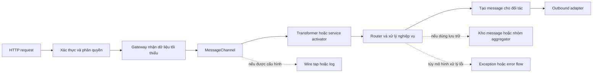

# Không đưa dữ liệu nhạy cảm vào header

## 1. Mục tiêu và phạm vi

Trong Spring Integration, header giúp các endpoint hiểu cách xử lý một message: định tuyến, liên kết các bước, trả kết quả hoặc chuyển lỗi. Header cũng đi qua nhiều thành phần hạ tầng, vì vậy cần thiết kế dữ liệu trong header cẩn thận như dữ liệu trong payload.

Bài này thuộc phần **Message headers** của **SPRING_INTEGRATION_CORE**. Sau bài học, bạn có thể:

- Phân biệt metadata phục vụ tích hợp với bí mật xác thực và dữ liệu cá nhân.
- Nhận diện đường lan truyền dữ liệu qua MessageChannel, transformer, router, gateway và nhánh lỗi.
- Dùng Java DSL để xóa header đã biết và tạo message đầu ra theo danh sách cho phép.
- Viết kiểm thử bảo đảm luồng vẫn hoạt động và dữ liệu ngoài hợp đồng không đi tới đích nhận.

Các ví dụ dùng Java 17 và API Spring Integration 6.5; cấu hình kiểm thử dùng JUnit Jupiter cùng Spring Test. Nội dung tập trung vào module core. HTTP và broker được nhắc đến để giải thích ranh giới tích hợp, không yêu cầu triển khai thêm adapter trong ví dụ.

Nguyên tắc thiết kế: **chỉ đặt vào header những dữ liệu mà thành phần tiếp theo thực sự cần, với phạm vi sử dụng và nơi được phép xuất hiện đã xác định**.

## 2. Header không phải vùng lưu trữ bí mật

Một message có thể được hình dung như sau:

```text
Message
├── payload: dữ liệu nghiệp vụ
└── headers: metadata phục vụ xử lý và vận chuyển
```

Header là một phần của message mà các thành phần được trao message có thể đọc. Tách một giá trị khỏi payload rồi chuyển sang header không tạo ra cơ chế mã hóa hoặc kiểm soát truy cập.

`MessageHeaders` có cấu trúc chỉ đọc; thao tác trực tiếp như `remove()` hoặc `put()` sẽ thất bại. Tính chất này không ngăn thành phần khác đọc header và không biến các object nằm trong header thành object bất biến. Đây là tính chất API, không phải bảo đảm về tính bí mật. [Tài liệu MessageHeaders](https://docs.spring.io/spring-framework/docs/current/javadoc-api/org/springframework/messaging/MessageHeaders.html).

Ví dụ sau minh họa một thiết kế cần tránh. Các chuỗi là dữ liệu giả, không phải thông tin xác thực thật:

```java
Message<String> unsafe = MessageBuilder.withPayload("order-demo-001")
        .setHeader("Authorization", "Bearer TEST_ONLY_TOKEN")
        .setHeader("customerEmail", "demo@example.invalid")
        .setHeader("apiKey", "TEST_ONLY_KEY")
        .build();
```

Một router chỉ cần biết loại đơn hàng nhưng cũng nhận được token nếu dùng message trên. Một nhánh chẩn đoán có thể vô tình ghi cả email. Đổi tên `apiKey` thành `context` không thay đổi nội dung nhạy cảm của giá trị.

### 2.1. Phân loại trước khi tạo header

Bảng dưới đây là gợi ý thiết kế cho ứng dụng minh họa; từng hệ thống cần phân loại theo dữ liệu và quyền truy cập thực tế.

| Dữ liệu | Cách xử lý đề xuất | Lý do |
| --- | --- | --- |
| Mật khẩu, private key, client secret | Giữ trong cơ chế quản lý bí mật; thành phần cần dùng truy xuất trực tiếp | Không phục vụ định tuyến message nghiệp vụ |
| Access token, refresh token, API key, session cookie | Xử lý tại biên xác thực hoặc client gọi dịch vụ đích | Có thể cho phép sử dụng quyền của chủ thể nếu bị lộ |
| Số định danh cá nhân, thông tin thanh toán | Chỉ đưa vào hợp đồng dữ liệu thực sự cần, có kiểm soát truy cập | Không cần nhân bản sang metadata |
| Email, số điện thoại, địa chỉ | Tránh dùng làm correlation hoặc routing key | Dễ xuất hiện trong log, màn hình tra cứu hoặc nhánh hỗ trợ |
| Loại sự kiện, phiên bản schema | Có thể dùng làm header với tập giá trị được kiểm soát | Phục vụ xử lý mà không cần chở hồ sơ người dùng |
| Mã yêu cầu ngẫu nhiên do máy chủ tạo | Có thể dùng để đối chiếu trong phạm vi cho phép | Hạn chế dùng định danh cá nhân để truy vết |
| Mã tenant, mã khách hàng, mã đơn hàng | Đánh giá mục đích, phạm vi chia sẻ và khả năng liên kết dữ liệu | Một mã nội bộ vẫn có thể xác định được chủ thể |
| `replyChannel`, `errorChannel`, dữ liệu sequence | Quản lý theo ngữ nghĩa của luồng | Là metadata điều khiển, không phải dữ liệu để gửi tùy ý ra ngoài |

Một UUID cũng có thể trở thành dữ liệu có thể liên kết khi có bảng ánh xạ tới người dùng. Vì vậy, “không chứa tên người” chưa đủ để kết luận một header được phép công khai.

OWASP khuyến nghị tránh ghi trực tiếp các loại dữ liệu như token, mật khẩu, khóa và thông tin cá nhân nhạy cảm vào log. Trong bài này, khuyến nghị đó được áp dụng bằng cách giới hạn ngay dữ liệu có thể tới các điểm ghi log. [OWASP Logging Cheat Sheet](https://cheatsheetseries.owasp.org/cheatsheets/Logging_Cheat_Sheet.html#data-to-exclude).

### 2.2. Dữ liệu lồng nhau cũng cần được phân loại

Header không chỉ chứa chuỗi. Một header tên `requestContext` có thể chứa một `Map`, một object người dùng hoặc một object xác thực mang theo credentials.

```text
requestContext
├── requestId
├── customer
│   ├── email
│   └── phone
└── credentials
    └── accessToken
```

Xóa header `accessToken` ở cấp ngoài sẽ không xóa `requestContext.credentials.accessToken`. Thiết kế metadata nên ưu tiên các giá trị nhỏ, rõ kiểu, có schema; tránh chuyển toàn bộ request, toàn bộ hồ sơ hoặc toàn bộ ngữ cảnh xác thực qua header nghiệp vụ.

## 3. Dữ liệu có thể lan truyền như thế nào?

Giả sử một API nhận yêu cầu tạo đơn hàng rồi gọi gateway để khởi chạy luồng xử lý:



Sơ đồ thể hiện các khả năng cần xem xét khi thiết kế; một channel không tự động bật tất cả các nhánh này.

Theo cơ chế header propagation, nhiều endpoint tạo message đầu ra sẽ kế thừa header đầu vào. Transformer trả về payload cũng giữ các header đầu vào; transformer trả về một `Message` hoàn chỉnh trao cho mã ứng dụng trách nhiệm xây dựng message đầu ra. Router và bridge không tự trở thành điểm làm sạch header. [Spring Integration: Header Propagation](https://docs.spring.io/spring-integration/reference/message.html#message-header-propagation).

Hệ quả trong thiết kế:

| Thao tác | Điều cần kiểm soát |
| --- | --- |
| Chuyển payload từ object sang JSON | Không suy luận rằng header xác thực đã biến mất |
| Định tuyến theo `eventType` | Các nhánh nhận message còn có thể thấy header ngoài nhu cầu |
| Thêm nhánh audit hoặc wire tap | Nhánh mới mở rộng nơi nhận dữ liệu |
| Lưu message để retry hoặc phục hồi | Xác định chính xác các trường được lưu và thời gian lưu |
| Gom message trong aggregator | Kiểm tra dữ liệu nằm trong từng message của nhóm |
| Bọc lỗi kèm message thất bại | Kiểm tra cả nội dung lỗi và message được tham chiếu |

### 3.1. Làm sạch đầu ra không sửa message gốc

Không sửa header bằng cách này:

```java
// UnsupportedOperationException với MessageHeaders thông thường.
message.getHeaders().remove("Authorization");
```

Có thể tạo một message đã bỏ các header được chỉ định bằng builder:

```java
Message<?> cleaned = MessageBuilder.fromMessage(message)
        .removeHeaders("Authorization", "authorization", "private_*")
        .build();
```

`fromMessage()` khởi tạo builder từ message đầu vào; `removeHeaders()` hỗ trợ mẫu tên header. Message trả về cần được dùng cho bước tiếp theo. [MessageBuilder Javadoc](https://docs.spring.io/spring-framework/docs/current/javadoc-api/org/springframework/messaging/support/MessageBuilder.html).

Sau thao tác này, một tham chiếu còn giữ `message` gốc vẫn có thể đọc `Authorization`. Nhánh đã nhận message trước đó và log đã ghi cũng không bị thay đổi. Không dùng việc gọi `build()` như một cơ chế xóa bí mật khỏi bộ nhớ hoặc thu hồi dữ liệu đã phát tán.

## 4. Giới hạn dữ liệu từ biên vào

Với ứng dụng nhận HTTP request, luồng đề xuất gồm các bước:

1. Lớp xác thực đọc credentials và xác minh người gọi.
2. Lớp phân quyền kiểm tra thao tác được yêu cầu trên tài nguyên cụ thể.
3. Lớp chuyển tiếp tạo DTO nghiệp vụ tối thiểu cùng metadata đã được chấp nhận.
4. Gateway chỉ nhận những dữ liệu thuộc hợp đồng đó.

Ví dụ hợp đồng đầu vào của gateway có thể gồm mã đơn hàng và mã yêu cầu do ứng dụng tạo. Không cần thêm tham số `Map<String, Object> allHttpHeaders` chỉ để tiện dùng về sau.

Nếu cần metadata tenant, lấy nó từ kết quả xác thực đáng tin cậy và kiểm tra quyền trên tài nguyên tương ứng. Một header `tenantId` do client tự gửi không đủ chứng minh quyền. Kiểm tra đúng định dạng cũng không thay thế kiểm tra nguồn gốc.

Khi gọi dịch vụ bên ngoài, client hoặc adapter có thể cần credentials ở tầng giao thức. Ưu tiên cấu hình cơ chế cấp credentials ngay tại thành phần gọi đích; nếu phải truyền token của người dùng, thiết kế riêng phạm vi, đối tượng nhận và vòng đời. Không chuyển token qua toàn bộ luồng chỉ vì bước cuối có thể cần nó.

**Header HTTP và header của Spring Message là hai lớp khác nhau.** Việc một HTTP request hợp lệ có `Authorization` không có nghĩa mọi message nghiệp vụ bên trong đều cần chứa bản sao của nó.

## 5. Hai cách kiểm soát header

### 5.1. Danh sách loại bỏ: xử lý các header đã biết

Header Filter tạo đầu ra đã bỏ các header được cấu hình. Đây là một transformer chuyên dụng, khác với Message Filter quyết định cho qua hoặc từ chối cả message. [Spring Integration: Header Filter](https://docs.spring.io/spring-integration/reference/6.5/transformer.html#header-filter).

Danh sách loại bỏ phù hợp khi luồng nội bộ có hợp đồng metadata đã biết và cần bỏ một số trường tạm thời. Giới hạn của nó là header mới ngoài danh sách vẫn có thể đi tiếp.

Tên header trong map cần được xử lý đúng theo tên thực tế. Không áp dụng mặc định quy tắc không phân biệt hoa thường của HTTP cho mọi thao tác trên `MessageHeaders`. Một danh sách có `Authorization` chưa thể hiện chính sách cho mọi biến thể tên header do ứng dụng hoặc mapper tạo ra.

Nếu dùng mẫu tên trong Java DSL, khai báo rõ `patternMatch(true)` và kiểm tra hành vi với phiên bản đang dùng. Ví dụ bên dưới sử dụng `HeaderFilterSpec`, có từ Spring Integration 6.2. [HeaderFilterSpec 6.5 API](https://docs.spring.io/spring-integration/docs/6.5.0/api/org/springframework/integration/dsl/HeaderFilterSpec.html).

### 5.2. Danh sách cho phép: dựng message theo hợp đồng đích

Tại biên gửi ra đối tác, một cách chặt chẽ hơn là tạo message mới và chỉ thêm các header thuộc hợp đồng xuất dữ liệu. Header mới không nằm trong hợp đồng sẽ không được sao chép tự động.

Phương án này cần hai quyết định riêng:

- **Payload xuất đi gồm gì?** Nếu payload chứa thông tin cá nhân ngoài nhu cầu đối tác, cần tạo DTO đầu ra tối thiểu.
- **Header xuất đi gồm gì?** Chỉ thêm metadata được chấp nhận và có nguồn gốc phù hợp.

Không dùng `copyHeaders(input.getHeaders())` trong bước này rồi giả định message mới đã có phạm vi dữ liệu nhỏ hơn. Cũng không chỉ trả về payload mới nếu mục đích là cắt việc kế thừa header.

## 6. Ví dụ Java DSL với hai ranh giới độc lập

Ví dụ dùng payload chuỗi `order-demo-001`, được giả định đã hợp lệ và được phép gửi tới đích nhận. `appRequestId` là UUID do ứng dụng tạo tại biên vào; `eventType` xuất đi là giá trị cố định thuộc hợp đồng.

Hai flow hoạt động độc lập để so sánh chính sách:

- `internal.sanitize.in` → `internal.sanitize.out`: bỏ các header đã biết, giữ metadata còn lại để xử lý nội bộ.
- `partner.export.in` → `partner.export.out`: tạo message cho đích nhận với đúng hai header ứng dụng.

`QueueChannel` ở đầu ra chỉ giúp quan sát kết quả trong ví dụ và kiểm thử. Nó chưa đại diện cho dữ liệu thực sự đã được HTTP client hoặc broker gửi qua mạng.

### 6.1. Cấu hình luồng

Tệp minh họa `HeaderBoundaryConfiguration.java`:

```java
package example.integration;

import java.util.UUID;

import org.springframework.context.annotation.Bean;
import org.springframework.context.annotation.Configuration;
import org.springframework.integration.channel.DirectChannel;
import org.springframework.integration.channel.QueueChannel;
import org.springframework.integration.config.EnableIntegration;
import org.springframework.integration.dsl.IntegrationFlow;
import org.springframework.integration.handler.LoggingHandler;
import org.springframework.messaging.Message;
import org.springframework.messaging.MessageChannel;
import org.springframework.messaging.support.MessageBuilder;

@Configuration
@EnableIntegration
public class HeaderBoundaryConfiguration {

    @Bean(name = "internal.sanitize.in")
    public MessageChannel internalInput() {
        return new DirectChannel();
    }

    @Bean(name = "internal.sanitize.out")
    public QueueChannel internalOutput() {
        return new QueueChannel(10);
    }

    @Bean(name = "partner.export.in")
    public MessageChannel partnerInput() {
        return new DirectChannel();
    }

    @Bean(name = "partner.export.out")
    public QueueChannel partnerOutput() {
        return new QueueChannel(10);
    }

    @Bean
    public IntegrationFlow internalSanitizingFlow() {
        return IntegrationFlow.from("internal.sanitize.in")
                .headerFilter(spec -> spec
                        .headersToRemove(
                                "Authorization", "authorization",
                                "Cookie", "cookie",
                                "Set-Cookie", "set-cookie",
                                "apiKey", "accessToken", "refreshToken",
                                "customerEmail", "private_*")
                        .patternMatch(true))
                .log(LoggingHandler.Level.INFO, "integration.internal",
                        m -> "internal.accepted messageId="
                                + m.getHeaders().getId())
                .channel("internal.sanitize.out")
                .get();
    }

    @Bean
    public IntegrationFlow partnerExportFlow() {
        return IntegrationFlow.from("partner.export.in")
                .transform(new PartnerEnvelopeTransformer(), "transform")
                .log(LoggingHandler.Level.INFO, "integration.partner",
                        m -> "partner.export appRequestId="
                                + m.getHeaders().get("appRequestId"))
                .channel("partner.export.out")
                .get();
    }

    public static class PartnerEnvelopeTransformer {

        public Message<?> transform(Message<?> input) {
            UUID requestId = input.getHeaders()
                    .get("appRequestId", UUID.class);

            if (requestId == null) {
                throw new IllegalArgumentException("appRequestId is required");
            }

            return MessageBuilder.withPayload(input.getPayload())
                    .setHeader("appRequestId", requestId)
                    .setHeader("eventType", "order.accepted")
                    .build();
        }
    }
}
```

`@EnableIntegration` cùng các bean flow đã đủ cho cấu hình minh họa. Không cần quét interface gateway vì ví dụ gửi trực tiếp vào các channel đầu vào.

Trong luồng nội bộ, Header Filter đứng trước điểm log do ta cấu hình. Điều này không bảo đảm rằng interceptor hoặc framework logger ở trước đầu vào chưa từng thấy message gốc. Kiểm soát dữ liệu từ producer vẫn là lớp bảo vệ đầu tiên.

Trong luồng đối tác, transformer trả về một `Message` hoàn chỉnh, không sao chép header từ đầu vào. Đầu ra vẫn có các header hạ tầng như `id` và `timestamp`; “đúng hai header ứng dụng” không có nghĩa tổng số header bằng hai.

### 6.2. Giới hạn cần hiểu đúng

Đây là nhánh một chiều với đầu ra cố định. Transformer không giữ `replyChannel`, `errorChannel` hoặc dữ liệu sequence từ message đầu vào. Không chèn nguyên cách làm này vào một flow request–reply đang dựa vào những header đó.

Nếu một gateway đang chờ phản hồi, việc làm mất đường trả lời có thể khiến lời gọi thất bại hoặc hết thời gian chờ. Nếu một aggregator còn cần thông tin nhóm, việc bỏ metadata trước bước gom nhóm có thể phá vỡ ngữ nghĩa xử lý.

Cách tổ chức phù hợp là hoàn thành phần điều phối nội bộ ở phạm vi tin cậy, rồi tạo message dành riêng cho nhánh xuất dữ liệu. Chỉ giữ metadata điều khiển khi có nhu cầu rõ ràng bên trong ứng dụng, đồng thời ngăn mapper xuất chúng ra giao thức bên ngoài.

Kiểm tra `UUID.class` trong ví dụ chỉ bảo đảm kiểu dữ liệu. Việc bảo đảm `appRequestId` được tạo bởi ứng dụng thuộc trách nhiệm của điểm tiếp nhận. Nếu đổi payload chuỗi thành object phức tạp, cần đánh giá DTO đầu ra riêng; ví dụ này giữ nguyên payload nên không làm sạch dữ liệu nằm trong payload.

## 7. Kiểm thử chính sách tại đầu ra của flow

Kiểm thử cần kiểm tra cả tính bí mật lẫn chức năng. Một flow bỏ được token nhưng làm mất đường trả kết quả vẫn chưa đạt yêu cầu.

Ví dụ dưới dùng `spring-integration-core`, `spring-test` và `junit-jupiter` với các phiên bản tương thích do dự án quản lý. Hai lớp minh họa cùng package. Không cần Spring Boot hoặc kết nối broker để quan sát đầu ra tại channel.

Tệp minh họa `HeaderBoundaryConfigurationTest.java`:

```java
package example.integration;

import java.util.Map;
import java.util.Set;
import java.util.UUID;

import org.junit.jupiter.api.Test;
import org.springframework.beans.factory.annotation.Autowired;
import org.springframework.beans.factory.annotation.Qualifier;
import org.springframework.integration.channel.QueueChannel;
import org.springframework.messaging.Message;
import org.springframework.messaging.MessageChannel;
import org.springframework.messaging.MessageHeaders;
import org.springframework.messaging.support.MessageBuilder;
import org.springframework.test.context.junit.jupiter.SpringJUnitConfig;

import static org.junit.jupiter.api.Assertions.*;

@SpringJUnitConfig(HeaderBoundaryConfiguration.class)
class HeaderBoundaryConfigurationTest {

    @Autowired
    @Qualifier("internal.sanitize.in")
    MessageChannel internalInput;

    @Autowired
    @Qualifier("internal.sanitize.out")
    QueueChannel internalOutput;

    @Autowired
    @Qualifier("partner.export.in")
    MessageChannel partnerInput;

    @Autowired
    @Qualifier("partner.export.out")
    QueueChannel partnerOutput;

    @Test
    void internalBoundaryRemovesKnownHeadersAndPreservesControlHeaders() {
        UUID requestId = UUID.randomUUID();
        QueueChannel replies = new QueueChannel(1);
        QueueChannel errors = new QueueChannel(1);

        Message<String> input = fixture(requestId)
                .setReplyChannel(replies)
                .setErrorChannel(errors)
                .build();

        assertTrue(internalInput.send(input, 1_000));
        Message<?> output = internalOutput.receive(1_000);
        assertNotNull(output);
        assertEquals("order-demo-001", output.getPayload());
        assertEquals(requestId, output.getHeaders().get("appRequestId"));

        for (String name : Set.of(
                "Authorization", "authorization", "Cookie", "cookie",
                "apiKey", "accessToken", "refreshToken",
                "customerEmail", "private_note")) {
            assertFalse(output.getHeaders().containsKey(name), name);
        }

        assertSame(replies,
                output.getHeaders().get(MessageHeaders.REPLY_CHANNEL));
        assertSame(errors,
                output.getHeaders().get(MessageHeaders.ERROR_CHANNEL));

        // Minh họa giới hạn của danh sách loại bỏ.
        assertTrue(output.getHeaders().containsKey("legacyCredential"));
        assertTrue(output.getHeaders().containsKey("requestContext"));

        // Message gốc không bị xóa dữ liệu bởi transformer.
        assertTrue(input.getHeaders().containsKey("Authorization"));
    }

    @Test
    void partnerBoundaryExportsOnlyApprovedApplicationHeaders() {
        UUID requestId = UUID.randomUUID();
        Message<String> input = fixture(requestId)
                .setReplyChannel(new QueueChannel(1))
                .setErrorChannel(new QueueChannel(1))
                .build();

        assertTrue(partnerInput.send(input, 1_000));
        Message<?> output = partnerOutput.receive(1_000);
        assertNotNull(output);
        assertEquals("order-demo-001", output.getPayload());
        assertEquals(requestId, output.getHeaders().get("appRequestId"));
        assertEquals("order.accepted", output.getHeaders().get("eventType"));

        Set<String> allowed = Set.of(
                MessageHeaders.ID, MessageHeaders.TIMESTAMP,
                "appRequestId", "eventType");

        assertTrue(allowed.containsAll(output.getHeaders().keySet()));
        assertFalse(output.getHeaders().containsKey("legacyCredential"));
        assertFalse(output.getHeaders().containsKey("requestContext"));
        assertFalse(output.getHeaders().containsKey(MessageHeaders.REPLY_CHANNEL));
        assertFalse(output.getHeaders().containsKey(MessageHeaders.ERROR_CHANNEL));
    }

    private static MessageBuilder<String> fixture(UUID requestId) {
        return MessageBuilder.withPayload("order-demo-001")
                .setHeader("appRequestId", requestId)
                .setHeader("eventType", "internal.order.received")
                .setHeader("Authorization", "Bearer TEST_ONLY_TOKEN")
                .setHeader("authorization", "Bearer TEST_ONLY_LOWERCASE")
                .setHeader("Cookie", "session=TEST_ONLY_SESSION")
                .setHeader("cookie", "session=TEST_ONLY_LOWERCASE_SESSION")
                .setHeader("apiKey", "TEST_ONLY_KEY")
                .setHeader("accessToken", "TEST_ONLY_ACCESS")
                .setHeader("refreshToken", "TEST_ONLY_REFRESH")
                .setHeader("customerEmail", "demo@example.invalid")
                .setHeader("private_note", "TEST_ONLY_PRIVATE_NOTE")
                .setHeader("legacyCredential", "TEST_ONLY_UNKNOWN_SECRET")
                .setHeader("requestContext",
                        Map.of("accessToken", "TEST_ONLY_NESTED_SECRET"));
    }
}
```

Kiểm thử thứ nhất cố ý xác nhận header chưa được liệt kê vẫn tồn tại. Đây là cách thể hiện giới hạn của chính sách, không phải xác nhận rằng nội dung đó được phép phát tán. Trong ứng dụng thật, producer cần ngừng tạo các header bí mật đó.

Kiểm thử thứ hai đi qua transformer của flow, nhờ đó kiểm tra cả khả năng framework tự bổ sung lại header đầu vào. Chỉ gọi trực tiếp phương thức transformer sẽ không quan sát được toàn bộ hành vi tại endpoint.

Hai kiểm thử trên chưa chứng minh hệ thống không lộ dữ liệu qua log, exception hoặc giao thức gửi thật. Khi nối thêm adapter, cần kiểm thử ở ranh giới tương ứng.

## 8. Header mapping tại biên gửi ra ngoài

Message đã được giới hạn header là một lớp kiểm soát. Header mapper của adapter là lớp khác, quyết định metadata nào được biểu diễn trên giao thức đích.

Đối với HTTP, Spring Integration có cơ chế mapping cho request và response, hỗ trợ cấu hình danh sách tên hoặc mẫu. Không suy luận chính sách của HTTP từ cấu hình mapper AMQP hay Kafka. [Spring Integration: HTTP Header Mappings](https://docs.spring.io/spring-integration/reference/http/header-mapping.html).

Khi thiết kế một outbound adapter:

1. Xác định các header giao thức cần thiết như kiểu nội dung và mã liên kết đã được chấp thuận.
2. Cấu hình mapper theo hợp đồng cụ thể của đích nhận.
3. Kiểm tra cả response header đi ngược vào ứng dụng.
4. Dùng endpoint thử nghiệm để quan sát dữ liệu thực sự được gửi.

Không mặc định rằng map header nội bộ được gửi nguyên vẹn qua mạng; cũng không dựa vào việc một mapper hiện tại đang bỏ một trường để cho phép bí mật tồn tại khắp ứng dụng.

Nếu HTTP client phải thêm `Authorization` để gọi đối tác, việc đó có thể diễn ra sau bước tạo message tối thiểu. Cần kiểm tra thêm logging của client và cơ chế tracing, vì chính điểm thêm credentials cũng là nơi có thể phát sinh bản sao.

## 9. Log, tracing và xử lý lỗi

### 9.1. Chọn nội dung log rõ ràng

Những biểu thức sau mở rộng dữ liệu ghi ra ngoài nhu cầu chẩn đoán:

```java
logger.info("message={}", message);
logger.info("headers={}", message.getHeaders());
```

Ẩn token trong một layout log chưa chắc áp dụng cho appender khác, trace exporter hoặc log của HTTP client. Nên chọn trường cần ghi từ đầu: tên bước xử lý, trạng thái, mã yêu cầu đã kiểm soát và mã lỗi cố định.

Java DSL cho phép truyền hàm chọn nội dung cho `.log()`, như hai flow trong ví dụ. Operator này sử dụng wire tap và `LoggingHandler`; cần xem nó là một điểm nhận dữ liệu của luồng. [Spring Integration: Operator log()](https://docs.spring.io/spring-integration/reference/dsl/java-log.html).

Với tracing và metrics, áp dụng chính sách riêng cho từng trường. Tránh đưa token hoặc dữ liệu cá nhân vào baggage, span attribute hoặc tag. Mã yêu cầu có giá trị khác nhau cho từng message cũng thường không phù hợp làm nhãn metrics do số lượng giá trị tăng theo lưu lượng; có thể dùng nó cho đối chiếu log nếu được phép.

### 9.2. Nhánh lỗi có thể giữ message gốc

Trong xử lý đồng bộ qua `DirectChannel`, exception thường trở về caller. Với xử lý bất đồng bộ hoặc poller, lỗi có thể được gửi dưới dạng `ErrorMessage` tới error channel theo cấu hình. Global `errorChannel` mặc định có subscriber ghi log, nên không giả định error flow luôn kín dữ liệu. [Spring Integration: Error Handling](https://docs.spring.io/spring-integration/reference/error-handling.html).

`MessagingException` có thể giữ message thất bại trong `failedMessage`. Vì thế, lọc header của một message đầu ra không đủ để kết luận việc ghi exception sẽ an toàn. [Spring Integration: Gateway Error Handling](https://docs.spring.io/spring-integration/reference/gateway.html#gateway-error-handling).

Ví dụ một transformer phát hiện thiếu `appRequestId` rồi ném lỗi: chưa có message xuất đi, nhưng exception có thể tham chiếu message đầu vào. Đây là lý do cần kiểm soát cả dữ liệu được đưa vào luồng, thay vì trông chờ bước xuất dữ liệu giải quyết mọi trường hợp.

Thiết kế bản ghi lỗi tối thiểu có thể gồm:

```json
{
  "step": "partner.export",
  "status": "FAILED",
  "errorCode": "INVALID_REQUEST_METADATA",
  "appRequestId": "c072ab4d-84f8-4939-a03f-f6736cfe32c0"
}
```

Nếu mã yêu cầu không hợp lệ hoặc chưa có, không sao chép giá trị chưa kiểm soát đó vào bản ghi. Không tự động dùng `exception.getMessage()` làm mô tả công khai: thông điệp lỗi có thể chứa dữ liệu do ứng dụng, thư viện hoặc người dùng đưa vào.

Một `ErrorMessage` đã xóa header ngoài vẫn có thể chứa exception trong payload, mà exception lại giữ message gốc. Muốn chuyển lỗi sang miền có quyền truy cập thấp hơn, tạo một DTO lỗi tối thiểu theo hợp đồng; không chỉ lọc map header của `ErrorMessage`.

## 10. Những cách sửa chưa giải quyết được nguyên nhân

| Cách làm | Phần còn thiếu | Cách xử lý phù hợp hơn |
| --- | --- | --- |
| Đổi `Authorization` thành `contextToken` | Nội dung và quyền sử dụng token vẫn giữ nguyên | Loại token khỏi hợp đồng nghiệp vụ |
| Base64 token trước khi đặt vào header | Base64 có thể giải mã trực tiếp | Dùng cơ chế cấp credentials tại nơi cần dùng |
| Chuyển toàn bộ header nhạy cảm vào payload | Payload vẫn có thể được log, lưu hoặc gửi tiếp | Tối thiểu hóa DTO và kiểm soát mọi điểm nhận |
| Tạo payload mới nhưng trả về riêng payload | Endpoint vẫn có thể kế thừa header cũ | Trả về `Message` hoàn chỉnh tại biên xuất dữ liệu |
| Lọc ngay trước outbound nhưng wire tap ở trước đó | Nhánh phụ đã nhận bản gốc | Giới hạn từ producer và kiểm soát vị trí nhánh phụ |
| Xóa mọi header trước khi aggregator hoàn tất | Có thể mất thông tin điều phối nhóm | Tách xử lý nội bộ với bước tạo message xuất đi |
| Chỉ thêm một subscriber log an toàn vào global error channel | Subscriber khác có thể vẫn nhận lỗi gốc | Quản lý toàn bộ đường xử lý lỗi và nội dung được phát tán |
| Dùng email làm correlation ID để dễ tìm | Hệ thống quan sát nhận thêm dữ liệu cá nhân | Dùng mã ngẫu nhiên và tra cứu có phân quyền khi cần |

Mã tham chiếu cũng cần được thiết kế đúng. Một mã dùng để tra cứu hồ sơ phải đi kèm kiểm soát truy cập; nếu ai biết mã cũng lấy được bí mật, mã đó trở thành một dạng credentials. Hash email đơn thuần không tự chứng minh tính ẩn danh vì không gian email có thể đoán và đối chiếu.

## 11. Bài thực hành mở rộng

Dùng hai flow và fixture ở trên để kiểm tra các thay đổi sau:

1. Bổ sung `Set-Cookie` và `set-cookie` vào fixture, xác nhận luồng nội bộ loại bỏ đúng hai tên.
2. Thêm một header tùy ý như `futureSecret`, xác nhận luồng đối tác tiếp tục loại bỏ nó mà không sửa transformer.
3. Bỏ `appRequestId` hoặc đổi sang chuỗi, quan sát cách lỗi đi về caller khi gửi qua `DirectChannel`; chỉ dùng dữ liệu giả trong quá trình thử.
4. Thu log của hai category minh họa, xác nhận không có các marker `TEST_ONLY_` và không có email thử nghiệm.
5. Nối một nhánh lỗi có kiểm soát và xác nhận bản ghi lỗi không chứa marker từ header hoặc object lồng nhau.
6. Khi có outbound adapter, kiểm tra request hoặc message trên giao thức thật bằng đích nhận thử nghiệm; phân biệt kết quả này với kết quả tại `QueueChannel`.

Tiêu chí hoàn thành là quan sát được hành vi ở từng ranh giới: luồng nội bộ còn metadata cần thiết, luồng xuất dữ liệu chỉ có các trường đã cho phép, và log cùng nhánh lỗi không tạo thêm bản sao bí mật. Nếu dữ liệu nhạy cảm đã bị ghi trước điểm lọc, sửa flow không thu hồi được bản sao cũ; cần xử lý bản sao và credentials liên quan theo quy trình vận hành của hệ thống.

## 12. Ghi nhớ khi thiết kế luồng

Header là hợp đồng metadata giữa các thành phần. Hợp đồng càng nhỏ và rõ nguồn gốc, càng dễ kiểm soát khi luồng có thêm router, transformer, aggregator, gateway hoặc cơ chế retry.

Hãy quyết định dữ liệu ngay tại biên vào, bảo toàn metadata điều khiển trong phạm vi cần thiết, và tạo message tối thiểu cho từng đích nhận. Kiểm thử đầu ra phải đi cùng kiểm thử các đường phụ mà dữ liệu có thể tới: log, tracing, kho message và xử lý lỗi.
