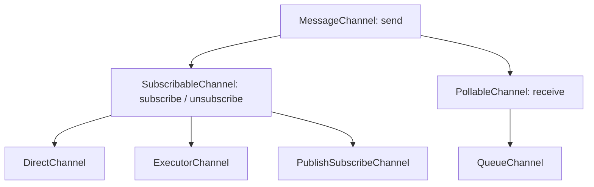

# MessageChannel

## 1. Mục tiêu và bối cảnh

Trong module **SPRING_INTEGRATION_CORE**, `MessageChannel` là điểm nối giữa các bước của luồng thông điệp. Sau bài này, bạn cần giải thích được hợp đồng gửi/nhận, chọn channel theo cách phân phối và cách thực thi, đồng thời nhận biết ảnh hưởng của channel đến lỗi, giao dịch và kiểm thử.

Xét một hệ thống nhận đơn hàng:

```text
Ứng dụng → orders.input → Kiểm tra đơn → orders.valid → Lưu đơn
                                                  → Phát sự kiện đã lưu
```

Mỗi tên như `orders.input` biểu diễn một điểm giao tiếp có chủ đích. Nơi gửi cần biết hợp đồng dữ liệu và channel đích; nơi xử lý cần biết cách tiếp nhận message. Cách tổ chức này cho phép thay thế một bước xử lý mà ít làm ảnh hưởng đến nơi phát sinh yêu cầu.

Trong sơ đồ trên, việc kiểm tra và lưu đơn thuộc endpoint. Channel quyết định message được chuyển đến bước tiếp theo bằng cơ chế nào. Đây là ranh giới quan trọng khi thiết kế luồng.

## 2. Message, channel, endpoint và gateway liên hệ thế nào?

| Thành phần | Trách nhiệm | Ví dụ trong luồng đơn hàng |
| --- | --- | --- |
| `Message<?>` | Mang payload và headers của một lần trao đổi | Payload chứa đơn hàng, header chứa `orderId` |
| `MessageChannel` | Cung cấp điểm gửi và cơ chế chuyển message | `orders.input`, `orders.valid` |
| Endpoint | Thực hiện một bước tích hợp hoặc nghiệp vụ | Transformer chuẩn hóa dữ liệu, filter kiểm tra điều kiện |
| Router | Chọn đầu ra dựa trên message | Chuyển đơn quốc tế sang `orders.international` |
| Gateway | Cung cấp giao diện gọi vào hoặc ra khỏi luồng | Phương thức `submitOrder` nhận đối tượng nghiệp vụ |
| Aggregator | Gom các message liên quan trước khi phát kết quả | Gom kết quả kiểm tra tồn kho của các dòng hàng |

Cùng một tên channel có thể được nhiều thành phần tham chiếu. Tên này vẫn cần đi cùng một hợp đồng: payload có kiểu gì, headers nào bắt buộc, ai nhận, có lưu đệm hay không và khi nào được xem là đã tiếp nhận.

Ví dụ, `orders.valid` có thể quy ước chỉ nhận đơn đã vượt qua kiểm tra đầu vào và phải có `orderId`. Việc đặt tên dễ hiểu giúp người đọc đoán đúng ý nghĩa; endpoint và kiểm thử mới là nơi thực thi, xác nhận quy ước đó.

## 3. Hợp đồng của MessageChannel

`MessageChannel` nằm trong package `org.springframework.messaging`. Những thao tác gửi cần nắm là:

```java
boolean send(Message<?> message);
boolean send(Message<?> message, long timeout);
```

`timeout` tính bằng mili giây. Giá trị `MessageChannel.INDEFINITE_TIMEOUT` biểu thị không đặt giới hạn chờ theo hợp đồng này. Trong API hiện hành, overload một tham số là một default method. Đoạn trên chỉ liệt kê chữ ký sử dụng, không sao chép đầy đủ khai báo interface. Xem [Javadoc MessageChannel](https://docs.spring.io/spring-framework/docs/current/javadoc-api/org/springframework/messaging/MessageChannel.html).

### 3.1. Đọc đúng kết quả gửi

Lời gọi `send` có ba khả năng cần xử lý:

- Trả `true`: channel báo gửi thành công theo cơ chế của implementation.
- Trả `false`: message không được gửi thành công; ví dụ hết thời gian chờ chỗ trống.
- Ném exception: có lỗi khi gửi hoặc khi xử lý đồng bộ.

`send` có thể chặn, tùy implementation. Truyền timeout không tạo một deadline cho toàn bộ nghiệp vụ phía sau channel. Hợp đồng API cho phép cả giá trị trả về lẫn exception, vì vậy chỉ kiểm tra boolean là chưa đủ trong các trường hợp cần phục hồi lỗi. Xem [hợp đồng send](https://docs.spring.io/spring-framework/docs/current/javadoc-api/org/springframework/messaging/MessageChannel.html#send(org.springframework.messaging.Message,long)).

Một mẫu xử lý ở biên ứng dụng:

```java
import org.springframework.messaging.Message;
import org.springframework.messaging.MessageChannel;
import org.springframework.messaging.MessagingException;

public final class OrderSender {

    private final MessageChannel input;

    public OrderSender(MessageChannel input) {
        this.input = input;
    }

    public void submit(Message<?> orderMessage) {
        try {
            boolean accepted = input.send(orderMessage, 200);
            if (!accepted) {
                throw new IllegalStateException(
                        "Chưa thể tiếp nhận đơn hàng trong thời gian cho phép");
            }
        }
        catch (MessagingException ex) {
            throw new IllegalStateException(
                    "Luồng đơn hàng gặp lỗi khi tiếp nhận hoặc xử lý", ex);
        }
    }
}
```

Ví dụ chọn cách báo lỗi rõ ràng cho bên gọi. Một ứng dụng thực tế có thể ánh xạ kết quả sang phản hồi API hoặc một cơ chế thử lại phù hợp. Nếu thử lại một thao tác có side effect, cần dùng khóa nghiệp vụ để tránh ghi nhận trùng.

### 3.2. Gửi thành công có ý nghĩa đến đâu?

Hãy mô tả ý nghĩa của `true` theo channel đang dùng:

| Trường hợp | Điều đã biết khi gửi thành công | Điều còn phải xác nhận riêng |
| --- | --- | --- |
| `DirectChannel` với handler kết thúc đồng bộ | Lời gọi handler trên cùng luồng đã trả về bình thường | Các công việc bất đồng bộ mà handler tự tạo |
| `QueueChannel` | Message đã vào hàng đợi | Consumer đã nhận và xử lý thành công hay chưa |
| `ExecutorChannel` với executor bất đồng bộ | Tác vụ phân phối đã được chấp nhận | Kết quả của handler chạy sau đó |
| `PublishSubscribeChannel` | Kết quả phụ thuộc cấu hình subscriber và executor | Mọi hiệu ứng nghiệp vụ mong muốn đã hoàn tất hay chưa |

Các khác biệt này xuất phát từ cơ chế thực thi của [DirectChannel](https://docs.spring.io/spring-integration/api/org/springframework/integration/channel/DirectChannel.html), [QueueChannel](https://docs.spring.io/spring-integration/api/org/springframework/integration/channel/QueueChannel.html), [ExecutorChannel](https://docs.spring.io/spring-integration/api/org/springframework/integration/channel/ExecutorChannel.html) và [PublishSubscribeChannel](https://docs.spring.io/spring-integration/api/org/springframework/integration/channel/PublishSubscribeChannel.html).

Một API trả “đã tiếp nhận” ngay khi message vào queue cần có cách theo dõi kết quả về sau, chẳng hạn tra cứu bằng `orderId`. Nếu bên gọi cần kết quả xử lý ngay, phải thiết kế thêm trao đổi request–reply.

## 4. Hai mô hình tiêu thụ thường gặp

### 4.1. SubscribableChannel: handler đăng ký nhận

```java
boolean subscribe(MessageHandler handler);
boolean unsubscribe(MessageHandler handler);
```

Channel chuyển message đến `MessageHandler` đã đăng ký. Consumer không gọi `receive()` trên interface này. `DirectChannel`, `ExecutorChannel` và `PublishSubscribeChannel` thuộc nhóm này.

### 4.2. PollableChannel: consumer chủ động lấy

```java
Message<?> receive();
Message<?> receive(long timeout);
```

Consumer gọi `receive` để lấy message. Khi hết thời gian chờ hoặc bị ngắt trong tình huống được hợp đồng mô tả, kết quả có thể là `null`. `QueueChannel` là ví dụ thông dụng.

Hai interface trên mô tả cách consumer tiếp cận message. Không thể chỉ nhìn chữ “subscribe” để kết luận xử lý chạy bất đồng bộ. Xem [MessageChannel và các interface liên quan](https://docs.spring.io/spring-integration/reference/channel/interfaces.html).



Sơ đồ thể hiện các nhánh thường dùng trong bài. Spring Integration còn có `FluxMessageChannel` cho tích hợp Reactive Streams; nó không thuộc hai nhánh consumer này. Xem [mô tả FluxMessageChannel](https://docs.spring.io/spring-integration/reference/channel/implementations.html#fluxmessagechannel).

## 5. Chọn channel theo phân phối và thực thi

Hai câu hỏi nên được trả lời riêng:

1. Một message cần đến một consumer hay đến nhiều subscriber?
2. Việc xử lý diễn ra ngay trên luồng gửi, được executor thực thi, hay chờ consumer lấy từ queue?

| Channel | Phân phối | Cơ chế thực thi hoặc chờ | Nhu cầu minh họa |
| --- | --- | --- | --- |
| `DirectChannel` | Một handler trong mỗi lần phân phối bình thường | Gọi handler trên luồng gửi | Chuỗi kiểm tra và chuẩn hóa đồng bộ |
| `QueueChannel` | Một consumer lấy mỗi message khỏi queue | Lưu đệm để consumer lấy sau | Tiếp nhận một đợt yêu cầu ngắn vượt tốc độ xử lý |
| `ExecutorChannel` | Một handler trong mỗi lần phân phối bình thường | Ủy quyền cho executor | Tách bước xử lý khỏi luồng gọi |
| `PublishSubscribeChannel` | Phát cho các subscriber | Đồng bộ mặc định; có thể cấu hình executor | Thông báo một sự kiện cho nhiều nhánh |

Bảng đối chiếu dựa trên API của [DirectChannel](https://docs.spring.io/spring-integration/api/org/springframework/integration/channel/DirectChannel.html), [QueueChannel](https://docs.spring.io/spring-integration/api/org/springframework/integration/channel/QueueChannel.html), [ExecutorChannel](https://docs.spring.io/spring-integration/api/org/springframework/integration/channel/ExecutorChannel.html) và [PublishSubscribeChannel](https://docs.spring.io/spring-integration/api/org/springframework/integration/channel/PublishSubscribeChannel.html).

### 5.1. DirectChannel: bước tiếp theo chạy trên luồng gửi

Trong đường đi đồng bộ, handler hoàn thành trước khi `send` trả về. Một handler chậm làm chậm bên gửi. Nếu có nhiều subscriber, `DirectChannel` phân phối công việc giữa các handler; không dùng nó để phát cùng một sự kiện đến tất cả nhánh.

Dispatcher hỗ trợ failover: khi handler được chọn ném lỗi, một handler khác có thể được thử tiếp tùy cấu hình. Khi handler đã tạo side effect rồi mới lỗi, cần tính đến nguy cơ xử lý trùng. Xem [DirectChannel và cấu hình dispatcher](https://docs.spring.io/spring-integration/reference/channel/implementations.html#directchannel).

Ví dụ quan sát luồng thực thi; class này có thể chạy độc lập khi classpath có Spring Integration Core:

```java
import org.springframework.integration.channel.DirectChannel;
import org.springframework.messaging.Message;
import org.springframework.messaging.support.MessageBuilder;

public class DirectChannelDemo {

    public static void main(String[] args) {
        DirectChannel input = new DirectChannel();

        input.subscribe(message -> {
            System.out.println("handler: " + Thread.currentThread().getName());
            System.out.println("payload: " + message.getPayload());
        });

        Message<String> message = MessageBuilder
                .withPayload("ORDER-001")
                .setHeader("orderId", "ORDER-001")
                .build();

        System.out.println("before: " + Thread.currentThread().getName());
        boolean sent = input.send(message);
        System.out.println("after: sent=" + sent);
    }
}
```

Với cách chạy thông thường từ `main`, phần trước và trong handler cùng in tên luồng `main`; dòng `after` xuất hiện sau các dòng trong handler.

Nếu chưa có subscriber, việc gửi vào `DirectChannel` thất bại bằng exception. Chỉ tạo bean channel chưa đủ để hình thành một luồng có nơi xử lý.

### 5.2. QueueChannel: lưu đệm có giới hạn rõ ràng

`QueueChannel` dùng queue để giữ message cho đến khi consumer lấy. Nên đặt capacity theo nhu cầu và bộ nhớ cho phép. Constructor không tham số tạo queue có giới hạn rất lớn, nên không phải một lựa chọn tự kiểm soát tải tốt. Xem [Javadoc QueueChannel](https://docs.spring.io/spring-integration/api/org/springframework/integration/channel/QueueChannel.html).

```java
import org.springframework.integration.channel.QueueChannel;
import org.springframework.messaging.Message;
import org.springframework.messaging.support.MessageBuilder;

public class QueueChannelDemo {

    public static void main(String[] args) {
        QueueChannel inbox = new QueueChannel(1);

        boolean first = inbox.send(
                MessageBuilder.withPayload("ORDER-001").build(), 0);
        boolean second = inbox.send(
                MessageBuilder.withPayload("ORDER-002").build(), 0);

        Message<?> received = inbox.receive(0);
        Message<?> empty = inbox.receive(0);

        System.out.println("first=" + first);    // true
        System.out.println("second=" + second);  // false: queue đã đầy
        System.out.println("payload=" + received.getPayload());
        System.out.println("empty=" + empty);    // null
    }
}
```

Ở đây, `0` nghĩa là không chờ: gửi khi đầy trả `false`, nhận khi rỗng trả `null`. Các overload không timeout của `QueueChannel` có thể chờ vô hạn. Xem [ngữ nghĩa gửi và nhận của QueueChannel](https://docs.spring.io/spring-integration/reference/channel/implementations.html#queuechannel).

Queue không tự tạo worker. Trong ví dụ, chính `main` lấy message. Khi nối queue vào endpoint trong ứng dụng Spring, thường dùng polling consumer để lấy message theo lịch.

### 5.3. ExecutorChannel: executor quyết định cách chạy

`ExecutorChannel` nhận executor để thực thi việc phân phối đến handler. Với thread pool bất đồng bộ, bên gửi thường tiếp tục trước khi handler kết thúc; giao dịch gắn với luồng gửi không tự truyền sang worker. Xem [Javadoc ExecutorChannel](https://docs.spring.io/spring-integration/api/org/springframework/integration/channel/ExecutorChannel.html).

Khi chọn cách này, cần quyết định số worker, độ lớn hàng đợi của executor và hành vi khi hết tài nguyên. Chính sách như `CallerRunsPolicy` có thể khiến tác vụ chạy ngay trên luồng gọi khi pool quá tải; vì thế không dựa vào giả định “luôn là luồng khác”. Xem [lưu ý về ExecutorChannel](https://docs.spring.io/spring-integration/reference/channel/implementations.html#executorchannel).

### 5.4. PublishSubscribeChannel: nhiều nhánh cùng quan tâm

Ví dụ sự kiện `OrderAccepted` cần đến nhánh gửi email và nhánh thống kê. `PublishSubscribeChannel` cung cấp cơ chế phát cho các subscriber. Constructor mặc định gọi handler trên luồng gửi; constructor nhận executor cho phép ủy quyền việc thực thi. Xem [Javadoc PublishSubscribeChannel](https://docs.spring.io/spring-integration/api/org/springframework/integration/channel/PublishSubscribeChannel.html).

Phát đến nhiều nhánh không tạo một giao dịch nguyên tử bao trùm mọi tác động. Khi thiết kế sự kiện đơn hàng, cần xác định cách xử lý tình huống email đã gửi nhưng ghi thống kê thất bại.

### 5.5. Các lựa chọn mở rộng

`PriorityChannel` ưu tiên message theo độ ưu tiên thay vì chỉ thứ tự vào queue. `RendezvousChannel` thực hiện bàn giao giữa sender và receiver với queue không có sức chứa. Hai loại này hữu ích khi thứ tự hoặc thời điểm tiếp nhận là một phần của yêu cầu. Xem [các implementation của message channel](https://docs.spring.io/spring-integration/reference/channel/implementations.html).

## 6. Ví dụ Java DSL: DirectChannel → transformer → QueueChannel

Ví dụ sau chuẩn hóa mã đơn hàng rồi giữ kết quả tại queue đầu ra. Mỗi đoạn được đặt trong file Java tương ứng ở package `example.channels`.

Cần có `org.springframework.integration:spring-integration-core` và các dependency Spring tương thích trên classpath. Trong dự án Spring Boot, có thể dùng `spring-boot-starter-integration` và để cơ chế quản lý dependency của Boot chọn phiên bản. Các ví dụ dùng API Java DSL dạng `IntegrationFlow.from(...)`.

### 6.1. Khai báo luồng

```java
package example.channels;

import java.util.Locale;

import org.springframework.beans.factory.annotation.Qualifier;
import org.springframework.context.annotation.Bean;
import org.springframework.context.annotation.Configuration;
import org.springframework.integration.channel.DirectChannel;
import org.springframework.integration.channel.QueueChannel;
import org.springframework.integration.config.EnableIntegration;
import org.springframework.integration.dsl.IntegrationFlow;

@Configuration
@EnableIntegration
public class ChannelFlowConfig {

    @Bean
    public DirectChannel orderInput() {
        return new DirectChannel();
    }

    @Bean
    public QueueChannel normalizedOrders() {
        return new QueueChannel(10);
    }

    @Bean
    public IntegrationFlow normalizeOrderFlow(
            @Qualifier("orderInput") DirectChannel input,
            @Qualifier("normalizedOrders") QueueChannel output) {

        return IntegrationFlow.from(input)
                .<String, String>transform(
                        value -> value.strip().toUpperCase(Locale.ROOT))
                .channel(output)
                .get();
    }
}
```

`@EnableIntegration` bật hạ tầng tích hợp cho cấu hình Spring độc lập này. `IntegrationFlow` là bean để Spring đăng ký các channel và endpoint trong luồng. Java DSL dùng trực tiếp các thành phần Spring Integration, nên cách viết nối tiếp vẫn tạo ra channel và endpoint thực. Xem [Java DSL](https://docs.spring.io/spring-integration/reference/dsl.html).

### 6.2. Gửi message và lấy kết quả

```java
package example.channels;

import org.springframework.context.annotation.AnnotationConfigApplicationContext;
import org.springframework.messaging.Message;
import org.springframework.messaging.MessageChannel;
import org.springframework.messaging.PollableChannel;
import org.springframework.messaging.support.MessageBuilder;

public class ChannelFlowDemo {

    public static void main(String[] args) {
        try (AnnotationConfigApplicationContext context =
                     new AnnotationConfigApplicationContext(ChannelFlowConfig.class)) {

            MessageChannel input =
                    context.getBean("orderInput", MessageChannel.class);
            PollableChannel output =
                    context.getBean("normalizedOrders", PollableChannel.class);

            Message<String> request = MessageBuilder
                    .withPayload("  order-001  ")
                    .setHeader("orderId", "ORDER-001")
                    .build();

            boolean sent = input.send(request);
            if (!sent) {
                throw new IllegalStateException("Không gửi được yêu cầu");
            }

            Message<?> result = output.receive(1_000);
            if (result == null) {
                throw new IllegalStateException("Không nhận được kết quả");
            }

            System.out.println(result.getPayload());               // ORDER-001
            System.out.println(result.getHeaders().get("orderId")); // ORDER-001
        }
    }
}
```

Hãy lần theo một message:

1. `orderInput` gọi transformer trên luồng của `main`.
2. Transformer tạo kết quả chuẩn hóa.
3. Kết quả được gửi vào `normalizedOrders`.
4. `main` lấy message đầu ra bằng `receive`.

Queue nằm ở cuối nên không cần poller trong ví dụ: chương trình chủ động nhận. Nếu gửi liên tục mà không lấy kết quả, queue sẽ đầy. Timeout đặt trên `input.send(request, 200)` cũng không tự giới hạn lời gọi gửi vào queue đầu ra; đó là một lần gửi khác của endpoint, cần cấu hình riêng nếu muốn giới hạn.

Một message mang kết quả mới có thể có `id` khác message đầu vào. Để đối chiếu đơn hàng qua các bước biến đổi, nên dùng header nghiệp vụ `orderId` đã chọn trong hợp đồng.

## 7. Khi consumer nằm sau QueueChannel

Nếu muốn framework tự lấy message và gọi handler, cần polling consumer. Có thể thêm bean sau vào `ChannelFlowConfig`; đoạn này cần import `org.springframework.integration.dsl.Pollers`:

```java
@Bean
public IntegrationFlow consumeNormalizedOrders(
        @Qualifier("normalizedOrders") QueueChannel output) {

    return IntegrationFlow.from(output)
            .handle(message ->
                    System.out.println("Đã nhận: " + message.getPayload()),
                    endpoint -> endpoint.poller(
                            Pollers.fixedDelay(100)
                                    .maxMessagesPerPoll(5)))
            .get();
}
```

Poller điều khiển thời điểm consumer thử lấy message và số message tối đa trong một lần poll. Endpoint nối vào `PollableChannel` dùng mô hình polling; endpoint nối vào `SubscribableChannel` dùng mô hình nhận theo sự kiện. Xem [Polling Consumer](https://docs.spring.io/spring-integration/reference/polling-consumer.html).

Đây là một biến thể của ví dụ trước. Khi thêm consumer tự động, hãy bỏ phần `output.receive(...)` trong `main`: nếu giữ cả hai, chúng cạnh tranh lấy message từ cùng queue.

Một lỗi cấu hình thường gặp là đổi channel đầu vào của endpoint từ `DirectChannel` sang `QueueChannel` nhưng quên khai báo poller hoặc poller mặc định. Hãy kiểm tra đồng thời channel và cách endpoint tiêu thụ, thay vì chỉ thay constructor của channel.

## 8. Luồng thực thi ảnh hưởng đến lỗi và giao dịch

### 8.1. Lỗi trong chuỗi đồng bộ

Nếu handler sau `DirectChannel` ném exception, lỗi có thể đi ngược về sender theo call stack. Gọi trực tiếp `send` hoặc dùng `MessagingTemplate` không tự biến lỗi của đường đi đồng bộ thành một lần gửi vào `errorChannel`. Gateway có khả năng cấu hình xử lý lỗi riêng. Xem [Error Handling](https://docs.spring.io/spring-integration/reference/error-handling.html).

Vì vậy, khi API nhận đơn yêu cầu phản hồi ngay về lỗi kiểm tra dữ liệu, đường đi đồng bộ giúp liên hệ phản hồi với lần gọi hiện tại. Sau đó vẫn cần ánh xạ exception sang thông điệp nghiệp vụ dễ hiểu.

### 8.2. Lỗi sau khi đã chuyển sang worker

Với tác vụ bất đồng bộ do hạ tầng Spring Integration quản lý, lỗi có thể được gửi dưới dạng `ErrorMessage`. Cơ chế mặc định xét header `errorChannel` của message, rồi đến bean chung tên `errorChannel`. Nếu ứng dụng tự tạo thread và tự gọi `receive`, nó phải thiết lập cách xử lý exception của mình. Xem [cơ chế báo lỗi bất đồng bộ](https://docs.spring.io/spring-integration/reference/error-handling.html).

Bên gửi đã nhận `true` từ queue không thể bắt một lỗi phát sinh sau đó trong worker bằng `try/catch` quanh lần gửi cũ. Hãy đưa `orderId` vào dữ liệu theo dõi để liên hệ lỗi với yêu cầu ban đầu.

### 8.3. Giao dịch cần một ranh giới rõ

`DirectChannel` giữ việc gọi handler trên cùng luồng, nên có thể tham gia giao dịch đang hoạt động nếu tài nguyên và transaction manager được cấu hình phù hợp. Channel không tự mở giao dịch. Xem [DirectChannel và giao dịch](https://docs.spring.io/spring-integration/reference/channel/implementations.html#directchannel).

Khi chuyển sang executor hoặc worker lấy queue, hãy xác định giao dịch tại phía xử lý mới. Chẳng hạn, “lưu đơn vào cơ sở dữ liệu” và “gửi email” cần một chiến lược phối hợp cụ thể nếu yêu cầu nghiệp vụ không cho phép bỏ sót hoặc lặp lại.

## 9. Độ bền, thứ tự và kiểm soát tải

### 9.1. Queue trong bộ nhớ có phạm vi bảo đảm hữu hạn

Các queue channel mặc định giữ message trong bộ nhớ. Nếu tiến trình dừng, không thể trông chờ dữ liệu chờ xử lý còn nguyên sau khi khởi động lại. Khi cần độ bền, phải thiết kế thêm message store bền vững hoặc tích hợp hệ thống messaging có persistence phù hợp. Xem [lưu ý về lưu trữ của queue channel](https://docs.spring.io/spring-integration/reference/channel/implementations.html).

Trong bài toán đơn hàng, hãy định nghĩa rõ “đã tiếp nhận” có nghĩa là nhận vào RAM hay đã ghi vào nơi lưu trữ bền vững. Phản hồi của ứng dụng phải phù hợp với bảo đảm đã chọn.

### 9.2. FIFO không quyết định thứ tự hoàn tất

Dù message được lấy khỏi queue theo thứ tự vào, nhiều worker vẫn có thể hoàn tất khác thứ tự:

```text
Lấy khỏi queue:      ORDER-001 → ORDER-002
Thời gian xử lý:     500 ms      20 ms
Thứ tự hoàn tất:     ORDER-002 → ORDER-001
```

Đây là hệ quả của xử lý song song. Nếu nghiệp vụ yêu cầu các thay đổi của cùng một đơn được thực hiện theo thứ tự, cần ràng buộc concurrency hoặc phân chia công việc theo khóa của đơn.

### 9.3. Dùng capacity để lượng hóa một đợt tăng tải

Giả sử trong 4 giây:

- Producer đưa vào 150 message/giây.
- Tổng consumer xử lý 100 message/giây.
- Queue ban đầu rỗng.

Số message tồn tăng xấp xỉ:

```text
(150 - 100) × 4 = 200 message
```

Capacity 200 chỉ vừa chạm mức tính toán trong giả định tốc độ đều. Khi thiết kế thực, cần xét biến động, kích thước payload và thời gian chờ tối đa chấp nhận được. Nếu đầu vào luôn vượt đầu ra, tăng capacity chỉ kéo dài thời điểm queue đầy.

Các tín hiệu có ích để quan sát gồm độ dài queue, tuổi message lâu nhất, số lần gửi thất bại và độ trễ xử lý. Chúng trả lời những câu hỏi khác nhau: queue dài cho biết tích tụ, còn message quá cũ cho biết yêu cầu đang chờ lâu.

## 10. Interceptor và quan sát channel

`ChannelInterceptor` cho phép bổ sung hành vi tại thao tác gửi/nhận. Ví dụ dưới đây gắn vào `orderInput` để yêu cầu có header nghiệp vụ:

```java
import org.springframework.messaging.Message;
import org.springframework.messaging.MessageChannel;
import org.springframework.messaging.support.ChannelInterceptor;

// Thay phương thức bean orderInput() trong ChannelFlowConfig.
@Bean
public DirectChannel orderInput() {
    DirectChannel channel = new DirectChannel();
    channel.addInterceptor(new ChannelInterceptor() {
        @Override
        public Message<?> preSend(Message<?> message, MessageChannel target) {
            String orderId = message.getHeaders().get("orderId", String.class);
            if (orderId == null || orderId.isBlank()) {
                throw new IllegalArgumentException("Thiếu orderId");
            }
            return message;
        }
    });
    return channel;
}
```

Phương thức này dùng các import `Bean` và `DirectChannel` đã có trong cấu hình. Nó thể hiện một quy ước dùng chung ở biên channel. Các phép biến đổi hoặc phân nhánh nghiệp vụ dài nên hiện rõ bằng endpoint trong luồng để người bảo trì dễ theo dõi.

`preSend` có thể trả `null` để ngăn gửi tiếp; các hook nhận chỉ áp dụng cho pollable channel. `postSend` tại channel bất đồng bộ không có nghĩa toàn bộ nghiệp vụ đã hoàn thành. Xem [Channel Interceptors](https://docs.spring.io/spring-integration/reference/channel/interceptors.html).

Khi ghi log, hãy ưu tiên mã đơn, channel và trạng thái xử lý cần tra cứu. Tránh ghi toàn bộ payload nếu nó chứa thông tin không cần thiết cho chẩn đoán lỗi.

## 11. Kiểm thử hành vi của channel

Các kiểm thử dưới đây dùng JUnit Jupiter và `ChannelFlowConfig` ở phần 6. Mục tiêu là kiểm tra hợp đồng quan sát được: luồng thực thi, hành vi khi đầy queue và dữ liệu đi qua luồng.

```java
package example.channels;

import java.util.concurrent.atomic.AtomicReference;

import org.junit.jupiter.api.Test;
import org.springframework.context.annotation.AnnotationConfigApplicationContext;
import org.springframework.integration.channel.DirectChannel;
import org.springframework.integration.channel.QueueChannel;
import org.springframework.messaging.Message;
import org.springframework.messaging.MessageChannel;
import org.springframework.messaging.PollableChannel;
import org.springframework.messaging.support.MessageBuilder;

import static org.junit.jupiter.api.Assertions.*;

class MessageChannelTest {

    @Test
    void directChannelInvokesHandlerOnSendingThread() {
        DirectChannel channel = new DirectChannel();
        Thread sender = Thread.currentThread();
        AtomicReference<Thread> handlerThread = new AtomicReference<>();

        channel.subscribe(message ->
                handlerThread.set(Thread.currentThread()));

        assertTrue(channel.send(
                MessageBuilder.withPayload("ORDER-001").build()));
        assertSame(sender, handlerThread.get());
    }

    @Test
    void fullQueueRejectsImmediateSendAndKeepsFirstMessage() {
        QueueChannel channel = new QueueChannel(1);

        assertTrue(channel.send(
                MessageBuilder.withPayload("ORDER-001").build(), 0));
        assertFalse(channel.send(
                MessageBuilder.withPayload("ORDER-002").build(), 0));

        Message<?> first = channel.receive(0);
        assertNotNull(first);
        assertEquals("ORDER-001", first.getPayload());
        assertNull(channel.receive(0));
    }

    @Test
    void flowNormalizesPayloadAndPreservesBusinessHeader() {
        try (AnnotationConfigApplicationContext context =
                     new AnnotationConfigApplicationContext(ChannelFlowConfig.class)) {

            MessageChannel input =
                    context.getBean("orderInput", MessageChannel.class);
            PollableChannel output =
                    context.getBean("normalizedOrders", PollableChannel.class);

            Message<String> request = MessageBuilder
                    .withPayload("  order-001  ")
                    .setHeader("orderId", "ORDER-001")
                    .build();

            assertTrue(input.send(request));

            Message<?> result = output.receive(1_000);
            assertNotNull(result);
            assertEquals("ORDER-001", result.getPayload());
            assertEquals("ORDER-001", result.getHeaders().get("orderId"));
        }
    }
}
```

Kiểm thử thứ ba dùng cấu hình gốc, chưa thêm consumer tự động ở phần 7. Nếu thêm consumer đó, việc test tự `receive` sẽ cạnh tranh lấy kết quả với consumer.

Khi kiểm thử biến thể có worker bất đồng bộ, hãy chờ bằng cơ chế có timeout như `receive` hoặc latch. Một khoảng `Thread.sleep` cố định không xác nhận được message đã hoàn tất và dễ phụ thuộc tốc độ máy.

Các đoạn kiểm thử là mã minh họa để người học chạy trong dự án có dependency phù hợp; bài viết không kèm kết quả thực thi của chúng.

## 12. Những nhầm lẫn cần tránh

| Nhầm lẫn | Hệ quả | Cách kiểm tra hoặc thiết kế |
| --- | --- | --- |
| Mọi channel đều là queue | Chờ gọi `receive` trên loại không hỗ trợ | Xác định interface và cơ chế consumer |
| Có subscriber tức là chạy bất đồng bộ | Ước lượng sai độ trễ của sender | Theo dõi luồng thực thi thực tế |
| `send(..., 200)` giới hạn toàn bộ handler | Tưởng nghiệp vụ không thể chạy quá 200 ms | Xác định timeout thuộc lần gửi hay thao tác nào |
| Hai consumer trên queue đều nhận cùng message | Một nhánh mong đợi không được chạy | Dùng cơ chế phát nhiều nhánh khi đó là yêu cầu |
| Queue tự có worker | Message tích tụ mà không được lấy | Kiểm tra polling consumer hoặc code `receive` |
| Queue mặc định tồn tại sau restart | Đánh giá sai bảo đảm tiếp nhận | Chọn lưu trữ và cơ chế phục hồi phù hợp |
| Có `errorChannel` là mọi lỗi đều tự chuyển tới đó | Bỏ sót exception đồng bộ hoặc thread tự tạo | Kiểm tra cơ chế gọi và hạ tầng xử lý lỗi |
| FIFO bảo đảm hoàn tất theo thứ tự | Kết quả nghiệp vụ đến sai thứ tự | Xét concurrency và khóa phân chia công việc |

## 13. Bài tập vận dụng

Dùng lại `ChannelFlowConfig` và giải thích kết quả trước khi chạy:

1. Bỏ `IntegrationFlow` nhưng giữ bean `orderInput`. Điều gì xảy ra khi gửi?
2. Đặt capacity đầu ra là 1, gửi hai message mà chưa nhận. Vì sao lần gửi thứ hai có thể chờ dù channel đầu vào là `DirectChannel`?
3. Thêm polling consumer rồi giữ lệnh `receive` trong `main`. Vì sao kết quả có thể xuất hiện ở hai nơi khác nhau giữa các lần chạy?
4. Thay bước xử lý bằng tác vụ bất đồng bộ. Cần thay đổi cách nhận biết thành công và cách theo dõi lỗi như thế nào?
5. Một sự kiện phải đến cả nhánh email và thống kê. Chọn cơ chế phân phối nào, và cần quyết định gì khi chỉ một nhánh thành công?

Khi trình bày phương án, hãy vẽ đường đi của một message và ghi rõ: consumer nào nhận, luồng nào thực thi, chỗ nào có thể chờ, lỗi quay về đâu và thời điểm nào có thể xác nhận yêu cầu nghiệp vụ đã hoàn tất.
