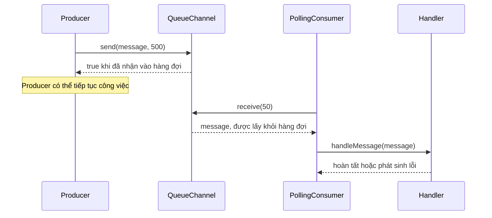

# PollableChannel

## 1. Mục tiêu và bối cảnh

Trong chương **Message channel** của module **SPRING_INTEGRATION_CORE**, bài này giải thích cách một thành phần chủ động lấy thông điệp từ kênh, thay vì được kênh gọi ngay khi có thông điệp mới.

Sau bài học, bạn có thể:

- Phân biệt hợp đồng `PollableChannel`, một triển khai như `QueueChannel`, và endpoint `PollingConsumer`.
- Dùng `receive()`, `receive(timeout)` và kiểm soát thời gian chờ khi gửi.
- Nối kênh vào Java DSL, đặt poller đúng endpoint và giới hạn công việc mỗi lượt.
- Giải thích sự khác nhau giữa nhận vào kênh, xử lý xong và lưu trữ bền vững.
- Thiết kế kiểm thử cho timeout, dung lượng, thứ tự và luồng xử lý có poller.

Giả sử hệ thống tiếp nhận yêu cầu xử lý đơn hàng nhanh hơn tốc độ xử lý thông thường. Một hàng đợi có thể hấp thụ đợt tăng tải ngắn; consumer lấy từng thông điệp theo khả năng xử lý. Thiết kế này cần quy định rõ giới hạn hàng đợi, hành vi khi đầy và cách theo dõi yêu cầu thất bại.

Các ví dụ cấu hình bên dưới hướng tới **Java 17 và Spring Integration 6.5.x**, sử dụng `spring-integration-core`. Phiên bản dependency nên được quản lý đồng bộ bằng BOM hoặc dependency management của dự án. JUnit Jupiter chỉ cần cho các đoạn kiểm thử minh họa.

## 2. PollableChannel là hợp đồng nhận chủ động

`PollableChannel` thuộc package `org.springframework.messaging` của Spring Framework và mở rộng `MessageChannel`. Nó bổ sung hai phương thức nhận:

```java
import org.springframework.messaging.Message;
import org.springframework.messaging.MessageChannel;

public interface PollableChannel extends MessageChannel {

    Message<?> receive();

    Message<?> receive(long timeout);
}
```

Đây là bản rút gọn để thấy chữ ký; API thực tế khai báo kết quả có thể là `null`. `receive()` có thể chờ vô hạn; `receive(timeout)` dùng thời gian chờ tính bằng mili giây. Hết thời gian chờ mà chưa có thông điệp thì kết quả là `null`; việc nhận bị interrupt cũng có thể trả về `null`. [Javadoc PollableChannel](https://docs.spring.io/spring-framework/docs/current/javadoc-api/org/springframework/messaging/PollableChannel.html).

Cần tách ba vai trò:

| Thành phần | Trách nhiệm | Ví dụ |
| --- | --- | --- |
| `PollableChannel` | Quy định API gửi và nhận chủ động | Biến dependency mà consumer sử dụng |
| Triển khai channel | Quyết định cách chứa hoặc bàn giao thông điệp | `QueueChannel`, `PriorityChannel`, `RendezvousChannel` |
| Endpoint/poller | Quyết định lúc nào lấy thông điệp và đưa cho handler | `PollingConsumer` cùng trigger |

Riêng interface không quy định FIFO, dung lượng, cách lưu bền vững hay việc có tạo thread. Những đặc điểm đó phụ thuộc triển khai và cấu hình.

### So sánh với nhận theo subscription

Với `SubscribableChannel`, handler đăng ký để được gọi khi kênh dispatch. Với `PollableChannel`, bên nhận gọi `receive(...)`. Spring Integration cung cấp `EventDrivenConsumer` và `PollingConsumer` tương ứng cho hai cách kết nối này. [Tài liệu Poller](https://docs.spring.io/spring-integration/reference/polling-consumer.html).

Một `QueueChannel` được tạo bằng `new` có thể dùng trực tiếp trong cùng thread. Khi nối vào endpoint có poller, việc nhận thường diễn ra trên thread phục vụ poller. Vì vậy, cần xác định thread từ toàn bộ cấu hình, không chỉ từ kiểu channel.

## 3. Đường đi của một thông điệp



Ví dụ trên có hai thời điểm khác nhau:

1. **Kênh chấp nhận thông điệp:** producer có thể kết thúc thao tác gửi.
2. **Handler hoàn tất nghiệp vụ:** xảy ra sau khi consumer nhận được thông điệp.

Nếu API tiếp nhận đơn hàng trả về trạng thái “đã tiếp nhận”, trạng thái đó nên được biểu diễn riêng với “đã xử lý”. Muốn khách hàng tra cứu tiến độ, ứng dụng cần mã nghiệp vụ, nơi lưu trạng thái và cơ chế cập nhật kết quả.

Ngoài ra, `Message<T>` mang cả payload lẫn headers. Việc đi qua hàng đợi không tự biến thông điệp thành một kiểu payload khác. Transformer mới là thành phần thích hợp khi cần đổi cấu trúc dữ liệu.

## 4. Nhận thông điệp và đặt timeout

Với `QueueChannel`, timeout bằng `0` yêu cầu trả về ngay. Khi hàng đợi có sẵn thông điệp, thao tác nhận không cần đợi hết timeout. [Cơ chế QueueChannel](https://docs.spring.io/spring-integration/reference/channel/implementations.html#queuechannel).

| Lệnh nhận | Ý nghĩa với QueueChannel | Nơi dùng phù hợp |
| --- | --- | --- |
| `receive()` | Chờ đến khi có thông điệp, có thể vô hạn | Consumer có quản lý lifecycle và interrupt |
| `receive(0)` | Thử lấy ngay, rỗng thì trả `null` | Kiểm thử trạng thái hiện tại hoặc lượt thăm dò ngắn |
| `receive(500)` | Chờ tối đa 500 ms nếu chưa có dữ liệu | Thao tác cần thời hạn hữu hạn |
| `receive(MessageChannel.INDEFINITE_TIMEOUT)` | Yêu cầu thời gian chờ vô hạn | Trường hợp chủ động chọn chờ vô hạn |

Ví dụ không cần Spring container:

```java
import org.springframework.integration.channel.QueueChannel;
import org.springframework.messaging.Message;
import org.springframework.messaging.PollableChannel;
import org.springframework.messaging.support.MessageBuilder;

public class ManualReceiveDemo {

    public static void main(String[] args) {
        PollableChannel channel = new QueueChannel(10);

        Message<String> request = MessageBuilder
                .withPayload("ORDER-1001")
                .setHeader("businessRequestId", "REQ-1001")
                .build();

        if (!channel.send(request, 500)) {
            throw new IllegalStateException("Không thể đưa yêu cầu vào kênh");
        }

        Message<?> received = channel.receive(500);

        if (received == null) {
            throw new IllegalStateException("Chưa nhận được thông điệp");
        }

        System.out.println(received.getPayload());
        System.out.println(received.getHeaders().get("businessRequestId"));
        System.out.println(channel.receive(0)); // null: hàng đợi đã rỗng
    }
}
```

Timeout của `receive(500)` giới hạn việc đợi thông điệp. Nó không áp đặt thời hạn 500 ms cho xử lý nghiệp vụ sau đó.

Trong một vòng lặp tự quản lý, gọi `receive(0)` liên tục trên kênh rỗng có thể làm tăng CPU. Nên dùng thời gian chờ hữu hạn và chính sách dừng rõ ràng, hoặc để endpoint của Spring Integration quản lý việc polling.

## 5. Dung lượng và thời gian chờ khi gửi

`QueueChannel(int capacity)` cho phép chọn dung lượng dương. Constructor không tham số tạo hàng đợi có dung lượng rất lớn; không nên xem đây là ngân sách bộ nhớ an toàn cho ứng dụng. Kênh cung cấp `getQueueSize()` và `getRemainingCapacity()` để quan sát trạng thái tức thời. [Javadoc QueueChannel](https://docs.spring.io/spring-integration/api/org/springframework/integration/channel/QueueChannel.html).

```java
QueueChannel inbox = new QueueChannel(1);

boolean first = inbox.send(
        MessageBuilder.withPayload("A").build(), 0);

boolean second = inbox.send(
        MessageBuilder.withPayload("B").build(), 0);

// first == true
// second == false vì chưa có consumer lấy A ra
```

Với `QueueChannel`, `send(message)` có thể chờ vô hạn khi hàng đợi đầy. `send(message, timeout)` giới hạn thời gian đợi chỗ trống; timeout bằng `0` chỉ thử gửi ngay. [Hành vi gửi và nhận của QueueChannel](https://docs.spring.io/spring-integration/reference/channel/implementations.html#queuechannel).

Ứng dụng phải xử lý kết quả `false` theo hợp đồng nghiệp vụ. Chẳng hạn:

- Từ chối tiếp nhận và để caller thử lại theo chính sách đã thống nhất.
- Chuyển sang nơi lưu bền vững đã được thiết kế trước.
- Ghi nhận chỉ số từ chối để phát hiện thiếu năng lực xử lý.

Không tiếp tục báo “đã tiếp nhận” nếu thao tác gửi thất bại.

### Ước lượng một đợt dồn tải

Giả sử trong 5 giây:

- Producer tạo 120 thông điệp/giây.
- Consumer xử lý được 80 thông điệp/giây.
- Hàng đợi ban đầu rỗng.

Mức tồn đọng tăng xấp xỉ:

```text
(120 - 80) × 5 = 200 thông điệp
```

Đây là phép tính theo giả định tải đều, chưa tính dao động hay lỗi. Nếu chênh lệch đầu vào lớn hơn đầu ra kéo dài, mọi dung lượng hữu hạn đều có thể bị lấp đầy. Để chọn capacity, cần đo thêm kích thước payload, giới hạn bộ nhớ và độ trễ chấp nhận được.

Giới hạn hàng đợi tạo áp lực ngược qua việc chờ hoặc từ chối. Cơ chế này không tương đương hợp đồng demand của Reactive Streams.

## 6. Poller thuộc endpoint tiêu thụ kênh

Khi handler nhận dữ liệu từ một `PollableChannel`, Spring Integration dùng `PollingConsumer` để kết nối hai thành phần. Endpoint quản lý lịch polling và chuyển thông điệp cho handler. Các loại handler như transformer, router, filter hoặc service activator có thể được nối theo cơ chế này. [Message Endpoints](https://docs.spring.io/spring-integration/reference/6.5/endpoint.html).

Trong Java DSL, cấu hình poller tại **endpoint đầu tiên đọc kênh pollable**:

```java
IntegrationFlow.from(ordersQueue)
        .handle(orderService, "process",
                endpoint -> endpoint.poller(
                        Pollers.fixedDelay(Duration.ofMillis(200))
                                .receiveTimeout(50)
                                .maxMessagesPerPoll(10)))
        .get();
```

Trong đoạn này, `.handle(...)` là điểm tiêu thụ `ordersQueue`. Vì vậy poller được đặt tại endpoint của `.handle(...)`.

Nếu transformer là thành phần đọc hàng đợi trước, chuyển cấu hình poller sang transformer:

```java
IntegrationFlow.from(ordersQueue)
        .<String, String>transform(String::trim,
                endpoint -> endpoint.poller(
                        Pollers.fixedDelay(Duration.ofMillis(200))
                                .receiveTimeout(50)
                                .maxMessagesPerPoll(10)))
        .handle(textService, "process")
        .get();
```

Hai đoạn trên là hai cấu hình minh họa độc lập, với kiểu payload tương ứng. Nếu gắn cả hai cùng vào một hàng đợi, chúng trở thành các consumer cạnh tranh.

Không đặt poller vào một handler phía sau chỉ vì handler đó xử lý lâu: hãy xác định channel đầu vào của chính endpoint ấy. Nếu channel đầu vào là `DirectChannel`, handler nhận theo subscription.

### Poller cục bộ và poller mặc định

Ví dụ trong bài cấu hình poller trực tiếp để nhìn thấy hành vi từng endpoint. Khi muốn dùng cấu hình chung, DSL cũng hỗ trợ bean poller mặc định:

```java
@Bean(name = PollerMetadata.DEFAULT_POLLER)
public PollerSpec defaultPoller() {
    return Pollers.fixedDelay(Duration.ofMillis(200))
            .receiveTimeout(50)
            .maxMessagesPerPoll(10);
}
```

Các import bổ sung:

```java
import org.springframework.integration.dsl.PollerSpec;
import org.springframework.integration.scheduling.PollerMetadata;
```

Nếu không khai báo poller cục bộ, endpoint cần một poller mặc định phù hợp. Khi tạo `PollerSpec` dưới dạng `@Bean`, trả về spec để container khởi tạo, không tự gọi `getObject()`. [Java DSL Pollers](https://docs.spring.io/spring-integration/reference/dsl/java-pollers.html).

## 7. Ba tham số cần hiểu độc lập

| Tham số | Câu hỏi được trả lời | Ví dụ trong bài |
| --- | --- | --- |
| `fixedDelay` | Chờ bao lâu trước lượt polling tiếp theo? | 200 ms |
| `receiveTimeout` | Một lần nhận chờ dữ liệu tối đa bao lâu? | 50 ms |
| `maxMessagesPerPoll` | Một lượt polling lấy tối đa bao nhiêu thông điệp? | 10 |

`PollerSpec` cung cấp cấu hình số thông điệp mỗi lượt và thời gian chờ nhận; cũng có thể cấu hình executor, transaction advice và kênh lỗi. [Javadoc PollerSpec](https://docs.spring.io/spring-integration/api/org/springframework/integration/dsl/PollerSpec.html).

### Fixed delay và fixed rate

`fixedDelay` đo khoảng cách sau khi tác vụ polling hoàn tất; `fixedRate` dựa trên các mốc bắt đầu theo lịch. [Javadoc Pollers 6.5](https://docs.spring.io/spring-integration/docs/6.5.0/api/org/springframework/integration/dsl/Pollers.html).

Với cấu hình đồng bộ trong ví dụ:

```text
lượt 1: nhận + xử lý một số thông điệp
        -> hoàn tất
        -> đợi khoảng 200 ms
        -> lượt 2
```

Không nên hiểu `fixedDelay(200)` là “cứ đúng 200 ms sẽ xử lý xong một thông điệp”. Lượt polling còn mất thời gian nhận, thực hiện handler và gửi kết quả.

### Max messages không phải batch payload

`maxMessagesPerPoll(10)` giới hạn công việc một lượt. Handler vẫn được gọi với từng thông điệp, không tự nhận `List<Message<?>>`. Nếu cần gom theo mã tương quan hoặc điều kiện hoàn tất, đó là bài toán của aggregator.

Nó cũng không tạo ra 10 worker. Với ví dụ không thêm executor, các lần xử lý trong lượt diễn ra tuần tự. Nếu chỉ có ba thông điệp rồi kênh tiếp tục rỗng, lượt không cần chờ đủ mười thông điệp để chuyển ba thông điệp ấy cho handler.

### Ước lượng thông lượng theo cấu hình

Giả sử luôn có backlog, một lượt lấy 10 thông điệp, mỗi handler mất 20 ms và không có chi phí đáng kể khác:

```text
thời gian xử lý mỗi lượt ≈ 10 × 20 = 200 ms
chu kỳ gồm fixed delay  ≈ 200 + 200 = 400 ms
thông lượng ước lượng   ≈ 10 / 0,4 = 25 thông điệp/giây
```

Đây là suy luận từ giả định, không phải cam kết của framework. Khi hàng đợi rỗng, thời gian chờ nhận ảnh hưởng chu kỳ. Khi thêm executor, scheduler và executor có quan hệ khác; cần đo lại cả số tác vụ chờ chạy.

## 8. Ví dụ hoàn chỉnh bằng Java DSL

Ví dụ tạo một hàng đợi yêu cầu, một hàng đợi kết quả và một kênh lỗi. Service trả chuỗi kết quả để có thể quan sát luồng mà không cần `Thread.sleep()`.

`QueueChannel` ở cuối luồng chỉ phục vụ minh họa; trong ứng dụng thực tế, kết quả phải có consumer hoặc nơi lưu tương ứng.

### 8.1. Cấu hình

```java
import java.time.Duration;
import java.util.logging.Level;
import java.util.logging.Logger;

import org.springframework.beans.factory.annotation.Qualifier;
import org.springframework.context.annotation.Bean;
import org.springframework.context.annotation.Configuration;
import org.springframework.integration.channel.DirectChannel;
import org.springframework.integration.channel.QueueChannel;
import org.springframework.integration.config.EnableIntegration;
import org.springframework.integration.dsl.IntegrationFlow;
import org.springframework.integration.dsl.Pollers;
import org.springframework.messaging.MessageChannel;

@Configuration
@EnableIntegration
public class PollableChannelConfig {

    private static final Logger LOG =
            Logger.getLogger(PollableChannelConfig.class.getName());

    @Bean
    public QueueChannel ordersQueue() {
        return new QueueChannel(100);
    }

    @Bean
    public QueueChannel processedOrders() {
        return new QueueChannel(100);
    }

    @Bean
    public DirectChannel orderErrors() {
        return new DirectChannel();
    }

    @Bean
    public OrderService orderService() {
        return new OrderService();
    }

    @Bean
    public IntegrationFlow orderFlow(
            @Qualifier("ordersQueue") QueueChannel input,
            @Qualifier("processedOrders") QueueChannel output,
            OrderService service) {

        return IntegrationFlow.from(input)
                .handle(service, "process",
                        endpoint -> endpoint
                                .id("orderPollingConsumer")
                                .poller(Pollers
                                        .fixedDelay(Duration.ofMillis(200))
                                        .receiveTimeout(50)
                                        .maxMessagesPerPoll(10)
                                        .errorChannel("orderErrors")))
                .channel(output)
                .get();
    }

    @Bean
    public IntegrationFlow orderErrorFlow(
            @Qualifier("orderErrors") MessageChannel errors) {

        return IntegrationFlow.from(errors)
                .handle(message -> {
                    Throwable failure = (Throwable) message.getPayload();
                    LOG.log(Level.SEVERE,
                            "Không xử lý được yêu cầu đơn hàng", failure);
                })
                .get();
    }

    public record OrderCommand(String orderId) {
    }

    public static class OrderService {

        public String process(OrderCommand command) {
            if (command.orderId() == null || command.orderId().isBlank()) {
                throw new IllegalArgumentException("orderId không hợp lệ");
            }

            // Thay bằng nghiệp vụ thật khi ứng dụng có nơi lưu trạng thái.
            return "Đã xử lý " + command.orderId();
        }
    }
}
```

`IntegrationFlow.from(input)` dùng channel đã khai báo làm đầu vào; framework đăng ký các thành phần được tạo bởi DSL vào application context. [Javadoc IntegrationFlow 6.5](https://docs.spring.io/spring-integration/docs/6.5.0/api/org/springframework/integration/dsl/IntegrationFlow.html).

Có hai endpoint với cách nhận khác nhau:

- `orderFlow` bắt đầu từ `QueueChannel`, dùng poller để lấy yêu cầu.
- `orderErrorFlow` bắt đầu từ `DirectChannel`, đăng ký handler để nhận lỗi khi được gửi tới kênh này.

Trong service mẫu, trả về chuỗi chỉ xác nhận hàm minh họa đã chạy. Khi thêm database hoặc API ngoài, hãy định nghĩa rõ kết quả nào mới được xem là hoàn tất nghiệp vụ.

### 8.2. Gửi và đợi kết quả với thời hạn

Đặt lớp dưới đây cùng package với lớp cấu hình:

```java
import org.springframework.context.annotation.AnnotationConfigApplicationContext;
import org.springframework.messaging.Message;
import org.springframework.messaging.MessageChannel;
import org.springframework.messaging.PollableChannel;
import org.springframework.messaging.support.MessageBuilder;

public class PollableChannelDemo {

    public static void main(String[] args) {
        try (var context = new AnnotationConfigApplicationContext(
                PollableChannelConfig.class)) {

            MessageChannel input =
                    context.getBean("ordersQueue", MessageChannel.class);

            PollableChannel results =
                    context.getBean("processedOrders", PollableChannel.class);

            Message<PollableChannelConfig.OrderCommand> request =
                    MessageBuilder.withPayload(
                            new PollableChannelConfig.OrderCommand("ORDER-1001"))
                            .setHeader("businessRequestId", "REQ-1001")
                            .build();

            if (!input.send(request, 500)) {
                throw new IllegalStateException("Hàng đợi yêu cầu đã đầy");
            }

            Message<?> reply = results.receive(2000);

            if (reply == null) {
                throw new IllegalStateException(
                        "Chưa có kết quả trong thời gian chờ");
            }

            System.out.println(reply.getPayload());
        }
    }
}
```

Kết quả kỳ vọng:

```text
Đã xử lý ORDER-1001
```

Mốc 500 ms dành cho tiếp nhận vào hàng đợi; mốc 2000 ms dành cho chờ kết quả trong chương trình minh họa. Nếu hết thời gian chờ kết quả, không thể suy ra yêu cầu chắc chắn chưa được xử lý: nó có thể đang thực hiện hoặc đã hoàn tất nhưng kết quả chưa đến.

Nếu gửi nhiều yêu cầu, cần đối chiếu kết quả bằng mã tương quan thay vì mặc định kết quả nhận được thuộc về lần gửi gần nhất.

### 8.3. Liên hệ với gateway và các EIP khác

Có thể đặt messaging gateway trước `ordersQueue` để nghiệp vụ gọi qua một interface Java. Gateway che giấu API messaging; phương thức trả về giá trị cần một đường trả lời cùng timeout phù hợp. [Messaging Gateways](https://docs.spring.io/spring-integration/reference/gateway.html).

Trong thiết kế đó, một hàng đợi ở request channel không làm lời gọi gateway trả kết quả ngay: caller vẫn có thể phải đợi reply. Cần phân biệt timeout đưa request vào kênh và timeout chờ reply.

Sau điểm đọc hàng đợi, flow có thể thêm transformer, filter, router hoặc aggregator. PollableChannel phụ trách vận chuyển; từng endpoint phụ trách biến đổi, loại bỏ, chọn nhánh hoặc gom nhóm.

## 9. Lỗi sau khi nhận thông điệp

### 9.1. Producer có nhìn thấy lỗi của handler không?

Khi producer đã gửi xong vào hàng đợi và poller xử lý ở thread khác, exception của handler không tự quay lại stack của producer.

Với hạ tầng xử lý lỗi mặc định, lỗi của tác vụ poller được biểu diễn bằng `ErrorMessage`. Header `errorChannel` của thông điệp có thể chỉ định đích lỗi; nếu không có, cơ chế mặc định dùng bean `errorChannel`. Ví dụ trên cấu hình đích lỗi riêng tại poller là `orderErrors`. [Error Handling](https://docs.spring.io/spring-integration/reference/error-handling.html).

Nếu tự viết vòng lặp `receive()` rồi gọi service trực tiếp, bạn phải tự xử lý exception của service. Đừng mặc định vòng lặp đó được bao bởi cơ chế lỗi của một endpoint do framework quản lý.

### 9.2. Nhận ra khỏi hàng đợi rồi lỗi

Xét hàng đợi trong bộ nhớ và không có cơ chế retry hay transaction bổ sung:

```text
receive lấy M ra khỏi QueueChannel
        -> handler gọi dịch vụ ngoài
        -> dịch vụ ngoài lỗi
        -> M không tự quay lại QueueChannel
```

Handler ghi log trong ví dụ chỉ giúp quan sát lỗi. Nó chưa tạo quy trình khôi phục, chưa ghi lại yêu cầu thất bại một cách bền vững và chưa lên lịch thử lại.

Một thiết kế có thể bổ sung:

- Retry hữu hạn cho lỗi tạm thời, với thời gian nghỉ phù hợp.
- Nơi lưu thông điệp thất bại cùng mã nghiệp vụ và nguyên nhân.
- Thao tác xử lý lại có kiểm soát.
- Tính idempotent để việc thử lại không tạo tác dụng phụ trùng.

Ví dụ, API thanh toán có thể đã thực hiện thành công nhưng phản hồi bị mất. Nếu ứng dụng gửi lại cùng yêu cầu, mã idempotency cần giúp nhận ra giao dịch cũ.

### 9.3. Transaction không tự đi qua mọi ranh giới

Poller có thể được bọc bởi transaction advice. Tuy nhiên, tài nguyên phải hỗ trợ transaction và phải tham gia đúng transaction manager; transaction gắn với thread không tự nối liền hai thread producer và consumer. [Transaction Support](https://docs.spring.io/spring-integration/reference/transactions.html).

Do đó, thêm transaction cho thao tác database của handler không tự biến hàng đợi trong bộ nhớ thành hàng đợi có rollback. Cần thiết kế riêng sự nhất quán giữa nhận thông điệp, ghi dữ liệu và phát thông điệp tiếp theo.

## 10. Thứ tự, cạnh tranh và khả năng lưu bền vững

### 10.1. Thứ tự nhận và thứ tự hoàn tất

Với `QueueChannel` FIFO thông thường và một consumer xử lý tuần tự, các yêu cầu A, B, C được lấy theo thứ tự đã xếp vào hàng đợi. Khi nhiều consumer cùng đọc, mỗi thông điệp được một consumer lấy; mô hình này chia công việc, không phát bản sao cho tất cả consumer. [Các triển khai message channel](https://docs.spring.io/spring-integration/reference/channel/implementations.html).

Ngay cả khi A được lấy trước B, A có thể hoàn tất sau B nếu có nhiều nhánh xử lý đồng thời. Ví dụ A mất 2 giây còn B mất 20 ms.

Nếu bắt buộc giữ thứ tự theo một đơn hàng, hãy xác định khóa thứ tự, cách phân tuyến và số consumer được phép xử lý cùng khóa.

### 10.2. Chọn triển khai theo nhu cầu

| Nhu cầu | Điểm bắt đầu xem xét | Điều cần kiểm tra thêm |
| --- | --- | --- |
| Đệm một lượng yêu cầu hữu hạn | `QueueChannel` có capacity | Bộ nhớ và hành vi khi đầy |
| Lấy yêu cầu theo độ ưu tiên | `PriorityChannel` | Quy tắc ưu tiên, nguy cơ yêu cầu thấp bị chờ lâu |
| Bàn giao khi bên nhận sẵn sàng | `RendezvousChannel` | Timeout và nguy cơ hai bên chờ nhau |
| Phát cùng sự kiện tới nhiều nơi | `PublishSubscribeChannel` | Chính sách lỗi và cách chạy từng subscriber |

`RendezvousChannel` không có vùng đệm như một hàng đợi dung lượng dương; việc bàn giao thành công vẫn chưa xác nhận nghiệp vụ ở handler đã hoàn tất. `PriorityChannel` cần quy tắc so sánh ưu tiên phù hợp. [Channel Implementations](https://docs.spring.io/spring-integration/reference/channel/implementations.html).

### 10.3. Lưu trong bộ nhớ và lưu bền vững

`new QueueChannel(100)` trong ví dụ không lưu thông điệp xuống đĩa. Khởi động lại tiến trình có thể làm mất các thông điệp chưa xử lý còn trong bộ nhớ. Khi cần persistence, Spring Integration hỗ trợ cấu hình message store phù hợp hoặc tích hợp với một hệ thống messaging bên ngoài. [Lưu trữ cho channel](https://docs.spring.io/spring-integration/reference/channel/implementations.html).

Việc chọn hệ thống bên ngoài vẫn cần chính sách acknowledgement, redelivery, giới hạn retry và tính idempotent. Không nên suy ra bảo đảm “exactly once” từ riêng kiểu `PollableChannel`.

## 11. Kiểm thử hành vi cốt lõi

Các đoạn sau là mã kiểm thử để người học đưa vào dự án. Chúng chưa được thực thi trong phạm vi biên soạn bài.

### 11.1. Kênh rỗng, giới hạn dung lượng và FIFO

Hai kiểm thử dùng timeout bằng `0` để kiểm tra trạng thái tức thời, không phụ thuộc một khoảng ngủ cố định:

```java
import org.junit.jupiter.api.Test;
import org.springframework.integration.channel.QueueChannel;
import org.springframework.messaging.support.MessageBuilder;

import static org.junit.jupiter.api.Assertions.*;

class QueueChannelContractTest {

    @Test
    void emptyQueueReturnsNullImmediately() {
        var channel = new QueueChannel(2);

        assertNull(channel.receive(0));
    }

    @Test
    void boundedQueueRejectsWhenFullAndReceivesInOrder() {
        var channel = new QueueChannel(2);

        var first = MessageBuilder.withPayload("A").build();
        var second = MessageBuilder.withPayload("B").build();
        var third = MessageBuilder.withPayload("C").build();

        assertTrue(channel.send(first, 0));
        assertTrue(channel.send(second, 0));
        assertFalse(channel.send(third, 0));

        assertEquals(first, channel.receive(0));
        assertEquals(second, channel.receive(0));
        assertNull(channel.receive(0));
    }
}
```

Các assertion kiểm tra hợp đồng mà ứng dụng cần dựa vào: không chờ khi rỗng, từ chối khi đầy, nhận đúng thứ tự và không nhận lại thông điệp đã lấy.

### 11.2. Kiểm thử flow với poller

Kiểm thử sau sử dụng chính `PollableChannelConfig` ở phần 8; đặt nó cùng package với lớp cấu hình.

```java
import org.junit.jupiter.api.Test;
import org.springframework.context.annotation.AnnotationConfigApplicationContext;
import org.springframework.messaging.Message;
import org.springframework.messaging.MessageChannel;
import org.springframework.messaging.PollableChannel;
import org.springframework.messaging.support.MessageBuilder;

import static org.junit.jupiter.api.Assertions.*;

class OrderPollingFlowTest {

    @Test
    void pollerProcessesAcceptedOrder() {
        try (var context = new AnnotationConfigApplicationContext(
                PollableChannelConfig.class)) {

            MessageChannel input =
                    context.getBean("ordersQueue", MessageChannel.class);

            PollableChannel output =
                    context.getBean("processedOrders", PollableChannel.class);

            assertTrue(input.send(MessageBuilder.withPayload(
                    new PollableChannelConfig.OrderCommand("ORDER-42"))
                    .build(), 500));

            Message<?> result = output.receive(2000);

            assertNotNull(result);
            assertEquals("Đã xử lý ORDER-42", result.getPayload());
        }
    }
}
```

Ở đây, `receive(2000)` đợi một kết quả quan sát được và có giới hạn. Không kiểm tra thời gian thực thi phải chính xác bằng số mili giây cấu hình, vì scheduler và tải máy có thể làm thời điểm chạy dao động.

Với luồng nhiều yêu cầu hoặc nhiều nhánh, mở rộng kiểm thử bằng cách kiểm tra mã tương quan, nội dung kết quả và số lượng kết quả. Chỉ tăng timeout khi đã xem xét nguyên nhân chậm.

## 12. Chẩn đoán những tình huống thường gặp

| Hiện tượng | Khả năng cần kiểm tra | Hướng xử lý |
| --- | --- | --- |
| Gửi được nhưng nghiệp vụ không chạy | Chưa có consumer, endpoint chưa start, thiếu poller | Kiểm tra endpoint đọc kênh và lifecycle |
| Producer bị giữ lâu | Hàng đợi đầy và gửi không có timeout | Đặt thời hạn gửi, xử lý kết quả thất bại |
| Nhận `null` | Kênh rỗng, timeout hết, nhận bị interrupt | Kiểm tra dữ liệu đầu vào và lifecycle |
| CPU tăng khi không có dữ liệu | Vòng lặp tự gọi `receive(0)` liên tục | Dùng chờ hữu hạn hoặc poller có lịch |
| Hàng đợi tăng dù đã có poller | Đầu vào lớn hơn năng lực xử lý | Đo thời gian handler và tốc độ tiêu thụ |
| Tăng max messages nhưng không có thêm worker | Nhầm giới hạn một lượt với mức song song | Thiết kế concurrency theo yêu cầu thứ tự |
| Lỗi chỉ xuất hiện trong log | Luồng lỗi chưa lưu hoặc khôi phục yêu cầu | Bổ sung nơi lưu lỗi và quy trình thử lại |
| Kết quả đến khác thứ tự gửi | Có nhiều consumer hoặc xử lý đồng thời | Đối chiếu mã tương quan, xem yêu cầu thứ tự |
| Chờ nhau không kết thúc | Hai thao tác blocking cần cùng thread để tiến triển | Tách bên gửi/nhận phù hợp và đặt timeout |

Khi theo dõi vận hành, nên đo cả tốc độ tiếp nhận, tốc độ hoàn tất, thời gian chờ trong hàng đợi và số yêu cầu lỗi. Độ dài hàng đợi thấp chưa đủ chứng minh hệ thống khỏe: yêu cầu có thể đã rời hàng đợi rồi thất bại ở handler.

## 13. Bài thực hành

1. Chạy `ManualReceiveDemo`, đổi capacity thành 1 và thử gửi hai thông điệp trước lần nhận đầu tiên. Giải thích kết quả của từng lần gửi.
2. Chạy flow mẫu, lần lượt đổi `maxMessagesPerPoll` thành 1 và 10 với cùng tập yêu cầu. Quan sát thời điểm hoàn tất khi có backlog.
3. Gửi `new OrderCommand("")`. Xác định log lỗi xuất hiện ở đâu và vì sao hàng đợi kết quả không có phản hồi thành công.
4. Giả lập một handler mất 100 ms, duy trì đầu vào lớn hơn đầu ra trong khoảng thời gian hữu hạn. Đo backlog rồi quan sát cách hệ thống xử lý khi hàng đợi đầy.
5. Vẽ phương án lưu yêu cầu lỗi và xử lý lại theo mã nghiệp vụ. Nêu cách tránh tạo tác dụng phụ hai lần.

Sau khi làm, cần giải thích được bốn quyết định trong thiết kế của mình: ai nhận thông điệp, chờ tối đa bao lâu, làm gì khi không còn chỗ và khôi phục thế nào khi nghiệp vụ thất bại.
