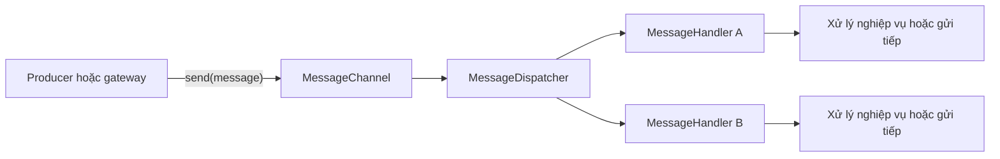
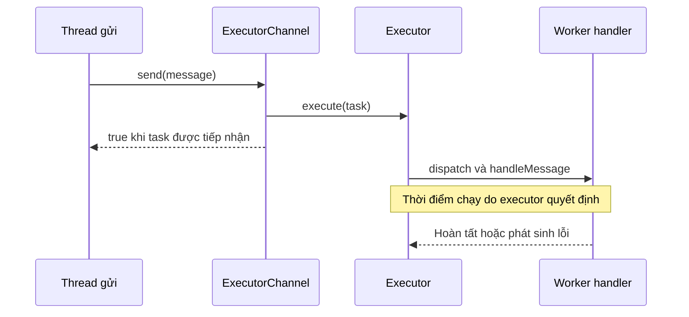

# MessageDispatcher

## 1. Mục tiêu và phạm vi

Trong chương **Message channel** của module **SPRING_INTEGRATION_CORE**, bài này giải thích cách Spring Integration chuyển một `Message<?>` từ channel đến các `MessageHandler` đã đăng ký. Sau bài học, bạn có thể chọn cơ chế phân phối phù hợp, cấu hình failover, dự đoán nơi phát sinh lỗi và kiểm thử số handler thực sự được gọi.

Tình huống xuyên suốt là xử lý đơn hàng:

- Hai worker có cùng khả năng tiếp nhận đơn: mỗi đơn cần một worker xử lý.
- Dịch vụ chính có dịch vụ dự phòng: thử dịch vụ tiếp theo khi lỗi cho phép chuyển tiếp.
- Một sự kiện đơn hàng cần thông báo đến cả bộ phận kiểm toán và gửi thông báo: mỗi nhánh cần nhận sự kiện.

Các ví dụ dùng `spring-integration-core`; phần kiểm thử dùng JUnit Jupiter. Riêng `setFailoverStrategy(Predicate<Exception>)` yêu cầu Spring Integration từ 6.3. Không cần tạo dispatcher bean riêng để áp dụng những cấu hình channel trong bài.

## 2. Dispatcher nằm ở đâu trong một luồng thông điệp?

`MessageDispatcher` thuộc package `org.springframework.integration.dispatcher`. Đây là giao diện chiến lược quản lý handler và phân phối message đến handler. Những thao tác chính gồm:

| Phương thức | Ý nghĩa |
| --- | --- |
| `addHandler(MessageHandler)` | Đăng ký handler; kết quả cho biết có thêm được hay không |
| `removeHandler(MessageHandler)` | Gỡ handler |
| `getHandlerCount()` | Lấy số handler đang đăng ký |
| `dispatch(Message<?>)` | Thực hiện phân phối theo chiến lược của dispatcher |

Ứng dụng thông thường gọi `channel.send(message)` và khai báo endpoint. Việc truy cập trực tiếp dispatcher chủ yếu hữu ích khi tìm hiểu nội bộ hoặc mở rộng framework. [API MessageDispatcher](https://docs.spring.io/spring-integration/api/org/springframework/integration/dispatcher/MessageDispatcher.html).



Hai cạnh từ dispatcher đến A và B thể hiện các đích có thể được gọi. Số đích được gọi trong một lần gửi phụ thuộc chiến lược.

Với `AbstractSubscribableChannel`, `subscribe(handler)` đăng ký vào dispatcher; `unsubscribe(handler)` gỡ đăng ký; đường gửi chuyển tiếp đến `dispatch(message)`. Trong một ứng dụng Spring, endpoint như `EventDrivenConsumer` đảm nhiệm đăng ký và gỡ handler theo vòng đời của endpoint. Vì vậy, một bean xử lý nghiệp vụ tồn tại chưa đủ để khẳng định channel đã có subscriber. [Mã nguồn AbstractSubscribableChannel](https://raw.githubusercontent.com/spring-projects/spring-integration/v6.5.0/spring-integration-core/src/main/java/org/springframework/integration/channel/AbstractSubscribableChannel.java).

Có thể hình dung các trách nhiệm trong cùng ví dụ:

| Thành phần | Trách nhiệm |
| --- | --- |
| Message | Mang payload đơn hàng và header |
| Channel | Điểm gửi/nhận mà các thành phần kết nối vào |
| Dispatcher | Quyết định cách gọi các handler của channel |
| Endpoint | Gắn handler vào luồng và quản lý vòng đời |
| Handler | Thực thi bước xử lý, chẳng hạn transformer, filter hoặc service activator |
| Gateway | Cung cấp giao diện Java để ứng dụng đi vào luồng thông điệp |

## 3. Quan hệ giữa channel và dispatcher

Bài tập trung vào hai chiến lược thường gặp: unicast và broadcast.

| Channel | Dispatcher liên quan | Mô hình phân phối | Luồng thực thi điển hình |
| --- | --- | --- | --- |
| `DirectChannel` | `UnicastingDispatcher` | Một handler hoàn tất bình thường thì dừng | Thread gọi `send()` |
| `ExecutorChannel` | `UnicastingDispatcher` | Cùng cơ chế chọn handler như unicast đồng bộ | Giao việc cho executor |
| `PublishSubscribeChannel` | `BroadcastingDispatcher` | Phân phối đến các subscriber | Thread gửi hoặc executor nếu được cấp |

`QueueChannel` lưu message để consumer lấy qua `receive()`; không dùng mô hình đăng ký handler và dispatch trực tiếp như các channel trên. Đây cũng không phải toàn bộ các loại channel: Spring Integration còn có những lựa chọn chuyên biệt như `PartitionedChannel`. [Message Channel Implementations](https://docs.spring.io/spring-integration/reference/channel/implementations.html).

Khi thiết kế luồng, cần trả lời riêng hai câu hỏi:

1. Một message cần được một worker hay nhiều nhánh xử lý?
2. Handler chạy trong thread gửi hay được giao cho executor?

Ví dụ, thêm executor vào publish-subscribe thay đổi cách thực thi các nhánh; nhu cầu phân phối đến nhiều subscriber vẫn giữ nguyên.

## 4. UnicastingDispatcher: chọn một handler xử lý

### 4.1. Khi nào dispatcher dừng?

`UnicastingDispatcher` xét các handler theo thứ tự do chiến lược cân bằng tải cung cấp. Khi một lời gọi `handleMessage(message)` kết thúc bình thường, dispatcher dừng và coi việc phân phối đã thành công.

`MessageHandler.handleMessage()` trả về `void`. Vì vậy, “handler chấp nhận message” được hiểu là lời gọi không ném exception. Nếu failover được bật, cùng một message có thể đã được thử ở nhiều handler trước khi một handler hoàn tất. [API UnicastingDispatcher](https://docs.spring.io/spring-integration/api/org/springframework/integration/dispatcher/UnicastingDispatcher.html).

Với hai worker có năng lực tương đương:

```text
Đơn 101 -> worker A hoàn tất -> dừng
Đơn 102 -> worker B hoàn tất -> dừng
Đơn 103 -> worker A hoàn tất -> dừng
```

Nếu A đã thực hiện một phần công việc rồi ném exception, B vẫn có thể được gọi. Do đó, số lần thử và số lần phát sinh tác dụng phụ cần được quan sát riêng.

### 4.2. Round-robin điều khiển điểm bắt đầu

`new DirectChannel()` sử dụng `RoundRobinLoadBalancingStrategy`. Chiến lược này luân phiên handler được thử đầu tiên; khi cần failover, iterator vẫn cho phép đi qua các handler còn lại. [API DirectChannel](https://docs.spring.io/spring-integration/api/org/springframework/integration/channel/DirectChannel.html), [API RoundRobinLoadBalancingStrategy](https://docs.spring.io/spring-integration/api/org/springframework/integration/dispatcher/RoundRobinLoadBalancingStrategy.html).

Giả sử subscriber ổn định, không có lỗi và các lệnh gửi tuần tự:

| Message | Thứ tự thử minh họa | Kết quả |
| --- | --- | --- |
| M1 | A, B, C | A hoàn tất; B và C không được gọi |
| M2 | B, C, A | B hoàn tất; C và A không được gọi |
| M3 | C, A, B | C hoàn tất; A và B không được gọi |

Round-robin phân chia lượt bắt đầu. Thời gian xử lý của A, B, C vẫn có thể khác nhau. Từ bảng này không thể suy ra thời gian hoàn tất bằng nhau hoặc handler luôn chạy song song.

### 4.3. Failover và thứ tự cố định

Failover mặc định được bật. Muốn luôn thử dịch vụ chính trước, có thể bỏ chiến lược cân bằng tải:

```java
DirectChannel primaryThenBackup = new DirectChannel(null);
primaryThenBackup.setFailover(true);
```

Với các handler không có ưu tiên riêng, ví dụ đăng ký primary trước backup sẽ cho thứ tự thử primary rồi backup. Trong cấu hình endpoint thực tế, cần xác định thứ tự rõ ràng nếu vai trò chính/dự phòng là yêu cầu nghiệp vụ. `AbstractDispatcher` quản lý tập handler có nhận biết thứ tự. [API AbstractDispatcher](https://docs.spring.io/spring-integration/api/org/springframework/integration/dispatcher/AbstractDispatcher.html).

Hai cấu hình độc lập cần phân biệt:

| Cấu hình | Điều khiển |
| --- | --- |
| `new DirectChannel(null)` | Không luân phiên điểm bắt đầu bằng load balancer |
| `setFailover(false)` | Dừng khi handler đang được thử ném exception |

Đặt load balancer bằng `null` vẫn cho phép chuyển sang handler tiếp theo khi failover được bật. [Configuring Message Channels](https://docs.spring.io/spring-integration/reference/channel/configuration.html).

### 4.4. Ví dụ: dịch vụ chính và dự phòng

Ví dụ sau là một chương trình Java độc lập khi classpath đã có `spring-integration-core` và các dependency của nó:

```java
import java.util.ArrayList;
import java.util.List;

import org.springframework.integration.channel.DirectChannel;
import org.springframework.messaging.Message;
import org.springframework.messaging.support.MessageBuilder;

public class UnicastFailoverDemo {

    public static void main(String[] args) {
        List<String> attempts = new ArrayList<>();
        DirectChannel orders = new DirectChannel(null);
        orders.setFailover(true);

        orders.subscribe(message -> {
            attempts.add("primary:" + message.getPayload());
            throw new IllegalStateException("Primary unavailable");
        });

        orders.subscribe(message ->
                attempts.add("backup:" + message.getPayload()));

        Message<String> message = MessageBuilder
                .withPayload("ORDER-101")
                .setHeader("orderId", "101")
                .build();

        boolean sent = orders.send(message);

        System.out.println("sent=" + sent);
        System.out.println(attempts);
    }
}
```

Bỏ qua log framework, kết quả mong đợi là:

```text
sent=true
[primary:ORDER-101, backup:ORDER-101]
```

Thành công ở backup khiến `send()` trả về `true`, dù primary đã lỗi. Khi cần theo dõi tình trạng primary, phải có log hoặc metric về từng lần thử.

Đổi thành `orders.setFailover(false)`: lời gọi gửi phát sinh exception ở primary, backup không được gọi và hai lệnh in sau `send()` không chạy.

### 4.5. Failover theo loại lỗi

Từ Spring Integration 6.3, có thể dùng `Predicate<Exception>` để chọn lỗi nào cho phép thử handler tiếp theo. `setFailover(boolean)` và `setFailoverStrategy(...)` thay thế cấu hình của nhau; nên chọn một cách cấu hình rõ ràng. [API setFailoverStrategy](https://docs.spring.io/spring-integration/api/org/springframework/integration/dispatcher/UnicastingDispatcher.html#setFailoverStrategy(java.util.function.Predicate)).

Ví dụ này cho phép failover khi chuỗi nguyên nhân chứa lỗi tạm thời do ứng dụng định nghĩa:

```java
import org.springframework.integration.channel.DirectChannel;

public class SelectiveFailover {

    static final class TemporaryBackendException extends RuntimeException {
        TemporaryBackendException(String message) {
            super(message);
        }
    }

    public static DirectChannel createChannel() {
        DirectChannel channel = new DirectChannel(null);
        channel.setFailoverStrategy(SelectiveFailover::isTemporary);
        return channel;
    }

    private static boolean isTemporary(Exception exception) {
        Throwable current = exception;
        while (current != null) {
            if (current instanceof TemporaryBackendException) {
                return true;
            }
            current = current.getCause();
        }
        return false;
    }
}
```

Việc duyệt nguyên nhân giúp ví dụ nhận ra lỗi nghiệp vụ khi exception đã được lớp xử lý bên ngoài bọc lại. Với dữ liệu đơn hàng sai định dạng, thiết kế này trả về `false` và cho lỗi đi ra thay vì thử một backend khác cũng nhận cùng dữ liệu sai.

### 4.6. Ba ranh giới cần hiểu đúng

**Failover và retry:** failover thử một handler khác trong danh sách subscriber. Retry áp dụng chính sách gọi lại một thao tác, thường kèm số lần thử và khoảng chờ. Ví dụ primary rồi backup có hai đích xử lý; retry primary ba lần là một quyết định khác.

**Filter từ chối và exception:** filter có thể loại message mà không ném exception. Khi lời gọi filter kết thúc bình thường, unicast không tự chuyển message sang subscriber tiếp theo để tìm nơi “đồng ý” xử lý. Nếu cần phân nhánh theo loại đơn, dùng router; nếu cần báo lỗi khi filter từ chối, cấu hình hành vi từ chối của filter. [Filter](https://docs.spring.io/spring-integration/reference/filter.html).

**Phạm vi lỗi:** nếu handler gửi tiếp qua các `DirectChannel`, exception ở bước sau có thể quay ngược về lời gọi ban đầu. Failover khi đó có thể thử lại cả nhánh xử lý ở subscriber khác. Khi nhánh trước đã gọi cổng thanh toán hoặc gửi email, cần thiết kế idempotency theo khóa nghiệp vụ như `orderId` và một cơ chế ghi nhận phù hợp; bản thân dispatcher không loại bỏ tác dụng phụ đã xảy ra.

## 5. BroadcastingDispatcher: phân phối đến nhiều subscriber

### 5.1. Các subscriber nhận cùng một sự kiện

Với `PublishSubscribeChannel`, kiểm toán và thông báo đều có thể nhận một sự kiện đơn hàng:

```java
import java.util.ArrayList;
import java.util.List;

import org.springframework.integration.channel.PublishSubscribeChannel;
import org.springframework.messaging.support.GenericMessage;

public class BroadcastDemo {

    public static void main(String[] args) {
        List<String> calls = new ArrayList<>();
        PublishSubscribeChannel events = new PublishSubscribeChannel(true);

        events.subscribe(message ->
                calls.add("audit:" + message.getPayload()));
        events.subscribe(message ->
                calls.add("notification:" + message.getPayload()));

        boolean sent = events.send(new GenericMessage<>("ORDER-CREATED"));

        System.out.println("sent=" + sent);
        System.out.println(calls);
    }
}
```

Kết quả mong đợi, bỏ qua log framework:

```text
sent=true
[audit:ORDER-CREATED, notification:ORDER-CREATED]
```

Constructor nhận `true` yêu cầu phải có subscriber. Khi không cung cấp executor, các lời gọi handler chạy trong thread gửi. Vì vậy, thời gian của nhánh kiểm toán ảnh hưởng trực tiếp đến thời điểm bắt đầu nhánh thông báo và thời gian trả về của `send()`. [API PublishSubscribeChannel](https://docs.spring.io/spring-integration/api/org/springframework/integration/channel/PublishSubscribeChannel.html).

### 5.2. Một nhánh lỗi có thể chặn nhánh sau

Mặc định `ignoreFailures=false`. Với broadcast đồng bộ, nếu subscriber A ném exception, quá trình có thể dừng trước khi gọi B và C.

```text
send(event)
  -> A ném exception
  -> B chưa được gọi
  -> C chưa được gọi
  -> exception đi ra khỏi send()
```

Có thể yêu cầu tiếp tục thử các subscriber còn lại:

```java
PublishSubscribeChannel events = new PublishSubscribeChannel(true);
events.setIgnoreFailures(true);
```

Khi đó, lỗi được ghi log và bị chặn tại bước dispatch để dispatcher tiếp tục. Nếu có executor, lỗi ở một task không bảo đảm ngăn những task khác vốn đã được giao thực thi; bật `ignoreFailures` còn có thể ngăn lỗi handler đi đến error handler. [API BroadcastingDispatcher](https://docs.spring.io/spring-integration/api/org/springframework/integration/dispatcher/BroadcastingDispatcher.html).

Ví dụ, nếu kiểm toán là bước bắt buộc trước khi gửi email, cần thể hiện quan hệ ấy bằng chuỗi xử lý. Nếu hai nhánh độc lập nhưng đều phải hoàn thành đáng tin cậy, mỗi nhánh cần cơ chế theo dõi và phục hồi phù hợp. Một cờ tiếp tục phân phối chưa thể hiện được hai yêu cầu này.

### 5.3. Không có subscriber, số subscriber tối thiểu và kết quả gửi

Các tùy chọn dễ nhầm:

| Tùy chọn | Mục đích | Điều không thể suy ra |
| --- | --- | --- |
| `requireSubscribers=true` | Báo lỗi khi không có subscriber | Mọi subscriber đều xử lý thành công |
| `minSubscribers=n` | Đặt ngưỡng để dispatcher trả về `true` | Có ít nhất n kết quả nghiệp vụ thành công khi xử lý bất đồng bộ |
| `ignoreFailures=true` | Tiếp tục thử các handler khác khi handler lỗi | Handler lỗi được tự động retry |
| `maxSubscribers` | Giới hạn số handler được đăng ký | Giới hạn số message đang xử lý hoặc kích thước thread pool |

Với channel mặc định, `requireSubscribers=false` và `minSubscribers=0`, gửi khi không có subscriber vẫn có thể trả về `true`. Khi dùng executor, việc đếm dispatch phản ánh các task được giao thực thi; handler có thể chưa hoàn tất. Trong broadcast đồng bộ, một số subscriber có thể đã chạy trước khi dispatcher xác định ngưỡng tối thiểu chưa đạt. Vì vậy, `minSubscribers` không phải cơ chế kiểm tra trước rồi mới cho toàn bộ nhánh chạy. [Mã nguồn BroadcastingDispatcher](https://raw.githubusercontent.com/spring-projects/spring-integration/v6.5.0/spring-integration-core/src/main/java/org/springframework/integration/dispatcher/BroadcastingDispatcher.java).

Ví dụ cấu hình yêu cầu có subscriber và đặt ngưỡng hai:

```java
PublishSubscribeChannel events = new PublishSubscribeChannel(true);
events.setMinSubscribers(2);
```

Nếu nghiệp vụ cần chứng minh cả kiểm toán và thông báo đã hoàn tất, nên thu thập kết quả của từng nhánh theo mã đơn hàng. Một giá trị boolean ở điểm gửi không thay thế được bản ghi kết quả đó.

### 5.4. applySequence và aggregator

Khi các nhánh broadcast cần hợp nhất kết quả, `setApplySequence(true)` bổ sung thông tin tương quan và thứ tự vào các message gửi ra:

```java
PublishSubscribeChannel checks = new PublishSubscribeChannel(true);
checks.setApplySequence(true);
```

Với hai subscriber, mỗi nhánh nhận thông tin `sequenceSize=2`, cùng correlation ID và sequence number khác nhau. Đây là dữ liệu hỗ trợ aggregator biết các kết quả thuộc cùng nhóm. Những message được tạo cho các nhánh vẫn tham chiếu cùng payload; bật sequence không deep-copy đối tượng nghiệp vụ. [Cấu hình apply-sequence](https://docs.spring.io/spring-integration/reference/channel/configuration.html).

Từ đó có hai hệ quả thiết kế cho ví dụ đơn hàng:

- Payload dùng chung nên được xử lý như dữ liệu bất biến để các nhánh không sửa trạng thái của nhau.
- Nếu một nhánh filter loại bỏ message hoặc không tạo kết quả, aggregator có thể thiếu thành viên. Cần xác định kết quả từ chối, timeout hoặc chính sách hoàn tất nhóm phù hợp.

Dispatcher cung cấp thông tin phân phối; điều kiện một nhóm đã đủ kết quả thuộc cấu hình aggregator và hợp đồng giữa các nhánh.

## 6. Thread, lỗi và ý nghĩa của send()

### 6.1. DirectChannel

Với `DirectChannel`, lời gọi handler chạy trong thread gửi. Nếu nhánh đồng bộ phía sau hoàn tất bình thường, `send()` mới trả về. Lỗi chưa được xử lý có thể đi ngược về caller.

Điều này cho phép một luồng đồng bộ tham gia giao dịch bao quanh lời gọi gửi khi các thành phần dùng đúng transaction manager và tài nguyên giao dịch. Channel không tự mở transaction, cũng không tự hoàn tác một cuộc gọi HTTP đã tạo tác dụng phụ. [API DirectChannel](https://docs.spring.io/spring-integration/api/org/springframework/integration/channel/DirectChannel.html).

### 6.2. ExecutorChannel

`ExecutorChannel` chuyển việc dispatch cho executor, thường tạo ranh giới thread. Khi `send()` trả về `true`, có thể task chỉ vừa được executor tiếp nhận. Lỗi nghiệp vụ phát sinh sau đó ở worker không thể được bắt bằng một `try/catch` đã kết thúc ở thread gửi. Executor cũng có thể từ chối task ngay lúc gửi nếu quá tải.

Transaction gắn với thread gửi không tự truyền sang thread worker. Một executor đặc biệt hoặc chính sách từ chối có thể chạy task trên thread gọi; thiết kế nên dựa trên cấu hình executor cụ thể. [API ExecutorChannel](https://docs.spring.io/spring-integration/api/org/springframework/integration/channel/ExecutorChannel.html).



Thứ tự giữa thời điểm worker bắt đầu và thời điểm caller nhận `true` có thể thay đổi. Sơ đồ minh họa việc giao task, không áp đặt rằng worker luôn bắt đầu sau khi `send()` trả về.

### 6.3. Đường đi của exception

| Bối cảnh | Cách tiếp cận xử lý lỗi |
| --- | --- |
| Gửi trực tiếp đến channel đồng bộ | Bắt exception tại caller hoặc để truyền lên tầng gọi |
| Gateway gọi luồng đồng bộ | Xem hợp đồng gateway và cấu hình error channel của gateway |
| Handler chạy qua executor | Dùng error handler và luồng `ErrorMessage` phù hợp |
| Task bị executor từ chối | Kiểm tra lỗi tại thời điểm submit, cấu hình quá tải và chính sách phục hồi |

Trong cơ chế xuất bản lỗi chuẩn, header `errorChannel` của message được ưu tiên; nếu không có, dùng bean toàn cục tên `errorChannel`. Việc chỉ thêm header này vào một message gửi qua `DirectChannel` không khiến mọi exception tự động được chuyển thành `ErrorMessage`. [Error Handling](https://docs.spring.io/spring-integration/reference/error-handling.html).

Với `PublishSubscribeChannel` có executor, có thể cấu hình `ErrorHandler`; mặc định channel dùng `MessagePublishingErrorHandler`. Khi không có executor, error handler của channel này không áp dụng và lỗi được ném trên thread gửi. [API PublishSubscribeChannel.setErrorHandler](https://docs.spring.io/spring-integration/api/org/springframework/integration/channel/PublishSubscribeChannel.html#setErrorHandler(org.springframework.util.ErrorHandler)).

## 7. Khai báo bằng Java DSL

Ví dụ sau tạo hai endpoint cùng nhận từ channel `work`, sau đó phát sự kiện kết quả đến hai endpoint nhận từ `events`. Các collection chỉ dùng để quan sát hành vi trong ví dụ.

```java
import java.util.List;
import java.util.concurrent.CopyOnWriteArrayList;

import org.springframework.context.annotation.Bean;
import org.springframework.context.annotation.Configuration;
import org.springframework.integration.channel.DirectChannel;
import org.springframework.integration.channel.PublishSubscribeChannel;
import org.springframework.integration.config.EnableIntegration;
import org.springframework.integration.dsl.IntegrationFlow;
import org.springframework.messaging.MessageHandler;

@Configuration
@EnableIntegration
public class OrderDispatchConfiguration {

    private final List<String> processed = new CopyOnWriteArrayList<>();
    private final List<String> audited = new CopyOnWriteArrayList<>();
    private final List<String> notified = new CopyOnWriteArrayList<>();

    @Bean
    public DirectChannel work() {
        DirectChannel channel = new DirectChannel();
        channel.setFailover(false);
        return channel;
    }

    @Bean
    public PublishSubscribeChannel events() {
        return new PublishSubscribeChannel(true);
    }

    @Bean
    public IntegrationFlow workerA() {
        return IntegrationFlow.from("work")
                .<String, String>transform(order -> "A:" + order)
                .channel("events")
                .get();
    }

    @Bean
    public IntegrationFlow workerB() {
        return IntegrationFlow.from("work")
                .<String, String>transform(order -> "B:" + order)
                .channel("events")
                .get();
    }

    @Bean
    public IntegrationFlow auditFlow() {
        return IntegrationFlow.from("events")
                .handle((MessageHandler) message -> {
                    String value = (String) message.getPayload();
                    processed.add(value);
                    audited.add(value);
                })
                .get();
    }

    @Bean
    public IntegrationFlow notificationFlow() {
        return IntegrationFlow.from("events")
                .handle((MessageHandler) message ->
                        notified.add((String) message.getPayload()))
                .get();
    }

    public List<String> processed() {
        return List.copyOf(processed);
    }

    public List<String> audited() {
        return List.copyOf(audited);
    }

    public List<String> notified() {
        return List.copyOf(notified);
    }
}
```

Sau khi Spring context khởi động, gửi bốn message `String` tuần tự vào bean `work`:

- Mỗi message đi qua một trong hai transformer.
- Khi không có lỗi, round-robin chia đều bốn lượt giữa A và B.
- Mỗi kết quả được gửi đến cả nhánh kiểm toán và thông báo.
- Ba collection đều có bốn phần tử khi các lời gọi gửi đồng bộ đã hoàn tất.

Java DSL tạo và đăng ký các thành phần của flow trong Spring context. Việc hai flow cùng `from("work")` tạo hai subscriber vào cùng channel; loại channel quyết định chúng cạnh tranh lượt xử lý hay cùng nhận message. [Java DSL](https://docs.spring.io/spring-integration/reference/dsl.html).

Ví dụ chủ động tắt failover ở `work` để một lỗi ở bước broadcast kết quả được trả về caller. Khi thay collection bằng dịch vụ bên ngoài, cần đánh giá lại vị trí failover để tránh xử lý lại đơn đã hoàn tất một phần.

## 8. Kiểm thử hành vi phân phối

Các test dưới đây kiểm tra channel trực tiếp, không cần khởi động Spring context. Chúng giúp quan sát số handler được gọi, failover và broadcast; các endpoint từ Java DSL vẫn cần kiểm thử tích hợp riêng khi áp dụng vào ứng dụng.

```java
import java.util.ArrayList;
import java.util.List;
import java.util.concurrent.atomic.AtomicInteger;

import org.junit.jupiter.api.Test;
import org.springframework.integration.MessageDispatchingException;
import org.springframework.integration.channel.DirectChannel;
import org.springframework.integration.channel.PublishSubscribeChannel;
import org.springframework.messaging.MessageDeliveryException;
import org.springframework.messaging.MessagingException;
import org.springframework.messaging.support.GenericMessage;

import static org.junit.jupiter.api.Assertions.assertEquals;
import static org.junit.jupiter.api.Assertions.assertSame;
import static org.junit.jupiter.api.Assertions.assertThrows;
import static org.junit.jupiter.api.Assertions.assertTrue;

class MessageDispatcherBehaviorTest {

    @Test
    void unicastDistributesSixMessagesInTheCallingThread() {
        DirectChannel channel = new DirectChannel();
        AtomicInteger countA = new AtomicInteger();
        AtomicInteger countB = new AtomicInteger();
        Thread caller = Thread.currentThread();

        channel.subscribe(message -> {
            assertSame(caller, Thread.currentThread());
            countA.incrementAndGet();
        });
        channel.subscribe(message -> {
            assertSame(caller, Thread.currentThread());
            countB.incrementAndGet();
        });

        for (int i = 1; i <= 6; i++) {
            assertTrue(channel.send(new GenericMessage<>("ORDER-" + i)));
        }

        assertEquals(3, countA.get());
        assertEquals(3, countB.get());
    }

    @Test
    void failoverTriesBackupAndStopsAfterSuccess() {
        DirectChannel channel = new DirectChannel(null);
        channel.setFailover(true);
        List<String> calls = new ArrayList<>();

        channel.subscribe(message -> {
            calls.add("primary");
            throw new IllegalStateException("Primary unavailable");
        });
        channel.subscribe(message -> calls.add("backup"));
        channel.subscribe(message -> calls.add("third"));

        assertTrue(channel.send(new GenericMessage<>("ORDER-1")));

        assertEquals(List.of("primary", "backup"), calls);
    }

    @Test
    void disabledFailoverDoesNotInvokeBackup() {
        DirectChannel channel = new DirectChannel(null);
        channel.setFailover(false);
        List<String> calls = new ArrayList<>();

        channel.subscribe(message -> {
            calls.add("primary");
            throw new IllegalStateException("Primary unavailable");
        });
        channel.subscribe(message -> calls.add("backup"));

        assertThrows(MessagingException.class,
                () -> channel.send(new GenericMessage<>("ORDER-1")));

        assertEquals(List.of("primary"), calls);
    }

    @Test
    void broadcastContinuesAfterFailureWhenConfigured() {
        PublishSubscribeChannel channel = new PublishSubscribeChannel(true);
        channel.setIgnoreFailures(true);
        List<String> calls = new ArrayList<>();

        channel.subscribe(message -> {
            calls.add("audit");
            throw new IllegalStateException("Audit unavailable");
        });
        channel.subscribe(message -> calls.add("notification"));

        assertTrue(channel.send(new GenericMessage<>("ORDER-1")));

        assertEquals(List.of("audit", "notification"), calls);
    }

    @Test
    void missingSubscriberPolicyDependsOnChannelConfiguration() {
        GenericMessage<String> message = new GenericMessage<>("ORDER-1");
        DirectChannel direct = new DirectChannel();
        PublishSubscribeChannel permissive = new PublishSubscribeChannel();
        PublishSubscribeChannel required = new PublishSubscribeChannel(true);

        MessageDeliveryException directError = assertThrows(
                MessageDeliveryException.class, () -> direct.send(message));
        assertTrue(directError.getCause() instanceof MessageDispatchingException);

        assertTrue(permissive.send(message));

        MessageDeliveryException broadcastError = assertThrows(
                MessageDeliveryException.class, () -> required.send(message));
        assertTrue(broadcastError.getCause() instanceof MessageDispatchingException);
    }
}
```

Test broadcast cố ý dùng `minSubscribers=0` mặc định. Vì thế `true` ở đây không có nghĩa nhánh audit đã thành công; danh sách `calls` chỉ chứng minh notification vẫn được gọi sau lần thử audit.

Với biến thể sử dụng executor, cần đổi cách kiểm thử:

| Hành vi cần kiểm tra | Cách quan sát phù hợp |
| --- | --- |
| Handler đã thực sự chạy | `CountDownLatch`, future hoặc hàng đợi kết quả với timeout |
| Lỗi đến đúng nơi | Thu nhận `ErrorMessage` trên error channel được cấu hình |
| Không xử lý trùng | Đếm kết quả theo mã nghiệp vụ và kiểm tra kho idempotency |
| Kết quả broadcast đầy đủ | Chờ phản hồi của từng nhánh theo correlation ID |

Không dựa vào `Thread.sleep()` để mặc định rằng task đã hoàn tất. Nếu test tự tạo executor, cần đóng executor sau khi test kết thúc để giải phóng thread.

## 9. Nhận diện lỗi và chẩn đoán

### 9.1. Phân biệt lỗi dispatcher với lỗi quan sát ở channel

Ở tầng dispatcher, tình huống không có handler tạo `MessageDispatchingException`. Khi gửi qua `AbstractSubscribableChannel`, lỗi này được bọc trong `org.springframework.messaging.MessageDeliveryException`. Vì vậy, khi đọc stack trace cần xem cả exception bên ngoài lẫn `cause`. [Mã nguồn AbstractSubscribableChannel](https://raw.githubusercontent.com/spring-projects/spring-integration/v6.5.0/spring-integration-core/src/main/java/org/springframework/integration/channel/AbstractSubscribableChannel.java).

Với unicast có failover, nhiều lần thử cùng thất bại có thể tạo `AggregateMessageDeliveryException`. Nếu chỉ có một lỗi được ghi nhận, chẳng hạn failover bị tắt ngay ở handler đầu tiên, implementation có thể ném lỗi giao nhận tương ứng thay vì luôn tạo aggregate exception. [Mã nguồn UnicastingDispatcher](https://raw.githubusercontent.com/spring-projects/spring-integration/v6.5.0/spring-integration-core/src/main/java/org/springframework/integration/dispatcher/UnicastingDispatcher.java).

### 9.2. Bảng chẩn đoán theo triệu chứng

| Triệu chứng | Khả năng cần kiểm tra | Hướng xử lý |
| --- | --- | --- |
| `Dispatcher has no subscribers` | Endpoint chưa khởi động, đã dừng hoặc trỏ sai channel | Kiểm tra tên channel, trạng thái endpoint và subscriber count |
| Chỉ một trong hai flow nhận mỗi message | Cả hai cùng đăng ký vào `DirectChannel` | Dùng publish-subscribe nếu yêu cầu là cả hai cùng nhận |
| Hai handler đều thử cùng một đơn | Handler đầu lỗi và unicast thực hiện failover | Đối chiếu log từng lần thử, chính sách failover và idempotency |
| Primary không luôn được thử đầu tiên | Channel vẫn dùng round-robin | Bỏ load balancer và xác định thứ tự subscriber |
| Nhánh broadcast sau không chạy | Nhánh trước lỗi trong quá trình dispatch đồng bộ | Xác định yêu cầu tiếp tục hay dừng; bố trí luồng lỗi phù hợp |
| `send()` thành công nhưng chưa có kết quả | Task chạy bất đồng bộ hoặc channel pub-sub không có subscriber | Quan sát kết quả worker và kiểm tra chính sách subscriber |
| Caller không bắt được lỗi worker | Lỗi phát sinh sau ranh giới executor | Kiểm tra error handler và subscriber của error channel |
| Aggregator chờ mãi | Nhánh bị loại, lỗi hoặc làm mất thông tin tương quan | Kiểm tra sequence, kết quả từng nhánh và timeout nhóm |
| Một số đơn tạo tác dụng phụ hai lần | Failover hoặc gửi lại sau một lần xử lý dở dang | Dùng khóa nghiệp vụ và ghi nhận xử lý có tính idempotent |

Khi điều tra ví dụ đơn hàng, nên ghi nhận `orderId`, tên channel, tên handler, thread, thời điểm bắt đầu/kết thúc và nguyên nhân lỗi. `messageId` hỗ trợ theo dấu từng message, nhưng khóa nghiệp vụ hữu ích hơn khi một yêu cầu được tạo lại thành message mới.

`getSubscriberCount()` giúp kiểm tra đăng ký tại một thời điểm. Số subscriber lớn hơn không chưa chứng minh backend đang khỏe, handler sẽ thành công hoặc endpoint vẫn giữ trạng thái đó khi lần gửi tiếp theo diễn ra.

## 10. Bài tập thực hành

1. Giữ hai subscriber của `DirectChannel`, gửi sáu message tuần tự và ghi lại số lần xử lý của mỗi worker. Sau đó đổi sang `new DirectChannel(null)` để quan sát thay đổi điểm bắt đầu.
2. Cho primary luôn lỗi. So sánh danh sách handler được gọi khi bật và tắt failover.
3. Với `PublishSubscribeChannel` đồng bộ, cho subscriber đầu ném exception. So sánh `ignoreFailures=false` và `true`, đồng thời ghi nhận subscriber nào đã tạo tác dụng phụ.
4. Gỡ hết subscriber. So sánh `DirectChannel`, publish-subscribe mặc định và publish-subscribe yêu cầu có subscriber.
5. Thay một channel bằng `ExecutorChannel`. Dùng latch hoặc hàng đợi kết quả có timeout để tách thời điểm gửi thành công khỏi thời điểm xử lý hoàn tất.

Khi trình bày kết quả, hãy giải thích ba điều: handler nào được gọi, thread nào thực thi và caller quan sát được kết quả hoặc lỗi ở đâu. Ba thông tin này giúp chọn đúng channel trước khi mở rộng luồng với gateway, router, filter hoặc aggregator.
