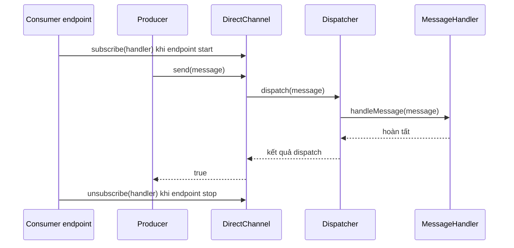
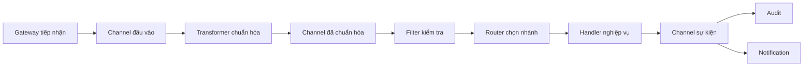

# MessageHandler đăng ký vào channel

Trong module **SPRING_INTEGRATION_CORE**, việc nối channel với thành phần xử lý là nền tảng để thiết kế luồng thông điệp bằng Message, MessageChannel, endpoint, gateway và Java DSL. Transformer, router, filter hay aggregator đều cần một cơ chế nhận message trước khi thực hiện chức năng riêng.

Bài học thuộc chương **Message channel**, tập trung vào câu hỏi: khi gọi `channel.send(message)`, điều gì khiến một `MessageHandler` được gọi? Từ cơ chế đăng ký này, ta sẽ xây dựng luồng đơn giản, quản lý vòng đời consumer, phân biệt cách phân phối message và kiểm thử hành vi xử lý lỗi.

## 1. Phân biệt message, channel, handler và endpoint

Giả sử hệ thống nhận mã đơn hàng `ORD-101`. Producer tạo message chứa mã này rồi gửi vào channel `orders`. Thành phần xử lý đơn hàng được nối với channel để nhận message.

| Thành phần | Trách nhiệm | Ví dụ trong luồng đơn hàng |
| --- | --- | --- |
| `Message<T>` | Mang payload và headers của một lần trao đổi | Payload là `ORD-101`, header `source` là `checkout` |
| `MessageChannel` | Cung cấp điểm gửi message | Producer gọi `orders.send(message)` |
| `MessageHandler` | Xử lý message được giao | Kiểm tra, ghi nhận hoặc chuyển tiếp đơn hàng |
| Consumer endpoint | Nối handler với channel và quản lý cách nhận message | `EventDrivenConsumer` hoặc `PollingConsumer` |
| Producer hoặc gateway | Đưa dữ liệu vào luồng | Dịch vụ checkout hoặc một messaging gateway |

Producer chỉ cần biết channel đầu vào. Cách channel chọn consumer và cách consumer xử lý thuộc về cấu hình luồng.

Một bean `MessageHandler` mới chỉ là một đối tượng có khả năng xử lý. Phải có bước kết nối với channel thì message gửi vào channel mới đến được đối tượng đó.

## 2. Hợp đồng MessageHandler và SubscribableChannel

### 2.1. MessageHandler nhận cả message

`MessageHandler` nằm trong package `org.springframework.messaging`. Hợp đồng chính của nó là:

```java
void handleMessage(Message<?> message) throws MessagingException;
```

Đây là functional interface nên có thể triển khai bằng lambda. Tham số chứa cả payload lẫn headers; kiểu trả về là `void`. Hợp đồng này không định nghĩa việc lấy một giá trị trả về rồi tự gửi sang channel tiếp theo. Xem [Javadoc MessageHandler](https://docs.spring.io/spring-framework/docs/current/javadoc-api/org/springframework/messaging/MessageHandler.html).

Ví dụ một handler chỉ ghi nhận đầu vào:

```java
MessageHandler handler = message -> {
    Object payload = message.getPayload();
    Object source = message.getHeaders().get("source");
    System.out.println("payload=" + payload + ", source=" + source);
};
```

Nếu dùng handler thô như trên, ứng dụng phải tự kiểm soát kiểu payload. Khi muốn Spring ánh xạ payload vào tham số phương thức và quản lý reply, có thể dùng service activator hoặc Java DSL ở các phần sau.

### 2.2. Đăng ký là khả năng của SubscribableChannel

Interface `MessageChannel` cung cấp `send(...)`. Khả năng thêm hoặc gỡ handler nằm ở interface con `SubscribableChannel`:

```java
boolean subscribe(MessageHandler handler);
boolean unsubscribe(MessageHandler handler);
```

Ý nghĩa giá trị trả về:

| Lệnh | `true` | `false` |
| --- | --- | --- |
| `subscribe(handler)` | Handler vừa được thêm | Handler đã được đăng ký |
| `unsubscribe(handler)` | Handler vừa được gỡ | Handler không nằm trong danh sách đăng ký |

Đây là kết quả thay đổi danh sách subscriber, không phải kết quả xử lý một message. Hợp đồng được mô tả trong [Javadoc SubscribableChannel](https://docs.spring.io/spring-framework/docs/current/javadoc-api/org/springframework/messaging/SubscribableChannel.html).

Kiểu khai báo biến cũng ảnh hưởng đến thao tác gọi được:

```java
MessageChannel sendingPort = new DirectChannel();
sendingPort.send(new GenericMessage<>("ORD-101"));

// sendingPort.subscribe(handler); // Không biên dịch: MessageChannel không có subscribe().
```

Khi cần quản lý subscription, hãy nhận `SubscribableChannel` hoặc kiểu channel cụ thể phù hợp. Không ép mọi `MessageChannel` sang `SubscribableChannel`, vì có channel chỉ hỗ trợ polling.

## 3. Điều gì xảy ra khi gửi vào DirectChannel?

Với một handler đã đăng ký, luồng gọi đồng bộ có thể biểu diễn như sau:



`DirectChannel` gọi subscriber trong thread đang gửi message. Vì vậy, khi handler đang chạy đồng bộ, lời gọi `send()` vẫn đang ở trên cùng call stack. Việc đăng ký không tạo thêm worker thread. Xem [Javadoc DirectChannel](https://docs.spring.io/spring-integration/api/org/springframework/integration/channel/DirectChannel.html).

Ví dụ handler gọi một dịch vụ ngoài và mất hai giây để hoàn tất: producer đi qua `DirectChannel` cũng phải chờ phần công việc đó. Thêm nhiều subscriber không tự biến thao tác gửi đơn lẻ thành xử lý song song.

Sơ đồ trên mô tả nhánh thành công, không có interceptor chặn message và không có ranh giới bất đồng bộ ở phía sau handler. Kết quả nghiệp vụ cuối cùng của một luồng dài còn phụ thuộc các bước tiếp theo.

## 4. Ví dụ đăng ký thủ công, gửi message và hủy đăng ký

Ví dụ dưới đây chỉ cần các thư viện Spring Integration Core và Spring Messaging có trên classpath; không cần broker hay Spring ApplicationContext.

```java
import org.springframework.integration.channel.DirectChannel;
import org.springframework.messaging.Message;
import org.springframework.messaging.MessageHandler;
import org.springframework.messaging.support.MessageBuilder;

public class ManualSubscriptionDemo {

    public static void main(String[] args) {
        DirectChannel orders = new DirectChannel();

        MessageHandler orderHandler = message -> {
            if (!(message.getPayload() instanceof String)) {
                throw new IllegalArgumentException("Payload phải là mã đơn hàng dạng String");
            }

            String orderId = (String) message.getPayload();
            String source = message.getHeaders().get("source", String.class);

            System.out.println(
                    "Đã nhận " + orderId
                    + ", source=" + source
                    + ", thread=" + Thread.currentThread().getName());
        };

        boolean added = orders.subscribe(orderHandler);
        System.out.println("Đăng ký lần đầu: " + added);
        System.out.println("Đăng ký lại cùng handler: "
                + orders.subscribe(orderHandler));

        try {
            Message<String> message = MessageBuilder
                    .withPayload("ORD-101")
                    .setHeader("source", "checkout")
                    .build();

            boolean sent = orders.send(message);
            System.out.println("send() trả về: " + sent);
        }
        finally {
            System.out.println("Hủy đăng ký: "
                    + orders.unsubscribe(orderHandler));
        }
    }
}
```

Kết quả dự kiến khi chạy từ thread `main`:

```text
Đăng ký lần đầu: true
Đăng ký lại cùng handler: false
Đã nhận ORD-101, source=checkout, thread=main
send() trả về: true
Hủy đăng ký: true
```

Điểm cần quan sát:

1. Chỉ sau `subscribe(orderHandler)`, channel mới có subscriber xử lý message.
2. Đăng ký lại cùng handler không tạo một bản đăng ký bổ sung.
3. Handler chạy trước khi dòng in kết quả `send()` được thực hiện.
4. `finally` giúp gỡ đúng handler dù xử lý có phát sinh exception.

Hãy giữ tham chiếu tới handler đã đăng ký. Tạo một lambda mới có cùng nội dung không phải cách đáng tin cậy để tìm lại subscriber cũ:

```java
MessageHandler original = message -> System.out.println(message.getPayload());
orders.subscribe(original);

MessageHandler another = message -> System.out.println(message.getPayload());
boolean removedWrongHandler = orders.unsubscribe(another); // false

orders.unsubscribe(original); // Gỡ đúng đối tượng đã thêm.
```

Đăng ký thủ công hữu ích để học cơ chế và viết kiểm thử nhỏ. Trong ứng dụng có Spring container, endpoint giúp quản lý subscription cùng vòng đời ứng dụng.

## 5. Số subscriber không quyết định một mình cách phân phối

Hai channel đều có `subscribe()` nhưng có thể phân phối message khác nhau.

| Loại channel | Cách nối consumer | Phân phối trong điều kiện xử lý thành công | Thread xử lý |
| --- | --- | --- | --- |
| `DirectChannel` | Đăng ký handler | Mỗi message đến một subscriber | Thread gửi |
| `PublishSubscribeChannel` không có executor | Đăng ký handler | Phát tới các subscriber hiện có | Thread gửi, gọi tuần tự |
| `ExecutorChannel` | Đăng ký handler | Mỗi message đến một subscriber | Theo executor được cấu hình |
| `QueueChannel` | Consumer gọi `receive()` | Mỗi lần lấy ra giao message cho một consumer | Thread gọi receive hoặc poller |

Với executor, cách thực thi cụ thể phụ thuộc cấu hình; chẳng hạn executor có thể thực thi ngay trong thread gọi. Không nên chỉ nhìn tên channel để kết luận một bảo đảm về thread.

Sự khác biệt giữa cơ chế push tới subscriber và cơ chế pull bằng `receive()` được trình bày trong [The MessageChannel Interface](https://docs.spring.io/spring-integration/reference/channel/interfaces.html).

### 5.1. DirectChannel: các subscriber cạnh tranh nhận việc

Giả sử đăng ký hai handler xử lý cùng một loại tác vụ:

```java
DirectChannel jobs = new DirectChannel();
jobs.subscribe(message -> System.out.println("worker-A: " + message.getPayload()));
jobs.subscribe(message -> System.out.println("worker-B: " + message.getPayload()));

jobs.send(new GenericMessage<>("JOB-1"));
jobs.send(new GenericMessage<>("JOB-2"));
```

Trong trường hợp đơn giản này, chiến lược round-robin mặc định luân phiên giao việc giữa hai handler. Một message được xử lý thành công sẽ không tiếp tục được phát cho subscriber còn lại.

`DirectChannel` mặc định cũng bật failover: nếu handler được chọn ném exception, dispatcher có thể thử handler khác. Do đó, một message có thể đã được một handler thử xử lý rồi mới đến handler tiếp theo. Có thể tắt cơ chế này:

```java
DirectChannel jobs = new DirectChannel();
jobs.setFailover(false);
```

Cấu hình mặc định và tùy chọn được mô tả trong [DirectChannel Configuration](https://docs.spring.io/spring-integration/reference/channel/configuration.html#channel-configuration-directchannel).

Với tác vụ có tác dụng phụ, chẳng hạn gọi thanh toán, cần xét tình huống handler đầu đã tạo tác dụng phụ rồi mới ném lỗi. Thử handler tiếp theo có thể lặp lại tác dụng phụ đó. Thiết kế khóa nghiệp vụ hoặc cơ chế idempotency phải giải quyết tình huống cụ thể; việc đăng ký handler không cung cấp bảo đảm exactly-once.

### 5.2. PublishSubscribeChannel: các subscriber nhận cùng sự kiện

Nếu yêu cầu là gửi một sự kiện cho cả audit và notification, có thể dùng:

```java
PublishSubscribeChannel orderEvents = new PublishSubscribeChannel();

orderEvents.subscribe(message ->
        System.out.println("audit: " + message.getPayload()));

orderEvents.subscribe(message ->
        System.out.println("notification: " + message.getPayload()));

orderEvents.send(new GenericMessage<>("ORDER_ACCEPTED"));
```

Khi cả hai handler đều thành công, cả hai đều được gọi. Với constructor không truyền executor, chúng chạy tuần tự trong thread gửi. Nếu một handler ném lỗi, việc các handler sau có tiếp tục chạy hay không còn phụ thuộc cấu hình xử lý failure.

Channel này không lưu lịch sử sự kiện để phát lại cho subscriber đăng ký muộn. Với cấu hình mặc định thông thường cho phép không có subscriber, `send()` có thể vẫn thành công dù chưa có handler nào nhận message. Xem [Message Channel Implementations](https://docs.spring.io/spring-integration/reference/channel/implementations.html).

Khi cần từ chối việc gửi vào một publish-subscribe channel không có người nhận, có thể chọn constructor yêu cầu subscriber:

```java
PublishSubscribeChannel requiredEvents = new PublishSubscribeChannel(true);
```

`requireSubscribers` kiểm soát trường hợp không có subscriber; `minSubscribers` là cấu hình ngưỡng nhận message liên quan đến kết quả dispatch. Hai cấu hình này có ý nghĩa riêng, được mô tả trong [Javadoc PublishSubscribeChannel](https://docs.spring.io/spring-integration/api/org/springframework/integration/channel/PublishSubscribeChannel.html).

Trong ví dụ đơn hàng, hai thao tác bắt buộc phải chạy theo thứ tự “ghi đơn trước, thông báo sau” nên được nối thành các bước của luồng. Dùng nhiều subscriber trên `DirectChannel` không thể hiện yêu cầu tuần tự đó.

## 6. EventDrivenConsumer quản lý subscription trong Spring

Một consumer endpoint kết nối `SubscribableChannel` với `MessageHandler`. Với `EventDrivenConsumer`, thao tác start đăng ký handler, còn stop hủy đăng ký. Có thể xem cơ chế trực tiếp trong [mã nguồn EventDrivenConsumer](https://github.com/spring-projects/spring-integration/blob/v7.1.1/spring-integration-core/src/main/java/org/springframework/integration/endpoint/EventDrivenConsumer.java).

Ví dụ cấu hình đầy đủ dưới đây dùng Spring ApplicationContext. Mỗi lớp cấu hình trong bài là một phương án độc lập, trừ khi có hướng dẫn kết hợp cụ thể.

```java
import org.springframework.beans.factory.annotation.Qualifier;
import org.springframework.context.annotation.AnnotationConfigApplicationContext;
import org.springframework.context.annotation.Bean;
import org.springframework.context.annotation.Configuration;
import org.springframework.integration.channel.DirectChannel;
import org.springframework.integration.config.EnableIntegration;
import org.springframework.integration.endpoint.EventDrivenConsumer;
import org.springframework.messaging.MessageHandler;
import org.springframework.messaging.SubscribableChannel;
import org.springframework.messaging.support.GenericMessage;

@Configuration
@EnableIntegration
public class ManagedSubscriptionDemo {

    @Bean
    public DirectChannel orders() {
        return new DirectChannel();
    }

    @Bean
    public MessageHandler orderHandler() {
        return message ->
                System.out.println("Xử lý đơn: " + message.getPayload());
    }

    @Bean
    public EventDrivenConsumer orderConsumer(
            @Qualifier("orders") SubscribableChannel input,
            @Qualifier("orderHandler") MessageHandler handler) {

        return new EventDrivenConsumer(input, handler);
    }

    public static void main(String[] args) {
        try (AnnotationConfigApplicationContext context =
                new AnnotationConfigApplicationContext(ManagedSubscriptionDemo.class)) {

            DirectChannel orders = context.getBean("orders", DirectChannel.class);
            EventDrivenConsumer endpoint =
                    context.getBean("orderConsumer", EventDrivenConsumer.class);

            System.out.println("Consumer đang chạy: " + endpoint.isRunning());
            System.out.println("Subscribers: " + orders.getSubscriberCount());

            orders.send(new GenericMessage<>("ORD-201"));

            endpoint.stop();
            System.out.println("Sau stop: " + orders.getSubscriberCount());

            endpoint.start();
            orders.send(new GenericMessage<>("ORD-202"));
        }
    }
}
```

Ứng dụng có dependency `spring-integration-core` và Spring Context tương thích; chọn phiên bản bằng BOM hoặc cơ chế quản lý dependency của dự án. `@EnableIntegration` bật hạ tầng cấu hình Spring Integration trong ví dụ Java configuration này.

Sau khi context khởi tạo hoàn tất, consumer tự khởi động theo cấu hình lifecycle mặc định và channel có một subscriber. Khi gọi `stop()`, subscriber bị gỡ; `start()` kết nối lại. Đóng context cũng dừng các endpoint do context quản lý.

Nếu chỉ khai báo hai bean `orders` và `orderHandler`, cấu hình vẫn thiếu sự kết nối. Tên bean handler không tự suy ra input channel.

Không vừa đăng ký thủ công vừa để endpoint sở hữu cùng subscription. Hai nơi cùng quản lý sẽ khiến vòng đời khó dự đoán: một nơi có thể gỡ subscription mà nơi kia vẫn cho rằng mình đang sở hữu.

Việc hủy đăng ký cũng không nên được hiểu là hủy cưỡng bức mọi lần xử lý đang chạy. Khi cần dừng hệ thống an toàn, producer, endpoint và tác vụ đang thực thi phải có chính sách phối hợp riêng.

## 7. Kết nối bằng @ServiceActivator

Thay vì trực tiếp tạo `EventDrivenConsumer`, ta có thể khai báo phương thức nghiệp vụ và để framework tạo thành phần xử lý cùng endpoint.

```java
import org.springframework.context.annotation.Bean;
import org.springframework.context.annotation.Configuration;
import org.springframework.integration.annotation.ServiceActivator;
import org.springframework.integration.channel.DirectChannel;
import org.springframework.integration.config.EnableIntegration;
import org.springframework.messaging.handler.annotation.Header;

@Configuration
@EnableIntegration
public class AnnotatedOrderConfiguration {

    @Bean
    public DirectChannel orders() {
        return new DirectChannel();
    }

    @Bean
    public OrderService orderService() {
        return new OrderService();
    }

    public static class OrderService {

        @ServiceActivator(inputChannel = "orders")
        public void accept(
                String orderId,
                @Header(name = "source", required = false) String source) {

            System.out.println("orderId=" + orderId + ", source=" + source);
        }
    }
}
```

Trong ví dụ:

- `OrderService` là bean do Spring quản lý.
- `inputChannel = "orders"` chỉ rõ channel đầu vào.
- Spring ánh xạ payload vào `orderId` và header `source` vào tham số tương ứng.
- Phương thức trả về `void`, nên đây là điểm xử lý không tạo reply.

Với channel đầu vào là `DirectChannel`, consumer thông thường hoạt động theo cơ chế event-driven. Một lựa chọn khác là đặt `@Bean` và `@ServiceActivator(inputChannel = "...")` trên phương thức tạo bean `MessageHandler`, để nối trực tiếp handler bean đó với channel.

Cơ chế ánh xạ phương thức và lựa chọn output được trình bày trong [Service Activator](https://docs.spring.io/spring-integration/reference/service-activator.html).

Nếu phương thức nghiệp vụ trả về giá trị, framework có thể dùng một handler hỗ trợ tạo reply để gửi kết quả tới output channel hoặc địa chỉ reply phù hợp. Điều này không thay đổi chữ ký `void` của `MessageHandler.handleMessage(...)`: công việc gửi output nằm bên trong implementation mà framework sử dụng.

## 8. Java DSL khai báo cùng mối nối bằng .handle()

Java DSL cho phép mô tả channel đầu vào và bước xử lý trong một `IntegrationFlow`. Ví dụ sau chuẩn hóa mã đơn rồi chuyển đến một handler kết thúc luồng.

```java
import java.util.Locale;

import org.springframework.beans.factory.annotation.Qualifier;
import org.springframework.context.annotation.Bean;
import org.springframework.context.annotation.Configuration;
import org.springframework.integration.channel.DirectChannel;
import org.springframework.integration.config.EnableIntegration;
import org.springframework.integration.dsl.IntegrationFlow;
import org.springframework.messaging.MessageHandler;

@Configuration
@EnableIntegration
public class OrderDslConfiguration {

    @Bean
    public DirectChannel orders() {
        return new DirectChannel();
    }

    @Bean
    public MessageHandler orderSink() {
        return message ->
                System.out.println("Mã đơn chuẩn hóa: " + message.getPayload());
    }

    @Bean
    public IntegrationFlow normalizeOrders(
            @Qualifier("orders") DirectChannel input,
            @Qualifier("orderSink") MessageHandler sink) {

        return IntegrationFlow.from(input)
                .handle(String.class,
                        (payload, headers) ->
                                payload.trim().toUpperCase(Locale.ROOT))
                .handle(sink)
                .get();
    }
}
```

Gửi payload `"  ord-301  "` vào bean `orders` sẽ khiến sink nhận `"ORD-301"`.

Hai overload trong ví dụ có vai trò khác nhau:

| Cách dùng | Đầu vào callback | Kết quả |
| --- | --- | --- |
| `.handle(String.class, (payload, headers) -> ...)` | Payload đã được ánh xạ và headers | Giá trị trả về có thể tạo message cho bước tiếp |
| `.handle(sink)` với sink là `MessageHandler` thô ở trên | Toàn bộ `Message<?>` | Sink trả về `void` và kết thúc việc xử lý trong ví dụ |

DSL đăng ký các endpoint của flow với Spring; không cần gọi `input.subscribe(sink)` thủ công. Xem [Service Activators and the .handle() method](https://docs.spring.io/spring-integration/reference/dsl/java-handle.html).

Trong flow này, sink không phải subscriber trực tiếp của channel `orders`: bước chuẩn hóa nhận đầu vào trước, rồi framework chuyển kết quả sang bước sink. Sự khác biệt đó giúp đọc đúng sơ đồ khi flow có nhiều endpoint.

Về mục đích nghiệp vụ, chuẩn hóa dữ liệu cũng có thể biểu diễn bằng `.transform(...)`. Ví dụ dùng `.handle(...)` để minh họa cách framework kết nối các hình thức handler.

### Vì sao gateway có thể chờ mãi dù handler đã chạy?

Nếu một gateway có phương thức yêu cầu giá trị trả về, nhánh xử lý phải tạo reply và gửi về đích reply phù hợp. Một sink chỉ in log rồi kết thúc không đáp ứng yêu cầu đó; gateway có thể chờ đến timeout.

Khi thiết kế gateway, cần quyết định ngay phương thức là gửi một chiều hay request-reply. Sau đó kiểm tra đường đi của reply, thay vì chỉ kiểm tra handler đã được gọi.

## 9. QueueChannel cần PollingConsumer

`QueueChannel` triển khai `PollableChannel`: message được lấy ra qua `receive()`. Nó không có thao tác `subscribe(handler)`.

```java
QueueChannel backlog = new QueueChannel(100);

// backlog.subscribe(handler); // Không biên dịch.
```

Để dùng cùng một logic xử lý với đầu vào là queue, cần consumer chủ động lấy message. Spring Integration cung cấp `PollingConsumer`; điểm khác biệt này được giải thích trong [Message Endpoints](https://docs.spring.io/spring-integration/reference/endpoint.html).

Ví dụ khai báo poller ngay trên service activator:

```java
import org.springframework.context.annotation.Bean;
import org.springframework.context.annotation.Configuration;
import org.springframework.integration.annotation.Poller;
import org.springframework.integration.annotation.ServiceActivator;
import org.springframework.integration.channel.QueueChannel;
import org.springframework.integration.config.EnableIntegration;
import org.springframework.messaging.MessageHandler;

@Configuration
@EnableIntegration
public class QueuedOrderConfiguration {

    @Bean
    public QueueChannel backlog() {
        return new QueueChannel(100);
    }

    @Bean
    @ServiceActivator(
            inputChannel = "backlog",
            poller = @Poller(fixedDelay = "200", maxMessagesPerPoll = "5"))
    public MessageHandler queuedOrderHandler() {
        return message ->
                System.out.println("Lấy từ backlog: " + message.getPayload());
    }
}
```

`fixedDelay = "200"` cấu hình khoảng nghỉ theo mili giây giữa các chu kỳ polling; `maxMessagesPerPoll = "5"` giới hạn số message xử lý trong một chu kỳ. Đây không phải cam kết mỗi đơn luôn được xử lý trong 200 ms: độ trễ còn phụ thuộc backlog, thời gian chạy handler và scheduler.

Nếu không khai báo poller trực tiếp, consumer dùng đầu vào pollable cần một cấu hình poller mặc định phù hợp. Xem [Using the @Poller Annotation](https://docs.spring.io/spring-integration/reference/configuration/annotations.html#using-the-poller-annotation).

Producer có thể gửi vào queue khi chưa có consumer đang chạy, miễn queue còn chỗ. Việc gửi thành công lúc này chỉ xác nhận message đã vào queue; xử lý nghiệp vụ xảy ra khi poller lấy message. Queue mặc định lưu trong bộ nhớ, nên muốn lưu bền qua sự cố phải thiết kế message store hoặc cơ chế vận chuyển phù hợp.

## 10. Luồng lỗi khi handler đã được đăng ký

Có subscriber mới chỉ giải quyết được đường đi đến handler. Kết quả xử lý có thể thành công hoặc phát sinh lỗi.

### 10.1. Lỗi đồng bộ đi về phía gọi send()

Ví dụ một handler từ chối đơn hàng:

```java
import org.springframework.integration.channel.DirectChannel;
import org.springframework.messaging.MessageHandlingException;
import org.springframework.messaging.support.GenericMessage;

DirectChannel orders = new DirectChannel();
orders.setFailover(false);

orders.subscribe(message -> {
    throw new MessageHandlingException(message, "Đơn hàng không hợp lệ");
});

try {
    orders.send(new GenericMessage<>("ORD-INVALID"));
}
catch (MessageHandlingException ex) {
    System.out.println("Producer nhận lỗi: " + ex.getMessage());
}
```

Đây là đoạn mã trong thân một phương thức; các import đặt ở đầu tệp Java khi áp dụng.

Vì handler chạy đồng bộ trên `DirectChannel`, exception đi ngược về producer. Chỉ thêm header `errorChannel` vào message không tự khiến lời gọi đồng bộ này chuyển toàn bộ lỗi sang channel khác.

### 10.2. Lỗi sau ranh giới bất đồng bộ cần đường báo lỗi riêng

Nếu producer đã gửi vào queue hoặc đã bàn giao tác vụ cho executor rồi tiếp tục công việc khác, lỗi phát sinh sau đó không thể được ném ngược vào call stack đã kết thúc của producer.

Với các tác vụ bất đồng bộ do hạ tầng Spring Integration quản lý, cơ chế publish lỗi có thể tạo `ErrorMessage` và gửi tới `errorChannel` của request, hoặc channel lỗi mặc định tùy cấu hình. Muốn áp dụng cơ chế này cho executor hay scheduler tự tạo, phải cấu hình error handler tương ứng.

Phân biệt này được mô tả trong [Error Handling](https://docs.spring.io/spring-integration/reference/error-handling.html).

### 10.3. DirectChannel không có subscriber là lỗi phân phối

Khi gửi vào `DirectChannel` không có handler, dispatcher không có đích xử lý. Với implementation Spring Integration, lỗi dispatch được bọc thành `MessageDeliveryException`; thông báo thường chứa `Dispatcher has no subscribers`. Xem [mã nguồn AbstractSubscribableChannel](https://github.com/spring-projects/spring-integration/blob/v7.1.1/spring-integration-core/src/main/java/org/springframework/integration/channel/AbstractSubscribableChannel.java).

Các nguyên nhân cần kiểm tra gồm:

- Endpoint chưa start hoặc đã stop.
- Chỉ có handler bean mà chưa có cấu hình nối input channel.
- Producer và consumer dùng hai instance channel khác nhau.
- Sai tên channel trong annotation hoặc DSL.
- Producer gửi quá sớm, trước khi consumer sẵn sàng.

Đừng dựa vào `send(message, timeout)` để giới hạn thời gian chạy nghiệp vụ trên `DirectChannel`. Timeout của thao tác channel không phải cơ chế tự ngắt handler đồng bộ đang xử lý.

## 11. Kiểm thử hành vi đăng ký và phân phối

Các kiểm thử sau dùng JUnit Jupiter và không cần khởi động Spring context. Chúng kiểm tra những điều có thể quan sát từ bên ngoài: số lần gọi, thread xử lý, subscription và lỗi trả về.

Đây là mã kiểm thử tham khảo để đưa vào dự án thực hành có dependency test tương thích.

```java
import java.util.concurrent.atomic.AtomicInteger;
import java.util.concurrent.atomic.AtomicReference;

import org.junit.jupiter.api.Test;
import org.springframework.integration.channel.DirectChannel;
import org.springframework.integration.channel.PublishSubscribeChannel;
import org.springframework.messaging.MessageDeliveryException;
import org.springframework.messaging.MessageHandler;
import org.springframework.messaging.MessageHandlingException;
import org.springframework.messaging.support.GenericMessage;

import static org.junit.jupiter.api.Assertions.*;

class HandlerSubscriptionTest {

    @Test
    void repeatedRegistrationDoesNotDuplicateDelivery() {
        DirectChannel channel = new DirectChannel();
        AtomicInteger calls = new AtomicInteger();
        MessageHandler handler = message -> calls.incrementAndGet();

        assertTrue(channel.subscribe(handler));
        assertFalse(channel.subscribe(handler));

        assertTrue(channel.send(new GenericMessage<>("ORD-1")));
        assertEquals(1, calls.get());

        assertTrue(channel.unsubscribe(handler));
        assertFalse(channel.unsubscribe(handler));
        assertEquals(0, channel.getSubscriberCount());

        assertThrows(MessageDeliveryException.class,
                () -> channel.send(new GenericMessage<>("ORD-2")));
        assertEquals(1, calls.get());
    }

    @Test
    void directChannelUsesTheSendingThread() {
        DirectChannel channel = new DirectChannel();
        Thread sender = Thread.currentThread();
        AtomicReference<Thread> handlerThread = new AtomicReference<>();

        channel.subscribe(message ->
                handlerThread.set(Thread.currentThread()));

        assertTrue(channel.send(new GenericMessage<>("ORD-3")));
        assertSame(sender, handlerThread.get());
    }

    @Test
    void directChannelChoosesOneSuccessfulHandlerPerMessage() {
        DirectChannel channel = new DirectChannel();
        AtomicInteger first = new AtomicInteger();
        AtomicInteger second = new AtomicInteger();

        channel.subscribe(message -> first.incrementAndGet());
        channel.subscribe(message -> second.incrementAndGet());

        channel.send(new GenericMessage<>("ORD-4"));

        assertEquals(1, first.get() + second.get());
    }

    @Test
    void publishSubscribeChannelInvokesBothSuccessfulHandlers() {
        PublishSubscribeChannel channel = new PublishSubscribeChannel();
        AtomicInteger first = new AtomicInteger();
        AtomicInteger second = new AtomicInteger();

        channel.subscribe(message -> first.incrementAndGet());
        channel.subscribe(message -> second.incrementAndGet());

        assertTrue(channel.send(new GenericMessage<>("ORDER_ACCEPTED")));

        assertEquals(1, first.get());
        assertEquals(1, second.get());
    }

    @Test
    void synchronousHandlerFailureReachesTheSender() {
        DirectChannel channel = new DirectChannel();
        channel.setFailover(false);

        channel.subscribe(message -> {
            throw new MessageHandlingException(message, "Bị từ chối");
        });

        assertThrows(MessageHandlingException.class,
                () -> channel.send(new GenericMessage<>("ORD-INVALID")));
    }
}
```

Kiểm thử thứ ba chỉ yêu cầu tổng số lần gọi bằng một. Nó không gắn hành vi nghiệp vụ với việc handler nào được chọn đầu tiên.

Để kiểm tra cấu hình Spring, có thể dùng `ManagedSubscriptionDemo` trong một kiểm thử context riêng: lấy bean `orderConsumer`, xác nhận có một subscriber, gọi `stop()` và xác nhận còn không, rồi `start()` và xác nhận handler nhận message trở lại.

Với luồng dùng executor hoặc poller, nên chờ một tín hiệu có giới hạn thời gian, chẳng hạn `CountDownLatch` hoặc nhận từ output queue với timeout. Kiểm tra ngay sau `send()` có thể xảy ra trước khi handler chạy xong; ngủ một khoảng cố định cũng không chứng minh được điều kiện cần kiểm tra.

## 12. Các lỗi thiết kế thường gặp

| Hiện tượng | Cách hiểu hoặc cấu hình sai | Cách xử lý |
| --- | --- | --- |
| Có handler bean nhưng không nhận được message | Chưa nối bean với input channel | Dùng endpoint, annotation hoặc DSL |
| `subscribe()` không biên dịch | Biến chỉ có kiểu `MessageChannel`, hoặc đối tượng là queue | Chọn đúng interface; dùng polling cho queue |
| Chỉ một trong hai handler chạy | Dùng `DirectChannel` cho yêu cầu broadcast | Chọn channel phát sự kiện hoặc thiết kế flow phù hợp |
| Cùng nghiệp vụ chạy nhiều lần | Tạo nhiều endpoint hoặc nhiều instance handler | Rà soát cấu hình và quyền sở hữu subscription |
| Đã unsubscribe nhưng handler cũ vẫn còn | Truyền một đối tượng handler mới | Giữ tham chiếu hoặc để endpoint quản lý |
| `send()` chậm dù đã subscribe | Handler đồng bộ thực hiện tác vụ chậm | Xác định ranh giới xử lý và chính sách executor/queue |
| Gateway timeout dù log đã xuất hiện | Nhánh xử lý không tạo reply | Thiết kế đường reply và loại phương thức gateway |
| Producer không nhận exception sau khi gửi vào queue | Lỗi xảy ra ở thread poller sau đó | Theo dõi đường lỗi của consumer |

Một lỗi dễ bỏ sót là tạo hai đối tượng Java khác nhau:

```java
DirectChannel channelUsedByProducer = new DirectChannel();
DirectChannel channelUsedByConsumer = new DirectChannel();

channelUsedByConsumer.subscribe(handler);
channelUsedByProducer.send(message); // Channel này không có subscriber.
```

Trong Spring configuration, hãy inject channel bean bằng tên hoặc qualifier rõ ràng. Cùng cách đặt tên biến hay cùng loại class không làm hai instance trở thành một channel.

## 13. Liên hệ với các mẫu tích hợp trong module

Cơ chế nhận message không thay thế chức năng nghiệp vụ của endpoint:

| Thành phần | Công việc sau khi nhận message |
| --- | --- |
| Transformer | Chuyển đổi nội dung hoặc kiểu dữ liệu |
| Router | Quyết định channel đích |
| Filter | Quyết định cho qua hoặc loại bỏ |
| Aggregator | Gom các message tương quan và phát kết quả khi đủ điều kiện |
| Service activator | Gọi logic ứng dụng |
| Gateway | Cung cấp điểm vào hoặc điểm trao đổi với hợp đồng phù hợp |

Có thể hình dung luồng đặt hàng theo các bước:



Mỗi đường nối cần một cơ chế channel và endpoint thích hợp. Nếu channel là subscribable, endpoint nhận theo kiểu event-driven; nếu channel là pollable, endpoint cần polling. Những chức năng như gom nhóm, định tuyến hay xử lý lỗi vẫn cần cấu hình riêng.

Với một nhánh đơn hàng có yêu cầu trả kết quả, cần bổ sung đường reply về gateway. Với một nhánh có thể chạy lại sau lỗi, cần xác định khóa nhận diện nghiệp vụ và hành vi khi nhận lặp. Hai quyết định đó bắt đầu từ việc hiểu message được giao cho handler nào, ở thread nào và vào thời điểm nào.

## 14. Bài thực hành

Xây dựng luồng nhận mã đơn hàng từ một producer và thực hiện lần lượt:

1. Tạo `DirectChannel`, đăng ký một handler và xác nhận handler nhận được cả payload lẫn header `source`.
2. Gửi hai message với hai handler thành công trên cùng `DirectChannel`; ghi lại số lần mỗi handler được gọi.
3. Đổi đầu vào thành `PublishSubscribeChannel` và quan sát cả hai handler nhận từng message.
4. Đưa logic xử lý vào `@ServiceActivator`, để Spring sở hữu vòng đời endpoint.
5. Dùng `QueueChannel` và một poller; phân biệt thời điểm gửi thành công với thời điểm xử lý hoàn tất.
6. Cho handler ném lỗi và quan sát nơi lỗi xuất hiện ở nhánh đồng bộ và nhánh polling.

Kết quả thực hành cần thể hiện được bốn điều: channel dùng kiểu nhận nào, ai quản lý subscription, mỗi message được giao cho những handler nào và bên nào quan sát được lỗi. Đó là cơ sở để tiếp tục thiết kế và kiểm thử các luồng Spring Integration có nhiều bước.
